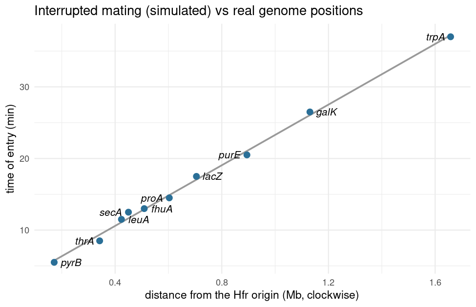

## Goal

By the end of this exercise you should be able to:

- turn interrupted-mating times into a gene order and distances in minutes;
- join the markers to real *E. coli* gene positions with `left_join`, and handle the **circular** chromosome with the modulo operator `%%`;
- fit minutes against megabases with `lm`, and use the fit to predict when other genes would enter.

## Before you start

This page builds on the by-hand part of the [Exercise](exercise.qmd), so do that first. You need the packages readr, dplyr and ggplot2. Download the two data files and save them in a `data/` folder of your R project:

- [hfr_entry.csv](data/hfr_entry.csv): times of entry for ten markers in an interrupted-mating experiment. **These are simulated teaching data**, not a real experiment: they were computed from the real gene positions for a hypothetical Hfr whose origin of transfer lies near 4 300 000 bp and which transfers towards increasing coordinates, with some random noise added. The comment lines at the top of the file say so.
- [ecoli_genes.csv](data/ecoli_genes.csv): **real** positions of 18 classic mapping markers in *E. coli* K-12 MG1655 (chromosome NC_000913.3, 4 641 652 bp), from NCBI Gene, retrieved 2026-11-20. Each classic marker (`lac`, `str`, …) is matched with one gene (*lacZ*, *rpsL*, …). See [data/README.md](data/README.md).

```r
library(readr)
library(dplyr)
library(ggplot2)
```

## Tasks

This unit reuses two things you already know: [`left_join`](https://dplyr.tidyverse.org/reference/mutate-joins.html) from Part 4, and [`lm`](https://rdrr.io/r/stats/lm.html) from 5KE232. One small new piece is the **modulo operator** [`%%`](https://rdrr.io/r/base/Arithmetic.html): `a %% b` is the remainder after dividing `a` by `b`, so `(x - origin) %% genome_length` is the distance from the origin **going round the circle**, even when the gene's coordinate is smaller than the origin's.

**R1. (order and distances)** Read `hfr_entry.csv`. The file starts with comment lines, which `comment = "#"` skips. Sort the markers by time of entry and add the gap to the previous marker with [`lag()`](https://dplyr.tidyverse.org/reference/lead-lag.html). What is the gene order? Which two markers are closest?

```r
hfr <- read_csv("data/hfr_entry.csv", comment = "#", show_col_types = FALSE)
hfr_map <- hfr |>
  arrange(time_of_entry_min) |>
  mutate(gap_min = time_of_entry_min - lag(time_of_entry_min))
hfr_map
paste(hfr_map$marker, collapse = " - ")
```

**R2. (join to the genome)** Read `ecoli_genes.csv` and join it to `hfr_map` by the column `marker`. Then compute each gene's distance from the Hfr origin (4 300 000 bp) in Mb, going in the direction of transfer (increasing coordinates) and round the circle. Why does *thrA*, at 337 bp, come out at 0.342 Mb and not at a negative distance?

```r
genes <- read_csv("data/ecoli_genes.csv", show_col_types = FALSE)
genome_length <- 4641652
origin <- 4300000

both <- hfr_map |>
  left_join(genes, by = "marker") |>
  mutate(dist_mb = ((start - origin) %% genome_length) / 1e6)
both |> select(marker, gene, time_of_entry_min, start, dist_mb)
```

**R3. (minutes against megabases)** Fit a straight line of time of entry on distance with `lm`. What are the slope (minutes per Mb) and the intercept? Turn the slope into kb per minute. Then plot the points with the fitted line and gene labels.

```r
fit <- lm(time_of_entry_min ~ dist_mb, data = both)
coef(fit)
summary(fit)$r.squared
1000 / coef(fit)[["dist_mb"]]     # kb per minute

# labels alternately right and left of the points, so close neighbours do not overlap
both <- both |> mutate(label_hjust = if_else(row_number() %% 2 == 0, 1.3, -0.3))

ggplot(both, aes(x = dist_mb, y = time_of_entry_min)) +
  geom_smooth(method = "lm", formula = y ~ x, se = FALSE, colour = "grey60", linewidth = 0.8) +
  geom_point(size = 2.5, colour = "#2a6f97") +
  geom_text(aes(label = gene, hjust = label_hjust), fontface = "italic", size = 3.5) +
  labs(x = "distance from the Hfr origin (Mb, clockwise)",
       y = "time of entry (min)",
       title = "Interrupted mating (simulated) vs real genome positions") +
  theme_minimal()
```

**R4. (predict)** How long would this Hfr need to transfer the whole chromosome (use the slope only)? Use [`predict()`](https://rdrr.io/r/stats/predict.lm.html) to estimate when *his* and *str* would enter. Why is *str* a good counterselection marker for this Hfr, and why would you rarely see *his*^+^ recombinants in practice?

```r
genome_length / 1e6 * coef(fit)[["dist_mb"]]   # minutes for the whole genome (without the lag)
far <- genes |>
  filter(marker %in% c("his", "str")) |>
  mutate(dist_mb = ((start - origin) %% genome_length) / 1e6)
far |>
  mutate(predicted_min = predict(fit, newdata = far)) |>
  select(marker, gene, dist_mb, predicted_min)
```

**R5. (the minute map)** Convert every gene in `ecoli_genes.csv` to map minutes, 100 × start / genome length, and print the table. Where is the origin of our Hfr, in minutes? Check two or three of the values against the classical map positions you know from the lecture (*lac* ≈ 8, *trp* ≈ 28, *his* ≈ 45 min).

```r
genes |>
  mutate(map_min = round(100 * start / genome_length, 1)) |>
  select(marker, gene, start, strand, map_min) |>
  print(n = Inf)
100 * origin / genome_length
```

## Solutions

::: {.callout-note collapse="true" title="Solutions: In R"}

All output below is from `Rscript --vanilla` run in the unit folder. Messages from loading packages are not shown.

**R1.**

```
# A tibble: 10 × 3
   marker time_of_entry_min gap_min
   <chr>              <dbl>   <dbl>
 1 pyr                  5.5    NA
 2 thr                  8.5     3
 3 leu                 11.5     3
 4 azi                 12.5     1
 5 ton                 13       0.5
 6 pro                 14.5     1.5
 7 lac                 17.5     3
 8 pur                 20.5     3
 9 gal                 26.5     6
10 trp                 37      10.5
[1] "pyr - thr - leu - azi - ton - pro - lac - pur - gal - trp"
```

The order is **pyr – thr – leu – azi – ton – pro – lac – pur – gal – trp**. The first gap is `NA`, because the first marker has no previous marker. *azi* and *ton* are closest (0.5 min, about 23 kb). With times rounded to 0.5 min and some noise, very close markers can even swap order; that is why fine mapping uses cotransduction instead.

**R2.**

```
# A tibble: 10 × 5
   marker gene  time_of_entry_min   start dist_mb
   <chr>  <chr>             <dbl>   <dbl>   <dbl>
 1 pyr    pyrB                5.5 4471460   0.171
 2 thr    thrA                8.5     337   0.342
 3 leu    leuA               11.5   81958   0.424
 4 azi    secA               12.5  108279   0.450
 5 ton    fhuA               13    167484   0.509
 6 pro    proA               14.5  261503   0.603
 7 lac    lacZ               17.5  363231   0.705
 8 pur    purE               20.5  552591   0.894
 9 gal    galK               26.5  788831   1.13
10 trp    trpA               37   1316416   1.66
```

337 − 4 300 000 is negative, but the chromosome is a circle: going forward from the origin, you pass the end of the sequence (4 641 652, which is the same point as 0) and reach *thrA* after 4 641 652 − 4 300 000 + 337 = 341 989 bp. `%%` does exactly this: `(-4299663) %% 4641652` is 341 989. The real gene order from the genome is the same as the order from the entry times.

**R3.**

```
(Intercept)     dist_mb
   2.117787   21.173664
[1] 0.9966286
[1] 47.22848
```

{width="80%" fig-align="center"}

The slope is **21.2 min per Mb**, so about **47 kb per minute** (the textbook value is ~46 kb per minute, from 4.64 Mb in 100 min). R² = 0.997: entry time is almost exactly proportional to DNA length, which is why the minute map and the base-pair map agree so well. The intercept, **2.1 min**, is the time before the first DNA arrives: the cells need to pair up and start transfer. (The data were simulated with a 1.5 min lag; the fit recovers it roughly.)

**R4.**

```
[1] 98.28078
# A tibble: 2 × 4
  marker gene  dist_mb predicted_min
  <chr>  <chr>   <dbl>         <dbl>
1 his    hisG     2.43          53.6
2 str    rpsL     3.82          82.9
```

The whole chromosome would take about **98 min**, close to the textbook 100 min. *his* would enter at about **54 min** and *str* at about **83 min**. Mating pairs break apart at random long before that, so recombinants for *his* are rare (the gradient of transfer), and *str*^s^ from the donor almost never reaches the recipient: streptomycin kills the donors but spares the recombinant recipients. To map *his* you would use a different Hfr, whose origin is near *his*.

**R5.**

```
# A tibble: 18 × 5
   marker gene    start strand map_min
   <chr>  <chr>   <dbl> <chr>    <dbl>
 1 thr    thrA      337 +          0
 2 leu    leuA    81958 -          1.8
 3 azi    secA   108279 +          2.3
 4 ton    fhuA   167484 +          3.6
 5 pro    proA   261503 +          5.6
 6 lac    lacZ   363231 -          7.8
 7 pur    purE   552591 -         11.9
 8 gal    galK   788831 -         17
 9 trp    trpA  1316416 -         28.4
10 his    hisG  2090192 +         45
11 thy    thyA  2964361 -         63.9
12 str    rpsL  3474178 -         74.8
13 mal    malT  3553085 +         76.5
14 xyl    xylA  3729443 -         80.3
15 ilv    ilvC  3957970 +         85.3
16 met    metB  4128672 +         88.9
17 arg    argE  4153696 -         89.5
18 pyr    pyrB  4471460 -         96.3
[1] 92.63943
```

Our Hfr's origin is at **92.6 min**, between *arg* (89.5) and *pyr* (96.3), which is why *pyr* enters first. *lac* (7.8), *trp* (28.4) and *his* (45.0) agree with the classical map to within a minute. Genes are found on both strands (`+` and `-`); the strand does not matter for mapping by conjugation, which transfers both strands' genes together.
:::

## Where this leads

The same `left_join` + `lm` pattern returns in Part 7, where heritability is a regression of offspring on parents. Next, in **Organelle inheritance**, you go back to `rbinom` and `replicate` (from the pedigree unit) to simulate the mitochondrial bottleneck.
