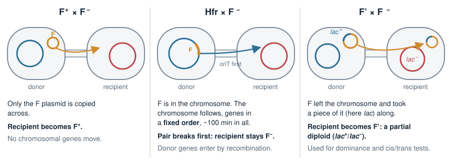
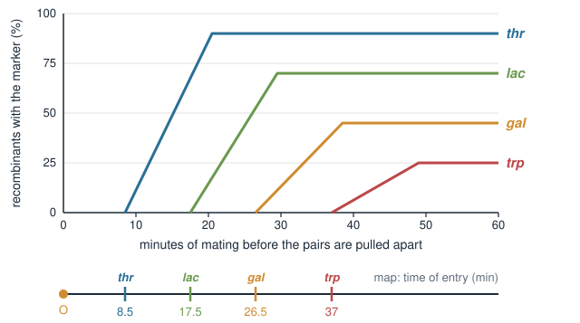
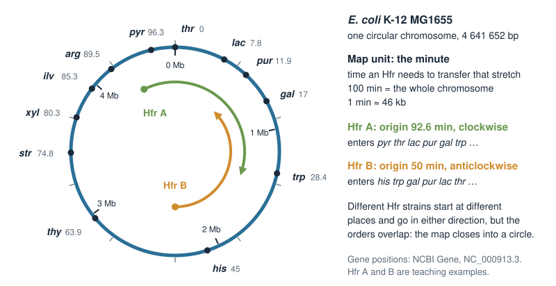
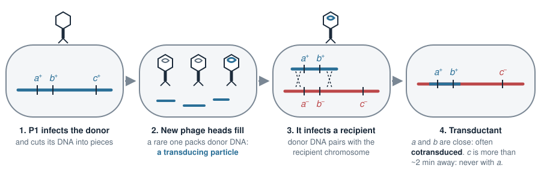

## About this lecture

**Recap of 5MO103** (*Microbiology and basic molecular biology*). There you met the three ways bacteria exchange DNA. Today we look at them **through the lens of genetics**: how they were used to map genes on the bacterial chromosome, and which mutations made that possible.

- Bacterial **mutants**: auxotrophs, resistance markers, replica plating; selection vs screening.
- **Conjugation**: F^+^, Hfr and F′ strains.
- **Interrupted mating**: a map in **minutes**, and why it is circular.
- **Minutes vs base pairs**: the *E. coli* map against the genome sequence.
- **Transduction** and **cotransduction**: fine mapping.
- **Transformation**, and what each method is still used for.

Book: Hartwell, *Genetics: From Genes to Genomes*, the bacterial genetics chapter.

::: notes
This is a short recap unit, so keep the pace up. Students have seen conjugation, transformation and transduction as biology in 5MO103: how DNA gets into a bacterial cell. The new angle is genetic: each mechanism is a way to do a "cross" in an organism that has no meiosis, and the genetic map of E. coli was built with exactly these tools in the 1950s and 1960s. The R exercise then checks that classical map against the genome sequence. Name the earlier course explicitly so students know they are expected to remember the basics.
:::

## Why bacteria are good for genetics {.smaller}

| Property | Why it helps |
|---|---|
| **Haploid**: one copy of each gene | every mutation shows its phenotype at once; no dominance to worry about |
| **Fast**: a generation in ~20–30 min | many generations overnight |
| **Huge numbers**: ~10^9^ cells per ml | events at 1 in 10^7^ can be found, **if you can select them** |
| Grow on **defined media** | phenotypes are read as "grows / does not grow" |

**Notation.** Genes are three lower-case italic letters plus a capital: *lacZ*, *trpA*. A phenotype or marker is written with a superscript: *lac*^+^ (can use lactose), *lac*^−^ (cannot), *str*^r^ (streptomycin resistant), *str*^s^ (sensitive). A strain that needs a nutrient, such as Trp^−^, is an **auxotroph**; the wild type, which grows on minimal medium, is a **prototroph**.

::: notes
Haploidy is the key difference from everything in Parts 1 and 2: a recessive mutation is not hidden by a second copy. The numbers are the second key: with a billion cells on a plate, a recombinant that occurs once in ten million cells is still found, but only if the plate kills or starves everyone else. That is why bacterial genetics is the genetics of selection. Spend a moment on notation, because the exercise uses it: lacZ is the gene, lac+ and lac− are phenotypes or alleles, and r and s mean resistant and sensitive.
:::

## Mutants: selection, screening and replica plating {.smaller}

- **Selection**: only the wanted cells grow. Minimal medium **without** threonine selects Thr^+^ cells; streptomycin selects *str*^r^ cells.
- **Screening**: everyone grows, but you can see the wanted ones. On X-gal plates, *lac*^+^ colonies are blue and *lac*^−^ colonies white.
- **Replica plating** (Lederbergs, 1952): press a velvet onto a master plate of colonies, then onto several test plates. A colony that grows on complete medium but not on minimal medium is an **auxotroph**.

Replica plating also showed that resistance mutations (to phage T1, for example) **exist before** the selection: the same colony positions were resistant on every replica. Selection finds mutants; it does not cause them (Luria and Delbrück had shown the same with the fluctuation test, 1943).

::: notes
These are the tools that make every mapping experiment possible. A bacterial cross always ends on a selective plate: we kill the donor and select recipients that gained a donor marker. Replica plating lets us then score unselected markers on many colonies at once. The historical point is worth one sentence, because students often hold the Lamarckian intuition that antibiotics "cause" resistance: Luria and Delbrück, and then the Lederbergs, showed that the resistant mutants were already there. This links back to the Mutation unit in Part 3.
:::

## Three ways DNA moves between bacteria {.smaller}

| | Transformation | Conjugation | Transduction |
|---|---|---|---|
| DNA travels as | naked DNA from the medium | DNA copied through a mating bridge | DNA packed in a **phage** head |
| Needs | a **competent** recipient | an F^+^, Hfr or F′ donor, and contact | a phage that sometimes packs host DNA (P1, P22) |
| How much DNA | small pieces, a few to ~20 kb | up to the whole chromosome (~100 min) | about one phage genome (P1: ~100 kb ≈ 2 min) |
| Mapping use | cotransformation of close genes | **gene order and long distances** (minutes) | **fine mapping** by cotransduction |

In all three, a donor fragment only becomes part of the recipient's chromosome by **homologous recombination**: an even number of crossovers (in practice two) between the fragment and the chromosome. No *recA*, no recombinants.

::: notes
The table is the whole unit in one view. The mapping logic is the same as in eukaryotes: the closer two genes are, the more often they travel together. What differs is the scale each method can measure. Conjugation transfers long stretches over time, so it gives a coarse map in minutes. Transduction moves about one phage head of DNA, so only genes within about two minutes can travel together, which gives fine distances. The last line ties to recombination in Part 2: a linear fragment entering a circular chromosome must be integrated by two crossovers, otherwise the circle is broken. A recA mutant recipient cannot do this, so it gives no recombinants in any of these crosses.
:::

## Conjugation: F^+^, Hfr and F′ {.smaller}

{width="96%" fig-align="center"}

The **F factor** (~100 kb) carries the genes for the mating bridge and an origin of transfer, *oriT*. One strand is cut at *oriT* and sent across, 5′ end first, while it is copied.

::: notes
Three states of the same plasmid. In an F+ cell, F is a free plasmid and only F itself is transferred, efficiently, so the recipient becomes F+. In an Hfr cell (high frequency of recombination), F has integrated into the chromosome by recombination at an insertion sequence. Transfer starts at oriT inside F, so chromosomal genes follow in a fixed order, and the rest of F would come last; because mating pairs usually break long before 100 minutes, the recipient almost never becomes F+ or Hfr. In an F′ cell, F has looped out again and taken a piece of chromosome with it. The recipient gets a second copy of those genes: a partial diploid, or merodiploid. That is the bacterial way to test dominance, and it is how Jacob and Monod did the cis/trans tests on the lac operon (the prokaryotic regulation unit in Part 6).
:::

## Interrupted mating: a map in minutes {.smaller}

:::: {.columns}
::: {.column width="60%"}
{width="100%"}
:::
::: {.column width="40%"}
Wollman and Jacob (1950s):

1. Mix Hfr *str*^s^ donors with F^−^ *str*^r^ recipients that carry recessive markers.
2. At intervals, shake the pairs apart in a blender.
3. Plate on **streptomycin** (kills the donors) plus a medium that **selects** a donor marker.

Each marker first appears at its **time of entry**. Earlier entry = closer to the origin. Later markers reach a lower plateau, because pairs break apart at random.
:::
::::

::: notes
This is the classic experiment. The donor is streptomycin sensitive and the recipient resistant, so streptomycin removes the donors from every plate; the str marker must lie far from the origin, so that it is not itself transferred early. Read the plot: no thr+ recombinants before about 8 minutes, then a linear rise. Extrapolating the rise back to zero gives the time of entry. The map is simply the list of entry times. The numbers here are the simulated Hfr from the R exercise. The lower plateaus for later markers are a gradient of transfer: the longer the transfer must last, the more pairs have broken apart before the marker gets through. That gradient alone already gives the order, even without a blender.
:::

## Hfr maps are circular {.smaller}

{width="78%" fig-align="center"}

Each Hfr strain has F inserted at its own place and in its own orientation. Every Hfr gives a **linear** order, but the orders from different Hfrs overlap and only fit together as a **circle**: the first genetic evidence that the *E. coli* chromosome is circular.

::: notes
Hfr A and B are teaching examples; the gene positions are the real ones from the genome sequence, converted to minutes. Ask the students: Hfr A transfers pyr, thr, lac, gal, trp; Hfr B transfers his, trp, gal, lac, thr. Can both be right on a straight chromosome? Only if the line is read in opposite directions. Add a third Hfr that starts in the str region and the orders wrap around: the only consistent arrangement is a circle. This was shown genetically in the late 1950s, years before Cairns saw the circular replicating chromosome by autoradiography (1963). The map unit, the minute, is still used in EcoCyc and in older papers.
:::

## Minutes vs base pairs {.smaller}

The whole chromosome transfers in about **100 min**, and the MG1655 genome is **4 641 652 bp** (NC_000913.3), so:

$$1 \text{ min} \approx \frac{4\,641\,652 \text{ bp}}{100} \approx 46 \text{ kb}$$

| Gene | Classic marker | Start in MG1655 (bp) | 100 × start / genome length |
|---|---|---:|---:|
| *thrA* | *thr* | 337 | 0.0 min |
| *lacZ* | *lac* | 363 231 | 7.8 min |
| *galK* | *gal* | 788 831 | 17.0 min |
| *trpA* | *trp* | 1 316 416 | 28.4 min |
| *hisG* | *his* | 2 090 192 | 45.0 min |
| *rpsL* | *str* | 3 474 178 | 74.8 min |

The minute map was drawn by convention from *thr* = 0. Transfer speed is nearly constant along the chromosome, so minutes and base pairs are **almost proportional**: a straight line. You fit that line in R.

::: notes
The coordinates are from NCBI Gene for E. coli K-12 MG1655, checked for this unit. The last column is just the position as a fraction of the genome. The historical minute map (from timed transfers) agrees with these values to within about a minute for most genes, which tells us that DNA transfer runs at a roughly constant speed. Compare with the cM-to-bp relation in eukaryotes in Part 2: there, recombination hot and cold spots make the relation uneven; here the "distance" is time, which tracks DNA length much more faithfully. In the R exercise students regress simulated entry times on real Mb positions and get the slope, about 21 minutes per Mb, or 47 kb per minute.
:::

## Generalized transduction {.smaller}

{width="100%" fig-align="center"}

Phage **P1** (*E. coli*) or **P22** (*Salmonella*; Zinder and Lederberg, 1952) sometimes packs a piece of host DNA instead of its own genome. Any part of the chromosome can be packed, so any gene can be transduced (**generalized** transduction). Specialized transduction, by phage λ, moves only the genes next to its insertion site.

::: notes
The key point is the size limit: a P1 head holds about 100 kilobases, a little over two minutes of the E. coli map. So two genes can only be transduced together, cotransduced, if they lie within about two minutes of each other. Transduction is therefore a short-range ruler, the opposite of interrupted mating. Note the double crossover again: the fragment must recombine into the chromosome on both sides of the marker. Most transducing fragments that enter a cell are never integrated; that is why transduction frequencies are low, around one transductant per 10^5 to 10^6 phage.
:::

## Cotransduction: distance from frequency {.smaller}

Select one donor marker, then score a second, unselected one by replica plating. The **cotransduction frequency** is the fraction of selected transductants that also got the second marker.

| Selected | Scored | Cotransduction | Meaning |
|---|---|---:|---|
| *leu*^+^ | *azi*^r^ | high | *leu* and *azi* are close |
| *leu*^+^ | *thr*^+^ | lower | *thr* is further from *leu* |
| *leu*^+^ | *lac*^+^ | 0 | *lac* is more than ~2 min away |

- **Higher frequency = closer.** Unlike recombination frequency in Part 2, the scale is reversed.
- **Order of three genes**: in a three-factor cross, the class that needs **four** crossovers is the rarest. The gene in the middle of that class's arrangement is the middle gene.

::: notes
These qualitative rows match the real positions: leuA at 1.8 min, secA (azi) at 2.3 min, thrA at 0 min, lacZ at 7.8 min. The reversed scale confuses students every year: in eukaryotic mapping a high recombination frequency means far apart; here a high cotransduction frequency means close together, because we count how often two markers travel in the same fragment. For order, the reasoning is the same as the three-point cross in Part 2: the rarest class needs the most crossovers. A widely used approximation (Wu, 1966) relates cotransduction frequency C to distance d and fragment length L: C = (1 − d/L)^3. It is in the exercise as an optional extra.
:::

## Transformation {.smaller}

- **Natural competence**: *Streptococcus pneumoniae*, *Bacillus subtilis*, *Haemophilus influenzae* take up DNA from the medium. Griffith's mice (1928) and Avery, MacLeod and McCarty (1944) used it to show that **DNA** is the genetic material (DNA recap unit).
- **Artificial**: *E. coli* is made competent with calcium chloride or an electric pulse. This is how plasmids get into cells in every molecular biology lab.
- **Mapping**: genes close enough to be on one piece of DNA are **cotransformed**; distant genes are transformed together only as often as two independent events (frequency × frequency).

Transformation and transduction are **gene transfer, not sex**: only a fragment moves, and the recipient stays haploid apart from that fragment.

::: notes
Transformation was the first of the three to be discovered and it carried the historical weight of proving that genes are DNA, which students met in the DNA recap unit in Part 3. For mapping, it works like transduction with a smaller and more variable fragment size. The test for linkage in transformation is a comparison with the product of the single frequencies: if a+ alone is transformed in 1 in 1000 cells and b+ alone in 1 in 1000, two independent events together happen in about 1 in a million. If a+ b+ double transformants are much more common than that, the genes are on the same fragment.
:::

## Which mutation breaks what {.smaller}

The classic markers are real genes. Their old names describe the phenotype; the new names describe the protein.

| Marker (phenotype) | Gene | Protein | What the mutant does |
|---|---|---|---|
| *lac*^−^ | *lacZ* | β-galactosidase | cannot use lactose; white on X-gal |
| *trp*^−^ | *trpA* | tryptophan synthase α | needs tryptophan (auxotroph) |
| *thr*^−^ | *thrA* | aspartate kinase / homoserine dehydrogenase | needs threonine |
| *str*^r^ | *rpsL* | ribosomal protein S12 | ribosome no longer binds streptomycin |
| *ton*^r^ (T1 resistant) | *fhuA* | outer membrane receptor | phage T1 cannot attach |
| *azi*^r^ | *secA* | protein secretion ATPase | resists sodium azide |
| Rec^−^ | *recA* | recombinase | **no recombinants** in any cross |

Loss of function in a biosynthetic enzyme → auxotroph. A change in a drug or phage **target** → resistance.

::: notes
This is the genetics lens the recap is meant to add. Most markers fall into two groups. Biosynthetic genes give auxotrophs when broken: the cell needs the end product in the medium. Resistance markers are changes in a target: an altered ribosomal protein that no longer binds streptomycin, or a missing outer membrane receptor that phage T1 uses to attach. Note that str-r is recessive to str-s in a merodiploid, because one sensitive ribosome population is enough to poison translation; that is a nice F′ dominance test. You will look up several of these genes in NCBI Gene in the exercise, with their positions in the genome.
:::

## Summary {.smaller}

| Concept | Key fact |
|---|---|
| Bacteria are haploid | every mutation shows; crosses end on **selective** plates |
| Auxotroph / prototroph | needs a nutrient / grows on minimal medium; found by **replica plating** |
| F^+^ × F^−^ | only F transfers; recipient becomes F^+^ |
| Hfr × F^−^ | chromosome transfers from *oriT* in a fixed order; recipient stays F^−^ |
| F′ | F with a piece of chromosome; gives a **partial diploid** for dominance tests |
| Interrupted mating | **time of entry** gives order and distance in **minutes** |
| Circular map | overlapping Hfr orders; 100 min ≈ 4.64 Mb, 1 min ≈ 46 kb |
| Transduction | phage carries ~2 min; **cotransduction**: higher = closer |
| Transformation | naked DNA; cotransformation of close genes |
| All three | need homologous recombination (*recA*): two crossovers |

::: notes
The revision sheet. The two things to remember: Hfr transfer gives long-range order in minutes, transduction gives short-range distances by cotransduction, and both depend on selecting recombinants. The minute map and the genome sequence agree closely.
:::

## Where this leads

- **Next: Organelle inheritance.** Mitochondria and chloroplasts descend from bacteria (an alphaproteobacterium and a cyanobacterium) and still carry small circular genomes.
- **Part 6: Prokaryotic regulation (recap).** F′ partial diploids were the key tool of Jacob and Monod's *lac* operon experiments.
- **Back to Part 2.** Interrupted mating and cotransduction are the bacterial versions of the linkage and three-point cross mapping.
- **In the exercise:** map genes from Hfr and transduction data by hand, find *E. coli* genes in NCBI Gene, and in R compare entry times with genome positions using `left_join` and `lm`.

::: notes
Point forward. Endosymbiosis is the bridge to the next unit: the mitochondrial genome is a shrunken bacterial chromosome, circular and without introns, and like bacteria it is inherited without meiosis. The lac operon in Part 6 uses the same F′ trick we met today. In the exercise, students first order markers from Hfr data by hand and then check the classical minute map against the real genome in R.
:::
