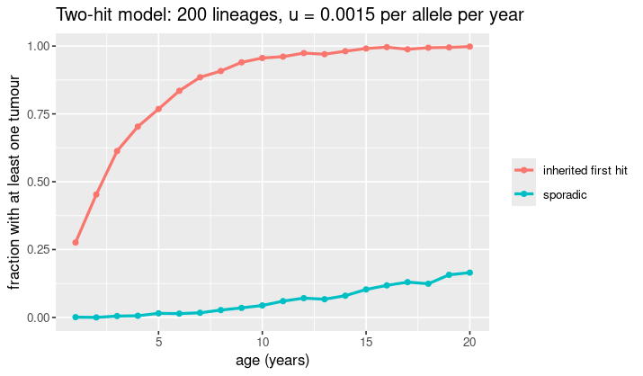
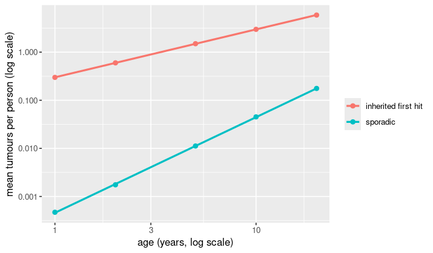
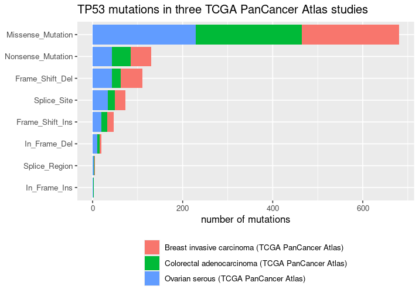

## Goal

By the end of this exercise you should be able to:

- simulate the two-hit model with `rbinom`, using one binomial draw per person;
- build incidence curves over a range of ages with `map_dbl`, and plot them;
- use `lm` on log-transformed data to recover the number of hits, as Knudson did;
- summarise a real table of tumour mutations downloaded from cBioPortal.

## Before you start

This page builds on the by-hand part of the [Exercise](exercise.qmd), so do that first. You need the packages dplyr, purrr, readr and ggplot2. Download [tp53_tcga_mutations.csv](data/tp53_tcga_mutations.csv) and save it in a `data/` folder of your R project.

The file lists every *TP53* mutation in three TCGA PanCancer Atlas studies on [cBioPortal](https://www.cbioportal.org) (`ov_tcga_pan_can_atlas_2018`, `brca_tcga_pan_can_atlas_2018` and `coadread_tcga_pan_can_atlas_2018`), downloaded through the cBioPortal API in November 2026. The column `n_sequenced` gives the number of samples with mutation data in each study.

## Tasks

No new idiom today: we reuse [`rbinom`](https://rdrr.io/r/stats/Binomial.html) from the [pedigrees unit](../pedigrees/exercise-r.qmd) and [`map_dbl`](https://purrr.tidyverse.org/reference/map.html) from [Extensions to Mendel](../mendel-extensions/exercise-r.qmd). The trick is that `rbinom(n_people, size = n_cells, prob = p)` gives, in one call, the number of tumour lineages in each of `n_people` people, each with `n_cells` independent cell lineages. Use the same model as the demo: 200 lineages per child and a hit rate *u* = 0.0015 per allele per year.

```r
library(dplyr)
library(purrr)
library(readr)
library(ggplot2)
```

### The two-hit model

**R1.** The probability that a given allele in one lineage has been hit by age *t* is 1 − (1 − *u*)<sup>*t*</sup>: one minus the chance of escaping every year. Write it as a function `p_hit(age, u)`. Compute it for ages 1, 5 and 10. What is the chance that **both** alleles of one lineage have been hit by age 10?

```r
u <- 0.0015      # hit rate per allele per year
n_cells <- 200   # cell lineages at risk per person
p_hit <- function(age, u) 1 - (1 - u)^age
p_hit(c(1, 5, 10), u)
p_hit(10, u)^2
```

**R2.** Simulate 1000 carriers of an inherited first hit (each lineage needs one more hit) and 1000 non-carriers (each lineage needs two), at age 10. What fraction of each group has at least one tumour? How many tumours does an affected person have on average? Tabulate the number of tumours per person. Compare with the demo's table.

```r
set.seed(1)
n_people <- 1000
carrier  <- rbinom(n_people, size = n_cells, prob = p_hit(10, u))
sporadic <- rbinom(n_people, size = n_cells, prob = p_hit(10, u)^2)
head(carrier, 10)
head(sporadic, 10)
mean(carrier > 0)
mean(sporadic > 0)
mean(carrier[carrier > 0])
mean(sporadic[sporadic > 0])
table(carrier)
table(sporadic)
```

**R3.** Write a function `frac_affected(age, hits_needed)` that simulates 1000 people at a given age and returns the fraction with at least one tumour. Use `map_dbl` to compute it for ages 1 to 20 in both groups, collect the results in one tibble, and plot the two incidence curves.

```r
frac_affected <- function(age, hits_needed, n_people = 1000) {
  p_cell <- p_hit(age, u)^hits_needed
  tumours <- rbinom(n_people, size = n_cells, prob = p_cell)
  mean(tumours > 0)
}
set.seed(2)
ages <- 1:20
onset <- bind_rows(
  tibble(age = ages, group = "inherited first hit",
         frac = map_dbl(ages, \(a) frac_affected(a, hits_needed = 1))),
  tibble(age = ages, group = "sporadic",
         frac = map_dbl(ages, \(a) frac_affected(a, hits_needed = 2)))
)
onset |> filter(age %in% c(1, 2, 5, 10, 20))

ggplot(onset, aes(age, frac, colour = group)) +
  geom_line(linewidth = 1) + geom_point() +
  labs(x = "age (years)", y = "fraction with at least one tumour", colour = NULL,
       title = "Two-hit model: 200 lineages, u = 0.0015 per allele per year")
```

### Counting hits from the shape of the curve

**R4.** If *k* hits are needed, the mean number of tumours per person grows as age<sup>*k*</sup>. Taking logs, log(tumours) = constant + *k* · log(age): a straight line whose **slope is the number of hits**. Simulate the mean number of tumours per person (100 000 people, so that the rare sporadic tumours are counted well) at ages 1, 2, 5, 10 and 20. Fit `lm(log10(tumours) ~ log10(age))` to each group and read the slopes. Plot both on log–log axes.

```r
mean_tumours <- function(age, hits_needed, n_people = 1e5) {
  p_cell <- p_hit(age, u)^hits_needed
  mean(rbinom(n_people, size = n_cells, prob = p_cell))
}
set.seed(3)
ages4 <- c(1, 2, 5, 10, 20)
counts <- bind_rows(
  tibble(age = ages4, group = "inherited first hit",
         tumours = map_dbl(ages4, \(a) mean_tumours(a, hits_needed = 1))),
  tibble(age = ages4, group = "sporadic",
         tumours = map_dbl(ages4, \(a) mean_tumours(a, hits_needed = 2)))
)
counts
coef(lm(log10(tumours) ~ log10(age), data = filter(counts, group == "inherited first hit")))
coef(lm(log10(tumours) ~ log10(age), data = filter(counts, group == "sporadic")))

ggplot(counts, aes(age, tumours, colour = group)) +
  geom_point(size = 2) + geom_smooth(method = "lm", se = FALSE, formula = y ~ x) +
  scale_x_log10() + scale_y_log10() +
  labs(x = "age (years, log scale)", y = "mean tumours per person (log scale)", colour = NULL)
```

**R5. (Knudson's test)** Knudson (1971) did not count tumours. He plotted the log of the fraction of bilateral cases **not yet diagnosed** against age, and found a straight line, as expected for a single event at a constant rate. For the carriers from R3 (ages 1 to 10), compute `still_free = 1 - frac` and fit `lm(log(still_free) ~ age)`. Compare the slope with −*n*·*u*. Why should they agree?

```r
inherited <- onset |>
  filter(group == "inherited first hit", age <= 10) |>
  mutate(still_free = 1 - frac)
fit_k <- lm(log(still_free) ~ age, data = inherited)
coef(fit_k)
-n_cells * u
```

**R6. (two eyes)** Split the 200 lineages into two eyes of 100 and simulate each eye with its own `rbinom` call at age 10. Among affected carriers, what fraction have tumours in both eyes? How many bilateral cases are there among 1000 non-carriers?

```r
set.seed(4)
left  <- rbinom(n_people, size = n_cells / 2, prob = p_hit(10, u))
right <- rbinom(n_people, size = n_cells / 2, prob = p_hit(10, u))
affected <- (left + right) > 0
mean(affected)
mean(left > 0 & right > 0) / mean(affected)
left_s  <- rbinom(n_people, size = n_cells / 2, prob = p_hit(10, u)^2)
right_s <- rbinom(n_people, size = n_cells / 2, prob = p_hit(10, u)^2)
mean((left_s + right_s) > 0)
sum(left_s > 0 & right_s > 0)
```

### Real tumours: *TP53* in cBioPortal

**R7.** Read `data/tp53_tcga_mutations.csv`. For each study, compute the fraction of sequenced samples that carry at least one *TP53* mutation (use [`n_distinct`](https://dplyr.tidyverse.org/reference/n_distinct.html) on `sample_id`; one sample can have two mutations). Then count the mutation types and the five most frequent protein changes over all three studies. Make a bar chart of mutation types, coloured by study. Do these numbers match what you found in cBioPortal (F3 in the [exercise](exercise.qmd))? Is the pattern typical of an oncogene or of a tumour suppressor?

```r
tp53 <- read_csv("data/tp53_tcga_mutations.csv")
tp53 |>
  group_by(study) |>
  summarise(n_sequenced = first(n_sequenced),
            n_mutated = n_distinct(sample_id),
            frac_mutated = n_mutated / n_sequenced)
tp53 |> count(mutation_type, sort = TRUE)
tp53 |> count(protein_change, sort = TRUE) |> head(5)

tp53 |>
  count(study, mutation_type) |>
  ggplot(aes(x = n, y = reorder(mutation_type, n), fill = study)) +
  geom_col() +
  labs(x = "number of mutations", y = NULL, fill = NULL,
       title = "TP53 mutations in three TCGA PanCancer Atlas studies") +
  theme(legend.position = "bottom", legend.direction = "vertical")
```

## Solutions

::: {.callout-note collapse="true" title="Solutions: In R"}

Run with `Rscript --vanilla` from the unit folder. Messages from loading packages and reading the CSV are not shown.

**R1.**

```
[1] 0.001500000 0.007477534 0.014899154
[1] 0.0002219848
```

By age 10 each allele has been hit with probability 0.0149, so both alleles of the same lineage with probability 0.0149² = 0.00022, about 67 times less.

**R2.**

```
 [1] 2 2 3 5 2 5 6 4 3 1
 [1] 0 0 0 0 0 0 0 0 0 0
[1] 0.957
[1] 0.046
[1] 3.143156
[1] 1
carrier
  0   1   2   3   4   5   6   7   8  10  11
 43 157 230 222 163  91  60  19  13   1   1
sporadic
  0   1
954  46
```

**95.7%** of carriers but only **4.6%** of non-carriers have a tumour by age 10. Affected carriers have **3.1** tumours on average (up to 11); every affected non-carrier has exactly **one**. This matches the demo (94% and 4.9%, 3.05 and 1.02 tumours; the difference is chance). Expected values: carriers 1 − (1 − 0.0149)<sup>200</sup> = 0.95, non-carriers 1 − (1 − 0.00022)<sup>200</sup> = 0.043.

**R3.**

```
# A tibble: 10 × 3
     age group                frac
   <int> <chr>               <dbl>
 1     1 inherited first hit 0.276
 2     2 inherited first hit 0.453
 3     5 inherited first hit 0.768
 4    10 inherited first hit 0.956
 5    20 inherited first hit 0.998
 6     1 sporadic            0.001
 7     2 sporadic            0
 8     5 sporadic            0.015
 9    10 sporadic            0.044
10    20 sporadic            0.165
```

{width="75%" fig-align="center"}

The carrier curve rises from the start, almost linearly at first, and then saturates near 1. The sporadic curve stays near 0 for years and then bends upwards. At ages 1 and 2 there are only 0–1 sporadic cases among 1000 people, so those values are pure chance.

**R4.**

```
# A tibble: 10 × 3
     age group               tumours
   <dbl> <chr>                 <dbl>
 1     1 inherited first hit 0.299
 2     2 inherited first hit 0.599
 3     5 inherited first hit 1.50
 4    10 inherited first hit 2.98
 5    20 inherited first hit 5.90
 6     1 sporadic            0.00047
 7     2 sporadic            0.00175
 8     5 sporadic            0.0112
 9    10 sporadic            0.0452
10    20 sporadic            0.176
(Intercept)  log10(age)
 -0.5229854   0.9962263
(Intercept)  log10(age)
  -3.339118    1.987324
```

{width="75%" fig-align="center"}

The slopes are **1.00** for carriers and **1.99** for non-carriers: one and two hits. Doubling the age doubles the carriers' tumours (0.30 → 0.60) but quadruples the non-carriers' (0.00047 → 0.00175, close to 4×; the small numbers are noisy). We use the mean number of tumours rather than the fraction affected, because the fraction saturates at 1 and would bend the carrier line (fitting the fraction at ages 1–5 gives a slope of only about 0.7).

**R5.**

```
(Intercept)         age
  0.0177288  -0.3093728
[1] -0.3
```

The slope is **−0.31**, close to −*n u* = −0.30. A carrier is still tumour-free at age *t* only if none of the 200 lineages has had its single remaining hit: (1 − *u*)<sup>*n t*</sup> ≈ e<sup>−*n u t*</sup>. Its log, −*n u t*, is a straight line in *t* with slope −*n u*. A straight line on this plot is the signature of **one** event happening at a constant rate; that is what Knudson saw for bilateral (hereditary) retinoblastoma.

**R6.**

```
[1] 0.936
[1] 0.6399573
[1] 0.043
[1] 0
```

**64%** of affected carriers have tumours in both eyes, close to the demo's 63%. Among the 43 affected non-carriers, **none** is bilateral: two independent two-hit events in the same child would have a probability of about 0.02² = 0.0005. This is why bilateral retinoblastoma is a strong sign of a germline *RB1* mutation, even without a family history.

**R7.**

```
# A tibble: 3 × 4
  study                                       n_sequenced n_mutated frac_mutated
  <chr>                                             <dbl>     <int>        <dbl>
1 Breast invasive carcinoma (TCGA PanCancer …        1066       347        0.326
2 Colorectal adenocarcinoma (TCGA PanCancer …         534       314        0.588
3 Ovarian serous (TCGA PanCancer Atlas)               523       373        0.713
# A tibble: 8 × 2
  mutation_type         n
  <chr>             <int>
1 Missense_Mutation   680
2 Nonsense_Mutation   130
3 Frame_Shift_Del     110
4 Splice_Site          73
5 Frame_Shift_Ins      47
6 In_Frame_Del         20
7 Splice_Region         5
8 In_Frame_Ins          2
# A tibble: 5 × 2
  protein_change     n
  <chr>          <int>
1 R175H             68
2 R273H             39
3 R248Q             32
4 R248W             29
5 R282W             28
```

{width="75%" fig-align="center"}

*TP53* is mutated in **71%** of ovarian serous, **59%** of colorectal and **33%** of breast cancers in these studies, as in cBioPortal. 680 of the 1067 mutations (64%) are missense, with recurrent hotspots at arginines 175, 248, 273 and 282 in the DNA-binding domain. The other third are **truncating** (nonsense, frameshift, splice site), spread along the gene: the loss-of-function pattern of a **tumour suppressor**. The missense hotspots are the twist: these mutant proteins also block the remaining normal p53, so they are selected more strongly than a simple null allele.
:::

## Where this leads

`rbinom` with a large `size` counts rare events in many independent units: cells here, gene copies in the next units. In *Drift, selection* the same function draws the next generation of a whole population, inside a loop.
