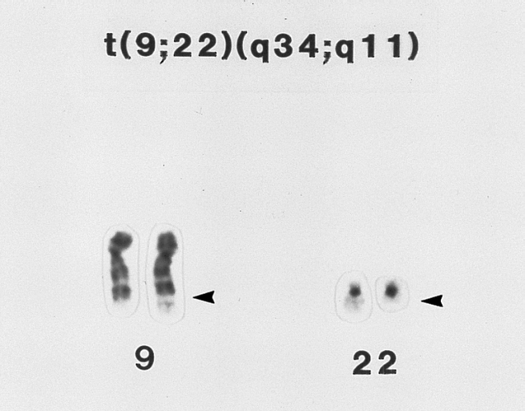

## Goal

By the end of this exercise you should be able to:

- classify a cancer gene as an **oncogene** or a **tumour suppressor** from the kind of mutation that affects it;
- explain the features of hereditary and sporadic retinoblastoma with **Knudson's two-hit model**, and do simple two-hit calculations;
- read **loss of heterozygosity** from marker genotypes in blood and tumour;
- compute cancer risks in families with **incomplete penetrance**;
- look up a cancer gene in NCBI Gene, cBioPortal and OncoKB, and read its location, mutation pattern and role.

Do the pen-and-paper part first. The demo and R come after.

## Background

**Two kinds of cancer gene.**

| | Oncogene | Tumour suppressor |
|---|---|---|
| Normal job | promote division when signalled | stop division, repair DNA, trigger apoptosis |
| Mutation | **gain** of function | **loss** of function |
| At the cell level | dominant: one allele enough | recessive: both alleles lost |
| Typical mutations | hotspot missense, amplification, translocation | nonsense, frameshift, deletion, LOH |
| Examples | *KRAS*, *MYC*, *ERBB2*, *BCR–ABL1* | *RB1*, *TP53*, *APC*, *BRCA1/2* |

**Two-hit model.** A cell lineage becomes a tumour when both alleles of a tumour suppressor are lost. With *n* cells at risk and a probability *u* that a given allele is hit (per year, or over a period):

- Hereditary (one hit inherited): expected tumours ≈ *n·u*; for small risks, risk ∝ *u* and ∝ age.
- Sporadic (two hits needed in the same cell): expected tumours ≈ *n·u*²; risk ∝ *u*² and ∝ age².
- The chance that **none** of *n* cells is hit, each with a small probability *p*, is (1 − *p*)<sup>*n*</sup> ≈ e<sup>−*np*</sup>. So the chance of **at least one** tumour is 1 − e<sup>−(expected number)</sup>.

**Loss of heterozygosity (LOH).** A tumour loses the normal allele of a tumour suppressor, often with the chromosome region around it. Markers that are heterozygous in blood look homozygous in the tumour.

**Penetrance** (Part 1): the probability that a person with the genotype shows the phenotype.

## By hand

**B1. (oncogene or tumour suppressor?)** For each tumour finding, say whether the gene behaves as an oncogene or a tumour suppressor, and whether one or both alleles are affected.
(a) A heterozygous *KRAS* G12D missense mutation in a pancreatic cancer.
(b) Both copies of *CDKN2A* deleted in a melanoma.
(c) 30 copies of *ERBB2* in a breast cancer.
(d) A nonsense mutation in *APC* on one chromosome 5, and loss of the other chromosome 5 in a colon polyp.
(e) A *BCR–ABL1* fusion in a leukaemia.

**B2. (two hits in numbers)** A simple model of the developing retina: each eye has *n* = 10<sup>6</sup> retinoblasts at risk. During the time they divide, each *RB1* allele in a cell is hit with probability *u* = 2 × 10<sup>−6</sup>.
(a) A child carries a germline *RB1* mutation. What is the expected number of tumours per eye, and in both eyes together?
(b) Use e<sup>−(expected number)</sup> to find the probability that a carrier gets **no** tumour at all. What is the penetrance in this model?
(c) What is the probability that a carrier has tumours in **both** eyes?
(d) A child without a germline mutation needs both hits in the same cell. What is the expected number of tumours in both eyes together? Compare with (a).

**B3. (linear vs quadratic)** In a two-hit model with small risks, 2% of carriers have a tumour by age 1. About what fraction do by age 2? For non-carriers, 0.01% have a tumour by age 10. About what fraction do by age 20, and by age 5?

**B4. (reading LOH)** A child with retinoblastoma is typed for four markers along chromosome 13, in order from the centromere to the end of the long arm. *RB1* lies between M2 and M3.

| Marker | M1 | M2 | M3 | M4 |
|---|---|---|---|---|
| Blood | 1/2 | 3/4 | 1/3 | 2/5 |
| Tumour | 1/2 | 3 | 1 | 2 |

(a) Which markers show LOH? (b) Name two mechanisms that could produce this pattern, and say how a copy-number measurement would tell them apart. (c) The child's father is 3/3 at M2 and the mother 4/4. From which parent did the child inherit the mutant *RB1* allele, if the tumour kept the mutant allele? (Assume no recombination between M2 and *RB1* in the parent's meiosis.)

**B5. (penetrance in a family)** A man had bilateral retinoblastoma and carries a germline *RB1* mutation. Assume a penetrance of 90%.
(a) What is the probability that his child develops retinoblastoma?
(b) One of his daughters is now an adult and never had retinoblastoma. What is the probability that she is a carrier?
(c) What is the probability that **her** child develops retinoblastoma?

**B6. (BRCA1)** A woman's mother carries a pathogenic *BRCA1* allele. The woman has not been tested. Assume a lifetime breast-cancer risk of 60% for carriers and 12% for non-carriers (round numbers for this exercise).
(a) What is her prior probability of being a carrier?
(b) What is her lifetime breast-cancer risk, before testing?
(c) She tests negative for her mother's allele. What is her risk now?

**B7. (Philadelphia chromosome)** The photo shows a partial karyotype (G-banded chromosomes 9 and 22) from the bone marrow of a patient with chronic myeloid leukaemia.

{width="45%" fig-align="center"}
[Photo: Armed Forces Institute of Pathology, public domain, via Wikimedia Commons](https://commons.wikimedia.org/wiki/File:Philadelphia_chromosome,_t(9;22)_translocation.jpg){.photo-credit}

(a) Explain the notation t(9;22)(q34;q11). Which chromosome in the photo is the Philadelphia chromosome? (b) The translocation is balanced: no DNA is lost. Why can it still cause leukaemia? (c) Imatinib inhibits the BCR–ABL1 kinase. Why does it harm leukaemia cells much more than normal cells? (d) Some patients relapse after a few years with a point mutation in the ABL1 kinase domain. Explain this in terms of clonal evolution.

**B8. (drivers and passengers)** 500 tumours of one cancer type are sequenced. Classify each gene as a likely oncogene, a likely tumour suppressor, or probably neither, and explain.
(a) Gene P: mutated in 160 tumours; 140 of the mutations are missense at codon 12 or 13.
(b) Gene Q: mutated in 110 tumours; the mutations are nonsense and frameshift, spread along the whole gene.
(c) Gene R, a very long gene: mutated in 12 tumours, all different missense mutations at random positions.

## Explore {#explore}

The demo follows 1000 children who inherited one mutant *RB1* allele and 1000 who did not. Each child has *n* retinal cell lineages, half in each eye, and each *RB1* allele in each lineage is knocked out at rate *u* per year. A lineage becomes a tumour when it has lost **both** copies. The rates are exaggerated so that sporadic cases show up in only 1000 children; the shapes are what matter.

```{=html}
<link rel="stylesheet" href="../demos/dist/demo.css">
<div data-demo="twohit"></div>
<script src="../demos/dist/twohit.js"></script>
```

**E1.** With the default settings (*n* = 200, *u* = 0.0015, *T* = 10), read the table. What fraction of each group has a tumour by age 10? How many tumours does an affected child have on average, and what fraction of affected children have tumours in **both** eyes? Relate this to the clinic: which children get bilateral, multiple tumours, and which get a single tumour in one eye?

**E2.** Compare the median age at the first tumour in the two groups. Then switch to the **log–log** view. Which curve rises with slope about 1, and which with slope about 2? Explain, from the number of hits each group still needs, why one curve is linear in age at early ages and the other quadratic.

**E3.** Press **rarer hits (u ÷ 2)**. By what factor does the fraction affected change in each group? Compare the inherited group at age 1 (linear view) and the sporadic group at age 10. Why does halving the mutation rate reduce the sporadic risk so much more?

**E4.** Return to **default** and press **Knudson's plot**. Which group gives the (nearly) straight line, and why does a straight line on this plot mean "one event at a constant rate"? Then press **new sample** a few times: which numbers in the table jump around the most, and why?

::: {.callout-note collapse="true" title="Solutions: Explore"}

**E1.** (Default, seed 1.) Inherited first hit: **94%** have a tumour by age 10, with **3.05** tumours per affected child, and **63%** of the affected children have tumours in both eyes. Sporadic: **4.9%** have a tumour, with **1.02** tumours per affected child, and only **2%** are bilateral (1 of 49). (The model's expected values are 95% and 4.3%.) With one hit already in every cell, the second hit happens in many of the 200 lineages, so tumours are **multiple and bilateral**. Without it, two hits in the same lineage are rare, so a sporadic case almost always has **one tumour in one eye**. This is the clinical picture of hereditary and sporadic retinoblastoma. Note also that about 6% of the carriers never get a tumour: incomplete penetrance, from a purely random process.

**E2.** The median age at the first tumour is **2.2 years** for inherited cases and **7.5 years** for sporadic cases. On the log–log view the inherited curve rises with slope about **1** and the sporadic curve with slope about **2**. An inherited case needs **one** more hit, so the chance of a tumour by age *t* is about *n u t*, proportional to *t*. A sporadic case needs **two** independent hits in the same cell, each with probability about *u t*, so the chance is about *n* (*u t*)², proportional to *t*². On log–log axes the exponent is the slope, so the slope counts the hits.

**E3.** Inherited: from 94% to **77%** at age 10, and at age 1 from 0.265 to 0.131, almost exactly half. Sporadic: from 4.9% to **1.0%** at age 10; the expected values fall from 4.3% to 1.1%, a factor of **4**. With one hit needed, risk ∝ *u*, so halving *u* halves it. With two hits needed, risk ∝ *u*², so halving *u* divides it by 4. (Tumours per affected carrier also fall, from 3.05 to 1.87, and bilateral cases from 63% to 33%.)

**E4.** The **inherited** group gives the nearly straight line (it bends down only at the very end, because we look only at cases diagnosed by age 10). If tumours start at a constant rate, the fraction still undiagnosed falls by the same **factor** each year, like radioactive decay: e<sup>−rate × *t*</sup>, a straight line on a log scale. The sporadic curve stays high and then falls steeply: almost nothing happens early, because a cell must first collect one hit before the second can do anything. Knudson read this shape from real cases. With **new sample**, the sporadic numbers vary most (for example seed 2 gives 4.3% affected, 0% bilateral, median age 6.3 years), because they rest on only 40–50 cases, while the inherited numbers rest on more than 900.
:::

## Find it

**F1. *RB1* in NCBI Gene.** Search [NCBI Gene](https://www.ncbi.nlm.nih.gov/gene/) for `RB1 human` and open the human gene record. Read the **Summary** box.
(a) What is the official full name of the gene, and its **Location** (chromosome band)?
(b) In one sentence from the summary: what does the protein do in the cell cycle?
(c) Open the disease record for retinoblastoma in [MedGen](https://www.ncbi.nlm.nih.gov/medgen/C0035335) (OMIM [180200](https://www.omim.org/entry/180200)). What **mode of inheritance** is given? How does this fit with *RB1* being recessive at the cell level?

**F2. The genes of the Philadelphia chromosome.** In NCBI Gene, find the human genes *BCR* and *ABL1* and read their **Location**. Do the bands match the breakpoints in t(9;22)(q34;q11)? While you are there, read the locations of *BRCA1* and *BRCA2*.

**F3. *TP53* in cBioPortal.** Go to [cBioPortal](https://www.cbioportal.org). On the start page, search for and tick the study **Ovarian Serous Cystadenocarcinoma (TCGA, PanCancer Atlas)**, then **Query by gene**, type `TP53` and press **Submit Query**. Open the **Mutations** tab.
(a) Roughly what fraction of the profiled samples carry a *TP53* mutation (read the number of mutated samples above the plot)? Is it a few percent, about a third, or most?
(b) What is the most common **mutation type** (the colours of the lollipops and the table column "Mutation Type")?
(c) Which **protein change** is the tallest lollipop?
(d) Repeat for **Breast Invasive Carcinoma (TCGA, PanCancer Atlas)**. How does the fraction compare?
The exact counts can change when a study is updated, so answer in round numbers.

**F4. Is it an oncogene or a tumour suppressor?** Open the [OncoKB Cancer Gene List](https://www.oncokb.org/cancer-genes) (Memorial Sloan Kettering, free, no login). Search for *TP53*, *RB1*, *KRAS* and *ABL1*. Which are annotated as **Oncogene** and which as **TSG**? The list also says whether each gene is in the **Sanger Cancer Gene Census** (COSMIC; its own gene pages need a free registration). Does your classification from the lecture agree?

::: {.callout-note collapse="true" title="Solutions: Find it"}

These facts were checked in November 2026 via the NCBI E-utilities (Gene and MedGen), the cBioPortal API and the OncoKB API.

**F1.** Click path: NCBI Gene → search `RB1 human` → "RB1 RB transcriptional corepressor 1 [*Homo sapiens* (human)]", Gene ID **5925**.
(a) **RB transcriptional corepressor 1**; Location **13q14.2**.
(b) pRB is a negative regulator of the cell cycle: it binds and represses E2F transcription factors, holding cells in G1 until it is phosphorylated. (The summary also says it was the first tumour suppressor gene found.)
(c) MedGen "Retinoblastoma" (C0035335, MIM 180200): **autosomal dominant inheritance**, gene *RB1* at 13q14.2. What is inherited is the first hit; the second hit in a retinal cell is so likely that most carriers are affected. The predisposition is dominant in the pedigree, although the allele is recessive in each cell.

**F2.**

| Gene | Gene ID | Location |
|---|---|---|
| *BCR* | 613 | 22q11.23 |
| *ABL1* | 25 | 9q34.12 |
| *BRCA1* | 672 | 17q21.31 |
| *BRCA2* | 675 | 13q13.1 |

*ABL1* lies in 9q34 and *BCR* in 22q11, exactly at the two breakpoints of t(9;22)(q34;q11). (*BRCA2* is on chromosome 13, like *RB1*, but far away, in band q13.)

**F3.** Click path: cbioportal.org → study list → tick "Ovarian Serous Cystadenocarcinoma (TCGA, PanCancer Atlas)" → Query by gene → `TP53` → Submit Query → **Mutations** tab (lollipop plot and table).
(a) **Most** samples: about 70% of the 523 samples with mutation data carry a *TP53* mutation (373 samples in November 2026). The OncoPrint tab shows a slightly different percentage because it also counts copy-number changes.
(b) **Missense** mutations are the most common type (about 60% of the mutations), followed by nonsense, frameshift and splice-site mutations.
(c) **R175H** (arginine 175 to histidine), in the DNA-binding domain. R248Q, R273H and R248W are also tall.
(d) Breast: about **one third** of samples (347 of 1066). *TP53* loss is nearly universal in high-grade serous ovarian cancer, but only part of breast cancers have it. R175H is again the most frequent change.
A missense hotspot is unusual for a tumour suppressor. The R175H protein is not only inactive but also interferes with the remaining normal p53 (a dominant-negative effect), so selection favours it.

**F4.** OncoKB: *TP53* **TSG**, *RB1* **TSG**, *KRAS* **Oncogene**, *ABL1* **Oncogene**. All four are marked as present in the Sanger Cancer Gene Census. This matches the lecture: *KRAS* and *ABL1* are activated by gain-of-function mutations (G12 hotspots; the *BCR–ABL1* fusion), while *TP53* and *RB1* are inactivated.
:::

## Solutions

::: {.callout-note collapse="true" title="Solutions: By hand"}

**B1.** (a) **Oncogene**, one allele: a hotspot missense that locks KRAS on. (b) **Tumour suppressor**, both alleles (a homozygous deletion of *CDKN2A*, which encodes the cell-cycle brake p16). (c) **Oncogene**, amplification: too much of a normal growth-factor receptor. (d) **Tumour suppressor**, both alleles: a point mutation (hit 1) plus loss of the other chromosome, LOH (hit 2). (e) **Oncogene**: a translocation that creates an always-active fusion kinase; one copy is enough.

**B2.** (a) Expected tumours per eye = *n·u* = 10<sup>6</sup> × 2 × 10<sup>−6</sup> = **2**; in both eyes **4**.
(b) P(no tumour) = e<sup>−4</sup> = **0.018**. Penetrance = 1 − 0.018 ≈ **0.98**.
(c) The eyes are independent. P(tumour in one given eye) = 1 − e<sup>−2</sup> = 0.865. Both eyes: 0.865² = **0.75**.
(d) Expected tumours = 2*n* × *u*² = 2 × 10<sup>6</sup> × (2 × 10<sup>−6</sup>)² = 2 × 10<sup>6</sup> × 4 × 10<sup>−12</sup> = **8 × 10<sup>−6</sup>**, about 1 in 125 000 children. That is half a million times less than a carrier's 4 tumours. Sporadic cases are therefore rare, and nearly always single.

**B3.** Carriers: risk ∝ age, so by age 2 about **4%**. Non-carriers: risk ∝ age², so by age 20 about 0.01% × 2² = **0.04%**, and by age 5 about 0.01% × (½)² = **0.0025%**. (These approximations hold while the risks are small.)

**B4.** (a) **M2, M3 and M4** show LOH; M1 stays heterozygous. (b) The LOH starts between M1 and M2 and runs to the end of the chromosome. Possible mechanisms: **mitotic recombination** between M1 and M2, which leaves two copies of the region, both from one parent (copy-neutral LOH), or a **terminal deletion** from between M1 and M2 to the end, which leaves one copy. Loss of the whole chromosome 13 is ruled out, because M1 is still heterozygous. Copy number tells them apart: two copies of the region in the tumour means recombination, one copy means deletion. (c) The tumour kept allele **3** at M2, which came from the **father**. The tumour keeps the mutant *RB1* allele, so the mutant allele came from the father.

**B5.** (a) P(child carries) × penetrance = ½ × 0.9 = **0.45**.
(b) Conditional probability, as in the [probability unit](../probability-chisq/lec.qmd): P(carrier and unaffected) = ½ × 0.1 = 0.05; P(non-carrier) = ½. So P(carrier | unaffected) = 0.05 / (0.05 + 0.5) = 0.05/0.55 = **0.091**.
(c) 0.091 × ½ × 0.9 = **0.041**, about 1 in 24. A non-penetrant carrier can pass on the allele: the trait then skips a generation.

**B6.** (a) **½**. (b) ½ × 0.60 + ½ × 0.12 = 0.30 + 0.06 = **0.36**. (c) If she does not carry her mother's allele, her risk is that of a non-carrier: **0.12**. A negative test for the **family's** variant is informative; a negative test in a family with no known variant is much less so.

**B7.** (a) A reciprocal **t**ranslocation between chromosomes **9** and **22**, with breakpoints in band **q34** of chromosome 9 and **q11** of chromosome 22. In the photo, the right-hand chromosome of each pair (marked by an arrowhead) is the rearranged one; the right-hand, shortened **chromosome 22** is the Philadelphia chromosome, der(22). (b) The breakpoints fall inside *ABL1* and *BCR* and join them, creating a new **fusion gene**. Nothing is lost, but a new protein is made: the BCR–ABL1 kinase that is always active. (A germline carrier of an unrelated balanced translocation is usually healthy because no gene is broken or fused.) (c) Only leukaemia cells contain BCR–ABL1, and they depend on it to keep dividing. Normal cells have normal ABL1, which is regulated and less critical for them. (d) In a large population of leukaemia cells, a few cells may already carry, or later acquire, a mutation that stops imatinib from binding. The drug kills the others, so this resistant **subclone** is selected and grows: clonal evolution under treatment.

**B8.** (a) Gene P: likely an **oncogene**: frequent, and concentrated at codons 12 and 13 (this is the *KRAS* pattern). Selection favours specific activating changes. (b) Gene Q: likely a **tumour suppressor**: frequent truncating mutations anywhere in the gene, all of which destroy the protein. (c) Gene R: probably **neither**: a few scattered, different missense mutations in a long gene are what passengers look like. A long gene collects passengers just by being a big target.
:::

## Where this leads

The two-hit model is a statement about how fast rare events accumulate in a population of cells. The next two units, *Hardy–Weinberg* and *Drift, selection*, take the same forces (mutation, selection and chance) to populations of people. In the ethics module we return to predictive testing for *BRCA1/2*.

**Next:** [Exercise in R](exercise-r.qmd): simulate the two-hit model with `rbinom`, recover Knudson's slopes, and summarise real *TP53* mutations from cBioPortal.
