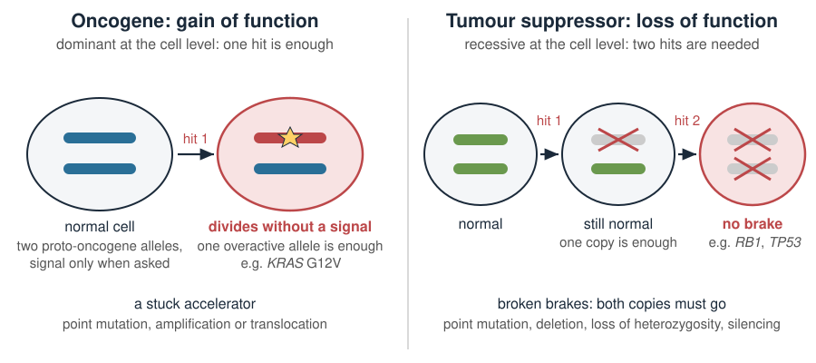
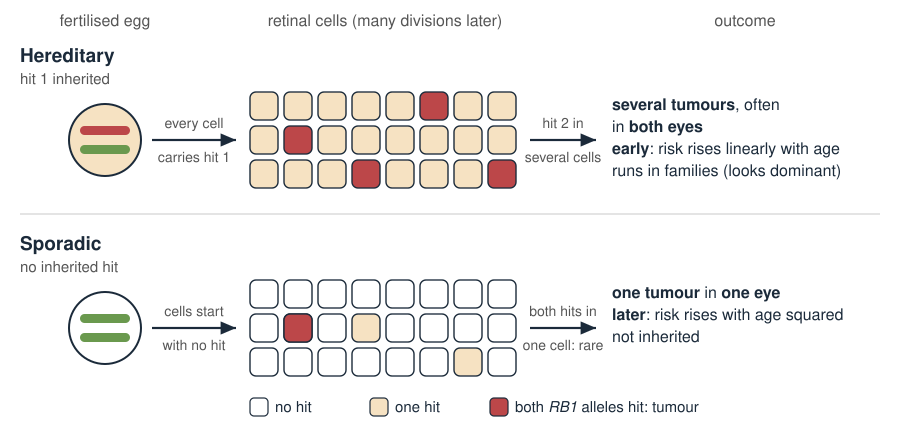
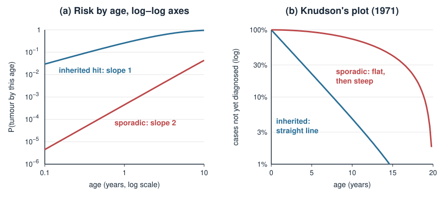
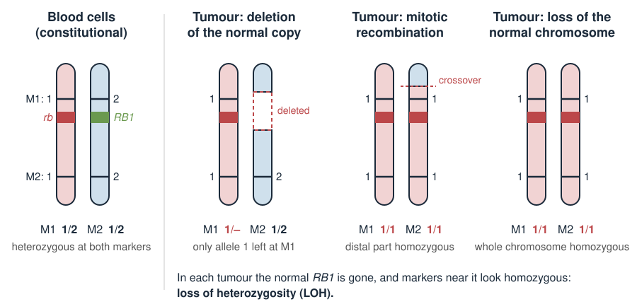
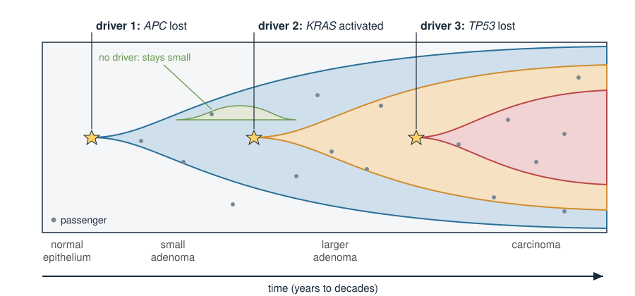
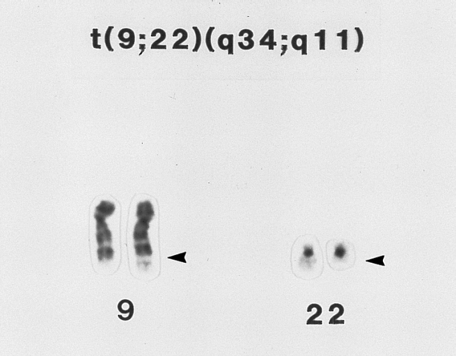
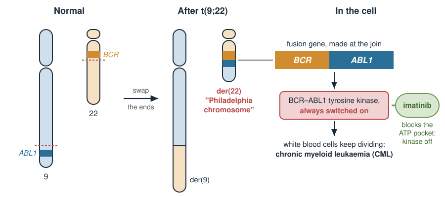

## About this lecture

Cancer is a **genetic disease of somatic cells**: a clone of cells that has collected mutations which let it divide when it should not.

- Two kinds of cancer gene: **oncogenes** (gain of function, dominant at the cell level) and **tumour suppressors** (loss of function, recessive at the cell level).
- **Knudson's two-hit hypothesis**, from the ages at which children get retinoblastoma, and the two-hit model in numbers.
- **Loss of heterozygosity**, read from marker data, and why a "recessive" cancer gene is inherited as a dominant predisposition with incomplete penetrance (*BRCA1/2*), with a worked family risk.
- **Mutator phenotypes**, **clonal evolution**, and **driver** vs **passenger** mutations.
- The **Philadelphia chromosome** and imatinib: from a chromosome to a drug.

You already know dominance, penetrance and pedigrees from Part 1, mutation types from Part 3, and translocations from Part 5. Book: Hartwell, the chapter on the genetics of cancer.

::: notes
The one idea to carry through the lecture: everything they have learnt about alleles in families also happens inside one body, among cells. A tumour is a population of cells, and the rules of dominance and recessiveness apply cell by cell. Oncogenes behave like dominant gain-of-function alleles; tumour suppressors like recessive loss-of-function alleles. The twist is that an inherited, cell-level recessive allele appears dominant in a pedigree. Knudson's argument is the centrepiece, and it is a lovely example of inferring a mechanism from a simple count of ages. The lecture ends with a link to population genetics: a tumour evolves by mutation and selection, which is the topic of the next two units.
:::

## Cancer is a genetic disease, but mostly not inherited

- A tumour is a **clone**: all its cells descend from one cell that escaped normal control of division.
- The mutations that drive it are mostly **somatic**: they arise in that cell lineage during life and are **not** passed to children.
- A minority of cancers (roughly 5–10%) arise in people with an **inherited** predisposing allele. These families give us the cancer genes.
- Most cancers are diseases of **old age**: a cell must collect **several** mutations, and that takes time.

| | Germline mutation | Somatic mutation |
|---|---|---|
| In which cells | every cell, including gametes | one cell and its descendants |
| Passed to children | yes | no |
| Example | inherited *RB1* allele | *KRAS* G12 in a colon polyp |

::: notes
Start by separating two meanings of "genetic". Cancer is genetic because it is caused by changes in DNA. But almost all of those changes are somatic: they happen in one cell during life, through replication errors and mutagens such as UV light or tobacco smoke. A tumour is the clone of that cell. The germline, inherited, cases are rare but important for two reasons: they are the patients with the highest risk, and their families let geneticists map the genes. The rise of cancer incidence with age is the first hint that several hits are needed, which is exactly the argument Knudson made for retinoblastoma. The 5 to 10 percent is a commonly quoted rough figure; it varies by cancer type.
:::

## Accelerators and brakes {.smaller}

{width="88%" fig-align="center"}

- **Proto-oncogenes** promote division when the cell is told to (growth-factor receptors, *RAS*, *MYC*). A gain-of-function mutation makes an **oncogene**: one mutant allele is enough, so it is **dominant** at the cell level.
- **Tumour suppressors** stop division or kill damaged cells (*RB1*, *TP53*, *APC*). A cell becomes abnormal only when **both** copies are lost: **recessive** at the cell level.

::: notes
The car analogy is old but works: an oncogene is a stuck accelerator, a tumour suppressor is a broken brake. Connect to Part 1. A gain-of-function allele is dominant because the one overactive copy does its job regardless of the normal copy; this is the same logic as a dominant gain-of-function disease allele. A loss-of-function allele in a tumour suppressor is recessive at the cell level because one working copy still provides the brake; this is the haplosufficiency argument from the extensions-to-Mendel unit. Most cancers need hits in both kinds of gene. Stress "at the cell level": we will see that at the level of the pedigree, a tumour suppressor allele looks dominant.
:::

## How a proto-oncogene becomes an oncogene

Three routes, all **gain of function**:

1. **Point mutation** that locks the protein on. *KRAS* codon 12 (G12V, G12D): RAS can no longer switch itself off, so it signals all the time.
2. **Amplification**: many copies of a normal gene, so too much protein. *ERBB2* (HER2) in some breast cancers; *MYC* in some neuroblastomas (*MYCN*).
3. **Translocation** that puts a gene under a strong promoter, or **fuses** two genes. *BCR–ABL1* in chronic myeloid leukaemia (end of this lecture).

Each needs only **one** allele, which is why oncogenes are rarely inherited: an always-on allele in every cell is usually lethal to the embryo.

::: notes
Each route connects to an earlier part. Point mutations are Part 3. Amplification and translocation are the chromosome rearrangements of Part 5. RAS is a small GTPase: it is on when GTP is bound and turns itself off by hydrolysing GTP to GDP; the codon 12 mutations block that hydrolysis, so the switch sticks in the on position. Amplification is visible in tumour karyotypes and in copy-number data. The last point is a nice question for students: why are inherited cancer genes mostly tumour suppressors? Because a germline loss-of-function allele in a tumour suppressor is harmless in most cells as long as the second copy works, while a germline oncogene would be active everywhere from the start. There are exceptions, such as RET in multiple endocrine neoplasia type 2, but they are few.
:::

## Retinoblastoma: two forms of one cancer

Retinoblastoma is a tumour of the developing retina, in young children.

| | **Hereditary** (about 40%) | **Sporadic** (about 60%) |
|---|---|---|
| Family history | often; autosomal dominant pattern | no |
| Eyes | usually **both** (bilateral) | **one** (unilateral) |
| Tumours | often **several** | one |
| Age at diagnosis | **earlier** | later |

In 1971 Alfred **Knudson** asked: what single model explains *all four* rows?

::: notes
This table is the observation that Knudson started from. The percentages are approximate and vary between sources; the qualitative pattern is what matters. Hereditary cases are bilateral and multifocal and diagnosed early; sporadic cases are unilateral, single, and diagnosed later. Ask the class to propose a model before the next slide. A good prompt: if the hereditary children inherited something, what did they inherit that makes tumours both more numerous and earlier? Retinoblasts divide only during early childhood; once they stop dividing, no new tumours form, which is why retinoblastoma is a disease of young children.
:::

## Knudson's two-hit hypothesis {.smaller}

{width="80%" fig-align="center"}

- A retinal cell becomes a tumour only when **both** alleles of one gene are lost: **two hits**. The gene is *RB1*, on 13q14.
- **Hereditary**: hit 1 is in the germline, so **every** retinal cell already has it. One more hit in any of millions of cells is likely: many tumours, both eyes, early.
- **Sporadic**: both hits must strike the **same** cell by chance. That is rare: one tumour, one eye, later.

::: notes
Walk through the figure row by row. In the hereditary row the fertilised egg already carries one mutant allele, so after many divisions every retinal cell has it. Each of these cells needs only one more event, and there are about a million retinoblasts, so several cells will get their second hit: hence several tumours, often in both eyes, and early. In the sporadic row every cell starts with two good copies. A tumour needs the same cell to be hit twice, which is so unlikely that it typically happens once, in one eye, if at all. Knudson proposed this before the gene was known; RB1 was cloned in the 1980s, and its protein, pRB, turned out to be a brake on the cell cycle at the G1 to S transition.
:::

## Knudson's argument from the ages at diagnosis {.smaller}

{width="80%" fig-align="center"}

- One hit needed: risk by age *t* ≈ *n·u·t*, **linear** in age. Two hits needed: ≈ *n·(u·t)*², **quadratic**. On log–log axes the slope **counts the hits** (a).
- Knudson plotted the fraction of cases **not yet diagnosed** on a log scale (b). Bilateral cases fell on a **straight line**, as for a single event at a constant rate; unilateral cases did not.

::: notes
This is the quantitative core. Use the symbols: n cells at risk, u the hit rate per allele per year. If one hit is still needed, the chance that one cell is hit by age t is about u times t, and there are n cells, so about n u t. If two hits are needed, each has probability u t and both must happen in the same cell, so about n times u t squared. A quadratic curve starts flat, which is why sporadic tumours appear later. Panel b is Knudson's own kind of plot. If tumours start at a constant rate, the fraction still undiagnosed falls by the same factor each year, like radioactive decay, which is a straight line on a log scale. That is what he saw for bilateral cases. The curves here come from the same model as the demo, with exaggerated rates; in reality the rates are far lower and the cells far more numerous.
:::

## The two-hit model in numbers

A simple model eye: *n* = 10⁶ retinoblasts, and each *RB1* allele in a cell is hit with probability *u* = 10⁻⁶ while the cells divide (round numbers for illustration).

**Carrier** (one hit inherited, one more needed per cell):

1. Expected tumours per eye = *n u* = 10⁶ × 10⁻⁶ = **1**; both eyes: **2**.
2. Rare events in many cells: P(no tumour) ≈ e<sup>−expected number</sup> = e<sup>−2</sup> = **0.14**, so penetrance ≈ **0.86**.
3. Both eyes affected: (1 − e<sup>−1</sup>)² = 0.63² = **0.40**.

**Non-carrier** (two hits needed in the **same** cell):

4. Expected tumours, both eyes = 2*n* *u*² = 2 × 10⁶ × 10⁻¹² = **2 × 10⁻⁶**: about 1 child in 500 000, and almost never bilateral.

::: notes
This turns the figure into arithmetic. The key step is 2: when each of very many cells has a tiny chance, the number of tumours is approximately Poisson, and the chance of none is e to the minus the expected number. Students know e to the minus x from radioactive decay. The carrier numbers reproduce the clinic: most carriers affected, many bilateral; a few unaffected carriers explain incomplete penetrance by chance alone. The non-carrier number is a million times smaller, because u is squared. The values of n and u are round numbers, not measurements; exercise B2 does the same with other values.
:::

## Demo: two hits

```{=html}
<link rel="stylesheet" href="../demos/dist/demo.css">
<div data-demo="twohit"></div>
<script src="../demos/dist/twohit.js"></script>
```

::: notes
Default settings: 200 lineages per child, hit rate 0.0015 per allele per year. Point at the table: about 94 percent of carriers get a tumour by age 10, with about 3 tumours each and two thirds bilateral; about 5 percent of non-carriers get one, almost always a single tumour in one eye. Switch to the log–log view and show the slopes 1 and 2. Then press "rarer hits": the carrier risk halves, the sporadic risk falls about four-fold, because it depends on u squared. Point out that about 6 percent of carriers never get a tumour: incomplete penetrance from pure chance. Finally Knudson's plot.
:::

## Loss of heterozygosity {.smaller}

{width="82%" fig-align="center"}

- In a carrier, the second hit is often **not** a new point mutation but the **loss of the normal allele**, together with a stretch of chromosome around it.
- Markers near the gene are heterozygous in blood but **homozygous in the tumour**: **loss of heterozygosity (LOH)**.
- A region with frequent LOH in tumours is a hint that it contains a **tumour suppressor**. *RB1* and many other genes were found this way.

::: notes
Three ways to lose the normal copy: an interstitial deletion, mitotic recombination proximal to the gene so that the distal part becomes homozygous for the mutant chromosome, or loss of the whole normal chromosome followed by duplication of the mutant one. In all three, polymorphic markers near the gene lose one allele in tumour DNA compared with blood DNA. This links to Part 2 and Part 4: markers are the same kind of polymorphism used for linkage mapping, and today SNP arrays and sequencing show LOH genome-wide. Ask: which allele is lost? Always the normal one, from the parent without the mutation, because only cells that lost the normal allele become tumours. That is selection at the cell level.
:::

## Reading LOH from marker data: a worked example

Five markers along one chromosome arm, from the centromere outwards; the tumour suppressor lies between M3 and M4. Blood and tumour DNA from one patient:

| Marker | M1 | M2 | M3 | M4 | M5 |
|---|---|---|---|---|---|
| Blood | 1/2 | 3/4 | 2/5 | 1/3 | 4/6 |
| Tumour | 1/2 | 3/4 | **2** | **1** | **4** |

1. **Where?** M1 and M2 stay heterozygous; M3 to M5 lose an allele. The lost region starts between M2 and M3 and runs to the end of the arm, and it covers the gene.
2. **How?** Not loss of the whole chromosome (M1, M2 still heterozygous). A **terminal deletion** leaves **1** copy of M3–M5; **mitotic recombination** between M2 and M3 leaves **2** identical copies. A copy-number measurement tells them apart.
3. **Which parent's allele is kept?** If the mother is 2/2 at M3 and the father 5/5, the tumour kept the **maternal** chromosome, so the inherited mutant allele most likely came from the **mother**.

::: notes
This is the reasoning that mapped many tumour suppressors: find the smallest region that loses heterozygosity in many tumours. The method in three questions: where does the loss start and end, which mechanism fits, and which parental chromosome is retained. The retained chromosome carries the first hit, because selection keeps cells that lost the normal copy. Step 3 assumes no recombination between M3 and the gene in the parent's meiosis, and that the mutant allele is the inherited first hit. The marker values here are invented; exercise B4 has another example of the same kind.
:::

## Recessive in the cell, dominant in the pedigree

A retinoblastoma family looks **autosomal dominant**: about ½ of the children of a carrier are affected, in every generation. Yet the allele is **recessive** in each cell. Both are true:

- What is inherited is a **predisposition**, a first hit in every cell.
- The second hit is so likely in a carrier that most carriers are affected. Some carriers get no tumour: **incomplete penetrance** (recap: [Extensions to Mendel](../mendel-extensions/lec.qmd)), and the pedigree then **skips a generation**.
- Inherited breast and ovarian cancer works the same way: germline *BRCA1* (17q21.31) or *BRCA2* (13q13.1), with LOH of the normal allele in the tumour. Lifetime risk is high, but not 100%.

::: notes
This slide resolves the apparent paradox that confuses many students. Dominant and recessive describe phenotypes at a level. At the level of the person, the phenotype is "gets retinoblastoma", and a heterozygote usually does: dominant, with high but incomplete penetrance. At the level of the cell, the phenotype is "divides uncontrollably", and a heterozygous cell does not: recessive. Link to the pedigrees unit: incomplete penetrance makes a dominant trait skip a generation, and an unaffected obligate carrier between two affected relatives is the giveaway. BRCA1 and BRCA2 are the commonest example in adults. Their penetrance is high but varies between studies and families; avoid quoting a single number without a source.
:::

## Incomplete penetrance in a family: a worked risk

A dominant cancer predisposition with penetrance **0.8** (round number). An affected carrier has children with a non-carrier.

1. **Child's risk** of disease: P(inherits the allele) × penetrance = ½ × 0.8 = **0.40**.
2. A daughter is now an adult and **unaffected**. Is she a carrier? Use conditional probability (probability unit):

| | prior | P(unaffected \| this) | product |
|---|---|---|---|
| carrier | ½ | 1 − 0.8 = 0.2 | 0.10 |
| non-carrier | ½ | 1 | 0.50 |

P(carrier | unaffected) = 0.10 / (0.10 + 0.50) = **1/6**.

3. **Her child's risk**: 1/6 × ½ × 0.8 = **1/15** (about 7%), although she herself never had the disease: the skipped generation of the pedigrees unit.

::: notes
This is the Bayesian table from the probability and pedigree units applied to cancer predisposition. Being unaffected is evidence against being a carrier, but only partly, because a carrier stays unaffected 20 percent of the time. The table makes the arithmetic transparent: multiply prior by the likelihood of the observation, then divide by the sum. In practice, penetrance also depends on age: an unaffected 20-year-old says less than an unaffected 70-year-old. Genetic testing for the family's known variant, if available, replaces this calculation with a near-certain answer, which is why it matters in counselling, a point the ethics module returns to. Exercise B5 does the same with 90 percent penetrance.
:::

## Caretakers and the mutator phenotype

Some tumour suppressors do not control division directly. They **repair DNA**, so losing them raises the mutation rate of the cell: a **mutator phenotype**.

- **Mismatch repair** (*MLH1*, *MSH2*): replication errors are not fixed. Inherited loss gives **Lynch syndrome** (colorectal and endometrial cancer); tumours carry thousands of small mutations.
- **Homologous recombination** (*BRCA1*, *BRCA2*): double-strand breaks are repaired by error-prone routes, giving rearrangements.
- **TP53**, "guardian of the genome": senses DNA damage and stops the cell cycle or triggers apoptosis. It is the most frequently mutated gene in human cancer.

A mutator phenotype does not cause cancer itself; it **speeds up** the collection of the other hits.

::: notes
Distinguish gatekeepers, which control division directly, such as RB1 and APC, from caretakers, which keep the genome intact, such as the mismatch repair genes and BRCA1 and 2. Losing a caretaker multiplies the hit rate u in Knudson's model, so every later step happens faster. Link to Part 3: the mutation unit covered mismatch repair and recombination repair; here we see what happens when they fail. TP53 sits in between: it does not repair DNA itself, but it decides whether a damaged cell may go on dividing. Its loss lets cells with damaged genomes survive. In the Find it task students will see in cBioPortal how often TP53 is mutated.
:::

## Clonal evolution: drivers and passengers {.smaller}

{width="80%" fig-align="center"}

- Each **driver** mutation gives its cell a growth advantage, so its descendants take over: **selection** among cells. The colorectal sequence *APC* → *KRAS* → *TP53* is the classic example.
- **Passenger** mutations happen by chance in the same cells and are carried along. They have no effect, but they are the majority of mutations in a tumour.
- So a tumour **evolves**: mutation, selection and drift in a population of cells. This is the topic of the next two units.

::: notes
A fish plot shows the fraction of cells in each clone over time. Every clone starts as one cell with a new driver mutation and expands because it divides faster or dies less. Most new clones without a driver, like the small green one, stay small or vanish. Drivers can be recognised in sequencing data because they recur across many patients and cluster at specific codons, such as KRAS codon 12 or TP53 R175. Passengers are scattered randomly. The order APC, KRAS, TP53 for colorectal cancer comes from Fearon and Vogelstein's comparison of polyps of increasing size with carcinomas; real tumours vary. Clonal evolution also explains drug resistance: a pre-existing subclone with a resistance mutation is selected by the treatment.
:::

## The Philadelphia chromosome under the microscope

:::: {.columns}
::: {.column width="52%"}
{width="100%"}
[Photo: Armed Forces Institute of Pathology, public domain, via Wikimedia Commons](https://commons.wikimedia.org/wiki/File:Philadelphia_chromosome,_t(9;22)_translocation.jpg){.photo-credit}
:::

::: {.column width="48%"}
A partial karyotype from the bone marrow of a patient with **chronic myeloid leukaemia**: the two chromosomes 9 and the two chromosomes 22, G-banded.

- In each pair, the **right-hand** chromosome (arrowhead) is the rearranged one: the end of 9q now carries material from 22, and 22 has lost most of its long arm.
- The short 22 is the **Philadelphia chromosome**, der(22).
- Nothing is lost: the ends were **swapped**, a balanced reciprocal translocation.
:::
::::

::: notes
This is what a cytogeneticist sees, and it connects to the karyotypes of Part 5. Each chromosome pair is shown side by side, the normal homologue on the left and the rearranged one on the right, marked with an arrowhead. Chromosome 9 gained material at the end of its long arm and chromosome 22 lost most of its long arm, which moved to 9. In 1960 Nowell and Hungerford saw only a small chromosome, without banding; the banded picture showing that it is a reciprocal translocation came from Janet Rowley in 1973. The next slide shows what the swap does at the level of genes.
:::

## The Philadelphia chromosome {.smaller}

{width="80%" fig-align="center"}

- In chronic myeloid leukaemia (CML) a small chromosome 22 was seen in 1960 (Nowell and Hungerford, Philadelphia). It is a reciprocal translocation **t(9;22)(q34;q11)**.
- The join fuses *BCR* (22q11.23) to *ABL1* (9q34.12): a **BCR–ABL1** tyrosine kinase that is always on.
- **Imatinib** blocks the ATP pocket of the kinase. It turned CML from a fatal disease into a manageable one: the first big success of a drug designed against a cancer's driver.

::: notes
This is the first chromosome abnormality tied to a specific cancer, found by looking at karyotypes, which connects to rearrangements in Part 5. The translocation is reciprocal, but the important product is the der(22), the Philadelphia chromosome, carrying the fusion gene under the BCR promoter. ABL1 is a tyrosine kinase that is normally tightly controlled; the BCR part makes it dimerise and stay active. Imatinib, approved around 2001, binds the kinase's ATP-binding site in its inactive form. Its success depends on CML being driven by one fusion. Resistance arises through point mutations in the kinase domain, which is clonal evolution again, and second-generation drugs target those. The chromosome bands are the cytogenetic locations listed in NCBI Gene.
:::

## Cancer genomes in public databases

Tumours are sequenced by the thousand. You can browse the results without writing code:

- **cBioPortal** (cbioportal.org): mutations, copy number and survival for public studies such as **TCGA PanCancer Atlas**. A lollipop plot shows where in the protein the mutations fall.
- **COSMIC** Cancer Gene Census (Sanger, free registration) and **OncoKB** (MSK): which genes are cancer genes, and whether each acts as an **oncogene** or a **tumour suppressor (TSG)**.
- The pattern tells you the role: oncogenes have **hotspots** (the same codon in many tumours, *KRAS* G12); tumour suppressors have **truncating** mutations spread along the gene, plus some hotspots (*TP53* R175H).

::: notes
This is the bioinformatics thread for the unit. In TCGA ovarian serous carcinoma most samples carry a TP53 mutation; in breast cancer about a third do. The lollipop plot is a quick way to classify a gene: a few tall lollipops at the same position mean selection for a specific gain of function; many nonsense and frameshift mutations spread along the gene mean selection for loss of function. TP53 is unusual because its common missense hotspots, such as R175H and R273H, also act dominant-negatively on the remaining normal protein. In the exercise students find the TP53 hotspots in cBioPortal and check the gene's role in OncoKB.
:::

## Common mistakes

| Mistake | Correct |
|---|---|
| "Cancer is genetic, so it is inherited" | most driver mutations are **somatic**; only a minority of patients inherit a first hit |
| "Tumour suppressor alleles are recessive, so carriers are not at risk" | recessive in the **cell**; in the **person** the second hit is so likely that the predisposition is dominant |
| "A dominant predisposition means every carrier gets cancer" | penetrance is **incomplete**: unaffected carriers exist and can transmit the allele |
| "Inherited cancer genes are oncogenes" | mostly **tumour suppressors**: an activated oncogene in every cell is usually not compatible with normal development |
| "LOH is a new point mutation" | LOH is **loss of the normal allele**, often with a stretch of chromosome (deletion, mitotic recombination, chromosome loss) |
| "Most mutations in a tumour cause the cancer" | most are **passengers**; drivers recur across tumours |

::: notes
Use as a check-yourself slide: cover the right column and ask for the correction. The first two are the most common confusions in exam answers; the fourth is a nice reasoning question with exceptions such as RET in multiple endocrine neoplasia type 2. The last one links to the cBioPortal task: recurrence at the same codon or gene across many tumours is the signature of selection.
:::

## Summary

- Cancer is a clone of cells with **somatic** mutations; a minority of patients carry an **inherited** first hit.
- **Oncogenes**: gain of function, one allele enough (dominant at the cell level). **Tumour suppressors**: loss of function, both alleles (recessive at the cell level).
- **Knudson**: hereditary retinoblastoma needs one more hit (early, bilateral, multiple, risk ∝ age); sporadic needs two in one cell (late, unilateral, single, risk ∝ age²). Expected tumours *nu* vs *nu*²; P(none) ≈ e<sup>−expected</sup>.
- The second hit is often **loss of heterozygosity**, read as markers heterozygous in blood but not in the tumour. An inherited cell-recessive allele gives a **dominant** predisposition with **incomplete penetrance** (*RB1*, *BRCA1/2*); unaffected relatives' risks need conditional probability.
- **Mutator phenotypes** raise the hit rate; **clonal evolution** selects drivers; passengers come along.
- **t(9;22)** makes BCR–ABL1; **imatinib** targets it.

::: notes
Go back to the four rows of the retinoblastoma table and ask the class to explain each with the two-hit model. Then ask them to place each gene from the lecture in one of two columns, oncogene or tumour suppressor, and to name the type of mutation that activates or inactivates it.
:::

## Where this leads

- **Next**: *Hardy–Weinberg* and *Drift, selection* treat allele frequencies in populations of people. A tumour is a population of cells that evolves by the same rules: mutation, selection, drift.
- **Part 1** links: penetrance and pedigrees explain why cancer predisposition looks dominant.
- **Ethics**: predictive testing for *BRCA1/2* and other cancer genes, and what a positive result means for relatives.
- In the exercise: two-hit problems by hand, the demo, *RB1* in NCBI Gene, *TP53* in cBioPortal and OncoKB, and the two-hit model in R.

::: notes
The bridge to the next units is explicit: mutation creates variation, selection favours some variants, and drift adds chance. These are exactly the forces of population genetics, applied to cells rather than people. Predictive testing comes back in the ethics module: a BRCA1 result in one person is also information about their siblings and children.
:::
