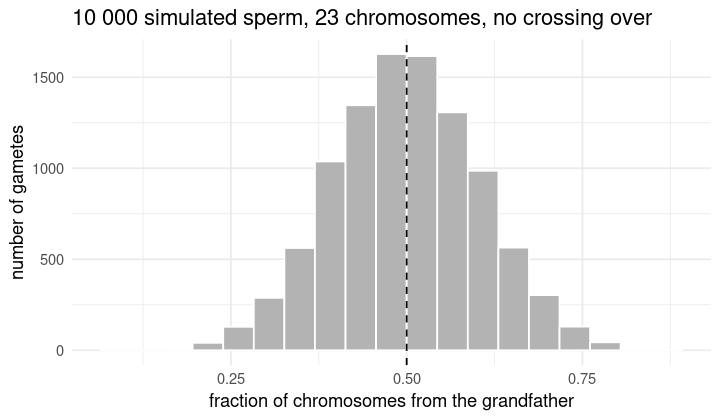

## Goal

By the end of this exercise you should be able to:

- compute the number of chromosome combinations in a gamete, $2^n$, for several species;
- simulate independent assortment of 23 chromosome pairs with `sample()` and `replicate()`, and describe how much of a gamete comes from each grandparent;
- weight a simulation by real chromosome lengths read from a data file;
- test Morgan's white-eye counts with `chisq.test()` and interpret a significant result.

## Before you start

This page builds on the by-hand part of the [Exercise](exercise.qmd), so do that first. You need the packages dplyr, ggplot2 and readr. Download two data files and save them in a `data/` folder of your R project:

- [morgan1910.csv](data/morgan1910.csv): Morgan's counts from *Science* 32:120–122 (1910), PMID [17759620](https://pubmed.ncbi.nlm.nih.gov/17759620/). Real data.
- [human_chromosomes.csv](data/human_chromosomes.csv): the lengths of the human chromosomes, from the Ensembl REST API (assembly GRCh38.p14, retrieved 2026-11-20). Real data.

```r
library(dplyr)
library(ggplot2)
library(readr)
```

## Tasks

There is no new R idiom on this page. You reuse three from Part 1: a small function of your own (*Mendel*), [`sample()`](https://rdrr.io/r/base/sample.html) and [`replicate()`](https://rdrr.io/r/base/lapply.html) for simulation (*Probability & the χ² test*), and [`chisq.test()`](https://rdrr.io/r/stats/chisq.test.html). The new thing is to apply them to chromosomes instead of single genes.

**R1. ($2^n$)** Make a tibble with the haploid chromosome number n of *Drosophila* (4), the garden pea (7) and humans (23). Add columns with the number of different combinations of grandparental chromosomes in a gamete, $2^n$, and in a zygote, $(2^n)^2$. What is the probability that a human gamete carries the grandfather's copy of all 23 chromosomes, *or* the grandmother's copy of all 23?

```r
species <- tibble(
  species = c("Drosophila melanogaster", "garden pea", "human"),
  n       = c(4, 7, 23)
)
species |>
  mutate(gametes = 2^n,
         zygotes = gametes^2)
2^23
1 / 2^22
```

**R2. (one sperm)** A man got one copy of each chromosome from his father (the child's grandfather) and one from his mother (the grandmother). Ignoring crossing over, each of the 23 chromosomes in one of his sperm comes from the grandfather or the grandmother with probability ½, independently. Write a function `one_gamete(n_pairs = 23)` that returns 23 random draws of `"grandfather"` or `"grandmother"`. Run it once and compute the fraction of chromosomes from the grandfather.

(The `n_pairs = 23` gives the argument a **default value**, so `one_gamete()` means `one_gamete(23)`. Default arguments are the new idiom of the next unit; here you just use one.)

```r
one_gamete <- function(n_pairs = 23) {
  sample(c("grandfather", "grandmother"), n_pairs, replace = TRUE)
}
set.seed(1)
g <- one_gamete()
g
table(g)
mean(g == "grandfather")
```

**R3. (10 000 sperm)** Use `replicate()` to compute the fraction from the grandfather in 10 000 simulated sperm. What are the mean and the standard deviation? What fraction of sperm carry between 40 % and 60 % grandfather chromosomes? Did any sperm carry chromosomes from only one grandparent? Plot a histogram.

```r
set.seed(2)
frac_gf <- replicate(10000, mean(one_gamete() == "grandfather"))
summary(frac_gf)
sd(frac_gf)
mean(frac_gf == 0 | frac_gf == 1)
mean(frac_gf >= 0.4 & frac_gf <= 0.6)

ggplot(tibble(frac = frac_gf), aes(x = frac)) +
  geom_histogram(binwidth = 1/23, boundary = -0.5/23, fill = "grey70", colour = "white") +
  geom_vline(xintercept = 0.5, linetype = "dashed") +
  labs(x = "fraction of chromosomes from the grandfather",
       y = "number of gametes",
       title = "10 000 simulated sperm, 23 chromosomes, no crossing over") +
  theme_minimal()
```

Compare the standard deviation with the binomial formula $\sqrt{p(1-p)/n}$ with p = ½ and n = 23.

**R4. (weighted by length)** Chromosomes differ in size, so the fraction of **DNA** from the grandfather is not the same as the fraction of chromosomes. Read `human_chromosomes.csv`, keep the 22 autosomes, and simulate the fraction of autosomal DNA (in base pairs) from the grandfather in 10 000 sperm. Is the spread larger or smaller than in R3? Why?

```r
chrom <- read_csv("data/human_chromosomes.csv", show_col_types = FALSE)
autosomes <- chrom |> filter(!chromosome %in% c("X", "Y"))
nrow(autosomes)
autosomes |> summarise(total_Mb = sum(length_bp) / 1e6,
                       longest_Mb = max(length_bp) / 1e6,
                       shortest_Mb = min(length_bp) / 1e6)
L <- autosomes$length_bp
dna_frac <- function() {
  from_gf <- one_gamete(22) == "grandfather"
  sum(L[from_gf]) / sum(L)
}
set.seed(3)
dna_gf <- replicate(10000, dna_frac())
summary(dna_gf)
sd(dna_gf)
```

**R5. (Morgan's F~2~)** Read `morgan1910.csv`. Test Morgan's F~2~ (F~1~ × F~1~) against the X-linked expectation ½ red ♀ : ¼ red ♂ : ¼ white ♂, and check the expected counts. Leave out the row with 0 white females (an X-linked gene predicts none). Then test the males alone against 1 : 1, and compute the fraction of white among the males.

```r
morgan <- read_csv("data/morgan1910.csv", show_col_types = FALSE)
f2 <- morgan |> filter(cross == "F1 x F1", n > 0)
f2 |> select(sex, eye, n)
chisq.test(f2$n, p = c(2, 1, 1) / 4)
chisq.test(f2$n, p = c(2, 1, 1) / 4)$expected
males <- f2 |> filter(sex == "male")
chisq.test(males$n, p = c(1, 1) / 2)
f2 |> summarise(white_share_of_males = n[eye == "white"] / sum(n[sex == "male"]))
```

**R6. (Morgan's backcross)** Morgan also crossed his original white male with F~1~ daughters. Test the four classes against 1 : 1 : 1 : 1. Then add up red and white across the sexes and test 1 : 1. Together with R5, what is the most likely reason that the F~2~ does not fit 2 : 1 : 1?

```r
bc <- morgan |> filter(cross == "white male x F1 female")
bc |> select(sex, eye, n)
chisq.test(bc$n, p = rep(1, 4) / 4)
bc |> group_by(eye) |> summarise(n = sum(n))
chisq.test(c(red = 129 + 132, white = 88 + 86), p = c(1, 1) / 2)
```

## Solutions

::: {.callout-note collapse="true" title="Solutions: In R"}

All output below is from `Rscript --vanilla` run in the unit folder.

**R1.**

```
# A tibble: 3 × 4
  species                     n gametes zygotes
  <chr>                   <dbl>   <dbl>   <dbl>
1 Drosophila melanogaster     4      16 2.56e 2
2 garden pea                  7     128 1.64e 4
3 human                      23 8388608 7.04e13
[1] 8388608
[1] 2.384186e-07
```

A fly gamete has 16 possible combinations, a pea gamete 128, a human gamete 8 388 608; a human zygote about 7 × 10^13^. All grandfather *or* all grandmother: 2 × (½)^23^ = 1/2^22^ ≈ **2.4 × 10^−7^**, about 1 in 4 million.

**R2.**

```
 [1] "grandfather" "grandmother" "grandfather" "grandfather" "grandmother"
 [6] "grandfather" "grandfather" "grandfather" "grandmother" "grandmother"
[11] "grandfather" "grandfather" "grandfather" "grandfather" "grandfather"
[16] "grandmother" "grandmother" "grandmother" "grandmother" "grandfather"
[21] "grandfather" "grandfather" "grandfather"
g
grandfather grandmother
         15           8
[1] 0.6521739
```

This sperm happens to carry 15 grandfather chromosomes and 8 grandmother chromosomes: 65 % from the grandfather.

**R3.**

```
   Min. 1st Qu.  Median    Mean 3rd Qu.    Max.
0.08696 0.43478 0.47826 0.49967 0.56522 0.86957
[1] 0.1045353
[1] 0
[1] 0.5896
```

{width="80%" fig-align="center"}

The mean is 0.50, as it must be, but single sperm range from 2/23 (0.09) to 20/23 (0.87). The SD is **0.105**, matching the binomial $\sqrt{0.25/23} = 0.104$. Only **59 %** of sperm fall between 40 % and 60 %. None of the 10 000 was all-grandfather or all-grandmother; we expect 10 000 × 2.4 × 10^−7^ ≈ 0.002 such sperm. So siblings can differ a lot in how much they inherit from each grandparent, even though every child gets exactly half of its DNA from each parent.

**R4.**

```
[1] 22
# A tibble: 1 × 3
  total_Mb longest_Mb shortest_Mb
     <dbl>      <dbl>       <dbl>
1    2875.       249.        46.7
   Min. 1st Qu.  Median    Mean 3rd Qu.    Max.
 0.1152  0.4168  0.4976  0.4981  0.5765  0.9121
[1] 0.1167169
```

The 22 autosomes add up to 2875 Mb, from 249 Mb (chromosome 1) down to 46.7 Mb (chromosome 21). The DNA fraction has a slightly **larger** spread (SD 0.117 against 0.105): a few big chromosomes carry much of the DNA, so whether chromosome 1 or 2 comes from the grandfather moves the total a lot. In reality, **crossing over** breaks each chromosome into grandparental pieces, which makes the spread much **smaller**. That is the next unit.

**R5.**

```
# A tibble: 3 × 3
  sex    eye       n
  <chr>  <chr> <dbl>
1 female red    2459
2 male   red    1011
3 male   white   782

	Chi-squared test for given probabilities

data:  f2$n
X-squared = 128.98, df = 2, p-value < 2.2e-16

[1] 2126 1063 1063

	Chi-squared test for given probabilities

data:  males$n
X-squared = 29.248, df = 1, p-value = 6.369e-08

# A tibble: 1 × 1
  white_share_of_males
                 <dbl>
1                0.436
```

χ² = **129.0** with 2 df (the lecture's value), p < 2.2 × 10^−16^: the counts do not fit 2 : 1 : 1. Among the males alone, white is 43.6 % instead of 50 % (χ² = 29.2, p = 6 × 10^−8^). The deficit is in the white class.

**R6.**

```
# A tibble: 4 × 3
  sex    eye       n
  <chr>  <chr> <dbl>
1 female red     129
2 male   red     132
3 female white    88
4 male   white    86

	Chi-squared test for given probabilities

data:  bc$n
X-squared = 17.46, df = 3, p-value = 0.0005684

# A tibble: 2 × 2
  eye       n
  <chr> <dbl>
1 red     261
2 white   174

	Chi-squared test for given probabilities

data:  c(red = 129 + 132, white = 88 + 86)
X-squared = 17.4, df = 1, p-value = 3.028e-05
```

The backcross also misfits 1 : 1 : 1 : 1 (χ² = 17.5, df = 3, p = 0.0006), and nearly all of it comes from red vs white: 261 : 174 (χ² = 17.4, df = 1). Within each eye colour, the sexes are almost equal (129 : 132 and 88 : 86). So the problem is not the X-linked inheritance, which predicts the sexes correctly, but that **white-eyed flies of both sexes are under-represented**, by about a third in both crosses. The most likely explanation is that white-eyed flies survive less well to adulthood (reduced viability), or were missed more often when counting. A significant χ² tells you that the model is incomplete; the pattern of the deviations tells you where.
:::

## Where this leads

In R2–R4 every chromosome was inherited whole, from one grandparent or the other. In **Linkage & recombination** crossing over breaks that: you write functions that convert between recombination frequency and map distance, with a **default argument** `method = "haldane"`, and plot them with `map_dbl()`.
