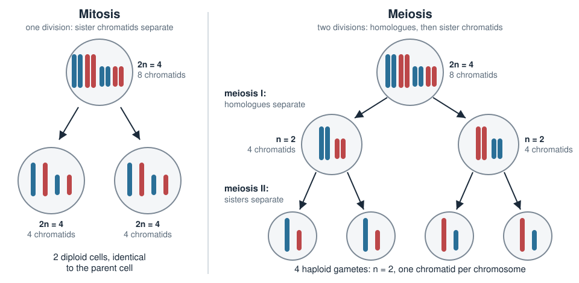
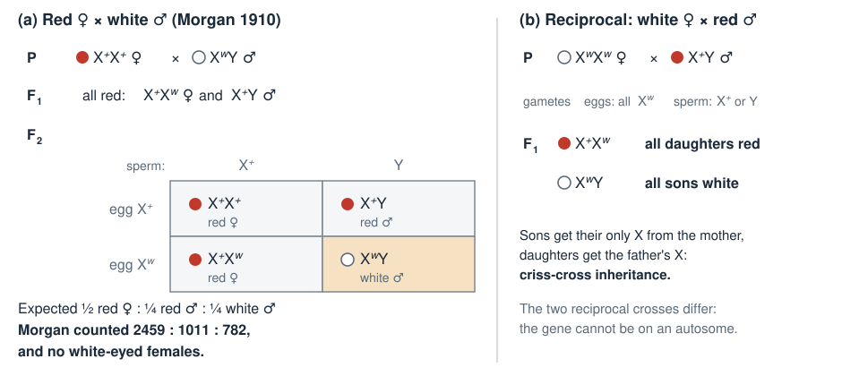
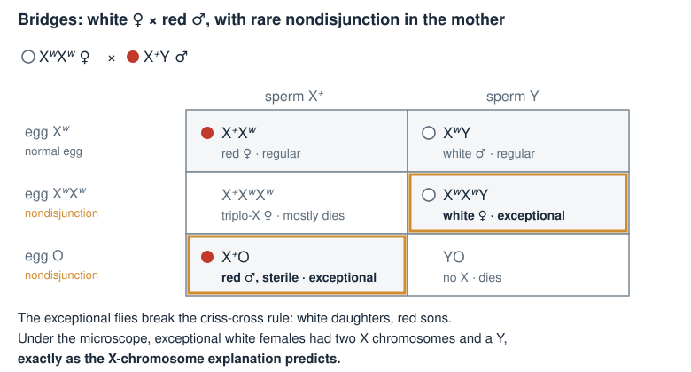
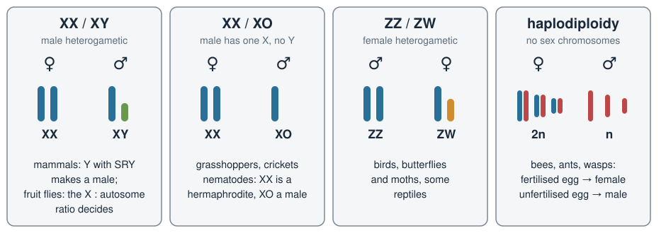

## About this lecture

Mendel's factors were an abstraction: pairs of "somethings" that separate when gametes form. Around 1900–1915 geneticists found out **where** genes are: on **chromosomes**. The key evidence came from a gene that follows the X chromosome.

- A careful recap of **mitosis and meiosis**: ploidy, homologues and sister chromatids, and what each division separates.
- The **chromosome theory of inheritance**: chromosomes behave exactly as Mendel's factors must.
- **Morgan's white-eyed fly** (1910): the first gene assigned to a specific chromosome, the X.
- **Bridges' nondisjunction** (1916): rare exceptions that proved the theory.
- **Sex determination**: XY with *SRY*, XO, ZW and haplodiploidy.
- **X-linked inheritance** worked by hand, and a pointer to dosage compensation.

Book: Hartwell, *Genetics: From Genes to Genomes*, chromosome theory of inheritance chapter.

::: notes
This lecture opens Part 2. Part 1 treated genes as abstract factors; today we put them on chromosomes. The next three units use that to map genes along a chromosome: linkage and recombination, three-point crosses, and human linkage with LOD scores. Mitosis and meiosis were covered at school and in cell biology, so the first slides are a recap, but a careful one: students must be fluent with chromosomes versus chromatids, and with n versus 2n, before mapping makes sense. Sex linkage was introduced just enough for pedigrees in Part 1; here it gets its full story.
:::

## Chromosomes: the vocabulary (recap) {.smaller}

| Term | Meaning | Example |
|---|---|---|
| **Homologous chromosomes** (homologues) | the two copies of one chromosome in a diploid cell, one from each parent; same genes in the same order, possibly different alleles | your two chromosome 7s, one carrying *CFTR* from your mother, one from your father |
| **Sister chromatids** | the two identical DNA copies of one chromosome after replication, joined at the **centromere** | a "metaphase chromosome" is two sister chromatids |
| **Haploid (n)** | one set of chromosomes | human gametes: n = 23 |
| **Diploid (2n)** | two sets, one from each parent | human body cells: 2n = 46 |
| **Autosomes / sex chromosomes** | chromosomes that are the same in both sexes / that differ (X, Y) | humans: 22 autosome pairs + XX or XY |
| **Karyotype** | the chromosome set of a species, as seen in the microscope | *Drosophila* 2n = 8, garden pea 2n = 14 |

**Count chromosomes by centromeres.** A replicated chromosome (two chromatids) is still **one** chromosome.

::: notes
Go slowly here: most confusion later in Part 2 comes from mixing up homologues and sister chromatids. Homologues are similar but not identical (they can carry different alleles) and come from different parents. Sister chromatids are identical copies made in S phase. The rule "count centromeres" settles every counting question: after S phase a human cell still has 46 chromosomes, but 92 chromatids. Mention the DNA content notation if useful: a G1 diploid cell is 2C, after S it is 4C, a gamete is 1C.
:::

## Mitosis and meiosis {.smaller}

{width="78%" fig-align="center"}

- **Mitosis**: one division; **sister chromatids** separate. Two diploid daughters, identical to the parent.
- **Meiosis**: one round of DNA replication, **two** divisions. **Meiosis I** separates **homologues** (2n → n). **Meiosis II** separates **sister chromatids**, as in mitosis.

::: notes
Recap from cell biology. Both start with a replicated cell: 2n = 4 here, so 8 chromatids. Mitosis separates sisters, so each daughter gets one copy of every chromosome from both parents, 2n again. Meiosis I is the special division: homologues pair up and then go to opposite poles, so each daughter gets one homologue of each pair, n chromosomes, but each still has two chromatids. Meiosis II is like mitosis in a haploid cell. Point at the gametes: each has one long and one short chromosome, but in different colour combinations. That is independent assortment, and it is built into meiosis I.
:::

## Counting through meiosis {.smaller}

A human cell, 2n = 46:

| Stage | Cells | Chromosomes per cell | Chromatids per cell | Ploidy |
|---|---:|---:|---:|---|
| G1 (before replication) | 1 | 46 | 46 | 2n |
| After S phase (G2) | 1 | 46 | 92 | 2n |
| Prophase I: 23 **bivalents** (paired homologues) | 1 | 46 | 92 | 2n |
| After meiosis I | 2 | 23 | 46 | **n** |
| After meiosis II (gametes) | 4 | 23 | 23 | n |

- **Meiosis I is reductional**: the chromosome number halves because homologues separate.
- **Meiosis II is equational**: the number stays at n; each chromosome loses its sister.
- **Mendel's segregation happens in anaphase I** (for a gene with no crossover between it and the centromere; crossovers are the next unit).

::: notes
Have them fill in this table before showing it. The common mistake is to say a cell after meiosis I is "still diploid because it has 46 chromatids". Ploidy counts chromosome sets, not DNA molecules. The last bullet is a small honesty note: if a crossover happens between a gene and its centromere, the two alleles are separated only in meiosis II. That matters for tetrad analysis in fungi, which we skip, and it is a hint that crossing over, next unit, complicates the simple picture.
:::

## Meiosis makes variety {.smaller}

**Independent orientation at metaphase I.** Each homologue pair faces the poles at random, independently of the others. A gamete gets the father's or the mother's copy of each chromosome, ½ each:

| | *Drosophila* | Pea | Human |
|---|---:|---:|---:|
| n | 4 | 7 | 23 |
| Combinations in a gamete, $2^n$ | 16 | 128 | 8 388 608 |
| Combinations in a zygote, $(2^n)^2$ | 256 | 16 384 | ≈ 7 × 10^13^ |

**Crossing over** in prophase I mixes the homologues *within* a chromosome and adds far more variety. It is the subject of the next unit, *Linkage & recombination*.

Ignoring crossovers, the probability that a human sperm carries the grandfather's copy of all 23 chromosomes is ½ × ½ × … = (½)^23^ ≈ 1 in 8.4 million.

::: notes
This is Mendel's independent assortment seen from the chromosome side: 2 to the n gamete types is the same count as for n unlinked heterozygous genes in the Mendel unit. With 23 pairs the number of combinations is about 8.4 million per gamete and about 70 trillion per zygote, before crossing over. In the R exercise students simulate this with sample() and ask how much of a gamete comes from each grandparent: on average half, but with a wide spread when whole chromosomes are the unit of inheritance. Crossing over narrows that spread, which they meet in the next unit.
:::

## Try it: meiosis step by step {.smaller}

```{=html}
<link rel="stylesheet" href="../demos/dist/demo.css">
<div data-demo="meiosis" data-pairs="2"></div>
<script src="../demos/dist/meiosis.js"></script>
```

::: notes
Step through with the Next button. Blue chromosomes came from the father, red from the mother; long and short are two different chromosomes. Stop at metaphase I and press "flip orientation": the gametes change from blue-long + red-short to blue-long + blue-short. That is the 2^n of the previous slide. Point out stage 2 (S phase): the count of chromosomes stays at 4 while chromatids double; and stage 6 (telophase I): two haploid cells whose chromosomes still have two chromatids. We come back to the two nondisjunction modes at the end of the lecture.
:::

## The chromosome theory of inheritance {.smaller}

Around 1902–1903, **Walter Sutton** (grasshoppers) and **Theodor Boveri** (sea urchins) noticed that chromosomes in meiosis behave exactly as Mendel's factors must:

| Mendel's factors | Chromosomes |
|---|---|
| come in **pairs** in the body | come in homologous **pairs** in diploid cells |
| the two members **segregate** into different gametes | homologues go to **opposite poles** in meiosis I |
| one of each pair in each gamete | gametes are **haploid** |
| different genes **assort independently** | different pairs **orient independently** at metaphase I |
| one set from each parent | one homologue from each parent |

**Chromosome theory of inheritance:** genes are carried on chromosomes, and the behaviour of chromosomes in meiosis is the physical basis of Mendel's laws.

A parallel is not a proof. The proof needed **one gene** whose inheritance follows **one identifiable chromosome**.

::: notes
The parallel is striking, but it is correlation: two things that both come in pairs and both segregate. Sceptics, including Morgan himself at first, pointed out that there are many more genes than chromosomes, so genes could not each be a chromosome. The resolution, many genes per chromosome, leads straight to linkage in the next unit. What was needed was a chromosome you could recognise in the microscope, and a gene that went with it. The sex chromosomes provided both.
:::

## Sex chromosomes {.smaller}

- In many animals the two sexes differ in one chromosome pair. Human and *Drosophila* females are **XX**, males **XY**.
- The X and Y are not true homologues: the Y is small and carries few genes. In humans X ≈ 156 Mb and Y ≈ 57 Mb (you look this up in the exercise).
- Short **pseudoautosomal regions** at the tips of X and Y let them pair and segregate in male meiosis.
- A male has only one X, so he is **hemizygous** for X-linked genes: one recessive allele is enough to show.
- Every child gets an X from the mother. The father decides the sex: his sperm carry **X or Y**, ½ each, so sons and daughters are born 1 : 1.

| Mother XX | | Father XY |
|---|---|---|
| eggs: all X | | sperm: ½ X, ½ Y |
| → daughters XX get one X from each parent | | → sons XY get their X from the mother |

::: notes
The first part is the hemizygosity rule students already used in pedigrees; now we see its chromosomal basis. The X-Y pairing via the pseudoautosomal regions matters for two reasons: it is how the X and Y segregate from each other in meiosis I, and occasional abnormal crossing over there can move SRY onto an X, which explains some XX males (two slides on). The 1 to 1 sex ratio is a Mendelian testcross: XY times XX is like Aa times aa.
:::

## Morgan's white-eyed fly (1910) {.smaller}

{width="80%" fig-align="center"}

Thomas Hunt Morgan found a white-eyed male in a culture of red-eyed flies. In the F~2~ **only males were white**. Explanation: the eye-colour gene *w* is on the **X**, and the Y carries no copy.

::: notes
Walk through panel a. The F1 are all red, so white is recessive. In the F2, red to white is 3470 to 782, roughly 3 to 1 but with too few whites (we come back to that), and all the white flies are males. That is not what an autosomal gene does. With w on the X the Punnett square works: the F1 female is a carrier, X+Xw; the F1 male is X+Y. Half the F2 sons get Xw from the mother and are white; all F2 daughters get X+ from the father and are red. Panel b is the reciprocal cross: a white female times a red male gives red daughters and white sons, the criss-cross pattern. Reciprocal crosses that differ are the hallmark of sex linkage; Mendel's reciprocal crosses gave the same result because his genes were autosomal. Morgan's own data and the correct reference: Morgan 1910, Science 32:120-122.
:::

## Do Morgan's numbers fit 2 : 1 : 1? {.smaller}

The F~2~, under X-linkage: ½ red ♀ : ¼ red ♂ : ¼ white ♂. Morgan counted 4252 flies:

| Class | Observed | Expected | (O − E)²/E |
|---|---:|---:|---:|
| red ♀ | 2459 | 2126 | 52.2 |
| red ♂ | 1011 | 1063 | 2.5 |
| white ♂ | 782 | 1063 | 74.3 |
| **Total** | 4252 | 4252 | **χ² = 129.0**, df = 2 |

p is far below 0.001: the counts **do not** fit 2 : 1 : 1. But the *pattern* fits perfectly: **no white females**, white males only.

The deficit is in the **white** classes. In Morgan's backcross (white ♂ × F~1~ ♀) the four classes should be 1 : 1 : 1 : 1, but he got 129 : 132 red to 88 : 86 white. White-eyed flies survive less well: reduced **viability**, as for the lethal alleles in *Extensions to Mendel*.

::: notes
This is the chi-square test from Part 1 applied to a real historical data set; students repeat it in R. The expected values are 4252 times 1/2, 1/4, 1/4. With df = 2 the 5 percent critical value is 5.99; 129 is enormous. A good scientist does not throw out X-linkage here: the striking qualitative result, no white daughters at all among thousands, is exactly what X-linkage predicts and an autosomal gene cannot produce. The quantitative misfit has a separate cause, and the backcross shows it: both white classes, female and male, are short by about a third. That points to the white allele lowering survival to adulthood, not to a problem with the inheritance model. The lesson: a significant chi-square tells you the model is incomplete, not which part is wrong.
:::

## Bridges: exceptions that prove the rule {.smaller}

{width="54%" fig-align="center"}

Morgan's student **Calvin Bridges** crossed white ♀ × red ♂. Rarely (well under 1 % of offspring) he found **exceptional** flies: white daughters and red sons. His explanation: the two X chromosomes of the mother occasionally fail to separate in meiosis, **nondisjunction**, giving XX and no-X (O) eggs.

::: notes
The regular offspring show criss-cross inheritance: red daughters, white sons. The exceptions are the reverse. Bridges reasoned that a white daughter must have got both her X chromosomes from her white-eyed mother, and a Y from the father; a red son must have got his X from the father and no X from the mother. If that is right, the exceptional females must be XXY and the exceptional males XO. In flies the Y does not determine sex, so XXY is female and XO is male, sterile because the Y carries genes needed for sperm. The XXX and YO zygotes mostly die. The table is the Punnett square with the two abnormal egg types added. Try the nondisjunction mode of the demo: the n+1 and n-1 gametes are the XX and O eggs.
:::

## Why nondisjunction was the proof {.smaller}

Bridges made a **prediction about chromosomes from genetic data**, then checked it in the **microscope**:

1. From the eye colours: exceptional white females should be **XXY**, exceptional red males **XO**.
2. Cytology: the exceptional females **had two X chromosomes and a Y**.
3. Further prediction: an XXY female has three sex chromosomes to share out, so she often makes XX and Y eggs. Her offspring should include exceptions at a much **higher** rate than an ordinary XX female's (secondary nondisjunction). They did.

A gene's inheritance followed one visible chromosome, even when that chromosome misbehaved. Genes are on chromosomes.

Bridges published this as the first paper of the first issue of the journal *Genetics* (Bridges 1916, *Genetics* 1:1–52).

::: notes
The strength of the argument is that it links two independent kinds of evidence: breeding results and what you see down the microscope. Correlations can be coincidence; a successful prediction of an unusual chromosome set in exactly the unusual flies is not. Secondary nondisjunction: in an XXY female, the two Xs and the Y must segregate somehow, and sometimes both Xs go together, so the XXY female produces exceptional offspring far more often than a normal XX female. Keep this light: the main point is the logic. The reference is real: volume 1, issue 1, pages 1 to 52, with a continuation in issue 2. Nondisjunction in humans, and the trisomies it causes, is in Part 5.
:::

## How is sex determined? {.smaller}

{width="88%" fig-align="center"}

The sex with two different sex chromosomes is **heterogametic**: it makes two kinds of gamete, and so decides the sex of the offspring. Many reptiles and fish use temperature or other cues instead.

::: notes
Four chromosomal systems. XY: mammals and Drosophila; the male is heterogametic. XO: grasshoppers and nematodes; the male simply has one fewer chromosome. ZW: birds, butterflies and moths, some reptiles; here the female is heterogametic, so in chickens it is the hen that decides the sex of the chicks. Haplodiploidy: bees, ants and wasps; males come from unfertilised eggs and are haploid, carrying only their mother's chromosomes, coloured red here. Note that the same chromosome constitution can mean different things: XY in mammals and in flies looks the same but is read differently, which is the next slide.
:::

## *SRY*: the Y makes a male, in mammals {.smaller}

| Karyotype | Human | *Drosophila* |
|---|---|---|
| XX | female | female |
| XY | male | male |
| **XXY** | **male** (Klinefelter syndrome) | **female** (Bridges' exceptions) |
| **XO** | **female** (Turner syndrome) | **male**, sterile |
| Rule | a **Y** (with *SRY*) makes a male | the **X : autosome ratio** decides |

Evidence that one Y gene, *SRY* (sex-determining region Y, on Yp11.2), is the switch:

- **XX men** usually carry *SRY*, moved onto an X by an abnormal crossover in the father's meiosis.
- Some **XY women** carry a mutated or deleted *SRY*.
- **XX mice** given an *Sry* transgene develop as males (1991).

*SRY* starts testis development; the testis hormones then make the body male. A mutation in the androgen receptor (*AR*, on the X) can give an XY person with testes but a female body (exercise, Find it).

::: notes
The aneuploid karyotypes are the experiment. In humans one Y makes a male however many Xs there are, and no Y means female. In flies the Y is irrelevant for sex; what matters is the number of X chromosomes relative to the autosome sets. SRY was found in 1990 by mapping the smallest piece of Y present in XX males. The three lines of evidence are the classic genetic triad: the gene is present when the trait appears without the rest of the Y, its loss gives the opposite outcome, and adding it alone is enough. SRY encodes a transcription factor; that is development, Part 6. Androgen insensitivity is a nice example that sex development is a pathway: SRY works, testes form, but the body cannot respond to testosterone.
:::

## X-linked inheritance by hand {.smaller}

Write X-linked genotypes with the allele on the X: X^*A*^X^*a*^, X^*a*^Y. Then use the three rules:

1. A son gets his X from his **mother**, and his Y from his father.
2. A daughter gets one X from **each** parent; the father's X goes to **every** daughter.
3. Males are **hemizygous**: X^*a*^Y shows the recessive trait.

**Example 1** (*Drosophila*): X^+^X^*w*^ ♀ × X^*w*^Y ♂.

| | ½ X^*w*^ (sperm) | ½ Y (sperm) |
|---|---|---|
| **½ X^+^** | X^+^X^*w*^ red ♀ | X^+^Y red ♂ |
| **½ X^*w*^** | X^*w*^X^*w*^ white ♀ | X^*w*^Y white ♂ |

All four classes ¼ each: ½ of the daughters and ½ of the sons are white.

**Example 2** (human haemophilia A, X-linked recessive): carrier mother × unaffected father → ½ of **sons** affected, ½ of **daughters** carriers, no affected daughters.

::: notes
The trick for X-linked problems is to solve sons and daughters separately. Sons: it is all about the mother, because the father gives a Y. Daughters: they always get the father's X, so look at his allele first, then add the mother's. In example 1, the father is white, so every daughter gets Xw; whether she is white depends on the mother's X, half and half. The sons get the mother's X, half and half. This cross is the one Morgan used to show that white-eyed females exist and are viable. Example 2 is the same pattern students used in pedigrees for Duchenne and haemophilia. Note the notation: the allele symbol goes as a superscript on the X; Y carries no allele.
:::

## Dosage compensation: a pointer {.smaller}

Females have **two** X chromosomes and males **one**. Why don't females make twice as much of every X-linked gene product?

| Organism | Solution |
|---|---|
| Mammals | one X in each female cell is **inactivated** (a Barr body) |
| *Drosophila* | males **double** transcription from their single X |
| *C. elegans* | XX hermaphrodites **halve** expression from each X |

In mammals the choice of which X to silence is random in each early embryonic cell, so a heterozygous female is a **mosaic**. Calico and tortoiseshell cats are the classic example.

**More in Part 6** (*Eukaryotic gene regulation*), with its own demo.

::: notes
Only a pointer today. The point to make is that sex chromosomes create a dosage problem that the autosomes do not, and that different lineages have solved it in opposite ways. X inactivation also explains why female carriers of X-linked diseases can show mild symptoms: in some tissues, by chance, most cells may have silenced the normal X. The mechanism (the XIST RNA, chromatin modification) belongs to gene regulation in Part 6.
:::

## Try it: nondisjunction {.smaller}

```{=html}
<link rel="stylesheet" href="../demos/dist/demo.css">
<div data-demo="meiosis" data-mode="nondisjunction" data-pairs="2" data-step="3"></div>
<script src="../demos/dist/meiosis.js"></script>
```

::: notes
The demo starts at metaphase I in the nondisjunction mode. Step to the gametes: all four are abnormal, two n+1 and two n-1, and the n+1 gametes carry one father's and one mother's copy. Then switch to nondisjunction in MII and step again: two gametes are normal, one n+1 with two identical (same colour) copies, one n-1. Link to Bridges: an XX egg is an n+1 gamete for the X; an O egg is n-1. In humans, the same error for chromosome 21 gives Down syndrome; whether it happened in meiosis I or II can be read from DNA markers, because MI errors give two different parental copies. That is Part 5.
:::

## Summary {.smaller}

| Concept | Key fact |
|---|---|
| Homologues vs sister chromatids | homologues: one from each parent; sisters: identical copies after S phase |
| Meiosis I | homologues separate: 2n → n (reductional); Mendel's segregation |
| Meiosis II | sister chromatids separate (equational) |
| Independent orientation | $2^n$ gamete combinations; 2^23^ ≈ 8.4 million in humans |
| Chromosome theory | genes are on chromosomes; Sutton & Boveri 1902–03 |
| Morgan 1910 | *w* on the X; F~2~ white only in males; criss-cross in the reciprocal cross |
| Bridges 1916 | nondisjunction; exceptional XXY females and XO males, seen in the microscope |
| Sex determination | XY (*SRY* in mammals; X : A ratio in flies), XO, ZW, haplodiploidy |
| X-linked crosses | sons get the mother's X; daughters get the father's X; males are hemizygous |
| Dosage compensation | X inactivation in mammals (Part 6) |

::: notes
The two things to take away: the chromosome mechanics of meiosis (which division separates what) and the logic of the proof (a gene that follows a visible chromosome, even in its exceptions). The rest is applying them: X-linked crosses by hand and the sex-determination systems.
:::

## Where this leads

- **Next: Linkage & recombination.** There are many more genes than chromosomes, so genes share chromosomes. Genes on one chromosome do **not** assort independently, except when crossing over separates them, and how often that happens measures the distance between them.
- **Three-point crosses** and **Human linkage & LOD scores** turn this into maps.
- **Part 5: Rearrangements & aneuploidy.** Nondisjunction in humans: trisomy 21, XXY and XO, using the same demo.
- **Part 6: Eukaryotic gene regulation.** X inactivation and dosage compensation.

::: notes
The exercise has by-hand X-linked crosses and nondisjunction problems, the meiosis demo, database tasks (the karyotype in Ensembl, SRY in NCBI Gene, X-linked diseases in MedGen and OMIM) and an R page where students count gamete combinations, simulate how much of a gamete comes from each grandparent, and test Morgan's counts with chi-square.
:::
