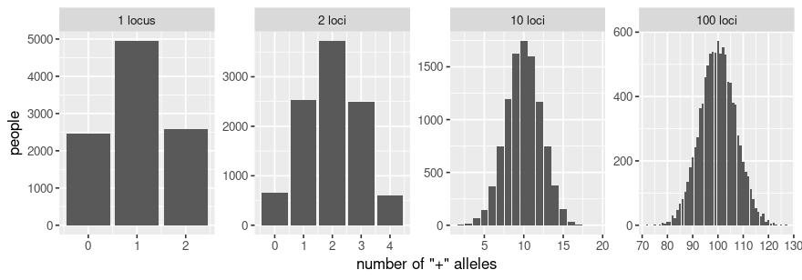
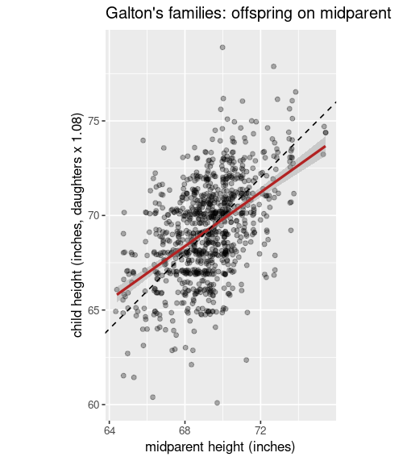
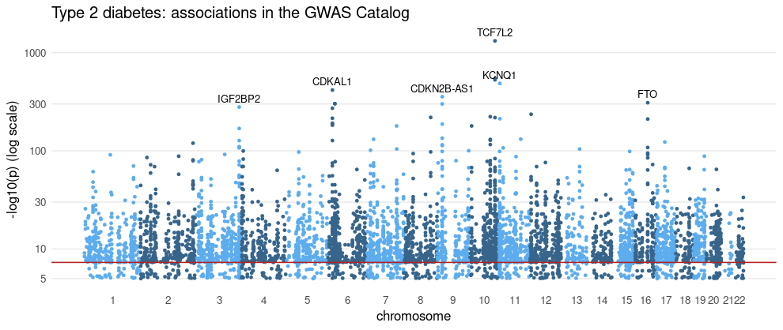

## Goal

By the end of this exercise you should be able to:

- simulate the polygenic model and see a normal distribution emerge;
- estimate heritability from Galton's family data with **`lm`**, and interpret the slope, its confidence interval and its limits;
- build a **Manhattan plot from scratch** in ggplot2 from a table of GWAS associations: cumulative positions, alternating colours, a threshold line and labels.

## Before you start

This page builds on the by-hand part of the [Exercise](exercise.qmd), so do that first. You need the packages dplyr, readr and ggplot2. Download two files and save them in a `data/` folder of your R project:

- [galton_families.csv](data/galton_families.csv): Galton's family heights in **inches**, one row per adult child (934 children, 205 families). From the R package [HistData](https://cran.r-project.org/package=HistData) 1.1.1, data set `GaltonFamilies`, which transcribes Galton's own notebook. `midparentHeight` is (father + 1.08 × mother)/2.
- [gwas_catalog_t2d.csv](data/gwas_catalog_t2d.csv): all associations for type 2 diabetes in the [GWAS Catalog](https://www.ebi.ac.uk/gwas/efotraits/MONDO_0005148), downloaded with the REST API v2 on 20 November 2026 and reduced to one row per SNP (the smallest p-value). `neg_log10_p` is −log10 of the p-value; `pos` is the GRCh38 position.

## Tasks

New this time: **`lm` for heritability** and a **Manhattan plot built step by step**. You know [`lm`](https://rdrr.io/r/stats/lm.html) from your data-analysis course; here the slope has a genetic meaning. A Manhattan plot needs one trick: positions restart at 1 on every chromosome, so we compute a **cumulative position** by adding the length of all earlier chromosomes.

```r
library(dplyr)
library(readr)
library(ggplot2)
```

### The polygenic model

**R1.** For 10 000 people, simulate the number of "+" alleles at 1, 2, 10 and 100 unlinked additive loci, each with allele frequency 0.5. `rbinom(n, size = 2, prob = 0.5)` gives the number of "+" alleles at one locus; put one locus per column in a matrix and add up each row with `rowSums`. Plot the distribution for each number of loci. How many classes do you see, and what shape appears?

```r
set.seed(1)
n_people <- 10000
polygenic <- function(n_loci) {
  # each locus: 2 alleles, each + with probability 0.5, so the genotype adds 0, 1 or 2
  g <- matrix(rbinom(n_people * n_loci, size = 2, prob = 0.5), nrow = n_people)
  rowSums(g)                         # number of "+" alleles per person
}
sims <- bind_rows(
  tibble(loci = "1 locus",    value = polygenic(1)),
  tibble(loci = "2 loci",     value = polygenic(2)),
  tibble(loci = "10 loci",    value = polygenic(10)),
  tibble(loci = "100 loci",   value = polygenic(100))
) |> mutate(loci = factor(loci, levels = c("1 locus", "2 loci", "10 loci", "100 loci")))
sims |> group_by(loci) |> summarise(classes = n_distinct(value), mean = mean(value), sd = sd(value))

ggplot(sims, aes(value)) + geom_bar() +
  facet_wrap(~ loci, scales = "free", nrow = 1) +
  labs(x = 'number of "+" alleles', y = "people")
```

### Galton's families

**R2.** Read `data/galton_families.csv`. How many families and children are there? Compute the mean and SD of the children's height for daughters and sons.

```r
galton <- read_csv("data/galton_families.csv")
galton
galton |> summarise(families = n_distinct(family), children = n())
galton |> group_by(gender) |> summarise(n = n(), mean_height = mean(childHeight), sd = sd(childHeight))
```

**R3.** Galton multiplied daughters' heights by 1.08 to put them on the male scale. Do the same in a new column `child_adj`, and check that the means of sons and daughters now agree. Then fit `lm(child_adj ~ midparentHeight)`. What is the slope, and its 95% confidence interval ([`confint`](https://rdrr.io/r/stats/confint.html))? What is your estimate of *h*²? Plot the data with the regression line and the line of slope 1.

```r
galton <- galton |>
  mutate(child_adj = ifelse(gender == "female", 1.08 * childHeight, childHeight))
galton |> group_by(gender) |> summarise(mean_adj = mean(child_adj))
fit <- lm(child_adj ~ midparentHeight, data = galton)
summary(fit)
coef(fit)
confint(fit)

ggplot(galton, aes(midparentHeight, child_adj)) +
  geom_jitter(width = 0.15, height = 0.15, alpha = 0.3) +
  geom_smooth(method = "lm", formula = y ~ x, colour = "firebrick") +
  geom_abline(slope = 1, intercept = 0, linetype = "dashed") +
  coord_equal() +
  labs(x = "midparent height (inches)", y = "child height (inches, daughters x 1.08)",
       title = "Galton's families: offspring on midparent")
```

(`geom_jitter` moves each point a little at random, because Galton rounded heights and many points would otherwise lie on top of each other.)

**R4.** Regress the children on the **father** alone and on the **mother** alone. Which slopes do you expect if *h*² is what you found in R3? Convert the father slope to an estimate of *h*². Finally, compute the correlation between the heights of fathers and mothers: did tall men marry tall women (assortative mating)?

```r
coef(lm(child_adj ~ father, data = galton))
coef(lm(child_adj ~ mother, data = galton))
2 * coef(lm(child_adj ~ father, data = galton))[2]
cor(galton$father, galton$mother)
```

### A Manhattan plot from the GWAS Catalog

**R5.** Read `data/gwas_catalog_t2d.csv`. How many SNPs and studies are in it? Show the eight strongest associations. How many SNPs are genome-wide significant (−log10 p ≥ −log10(5 × 10⁻⁸) = 7.3)?

```r
t2d <- read_csv("data/gwas_catalog_t2d.csv")
nrow(t2d)
n_distinct(t2d$study)
t2d |> arrange(desc(neg_log10_p)) |> select(rsid, chr, pos, neg_log10_p, mapped_gene) |> head(8)
t2d |> filter(neg_log10_p >= -log10(5e-8)) |> nrow()
```

**R6.** Build the Manhattan plot in four steps.

1. For each chromosome, find its length (here: the largest position in the data) and an **offset**: the summed length of all earlier chromosomes, with [`cumsum`](https://rdrr.io/r/base/cumsum.html).
2. [`left_join`](https://dplyr.tidyverse.org/reference/mutate-joins.html) the offsets to the SNPs and compute `bp_cum = pos + offset`.
3. Find the centre of each chromosome for the axis labels, and the strongest SNP of the six top genes (skip SNPs mapped to several genes) for text labels.
4. Plot −log10 p against `bp_cum`, colour alternate chromosomes with `chr %% 2`, add the 5 × 10⁻⁸ line, and use a log scale on y because the p-values span from 10⁻⁵ to 10⁻¹³¹⁵.

Which chromosomes have most associations?

```r
chrom_len <- t2d |> group_by(chr) |> summarise(len = max(pos)) |>
  mutate(offset = cumsum(as.numeric(len)) - len)
manh <- t2d |>
  left_join(chrom_len, by = "chr") |>
  mutate(bp_cum = pos + offset)
axis_pos <- manh |> group_by(chr) |> summarise(centre = (min(bp_cum) + max(bp_cum)) / 2)
top_genes <- manh |>
  filter(!grepl(";", mapped_gene)) |>
  group_by(mapped_gene) |> slice_max(neg_log10_p, n = 1, with_ties = FALSE) |>
  ungroup() |> slice_max(neg_log10_p, n = 6)
top_genes |> select(mapped_gene, chr, neg_log10_p)

ggplot(manh, aes(bp_cum, neg_log10_p, colour = factor(chr %% 2))) +
  geom_point(size = 0.8) +
  geom_hline(yintercept = -log10(5e-8), colour = "firebrick") +
  geom_text(data = top_genes, aes(label = mapped_gene), colour = "black", size = 3, vjust = -0.6) +
  scale_colour_manual(values = c("steelblue4", "steelblue2"), guide = "none") +
  scale_x_continuous(breaks = axis_pos$centre, labels = axis_pos$chr) +
  scale_y_log10(breaks = c(5, 10, 30, 100, 300, 1000)) +
  labs(x = "chromosome", y = "-log10(p) (log scale)",
       title = "Type 2 diabetes: associations in the GWAS Catalog") +
  theme_minimal() + theme(panel.grid.minor = element_blank(), panel.grid.major.x = element_blank())

t2d |> count(chr) |> arrange(desc(n)) |> head(5)
```

## Solutions

::: {.callout-note collapse="true" title="Solutions: In R"}

Run with `Rscript --vanilla` from the unit folder. Messages from loading packages and reading the CSV files are not shown.

**R1.**

```
# A tibble: 4 × 4
  loci     classes   mean    sd
  <fct>      <int>  <dbl> <dbl>
1 1 locus        3   1.01 0.710
2 2 loci         5   1.99 1.00
3 10 loci       18   9.98 2.25
4 100 loci      51 100.0  7.09
```

{width="90%" fig-align="center"}

One locus gives 3 classes in the ratio 1 : 2 : 1, two loci 5 classes (1 : 4 : 6 : 4 : 1). With 10 loci, 18 of the 21 possible classes appear (the extremes are too rare to show up in 10 000 people), and the shape is already a bell curve. With 100 loci, a smooth normal distribution: the binomial approaches the normal. The SD grows as √(*k*/2): 0.71, 1.0, 2.24, 7.07.

**R2.**

```
# A tibble: 934 × 8
   family father mother midparentHeight children childNum gender childHeight
   <chr>   <dbl>  <dbl>           <dbl>    <dbl>    <dbl> <chr>        <dbl>
 1 001      78.5   67              75.4        4        1 male          73.2
 2 001      78.5   67              75.4        4        2 female        69.2
 3 001      78.5   67              75.4        4        3 female        69
 4 001      78.5   67              75.4        4        4 female        69
 5 002      75.5   66.5            73.7        4        1 male          73.5
 6 002      75.5   66.5            73.7        4        2 male          72.5
 7 002      75.5   66.5            73.7        4        3 female        65.5
 8 002      75.5   66.5            73.7        4        4 female        65.5
 9 003      75     64              72.1        2        1 male          71
10 003      75     64              72.1        2        2 female        68
# ℹ 924 more rows
# A tibble: 1 × 2
  families children
     <int>    <int>
1      205      934
# A tibble: 2 × 4
  gender     n mean_height    sd
  <chr>  <int>       <dbl> <dbl>
1 female   453        64.1  2.36
2 male     481        69.2  2.62
```

205 families, 934 adult children. Sons average 69.2 inches (176 cm) and daughters 64.1 inches (163 cm).

**R3.**

```
# A tibble: 2 × 2
  gender mean_adj
  <chr>     <dbl>
1 female     69.2
2 male       69.2

Call:
lm(formula = child_adj ~ midparentHeight, data = galton)

Residuals:
    Min      1Q  Median      3Q     Max
-9.4992 -1.4956  0.0939  1.5365  9.1303

Coefficients:
                Estimate Std. Error t value Pr(>|t|)
(Intercept)     19.91751    2.82130    7.06 3.26e-12 ***
midparentHeight  0.71258    0.04075   17.49  < 2e-16 ***
---
Signif. codes:  0 ‘***’ 0.001 ‘**’ 0.01 ‘*’ 0.05 ‘.’ 0.1 ‘ ’ 1

Residual standard error: 2.244 on 932 degrees of freedom
Multiple R-squared:  0.247,	Adjusted R-squared:  0.2462
F-statistic: 305.8 on 1 and 932 DF,  p-value: < 2.2e-16

    (Intercept) midparentHeight
      19.917513        0.712585
                     2.5 %     97.5 %
(Intercept)     14.3806836 25.4543419
midparentHeight  0.6326079  0.7925621
```

{width="55%" fig-align="center"}

After the × 1.08 adjustment, sons and daughters both average 69.2 inches. The slope is **0.71** (95% CI 0.63 to 0.79), so ***h*² ≈ 0.71**. Three caveats make this an imperfect estimate: (1) families share **environment** (food, wealth), which inflates the slope; (2) siblings in the same family are **not independent** observations, so `lm` underestimates the SE and the CI is too narrow; (3) Galton's heights are rounded and partly reported, not measured. *R*² = 0.25 is not *h*²: *R*² is the fraction of the children's variance explained by the midparent, which also depends on how variable the midparents are.

**R4.**

```
(Intercept)      father
  39.684187    0.427027
(Intercept)      mother
   46.49690     0.35476
  father
0.854054
[1] 0.06036612
```

With *h*² ≈ 0.71, each single-parent slope should be about 0.36. The **mother** slope is 0.35, as expected. The **father** slope is 0.43, giving *h*² = 2 × 0.43 = 0.85, higher than the midparent estimate. (In Galton's data the father's height may be measured more accurately, or the 1.08 factor may not fit the mothers well; single-parent estimates are also noisier.) The correlation between the heights of fathers and mothers is only **0.06**: almost no assortative mating for height in these families.

**R5.**

```
[1] 5230
[1] 192
# A tibble: 8 × 5
  rsid         chr       pos neg_log10_p mapped_gene
  <chr>      <dbl>     <dbl>       <dbl> <chr>
1 rs7903146     10 112998590       1315. TCF7L2
2 rs35011184    10 112989975        543. TCF7L2
3 rs34872471    10 112994312        528. TCF7L2
4 rs2237897     11   2837316        485. KCNQ1
5 rs7766070      6  20686342        416. CDKAL1
6 rs10811661     9  22134095        355. CDKN2B-AS1
7 rs1558902     16  53769662        309. FTO
8 rs13214872     6  31287231        302. RPL3P2;WASF5P
[1] 4536
```

5 230 SNPs from 192 studies (in this reduced file). The top three SNPs are all in *TCF7L2*, close together on chromosome 10: one locus, several SNPs in LD (a tower). 4 536 of the 5 230 SNPs are genome-wide significant; the rest were reported at the suggestive level (the Catalog includes associations with p < 10⁻⁵).

**R6.**

```
# A tibble: 6 × 3
  mapped_gene   chr neg_log10_p
  <chr>       <dbl>       <dbl>
1 TCF7L2         10       1315.
2 KCNQ1          11        485.
3 CDKAL1          6        416.
4 CDKN2B-AS1      9        355.
5 FTO            16        309.
6 IGF2BP2         3        279.
# A tibble: 5 × 2
    chr     n
  <dbl> <int>
1     6   413
2     3   407
3     2   379
4    10   358
5     7   356
```

{width="100%" fig-align="center"}

*TCF7L2* towers above everything else, followed by *KCNQ1*, *CDKAL1*, *CDKN2B-AS1*, *FTO* and *IGF2BP2*. Associations are spread over **every** autosome: type 2 diabetes is highly polygenic. Large chromosomes tend to have more hits (6, 3 and 2 lead, and 10 is high because of the many SNPs around *TCF7L2*), as expected if risk loci are scattered through the genome. Counting SNPs is not the same as counting loci: one locus can contribute dozens of SNPs in LD. Unlike a plot of a single GWAS, this one has no grey "skyline" of null SNPs at the bottom: the Catalog keeps only the reported associations.
:::

## Where this leads

The same code makes a Manhattan plot from the full summary statistics of any GWAS, which many studies publish (the GWAS Catalog links to them). From there, the next steps are fine-mapping, polygenic scores, and the ethics module's discussion of what such scores should and should not be used for.
