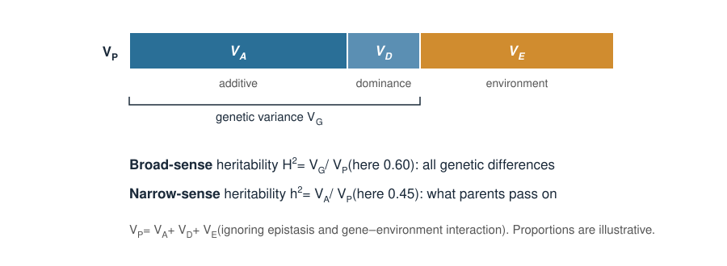
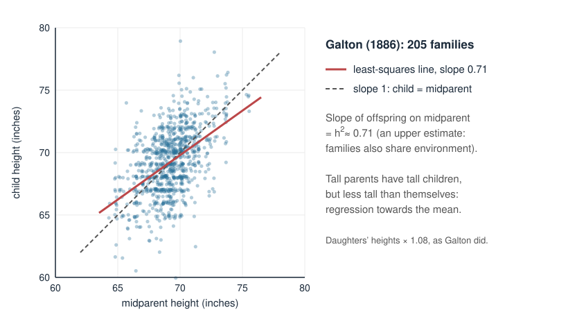
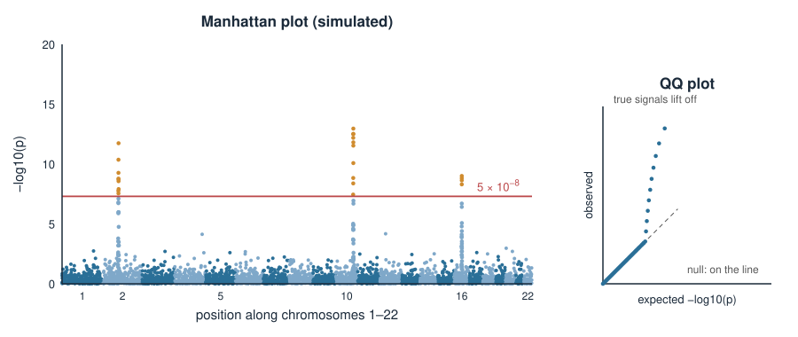

## About this lecture

Height, blood pressure and the risk of type 2 diabetes do not fall into Mendel's neat classes. They vary **continuously**, and depend on **many genes and the environment**: they are **complex** (quantitative, polygenic) traits.

- The **polygenic model**: many loci of small effect give a normal distribution.
- **Heritability**: broad (*H*²) and narrow (*h*²); **twin studies**; **parent–offspring regression** (slope = *h*²).
- What heritability does **not** mean.
- Finding the loci: **QTL mapping** in crosses, and **genome-wide association studies (GWAS)**: association, linkage disequilibrium, 5 × 10⁻⁸, Manhattan and QQ plots.
- **Polygenic scores** and the **missing heritability**.

Book: Hartwell, the chapter on complex traits. You need χ² and multiple testing (Part 1, Hardy–Weinberg), LOD scores (Part 2) and `lm` from your data-analysis course.

::: notes
This last unit of Part 7 ties together everything in the course. The Mendelian traits of Part 1 are the special case where one locus has a large effect. Most traits of medical and agricultural interest are complex. The statistics students already know, regression with lm, is exactly what Galton invented for this problem. The second half moves from heritability, a property of a population, to finding the actual loci, which is what GWAS do and what the GWAS Catalog records.
:::

## From Mendel's classes to a continuous trait {.smaller}

{width="88%" fig-align="center"}

- One locus with additive alleles gives **3** classes; *k* loci give 2*k* + 1 classes, and their frequencies follow a **binomial**, which approaches a **normal** curve.
- Add **environmental** variation and the steps blur: a smooth bell curve, as for height.
- This **polygenic model** (Fisher, 1918) reconciled Mendel's discrete inheritance with Galton's continuous variation.

::: notes
In the early 1900s there was a real conflict between Mendelians, who studied discrete traits, and biometricians, who studied continuous ones like height. Fisher showed in 1918 that many Mendelian loci, each with a small additive effect, produce continuous normal variation and the correlations between relatives that Galton had measured. The figure assumes each locus has two equally frequent alleles and that each "+" allele adds the same amount. With 20 loci there are already 41 classes; with environmental noise, nobody would see the steps. Nilsson-Ehle's wheat kernel colour with three loci is the textbook example of the transition. Students simulate this in R.
:::

## Genes and environment

The phenotype of one person: **P = G + E**, the sum of a genetic value and an environmental deviation.

- **Environment** here means everything that is not the DNA sequence: nutrition, disease, climate, chance events in development, measurement error.
- Height in many countries rose by roughly 10 cm over the 20th century: far too fast for genes, so this is **environment** (nutrition, health).
- Genes and environment can **interact**: the effect of a genotype may depend on the environment (G × E). Example: PKU is harmful only on a normal diet.

Across a population, we split the **variance** of *P*, not one person's height, into genetic and environmental parts.

::: notes
The key conceptual move: heritability is about variation among individuals in a population, not about how much of one person's height comes from genes. That question makes no sense, because genes and environment are both needed for any height at all. The secular increase in height is a good example of why high heritability does not mean a trait cannot change. The PKU example from Part 1 is the classic gene–environment interaction: the genotype causes disease only on a diet with phenylalanine.
:::

## Heritability: partitioning the variance {.smaller}

{width="80%" fig-align="center"}

- *V*<sub>A</sub>, **additive** variance: the part due to the average effects of alleles. This is what makes children resemble their parents.
- *V*<sub>D</sub>, **dominance** variance: interactions between the two alleles at a locus, which are not passed on as such (each parent passes one allele).
- **Narrow-sense heritability *h*² = *V*<sub>A</sub>/*V*<sub>P</sub>** predicts the response to selection and the parent–offspring resemblance.

::: notes
Two heritabilities: broad sense, all genetic variance over phenotypic variance; narrow sense, additive variance only. Why does dominance variance not pass to children? A parent passes one allele, not a genotype. If Aa has a special effect because of the combination, the child does not get that combination from one parent. Breeders care about narrow-sense heritability, because the response to selection is R = h² S, the breeder's equation: if you select parents that are S units above the mean, the offspring will be h² S above the mean. Epistasis, from the extensions-to-Mendel unit, adds a further interaction component, which we ignore here.
:::

## Twin studies {.smaller}

{width="80%" fig-align="center"}

- **MZ** twins share all their genes; **DZ** twins half, like ordinary siblings. Both share a family environment.
- If MZ twins are more alike than DZ twins, the difference reflects genes: **Falconer's formula** *h*² ≈ 2 [*r*(MZ) − *r*(DZ)].
- Assumption: MZ and DZ twins have **equally similar** environments. Twins **reared apart** and **adoption studies** test it.

::: notes
Twins are a natural experiment. The correlation of MZ twins includes all the genetic variance plus the shared environment; DZ twins share half of the additive genetic variance plus the same shared environment. The difference, doubled, estimates the additive part. The numbers in the figure are illustrative; for height in many studies MZ correlations are around 0.9. The equal-environments assumption is the main criticism: MZ twins may be treated more similarly. Twins reared apart, as in the Minnesota study, and adopted children compared with their biological and adoptive parents, are designs that separate genes from family environment. Scandinavian twin registries, including the Swedish Twin Registry, are among the largest sources of such data.
:::

## Parent–offspring regression {.smaller}

{width="70%" fig-align="center"}

- Regress offspring on the **midparent** (mean of the parents): the **slope = *h*²**. On **one** parent, slope = *h*²/2.
- Galton's 205 families (1886): slope **0.71**. Children of tall parents are tall, but **less extreme**: **regression towards the mean**, Galton's original use of the word "regression".
- Shared family environment also makes parents and children alike, so this is an **upper** estimate of *h*².

::: notes
This is lm from the data-analysis course, applied to the problem it was invented for. Why is the slope h squared? The covariance between midparent and offspring is half the additive variance, and the variance of the midparent is half the phenotypic variance, so the ratio is VA over VP. With one parent, the covariance is the same but the variance is the full VP, so the slope halves. The data are Galton's original family heights, from the HistData R package; students fit this model themselves. Galton multiplied daughters' heights by 1.08 to put them on the male scale; we follow him. Note that Galton's slope of 0.71 is probably inflated by shared environment and by assortative mating; modern estimates of the narrow-sense heritability of height in well-nourished populations are around 0.7 to 0.8 from family data.
:::

## Demo: parent–offspring regression

```{=html}
<link rel="stylesheet" href="../demos/dist/demo.css">
<div data-demo="heritability"></div>
<script src="../demos/dist/heritability.js"></script>
```

::: notes
The demo starts at h squared 0.6 with 200 families: the fitted slope is 0.58 plus or minus 0.10. Drag h squared to 0: the cloud becomes round, the slope near zero. Tick single parent: the slope halves. Then the shared environment preset, h squared 0.3 and c squared 0.3: the slope is about 0.6, so we would wrongly double the heritability. This is the main weakness of family designs.
:::

## What heritability does *not* mean

- It is **not** the fraction of one person's trait caused by genes. It describes **variation** in a **population**.
- It is **specific** to a population and environment. If everyone gets the same good food, *V*<sub>E</sub> shrinks and *h*² rises.
- High heritability does **not** mean unchangeable: height is highly heritable and rose ~10 cm in a century; PKU is genetic and treated with diet.
- Heritability **within** groups says **nothing** about the cause of differences **between** groups. (Lewontin: seeds from one sack grown in two fields of different soil.)
- *h*² = 0 does not mean genes are unimportant: the number of fingers has heritability near 0, because almost all variation is accidental.

::: notes
This slide is the ethics content of the unit, and links to the ethics module. Lewontin's thought experiment: take a sack of genetically varied seeds, plant half in good soil and half in poor soil. Within each field, height differences are mostly genetic: high heritability. Between the fields, the difference is entirely environmental. So a high heritability within human groups gives no support to genetic explanations of differences between groups. The fingers example: humans almost all have five fingers because of genes, but the rare variation is mostly due to accidents, so heritability is low. Heritability measures what causes differences, not what causes the trait.
:::

## Finding the loci: QTL mapping

A **quantitative trait locus (QTL)** is a locus that affects a quantitative trait.

- In a **cross** between two inbred lines (for example a tall and a short strain of mice or maize), the F2 or backcross offspring carry different combinations of the parents' chromosome segments.
- Genotype **markers** along the genome; for each marker, compare the trait between genotype classes (a *t*-test or regression).
- A marker **linked** to a QTL shows a difference; unlinked markers do not. The evidence is summarised as a **LOD score** along the chromosome, as in Part 2 (*LOD scores*).

QTL mapping needs a cross and gives broad regions (tens of cM). In humans we use **association** in unrelated people instead.

::: notes
QTL mapping is linkage mapping for quantitative traits. Students know linkage, recombination fractions and LOD scores from Part 2; the only change is that the phenotype is a number, so instead of counting recombinants we compare means. Because an F2 has had only one or two meioses since the parents, linkage blocks are long, so a QTL peak covers a large region. Fine mapping needs many more generations of recombination. Classic successes include fruit size in tomato and domestication genes in maize.
:::

## Genome-wide association studies (GWAS)

Genotype hundreds of thousands to millions of **SNPs** in thousands of unrelated people. For each SNP, test whether the trait differs between genotypes:

- **Quantitative trait**: regress the trait on the number of copies of the allele (0, 1, 2), with `lm`.
- **Disease**: compare allele frequencies in **cases** and **controls** (a 2 × 2 χ² test, or logistic regression).

Unrelated people share only tiny stretches of chromosome from common ancestors, so association is **local**: only SNPs in **linkage disequilibrium** (LD) with a causal variant show a signal.

**Linkage disequilibrium**: alleles at nearby SNPs are correlated in the population, because they sit on the same ancestral haplotypes that recombination has not yet broken up.

::: notes
The contrast with QTL mapping and with family-based LOD scores is the number of meioses: in a population, the haplotypes around a variant have been broken up by recombination over thousands of generations, so only SNPs very close to the causal variant, typically within tens of kilobases, are still correlated with it. That gives much finer resolution, but needs very many markers and very many people. LD is what makes GWAS work with a SNP array: we do not need to genotype the causal variant itself, only a SNP correlated with it.
:::

## Manhattan and QQ plots {.smaller}

{width="78%" fig-align="center"}

- One test per SNP, so about **a million tests**. At p < 0.05 we would expect ~50 000 false hits. The **genome-wide threshold** is **5 × 10⁻⁸** ≈ 0.05 / 1 000 000 (a Bonferroni correction for about a million independent tests).
- **Manhattan plot**: −log10 p against position. Causal loci appear as **towers**: the causal variant and its LD neighbours.
- **QQ plot**: observed against expected −log10 p. Null SNPs follow the line; true signals lift off at the top. If **all** points lift off, suspect **population structure** (the Wahlund effect of the Hardy–Weinberg unit) or genotyping errors.

::: notes
Recall from the Hardy–Weinberg exercise: one of 15 tests was significant at 5 percent, which was just chance. With a million tests, chance alone would give tens of thousands of hits. 5 times 10 to the minus 8 is the conventional threshold; it corresponds to roughly a million independent common variants in the genome of European-ancestry populations. Population structure is a classic trap: if cases come more often from one population than controls, every SNP with an allele frequency difference between the populations looks associated. Modern GWAS correct for this with principal components of the genotypes.
:::

## Demo: a simulated GWAS

```{=html}
<link rel="stylesheet" href="../demos/dist/demo.css">
<div data-demo="manhattan"></div>
<script src="../demos/dist/manhattan.js"></script>
```

::: notes
Five causal loci with small effects. At N equals 50 000, two of five pass the genome-wide line with the default seed. Press N equals 5 000: none. N equals 500 000: all five, and no false loci. The expected z of a causal SNP is beta times the square root of 2 f (1 − f) N, so halving the effect requires four times the sample. Then the null preset: the QQ plot follows the diagonal and nothing passes 10 to the minus 5. Point out the towers: many SNPs in LD with each causal one.
:::

## What GWAS have found

- **Type 2 diabetes**: the strongest association is rs7903146 in an intron of ***TCF7L2*** (10q25). In a 2024 multi-ancestry study of about 2.5 million people (Suzuki et al., *Nature*), its p-value was about 10⁻¹³¹⁵. Each copy of the risk allele raises the risk only modestly.
- The GWAS Catalog lists **thousands** of T2D associations (*KCNQ1*, *CDKAL1*, *CDKN2B*, *FTO*, *IGF2BP2*, …) and **tens of thousands** for **height** (*GDF5*, *ZBTB38*, *LCORL*, *HMGA2*, …).
- Most hits are **non-coding**: they change **regulation** of nearby genes (Part 6), not protein sequence.
- Each variant explains a **tiny** fraction of the variance: complex traits are truly **polygenic**.

::: notes
These are the facts students look up in the exercise via the GWAS Catalog. A p-value of 10 to the minus 1315 is not a measure of a large effect: it reflects an enormous sample. The odds ratio per allele for TCF7L2 is modest, of the order of 1.3 to 1.4 in European-ancestry studies; check the Catalog entry for the exact estimate in a given study. TCF7L2 is a transcription factor in the Wnt pathway; the risk allele is thought to affect insulin secretion. FTO was first found as an obesity locus, and its T2D signal works mostly through body weight. The height loci include genes of the growth plate and skeletal development, which makes biological sense.
:::

## Polygenic scores and the missing heritability

**Polygenic score**: add up a person's risk alleles, each weighted by its GWAS effect size: PGS = Σ *β*<sub>*i*</sub> × (number of risk alleles at SNP *i*).

- Useful for **groups** (risk stratification, research); weak for **individuals**: most people with a high score do not get the disease.
- Scores built in one ancestry group predict **worse** in others: allele frequencies and LD differ (drift, previous unit).

**Missing heritability**: twin and family studies give *h*² ≈ 0.8 for height, but the first GWAS hits together explained only a few percent. Explanations:

- many **more** loci of **tiny** effect, below the threshold (larger samples keep finding more);
- **rare** variants that arrays do not capture;
- family designs **overestimating** *h*² (shared environment, as in the demo).

::: notes
A polygenic score is a weighted sum, exactly the polygenic model of the first slide turned into a prediction. For height, scores now explain a substantial part of the variance in European-ancestry samples, much less in others. This transferability problem is an equity issue: most GWAS participants have been of European ancestry, so the benefits of genetic prediction are unequally distributed. That links to the ethics module. The missing heritability was a major puzzle around 2010; much of it has since been found by bigger GWAS and by methods that estimate heritability from all SNPs together. The gap that remains is partly rare variants and partly overestimation in family studies.
:::

## Summary

- Complex traits: **many loci + environment** give continuous, normal variation (Fisher's polygenic model).
- *V*<sub>P</sub> = *V*<sub>A</sub> + *V*<sub>D</sub> + *V*<sub>E</sub>. **Broad** *H*² = *V*<sub>G</sub>/*V*<sub>P</sub>; **narrow** *h*² = *V*<sub>A</sub>/*V*<sub>P</sub>.
- Estimates: twins *h*² ≈ 2[*r*(MZ) − *r*(DZ)]; offspring on midparent **slope = *h*²** (Galton: 0.71); on one parent slope = *h*²/2.
- Heritability is about **variation in one population and environment**; it says nothing about individuals or differences between groups.
- **QTL mapping** uses crosses and linkage (LOD); **GWAS** use association and **LD** in unrelated people, with p < **5 × 10⁻⁸**.
- Hits such as *TCF7L2* for T2D have small effects; **polygenic scores** add them up; part of the heritability is still **missing**.

::: notes
The exam-level skills: compute heritability from twin correlations or a regression slope; interpret a Manhattan plot and a QQ plot; explain why the threshold is 5 times 10 to the minus 8; and explain clearly what heritability does not mean.
:::

## Where this leads

- **Ethics module**: polygenic scores in embryo selection and insurance, direct-to-consumer genomics, and the misuse of heritability.
- **Back to Part 6**: most GWAS hits sit in regulatory DNA; finding the gene they regulate uses the tools of gene regulation.
- In the exercise: heritability by hand, the two demos, the GWAS Catalog for type 2 diabetes and height, and in R: Galton's families with `lm`, and a Manhattan plot built from scratch with ggplot2.

::: notes
This is the last unit before the ethics module, and it gives the ethics module much of its material. Encourage students to read one GWAS paper from the Catalog, which supports the literature outcome of the course.
:::
