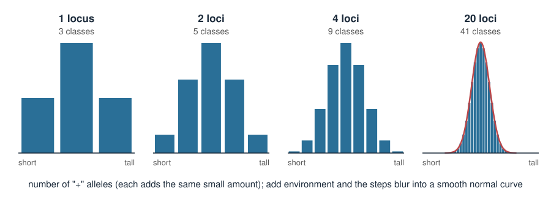
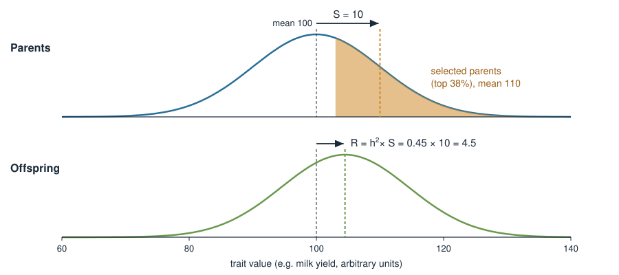
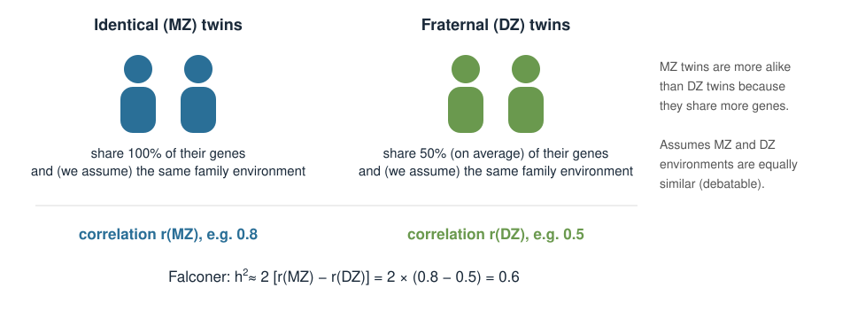
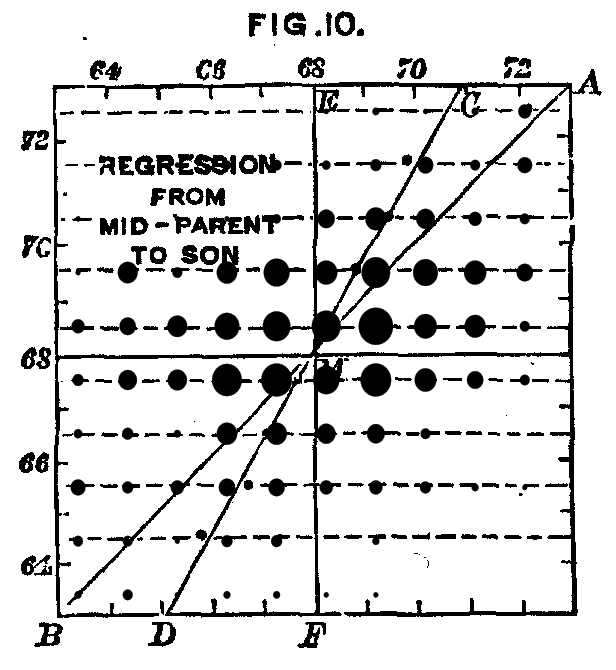
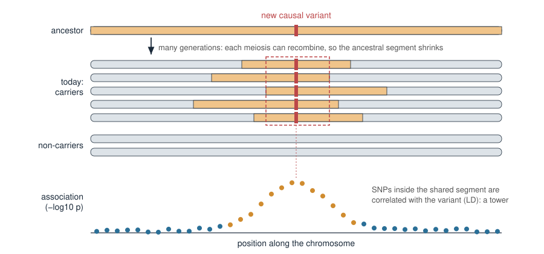

## About this lecture

Height, blood pressure and the risk of type 2 diabetes do not fall into Mendel's neat classes. They vary **continuously**, and depend on **many genes and the environment**: they are **complex** (quantitative, polygenic) traits.

- The **polygenic model**: many loci of small effect give a normal distribution.
- **Heritability**: variance components with numbers, broad (*H*²) and narrow (*h*²); the **breeder's equation**; **twin studies**; **parent–offspring regression** (slope = *h*²).
- What heritability does **not** mean.
- Finding the loci: **QTL mapping** in crosses, and **genome-wide association studies (GWAS)**: linkage disequilibrium, a case–control test by hand, 5 × 10⁻⁸, and how to read Manhattan and QQ plots.
- **Polygenic scores** and the **missing heritability**.

Book: Hartwell, the chapter on complex traits. You need χ² and multiple testing (Part 1, Hardy–Weinberg), LOD scores (Part 2) and `lm` from your data-analysis course.

::: notes
This last unit of Part 7 ties together everything in the course. The Mendelian traits of Part 1 are the special case where one locus has a large effect. Most traits of medical and agricultural interest are complex. The statistics students already know, regression with lm, is exactly what Galton invented for this problem. The second half moves from heritability, a property of a population, to finding the actual loci, which is what GWAS do and what the GWAS Catalog records.
:::

## From Mendel's classes to a continuous trait {.smaller}

{width="88%" fig-align="center"}

- One locus with additive alleles gives **3** classes; *k* loci give 2*k* + 1 classes, and their frequencies follow a **binomial**, which approaches a **normal** curve.
- Add **environmental** variation and the steps blur: a smooth bell curve, as for height.
- This **polygenic model** (Fisher, 1918) reconciled Mendel's discrete inheritance with Galton's continuous variation.

::: notes
In the early 1900s there was a real conflict between Mendelians, who studied discrete traits, and biometricians, who studied continuous ones like height. Fisher showed in 1918 that many Mendelian loci, each with a small additive effect, produce continuous normal variation and the correlations between relatives that Galton had measured. The figure assumes each locus has two equally frequent alleles and that each "+" allele adds the same amount. With 20 loci there are already 41 classes; with environmental noise, nobody would see the steps. Nilsson-Ehle's wheat kernel colour with three loci is the textbook example of the transition. Students simulate this in R.
:::

## Two additive loci, by hand

*AaBb* × *AaBb*, unlinked. Each "+" allele (*A* or *B*) adds the same amount; *a* and *b* add nothing.

1. Each parent's gamete carries 0, 1 or 2 "+" alleles; each of the 4 allele copies in the child is "+" with probability ½, independently.
2. So the number of "+" alleles in the child is **Binomial(4, ½)**:

| "+" alleles | 0 | 1 | 2 | 3 | 4 |
|---|---|---|---|---|---|
| genotypes | *aabb* | *Aabb*, *aaBb* | *AAbb*, *AaBb*, *aaBB* | *AABb*, *AaBB* | *AABB* |
| fraction | 1/16 | 4/16 | 6/16 | 4/16 | 1/16 |

3. In general, *k* loci give **2*k* + 1** classes, and each **extreme** class has frequency (¼)<sup>*k*</sup>: 1/16 for 2 loci, 1/4096 for 6, about 1 in a million for 10.

This is the method for any number of loci: count "+" alleles, use the binomial (Pascal's triangle).

::: notes
This is the polygenic model in its smallest form. Write out the 16 squares of the Punnett square if students need it, then show that grouping by the number of plus alleles gives 1, 4, 6, 4, 1, a row of Pascal's triangle. The extreme classes become rare very fast, which is why Nilsson-Ehle could estimate the number of loci in wheat from how often the parental extremes reappeared in the F2. Assumptions: additive alleles with equal effects, no dominance, unlinked loci, and allele frequency one half in the F2. Exercise B1 uses three loci; same method.
:::

## Genes and environment

The phenotype of one person: **P = G + E**, the sum of a genetic value and an environmental deviation.

- **Environment** here means everything that is not the DNA sequence: nutrition, disease, climate, chance events in development, measurement error.
- Height in many countries rose by roughly 10 cm over the 20th century: far too fast for genes, so this is **environment** (nutrition, health).
- Genes and environment can **interact**: the effect of a genotype may depend on the environment (G × E). Example: PKU is harmful only on a normal diet.

Across a population, we split the **variance** of *P*, not one person's height, into genetic and environmental parts.

::: notes
The key conceptual move: heritability is about variation among individuals in a population, not about how much of one person's height comes from genes. That question makes no sense, because genes and environment are both needed for any height at all. The secular increase in height is a good example of why high heritability does not mean a trait cannot change. The PKU example from Part 1 is the classic gene–environment interaction: the genotype causes disease only on a diet with phenylalanine.
:::

## Separating *V*<sub>G</sub> from *V*<sub>E</sub>: inbred lines and the F2

In plants and animals we can **remove** the genetic variance on purpose:

| Population | genotypes | variance contains | example variance |
|---|---|---|---|
| inbred parent line P1 | all identical | *V*<sub>E</sub> only | 4 |
| inbred parent line P2 | all identical | *V*<sub>E</sub> only | 4 |
| F1 (P1 × P2) | all identical (heterozygous) | *V*<sub>E</sub> only | 4 |
| F2 (F1 × F1) | segregating | *V*<sub>G</sub> + *V*<sub>E</sub> | 10 |

1. *V*<sub>E</sub> = 4 (the average of the uniform populations).
2. *V*<sub>G</sub> = *V*<sub>F2</sub> − *V*<sub>E</sub> = 10 − 4 = 6.
3. *H*² = *V*<sub>G</sub>/*V*<sub>F2</sub> = 6/10 = **0.6**.

In humans we cannot make inbred lines, so we use **relatives** instead: twins and families (next slides).

::: notes
This is the cleanest way to see what the variance components mean. Every plant in an inbred line, or in the F1 between two inbred lines, has the same genotype, so any variation among them must be environmental: soil, light, measurement. The F2 segregates, so it has genetic variance on top. The numbers are invented for illustration. The method assumes the environment acts the same in all four populations, and that the F2 is grown alongside the others. It gives broad-sense heritability; separating additive from dominance variance needs more crosses, such as backcrosses, which we skip.
:::

## Heritability: partitioning the variance {.smaller}

{width="80%" fig-align="center"}

- *V*<sub>A</sub>, **additive** variance: the part due to the average effects of alleles. This is what makes children resemble their parents.
- *V*<sub>D</sub>, **dominance** variance: interactions between the two alleles at a locus, which are not passed on as such (each parent passes one allele).
- **Narrow-sense heritability *h*² = *V*<sub>A</sub>/*V*<sub>P</sub>** predicts the response to selection and the parent–offspring resemblance.

::: notes
Two heritabilities: broad sense, all genetic variance over phenotypic variance; narrow sense, additive variance only. Why does dominance variance not pass to children? A parent passes one allele, not a genotype. If Aa has a special effect because of the combination, the child does not get that combination from one parent. Breeders care about narrow-sense heritability, because the response to selection is R = h² S, the breeder's equation: if you select parents that are S units above the mean, the offspring will be h² S above the mean. Epistasis, from the extensions-to-Mendel unit, adds a further interaction component, which we ignore here.
:::

## Variance components: a worked example

The proportions in the figure, as numbers (trait units²):

| *V*<sub>P</sub> | *V*<sub>A</sub> | *V*<sub>D</sub> | *V*<sub>E</sub> |
|---|---|---|---|
| 100 | 45 | 15 | 40 |

1. *V*<sub>G</sub> = *V*<sub>A</sub> + *V*<sub>D</sub> = 45 + 15 = 60.
2. Broad sense: *H*² = *V*<sub>G</sub>/*V*<sub>P</sub> = 60/100 = **0.60**.
3. Narrow sense: *h*² = *V*<sub>A</sub>/*V*<sub>P</sub> = 45/100 = **0.45**.

Always *h*² ≤ *H*². The gap is the dominance (and epistatic) variance: genetic, but **not** passed from parent to child as such.

Heritabilities are ratios of **variances**, not of standard deviations: never take a square root of *h*² to compare traits.

::: notes
Put numbers to the figure. The steps are just definitions, but students often mix up which numerator goes with which heritability, and whether VD belongs to VG. The point about variances versus standard deviations matters later: when we say a SNP explains 0.1 percent of the variance, we mean a variance ratio. Exercise B2 asks the same with cattle milk yield. The narrow-sense value is the one we need for the breeder's equation on the next slide.
:::

## The breeder's equation: *R* = *h*² *S*

{width="60%" fig-align="center"}

- **Selection differential *S***: selected parents' mean minus population mean (110 − 100 = 10).
- **Response *R***: how far the **offspring** mean moves. Only the additive part is passed on: *R* = *h*² *S* = 0.45 × 10 = **4.5**.

::: notes
This is how animal and plant breeders use narrow-sense heritability every day. Read the figure: the selected parents, the orange tail, have a mean 10 units above the population. Their offspring move only 4.5 units, because the parents were partly lucky with their environment and their dominance combinations, and neither is inherited. This is regression towards the mean, the same thing Galton saw in families. If h squared were zero, there would be no response at all however hard one selected; if it were one, the offspring would be as extreme as the parents. Repeated over generations, the response accumulates, as long as the additive variance lasts: much of the long-term rise in dairy cattle milk yield is due to such selection, alongside better feeding. Exercise B5 applies the same equation. The equation can also be read backwards: from a measured response and differential, h squared equals R over S, which is the realised heritability.
:::

## Twin studies {.smaller}

{width="80%" fig-align="center"}

- **MZ** twins share all their genes; **DZ** twins half, like ordinary siblings. Both share a family environment.
- If MZ twins are more alike than DZ twins, the difference reflects genes: **Falconer's formula** *h*² ≈ 2 [*r*(MZ) − *r*(DZ)].
- Assumption: MZ and DZ twins have **equally similar** environments. Twins **reared apart** and **adoption studies** test it.

::: notes
Twins are a natural experiment. The correlation of MZ twins includes all the genetic variance plus the shared environment; DZ twins share half of the additive genetic variance plus the same shared environment. The difference, doubled, estimates the additive part. The numbers in the figure are illustrative; for height in many studies MZ correlations are around 0.9. The equal-environments assumption is the main criticism: MZ twins may be treated more similarly. Twins reared apart, as in the Minnesota study, and adopted children compared with their biological and adoptive parents, are designs that separate genes from family environment. Scandinavian twin registries, including the Swedish Twin Registry, are among the largest sources of such data.
:::

## Falconer's formula, step by step

Split the variance into additive genes (*h*²), **shared** family environment (*c*²) and **unique** environment (*e*²), with *h*² + *c*² + *e*² = 1. Then (additive genes only):

| | shares genes | shares family environment | correlation |
|---|---|---|---|
| MZ twins | all | yes | *r*(MZ) = *h*² + *c*² |
| DZ twins | half, on average | yes | *r*(DZ) = ½ *h*² + *c*² |

With the numbers in the figure, *r*(MZ) = 0.8 and *r*(DZ) = 0.5:

1. Subtract: *r*(MZ) − *r*(DZ) = ½ *h*², so ***h*² = 2 [*r*(MZ) − *r*(DZ)]** = 2 × 0.3 = **0.6**.
2. Shared environment: *c*² = *r*(MZ) − *h*² = 2*r*(DZ) − *r*(MZ) = 1.0 − 0.8 = **0.2**.
3. Unique environment (and measurement error): *e*² = 1 − *r*(MZ) = **0.2**: the reason MZ twins are not identical.

::: notes
The two rows are the whole model: everything that makes twins alike is either shared genes or shared environment. The shared environment cancels when we subtract, which is the trick of the twin design. The last line is a nice point to stress: MZ twins are genetically identical, so anything that makes them different must be environment in the broad sense, including chance in development. Assumptions: only additive genetic effects (dominance would make r of DZ less than half the genetic part and inflate the h squared estimate), equal environments for MZ and DZ pairs, and twins representative of the population. Exercise B3 asks the same with body mass index.
:::

## Parent–offspring regression {.smaller}

{width="70%" fig-align="center"}

- Regress offspring on the **midparent** (mean of the parents): the **slope = *h*²**. On **one** parent, slope = *h*²/2.
- Galton's 205 families (1886): slope **0.71**. Children of tall parents are tall, but **less extreme**: **regression towards the mean**, Galton's original use of the word "regression".
- Shared family environment also makes parents and children alike, so this is an **upper** estimate of *h*².

::: notes
This is lm from the data-analysis course, applied to the problem it was invented for. Why is the slope h squared? The covariance between midparent and offspring is half the additive variance, and the variance of the midparent is half the phenotypic variance, so the ratio is VA over VP. With one parent, the covariance is the same but the variance is the full VP, so the slope halves. The data are Galton's original family heights, from the HistData R package; students fit this model themselves. Galton multiplied daughters' heights by 1.08 to put them on the male scale; we follow him. Note that Galton's slope of 0.71 is probably inflated by shared environment and by assortative mating; modern estimates of the narrow-sense heritability of height in well-nourished populations are around 0.7 to 0.8 from family data.
:::

## Galton's own plot, and predicting a child

:::: {.columns}
::: {.column width="42%"}
{width="100%"}
[Figure: Madprime after Galton (1889), CC BY-SA 4.0, via Wikimedia Commons](https://commons.wikimedia.org/wiki/File:Galton-height-regress.png){.photo-credit}
:::

::: {.column width="58%"}
Galton's diagram (*Natural Inheritance*, 1889), in inches. Here the **midparent** is on the vertical axis and the **son** on the horizontal; dot size = number of sons. Line **AB**: sons exactly as tall as their midparents. Line **CD**, Galton's regression: per inch of midparent above the mean, sons are only about ⅔ inch above it.

**Prediction**: child's deviation = *h*² × midparent deviation.

- Midparent 6 cm above the mean, *h*² = 0.7: child expected **4.2 cm** above the mean.
- Midparent 6 cm **below**: child expected 4.2 cm below. Regression works in both directions.

The **variance** does not shrink: children scatter around their predicted value, and some are more extreme than their parents.
:::
::::

::: notes
This is Galton's own regression figure from his 1889 book, redrawn with the circles sized by the counts in his table. Note that the axes are swapped compared with our plots: each horizontal row of dots is one midparent height, and the dots along it are the sons' heights, taken from his family table. Point to the two lines: AB is where sons would be if they were exactly as tall as their midparents; CD runs through the centre of each row, and it is steeper in this orientation, which means the sons change less than the midparents: tall parents have sons who are on average less tall, and short parents sons who are less short. Galton called it regression towards mediocrity. Two misconceptions to address. First, regression is not a force that makes the population more uniform: the next generation has the same variance, because the children also have their own environmental deviations and new combinations of alleles. Second, a prediction is an average; individual children vary around it. The 0.7 is an illustrative heritability close to Galton's slope. Exercise B4 and E2 use the same prediction.
:::

## Demo: parent–offspring regression

```{=html}
<link rel="stylesheet" href="../demos/dist/demo.css">
<div data-demo="heritability"></div>
<script src="../demos/dist/heritability.js"></script>
```

::: notes
The demo starts at h squared 0.6 with 200 families: the fitted slope is 0.58 plus or minus 0.10. Drag h squared to 0: the cloud becomes round, the slope near zero. Tick single parent: the slope halves. Then the shared environment preset, h squared 0.3 and c squared 0.3: the slope is about 0.6, so we would wrongly double the heritability. This is the main weakness of family designs.
:::

## What heritability does *not* mean

- It is **not** the fraction of one person's trait caused by genes. It describes **variation** in a **population**.
- It is **specific** to a population and environment. If everyone gets the same good food, *V*<sub>E</sub> shrinks and *h*² rises.
- High heritability does **not** mean unchangeable: height is highly heritable and rose ~10 cm in a century; PKU is genetic and treated with diet.
- Heritability **within** groups says **nothing** about the cause of differences **between** groups. (Lewontin: seeds from one sack grown in two fields of different soil.)
- *h*² = 0 does not mean genes are unimportant: the number of fingers has heritability near 0, because almost all variation is accidental.

::: notes
This slide is the ethics content of the unit, and links to the ethics module. Lewontin's thought experiment: take a sack of genetically varied seeds, plant half in good soil and half in poor soil. Within each field, height differences are mostly genetic: high heritability. Between the fields, the difference is entirely environmental. So a high heritability within human groups gives no support to genetic explanations of differences between groups. The fingers example: humans almost all have five fingers because of genes, but the rare variation is mostly due to accidents, so heritability is low. Heritability measures what causes differences, not what causes the trait.
:::

## Finding the loci: QTL mapping

A **quantitative trait locus (QTL)** is a locus that affects a quantitative trait.

- In a **cross** between two inbred lines (for example a tall and a short strain of mice or maize), the F2 or backcross offspring carry different combinations of the parents' chromosome segments.
- Genotype **markers** along the genome; for each marker, compare the trait between genotype classes (a *t*-test or regression).
- A marker **linked** to a QTL shows a difference; unlinked markers do not. The evidence is summarised as a **LOD score** along the chromosome, as in Part 2 (*LOD scores*).

QTL mapping needs a cross and gives broad regions (tens of cM). In humans we use **association** in unrelated people instead.

::: notes
QTL mapping is linkage mapping for quantitative traits. Students know linkage, recombination fractions and LOD scores from Part 2; the only change is that the phenotype is a number, so instead of counting recombinants we compare means. Because an F2 has had only one or two meioses since the parents, linkage blocks are long, so a QTL peak covers a large region. Fine mapping needs many more generations of recombination. Classic successes include fruit size in tomato and domestication genes in maize.
:::

## Genome-wide association studies (GWAS)

Genotype hundreds of thousands to millions of **SNPs** in thousands of unrelated people. For each SNP, test whether the trait differs between genotypes:

- **Quantitative trait**: regress the trait on the number of copies of the allele (0, 1, 2), with `lm`.
- **Disease**: compare allele frequencies in **cases** and **controls** (a 2 × 2 χ² test, or logistic regression).

Unrelated people share only tiny stretches of chromosome from common ancestors, so association is **local**: only SNPs in **linkage disequilibrium** (LD) with a causal variant show a signal.

**Linkage disequilibrium**: alleles at nearby SNPs are correlated in the population, because they sit on the same ancestral haplotypes that recombination has not yet broken up.

::: notes
The contrast with QTL mapping and with family-based LOD scores is the number of meioses: in a population, the haplotypes around a variant have been broken up by recombination over thousands of generations, so only SNPs very close to the causal variant, typically within tens of kilobases, are still correlated with it. That gives much finer resolution, but needs very many markers and very many people. LD is what makes GWAS work with a SNP array: we do not need to genotype the causal variant itself, only a SNP correlated with it.
:::

## Linkage disequilibrium makes towers

{width="64%" fig-align="center"}

- A new variant arises on **one** ancestral chromosome (orange). Recombination shrinks the shared segment around it; today's carriers still share a short **core** (dashed box).
- SNPs in the core are correlated with the variant (**LD**), so they are associated too: a **tower**.

::: notes
This picture explains three things at once. Why a SNP array works: one SNP in the core tags the causal variant. Why the signal is a tower rather than a single dot: every SNP in LD with the causal variant carries part of its signal. And why the top SNP is not necessarily causal: several SNPs in the core are almost equally correlated with it, and noise decides which one is highest. The length of the core depends on the age of the variant and the local recombination rate; in European-ancestry populations LD blocks are typically tens of kilobases, shorter in African populations, which have a larger long-term effective size. That difference is why fine mapping benefits from diverse samples. The figure is schematic: real carriers would show many more chromosomes.
:::

## A case–control test by hand, step 1: allele counts

Invented example: 500 cases and 500 controls genotyped at one SNP. Count **alleles** (two per person):

| | risk allele T | other allele C | total |
|---|---|---|---|
| cases | 400 | 600 | 1000 |
| controls | 300 | 700 | 1000 |
| total | 700 | 1300 | 2000 |

1. **Allele frequencies**: T in cases 400/1000 = **0.40**; in controls 300/1000 = **0.30**.
2. **Odds ratio** (the effect size):

$$
\text{OR} = \frac{400/600}{300/700} = \frac{0.667}{0.429} = \mathbf{1.56}.
$$

Each T allele is associated with about 1.56 times higher odds of being a case. An OR of 1 means no association.

::: notes
This is the simplest form of a disease GWAS test, done for one SNP. The numbers are invented and the effect is larger than typical GWAS hits, to keep the arithmetic easy. Counting alleles rather than people doubles the sample and assumes the alleles act additively. The odds ratio compares odds, not probabilities: in cases the odds of carrying T rather than C is 400 to 600, in controls 300 to 700. Real GWAS hits for type 2 diabetes have odds ratios of about 1.1 to 1.4 per allele, which is why very large samples are needed. Exercise B7 has a table with other numbers.
:::

## Step 2: the χ² test, and the genome-wide threshold

**Expected counts** under no association = row total × column total / grand total:

| | T | C |
|---|---|---|
| cases | 1000 × 700/2000 = 350 | 1000 × 1300/2000 = 650 |
| controls | 350 | 650 |

Every cell is 50 away from its expectation:

$$
\chi^2 = \frac{50^2}{350} + \frac{50^2}{650} + \frac{50^2}{350} + \frac{50^2}{650} = 7.14 + 3.85 + 7.14 + 3.85 = \mathbf{22.0}, \quad \text{df} = 1.
$$

- p ≈ 3 × 10⁻⁶: significant at 0.05 (χ² > 3.84), but **not** genome-wide (needs χ² > **29.7** for p < 5 × 10⁻⁸).
- With the same frequencies, χ² grows in proportion to *N*: 29.7/22.0 ≈ 1.35 times as many people would reach it.

::: notes
The 2 by 2 table has df 1: once the margins are fixed, one cell determines the rest. The expected count rule is the same as for any contingency table: if allele and case status were independent, the fraction of T would be the same in both rows. The point of the last two lines: whether a SNP is significant depends both on the effect and on the sample size, which is why the same SNP can be missed in one study and found in a bigger one. The threshold value 29.7 is the χ² with df 1 that has a tail probability of 5 times 10 to the minus 8; students can get it in R with qchisq.
:::

## A million tests: why 5 × 10⁻⁸

A GWAS repeats the test of the last slide at about **a million** independent SNPs. If **none** had any effect, how many would pass by chance?

| threshold | expected false hits among 10⁶ null SNPs | −log10 threshold |
|---|---|---|
| p < 0.05 | 10⁶ × 0.05 = **50 000** | 1.3 |
| p < 10⁻⁵ ("suggestive") | 10⁶ × 10⁻⁵ = **10** | 5 |
| p < 5 × 10⁻⁸ | 10⁶ × 5 × 10⁻⁸ = **0.05** | 7.3 |

**Bonferroni**: divide the error rate you accept for the **whole** study by the number of tests: 0.05 / 10⁶ = **5 × 10⁻⁸**. Then the chance of even **one** false hit in the whole scan is about 5%.

::: notes
Recall from the Hardy–Weinberg exercise: one of 15 tests was significant at 5 percent, which was just chance. With a million tests, chance alone gives tens of thousands of hits at 0.05. The number of tests is "about a million independent" because neighbouring SNPs are in LD, so the effective number of tests is smaller than the number of SNPs genotyped; a million is the conventional estimate for common variants in European-ancestry genomes. The minus log10 column is what the Manhattan plot shows on its y-axis: 7.3 is the red line. Exercise B6 uses the same multiplication.
:::

## Reading a Manhattan plot, step by step

{width="56%" fig-align="center"}

1. **One dot = one SNP.** *x*: position, chromosome by chromosome. *y*: −log10 p (*y* = 2 is p = 0.01; *y* = 13 is p = 10⁻¹³).
2. **The red line** is 5 × 10⁻⁸ (*y* = 7.3): dots above it are genome-wide significant.
3. **Count towers, not dots**: 3 loci here (chromosomes 2, 10, 16), each a causal variant plus its LD neighbours.
4. **Height is evidence, not effect size**: it also grows with sample size and allele frequency.
5. **QQ plot**: null SNPs lie on the diagonal; true signals lift off at the **top**. If **all** points lie above it, suspect **population structure** or genotyping errors.

::: notes
Walk through the plot in this order every time. Students often read each dot above the line as a separate discovery; the tower on chromosome 10 is one locus with many SNPs in LD. The highest dot in a tower is the best-tagged SNP, not necessarily the causal one. The height point connects to the TCF7L2 example coming up: a p-value of 10 to the minus 1315 reflects millions of participants, not a huge effect. Population structure is a classic trap: if cases come more often from one population than controls, every SNP with an allele frequency difference between the populations looks associated, and the whole QQ plot lifts. Modern GWAS correct for this with principal components of the genotypes. The plot is simulated.
:::

## Demo: a simulated GWAS

```{=html}
<link rel="stylesheet" href="../demos/dist/demo.css">
<div data-demo="manhattan"></div>
<script src="../demos/dist/manhattan.js"></script>
```

::: notes
Five causal loci with small effects. At N equals 50 000, two of five pass the genome-wide line with the default seed. Press N equals 5 000: none. N equals 500 000: all five, and no false loci. The expected z of a causal SNP is beta times the square root of 2 f (1 − f) N, so halving the effect requires four times the sample. Then the null preset: the QQ plot follows the diagonal and nothing passes 10 to the minus 5. Point out the towers: many SNPs in LD with each causal one.
:::

## What GWAS have found

- **Type 2 diabetes**: the strongest association is rs7903146 in an intron of ***TCF7L2*** (10q25). In a 2024 multi-ancestry study of about 2.5 million people (Suzuki et al., *Nature*), its p-value was about 10⁻¹³¹⁵. Each copy of the risk allele raises the risk only modestly.
- The GWAS Catalog lists **thousands** of T2D associations (*KCNQ1*, *CDKAL1*, *CDKN2B*, *FTO*, *IGF2BP2*, …) and **tens of thousands** for **height** (*GDF5*, *ZBTB38*, *LCORL*, *HMGA2*, …).
- Most hits are **non-coding**: they change **regulation** of nearby genes (Part 6), not protein sequence.
- Each variant explains a **tiny** fraction of the variance: complex traits are truly **polygenic**.

::: notes
These are the facts students look up in the exercise via the GWAS Catalog. A p-value of 10 to the minus 1315 is not a measure of a large effect: it reflects an enormous sample. The odds ratio per allele for TCF7L2 is modest, of the order of 1.3 to 1.4 in European-ancestry studies; check the Catalog entry for the exact estimate in a given study. TCF7L2 is a transcription factor in the Wnt pathway; the risk allele is thought to affect insulin secretion. FTO was first found as an obesity locus, and its T2D signal works mostly through body weight. The height loci include genes of the growth plate and skeletal development, which makes biological sense.
:::

## Polygenic scores and the missing heritability

**Polygenic score**: add up a person's risk alleles, each weighted by its GWAS effect size: PGS = Σ *β*<sub>*i*</sub> × (number of risk alleles at SNP *i*).

- Useful for **groups** (risk stratification, research); weak for **individuals**: most people with a high score do not get the disease.
- Scores built in one ancestry group predict **worse** in others: allele frequencies and LD differ (drift, previous unit).

**Missing heritability**: twin and family studies give *h*² ≈ 0.8 for height, but the first GWAS hits together explained only a few percent. Explanations:

- many **more** loci of **tiny** effect, below the threshold (larger samples keep finding more);
- **rare** variants that arrays do not capture;
- family designs **overestimating** *h*² (shared environment, as in the demo).

::: notes
A polygenic score is a weighted sum, exactly the polygenic model of the first slide turned into a prediction. For height, scores now explain a substantial part of the variance in European-ancestry samples, much less in others. This transferability problem is an equity issue: most GWAS participants have been of European ancestry, so the benefits of genetic prediction are unequally distributed. That links to the ethics module. The missing heritability was a major puzzle around 2010; much of it has since been found by bigger GWAS and by methods that estimate heritability from all SNPs together. The gap that remains is partly rare variants and partly overestimation in family studies.
:::

## Common mistakes

| Mistake | Correct |
|---|---|
| "*h*² = 0.8 means 80% of my height comes from genes" | *h*² describes **variation in a population**, not one person |
| Using *H*² in the breeder's equation | *R* = ***h*²** *S*: only additive variance is passed on |
| Slope on **one** parent = *h*² | one parent: slope = *h*²/2; **midparent**: slope = *h*² |
| "Regression to the mean makes the population less variable" | the variance stays the same; children scatter around the prediction |
| Each dot above the line is a separate discovery | count **towers**: one locus, many SNPs in LD |
| The top SNP is the causal variant | it is the best **tag**; fine mapping is needed |
| A tiny p-value means a large effect | p depends on *N*; read the **odds ratio** or *β* for the effect |

::: notes
Use as a check-yourself slide: cover the right column. The first and fourth are conceptual misunderstandings that also come up in public debate; the second and third are the commonest calculation errors; the last three are about reading GWAS results, and they matter whenever students read news about "a gene for" something.
:::

## Summary

- Complex traits: **many loci + environment** give continuous, normal variation (Fisher's polygenic model). *k* additive loci: Binomial(2*k*, ½), 2*k* + 1 classes.
- *V*<sub>P</sub> = *V*<sub>A</sub> + *V*<sub>D</sub> + *V*<sub>E</sub>. **Broad** *H*² = *V*<sub>G</sub>/*V*<sub>P</sub>; **narrow** *h*² = *V*<sub>A</sub>/*V*<sub>P</sub>. Inbred lines and F1 give *V*<sub>E</sub>; breeder's equation *R* = *h*² *S*.
- Estimates: twins *h*² ≈ 2[*r*(MZ) − *r*(DZ)]; offspring on midparent **slope = *h*²** (Galton: 0.71); on one parent slope = *h*²/2.
- Heritability is about **variation in one population and environment**; it says nothing about individuals or differences between groups.
- **QTL mapping** uses crosses and linkage (LOD); **GWAS** use association and **LD** in unrelated people: a 2 × 2 χ² test and odds ratio per SNP, with p < **5 × 10⁻⁸** = 0.05/10⁶. Read Manhattan plots as towers.
- Hits such as *TCF7L2* for T2D have small effects; **polygenic scores** add them up; part of the heritability is still **missing**.

::: notes
The exam-level skills: compute heritability from twin correlations or a regression slope; interpret a Manhattan plot and a QQ plot; explain why the threshold is 5 times 10 to the minus 8; and explain clearly what heritability does not mean.
:::

## Where this leads

- **Ethics module**: polygenic scores in embryo selection and insurance, direct-to-consumer genomics, and the misuse of heritability.
- **Back to Part 6**: most GWAS hits sit in regulatory DNA; finding the gene they regulate uses the tools of gene regulation.
- In the exercise: heritability by hand, the two demos, the GWAS Catalog for type 2 diabetes and height, and in R: Galton's families with `lm`, and a Manhattan plot built from scratch with ggplot2.

::: notes
This is the last unit before the ethics module, and it gives the ethics module much of its material. Encourage students to read one GWAS paper from the Catalog, which supports the literature outcome of the course.
:::
