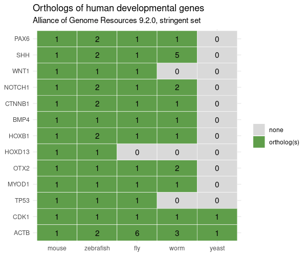

## Goal

By the end of this exercise you should be able to:

- join an ortholog table to a gene list with `left_join()`, and fill in the missing combinations with `expand_grid()` and `replace_na()`;
- draw a **presence/absence heat map** with `geom_tile()`;
- see how the **stringency** of an ortholog call changes the answer, and summarise conservation per gene and per species.

## Before you start

This page builds on the [Exercise](exercise.qmd). You need the packages readr, dplyr, tidyr and ggplot2. Download these two files and save them in a `data/` folder of your R project:

- [dev_genes.csv](data/dev_genes.csv): 13 human genes (11 developmental genes and 2 housekeeping controls) with their HGNC IDs.
- [orthologs.csv](data/orthologs.csv): their orthologs in mouse, zebrafish, fly, worm and yeast, from the **Alliance of Genome Resources, release 9.2.0**, stringent set, downloaded on 2026-11-20. One row per gene pair; `n_methods` is the number of prediction methods that agree, and `best` is the Alliance's best-match flag.

See the [data README](data/README.md) for the exact sources. Both files start with comment lines beginning with `#`.

```r
library(readr)
library(dplyr)
library(tidyr)
library(ggplot2)
```

## Tasks

You met [`left_join()`](https://dplyr.tidyverse.org/reference/mutate-joins.html) in Part 4. The new problem here is **absence**: the ortholog table only has rows for orthologs that exist, so "no ortholog in yeast" is a missing row, not a zero. [`expand_grid()`](https://tidyr.tidyverse.org/reference/expand_grid.html) builds every gene × species combination, `left_join()` fills in the counts where there are any, and [`replace_na()`](https://tidyr.tidyverse.org/reference/replace_na.html) turns the rest into 0. Then [`geom_tile()`](https://ggplot2.tidyverse.org/reference/geom_tile.html) draws one coloured square per cell.

**R1. (read and count)** Read both files with `read_csv(..., comment = "#")`. Show the orthologs of *PAX6*. Then count the orthologs per human gene and species with `count()`. How many rows does the count table have, and why is that fewer than 13 × 5 = 65?

**R2. (fill in the zeros)** Build a table `grid` with every combination of the 13 genes and the 5 species (in the order mouse, zebrafish, fly, worm, yeast), join the counts onto it and replace `NA` with 0. List the gene–species pairs with no ortholog.

**R3. (heat map)** Draw `grid` as a heat map: species on the x axis, genes on the y axis (in the order of `dev_genes.csv`, top to bottom), fill by whether there is at least one ortholog, and print the number in each tile. Which genes are found in yeast? Which developmental gene has the fewest orthologs?

**R4. (stringency)** Keep only ortholog pairs supported by **at least 5 methods**, count again and join onto `grid`. Which gene–species pairs change from "ortholog" to "none"? What kind of genes are they?

**R5. (summaries)** a) For each gene, in how many of the 5 species does it have an ortholog? Join the `role` column back on and sort. b) For each species, how many of the 13 genes have an ortholog, and how many orthologs are there in total? Why can the total be larger than 13?

## Solutions

::: {.callout-note collapse="true" title="Solutions: In R"}

**R1.**

```r
genes <- read_csv("data/dev_genes.csv", comment = "#", show_col_types = FALSE)
orth  <- read_csv("data/orthologs.csv", comment = "#", show_col_types = FALSE)
orth |> filter(human_gene == "PAX6")
```
```
# A tibble: 5 × 6
  human_gene species   ortholog ortholog_id              n_methods best
  <chr>      <chr>     <chr>    <chr>                        <dbl> <chr>
1 PAX6       fly       toy      FB:FBgn0019650                   6 Yes
2 PAX6       mouse     Pax6     MGI:97490                       10 Yes
3 PAX6       worm      vab-3    WB:WBGene00006870                6 Yes
4 PAX6       zebrafish pax6a    ZFIN:ZDB-GENE-990415-200         9 Yes
5 PAX6       zebrafish pax6b    ZFIN:ZDB-GENE-001031-1           9 Yes
```
```r
counts <- orth |> count(human_gene, species, name = "n_orthologs")
counts
```
```
# A tibble: 50 × 3
   human_gene species   n_orthologs
   <chr>      <chr>           <int>
 1 ACTB       fly                 6
 2 ACTB       mouse               1
 3 ACTB       worm                3
 4 ACTB       yeast               1
 5 ACTB       zebrafish           2
 6 BMP4       fly                 1
 7 BMP4       mouse               1
 8 BMP4       worm                1
 9 BMP4       zebrafish           1
10 CDK1       fly                 1
# ℹ 40 more rows
```

The stringent fly ortholog of *PAX6* is *toy*, not *eyeless*, and zebrafish has two copies. The count table has **50** rows, not 65: the 15 gene–species pairs without an ortholog have no row at all.

**R2.**

```r
species_order <- c("mouse", "zebrafish", "fly", "worm", "yeast")
grid <- expand_grid(human_gene = genes$human_gene, species = species_order) |>
  left_join(counts, by = c("human_gene", "species")) |>
  mutate(n_orthologs = replace_na(n_orthologs, 0))
grid
```
```
# A tibble: 65 × 3
   human_gene species   n_orthologs
   <chr>      <chr>           <int>
 1 PAX6       mouse               1
 2 PAX6       zebrafish           2
 3 PAX6       fly                 1
 4 PAX6       worm                1
 5 PAX6       yeast               0
 6 SHH        mouse               1
 7 SHH        zebrafish           2
 8 SHH        fly                 1
 9 SHH        worm                5
10 SHH        yeast               0
# ℹ 55 more rows
```
```r
grid |> filter(n_orthologs == 0)
```
```
# A tibble: 15 × 3
   human_gene species n_orthologs
   <chr>      <chr>         <int>
 1 PAX6       yeast             0
 2 SHH        yeast             0
 3 WNT1       worm              0
 4 WNT1       yeast             0
 5 NOTCH1     yeast             0
 6 CTNNB1     yeast             0
 7 BMP4       yeast             0
 8 HOXB1      yeast             0
 9 HOXD13     fly               0
10 HOXD13     worm              0
11 HOXD13     yeast             0
12 OTX2       yeast             0
13 MYOD1      yeast             0
14 TP53       worm              0
15 TP53       yeast             0
```

**R3.**

```r
ggplot(grid, aes(x = factor(species, levels = species_order),
                 y = factor(human_gene, levels = rev(genes$human_gene)),
                 fill = n_orthologs > 0)) +
  geom_tile(colour = "white") +
  geom_text(aes(label = n_orthologs)) +
  scale_fill_manual(values = c(`TRUE` = "#5f9e4a", `FALSE` = "grey85"),
                    labels = c(`TRUE` = "ortholog(s)", `FALSE` = "none"), name = NULL) +
  labs(x = NULL, y = NULL, title = "Orthologs of human developmental genes",
       subtitle = "Alliance of Genome Resources 9.2.0, stringent set") +
  theme_minimal()
```

{width="70%" fig-align="center"}

Only the two **controls**, *CDK1* and *ACTB*, have a yeast ortholog: the cell cycle and the cytoskeleton are older than animals, while the signalling and patterning genes arose in the animal lineage. *HOXD13* has the fewest: only mouse and zebrafish. The fly does have a posterior Hox gene, *Abd-B*, but the posterior Hox genes duplicated separately in each lineage, so no one-to-one ortholog passes the stringent filter. *WNT1* and *TP53* also have no **worm** ortholog under these rules, although worms have Wnt and p53-family genes: absence means "no ortholog called", not "no related gene". Note the many copies: six fly actins, two zebrafish genes for several human genes (the teleost genome duplication), and five worm *wrt* genes for *SHH*.

**R4.**

```r
strict <- orth |>
  filter(n_methods >= 5) |>
  count(human_gene, species, name = "n_strict")
grid2 <- grid |>
  left_join(strict, by = c("human_gene", "species")) |>
  mutate(n_strict = replace_na(n_strict, 0))
grid2 |> filter((n_orthologs > 0) != (n_strict > 0))
```
```
# A tibble: 5 × 4
  human_gene species   n_orthologs n_strict
  <chr>      <chr>           <int>    <int>
1 NOTCH1     worm                2        0
2 BMP4       worm                1        0
3 HOXB1      fly                 1        0
4 HOXD13     zebrafish           1        0
5 OTX2       fly                 1        0
```

Five pairs disappear. They include classic pairs from developmental genetics: *HOXB1*–*lab* (3 methods), *OTX2*–*oc* (4), *BMP4*–*dbl-1* (4) and *NOTCH1*–*glp-1*/*lin-12* (4 each). They are distant relatives in a family of related genes, where methods disagree about which pair is the true one-to-one ortholog. Where you draw the line decides the answer, so always report the rule you used.

**R5.**

```r
grid |>
  group_by(human_gene) |>
  summarise(n_species = sum(n_orthologs > 0)) |>
  left_join(genes, by = "human_gene") |>
  arrange(desc(n_species)) |>
  select(human_gene, n_species, role)
```
```
# A tibble: 13 × 3
   human_gene n_species role
   <chr>          <int> <chr>
 1 ACTB               5 control: cytoskeleton, actin
 2 CDK1               5 control: cell-cycle kinase
 3 BMP4               4 dorsal-ventral signal (fly decapentaplegic)
 4 CTNNB1             4 Wnt pathway effector (fly armadillo)
 5 HOXB1              4 anterior Hox gene (fly labial)
 6 MYOD1              4 muscle determination
 7 NOTCH1             4 cell-cell signalling receptor (fly Notch)
 8 OTX2               4 head development (fly orthodenticle)
 9 PAX6               4 eye development (fly eyeless/twin of eyeless)
10 SHH                4 signal: limb and neural patterning (fly hedgehog)
11 TP53               3 tumour suppressor, DNA damage response
12 WNT1               3 signal: segment polarity (fly wingless)
13 HOXD13             2 posterior Hox gene (fly Abdominal-B)
```
```r
grid |>
  group_by(species) |>
  summarise(genes_with_ortholog = sum(n_orthologs > 0),
            total_orthologs = sum(n_orthologs))
```
```
# A tibble: 5 × 3
  species   genes_with_ortholog total_orthologs
  <chr>                   <int>           <int>
1 fly                        12              17
2 mouse                      13              13
3 worm                       10              18
4 yeast                       2               2
5 zebrafish                  13              19
```

a) Most developmental genes have orthologs in **4 of 5** species, all except yeast. The two controls are found in all five. b) The mouse has exactly one ortholog for every gene, as expected for two mammals. Zebrafish has 19 orthologs for 13 genes, because of the fish genome duplication; the worm has 18 for 10 genes and the fly 17 for 12, because of gene families that expanded in those lineages (actins, *wrt* genes). The total can be larger than 13 because one human gene can have several orthologs in another species ("one-to-many").
:::

## Where this leads

In **Part 7** the same developmental genes come back as cancer genes: *SHH*, *WNT1*, *CTNNB1*, *NOTCH1* and *TP53* are all in this table. The join-and-fill pattern you used here works whenever "missing" means "zero", for example when you count mutations per gene and per tumour.
