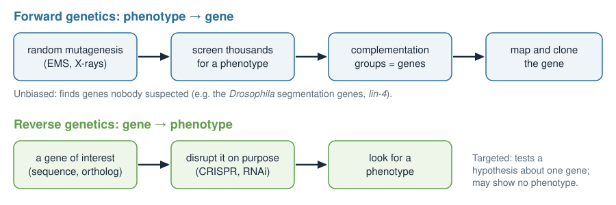
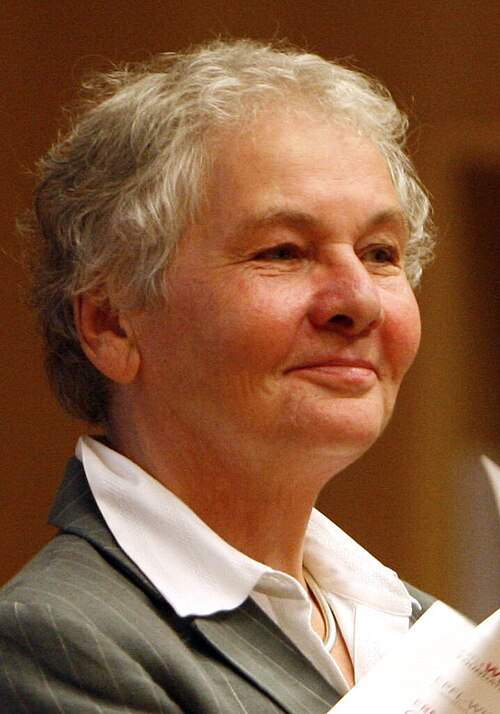
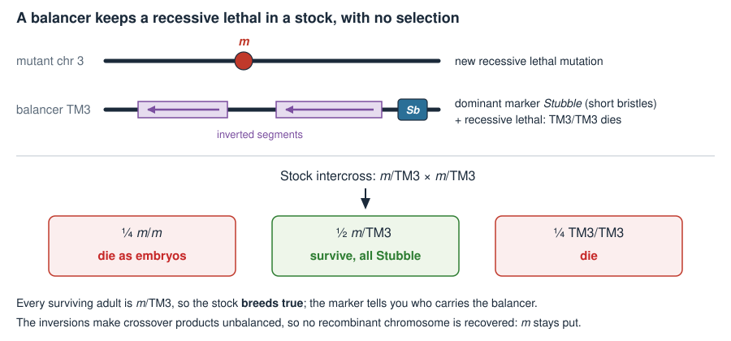
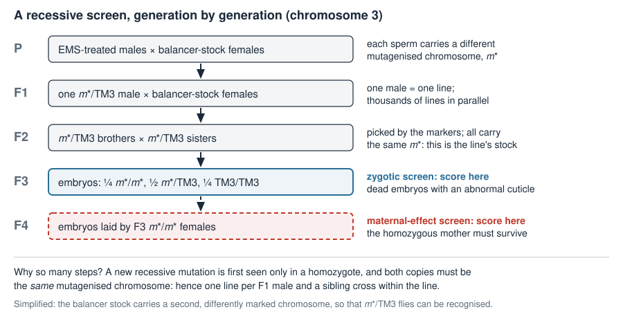
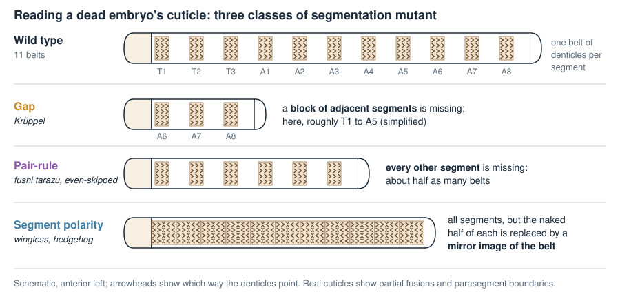
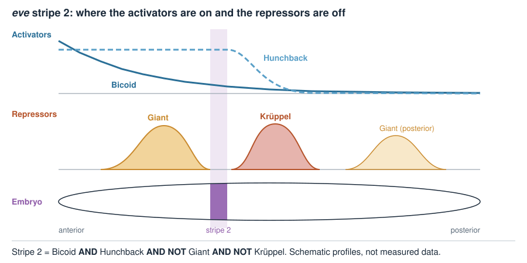
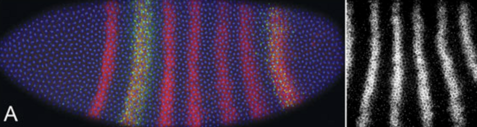
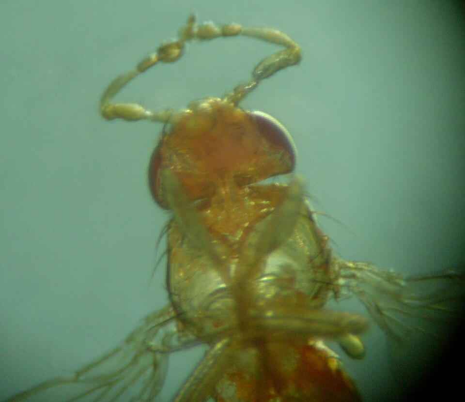
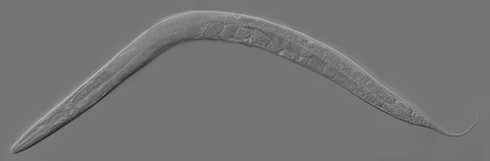

## About this lecture {.smaller}

How does one fertilised egg build a body with a head at one end and a tail at the other? Most of what we know came from **mutant screens** in a few **model organisms**, and from the surprise that the genes found in flies and worms have counterparts in humans.

- **Forward vs reverse genetics**; the main model organisms and their databases.
- **How a screen works**: balancers, the generations of a recessive screen, **maternal-effect** genes and reciprocal crosses.
- The ***Drosophila* segmentation hierarchy**: reading mutant cuticles; the *eve* stripe 2 enhancer as a logic gate.
- **Hox genes**: which way a segment is transformed, dominance, **colinearity**.
- **Ordering genes by epistasis**; the *C. elegans* cell lineage and cell death.
- **Gene dose**: haploinsufficiency plus recessive lethality (*Brachyury*, *PAX6*).
- **Genetic tools**: GAL4/UAS, CRISPR–Cas9, from a mosaic founder to a homozygous mutant.

Book: Hartwell, *Genetics: From Genes to Genomes*, the chapter on the genetic analysis of development.

::: notes
This unit pulls Part 6 together. The segmentation genes are transcription factors acting on enhancers (Eukaryotic regulation), the heterochronic genes are microRNAs and their targets (RNA-mediated regulation), and the logic of the screens is Mendelian: recessive lethals, complementation groups (Mutation unit, Part 3), maternal effects, epistasis, lethal alleles. The deck spends most of its time on the reasoning students need for the by-hand exercises: how a balancer stock works, how many generations a screen takes, what a maternal effect looks like over generations, how to classify a cuticle, how an enhancer reads its inputs, which way a homeotic transformation goes, how to order genes by epistasis, and how dose gives a dominant phenotype with a recessive lethal. The R exercise looks at the conservation of developmental genes across the model organisms.
:::

## Why model organisms? {.smaller}

| Organism | Generation | Genome (approx.) | Strengths | Database |
|---|---|---|---|---|
| Budding yeast, *S. cerevisiae* | ~2 h | 12 Mb, ~6000 genes | haploid and diploid; tetrads; cell cycle | SGD |
| Worm, *C. elegans* | ~3.5 days | 100 Mb, ~20 000 genes | invariant cell lineage; transparent; RNAi by feeding | WormBase |
| Fruit fly, *D. melanogaster* | ~10 days | 140 Mb, ~14 000 genes | huge mutant collections; balancers; GAL4/UAS | FlyBase |
| Zebrafish, *D. rerio* | ~3 months | 1.4 Gb, ~26 000 genes | transparent embryos; vertebrate | ZFIN |
| Mouse, *M. musculus* | ~10 weeks | 2.7 Gb, ~22 000 genes | mammal; knockouts; disease models | MGI |
| Thale cress, *A. thaliana* | ~6 weeks | 135 Mb, ~27 000 genes | plant development; selfing | TAIR |

The **Alliance of Genome Resources** brings SGD, WormBase, FlyBase, ZFIN, MGI, RGD and Xenbase together, with **orthology** between them.

::: notes
The numbers are rounded and change a bit with each annotation release, so do not ask students to learn them; the pattern matters. Small genomes and short generations mean you can do big screens; vertebrates are closer to humans but slower and more expensive. Mendel chose peas for the same practical reasons. Each organism has its own curated database, with its own gene naming conventions (fly genes named after their mutant phenotype, like eyeless; worm genes like lin-4 with a three-letter code and a number; mouse genes like Pax6, human like PAX6). The Alliance is the place to go between them, which students do in Find it.
:::

## Forward and reverse genetics {.smaller}

{width="76%" fig-align="center"}

- **Forward**: mutagenise, screen, find the genes. **Unbiased**, but you only find genes whose loss gives a visible, specific phenotype.
- **Reverse**: start from a gene (often an ortholog of a gene known elsewhere), knock it out, and look. Targeted, but genes can be **redundant** and show no phenotype.

::: notes
Forward genetics was the only option until the 1980s and it is how all the genes in today's lecture were found. Reverse genetics needs the gene sequence, and was transformed first by RNAi (last unit) and then by CRISPR. The two are complementary: a forward screen is like asking the organism what matters; reverse genetics is asking a specific question. A common surprise with reverse genetics: a knockout with no phenotype, often because a paralog covers for it, the same redundancy as the 15:1 duplicate-gene ratio in Extensions to Mendel. Another limit of forward screens: a gene needed early for survival hides any later role, because the animal dies before you can look.
:::

## The Heidelberg screen {.smaller}

:::: {.columns}
::: {.column width="72%"}
Christiane **Nüsslein-Volhard** and Eric **Wieschaus** (1980) looked for every gene needed to make the pattern of the *Drosophila* larva.

- **Mutagen**: EMS on males; each sperm carries different random point mutations.
- **Readout**: embryos that die with an abnormal **larval cuticle**. The cuticle has one belt of small hooks (**denticles**) per segment, so pattern defects are easy to see.
- **Sorting**: mutations with similar phenotypes are tested against each other and sorted into **complementation groups** (genes), as in the Mutation unit.
- **Saturation**: most genes were hit several times, so few genes of this kind were left to find.
- **Result**: about 15 genes for segment number and polarity, in **three classes**: gap, pair-rule and segment polarity. (Nobel Prize 1995, with Ed Lewis.)

The next two slides show the genetic trick that made it possible: the **balancer**.
:::
::: {.column width="28%"}
{width="100%"}

[Photo: Rama, CC BY-SA 2.0 fr, via Wikimedia Commons](https://commons.wikimedia.org/wiki/File:Christiane_N%C3%BCsslein-Volhard_mg_4389_(cropped).jpg){.photo-credit}
:::
::::

::: notes
This is the clearest example of a forward screen. The photo is Christiane Nüsslein-Volhard, who later moved to zebrafish and ran the first large vertebrate screens in the same style. The dead embryo secretes its cuticle before it dies, so even a lethal mutant leaves a record of its segment pattern; that is what makes embryonic lethals usable. Saturation is a useful idea: if you find most genes several times, there are probably few left to find. A gene found only once might still have relatives that were missed. The complementation test is exactly the one from the Mutation unit: two recessive mutations that fail to complement are in the same gene. The screen was done chromosome by chromosome, using balancers for each major autosome and for the X.
:::

## Balancers: keeping a lethal mutation without selection {.smaller}

{width="68%" fig-align="center"}

A balancer has **three properties**: several **inversions** (so recombinants are not recovered), a **dominant marker** (so you can see who carries it), and a **recessive lethal** (so balancer homozygotes die).

::: notes
Walk through the figure with the class. The problem a balancer solves: a recessive lethal mutation can only be kept in heterozygotes, and in an ordinary stock you would have to test every generation which flies still carry it, because the wild-type allele would take over. Over a balancer, both homozygous classes die, so every surviving fly is heterozygous, and you can see that from the dominant marker. Here TM3 on chromosome 3 with the marker Stubble, short thick bristles; on chromosome 2 the common balancer is CyO with Curly wings, which students meet in the exercise. Why the inversions: a single crossover inside an inverted segment gives chromatids with duplications and deletions (the inversion loop from the Rearrangements unit in Part 5), so recombinant chromosomes are not recovered in the progeny. Without them, crossing over would slowly separate the mutation from the chromosome it was found on, and the marker from the lethal. A balancer is thus a stretch of chromosome that is inherited as one block.
:::

## A recessive screen, generation by generation {.smaller}

{width="62%" fig-align="center"}

Rule of thumb: you see a **recessive zygotic** phenotype two generations after the mutagenised male (F3); a **maternal-effect** phenotype one generation later, in the embryos **of** homozygous mothers.

::: notes
Go row by row and ask at each step: which flies carry the new mutation, and is anyone homozygous yet? P: the mutagenised male makes sperm with many different mutagenised chromosomes. F1: each F1 son carries one particular mutagenised chromosome, so each must be kept separately as its own line: thousands of single-male crosses. F2: within a line, all flies that carry the balancer marker and the mutagenised chromosome carry the same m-star; cross brothers to sisters. F3: one quarter of the embryos are homozygous; if they die with a defective cuticle, the line is kept, from its F2 heterozygous siblings, and that is the stock. In the exercise, students lay out the same scheme for chromosome 2 with CyO. The maternal-effect point links to the next slide: a homozygous maternal-effect mutant looks normal, so you must let it grow up and look at its eggs. Real screens add a second marker so that the right F2 class can be picked, which the figure footnote mentions.
:::

## Maternal-effect genes {.smaller}

{width="68%" fig-align="center"}

The anterior–posterior axis is set up **before** the embryo's own genes are switched on, by mRNAs the **mother** puts into the egg. *bicoid* mRNA sits at the anterior pole; its protein forms a **gradient** that tells nuclei how far they are from the head.

**Rule:** the embryo's phenotype = the **mother's genotype**. The embryo's own genotype does not matter.

::: notes
Maternal effect is another way for reciprocal crosses to differ, next to sex linkage (Part 2), organelle inheritance (Part 5) and imprinting (Eukaryotic regulation). The embryo's genotype is irrelevant; the mother's genotype decides. A classic exam trap: a bcd/bcd female is perfectly normal, because she developed from an egg that her bcd/+ mother provided with bicoid mRNA. Bicoid is a morphogen: a transcription factor whose concentration gradient switches on different target genes at different thresholds, for example hunchback at high levels. Nanos does the same job from the posterior end, by repressing translation of maternal hunchback mRNA. The next slide works through the generations with the classic example, so that students can do the bicoid crosses in the exercise on their own.
:::

## Maternal effect over three generations: snail coiling

In the pond snail *Lymnaea*, the direction of shell coiling is set by one gene: **dextral** (*D*, right-handed) is dominant over **sinistral** (*d*). It acts as a **maternal effect** (Boycott & Diver; Sturtevant, 1923). The snails are hermaphrodites and can self-fertilise.

| Generation | Genotypes | Coiling | Why |
|---|---|---|---|
| P | *dd* ♀ × *DD* ♂ | (sinistral × dextral) | |
| F1 | all *Dd* | **all sinistral** | their mother was *dd* |
| F2 (F1 selfed) | 1 *DD* : 2 *Dd* : 1 *dd* | **all dextral** | their mother (F1) was *Dd* |
| F3 (each F2 selfed) | broods from each F2 parent | ¾ of broods dextral, ¼ sinistral | each brood follows its own mother: *DD*, *Dd* → dextral; *dd* → sinistral |

- The **genotype ratio** is Mendelian (1 : 2 : 1 in F2); the **phenotype ratio** appears **one generation late**, counted as whole broods.
- Reciprocal P cross, *DD* ♀ × *dd* ♂: F1 all *Dd* and **dextral**. Same F1 genotype, opposite phenotype.

::: notes
Do this on the board one generation at a time, asking the room each time: what is the mother's genotype? That is the only question. The F2 has a dd quarter, but every F2 snail is dextral, because all F2 snails had a Dd mother. The 3 to 1 ratio only shows up in F3, and it is a ratio of families, not of individuals: three quarters of the F2 snails produce all-dextral broods, one quarter produce all-sinistral broods. The same structure applies to bicoid in the exercise, except that bicoid embryos without a mother's mRNA die. The coiling gene was identified in 2016 as a formin, a cytoskeleton gene that acts in the very early cleavage divisions. A quick check: a sinistral snail tells you its mother was dd, so it carries at least one d; its own genotype could be Dd or dd.
:::

## Four ways reciprocal crosses can differ

Mendel's reciprocal crosses gave the same result: for his genes, it did not matter which parent gave which allele. When reciprocal crosses **differ**, ask **what decides the offspring's phenotype**:

| Mechanism | Unit | What decides | Diagnostic pattern |
|---|---|---|---|
| **X linkage** | Part 2 | the offspring's own genotype, and its sex | ratios differ between sons and daughters; sons get their X from the mother |
| **Organelle inheritance** | Part 5 | the mother's **cytoplasm** (mtDNA, chloroplasts) | all offspring of an affected mother, every generation; never through fathers |
| **Imprinting** | Eukaryotic regulation | which **parent** gave the active allele | autosomal 1 : 1 segregation, but expressed only when inherited from one parent |
| **Maternal effect** | this unit | the mother's **nuclear genotype** | offspring look like the mother's genotype; Mendelian ratios appear one generation late |

::: notes
This slide is a comparison students can use in any exam question with a reciprocal-cross twist. Organelle inheritance and maternal effect are often confused, because both go through the mother. The difference: in organelle inheritance the gene is in the cytoplasm and is passed on from mother to all offspring for ever; in a maternal effect the gene is in the nucleus, segregates normally, and a dd snail's sons and daughters can carry D and have dextral offspring of their own. Imprinting and maternal effect are also confused: with imprinting the child's own genotype matters, but only the allele from one parent is used; with maternal effect the child's genotype does not matter at all.
:::

## The segmentation hierarchy {.smaller}

{width="74%" fig-align="center"}

Each tier is a set of **transcription factors** (or signals) that regulate the next. The pattern gets finer at every step: one gradient → a few broad domains → 7 stripes → 14 stripes → 14 segments, each with its own identity.

::: notes
Go down the figure. Maternal genes set up the gradients. Gap genes are expressed in broad domains, and a gap mutant lacks a block of adjacent segments: Krüppel, German for cripple, lacks the thorax and anterior abdomen. Pair-rule genes are expressed in seven stripes, and mutants lack every other segment, which is where the name comes from (fushi tarazu is Japanese for "not enough segments"). Segment-polarity genes, in fourteen stripes, define the front and back of each segment; in mutants, part of each segment is replaced by a mirror image of the other part. Many are parts of signalling pathways: wingless (Wnt) and hedgehog. Hox genes then give each segment an identity. The hierarchy is also an epistasis argument: in a gap mutant the pair-rule stripes are disturbed, but in a pair-rule mutant the gap domains are normal, so the gap genes act upstream.
:::

## Reading a mutant cuticle {.smaller}

{width="72%" fig-align="center"}

Ask two questions: **how many** belts are left, and **which** are missing (a block, every other one, or part of each)? The answer names the class, and the class tells you the **scale** at which the gene acts.

::: notes
This is how the Heidelberg screen sorted its mutants, before any gene was cloned. A gap gene works on a scale of several segments, so its loss removes a block. A pair-rule gene works on a two-segment repeat, so its loss removes every other one. A segment-polarity gene works within each segment, so all segments are there, but the naked back half of each is replaced by a mirror image of the denticle belt, giving a short larva covered in a lawn of denticles; hedgehog is named after that look. The figure is schematic. In real pair-rule mutants the missing pieces are parasegments, units offset by half a segment from the visible segments, so the remaining belts are fused pieces. The exercise asks students to classify three cuticles in words.
:::

## *eve* stripe 2: an enhancer as a logic gate {.smaller}

{width="68%" fig-align="center"}

The ***even-skipped* stripe 2 enhancer** (about 500 bp) has binding sites for the activators **Bicoid** and **Hunchback** and the repressors **Giant** and **Krüppel**. Each of the seven *eve* stripes is driven by its own enhancer (some drive two).

::: notes
The eve stripe 2 enhancer is the textbook example of an enhancer acting as a logic gate: AND for the activators, NOT for the repressors. Bicoid and Hunchback are present in the whole anterior half, so on their own they would switch eve on everywhere there. Giant, on the anterior side, and Krüppel, on the posterior side, carve the stripe out: the anterior border is where Giant falls off, the posterior border is where Krüppel rises. The repressors act over short distances, so they only silence the enhancer they are bound to, not the other stripe enhancers nearby, which is why one gene can be read in seven places. The profiles in the figure are schematic, drawn to show the logic, not measured curves.
:::

## Experiments that define an enhancer

:::: {.columns}
::: {.column width="56%"}
- **Delete** the stripe 2 enhancer: stripe 2 disappears; the other six stay.
- **Reporter**: put the enhancer in front of a minimal promoter and *lacZ*: β-galactosidase is made in stripe 2 only.
- **Remove a repressor**: in a *giant* mutant embryo, stripe 2 spreads **anteriorly**, into the region where Giant would be. Mutating a repressor's binding sites in the reporter has the same kind of effect.
- **Rule**: removing a repressor lets the stripe grow **towards where that repressor was**.
- **Cis/trans**: the enhancer is a DNA site, so a deletion affects only the *eve* copy on its own chromosome. The four factors are proteins and act on both copies.
:::
::: {.column width="44%"}
{width="100%"}

[Image: Thomas Gregor (left), Erik Clark (right), CC BY 4.0, via Wikimedia Commons](https://commons.wikimedia.org/wiki/File:Drosophila_pair_rule_pattern.png){.photo-credit}

Left: Eve protein (red) in seven stripes; a reporter driven by one enhancer (green) marks only some of them. Right: detail of the *eve* stripes.
:::
::::

::: notes
These are the standard experiments, and they use the cis/trans logic from the lac operon and the Eukaryotic regulation unit. The reporter is the same lacZ as in the lac operon: fuse the DNA fragment to lacZ, make transgenic flies, stain for beta-galactosidase. In the photo the green reporter shows that one enhancer reproduces only part of the pattern, which is the experimental definition of a stripe-specific enhancer. The Giant result comes from Small, Blair and Levine (1992): in giant mutant embryos stripe 2 expands to the anterior. Mutating repressor sites inside the stripe 2 reporter widens the reporter stripe in the same way, which shows that the repressors act directly on the enhancer. Students predict the Krüppel case in the exercise by the same rule. The cis/trans point matters for heterozygotes: one intact enhancer still drives its own copy of eve in stripe 2.
:::

## Hox genes: homeotic mutants

:::: {.columns}
::: {.column width="62%"}
**Homeotic** mutations turn one body part into another:

- ***Antennapedia*** (dominant gain of function): *Antp* is switched on in the head, and **legs grow where the antennae should be**.
- ***Ultrabithorax*** (loss of function, combined alleles in the *bithorax* complex): the third thoracic segment develops like the second: a fly with **four wings**.

Ed **Lewis** showed that the genes of the *bithorax* complex lie in the **same order** on the chromosome as the segments they control. All Hox genes share a 180-bp **homeobox**, encoding a DNA-binding homeodomain: they are transcription factors.
:::
::: {.column width="38%"}
{width="100%"}

[Photo: toony, CC BY-SA 3.0, via Wikimedia Commons](https://commons.wikimedia.org/wiki/File:Antennapedia2.jpg){.photo-credit}

An *Antennapedia* fly: a pair of legs in place of the antennae.
:::
::::

::: notes
Homeotic transformations are the most dramatic phenotypes in genetics, and they made sense only once it was clear that each segment has a default identity that Hox genes modify. In the photo, the two jointed appendages on top of the head are legs, with their segments and claws, where antennae should be. The four-winged fly needs a combination of mutations in regulatory regions of Ubx (bx, pbx and abx alleles), because a complete loss of Ubx is lethal. The homeobox was discovered in 1984 by comparing Antp and Ubx sequences, and was then found in every animal tested. The next slide gives the rule for which way a transformation goes.
:::

## Which way does a segment turn?

Each segment's identity is set by the **most posterior** Hox gene active in it. That gives one rule for both kinds of mutation:

| Allele | What goes wrong | Transformation | Dominance |
|---|---|---|---|
| *Ubx* loss (*bx*, *pbx*) | no Ubx in T3 | T3 → T2: haltere → **wing** (more **anterior**) | recessive |
| *Contrabithorax* (*Ubx* gain) | Ubx made in T2 too | T2 → T3: wing → **haltere** (more **posterior**) | dominant |
| *Antp* gain | Antp made in the head | antenna → **leg** (more **posterior**) | dominant |
| *Antp* loss (in clones) | no Antp in thoracic cells | leg → **antenna** (more **anterior**) | recessive |

- **Loss** of a Hox gene → the segment takes a **more anterior** identity. **Ectopic gain** → **more posterior**.
- **Gain** alleles are usually **dominant**: one allele that makes a normal protein in the **wrong place** is enough. **Loss** alleles are usually **recessive**: one working copy is enough where the gene should be on.

::: notes
This table turns a list of strange flies into one rule. Ubx is needed in T3; without it T3 falls back to the identity of T2, the default set by Antp, so the haltere becomes a wing. Contrabithorax alleles are regulatory gain-of-function mutations of Ubx that switch it on in T2 as well, so the wing becomes more haltere-like: the opposite direction, and dominant. Antp loss of function is lethal in whole animals, so it was studied in clones of mutant cells in the leg disc, which form antennal structures. The dominance argument is the same as for enhancer variants in the Eukaryotic regulation unit: a gain in the wrong place acts in cis and needs only one allele; a loss leaves the other allele to do the job. The exercise asks students to apply exactly this reasoning.
:::

## Colinearity, from flies to mice {.smaller}

{width="72%" fig-align="center"}

The order of Hox genes on the chromosome matches the order of the body regions where they act (**colinearity**): *lab* at one end is most **anterior**, *Abd-B* at the other end most **posterior**. Mammals have **four Hox clusters** (*Hoxa*–*d*, 39 genes) made by duplication of one ancestral cluster. Knocking out mouse Hox genes gives homeotic changes in **vertebrae**, e.g. a cervical vertebra that looks like a thoracic one (with ribs).

::: notes
The conservation is astonishing: the same genes, in the same order, doing the same kind of job in flies and mammals, which last shared an ancestor more than 500 million years ago. In vertebrates there is also temporal colinearity: the 3' genes are switched on first, then the 5' ones. Because there are four clusters, mammals have paralogs (for example Hoxa1, Hoxb1 and Hoxd1, the same paralog group as fly lab) that partly cover for each other, so single knockouts often give mild phenotypes, and double or triple knockouts of a paralog group are needed for full transformations: redundancy again, the reverse-genetics problem from the start of the lecture. Polycomb proteins keep Hox genes off in segments where they should be off, which links to chromatin memory from the regulation unit: Polycomb mutants in flies show homeotic transformations.
:::

## Ordering genes in a pathway by epistasis

**Method** (as in Extensions to Mendel): find two mutants with **opposite** phenotypes, make the double mutant, and see which phenotype it shows. The double mutant looks like the **downstream** gene.

**Worked example:** vulva induction in *C. elegans*. A signal from one cell tells three skin cells to form the vulva.

| Genotype | Phenotype |
|---|---|
| wild type | one vulva |
| *let-23* loss of function (receptor, EGFR-like) | **vulvaless** |
| *let-60* gain of function (Ras, stuck "on") | **multivulva** (extra vulvae) |
| *let-23*(lf); *let-60*(gf) | **multivulva** |

The double looks like *let-60*: Ras acts **downstream** of the receptor. An active Ras does not need the receptor.

::: notes
Go through the logic slowly. If the receptor were downstream of Ras, a dead receptor would block the signal whatever Ras does, and the double would be vulvaless. It is multivulva, so Ras must act after the receptor: a permanently active Ras bypasses the missing receptor. The order fits the biochemistry found later: receptor tyrosine kinase, then Ras, then the MAP kinase cascade, the same pathway that is mutated in many cancers (Part 7). The rule only works cleanly when the single mutants have opposite phenotypes; if both mutants look the same, the double mutant tells you nothing about order. The same reasoning ordered lin-4 and lin-14 in the last unit, and students use it for the ced genes in the exercise.
:::

## *C. elegans*: a body built cell by cell

:::: {.columns}
::: {.column width="58%"}
- The adult hermaphrodite has **959 somatic nuclei**. John **Sulston** traced every division from the zygote: the **cell lineage** is **invariant**, the same in every worm.
- So a mutant phenotype can be read **cell by cell**: which cell divided wrongly, or took the wrong fate?
- **Heterochronic** genes (*lin-4*, *lin-14*, *let-7*) decide *when* in the lineage each fate happens (last unit).
- **Laser ablation** of single cells shows which cells signal to their neighbours.
:::
::: {.column width="42%"}
{width="100%"}

[Photo: Zeynep F. Altun (WormAtlas), CC BY-SA 2.5, via Wikimedia Commons](https://commons.wikimedia.org/wiki/File:Adult_Caenorhabditis_elegans.jpg){.photo-credit}

An adult hermaphrodite, about 1 mm long, in DIC microscopy: transparent, so every nucleus can be followed.
:::
::::

::: notes
The worm is the opposite extreme to the fly: few cells, every one named and known. Because the animal is transparent, the divisions can be followed live under the microscope, which is how Sulston built the lineage. Laser ablation was used, for example, to find the anchor cell that induces the vulva in the previous slide: kill it, and no vulva forms. The next slide is the cell-death story, which students order by epistasis in the exercise.
:::

## Programmed cell death: the *ced* genes

During development, **131** of the cells made in the hermaphrodite die by **programmed cell death**. Mutant screens found the genes:

| Mutant | Phenotype |
|---|---|
| *ced-3* loss of function | the 131 cells **survive** |
| *ced-4* loss of function | the 131 cells **survive** |
| *ced-9* loss of function | **extra** cells die, embryo dies |

- *ced-3* and *ced-4* are needed **for** death; *ced-9* **protects** cells: opposite phenotypes, so double mutants can order them (exercise).
- Human counterparts: **caspases** (*ced-3*), ***APAF1*** (*ced-4*), ***BCL2*** (*ced-9*). Human BCL2 can replace *ced-9* in transgenic worms. (Nobel Prize 2002: Brenner, Horvitz, Sulston.)

::: notes
The cell-death genes are a clean epistasis problem, and the exercise asks students to order all three from double-mutant data, using the method from two slides back. Do not give the order here; ask the room only what kind of double mutant they would need: one that combines a ced-9 loss with a loss of one of the death genes. The deep conservation is the other point: the worm genes have human counterparts that control apoptosis, and a worm missing ced-9 can be rescued by the human gene. BCL2 over-expression in follicular lymphoma, caused by a translocation, blocks apoptosis: an oncogene, which returns in Part 7.
:::

## Dose: dominant phenotype, recessive lethal

Some developmental genes are **haploinsufficient**: one working copy is not enough. Their loss-of-function alleles then have **two** phenotypes, one in heterozygotes and one in homozygotes.

**Worked example: mouse *Brachyury* (*T*)**, a transcription factor needed for posterior mesoderm.

| Genotype | Phenotype |
|---|---|
| +/+ | normal tail |
| *T*/+ | **short tail** (dominant, visible) |
| *T*/*T* | **dies in mid-gestation**: no notochord, no posterior body (recessive lethal) |

*T*/+ × *T*/+ → ¼ +/+ : ½ *T*/+ : ¼ *T*/*T*. Among the **live-born** pups: **1 normal : 2 short-tailed**. The missing quarter is the 2 : 1 signature of a recessive lethal, as for the yellow mouse in Extensions to Mendel.

::: notes
The key is to keep the two phenotypes apart: the short tail is a dominant phenotype, because half the dose of Brachyury is not enough for a full tail; the lethality is recessive, because only animals with no working copy die. One allele, two dominance relations, depending on which trait you look at. To get the ratio among survivors, cross out the dead quarter and renormalise over the three quarters left, as for the yellow mouse. The same logic applies to PAX6 on the next slide, which students work through in the exercise. The Brachyury mutant was described in 1927 by Dobrovolskaia-Zavadskaia, among the first developmental mutants in the mouse.
:::

## *eyeless* and *PAX6*: one master gene for eyes?

- ***eyeless*** (*Drosophila*): flies lacking it have small or no eyes. ***Small eye*** (mouse, *Pax6*) and **aniridia** (human, *PAX6*) are caused by mutations in orthologous genes: in mice and humans **one** mutant copy is enough to give a phenotype (**haploinsufficiency**), and loss of both copies is far more severe.
- Expressing *eyeless* in other imaginal discs gives **ectopic eyes** on legs, wings and antennae (Gehring lab, 1995). **Mouse *Pax6*** does the same in flies.
- Flies, mice and humans built their eyes very differently, yet use a related transcription factor at the top of the eye programme: **deep homology**.

Flies actually have **two** *PAX6* genes, *eyeless* and *twin of eyeless*; which one counts as "the" ortholog depends on the method. You will see this in Find it and in R.

::: notes
The ectopic-eye experiment used GAL4/UAS (next slide) to switch on eyeless in leg and wing discs; the extra eyes are compound fly eyes, not mouse eyes, because eyeless switches on the fly's own eye programme. Aniridia, absence of the iris, is inherited as an autosomal dominant, because half the PAX6 dose is not enough; homozygous Small eye mice and the rare human PAX6 compound heterozygotes have no eyes and severe brain defects. That is the Brachyury pattern again: a dominant visible phenotype plus a recessive lethal. The two-paralog situation in flies is a nice honest complication for the database part: orthology is inferred, and methods can disagree.
:::

## Genetic tools: GAL4/UAS and CRISPR {.smaller}

{width="74%" fig-align="center"}

- **Transgenics**: put new DNA into the germ line (P elements in flies, injection in worms and mice).
- **GAL4/UAS**: switch on any transgene (or an RNAi hairpin) in any tissue, by **crossing** a driver line to a responder line. The ectopic eyes were made this way.
- **CRISPR–Cas9**: cut a chosen site; error-prone repair gives a **knockout**; repair with a template gives a precise **edit**.

::: notes
GAL4/UAS is a binary system, which is why it is so powerful: the driver decides where and when, the responder decides what. Neither line has a phenotype on its own; only their progeny do. The same principle (a yeast transcription factor and its binding site, foreign to the fly) shows the modularity of enhancers. In mice the equivalent tissue-specific tool is Cre/lox: Cre recombinase expressed in one tissue deletes a gene flanked by loxP sites, a conditional knockout, so you can study a gene whose full knockout is lethal. CRISPR: the guide RNA finds the site by base pairing, like a microRNA; the PAM (NGG for the common Cas9) must sit next to it.
:::

## From a CRISPR founder to a homozygous mutant

The injected animal (**F0**, the founder) is usually a **mosaic**: Cas9 cuts after the embryo has started dividing, so different cells carry different edits, or none.

1. **F0 × wild type.** Each F1 offspring gets **one** chromosome from the founder's germ line: it is a **heterozygote** for one defined allele (or wild type).
2. **Genotype the F1** by sequencing the target site. Keep carriers of a useful allele, e.g. a frameshift, and discard in-frame changes.
3. **F1 × F1** carriers of the **same** allele → F2: Mendel's monohybrid cross, 1 : 2 : 1.

The phenotype of a knockout is studied in **homozygotes of one defined allele**, never in the mosaic founder.

::: notes
This is the reverse-genetics counterpart of the screen scheme earlier: in both, you first need to fix one mutant chromosome in a line, then make homozygotes by crossing heterozygous siblings. Why not look at the founder? Because its cells are a mixture: some carry frameshifts, some in-frame deletions that may keep the protein working, some no edit; its phenotype is uninterpretable and its germ line can pass on several different alleles. Why sequence? Because the edit is a random repair product; you choose an allele that destroys the reading frame. If the homozygote is lethal, keep the line as heterozygotes, over a balancer in flies, or use a conditional allele in mice.
:::

## Orthologs across model organisms

**Orthologs** are genes in different species that descend from one gene in their last common ancestor; **paralogs** arise by duplication within a lineage.

| Human | Mouse | Zebrafish | Fly | Worm | Yeast |
|---|---|---|---|---|---|
| *PAX6* | *Pax6* | *pax6a*, *pax6b* | *toy* (and *ey*) | *vab-3* | — |
| *CDK1* | *Cdk1* | *cdk1* | *Cdk1* | *cdk-1* | *CDC28* |

- Developmental **signalling and patterning genes** go back to the animal ancestor; yeast, a single-celled fungus, has none of them.
- **Core cell machinery** (cell cycle, cytoskeleton) is shared with yeast.
- Zebrafish often have **two** copies, from a genome duplication in the ancestor of teleost fish.

::: notes
The table comes from the Alliance (stringent set, release 9.2.0), which students use in Find it and in R. Point out the PAX6 row: zebrafish has two copies because of the teleost-specific genome duplication; the fly also has two related genes, ey and toy, from a separate duplication in insects, and orthology methods disagree on which to pair with PAX6. That is a good lesson about databases: an ortholog call is a prediction, made by algorithms, and "no ortholog" in a table can mean "no gene", "a gene too divergent to call", or "methods disagree". CDK1 is a control: yeast CDC28 is the cell-cycle kinase found in Lee Hartwell's yeast screens, the same Hartwell as the course book.
:::

## Common mistakes

- **"A *bcd*/*bcd* fly must look abnormal."** No: her own mother was *bcd*/+ and gave her egg *bicoid* mRNA. Only her **embryos** are abnormal.
- **"Maternal effect is the same as mitochondrial inheritance."** No: a maternal-effect gene is **nuclear** and segregates normally; its effect is just delayed by one generation.
- **"The epistatic gene acts first."** No: with opposite single-mutant phenotypes, the double mutant shows the **downstream** gene.
- **"Dominant means gain of function."** No: haploinsufficient losses (*PAX6*, *Brachyury*) are dominant too. And **trans-acting** does not mean dominant.
- **"A Hox loss of function makes extra structures."** Usually it makes a segment more **anterior**; extra structures (four wings) come from one segment copying another.
- **"Score the CRISPR founder."** No: it is a mosaic; score homozygotes of one allele, two generations later.

::: notes
Each of these comes up every year in exams. Ask students to explain each "No" in their own words before you reveal the explanation. The four-wing point is subtle: the fly has extra wings, but nothing new was made; T3 simply built what T2 builds, because Ubx was missing. The trans-acting point links back to the lac operon and Eukaryotic regulation: a transcription-factor mutation acts on both target copies, but it is still recessive if one working copy of the factor is enough.
:::

## Check yourself

1. A sinistral *Lymnaea* snail is found in a pond. What can you say for certain about its **mother's** genotype? About its **own**?
2. A fly stock is *m*/TM3. You stop checking it for 20 generations. Is *m* still there? How do you know without testing?
3. You want to order two genes in a pathway. Mutant *a* and mutant *b* both lack a structure. Can the double mutant tell you which gene acts first? What would you look for instead?
4. In a heterozygote for a deletion of an enhancer of gene *G*, is *G* still expressed in that enhancer's tissue? And in a heterozygote for a loss-of-function allele of the transcription factor that binds the enhancer?

::: notes
Answers. 1: its mother was dd, since coiling follows the mother's genotype; the snail itself carries at least one d (from its mother), so it is Dd or dd, and you would find out from its own offspring. 2: yes; both homozygous classes die, so every surviving fly is m over TM3, recognisable by Stubble, and the inversions stop recombination from separating m from its chromosome. 3: no; if both single mutants lack the structure, the double mutant also lacks it, whatever the order. Look for a mutant with the opposite phenotype (too much of the structure), often a gain-of-function allele as with let-60, and combine it with the loss. 4: yes, from the intact copy only (the enhancer acts in cis); in the factor heterozygote both copies of G are still expressed, at the level one working factor allele allows (trans), and often normally, if the factor is haplosufficient.
:::

## Summary {.smaller}

| Concept | Key fact |
|---|---|
| Forward / reverse genetics | phenotype → gene (screens) / gene → phenotype (RNAi, CRISPR) |
| Balancer | inversions + dominant marker + recessive lethal: the stock breeds true |
| Recessive screen | one line per F1 male; sibling cross; homozygous embryos in F3 (maternal effect: F4) |
| Maternal effect | embryo phenotype = mother's genotype; ratios appear one generation late |
| Segmentation hierarchy | maternal → gap (blocks) → pair-rule (every other) → segment polarity (mirror) → Hox |
| Stripe enhancers | *eve* stripe 2 = Bcd AND Hb AND NOT Gt AND NOT Kr; cis-acting |
| Hox genes | loss → more anterior, ectopic gain → more posterior; gain dominant; colinearity |
| Epistasis | opposite single mutants: the double shows the downstream gene |
| *C. elegans* | 959 somatic nuclei, invariant lineage; 131 programmed deaths (*ced* genes) |
| Dose | haploinsufficient + recessive lethal: 1 : 2 among survivors (*T*, *PAX6*) |
| Tools | GAL4/UAS, CRISPR; mosaic F0 → F1 heterozygotes → F2 homozygotes |
| Orthologs | inferred by algorithms; patterning genes absent from yeast; fish duplicates |

::: notes
Revision sheet. The single idea that ties Part 6 together: development is gene regulation in time and space, built from the same parts (cis-acting sites, trans-acting factors, RNA regulators, chromatin memory) that we met in the first three units, and analysed with the same Mendelian tools as in Part 1: crosses, ratios, complementation, dominance and epistasis.
:::

## Where this leads

- **Part 7: Cancer genetics.** Many developmental genes (*SHH*, *WNT*, *NOTCH*, *HMGA2*, *BCL2*) and the receptor–Ras pathway return as oncogenes and tumour suppressors when they are switched on in the wrong place or time.
- **Part 7: Complex traits.** Most human variation in shape and size comes from regulatory variants in developmental genes.
- **Ethics.** CRISPR in embryos and the germ line.

::: notes
Point forward. In the exercise students design and interpret screens and crosses by hand (balancers, screen generations, maternal effect, cuticle classes, the stripe 2 enhancer, Hox alleles, epistasis in the ced pathway, PAX6 dose, CRISPR founders), look up PAX6/eyeless and a Hox gene across the model-organism databases, and in R they build a presence/absence heat map of orthologs with left_join.
:::
