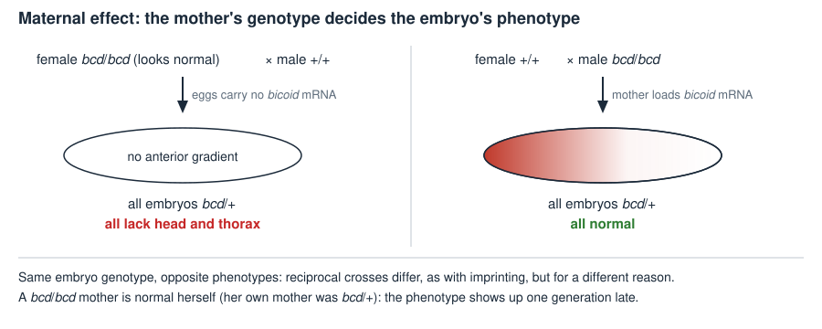
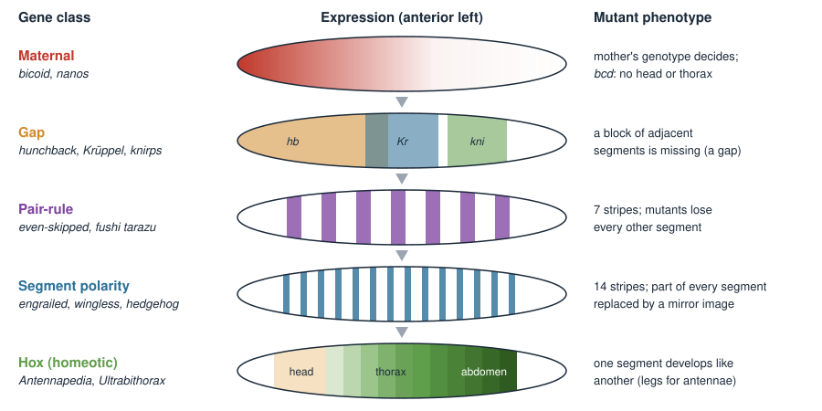
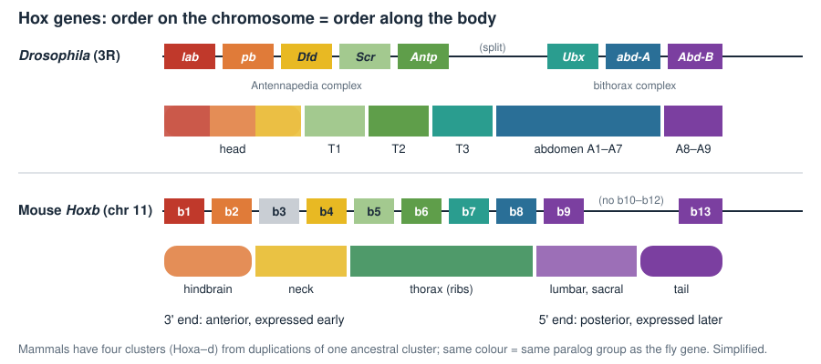
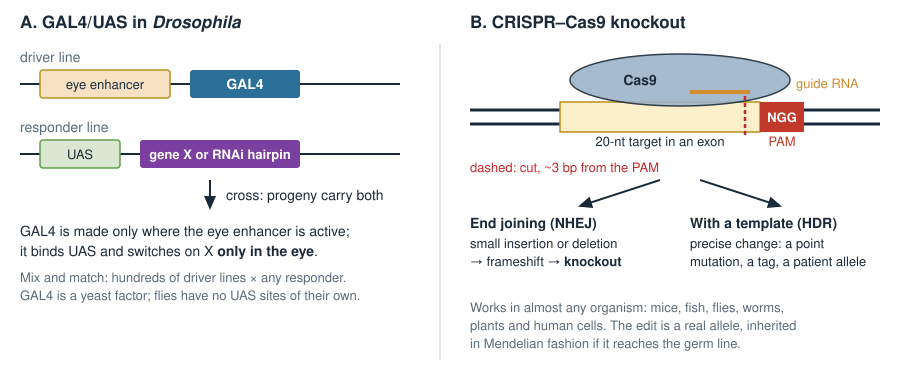

## About this lecture

How does one fertilised egg build a body with a head at one end and a tail at the other? Most of what we know came from **mutant screens** in a few **model organisms**, and from the surprise that the genes found in flies and worms have counterparts in humans.

- **Forward vs reverse genetics**; the main model organisms and their databases.
- The **Nüsslein-Volhard–Wieschaus screen** and **maternal-effect** genes.
- The ***Drosophila* segmentation hierarchy**: maternal → gap → pair-rule → segment polarity → Hox.
- **Hox genes** and **colinearity**; *PAX6*/*eyeless* and deep conservation.
- The ***C. elegans* cell lineage**.
- **Genetic tools**: transgenics, GAL4/UAS, CRISPR–Cas9 knockouts.

Book: Hartwell, *Genetics: From Genes to Genomes*, the chapter on the genetic analysis of development.

::: notes
This unit pulls Part 6 together. The segmentation genes are transcription factors acting on enhancers (Eukaryotic regulation), the heterochronic genes are microRNAs and their targets (RNA-mediated regulation), and the logic of the screens is Mendelian: recessive lethals, complementation groups (Mutation unit, Part 3), maternal effects, epistasis. The R exercise looks at the conservation of developmental genes across the model organisms.
:::

## Why model organisms? {.smaller}

| Organism | Generation | Genome (approx.) | Strengths | Database |
|---|---|---|---|---|
| Budding yeast, *S. cerevisiae* | ~2 h | 12 Mb, ~6000 genes | haploid and diploid; tetrads; cell cycle | SGD |
| Worm, *C. elegans* | ~3.5 days | 100 Mb, ~20 000 genes | invariant cell lineage; transparent; RNAi by feeding | WormBase |
| Fruit fly, *D. melanogaster* | ~10 days | 140 Mb, ~14 000 genes | huge mutant collections; balancers; GAL4/UAS | FlyBase |
| Zebrafish, *D. rerio* | ~3 months | 1.4 Gb, ~26 000 genes | transparent embryos; vertebrate | ZFIN |
| Mouse, *M. musculus* | ~10 weeks | 2.7 Gb, ~22 000 genes | mammal; knockouts; disease models | MGI |
| Thale cress, *A. thaliana* | ~6 weeks | 135 Mb, ~27 000 genes | plant development; selfing | TAIR |

The **Alliance of Genome Resources** brings SGD, WormBase, FlyBase, ZFIN, MGI, RGD and Xenbase together, with **orthology** between them.

::: notes
The numbers are rounded and change a bit with each annotation release, so do not ask students to learn them; the pattern matters. Small genomes and short generations mean you can do big screens; vertebrates are closer to humans but slower and more expensive. Mendel chose peas for the same practical reasons. Each organism has its own curated database, with its own gene naming conventions (fly genes named after their mutant phenotype, like eyeless; worm genes like lin-4 with a three-letter code and a number; mouse genes like Pax6, human like PAX6). The Alliance is the place to go between them, which students do in Find it.
:::

## Forward and reverse genetics {.smaller}

{width="76%" fig-align="center"}

- **Forward**: mutagenise, screen, find the genes. **Unbiased**, but you only find genes whose loss gives a visible, specific phenotype.
- **Reverse**: start from a gene (often an ortholog of a gene known elsewhere), knock it out, and look. Targeted, but genes can be **redundant** and show no phenotype.

::: notes
Forward genetics was the only option until the 1980s and it is how all the genes in today's lecture were found. Reverse genetics needs the gene sequence, and was transformed first by RNAi (last unit) and then by CRISPR. The two are complementary: a forward screen is like asking the organism what matters; reverse genetics is asking a specific question. A common surprise with reverse genetics: a knockout with no phenotype, often because a paralog covers for it, the same redundancy as the 15:1 duplicate-gene ratio in Extensions to Mendel.
:::

## The Heidelberg screen {.smaller}

Christiane **Nüsslein-Volhard** and Eric **Wieschaus** (1980) looked for every gene needed to make the pattern of the *Drosophila* larva.

- Mutagenise males with **EMS**; set up thousands of lines, each carrying one mutagenised chromosome over a **balancer** (a chromosome with inversions that cannot recombine, and a dominant marker).
- Inter-cross heterozygous siblings: ¼ of the embryos are **homozygous** for the new mutation. Look for embryos that die with an abnormal **larval cuticle** pattern.
- Sort the mutations into **complementation groups** (genes). Many genes had several alleles: the screen was close to **saturation**.
- They found about 15 genes for segment number and polarity, in **three classes**: gap, pair-rule and segment polarity. (Nobel Prize 1995, with Ed Lewis.)

::: notes
This is the clearest example of a forward screen. The genetic tricks matter: balancers let you keep a recessive lethal mutation as a heterozygous stock without selecting for it every generation, because the balancer prevents recombination and its own recessive lethal kills balancer homozygotes. The cuticle of a dead embryo shows a pattern of denticle belts, one per segment, which makes pattern defects easy to see under a microscope. Saturation is a useful idea: if you find most genes several times, there are probably few left to find. The complementation test is exactly the one from the Mutation unit.
:::

## Maternal-effect genes {.smaller}

{width="68%" fig-align="center"}

The anterior–posterior axis is set up **before** the embryo's own genes are switched on, by mRNAs the **mother** puts into the egg. *bicoid* mRNA sits at the anterior pole; its protein forms a **gradient** that tells nuclei how far they are from the head. A screen for maternal-effect genes therefore needs **homozygous mothers**, one generation later than a zygotic screen.

::: notes
Maternal effect is another way for reciprocal crosses to differ, next to sex linkage (Part 2), cytoplasmic inheritance (Part 5) and imprinting (last but one unit). The embryo's genotype is irrelevant; the mother's genotype decides. A classic exam trap: a bcd/bcd female is perfectly normal, because she developed from an egg that her bcd/+ mother provided with bicoid mRNA. Bicoid is a morphogen: a transcription factor whose concentration gradient switches on different target genes at different thresholds, for example hunchback at high levels. Nanos does the same job from the posterior end, by repressing translation of maternal hunchback mRNA.
:::

## The segmentation hierarchy {.smaller}

{width="74%" fig-align="center"}

Each tier is a set of **transcription factors** (or signals) that regulate the next. The pattern gets finer at every step: one gradient → a few broad domains → 7 stripes → 14 stripes → 14 segments, each with its own identity.

::: notes
Go down the figure. Maternal genes set up the gradients. Gap genes are expressed in broad domains, and a gap mutant lacks a block of adjacent segments: Krüppel, German for cripple, lacks the thorax and anterior abdomen. Pair-rule genes are expressed in seven stripes, and mutants lack every other segment, which is where the name comes from (fushi tarazu is Japanese for "not enough segments"). Segment-polarity genes, in fourteen stripes, define the front and back of each segment; in mutants, part of each segment is replaced by a mirror image of the other part. Many are parts of signalling pathways: wingless (Wnt) and hedgehog. Hox genes then give each segment an identity.
:::

## Reading a stripe: enhancers again {.smaller}

How does a gene get expressed in exactly **seven stripes**? Each stripe is driven by its own **enhancer**.

- The ***even-skipped* stripe 2 enhancer** (about 500 bp) contains binding sites for activators (**Bicoid**, **Hunchback**) and repressors (**Giant**, **Krüppel**).
- Stripe 2 forms where Bicoid and Hunchback are high **and** Giant and Krüppel are low: a narrow band of a few nuclei.
- Delete the stripe 2 enhancer: stripe 2 disappears, the other six stay. Attach it to a reporter gene: the reporter is expressed in stripe 2 only.

This is the cis-regulatory logic of the Eukaryotic regulation unit, at work in an embryo: **modular enhancers** make one gene readable in many places.

::: notes
The eve stripe 2 enhancer is the textbook example of an enhancer acting as a logic gate: AND for the activators, NOT for the repressors. Each of the seven eve stripes is controlled by a separate enhancer (some enhancers drive two stripes), so the gene is used seven times with different inputs. The reporter-gene experiment is the standard way to define an enhancer: fuse the DNA fragment to a minimal promoter and lacZ (the same lacZ as in the lac operon!), make transgenic flies, and stain for beta-galactosidase. A mutation in a binding site within the stripe 2 enhancer changes only stripe 2: cis-acting and stripe-specific.
:::

## Hox genes: identity of each segment {.smaller}

**Homeotic** mutations turn one body part into another:

- ***Antennapedia*** (dominant gain-of-function): the *Antp* gene is switched on in the head, and **legs grow where the antennae should be**.
- ***Ultrabithorax*** (loss of function, combined alleles in the *bithorax* complex): the third thoracic segment develops like the second: a fly with **four wings**.

Ed **Lewis** showed that the genes of the *bithorax* complex lie in the **same order** on the chromosome as the segments they control. All Hox genes share a 180-bp **homeobox**, encoding a DNA-binding homeodomain: they are transcription factors.

::: notes
Homeotic transformations are the most dramatic phenotypes in genetics, and they made sense only once it was clear that each segment has a default identity that Hox genes modify. Antennapedia gain-of-function alleles are dominant, because they express a normal protein in the wrong place, the same logic as the enhancer variants in the regulation unit: a cis-regulatory change, dominant. The four-winged fly needs a combination of mutations in regulatory regions of Ubx (bx, pbx and abx alleles), because a complete loss of Ubx is lethal. The homeobox was discovered in 1984 by comparing Antp and Ubx sequences, and was then found in every animal tested.
:::

## Colinearity, from flies to mice {.smaller}

{width="74%" fig-align="center"}

The order of Hox genes on the chromosome matches the order of the body regions where they act (**colinearity**). Mammals have **four Hox clusters** (*Hoxa*–*d*, 39 genes) made by duplication of one ancestral cluster. Knocking out mouse Hox genes gives homeotic changes in **vertebrae**, e.g. a cervical vertebra that looks like a thoracic one (with ribs).

::: notes
The conservation is astonishing: the same genes, in the same order, doing the same kind of job in flies and mammals, which last shared an ancestor more than 500 million years ago. In vertebrates there is also temporal colinearity: the 3' genes are switched on first, then the 5' ones. Because there are four clusters, mammals have paralogs that partly cover for each other, so single knockouts often give mild phenotypes, and double or triple knockouts of a paralog group are needed for full transformations: redundancy again. Polycomb proteins keep Hox genes off in segments where they should be off, which links to chromatin memory from the regulation unit: Polycomb mutants in flies show homeotic transformations.
:::

## *eyeless* and *PAX6*: one master gene for eyes? {.smaller}

- ***eyeless*** (*Drosophila*): flies lacking it have small or no eyes. ***Small eye*** (mouse, *Pax6*) and **aniridia** (human, *PAX6*) are caused by mutations in orthologous genes: in mice and humans **one** mutant copy is enough to give a phenotype (**haploinsufficiency**).
- Expressing *eyeless* in other imaginal discs gives **ectopic eyes** on legs, wings and antennae (Gehring lab, 1995). **Mouse *Pax6*** does the same in flies.
- Flies, mice and humans built their eyes very differently, yet use a related transcription factor at the top of the eye programme: **deep homology**.

Flies actually have **two** *PAX6* genes, *eyeless* and *twin of eyeless*; which one counts as "the" ortholog depends on the method. You will see this in Find it and in R.

::: notes
The ectopic-eye experiment used GAL4/UAS (two slides on) to switch on eyeless in leg and wing discs; the extra eyes are compound fly eyes, not mouse eyes, because eyeless switches on the fly's own eye programme. Aniridia: absence of the iris, inherited as an autosomal dominant, because half the PAX6 dose is not enough; homozygous Small eye mice and the rare human PAX6 compound heterozygotes have no eyes and severe brain defects. The two-paralog situation in flies is a nice honest complication for the database part: orthology is inferred, and methods can disagree.
:::

## *C. elegans*: a body built cell by cell {.smaller}

- The adult hermaphrodite has **959 somatic nuclei**. John **Sulston** traced every division from the zygote: the **cell lineage** is **invariant**, the same in every worm.
- So a mutant phenotype can be read **cell by cell**: which cell divided wrongly, or took the wrong fate?
- **131** cells die by **programmed cell death** during development. Mutants in *ced-3* and *ced-4* keep them alive; *ced-9* protects cells. The human counterparts (caspases, *APAF1*, *BCL2*) control apoptosis and cancer. (Nobel Prize 2002: Brenner, Horvitz, Sulston.)
- **Heterochronic** genes (*lin-4*, *lin-14*, *let-7*) decide *when* in the lineage each fate happens (last unit).
- **Laser ablation** of single cells shows which cells signal to their neighbours.

::: notes
The worm is the opposite extreme to the fly: few cells, every one named and known. The cell-death genes are a nice epistasis story: ced-9 loss kills cells that should live, but ced-9; ced-3 double mutants survive, so ced-3 is downstream: ced-9 inhibits ced-4, which activates the caspase ced-3. Mammalian BCL2 can replace worm ced-9 in transgenic worms, another case of deep conservation, and BCL2 over-expression in follicular lymphoma (a translocation) is an oncogene that blocks apoptosis: Part 7.
:::

## Genetic tools {.smaller}

{width="72%" fig-align="center"}

- **Transgenics**: put new DNA into the germ line (P elements in flies, injection in worms and mice).
- **GAL4/UAS**: switch on any transgene (or an RNAi hairpin) in any tissue, by crossing a driver line to a responder line.
- **CRISPR–Cas9**: cut a chosen site; error-prone repair gives a **knockout**; repair with a template gives a precise **edit**. Mosaic founders are crossed to get a heritable allele.

::: notes
GAL4/UAS is a binary system, which is why it is so powerful: the driver decides where and when, the responder decides what. The same principle (a yeast transcription factor and its binding site, foreign to the fly) shows the modularity of enhancers. In mice the equivalent tissue-specific tool is Cre/lox: Cre recombinase expressed in one tissue deletes a gene flanked by loxP sites, a conditional knockout, so you can study a gene whose full knockout is lethal. CRISPR: the guide RNA finds the site by base pairing, like a microRNA; the PAM (NGG for the common Cas9) must sit next to it. The founders (F0) are usually mosaics of different edits, so you cross them and select germ-line transmission, then make homozygotes: Mendel again.
:::

## Orthologs across model organisms {.smaller}

**Orthologs** are genes in different species that descend from one gene in their last common ancestor; **paralogs** arise by duplication within a lineage.

| Human | Mouse | Zebrafish | Fly | Worm | Yeast |
|---|---|---|---|---|---|
| *PAX6* | *Pax6* | *pax6a*, *pax6b* | *toy* (and *ey*) | *vab-3* | — |
| *CDK1* | *Cdk1* | *cdk1* | *Cdk1* | *cdk-1* | *CDC28* |

- Developmental **signalling and patterning genes** go back to the animal ancestor; yeast, a single-celled fungus, has none of them.
- **Core cell machinery** (cell cycle, cytoskeleton) is shared with yeast.
- Zebrafish often have **two** copies, from a genome duplication in the ancestor of teleost fish.

::: notes
The table comes from the Alliance (stringent set, release 9.2.0), which students use in Find it and in R. Point out the PAX6 row: zebrafish has two copies because of the teleost-specific genome duplication; the fly also has two related genes, ey and toy, from a separate duplication in insects, and orthology methods disagree on which to pair with PAX6. That is a good lesson about databases: an ortholog call is a prediction, made by algorithms, and "no ortholog" in a table can mean "no gene", "a gene too divergent to call", or "methods disagree". CDK1 is a control: yeast CDC28 is the cell-cycle kinase found in Lee Hartwell's yeast screens, the same Hartwell as the course book.
:::

## Summary {.smaller}

| Concept | Key fact |
|---|---|
| Forward / reverse genetics | phenotype → gene (screens) / gene → phenotype (RNAi, CRISPR) |
| Heidelberg screen | EMS, balancers, embryonic lethals, complementation groups; gap, pair-rule, segment polarity |
| Maternal effect | embryo phenotype set by the mother's genotype; *bicoid* mRNA gradient |
| Segmentation hierarchy | maternal → gap → pair-rule (7 stripes) → segment polarity (14) → Hox |
| Stripe enhancers | *eve* stripe 2: activated by Bcd, Hb; repressed by Gt, Kr |
| Hox genes | homeotic transformations; homeobox; colinearity; four clusters in mammals |
| *PAX6* / *eyeless* | eye development from flies to humans; ectopic eyes; haploinsufficient in humans |
| *C. elegans* lineage | 959 somatic nuclei, invariant; 131 programmed deaths (*ced* genes) |
| Tools | transgenics, GAL4/UAS, CRISPR knockouts and edits, conditional knockouts |
| Orthologs | inferred by algorithms; patterning genes absent from yeast; fish duplicates |

::: notes
Revision sheet. The single idea that ties Part 6 together: development is gene regulation in time and space, built from the same parts (cis-acting sites, trans-acting factors, RNA regulators, chromatin memory) that we met in the first three units.
:::

## Where this leads

- **Part 7: Cancer genetics.** Many developmental genes (*SHH*, *WNT*, *NOTCH*, *HMGA2*, *BCL2*) return as oncogenes and tumour suppressors when they are switched on in the wrong place or time.
- **Part 7: Complex traits.** Most human variation in shape and size comes from regulatory variants in developmental genes.
- **Ethics.** CRISPR in embryos and the germ line.

::: notes
Point forward. In the exercise students design and interpret screens and crosses by hand (maternal effect, balancers, epistasis in the hierarchy), look up PAX6/eyeless and a Hox gene across the model-organism databases, and in R they build a presence/absence heat map of orthologs with left_join.
:::
