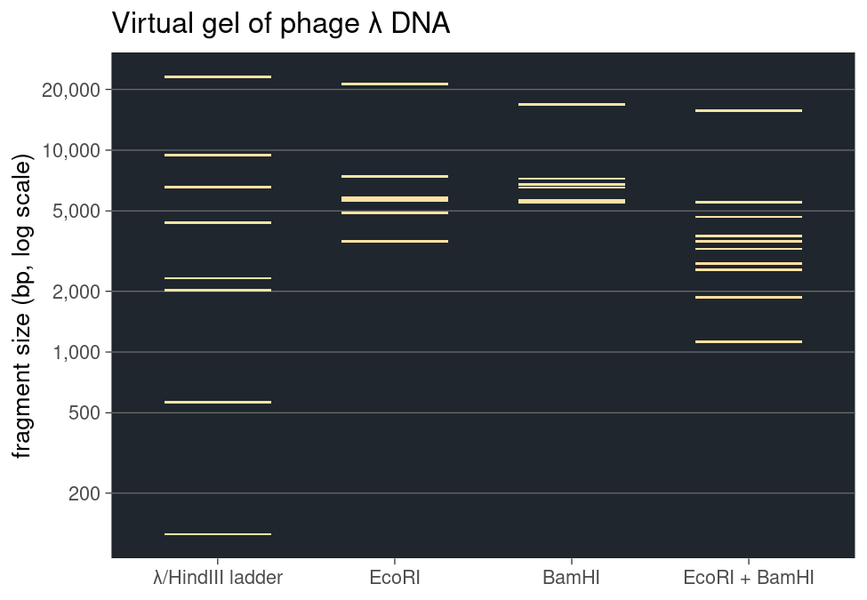

## Goal

By the end of this exercise you should be able to:

- read a **FASTA** file into R by hand with `readLines()` and `paste()`;
- find every occurrence of a restriction site with **`str_locate_all()`**;
- turn cut positions into fragment sizes with a small function;
- draw a virtual gel with ggplot2 on a log scale.

## Before you start

This page builds on the [Exercise](exercise.qmd), so do the by-hand part (B1–B3) and the gel demo first. You need the packages dplyr, stringr and ggplot2. Download the two FASTA files and save them in a `data/` folder of your R project:

- [lambda.fasta](data/lambda.fasta): the genome of phage λ, NCBI **NC_001416.1** (48,502 bp; the same file you get in Find it F5).
- [hbb_pcr.fasta](data/hbb_pcr.fasta): the 500-bp *HBB* PCR product from the sickle-cell test (normal allele), taken from the human genome GRCh38 (chr11:5,226,722–5,227,221, minus strand, Ensembl release 116).

See [data/README.md](data/README.md) for where the files come from.

## Tasks

**New idiom: `str_locate_all()`.** [`str_locate_all(string, pattern)`](https://stringr.tidyverse.org/reference/str_locate.html) from stringr finds **every** match of a pattern in a string and returns, for each string, a matrix with one row per match and the columns `start` and `end`. The pattern is a [regular expression](https://stringr.tidyverse.org/articles/regular-expressions.html), so `"GAATTC"` matches itself, `"GAATTC|GGATCC"` matches either site, and `"CT[ACGT]AG"` matches CTAAG, CTCAG, CTGAG and CTTAG (the DdeI site, N = any base). In the DNA recap unit you used stringr for single sequences; here we search a whole genome.

A **FASTA** file is plain text: one header line starting with `>`, then the sequence split over many lines. There are packages that read FASTA, but it is easy to do by hand, and doing it once shows you what the format is.

```r
library(dplyr)
library(stringr)
library(ggplot2)
```

**R1. (read a FASTA file by hand)** Read the λ genome with [`readLines()`](https://rdrr.io/r/base/readLines.html), which gives one string per line. Look at the first line, drop it, and glue the rest together with [`paste(..., collapse = "")`](https://rdrr.io/r/base/paste.html). Check the length with `nchar()` against the NCBI record (Find it F5).

```r
lines <- readLines("data/lambda.fasta")
length(lines)
lines[1]
lambda <- paste(lines[-1], collapse = "")   # lines[-1]: every line except the first
nchar(lambda)
str_sub(lambda, 1, 12)
```

The first 12 bases are the single-stranded "cos" end of the λ genome. How many sequence lines does the file have, and how many bases per line?

**R2. (find the sites)** First check with a reverse-complement function (as in the DNA recap unit) that the EcoRI and BamHI sites are palindromes. Then find all EcoRI sites with `str_locate_all()`. The result is a list with one matrix per input string; we have one string, so take `[[1]]`. For BamHI, keep only the `start` column.

```r
revcomp <- function(s) {
  paste(rev(strsplit(chartr("ACGT", "TGCA", s), "")[[1]]), collapse = "")
}
revcomp("GAATTC")
revcomp("GGATCC")

eco <- str_locate_all(lambda, "GAATTC")[[1]]
eco
bam <- str_locate_all(lambda, "GGATCC")[[1]]
bam[, "start"]
```

How many sites does each enzyme have? Compare with the lecture table and with REBASE (Find it F4).

**R3. (from sites to fragments)** EcoRI cuts between the G and the first A (G^AATTC). If a site starts at position *s*, there are *s* bases to the left of the cut, so the cut position is *s* + offset − 1 with offset 1. Write a function `digest(seq, site, offset = 1)` that returns the fragment sizes of a **linear** molecule, largest first. [`diff()`](https://rdrr.io/r/base/diff.html) gives the differences between neighbouring numbers, which are exactly the fragment lengths if you add the two ends (0 and the length) to the cut positions. Use it for EcoRI, BamHI and the double digest, and check that the fragments add up to the genome.

```r
digest <- function(seq, site, offset = 1) {
  starts <- str_locate_all(seq, site)[[1]][, "start"]
  cuts <- starts + offset - 1                  # bases to the left of each cut
  ends <- c(0, sort(cuts), nchar(seq))
  sort(diff(ends), decreasing = TRUE)
}
digest(lambda, "GAATTC")
digest(lambda, "GGATCC")
sum(digest(lambda, "GAATTC"))
both <- digest(lambda, "GAATTC|GGATCC")
both
length(both)
```

Compare with the restriction-mapping slide in the lecture and with the gel demo.

**R4. (the λ/HindIII ladder)** The classic λ/HindIII ladder has the bands 23,130, 9,416, 6,557, 4,361, 2,322, 2,027, 564 and 125 bp. Digest the λ sequence with HindIII (A^AGCTT, offset 1) and compare with [`setdiff()`](https://rdrr.io/r/base/sets.html). Which fragment differs, and what does that tell you about the DNA used to make the ladder? (This is question E2 in the exercise.)

```r
hind <- digest(lambda, "AAGCTT")
hind
ladder <- c(23130, 9416, 6557, 4361, 2322, 2027, 564, 125)
setdiff(hind, ladder)
setdiff(ladder, hind)
6557 + 125
```

**R5. (a virtual gel)** Put the ladder and the three digests in one table with [`bind_rows()`](https://dplyr.tidyverse.org/reference/bind_rows.html), one row per band, and plot each band as a short wide tile. On a log y-axis, large fragments end up at the top and small ones at the bottom, just like a real gel. Use `factor(..., levels = ...)` to keep the lanes in order.

```r
gel <- bind_rows(
  tibble(lane = "λ/HindIII ladder", size = ladder),
  tibble(lane = "EcoRI", size = digest(lambda, "GAATTC")),
  tibble(lane = "BamHI", size = digest(lambda, "GGATCC")),
  tibble(lane = "EcoRI + BamHI", size = both)
) |>
  mutate(lane = factor(lane, levels = c("λ/HindIII ladder", "EcoRI", "BamHI", "EcoRI + BamHI")))
gel |> count(lane)

ggplot(gel, aes(x = lane, y = size)) +
  geom_tile(width = 0.6, height = 0.012, fill = "#ffe3a3") +
  scale_y_log10(breaks = c(200, 500, 1000, 2000, 5000, 10000, 20000),
                labels = scales::label_comma()) +
  labs(x = NULL, y = "fragment size (bp, log scale)", title = "Virtual gel of phage λ DNA") +
  theme_dark(base_size = 13) +
  theme(panel.background = element_rect(fill = "#1f262d"),
        panel.grid.major.x = element_blank(), panel.grid.minor = element_blank())
```

(On a log axis, `height = 0.012` is measured in log~10~ units, so every band has the same thickness.) Which bands in the double digest would you expect to merge on a real gel?

**R6. (diagnosing sickle cell in R)** Read the *HBB* PCR product the same way. The A of the ATG start codon is at position 201, so codon 7 (GAG) is at positions 219–221 and the HbS change (A → T) is at position **220**. Make the HbS version by replacing that base with [`str_sub() <-`](https://stringr.tidyverse.org/reference/str_sub.html), then digest both alleles with DdeI (pattern `"CT[ACGT]AG"`, offset 1).

```r
hl <- readLines("data/hbb_pcr.fasta")
hbbA <- paste(hl[-1], collapse = "")
nchar(hbbA)
str_sub(hbbA, 201, 221)          # codons 1-7
hbbS <- hbbA
str_sub(hbbS, 220, 220) <- "T"
str_sub(hbbS, 201, 221)
dde <- "CT[ACGT]AG"
str_locate_all(hbbA, dde)[[1]][, "start"]
digest(hbbA, dde)
digest(hbbS, dde)
```

Translate codons 1–7 in your head (or with the codon table from the Mutation unit) for both alleles. Do the fragments agree with the table in the exercise Background?

## Solutions

::: {.callout-note collapse="true" title="Solutions: In R"}

All output below is from `Rscript --vanilla` (R 4.6.2) run in the unit folder.

**R1.**

```
[1] 695
[1] ">NC_001416.1 Enterobacteria phage lambda, complete genome"
[1] 48502
[1] "GGGCGGCGACCT"
```

The file has 695 lines: the header and 694 sequence lines of 70 bases (the last one shorter). Glued together, the sequence is **48,502** bases, as in the NCBI record.

**R2.**

```
[1] "GAATTC"
[1] "GGATCC"
     start   end
[1,] 21226 21231
[2,] 26104 26109
[3,] 31747 31752
[4,] 39168 39173
[5,] 44972 44977
[1]  5505 22346 27972 34499 41732
```

Both sites equal their reverse complement. EcoRI has **5** sites and BamHI **5**, as in the lecture and in REBASE. Each EcoRI match is 6 bases long (`end − start = 5`).

**R3.**

```
[1] 21226  7421  5804  5643  4878  3530
[1] 16841  7233  6770  6527  5626  5505
[1] 48502
 [1] 15721  5505  4669  3775  3758  3530  3240  2752  2564  1868  1120
[1] 11
```

Five sites in a linear molecule give **6** fragments for each enzyme; the ten sites together give **11**. The EcoRI fragments add up to 48,502. The first EcoRI site is at 21,226, so the first fragment (the left end of the genome) is 21,226 bp, the largest.

**R4.**

```
[1] 23130  9416  6682  4361  2322  2027   564
[1] 6682
[1]  6557  125
[1] 6682
```

The reference sequence has six HindIII sites and seven fragments. Instead of the ladder's 6,557 and 125 bp it has one 6,682-bp fragment, and 6,557 + 125 = 6,682. The ladder DNA has one extra HindIII site, 125 bp from another one: the *ind1* mutation (C → T at position 37,589) in the λ strain that is sold for ladders creates it.

**R5.**

```
# A tibble: 4 × 2
  lane                 n
  <fct>            <int>
1 λ/HindIII ladder     8
2 EcoRI                6
3 BamHI                6
4 EcoRI + BamHI       11
```

{width="75%" fig-align="center"}

The EcoRI 5,804 and 5,643 bands, the BamHI 6,770 and 6,527 bands, and in the double digest the 3,775 and 3,758 bands (only 17 bp apart) would merge or nearly merge on a real gel. The 125 bp ladder band is so small and so faint that it is often not visible at all.

**R6.**

```
[1] 500
[1] "ATGGTGCATCTGACTCCTGAG"
[1] "ATGGTGCATCTGACTCCTGTG"
[1]  37 217 418
[1] 201 180  82  37
[1] 381  82  37
```

Codons 1–7 read ATG GTG CAT CTG ACT CCT GAG = Met-Val-His-Leu-Thr-Pro-**Glu** in HbA and …CCT GTG = …Pro-**Val** in HbS. The DdeI site at 217 (CTGAG) is lost in HbS (CTGTG), so the 180 and 201 bp fragments become one fragment of **381** bp, as in the Background table and the gel demo.
:::

## Where this leads

In **Genome annotation** you read a much bigger table: every human protein-coding gene from Ensembl BioMart, with `read_tsv()`, and you count genes per chromosome. The `str_locate_all()` idea comes back in the ORF finder demo, which searches all six reading frames for start and stop codons.
