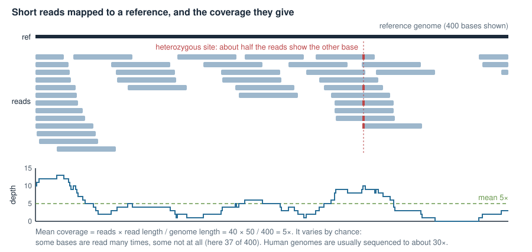

## About this lecture

So far we have studied genes through **phenotypes**: round or wrinkled, affected or not. From here on we also read the **DNA itself**. Four tools make that possible, and together they turn a gene into data you can store, compare and search.

- **Cut**: restriction enzymes recognise short palindromic sites and cut there.
- **Sort**: gel electrophoresis separates DNA fragments by size; a ladder gives the scale.
- **Copy**: cloning in a plasmid vector (briefly), and the **polymerase chain reaction** (PCR), which copies one stretch of DNA a billion-fold.
- **Read**: **Sanger sequencing** reads one PCR product; **next-generation sequencing** reads millions of short pieces at once.

The running example is the sickle-cell allele of *HBB* from Genetics as information: we will detect it in a family with PCR and a restriction enzyme.

Book: Hartwell, *Genetics: From Genes to Genomes*, chapter on digital analysis of DNA.

::: notes
This lecture opens Part 4, the most bioinformatic block of the course, but the questions stay genetic: which allele does this person carry, and how do we know? Remind students of HbS from the first unit: one base change, GAG to GTG in codon 7 (traditionally codon 6). Today we see how a lab detects that one base. The book calls this "digital" because DNA, once read, is a string of four letters that can be copied, compared and searched like any other digital data. The exercise has two demos (a virtual gel and a PCR curve) and the R part finds restriction sites in the genome of phage lambda.
:::

## Cut, sort, copy, read {.smaller}

| Tool | What it does | What it gives you | Used for |
|---|---|---|---|
| Restriction enzyme | cuts at a specific 4–8 bp site | fragments of predictable size | mapping, cloning, detecting some mutations |
| Gel electrophoresis | separates fragments by size | bands; size from a ladder | checking digests and PCR products |
| Cloning vector | carries a fragment into bacteria, which copy it | many identical copies, kept for later | libraries, protein expression, transgenics |
| PCR | copies the DNA between two primers | 10^9^-fold more of one region | diagnostics, genotyping, sequencing input |
| Sanger sequencing | reads one PCR product | ~800 bases of high-quality sequence | confirming a variant |
| Next-generation sequencing | reads millions of short fragments | whole genomes, exomes, transcriptomes | finding variants genome-wide |

The tools combine: PCR a region, cut it, run it on a gel; or PCR it and sequence it.

::: notes
This slide is the map of the lecture. Read it as a pipeline: you usually cannot see one gene in three billion base pairs, so you first make many copies of it (PCR or cloning), then you look at it, either by its size on a gel or by reading the bases. Each tool has a characteristic output, and students should be able to say which tool answers which question. For example: "is this person a carrier of HbS?" can be answered by PCR plus DdeI digestion plus a gel, or by PCR plus Sanger sequencing. "Which variants does this person carry in all 20,000 genes?" needs next-generation sequencing.
:::

## Restriction enzymes cut at palindromes {.smaller}

{width="72%" fig-align="center"}

- Bacteria make restriction enzymes to **cut invading phage DNA**; they protect their own DNA by methylating the same sites.
- The site is usually a **palindrome**: the two strands read the same 5'→3'. The enzyme is a dimer and each half cuts one strand.
- A staggered cut leaves **sticky ends** that can pair with any other end cut by the same enzyme.

::: notes
Restriction enzymes were discovered as the reason some phages grow poorly on certain bacterial strains: the phage DNA is "restricted", cut up, on entry. The bacterium's own DNA carries a methyl group at the same sites, added by a matching methyltransferase, so it is not cut. The names come from the organism: EcoRI from Escherichia coli strain RY13, HindIII from Haemophilus influenzae Rd, BamHI from Bacillus amyloliquefaciens. Palindrome here means the sequence equals its own reverse complement, which students can check with the reverse-complement function from the DNA recap unit. Sticky ends are what made recombinant DNA possible in the 1970s: cut a human gene and a plasmid with EcoRI, mix, and the ends pair; DNA ligase seals them.
:::

## How often does an enzyme cut? {.smaller}

If the four bases were equally common and random, a given site of *n* specified bases would occur once every 4^*n*^ bp.

| Enzyme | Site | Expected spacing | Expected in phage λ (48,502 bp) | Actual in λ |
|---|---|---:|---:|---:|
| EcoRI | GAATTC | 4^6^ = 4,096 bp | 11.8 | **5** |
| BamHI | GGATCC | 4,096 bp | 11.8 | **5** |
| HindIII | AAGCTT | 4,096 bp | 11.8 | **6** |
| DdeI | CTNAG (N = any) | 4^4^ = 256 bp | 189 | **104** |

- 6-bp cutters ("six-cutters") give fragments of a few kb; 4-bp cutters give a few hundred bp.
- Real DNA is not random, so actual counts differ from the expectation. In the R exercise you count the λ sites yourself.

::: notes
The 4 to the n rule is a useful first estimate and a nice probability exercise: each position must match, with probability one quarter, independently, so the product rule from Part 1 gives one quarter to the power n. For DdeI, the N matches anything, so only four positions count. The actual numbers for phage lambda come from the reference sequence NC_001416.1 and agree with REBASE's own counts. Lambda has fewer sites than expected for all four enzymes. One reason is that many phages avoid the sites of their hosts' restriction enzymes over evolutionary time, since phages with fewer sites survive restriction better. Do not overclaim this for lambda in particular; the general point is that sequence composition matters.
:::

## Gel electrophoresis: sorting fragments by size {.smaller}

{width="74%" fig-align="center"}

- DNA has a negative phosphate backbone, so it moves towards the + electrode. The agarose mesh slows long molecules more.
- Distance run is roughly linear in **log(size)** over the gel's useful range. Use a **ladder** of known sizes to read off unknown bands.
- Higher % agarose resolves short fragments (100–1,000 bp); lower % resolves long ones (1–20 kb).

::: notes
Every DNA molecule has the same charge per unit length, so charge alone would not separate them; it is the gel matrix that does, by sieving. That is why distance depends on size, and in practice on the log of size. Show how to read the plot: find the unknown band's distance, go up to the line, read across. Doing it by eye on a log scale is a skill students will need in the lab. Two practical details: the DNA is invisible until stained, and band brightness depends on mass, so a 37 bp fragment carries much less stain than a 400 bp fragment present in the same number of copies. Very large fragments (above about 20 to 30 kb) all run together near the well on a normal gel; separating them needs pulsed-field electrophoresis.
:::

## Restriction mapping: where are the sites? {.smaller}

Phage λ DNA (48,502 bp, linear), digested once with each enzyme and once with both:

| Digest | Fragments (bp) | Number |
|---|---|---:|
| EcoRI | 21,226 · 7,421 · 5,804 · 5,643 · 4,878 · 3,530 | 6 |
| BamHI | 16,841 · 7,233 · 6,770 · 6,527 · 5,626 · 5,505 | 6 |
| EcoRI + BamHI | 15,721 · 5,505 · 4,669 · 3,775 · 3,758 · 3,530 · 3,240 · 2,752 · 2,564 · 1,868 · 1,120 | 11 |

- A linear molecule with *k* sites gives *k* + 1 fragments; a **circular** one gives *k*.
- Fragments always **sum** to the full length: a check on your reading of the gel.
- A fragment that survives the double digest unchanged (5,505; 3,530) contains no site for the other enzyme. Fragments that split show where the other sites are.

::: notes
Restriction mapping is the oldest kind of physical map, and the logic is a puzzle like the three-point cross in Part 2: you have pieces and must find the order. Walk through one example. The BamHI 5,505 fragment survives the double digest, so it has no EcoRI site; it is at an end of the molecule (it is in fact the left end, positions 1 to 5,505). The EcoRI 21,226 fragment, the left end, is cut by BamHI into 5,505 and 15,721. The numbers are computed from the real sequence; students reproduce them in R. Note that 3,775 and 3,758 differ by only 17 bp and would look like one bright band on a gel: a gel cannot resolve everything.
:::

## Cloning vectors (briefly) {.smaller}

:::: {.columns}
::: {.column width="55%"}

A **vector** is a small DNA molecule that bacteria copy for you. The classic example is the plasmid **pUC19** (2,686 bp, circular):

| Part | Job |
|---|---|
| origin of replication | many copies per cell |
| antibiotic-resistance gene (*bla*, ampicillin) | only cells with the plasmid survive |
| multiple cloning site (MCS) | one site each for EcoRI, BamHI, HindIII, PstI, … |
| *lacZα* around the MCS | an insert disrupts it: white instead of blue colonies |

:::
::: {.column width="45%"}

**Cloning in four steps**

1. Cut vector and insert with the same enzyme(s).
2. Mix; sticky ends pair; **ligase** seals them.
3. **Transform** *E. coli*; select on ampicillin.
4. Pick a white colony, grow it, check the insert with a digest and a gel.

:::
::::

Today PCR has replaced cloning for most diagnostic work; cloning is still used to make proteins and transgenic organisms.

::: notes
Keep this short: the course book covers vectors in more detail, and the lab course does the practical work. The key ideas are the selectable marker and the unique sites. In pUC19, the EcoRI, BamHI, HindIII and PstI sites each occur once, all inside the multiple cloning site, so one cut opens the circle into a single linear 2,686 bp piece; students can check this in the gel demo. Blue-white screening: the lacZ alpha fragment complements a defective lacZ in the host, giving blue colonies on X-gal; an insert in the MCS breaks lacZ alpha and gives white colonies. This links back to the lac operon from 5MO103. Vectors come back in the BLAST task of the exercise: the mystery read hits fly transformation vectors, because they carry the white gene as a marker.
:::

## PCR: copying one region a billion times {.smaller}

{width="74%" fig-align="center"}

- Two **primers** define the product: one on each strand, 3' ends pointing towards each other.
- Each cycle: **denature** (~95 °C), **anneal** primers (~55–65 °C), **extend** with a heat-stable polymerase (72 °C).
- Ingredients: template DNA, two primers, dNTPs, Mg^2+^, buffer, *Taq* polymerase.

::: notes
PCR was invented by Kary Mullis in the 1980s. The trick that made it practical was the polymerase from Thermus aquaticus, a bacterium from hot springs, which survives the denaturation step, so you do not have to add new enzyme every cycle. Make sure students see why the product has defined ends: the first cycles make longer strands that start at a primer but run past the other primer site, but from cycle 3 on, strands that start at one primer and end at the other dominate, and after 30 cycles they are essentially all of the product. The product length is therefore set by the primer positions, which is what Primer-BLAST reports in the exercise.
:::

## Exponential amplification, efficiency and plateau {.smaller}

| Cycles | Ideal copies from 1 template (2^*n*^) | At 90% efficiency (1.9^*n*^) |
|---:|---:|---:|
| 10 | 1,024 | 613 |
| 20 | 1.0 × 10^6^ | 3.8 × 10^5^ |
| 30 | 1.1 × 10^9^ | 2.3 × 10^8^ |

- Real reactions copy a fraction *E* of the molecules per cycle: *N* = *N*~0~ (1 + *E*)^*n*^.
- The reaction **plateaus** (~10^12^ copies in 50 µl) when primers and dNTPs run out.
- **qPCR** measures the cycle where the product crosses a threshold (Ct). 10× more template crosses about log(10)/log(1 + *E*) ≈ **3.3 cycles** earlier (at *E* = 1).

::: notes
The point of this table is that exponential growth is extremely sensitive to both the number of cycles and the efficiency: 90 percent instead of 100 percent efficiency gives five times fewer copies after 30 cycles. That is why quantitative PCR does not read the end point, which saturates, but the threshold cycle, which sits in the exponential phase. The rule of 3.3 cycles per ten-fold is worth deriving on the board: 2 to the power x equals 10 gives x equals log 10 over log 2, about 3.32. At 90 percent efficiency it is log 10 over log 1.9, about 3.6, which the demo shows. Sensitivity has a dark side: a single contaminating molecule can be amplified too, so every PCR has a no-template control.
:::

## Designing primers {.smaller}

| Rule of thumb | Why |
|---|---|
| Length **18–25 nt** | long enough to be unique in a 3 × 10^9^ bp genome (4^18^ ≈ 7 × 10^10^) |
| GC content **40–60%** | stable binding without sticking everywhere |
| Melting temperature (Tm) **~55–65 °C**, the two primers within ~2–5 °C | both bind well at the same annealing temperature |
| A G or C at the 3' end, but no run of G/C | the polymerase starts from a firmly paired 3' end |
| No complementarity between or within primers, especially at 3' ends | avoids **primer-dimers** and hairpins |
| Unique in the genome (check with **Primer-BLAST**) | one product, not several |

Quick estimate (Wallace rule, for short primers): Tm ≈ 2 °C × (A + T) + 4 °C × (G + C).

::: notes
The 4 to the 18 argument mirrors the restriction-site calculation: a random 18-mer occurs about once per 7 times ten to the ten bases, more than the genome size, so most 18-mers are unique. Real genomes are full of repeats, so uniqueness must be checked, and that is what Primer-BLAST does: it designs primers and searches them against the genome or the RefSeq transcripts. Primer-dimers are the classic failure: two primers with complementary 3' ends prime on each other and make a short product that competes with the target, especially when the template is scarce. The second demo shows this. The Wallace rule is crude; Primer-BLAST uses a better model and reports slightly different numbers.
:::

## Try it: PCR, cycle by cycle {.smaller}

```{=html}
<link rel="stylesheet" href="../demos/dist/demo.css">
<div data-demo="pcr" data-preset="real"></div>
<script src="../demos/dist/pcr.js"></script>
```

::: notes
Interactive demo. It starts on the "realistic" preset: 1,000 starting copies, 90 percent efficiency, 35 cycles, log axis, with a dashed curve for ten times less template. Point out the straight line on the log axis during the exponential phase, the plateau near 10 to the 12, and that the dashed curve is a parallel line shifted 3.6 cycles to the right. Untick "log y-axis": on a linear axis nothing seems to happen for 20 cycles, then the curve shoots up and flattens. That is the same data. Then click "10 templates + primer-dimer" and "no-template control": with almost no template, primer-dimers made from the primers alone can reach the detection threshold by cycle 39 or so. That is why late signals in a no-template control mean trouble, and why diagnostic PCR uses a cycle cut-off.
:::

## PCR plus a restriction enzyme: genotyping HbS {.smaller}

{width="66%" fig-align="center"}

The sickle-cell change (codon 7 GAG → GTG, c.20A>T) destroys a **DdeI** site (CTGAG → CTGTG). Amplify 500 bp around it, cut with DdeI, run a gel: *AA* = HbA/HbA, *AS* = carrier, *SS* = sickle-cell disease.

::: notes
This is a classic diagnostic method called PCR-RFLP. It ties together everything so far: the mutation from Genetics as information and from the Mutation unit, PCR to get enough DNA from a cheek swab or a blood spot, a restriction enzyme to "read" one base, and a gel to see the result. The primers and fragment sizes are real: the 500 bp product spans exon 1 and intron 1 of HBB on chromosome 11 (GRCh38), and we checked with Primer-BLAST that the primers give a single product in the human genome. The carrier lane shows both alleles: at the DNA level, HbA and HbS are codominant, even though sickle-cell disease is recessive at the level of the phenotype. Before PCR, the same site was detected with the enzyme MstII on Southern blots. In a pedigree, this test turns "probably a carrier, 2/3" into a yes or no.
:::

## Try it: a virtual gel {.smaller}

```{=html}
<link rel="stylesheet" href="../demos/dist/demo.css">
<div data-demo="gel" data-preset="hbbAS"></div>
<script src="../demos/dist/gel.js"></script>
```

::: notes
Interactive demo. It starts on the HBB PCR product from a carrier, cut with DdeI on a 2 percent gel. Ask the room to estimate the sizes from the 100 bp ladder before ticking "show fragment sizes". Switch between the three genotypes. Then switch to phage lambda with EcoRI and BamHI on a 0.7 percent gel: six, six and eleven bands, and some of the double-digest bands overlap. Then pUC19: each single enzyme gives one band (one site, circular plasmid, so one linear fragment of 2,686 bp), and EcoRI plus HindIII cuts out the 51 bp stretch of the multiple cloning site, which is too faint and too small to see well. Note that the uncut plasmid runs as a supercoiled band, ahead of its true size.
:::

## Sanger sequencing: reading one product {.smaller}

{width="76%" fig-align="center"}

- A primer, a polymerase, normal dNTPs and a small amount of four **dye-labelled dideoxynucleotides** (ddNTPs). A ddNTP lacks the 3'-OH, so the chain stops there.
- The result is a set of products ending at every position; **capillary electrophoresis** sorts them by length, and the dye colour of each gives the base.

::: notes
Frederick Sanger published the dideoxy method in 1977, and it read the first human genome together with clever automation. The principle uses the replication chemistry from the DNA recap unit: DNA polymerase needs a free 3' hydroxyl to add the next nucleotide. A dideoxynucleotide has a hydrogen there instead, so once it is built in, synthesis stops. Because the ddNTPs are rare compared with normal dNTPs, termination happens at random, and among millions of molecules every position is represented. Electrophoresis in a thin capillary separates products that differ by one base, which is much finer than an agarose gel.
:::

## Reading a Sanger trace {.smaller}

| What you see | What it means |
|---|---|
| one clean peak per position | a single sequence: homozygous at that site, or a cloned molecule |
| **two overlapping peaks** of about half height at one position | a **heterozygous** SNP (two alleles in the PCR product) |
| everything doubles after one point | a heterozygous **indel**: the two alleles are shifted relative to each other |
| messy start (first ~30 bases) and fading end (after ~800) | normal limits of the method |

An HbA/HbS carrier shows an **A and a T peak together** at c.20 (forward strand).

::: notes
Reading a trace is a practical skill students may meet in lab courses and in clinical genetics reports. The double peak is the sequencing version of the carrier lane in the PCR-RFLP gel: both alleles are amplified and both are read at once. Make the link to the pedigree unit: a Sanger trace is how a clinical lab confirms that both parents of a child with a recessive disease are carriers. The indel case is worth a sentence: after a heterozygous one-base deletion, every subsequent position has two different bases, so the trace becomes unreadable from that point on, which itself tells you there is an indel.
:::

## Next-generation sequencing: reads and coverage {.smaller}

{width="64%" fig-align="center"}

- Fragment the genome, sequence **millions of short reads** (typically 100–300 bases) in parallel, and **map** each read to a reference genome.
- **Coverage** = number of reads × read length ÷ genome length. A human genome at 30× needs about 90 Gb of reads.
- Coverage varies by chance, so a heterozygous site is called only where enough reads cover it.

::: notes
The details of the chemistry vary between platforms and change every few years, so we stay at the level of concepts that do not change: reads, mapping and coverage. Short-read platforms such as Illumina dominate; long-read platforms (PacBio, Oxford Nanopore) give reads of tens of kilobases, which help with repeats and assembly in the next unit. The figure is simulated: 40 reads of 50 bases on a 400 base window, mean coverage 5 times. Even so, some bases are not covered at all. This is why 30 times is the usual target for a human genome: at 30 times, very few bases have so few reads that a heterozygous site could be missed. Calling a heterozygote is like the double peak in Sanger, only counted: about half the reads show each allele. The Genomic variation unit uses data from exactly this kind of sequencing.
:::

## Summary {.smaller}

| Concept | Key fact |
|---|---|
| Restriction enzyme | cuts at a palindromic site; sticky or blunt ends; a 6-bp site every ~4,096 bp in random DNA |
| Fragments | linear: *k* sites → *k* + 1 fragments; circular: *k*; sizes sum to the total |
| Gel | distance ∝ −log(size); read sizes from a ladder; brightness ∝ mass |
| Vector | origin + selectable marker + unique cloning sites (pUC19) |
| PCR | two primers define the product; *N* = *N*~0~(1 + *E*)^*n*^ until a plateau; 3.3 cycles per 10× |
| Primers | 18–25 nt, 40–60% GC, matched Tm, no 3' complementarity, unique (Primer-BLAST) |
| PCR-RFLP | HbS destroys a DdeI site: 201 + 180 bp (HbA) vs 381 bp (HbS) |
| Sanger | ddNTPs stop synthesis; sort by length; a heterozygote gives double peaks |
| NGS | millions of short reads mapped to a reference; coverage = reads × length / genome |

::: notes
This is the revision table. The numbers students should be able to reproduce: 4 to the 6 equals 4,096; k plus 1 fragments for a linear molecule; 2 to the 30 is about a billion; 3.3 cycles per ten-fold; and the coverage formula. The HbS fragment sizes are not to be memorised, but students should be able to predict which bands a carrier shows.
:::

## Where this leads

- **Exercise**: estimate sizes from a gel, design primers, BLAST a mystery read, and look up an enzyme in REBASE.
- **Exercise in R**: read the phage λ genome from a FASTA file, find the EcoRI and BamHI sites with `str_locate_all()`, and draw your own virtual gel.
- **Next: Genome annotation.** Once a genome is sequenced, where are the genes? ORFs, homology (BLAST), genome browsers.
- **Genomic variation.** Sequencing many people reveals millions of variants, such as the HbS allele, and how their frequencies differ between populations.

::: notes
Point forward. The BLAST search of the mystery read in the exercise is the first time students use BLAST; the next unit uses it properly, with proteins. The FASTA file in the R exercise is the format every sequence database uses, so reading one by hand is worth doing once.
:::
