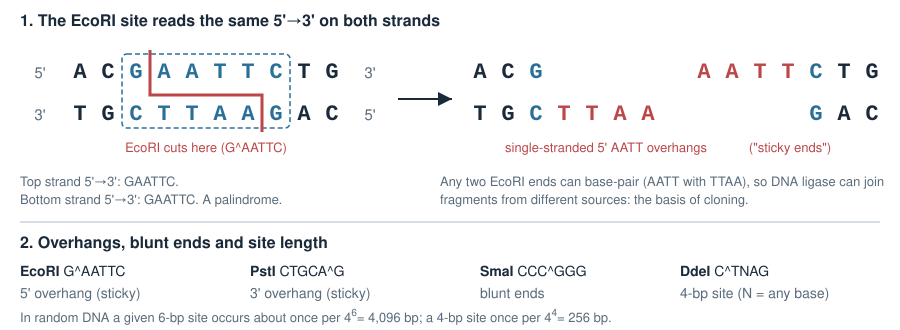
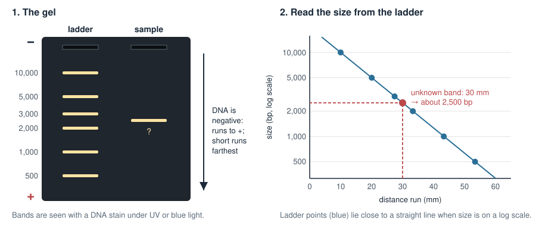
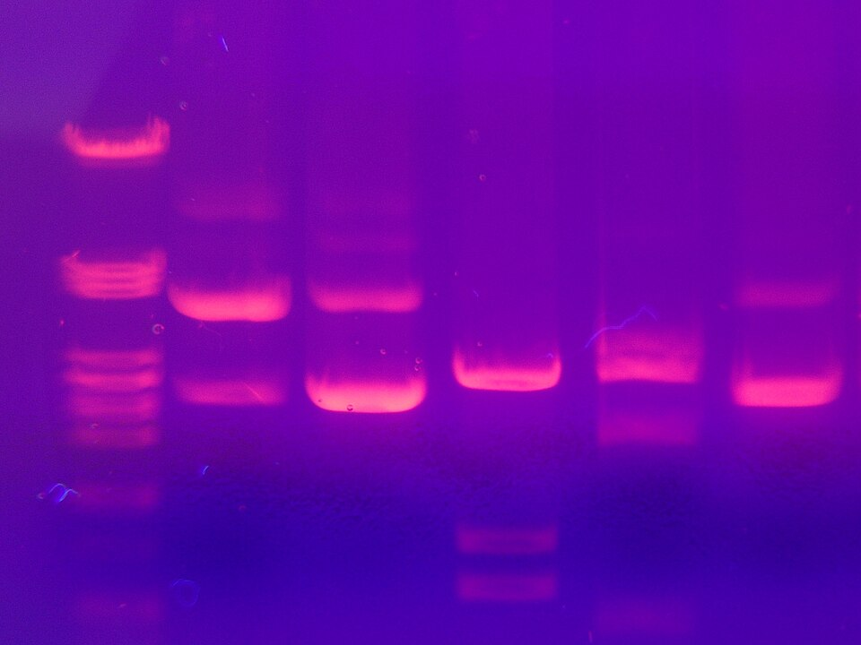
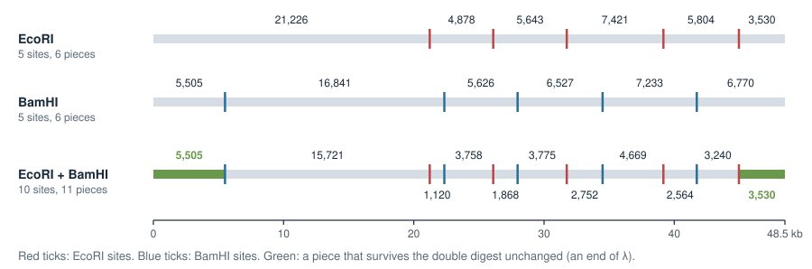
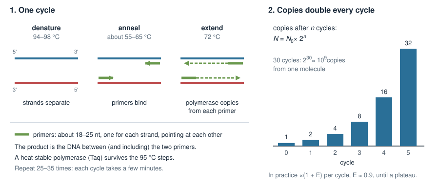
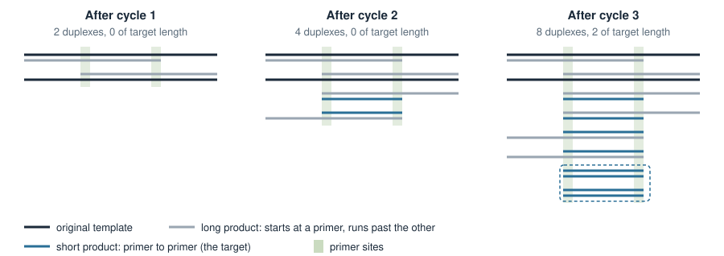
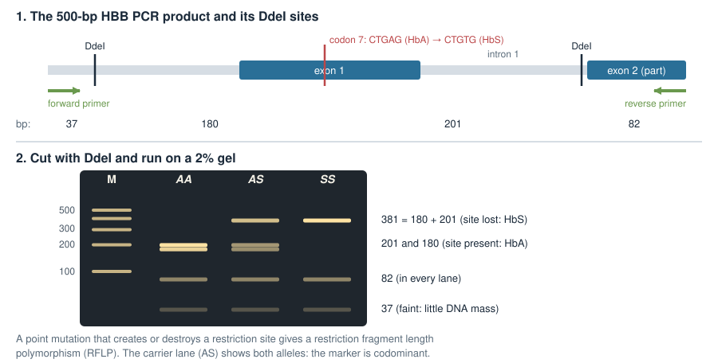
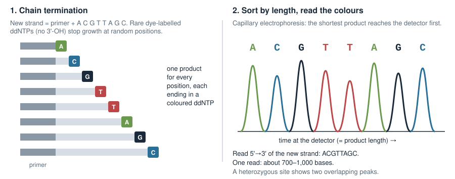
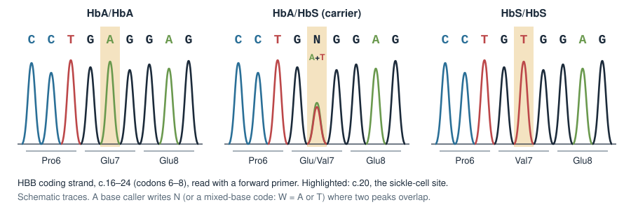
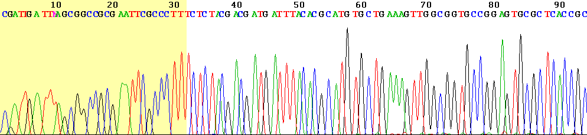

## About this lecture

So far we have studied genes through **phenotypes**: round or wrinkled, affected or not. From here on we also read the **DNA itself**. Four tools make that possible, and together they turn a gene into data you can store, compare and search.

- **Cut**: restriction enzymes recognise short palindromic sites and cut there.
- **Sort**: gel electrophoresis separates DNA fragments by size; a ladder gives the scale.
- **Copy**: cloning in a plasmid vector (briefly), and the **polymerase chain reaction** (PCR), which copies one stretch of DNA a billion-fold.
- **Read**: **Sanger sequencing** reads one PCR product; **next-generation sequencing** reads millions of short pieces at once.

The running example is the sickle-cell allele of *HBB* from Genetics as information: we detect it in a family with PCR and a restriction enzyme, and then by sequencing. Along the way we work through the by-hand skills step by step: reading a gel against a ladder, building a restriction map, PCR arithmetic, writing primers and reading a Sanger trace.

Book: Hartwell, *Genetics: From Genes to Genomes*, chapter on digital analysis of DNA.

::: notes
This lecture opens Part 4, the most bioinformatic block of the course, but the questions stay genetic: which allele does this person carry, and how do we know? Remind students of HbS from the first unit: one base change, GAG to GTG in codon 7 (traditionally codon 6). Today we see how a lab detects that one base. The book calls this "digital" because DNA, once read, is a string of four letters that can be copied, compared and searched like any other digital data. The worked examples in this deck use the same methods as the by-hand problems in the exercise, but with different numbers, so students can follow the method and then do the exercise themselves. The exercise has two demos (a virtual gel and a PCR curve) and the R part finds restriction sites in the genome of phage lambda.
:::

## Cut, sort, copy, read {.smaller}

| Tool | What it does | What it gives you | Used for |
|---|---|---|---|
| Restriction enzyme | cuts at a specific 4–8 bp site | fragments of predictable size | mapping, cloning, detecting some mutations |
| Gel electrophoresis | separates fragments by size | bands; size from a ladder | checking digests and PCR products |
| Cloning vector | carries a fragment into bacteria, which copy it | many identical copies, kept for later | libraries, protein expression, transgenics |
| PCR | copies the DNA between two primers | 10^9^-fold more of one region | diagnostics, genotyping, sequencing input |
| Sanger sequencing | reads one PCR product | ~800 bases of high-quality sequence | confirming a variant |
| Next-generation sequencing | reads millions of short fragments | whole genomes, exomes, transcriptomes | finding variants genome-wide |

The tools combine: PCR a region, cut it, run it on a gel; or PCR it and sequence it.

::: notes
This slide is the map of the lecture. Read it as a pipeline: you usually cannot see one gene in three billion base pairs, so you first make many copies of it (PCR or cloning), then you look at it, either by its size on a gel or by reading the bases. Each tool has a characteristic output, and students should be able to say which tool answers which question. For example: "is this person a carrier of HbS?" can be answered by PCR plus DdeI digestion plus a gel, or by PCR plus Sanger sequencing. "Which variants does this person carry in all 20,000 genes?" needs next-generation sequencing.
:::

## Restriction enzymes cut at palindromes {.smaller}

{width="72%" fig-align="center"}

- Bacteria make restriction enzymes to **cut invading phage DNA**; they protect their own DNA by methylating the same sites.
- The site is usually a **palindrome**: the two strands read the same 5'→3'. The enzyme is a dimer and each half cuts one strand.
- A staggered cut leaves **sticky ends** that can pair with any other end cut by the same enzyme.

::: notes
Restriction enzymes were discovered as the reason some phages grow poorly on certain bacterial strains: the phage DNA is "restricted", cut up, on entry. The bacterium's own DNA carries a methyl group at the same sites, added by a matching methyltransferase, so it is not cut. The names come from the organism: EcoRI from Escherichia coli strain RY13, HindIII from Haemophilus influenzae Rd, BamHI from Bacillus amyloliquefaciens. Palindrome here means the sequence equals its own reverse complement, which students can check with the reverse-complement function from the DNA recap unit. Sticky ends are what made recombinant DNA possible in the 1970s: cut a human gene and a plasmid with EcoRI, mix, and the ends pair; DNA ligase seals them.
:::

## How often does an enzyme cut? {.smaller}

If the four bases were equally common and random, a given site of *n* specified bases would occur once every 4^*n*^ bp.

| Enzyme | Site | Expected spacing | Expected in phage λ (48,502 bp) | Actual in λ |
|---|---|---:|---:|---:|
| EcoRI | GAATTC | 4^6^ = 4,096 bp | 11.8 | **5** |
| BamHI | GGATCC | 4,096 bp | 11.8 | **5** |
| HindIII | AAGCTT | 4,096 bp | 11.8 | **6** |
| DdeI | CTNAG (N = any) | 4^4^ = 256 bp | 189 | **104** |

- 6-bp cutters ("six-cutters") give fragments of a few kb; 4-bp cutters give a few hundred bp.
- Real DNA is not random, so actual counts differ from the expectation. In the R exercise you count the λ sites yourself.

::: notes
The 4 to the n rule is a useful first estimate and a nice probability exercise: each position must match, with probability one quarter, independently, so the product rule from Part 1 gives one quarter to the power n. For DdeI, the N matches anything, so only four positions count. The actual numbers for phage lambda come from the reference sequence NC_001416.1 and agree with REBASE's own counts. Lambda has fewer sites than expected for all four enzymes. One reason is that many phages avoid the sites of their hosts' restriction enzymes over evolutionary time, since phages with fewer sites survive restriction better. Do not overclaim this for lambda in particular; the general point is that sequence composition matters.
:::

## Gel electrophoresis: sorting fragments by size {.smaller}

{width="74%" fig-align="center"}

- DNA has a negative phosphate backbone, so it moves towards the + electrode. The agarose mesh slows long molecules more.
- Distance run is roughly linear in **log(size)** over the gel's useful range. Use a **ladder** of known sizes to read off unknown bands.
- Higher % agarose resolves short fragments (100–1,000 bp); lower % resolves long ones (1–20 kb).

::: notes
Every DNA molecule has the same charge per unit length, so charge alone would not separate them; it is the gel matrix that does, by sieving. That is why distance depends on size, and in practice on the log of size. The figure shows the idea; the next slide does the reading step by step with numbers. Two practical details: the DNA is invisible until stained, and band brightness depends on mass, so a 37 bp fragment carries much less stain than a 400 bp fragment present in the same number of copies. Very large fragments (above about 20 to 30 kb) all run together near the well on a normal gel; separating them needs pulsed-field electrophoresis.
:::

## Reading a gel against a ladder, step by step

:::: {.columns}
::: {.column width="42%"}

The ladder in the figure, measured from the wells:

| Ladder band (bp) | Distance (mm) | log~10~(size) |
|---:|---:|---:|
| 10,000 | 10.0 | 4.00 |
| 5,000 | 20.0 | 3.70 |
| 3,000 | 27.4 | 3.48 |
| 2,000 | 33.3 | 3.30 |
| 1,000 | 43.3 | 3.00 |

Unknown band: **30.0 mm**.

:::
::: {.column width="58%"}

1. **Bracket** the unknown with the two nearest ladder bands: 3,000 bp (27.4 mm) and 2,000 bp (33.3 mm).
2. **How far along?** From the 2,000 band: (33.3 − 30.0) / (33.3 − 27.4) = 3.3 / 5.9 = **0.56** of the way.
3. **Interpolate the log**, not the size: 3.30 + 0.56 × (3.48 − 3.30) = **3.40**.
4. **Back-transform**: 10^3.40^ ≈ **2,500 bp**.
5. **Check**: the answer lies between the two ladder bands, and nearer the one it ran nearer to.

*Wrong way*: interpolating sizes linearly between 1,000 and 5,000 bp gives about 3,300 bp, 30% too large.

:::
::::

::: notes
This is the method for B4 in the exercise and for every gel students will run in the lab. The ladder numbers here are the illustrative ones behind the figure on the previous slide, where log size falls by 0.03 per millimetre. The key idea is that equal distances correspond to equal ratios of size, not equal differences. So half-way between a 1,000 and a 9,000 bp band on the gel is 3,000 bp (the geometric mean), not 5,000. Always bracket with the nearest bands: the line is only roughly straight, and a short interpolation is more accurate than a long one. In practice gel software does this with a fitted curve, but the logic is the same. The linear mistake at the bottom: going 0.57 of the way from 1,000 to 5,000 in bp gives 3,280, whereas 0.57 of the way in log units gives 2,500.
:::

## Check yourself: what can fool you on a gel {.smaller}

:::: {.columns}
::: {.column width="34%"}

{width="100%"}

[Photo: Mnolf, CC BY-SA 3.0, via Wikimedia Commons](https://commons.wikimedia.org/wiki/File:Gel_electrophoresis_2.jpg){.photo-credit}

A real gel under UV: ladder on the left, five samples.

:::
::: {.column width="66%"}

| What you see | What it can mean |
|---|---|
| uncut plasmid runs **ahead** of the linear plasmid | **supercoiled** circles are compact and run fast: an uncut circle does not give its size |
| an expected small band is missing | it is faint (little mass), or it ran off the end of the gel |
| fewer bands than expected | two fragments of nearly the same size **comigrate** (λ EcoRI + BamHI: 3,775 and 3,758 bp) |
| more bands than expected, adding up to more than the molecule | a **partial digest**: some sites were not cut, leaving larger intermediate pieces |
| bands do not sum to the known length | a misread size, a missing small band, or a doublet |

The **sum check** is the simplest test of a reading: fragments of a complete digest add up to the length of the molecule.

:::
::::

::: notes
The photo is a real agarose gel stained with a DNA dye and photographed under UV light, from Wikimedia Commons. Point out the ladder in the first lane, that bands differ in brightness (more DNA mass, brighter band), and that some lanes are fuzzy or have faint extra bands: real gels are messier than the diagrams. These are the errors students actually make, and the exercise touches several of them (E3 on supercoiling, E2 and R4 on the HindIII ladder). Partial digests happen when there is too little enzyme or too short a time: then some molecules are cut at every site, others at only some, and you see the complete products plus larger pieces that are sums of neighbouring fragments. That is itself useful information in classical restriction mapping, because a partial product shows which fragments are neighbours. Comigrating fragments are recognised by brightness: a doublet carries twice the mass of a single band of the same size.
:::

## Restriction mapping: where are the sites? {.smaller}

Phage λ DNA (48,502 bp, linear), digested once with each enzyme and once with both:

| Digest | Fragments (bp) | Number |
|---|---|---:|
| EcoRI | 21,226 · 7,421 · 5,804 · 5,643 · 4,878 · 3,530 | 6 |
| BamHI | 16,841 · 7,233 · 6,770 · 6,527 · 5,626 · 5,505 | 6 |
| EcoRI + BamHI | 15,721 · 5,505 · 4,669 · 3,775 · 3,758 · 3,530 · 3,240 · 2,752 · 2,564 · 1,868 · 1,120 | 11 |

- A linear molecule with *k* sites gives *k* + 1 fragments; a **circular** one gives *k*.
- Fragments always **sum** to the full length: a check on your reading of the gel.
- A fragment that survives the double digest unchanged (5,505; 3,530) contains no site for the other enzyme. Fragments that split show where the other sites are.

::: notes
Restriction mapping is the oldest kind of physical map, and the logic is a puzzle like the three-point cross in Part 2: you have pieces and must find the order. The next slide walks through it. The numbers are computed from the real sequence; students reproduce them in R. Note that 3,775 and 3,758 differ by only 17 bp and would look like one bright band on a gel: a gel cannot resolve everything.
:::

## Building the λ map, step by step {.smaller}

{width="80%" fig-align="center"}

1. **Survivors.** BamHI 5,505 and EcoRI 3,530 appear unchanged in the double digest, so each holds no site of the other enzyme.
2. **Splits.** EcoRI 21,226 is missing from the double digest; 5,505 + 15,721 = 21,226, so BamHI cuts it 5,505 bp from one end. Both 21,226 and 5,505 must then be the **same end** of λ.
3. **Repeat** for each missing fragment: find the double-digest pieces that sum to it, and place the cut. Check that every single-digest fragment is accounted for.

::: notes
This is the reasoning for B3 in the exercise, shown on real data. Step 1: a fragment that survives both digests has no site for the other enzyme inside it. Step 2: the EcoRI 21,226 piece is not in the double digest, so BamHI cuts it, and the only pair of double-digest fragments that sums to 21,226 and includes a survivor is 5,505 plus 15,721. Since the BamHI 5,505 piece is an end fragment of the BamHI digest (it has a BamHI cut on only one side and no EcoRI site), both pieces sit at the left end. Step 3 continues the same way along the molecule. For a small problem you can also simply try each arrangement and check which one gives the observed double digest; for a real genome you let R do it, as in the R exercise. A map built from fragment sizes is unique only up to orientation: it can always be flipped end to end.
:::

## Cloning vectors (briefly) {.smaller}

:::: {.columns}
::: {.column width="55%"}

A **vector** is a small DNA molecule that bacteria copy for you. The classic example is the plasmid **pUC19** (2,686 bp, circular):

| Part | Job |
|---|---|
| origin of replication | many copies per cell |
| antibiotic-resistance gene (*bla*, ampicillin) | only cells with the plasmid survive |
| multiple cloning site (MCS) | one site each for EcoRI, BamHI, HindIII, PstI, … |
| *lacZα* around the MCS | an insert disrupts it: white instead of blue colonies |

:::
::: {.column width="45%"}

**Cloning in four steps**

1. Cut vector and insert with the same enzyme(s).
2. Mix; sticky ends pair; **ligase** seals them.
3. **Transform** *E. coli*; select on ampicillin.
4. Pick a white colony, grow it, check the insert with a digest and a gel.

:::
::::

Today PCR has replaced cloning for most diagnostic work; cloning is still used to make proteins and transgenic organisms.

::: notes
Keep this short: the course book covers vectors in more detail, and the lab course does the practical work. The key ideas are the selectable marker and the unique sites. In pUC19, the EcoRI, BamHI, HindIII and PstI sites each occur once, all inside the multiple cloning site, so one cut opens the circle into a single linear 2,686 bp piece; students can check this in the gel demo. Blue-white screening: the lacZ alpha fragment complements a defective lacZ in the host, giving blue colonies on X-gal; an insert in the MCS breaks lacZ alpha and gives white colonies. This links back to the lac operon from 5MO103. Vectors come back in the BLAST task of the exercise: the mystery read hits fly transformation vectors, because they carry the white gene as a marker.
:::

## PCR: copying one region a billion times {.smaller}

{width="74%" fig-align="center"}

- Two **primers** define the product: one on each strand, 3' ends pointing towards each other.
- Each cycle: **denature** (~95 °C), **anneal** primers (~55–65 °C), **extend** with a heat-stable polymerase (72 °C).
- Ingredients: template DNA, two primers, dNTPs, Mg^2+^, buffer, *Taq* polymerase.

::: notes
PCR was invented by Kary Mullis in the 1980s. The trick that made it practical was the polymerase from Thermus aquaticus, a bacterium from hot springs, which survives the denaturation step, so you do not have to add new enzyme every cycle. The figure simplifies one thing: it treats every copy as the final product. The next slide shows why that is nearly, but not exactly, true.
:::

## Why the product has defined ends: the first three cycles {.smaller}

{width="78%" fig-align="center"}

| Cycle *n* | 1 | 2 | 3 | 4 | 5 | 10 | 30 |
|---|---:|---:|---:|---:|---:|---:|---:|
| duplexes (2^*n*^) | 2 | 4 | 8 | 16 | 32 | 1,024 | 1.07 × 10^9^ |
| target length (2^*n*^ − 2*n*) | 0 | 0 | 2 | 8 | 22 | 1,004 | all but 60 |

::: notes
Go through the columns one at a time. Cycle 1: each original strand is copied from a primer, but the polymerase runs on past the far primer site, so the new strands are long, with one defined end. Cycle 2: copying a long strand from the other primer stops at its end, which is the first primer: this gives the first strand with two defined ends, the short product, still paired with a long strand. Cycle 3: copying a short strand gives a short strand, so the first two duplexes of exactly the target length appear. From then on the short products grow exponentially, while the originals stay at 2 and the long products grow only by 2 per cycle. That is the 2 to the n minus 2n in the table, which we checked by counting duplexes in a small simulation. After 30 cycles, all but 60 of a billion duplexes are the target. So the product length is set by the primer positions, which is what Primer-BLAST reports in the exercise. A common misconception is that PCR copies "the gene"; it copies only the stretch between the primers.
:::

## Exponential amplification, efficiency and plateau {.smaller}

| Cycles | Ideal copies from 1 template (2^*n*^) | At 90% efficiency (1.9^*n*^) |
|---:|---:|---:|
| 10 | 1,024 | 613 |
| 20 | 1.0 × 10^6^ | 3.8 × 10^5^ |
| 30 | 1.1 × 10^9^ | 2.3 × 10^8^ |

- Real reactions copy a fraction *E* of the molecules per cycle: *N* = *N*~0~ (1 + *E*)^*n*^.
- The reaction **plateaus** (~10^12^ copies in 50 µl) when primers and dNTPs run out.
- **qPCR** measures the cycle where the product crosses a threshold (Ct). 10× more template crosses about log(10)/log(1 + *E*) ≈ **3.3 cycles** earlier (at *E* = 1).

::: notes
The point of this table is that exponential growth is extremely sensitive to both the number of cycles and the efficiency: 90 percent instead of 100 percent efficiency gives five times fewer copies after 30 cycles. That is why quantitative PCR does not read the end point, which saturates, but the threshold cycle, which sits in the exponential phase. The rule of 3.3 cycles per ten-fold is worth deriving on the board: 2 to the power x equals 10 gives x equals log 10 over log 2, about 3.32. At 90 percent efficiency it is log 10 over log 1.9, about 3.6, which the demo shows. Sensitivity has a dark side: a single contaminating molecule can be amplified too, so every PCR has a no-template control.
:::

## Worked example: PCR arithmetic

**How many templates?** One haploid human genome is 3.1 × 10^9^ bp × 650 g/mol per bp ÷ 6.0 × 10^23^ per mol ≈ **3.3 pg**. So 10 ng of genomic DNA holds 10,000 pg / 3.3 pg ≈ **3,000 copies** of a single-copy gene such as *HBB*.

**How many copies after 30 cycles at *E* = 0.9?** *N* = 3,000 × 1.9^30^ = 3,000 × 2.3 × 10^8^ ≈ **6.9 × 10^11^**: close to the plateau of about 10^12^, so 30 cycles is enough.

**How many cycles to reach 10^11^ copies?** Solve 3,000 × 1.9^*n*^ = 10^11^ with logs:

$$n = \frac{\log(10^{11} / 3{,}000)}{\log 1.9} = \frac{7.52}{0.279} \approx 27 \text{ cycles}$$

**What does a difference in Ct mean?** Two samples cross the threshold 5.0 cycles apart. At *E* = 1 the earlier one had 2^5^ = **32 times** more template; at *E* = 0.9, 1.9^5^ ≈ **25 times**.

::: notes
These are the three kinds of PCR calculation students meet in the exercise (B5) and the quiz, done with different numbers. The first line is worth doing once: it turns a mass of DNA, which is what you measure in the lab, into a number of template molecules, which is what PCR counts. 650 grams per mole is the average mass of one base pair. The second line uses the formula from the previous slide. The third line is the only step that needs logarithms: take the log of both sides, so the exponent comes down. Any base of logarithm works, as long as you use the same one above and below the line; here base 10. The last line is the qPCR rule turned round: each cycle earlier means one factor of 1 plus E more template. Remind students that the plateau stops all of this: past about 10 to the 12 copies in a normal reaction, nothing is exponential any more.
:::

## Designing primers {.smaller}

| Rule of thumb | Why |
|---|---|
| Length **18–25 nt** | long enough to be unique in a 3 × 10^9^ bp genome (4^18^ ≈ 7 × 10^10^) |
| GC content **40–60%** | stable binding without sticking everywhere |
| Melting temperature (Tm) **~55–65 °C**, the two primers within ~2–5 °C | both bind well at the same annealing temperature |
| A G or C at the 3' end, but no run of G/C | the polymerase starts from a firmly paired 3' end |
| No complementarity between or within primers, especially at 3' ends | avoids **primer-dimers** and hairpins |
| Unique in the genome (check with **Primer-BLAST**) | one product, not several |

Quick estimate (Wallace rule, for short primers): Tm ≈ 2 °C × (A + T) + 4 °C × (G + C).

::: notes
The 4 to the 18 argument mirrors the restriction-site calculation: a random 18-mer occurs about once per 7 times ten to the ten bases, more than the genome size, so most 18-mers are unique. Real genomes are full of repeats, so uniqueness must be checked, and that is what Primer-BLAST does: it designs primers and searches them against the genome or the RefSeq transcripts. Primer-dimers are the classic failure: two primers with complementary 3' ends prime on each other and make a short product that competes with the target, especially when the template is scarce. The second demo shows this. The Wallace rule is crude; Primer-BLAST uses a better model and reports slightly different numbers.
:::

## Worked example: writing a primer pair

You want to amplify a stretch whose **top strand** (5'→3') starts and ends like this (an invented sequence):

```
5'-AGGTCTGACCAAGTTCAGCAC ········ 260 bp ········ GCCTACGAGTTCAACCTGCA-3'
```

| | Forward primer | Reverse primer |
|---|---|---|
| Rule | **copy** the start of the top strand | **reverse complement** of the end of the top strand |
| Sequence (5'→3') | AGGTCTGACCAAGTTCAGCAC | TGCAGGTTGAACTCGTAGGC |
| Length; G + C | 21 nt; 11 (52%) | 20 nt; 11 (55%) |
| Wallace Tm | 2 × 10 + 4 × 11 = 64 °C | 2 × 9 + 4 × 11 = 62 °C |

Product: 21 + 260 + 20 = **301 bp**. Both primers end in C, are within 2 °C of each other, and are 40–60% GC.

*Common mistake*: writing GCCTACGAGTTCAACCTGCA (the top strand itself) as the reverse primer. It would pair with the same strand as the forward primer, both would extend in the same direction, and there would be no exponential product.

::: notes
Students reliably make the strand mistake once, so it is worth a slide. Draw the two strands on the board. The forward primer has the same sequence as the top strand and anneals to the bottom strand; it is extended to the right. The reverse primer must anneal to the top strand, so it is complementary to it, and since every primer is written 5' to 3', its sequence is the reverse complement of the top-strand stretch. A second, quieter mistake is to complement without reversing, which gives a sequence that is written backwards. Check the reverse primer by reverse-complementing it again: you must get the top strand back. The sequence here is invented for the example; in the exercise, B6 does the same with the real sickle-cell primers, and Primer-BLAST in Find it designs primers for HBB automatically.
:::

## Try it: PCR, cycle by cycle {.smaller}

```{=html}
<link rel="stylesheet" href="../demos/dist/demo.css">
<div data-demo="pcr" data-preset="real"></div>
<script src="../demos/dist/pcr.js"></script>
```

::: notes
Interactive demo. It starts on the "realistic" preset: 1,000 starting copies, 90 percent efficiency, 35 cycles, log axis, with a dashed curve for ten times less template. Point out the straight line on the log axis during the exponential phase, the plateau near 10 to the 12, and that the dashed curve is a parallel line shifted 3.6 cycles to the right. Untick "log y-axis": on a linear axis nothing seems to happen for 20 cycles, then the curve shoots up and flattens. That is the same data. Then click "10 templates + primer-dimer" and "no-template control": with almost no template, primer-dimers made from the primers alone can reach the detection threshold by cycle 39 or so. That is why late signals in a no-template control mean trouble, and why diagnostic PCR uses a cycle cut-off.
:::

## PCR plus a restriction enzyme: genotyping HbS {.smaller}

{.nostretch width="72%" fig-align="center"}

The sickle-cell change (codon 7 GAG → GTG, c.20A>T) destroys a **DdeI** site (CTGAG → CTGTG). Amplify 500 bp around it, cut with DdeI, run a gel: *AA* = HbA/HbA, *AS* = carrier, *SS* = sickle-cell disease.

::: notes
This is a classic diagnostic method called PCR-RFLP. It ties together everything so far: the mutation from Genetics as information and from the Mutation unit, PCR to get enough DNA from a cheek swab or a blood spot, a restriction enzyme to "read" one base, and a gel to see the result. The primers and fragment sizes are real: the 500 bp product spans exon 1 and intron 1 of HBB on chromosome 11 (GRCh38), and we checked with Primer-BLAST that the primers give a single product in the human genome. The carrier lane shows both alleles: at the DNA level, HbA and HbS are codominant, even though sickle-cell disease is recessive at the level of the phenotype. Before PCR, the same site was detected with the enzyme MstII on Southern blots. In a pedigree, this test turns "probably a carrier, 2/3" into a yes or no.
:::

## Predicting the bands from the site positions

The 500-bp product has DdeI sites (C^TNAG, cut after the C) at positions **37, 217 and 418**. Each cut position becomes a fragment boundary:

| | Boundaries | Fragments (bp) |
|---|---|---|
| HbA allele | 0 · 37 · 217 · 418 · 500 | 37 · **180** · **201** · 82 |
| HbS allele (site at 217 lost) | 0 · 37 · 418 · 500 | 37 · **381** · 82 |

- A person has **two** alleles, and PCR copies both: the lane is the **union** of the two allele patterns.
- **Diagnostic** bands: 381 (an HbS allele is present), 201 + 180 (an HbA allele is present).
- **Control** bands: 82 and 37 appear in every genotype and show that the enzyme cut.

::: notes
This is the reasoning students need for B7 and for E1 in the gel demo. Write the boundaries as a list, sort them, and take the differences; that is exactly what the digest function in the R exercise does with diff. The union point is the one students miss: a heterozygote does not show a "half" band or an intermediate band, it shows both sets of bands. The control bands are good experimental design: an incomplete digest leaves uncut or partly cut product, for example a 418 bp piece (37 plus 381) or the full 500 bp, which could be misread as an HbS band. The 82 and 37 bands at full strength show that the enzyme cut properly.
:::

## Try it: a virtual gel {.smaller}

```{=html}
<link rel="stylesheet" href="../demos/dist/demo.css">
<div data-demo="gel" data-preset="hbbAS"></div>
<script src="../demos/dist/gel.js"></script>
```

::: notes
Interactive demo. It starts on the HBB PCR product from a carrier, cut with DdeI on a 2 percent gel. Ask the room to estimate the sizes from the 100 bp ladder before ticking "show fragment sizes". Switch between the three genotypes. Then switch to phage lambda with EcoRI and BamHI on a 0.7 percent gel: six, six and eleven bands, and some of the double-digest bands overlap. Then pUC19: each single enzyme gives one band (one site, circular plasmid, so one linear fragment of 2,686 bp), and EcoRI plus HindIII cuts out the 51 bp stretch of the multiple cloning site, which is too faint and too small to see well. Note that the uncut plasmid runs as a supercoiled band, ahead of its true size.
:::

## Sanger sequencing: reading one product {.smaller}

{width="76%" fig-align="center"}

- A primer, a polymerase, normal dNTPs and a small amount of four **dye-labelled dideoxynucleotides** (ddNTPs). A ddNTP lacks the 3'-OH, so the chain stops there.
- The result is a set of products ending at every position; **capillary electrophoresis** sorts them by length, and the dye colour of each gives the base.

::: notes
Frederick Sanger published the dideoxy method in 1977, and it read the first human genome together with clever automation. The principle uses the replication chemistry from the DNA recap unit: DNA polymerase needs a free 3' hydroxyl to add the next nucleotide. A dideoxynucleotide has a hydrogen there instead, so once it is built in, synthesis stops. Because the ddNTPs are rare compared with normal dNTPs, termination happens at random, and among millions of molecules every position is represented. Electrophoresis in a thin capillary separates products that differ by one base, which is much finer than an agarose gel.
:::

## Worked example: from products to sequence

A reaction with an **18-nt primer** gave these products (in the order they were listed, not by size):

| Length (nt) | 21 | 19 | 23 | 20 | 24 | 22 |
|---|---|---|---|---|---|---|
| Last base (dye) | T | G | C | A | A | T |

1. **Sort by length.** 19 G, 20 A, 21 T, 22 T, 23 C, 24 A. The shortest product ends at the first base after the primer (position 19).
2. **Read the new strand 5'→3'**: 5'-**GATTCA**-3'.
3. **Template strand**: complementary and antiparallel: 3'-CTAAGT-5', which written 5'→3' is **5'-TGAATC-3'**.

The trace you get from the sequencer is the **new strand**. To report the other strand, reverse-complement it.

::: notes
This is the logic of B8 with different numbers. The step students skip is the last one: the colours give the strand that was synthesised, which is complementary to the template. Sequencing labs usually sequence both strands, with a forward and a reverse primer, and the reverse read must be reverse-complemented before it can be compared with the forward read. Also point out that the products do not include anything shorter than the primer plus one, because every product starts with the primer.
:::

## Sanger traces at the sickle-cell site

{width="80%" fig-align="center"}

PCR copies **both** alleles, and the sequencing reaction reads both at once. At a heterozygous site the two dyes share the signal: two peaks of about half height at the same position. Everywhere else the alleles are identical and the peaks are single.

::: notes
These traces are schematic, drawn to show the principle; real traces are noisier and peak heights vary from base to base. The sequence is the real HBB coding strand around codon 7: CCT GAG GAG, with the HbS change at the middle base of codon 7. The carrier trace is the sequencing version of the carrier lane in the PCR-RFLP gel: both alleles are present, so both signals are seen. Base-calling software marks such positions with N or with an IUPAC code; W means A or T. A good habit is to confirm a heterozygous call on the reverse strand: there it shows up as a T and an A peak on the complementary strand, at the same site.
:::

## Reading a Sanger trace {.smaller}

| What you see | What it means |
|---|---|
| one clean peak per position | a single sequence: homozygous at that site, or a cloned molecule |
| **two overlapping peaks** of about half height at one position | a **heterozygous** SNP (two alleles in the PCR product) |
| everything doubles after one point | a heterozygous **indel**: the two alleles are shifted relative to each other |
| messy start (first ~30 bases) and fading end (after ~800) | normal limits of the method |

An HbA/HbS carrier shows an **A and a T peak together** at c.20 (forward strand), as on the previous slide.

{width="85%" fig-align="center"}

[Real trace (start of a read from a plasmid; shaded: low-quality start). Loris, public domain, via Wikimedia Commons](https://commons.wikimedia.org/wiki/File:Sanger_sequencing_read_display.png){.photo-credit}

::: notes
Reading a trace is a practical skill students may meet in lab courses and in clinical genetics reports. This table generalises the previous slide. The trace at the bottom is a real one, the first 95 bases of a read from a plasmid: in the shaded first 30 bases the peaks are small and uneven, and the base caller has written an N, while from about base 35 the peaks are clean and evenly spaced. Make the link to the pedigree unit: a Sanger trace is how a clinical lab confirms that both parents of a child with a recessive disease are carriers. The indel case is worth a sentence: after a heterozygous one-base deletion, every subsequent position has two different bases, so the trace becomes unreadable from that point on, which itself tells you there is an indel.
:::

## Next-generation sequencing: reads and coverage {.smaller}

{.nostretch width="68%" fig-align="center"}

- Fragment the genome, sequence **millions of short reads** (typically 100–300 bases) in parallel, and **map** each read to a reference genome.
- **Coverage** = number of reads × read length ÷ genome length. A human genome at 30× needs about 90 Gb of reads.
- Coverage varies by chance, so a heterozygous site is called only where enough reads cover it.

::: notes
The details of the chemistry vary between platforms and change every few years, so we stay at the level of concepts that do not change: reads, mapping and coverage. Short-read platforms such as Illumina dominate; long-read platforms (PacBio, Oxford Nanopore) give reads of tens of kilobases, which help with repeats and assembly in the next unit. The figure is simulated: 40 reads of 50 bases on a 400 base window, mean coverage 5 times. Even so, some bases are not covered at all. This is why 30 times is the usual target for a human genome: at 30 times, very few bases have so few reads that a heterozygous site could be missed. Calling a heterozygote is like the double peak in Sanger, only counted: about half the reads show each allele. The Genomic variation unit uses data from exactly this kind of sequencing.
:::

## Worked example: coverage and calling a heterozygote

**Reads needed.** *E. coli* K-12 has a 4.6 Mb genome. For 50× coverage with 150-base reads:

reads = coverage × genome length / read length = 50 × 4.6 × 10^6^ / 150 ≈ **1.5 million reads**.

**Why depth matters for a diploid genome.** At a heterozygous site each read comes from either chromosome with probability ½. The chance that **all** *n* reads show the same allele, so that the site looks homozygous, is 2 × (½)^*n*^:

| Reads covering the site (*n*) | 4 | 10 | 30 |
|---|---:|---:|---:|
| P(heterozygote missed) | 1/8 = 0.125 | 0.002 | 2 × 10^−9^ |

The **average** is not enough: coverage varies by chance, and the sites with few reads are where heterozygotes are missed.

::: notes
The first part is the coverage formula turned round, the same calculation as B9 but for a bacterial genome. A bacterium is haploid, so there are no heterozygotes to call; the second part is about diploid genomes such as ours. It is the product rule from the probability unit: each read independently picks one of the two chromosomes, so the chance that all n reads pick the same one is one half to the n, times two because it could be either chromosome. With 4 reads, one heterozygote in 8 would be missed. That is why 30x is the standard for a human genome: even the poorly covered sites usually have 10 or more reads. For the curious: if reads land at random, the number covering a base is roughly Poisson, and the fraction of bases with no read at all is e to the minus coverage, about 0.7 percent at 5x and essentially zero at 30x.
:::

## Identifying a read: BLAST in one slide

A read of 200 bases can be traced to its gene and organism by searching all known sequences with **BLAST** (blastn for DNA). In the hit table, read:

| Column | Question it answers |
|---|---|
| **Description**, **Scientific Name** | which sequence, from which organism? |
| **Per. Ident** | how many bases of the alignment are identical? |
| **Query Cover** | how much of your read is in the alignment? |
| **E value** | how many hits this good would you expect **by chance** in a database this size? |

A hit with ~100% identity over the whole read and an E value like 10^−90^ is the same sequence. Several identical hits may be the gene itself, other entries of the same gene, or **vectors** that carry a copy of it.

::: notes
This slide prepares Find it F3, the mystery read, which is the first time students use BLAST. Keep it practical: which columns to read and what a convincing hit looks like. How BLAST finds the hits, how the score is computed and what the E value really means come in the next unit, Genome annotation, where BLAST gets several slides. The vector point is a real-world lesson: a database contains whatever people have sequenced, and laboratory constructs are a large part of it.
:::

## Common mistakes

| Mistake | Correct |
|---|---|
| "A circular plasmid with *k* sites gives *k* + 1 fragments." | Circular: *k*; linear: *k* + 1. |
| Interpolating band sizes linearly between ladder bands. | Interpolate log(size); use the two nearest bands. |
| Reading the size of an **uncut** plasmid from its band. | Supercoiled DNA runs faster than its linear size. |
| Writing the reverse primer as the top-strand sequence. | Reverse primer = reverse complement of the top strand. |
| "More cycles always give more product." | The reaction plateaus; end-point PCR is not quantitative. |
| "PCR copies the whole gene." | It copies only the stretch between the primers. |
| Treating a double peak in a trace as noise. | Two clean half-height peaks at one site = a heterozygote. |
| "30× coverage: every base is read 30 times." | 30 is the average; some bases get far fewer reads. |

::: notes
A revision slide built from the errors students make most often in the exercise and the exam. Ask the room to explain one or two of them before revealing the right-hand column. Each line points back to one of the worked examples.
:::

## Summary {.smaller}

| Concept | Key fact |
|---|---|
| Restriction enzyme | cuts at a palindromic site; sticky or blunt ends; a 6-bp site every ~4,096 bp in random DNA |
| Fragments | linear: *k* sites → *k* + 1 fragments; circular: *k*; sizes sum to the total |
| Gel | distance ∝ −log(size); interpolate log(size) between the nearest ladder bands; brightness ∝ mass |
| Restriction map | survivors of a double digest hold no site of the other enzyme; split fragments locate the sites |
| Vector | origin + selectable marker + unique cloning sites (pUC19) |
| PCR | two primers define the product (from cycle 3 on); *N* = *N*~0~(1 + *E*)^*n*^ until a plateau; 3.3 cycles per 10× |
| Primers | 18–25 nt, 40–60% GC, matched Tm, no 3' complementarity, unique; reverse primer = reverse complement |
| PCR-RFLP | HbS destroys a DdeI site: 201 + 180 bp (HbA) vs 381 bp (HbS); a carrier shows both |
| Sanger | ddNTPs stop synthesis; sort by length; read the new strand; a heterozygote gives double peaks |
| NGS | millions of short reads mapped to a reference; coverage = reads × length / genome; depth to call heterozygotes |

::: notes
This is the revision table. The numbers students should be able to reproduce: 4 to the 6 equals 4,096; k plus 1 fragments for a linear molecule; 2 to the 30 is about a billion; 3.3 cycles per ten-fold; and the coverage formula. The methods they should be able to carry out: read a gel on a log scale, place sites from a double digest, compute PCR yields and cycles with logs, write a reverse primer, read a sequence from a set of products. The HbS fragment sizes are not to be memorised, but students should be able to predict which bands a carrier shows.
:::

## Where this leads

- **Exercise**: the by-hand problems use the methods of today's worked examples (gel, map, PCR, primers, Sanger, coverage); then BLAST a mystery read and look up an enzyme in REBASE.
- **Exercise in R**: read the phage λ genome from a FASTA file, find the EcoRI and BamHI sites with `str_locate_all()`, and draw your own virtual gel.
- **Next: Genome annotation.** Once a genome is sequenced, where are the genes? ORFs, homology (BLAST), genome browsers.
- **Genomic variation.** Sequencing many people reveals millions of variants, such as the HbS allele, and how their frequencies differ between populations.

::: notes
Point forward. The BLAST search of the mystery read in the exercise is the first time students use BLAST; the next unit uses it properly, with proteins. The FASTA file in the R exercise is the format every sequence database uses, so reading one by hand is worth doing once.
:::
