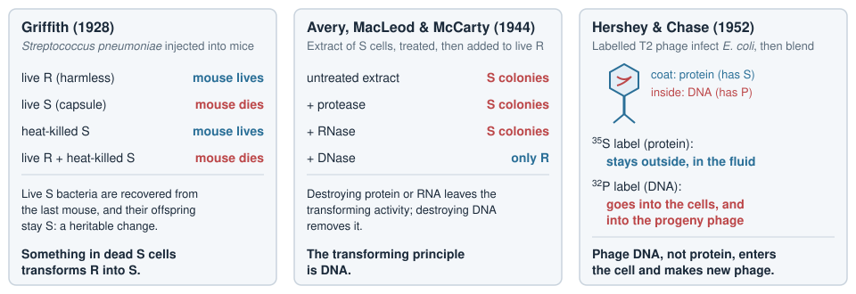
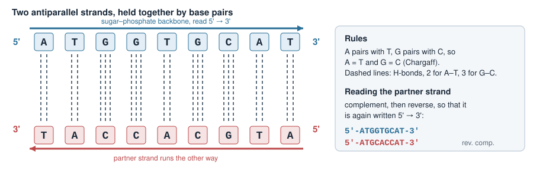
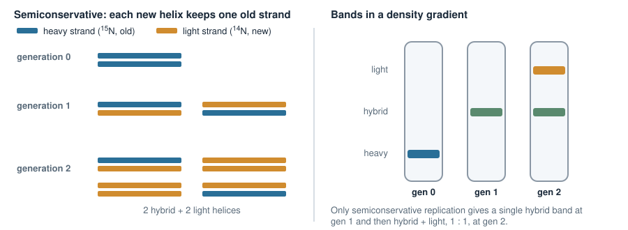
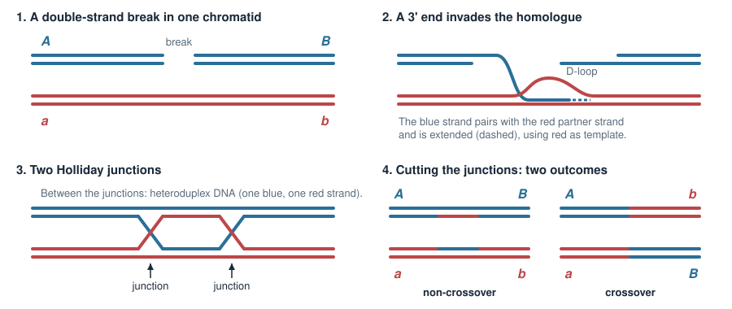

## About this lecture

**Recap of 5MO103** (Microbiology and basic molecular biology), seen through the eyes of a geneticist. In Parts 1 and 2 a gene was an abstract "factor" on a chromosome. Now we open it up.

- **How we know** that genes are made of DNA: Griffith, Avery, Hershey and Chase.
- The **double helix**: base pairing, antiparallel strands, and how to read the partner strand (the **reverse complement**).
- **Semiconservative replication** and the Meselson–Stahl experiment.
- The **replication fork** in brief, and why copying errors matter to a geneticist.
- **Homologous recombination** at the molecular level: the Holliday junction, the molecular basis of crossing over from Part 2.

Book: Hartwell, *Genetics: From Genes to Genomes*, DNA structure, replication and recombination chapter.

::: notes
This is a recap unit. Students have met DNA structure and replication in 5MO103, so do not re-teach the enzymology. The aim is to look at the same material with a geneticist's questions: what properties must the genetic material have, what experiment showed it, what happens when copying goes wrong (mutation, next unit), and how crossing over, which they used as an abstract event in Part 2, happens at the level of DNA strands. Keep it brisk; about 10 content slides.
:::

## What must the genetic material do? {.smaller}

From Parts 1 and 2 we already know what genes **do**. Any candidate molecule has to explain it:

| Property seen in genetics | What the molecule must be able to do |
|---|---|
| Genes are passed on faithfully, generation after generation | be **copied** accurately before every cell division |
| Genes come in different **alleles** | **vary**: store information in a sequence that can change (mutate) |
| Genes control phenotypes (round vs wrinkled, HbA vs HbS) | carry **information** that the cell reads to make RNA and proteins |
| Homologues exchange parts (crossing over, Part 2) | be cut and rejoined **precisely**, at matching positions |

Until the 1940s most biologists bet on **protein**: 20 amino acids seemed a richer alphabet than DNA's 4 bases.

::: notes
Frame the whole lecture with this table. Each row is answered later: replication (row 1), sequence and mutation (row 2, the next unit), gene expression (row 3, the gene expression recap) and recombination (row 4, the end of today). The protein hypothesis was reasonable: DNA was thought to be a boring repeat of the four bases (the tetranucleotide hypothesis). The next slide is the evidence that changed minds.
:::

## Three experiments: genes are DNA {.smaller}

{width="92%" fig-align="center"}

- **Griffith**: a heritable change (R → S) can be caused by something from dead cells: **transformation**.
- **Avery, MacLeod & McCarty**: only DNase destroys the transforming activity.
- **Hershey & Chase**: phage DNA, not phage protein, enters the bacterium and directs new phage.

::: notes
Walk through the three panels left to right. Griffith did not identify the molecule; he showed that a heritable trait (the polysaccharide capsule that makes S strains virulent) can be transferred by something in heat-killed cells, and that the change is inherited by the transformed bacteria's descendants. That last point is what makes it genetics: the R cells did not just pick up capsules, they gained the ability to make them. Avery and colleagues purified the transforming principle and destroyed each kind of molecule in turn with enzymes. Hershey and Chase used the fact that protein contains sulphur but no phosphorus, and DNA contains phosphorus but no sulphur. After infection they sheared the phage coats off the bacteria in a kitchen blender; the 32P went with the cells and was passed on to progeny phage, the 35S stayed in the coats. Transformation comes back in the bacterial genetics recap in Part 5.
:::

## The double helix {.smaller}

:::: {.columns}
::: {.column width="45%"}

Watson and Crick (1953), using X-ray data from **Rosalind Franklin** and Maurice Wilkins, and **Chargaff's rules** (A = T, G = C):

- Two strands, each a **sugar–phosphate backbone** with a **base** on every sugar.
- Bases pair across: **A–T** (2 hydrogen bonds), **G–C** (3).
- A **purine** (A, G) always pairs with a **pyrimidine** (T, C), so the helix has a constant width.
- The strands are **antiparallel**: one runs 5′ → 3′, the partner 3′ → 5′.

:::
::: {.column width="55%"}

{width="100%"}

:::
::::

"It has not escaped our notice that the specific pairing we have postulated immediately suggests a possible copying mechanism for the genetic material." (Watson & Crick, 1953)

::: notes
The key genetic fact is complementarity: one strand determines the other. That gives a copying mechanism (each strand is a template) and a way to repair damage (the undamaged strand holds the information). The 5' and 3' ends refer to the carbon atoms of the deoxyribose: the 5' end has a free phosphate, the 3' end a free hydroxyl. Polymerases add only to the 3' end, which is why the replication fork is asymmetric. G-C pairs have three hydrogen bonds and A-T two, so GC-rich DNA melts at a higher temperature; that matters for PCR primers in Part 4. The quotation is the famous understatement at the end of the 1953 paper.
:::

## Reading DNA: strands and the reverse complement {.smaller}

A sequence is always written **5′ → 3′**. To write the partner strand, **complement** every base, then **reverse** the order:

| | |
|---|---|
| this strand | 5′-`ATGGTGCAT`-3′ (start of the *HBB* coding sequence) |
| complement, as it lies | 3′-`TACCACGTA`-5′ |
| reverse complement | 5′-`ATGCACCAT`-3′ |

**Why a geneticist cares.** A genome database stores only the **+ strand** of each chromosome. *HBB* lies on the **− strand** of chromosome 11, so the sickle-cell change looks different depending on which strand you read:

- on the *HBB* mRNA and coding sequence: **c.20A>T** (GAG → GTG, Glu → Val);
- on the chromosome's + strand (dbSNP rs334): **T>A** at position 5,227,002 (GRCh38).

Same mutation, same base pair, two strands.

::: notes
This is the most useful practical skill of the lecture, and the R exercise automates it. Every genome browser, VCF file and dbSNP record reports alleles on the forward (+) strand of the reference chromosome, while gene-centred names (HGVS c. names, ClinVar titles) use the gene's own coding strand. For a gene on the minus strand, the two descriptions are reverse complements of each other. Students will meet this in the Find it tasks of this and the next unit: dbSNP rs334 is listed as T>A on NC_000011.10, while ClinVar calls it c.20A>T. Neither is wrong. A palindromic site such as GAATTC (EcoRI) is its own reverse complement, which is why restriction enzymes can recognise it on both strands at once (Part 4).
:::

## Three ways to copy a helix {.smaller}

Complementary strands suggest three models of replication. **Meselson and Stahl (1958)** grew *E. coli* for many generations in heavy nitrogen (^15^N), moved the cells to light nitrogen (^14^N), and separated DNA by density in a caesium chloride gradient.

{width="78%" fig-align="center"}

| Model | Generation 1 | Generation 2 |
|---|---|---|
| **Semiconservative** (each helix = one old + one new strand) | all hybrid | ½ hybrid, ½ light |
| Conservative (old helix stays intact) | ½ heavy, ½ light | ¼ heavy, ¾ light |
| Dispersive (old and new mixed along each strand) | all hybrid | all one intermediate band |

::: notes
This is one of the most elegant experiments in biology, and it is a genetics-style experiment: three hypotheses, each with a different quantitative prediction, and one decisive observation. Generation 1 rules out conservative replication (no heavy band). Generation 2 rules out dispersive replication (two bands, not one band moving slowly towards light). Only semiconservative fits both. Ask the room what generation 3 would look like: one quarter hybrid, three quarters light. Semiconservative replication is also why a mutation that arises as a mismatch on one strand ends up in only one of the two daughter helices; that comes back in the next unit.
:::

## The replication fork, in brief {.smaller}

Polymerases add nucleotides only to a **3′ end**, and need a **primer**. So one strand is made continuously (**leading**), the other in short **Okazaki fragments** (**lagging**).

| Job | Bacterial protein | How genetics found or uses it |
|---|---|---|
| Start at the origin | DnaA | *dnaA* temperature-sensitive mutants cannot start new rounds |
| Unwind the helix | helicase (DnaB) | *dnaB* ts mutants stop replication at once at high temperature |
| Lay down RNA primers | primase (DnaG) | |
| Copy DNA, **proofread** | DNA polymerase III | the ε subunit (*dnaQ*, *mutD*) proofreads: its mutants are **mutators** |
| Replace primers, join fragments | DNA polymerase I, ligase | |

**Accuracy:** about 1 error in 10^5^ bases from base pairing alone, 1 in 10^7^ after proofreading, about 1 in 10^9^–10^10^ after **mismatch repair**.

::: notes
Do not re-teach the fork in detail; students have the full picture from 5MO103. The genetic lens is the right-hand column: many of these genes were found as conditional (temperature-sensitive) lethal mutants. A mutation that stops replication would be lethal, so you can only keep it if it works at the permissive temperature and fails at the restrictive one. The difference between "fast stop" (elongation, dnaB) and "slow stop" (initiation, dnaA: rounds in progress finish) told geneticists what each gene did before anyone purified the proteins. Mutator strains, in which every gene mutates faster, are the bridge to the next unit. The error rates are order-of-magnitude textbook values; the human germline mutation rate, about 1 in 10^8 per base pair per generation, is the end result after many cell divisions.
:::

## Homologous recombination: why and where {.smaller}

**Homologous recombination** uses a matching (homologous) DNA molecule as a template to repair or exchange DNA.

- **Repair**: a **double-strand break** is mended by copying the sister chromatid. Defects in this pathway (for example in *BRCA1* or *BRCA2*) raise cancer risk.
- **Meiosis**: the cell **deliberately** breaks DNA (the enzyme Spo11), and repairs the breaks using the **homologue**. Some repairs become **crossovers**: the chiasmata you saw in Part 2.

The model, first proposed by **Robin Holliday (1964)** and later refined to start from a double-strand break:

1. A double-strand break; the 5′ ends are trimmed back, leaving 3′ single-strand tails.
2. A 3′ tail **invades** the homologue, pairs with its complementary strand, and primes new DNA synthesis.
3. The two duplexes become joined by **Holliday junctions**: points where strands cross between helices.
4. Enzymes **cut** the junctions to separate the helices.

::: notes
The genetic question that drove this model was: how can two chromosomes exchange parts at exactly matching positions, without losing or gaining a single base? Base pairing is the answer: the invading strand finds its place by pairing with its complement on the homologue. The DSB-repair model is the one in Hartwell; Holliday's original 1964 model started from single-strand nicks. Spo11 is the meiotic enzyme that makes the breaks, a few hundred per human meiosis, of which only a few dozen become crossovers. BRCA1 and BRCA2 return in the cancer genetics unit.
:::

## From Holliday junctions to crossing over {.smaller}

{width="80%" fig-align="center"}

- Cut one way: **crossover**, *A b* and *a B*. The flanking markers are **recombinant**: this is what you counted as recombination frequency in Part 2.
- Cut the other way: **non-crossover**. The flanks stay parental (*A B*, *a b*), but a short stretch of **heteroduplex** DNA remains.
- If a heteroduplex covers a gene where the homologues differ, **mismatch repair** may "correct" one strand to match the other: **gene conversion**. In fungal tetrads this shows up as 3 : 1 instead of the Mendelian 2 : 2.

::: notes
This slide connects to Part 2. A crossover between two genes swaps the flanking markers, which is the event that linkage mapping counts. Non-crossovers leave no trace in flanking markers, so they were invisible in mapping crosses, but they can still change a gene inside the heteroduplex patch. Gene conversion was discovered in fungi, where all four products of a single meiosis can be recovered (tetrad analysis): an Aa diploid should give 2 A : 2 a spores, but occasionally gives 3 : 1. That non-Mendelian ratio is explained by mismatch repair in the heteroduplex. Gene conversion is rare per gene per meiosis and does not disturb Mendel's ratios in ordinary crosses.
:::

## Summary {.smaller}

| Concept | Key fact |
|---|---|
| Genes are DNA | Griffith (transformation), Avery et al. (only DNase stops it), Hershey–Chase (phage DNA enters the cell) |
| Double helix | two antiparallel strands; A–T, G–C; one strand determines the other |
| Reverse complement | the partner strand, written 5′ → 3′: complement every base, then reverse |
| Strands in databases | genome records use the + strand; gene names (c.) use the gene's own strand. *HBB* c.20A>T = + strand T>A |
| Replication | semiconservative (Meselson–Stahl: hybrid, then hybrid + light) |
| Fork | leading and lagging strands; polymerase proofreads; mismatch repair finishes; error about 10^−9^–10^−10^ per base |
| Recombination | DSB → strand invasion → Holliday junctions → crossover or non-crossover (heteroduplex, gene conversion) |

::: notes
The revision sheet. If they remember three things: complementarity (one strand determines the other, which explains copying, repair and the reverse complement), semiconservative replication, and that crossing over is a DNA repair event that uses the homologue as template.
:::

## Where this leads

- **Next: Mutation & complementation.** What happens when copying or repair fails: kinds of mutation, mutagens, the Ames test, and how geneticists decide whether two mutations hit the same gene.
- **Gene expression (recap).** How the cell reads the sequence: transcription, splicing, translation and the genetic code.
- **Part 4: Digital analysis of DNA.** PCR and sequencing exploit exactly the rules on today's slides: primers, 5′ → 3′ synthesis and base pairing.
- **Exercise in R:** write `revcomp()` and compute GC content of the *HBB* mRNA.

::: notes
Point forward. The exercise today has short by-hand problems on base pairing, Meselson-Stahl and recombination, a Find it task that downloads the HBB mRNA from NCBI Nucleotide, and an R page where students write their own reverse-complement function. That function is reused in Part 4 to find restriction sites and design primers.
:::
