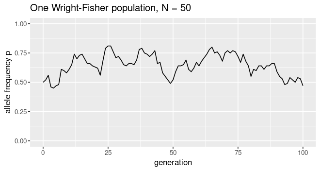
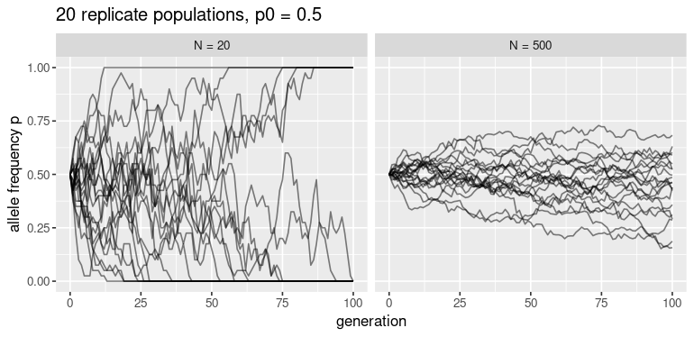

## Goal

By the end of this exercise you should be able to:

- write a simulation that runs generation after generation with a **`for` loop**;
- wrap it in a function `wright_fisher()` with drift and selection;
- run many replicate populations with `replicate()`, reshape the result with `pivot_longer`, and plot all trajectories;
- check theory against simulation: fixation probability = *p*₀, heterozygosity decay, selection, and the sickle-cell equilibrium.

## Before you start

This page builds on the by-hand part of the [Exercise](exercise.qmd), so do that first. You need the packages dplyr, tidyr and ggplot2. No data files are needed: everything is simulated.

## Tasks

New idiom today: the **`for` loop**. So far each random draw was independent: `rbinom(1000, ...)` made 1000 families at once. Drift is different: generation *t* + 1 is drawn **from** generation *t*, so we cannot draw all generations at once. A [`for` loop](https://rdrr.io/r/base/Control.html) repeats a block of code once for each value of a counter:

```r
for (t in 1:5) {
  print(t^2)      # runs with t = 1, then t = 2, ..., then t = 5
}
```

The usual pattern is: make an empty vector with [`numeric(n)`](https://rdrr.io/r/base/numeric.html), set the first element, and fill in element `t + 1` from element `t` inside the loop. As before, `set.seed()` makes your numbers match the solutions.

```r
library(dplyr)
library(tidyr)
library(ggplot2)
```

### One population, one loop

**R1.** Simulate one Wright–Fisher population of *N* = 50 diploid individuals (100 gene copies), starting at *p* = 0.5, for 100 generations. Each generation, the number of *A* copies is `rbinom(1, size = 2 * N, prob = p[t])`. Print the first 10 values and the last one, and plot *p* against generation.

```r
set.seed(1)
N <- 50          # diploid individuals, so 2N = 100 gene copies
gens <- 100
p <- numeric(gens + 1)   # an empty vector to fill in
p[1] <- 0.5
for (t in 1:gens) {
  p[t + 1] <- rbinom(1, size = 2 * N, prob = p[t]) / (2 * N)
}
round(p[1:10], 2)
p[gens + 1]

ggplot(tibble(generation = 0:gens, p = p), aes(generation, p)) +
  geom_line() + ylim(0, 1) +
  labs(y = "allele frequency p", title = "One Wright-Fisher population, N = 50")
```

**R2.** Turn the loop into a function `wright_fisher(N, p0, gens, s = 0, h = 0.5)`. Before the drift step, apply **selection** with fitnesses *w*<sub>AA</sub> = 1 + *s*, *w*<sub>Aa</sub> = 1 + *hs*, *w*<sub>aa</sub> = 1, using the recursion from the lecture. Test it: (a) neutral drift with *N* = 20 for 10 generations; (b) selection with *s* = 0.05 in a huge population (*N* = 10⁶), where drift is negligible. Check the first step of (b) by hand.

```r
wright_fisher <- function(N, p0, gens, s = 0, h = 0.5) {
  w_AA <- 1 + s
  w_Aa <- 1 + h * s
  w_aa <- 1
  p <- numeric(gens + 1)
  p[1] <- p0
  for (t in 1:gens) {
    q <- 1 - p[t]
    w_bar <- p[t]^2 * w_AA + 2 * p[t] * q * w_Aa + q^2 * w_aa
    p_sel <- (p[t]^2 * w_AA + p[t] * q * w_Aa) / w_bar      # selection
    p[t + 1] <- rbinom(1, size = 2 * N, prob = p_sel) / (2 * N)   # drift
  }
  p
}
set.seed(2)
round(wright_fisher(N = 20, p0 = 0.5, gens = 10), 3)
round(wright_fisher(N = 1e6, p0 = 0.1, gens = 10, s = 0.05), 3)
```

### Many populations

**R3.** Use [`replicate`](https://rdrr.io/r/base/lapply.html) to run 20 populations of *N* = 20 for 100 generations. Each run returns a vector of 101 values, so `replicate` gives a matrix with one **column** per population. Turn it into a tibble with one column per population and reshape it to long format with [`pivot_longer`](https://tidyr.tidyverse.org/reference/pivot_longer.html) (from Part 6), so that ggplot can draw one line per population. How many populations are fixed, lost or still segregating at generation 100? Then do the same with *N* = 500 and plot both side by side with `facet_wrap`.

```r
set.seed(3)
runs <- replicate(20, wright_fisher(N = 20, p0 = 0.5, gens = 100))
dim(runs)
lines20 <- as_tibble(runs, .name_repair = \(x) paste0("pop", seq_along(x))) |>
  mutate(generation = 0:100) |>
  pivot_longer(-generation, names_to = "population", values_to = "p")
lines20
final <- runs[101, ]
table(fate = ifelse(final == 1, "fixed", ifelse(final == 0, "lost", "segregating")))

set.seed(4)
runs500 <- replicate(20, wright_fisher(N = 500, p0 = 0.5, gens = 100))
range(runs500[101, ])
both <- bind_rows(
  lines20 |> mutate(N = "N = 20"),
  as_tibble(runs500, .name_repair = \(x) paste0("pop", seq_along(x))) |>
    mutate(generation = 0:100) |>
    pivot_longer(-generation, names_to = "population", values_to = "p") |>
    mutate(N = "N = 500")
)
ggplot(both, aes(generation, p, group = population)) +
  geom_line(alpha = 0.5) + facet_wrap(~ N) +
  labs(y = "allele frequency p", title = "20 replicate populations, p0 = 0.5")
```

(`.name_repair` gives the matrix columns the names pop1, pop2, …; `\(x)` is the short way to write a function, as in Part 1.)

### Checking the theory

**R4.** Run 1000 neutral populations of *N* = 20, starting at *p* = 0.2, for 500 generations (long enough for all to fix or lose *A*), and keep only the final *p*. What fraction fixed *A*? Is it close to 0.2? Then start 4000 populations from a single new mutation, *p*₀ = 1/40. What fraction fixed it?

```r
set.seed(5)
final_p <- replicate(1000, wright_fisher(N = 20, p0 = 0.2, gens = 500)[501])
table(final_p)
mean(final_p == 1)
set.seed(6)
final_new <- replicate(4000, wright_fisher(N = 20, p0 = 1/40, gens = 500)[501])
mean(final_new == 1)
```

**R5.** Heterozygosity: run 1000 populations of *N* = 20 from *p* = 0.5 for 100 generations. Compute *H* = 2*p*(1 − *p*) for every population and generation (R does this element by element on the whole matrix), average over populations with [`rowMeans`](https://rdrr.io/r/base/colSums.html), and compare with *H*₀(1 − 1/2*N*)<sup>*t*</sup> at generations 0, 10, 25, 50 and 100.

```r
set.seed(9)
runs1000 <- replicate(1000, wright_fisher(N = 20, p0 = 0.5, gens = 100))
H <- 2 * runs1000 * (1 - runs1000)    # heterozygosity of every population, every generation
het <- tibble(generation = 0:100,
              simulated = rowMeans(H),
              theory = 0.5 * (1 - 1 / (2 * 20))^(0:100))
het |> filter(generation %in% c(0, 10, 25, 50, 100))
```

**R6.** Selection and drift together.
(a) Run 20 populations with *s* = 0.05, *h* = 0.5, *p*₀ = 0.1 for 200 generations, with *N* = 500 and with *N* = 20. Compare with the deterministic curve (use *N* = 10⁹). What fraction of the *N* = 20 populations lose the favoured allele?
(b) Sickle cell: *s* = −0.8 and *h* = −0.2 give *w*<sub>SS</sub> = 0.2, *w*<sub>AS</sub> = 1.16 and *w*<sub>AA</sub> = 1 (the focal allele is HbS). Run 20 populations of *N* = 1000 from *p*₀ = 0.02 for 300 generations. Compare the mean final frequency with the equilibrium from the lecture.

```r
set.seed(7)
sel500 <- replicate(20, wright_fisher(N = 500, p0 = 0.1, gens = 200, s = 0.05))
sel20  <- replicate(20, wright_fisher(N = 20,  p0 = 0.1, gens = 200, s = 0.05))
det    <- wright_fisher(N = 1e9, p0 = 0.1, gens = 200, s = 0.05)
round(det[c(51, 101, 201)], 3)
round(mean(sel500[201, ]), 3)
range(sel500[201, ])
table(sel20[201, ])

set.seed(8)
sickle <- replicate(20, wright_fisher(N = 1000, p0 = 0.02, gens = 300, s = -0.8, h = -0.2))
round(mean(sickle[301, ]), 3)
w_AA <- 1 - 0.8; w_Aa <- 1 + 0.16; w_aa <- 1
(w_Aa - w_aa) / (2 * w_Aa - w_AA - w_aa)
```

## Solutions

::: {.callout-note collapse="true" title="Solutions: In R"}

Run with `Rscript --vanilla` from the unit folder. Messages from loading packages are not shown.

**R1.**

```
 [1] 0.50 0.52 0.56 0.46 0.45 0.47 0.48 0.61 0.60 0.58
[1] 0.47
```

{width="70%" fig-align="center"}

*p* moves by a few percent each generation, sometimes more (0.48 → 0.61 in one step). With 100 gene copies, the standard deviation of one step at *p* = 0.5 is √(0.25/100) = 0.05. After 100 generations this population happens to be back near where it started; another seed would end elsewhere.

**R2.**

```
 [1] 0.500 0.425 0.475 0.500 0.425 0.550 0.425 0.325 0.400 0.400 0.400
 [1] 0.100 0.102 0.104 0.106 0.109 0.112 0.114 0.117 0.119 0.121 0.124
```

(a) With 40 copies, *p* jumps in steps of 1/40 = 0.025. (b) First step by hand: *w̄* = 0.01 × 1.05 + 0.18 × 1.025 + 0.81 × 1 = 1.0050; *p*′ = (0.01 × 1.05 + 0.09 × 1.025)/1.0050 = 0.10275/1.0050 = **0.1022**, printed as 0.102. In a population of a million, drift is negligible and *p* rises smoothly by about 0.002 per generation.

**R3.**

```
[1] 101  20
# A tibble: 2,020 × 3
   generation population     p
        <int> <chr>      <dbl>
 1          0 pop1         0.5
 2          0 pop2         0.5
 3          0 pop3         0.5
 4          0 pop4         0.5
 5          0 pop5         0.5
 6          0 pop6         0.5
 7          0 pop7         0.5
 8          0 pop8         0.5
 9          0 pop9         0.5
10          0 pop10        0.5
# ℹ 2,010 more rows
fate
fixed  lost
    5    15
[1] 0.157 0.683
```

{width="85%" fig-align="center"}

With *N* = 20, **all 20** populations have fixed (5) or lost (15) *A* by generation 100. The split 5:15 rather than 10:10 is chance: with 20 populations and P(fix) = 0.5, a split this uneven or more happens in about 4% of experiments. With *N* = 500 none is fixed or lost; the final frequencies range from 0.16 to 0.68.

**R4.**

```
final_p
  0   1
777 223
[1] 0.223
[1] 0.02675
```

Every population ended at 0 or 1. **22.3%** fixed *A*, close to *p*₀ = 0.2 (the standard error of a fraction of 1000 is √(0.2 × 0.8/1000) = 0.013, so 0.223 is within 2 SE). For a new mutation, **2.7%** fixed it, against 1/40 = 2.5%.

**R5.**

```
# A tibble: 5 × 3
  generation simulated theory
       <int>     <dbl>  <dbl>
1          0    0.5    0.5
2         10    0.393  0.388
3         25    0.271  0.266
4         50    0.144  0.141
5        100    0.0398 0.0398
```

The simulated mean heterozygosity follows (1 − 1/40)<sup>*t*</sup> closely: 0.39 after 10 generations, 0.14 after 50, 0.04 after 100. Individual populations jump around, but their **average** loses variation at exactly the predicted rate.

**R6.**

```
[1] 0.275 0.563 0.936
[1] 0.888
[1] 0.661 1.000

 0  1
18  2
[1] 0.14
[1] 0.1428571
```

(a) Deterministic: *p* = 0.275 after 50, 0.563 after 100 and 0.936 after 200 generations. With *N* = 500 the populations follow it with some scatter (mean 0.888, range 0.66 to 1.00; none lost). With *N* = 20, **18 of 20** populations **lost** the favoured allele: drift beats weak selection in small populations (4*Ns* = 4), and an allele starting at 4 copies is easily lost by chance.
(b) The 20 populations average **0.14** after 300 generations, matching the equilibrium *q̂* = 0.16/1.12 = **0.143**. Heterozygote advantage holds HbS at a stable intermediate frequency in a large population.
:::

## Where this leads

The `for` loop is the general tool for anything that depends on its own past: population sizes, epidemics, tumour growth. In *Complex traits* we go back to vectorised R and to `lm`, to estimate heritability from family data.
