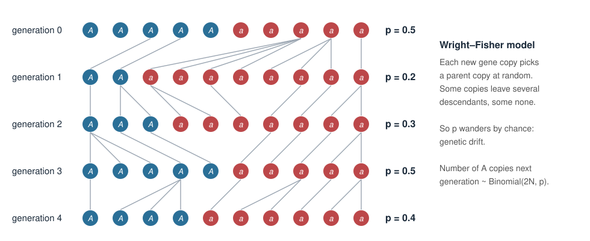
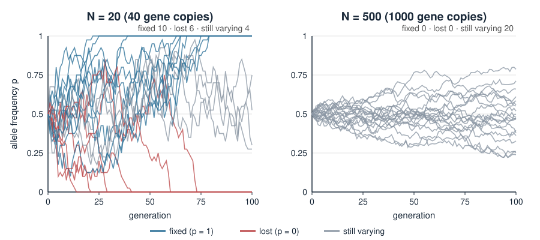
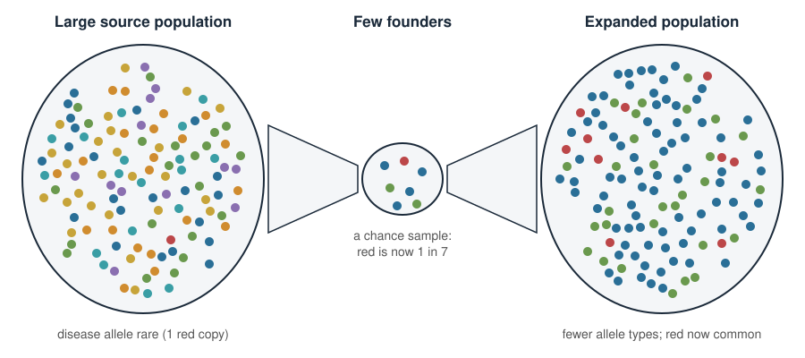
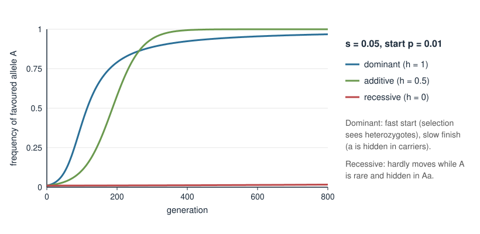
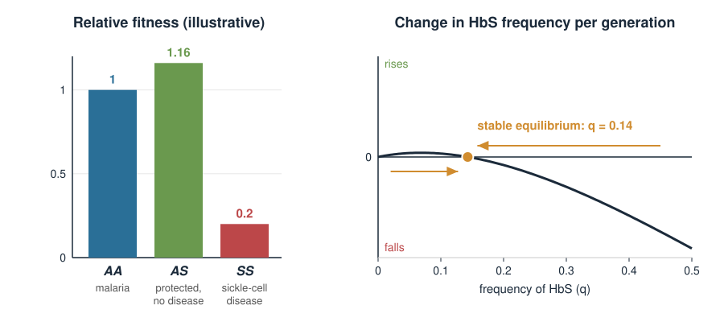

## About this lecture

Hardy–Weinberg keeps the allele frequency *p* constant. Real allele frequencies **change**. This lecture is about the four forces that change them:

- **Genetic drift**: chance, strongest in small populations. The Wright–Fisher model; fixation and loss; effective population size; **founder effects** and the **Finnish disease heritage**.
- **Selection**: genotypes differ in fitness. The Δ*p* recursion; dominance and the speed of selection.
- **Mutation** and **mutation–selection balance**: why harmful alleles never disappear.
- **Migration**: gene flow makes populations alike.
- **Heterozygote advantage**: sickle-cell haemoglobin and malaria.

This is syllabus outcome 2: *how allele frequencies in populations vary with different factors*. Book: Hartwell, the population genetics chapter.

::: notes
Frame the lecture as "what happens when each Hardy–Weinberg assumption fails". We dealt with non-random mating last time; today the other four. The thread through the course is HBB: the sickle-cell allele was introduced in Part 1 as a missense variant, it was a codominant example in extensions to Mendel, it was missing as homozygotes from 1000 Genomes samples last time, and today we explain why it is common at all. The tumour from the cancer lecture is also a population: drift and selection act on cell clones exactly as they do here.
:::

## Four forces change allele frequencies

| Force | What it does to *p* | Direction | Strongest when |
|---|---|---|---|
| **Drift** | random change from generation to generation | none (random) | population is **small** |
| **Selection** | genotypes leave different numbers of offspring | towards the fitter allele, or to a balance | fitness differences are **large** |
| **Mutation** | turns one allele into another | towards new alleles | over very long times (rates ~10⁻⁸ per base) |
| **Migration** | brings alleles from other populations | towards the source population's *p* | many migrants, very different *p* |

Drift and mutation create and remove **variation**; selection adapts; migration makes populations **similar**. Real populations feel all four at once.

::: notes
A summary slide to come back to. Mutation is the ultimate source of all variation but changes allele frequencies very slowly: per-base mutation rates in humans are about 1 in 100 million per generation. Its effect on frequencies matters only in balance with selection. Drift is directionless: it is just as likely to increase as to decrease p. Selection has a direction. Ask students which forces increase differences between populations (drift, divergent selection) and which decrease them (migration).
:::

## Genetic drift: the Wright–Fisher model {.smaller}

{width="80%" fig-align="center"}

- A population of *N* diploid individuals has **2*N*** gene copies. Each copy in the next generation is a random draw from the copies of this generation.
- So the number of *A* copies next generation is **Binomial(2*N*, *p*)**: the same `rbinom` you used for sibships.
- *p* goes up or down by chance: **genetic drift**. The expected change is zero, but the variance per generation is *p*(1 − *p*)/(2*N*).

::: notes
The Wright–Fisher model is the simplest model of drift: discrete generations, a constant population size, and random sampling of gene copies. Some copies leave several descendants, some none, purely by chance. In the figure, p goes 0.5, 0.2, 0.3, 0.5, 0.4 with only 10 copies. The variance formula shows why small populations drift faster: the standard deviation of the change per generation is the square root of pq over 2N. For 2N equals 10 and p equals 0.5 that is 0.16; for 2N equals 1000 it is 0.016. In the R exercise this model is a for loop of a few lines.
:::

## What drift does {.smaller}

{width="78%" fig-align="center"}

- Each population wanders until the allele is **fixed** (*p* = 1) or **lost** (*p* = 0). Then drift stops: there is no variation left.
- The probability that a neutral allele is eventually fixed equals its **starting frequency**, *p*₀. A new mutation (*p*₀ = 1/2*N*) is almost always lost.
- **Heterozygosity** *H* = 2*pq* falls by a factor (1 − 1/2*N*) per generation on average. Different populations **diverge**.

::: notes
Left: with 40 gene copies, after 100 generations most of the 20 populations have fixed or lost A. Right: with 1000 copies, they have barely spread. Fixation probability equals p0 because drift has no direction: the average of p over many populations stays at p0, and at the end every population is at 0 or 1, so the fraction at 1 must be p0. The heterozygosity formula says how fast variation disappears; time to lose half of it is about 1.4 times 2N generations. Note the divergence: populations that start the same end up different by chance alone. This is part of why human populations differ in allele frequencies, as seen in 1000 Genomes.
:::

## Effective population size

Drift depends on the **effective** population size *N*ₑ: the size of an ideal Wright–Fisher population that drifts as fast as the real one. Usually *N*ₑ is **much smaller** than the census size.

- **Unequal sex ratio**: $N_e = \dfrac{4 N_m N_f}{N_m + N_f}$. A herd with 10 breeding males and 90 females: *N*ₑ = 4 × 10 × 90 / 100 = **36**, not 100.
- **Fluctuating size**: *N*ₑ is close to the **harmonic mean** over generations, so a single small generation dominates. Sizes 1000, 10, 1000: *N*ₑ = 3/(1/1000 + 1/10 + 1/1000) ≈ **29**.
- **Variance in family size** (some parents have many children, most have few) also lowers *N*ₑ.

Long-term *N*ₑ of humans is estimated at roughly 10 000, although billions are alive today: past bottlenecks still shape our genomes.

::: notes
Ne is the number that goes into all the drift formulas. The sex ratio formula follows because half of the genes come from each sex: if only 10 males breed, the paternal half is drawn from a small pool. This matters for conservation genetics and animal breeding, where a few sires father many offspring. The harmonic mean point is the formal version of a bottleneck: one generation at size 10 counts almost as much as a hundred generations at 1000. The human value of around 10 000 is a commonly quoted estimate from genetic diversity; treat it as an order of magnitude.
:::

## Founder effects and bottlenecks {.smaller}

{width="76%" fig-align="center"}

- A new population founded by **few** people carries only a **chance sample** of the source's alleles. A rare allele that happens to be among the founders can become **common**; many others are **lost**.
- A **bottleneck** (a population crash and recovery) has the same effect.
- Recessive diseases due to that allele are then much more common than elsewhere, and are usually due to **one** shared ("founder") mutation.

::: notes
Founder effects are drift compressed into one generation. In the figure, one red copy among 120 in the source becomes one in seven among the founders, and stays at that frequency as the population grows. Classic examples include Ellis–van Creveld syndrome among the Old Order Amish, Tay–Sachs disease among Ashkenazi Jews (where selection may also play a role), and the Finnish disease heritage on the next slide. A founder mutation can be recognised because all patients share the same mutation on the same surrounding haplotype, inherited from the common ancestor.
:::

## The Finnish disease heritage

Finland's population grew from a small number of settlers, with further bottlenecks as internal regions were settled. Result:

- A few dozen rare recessive diseases are **much more common** in Finland than elsewhere: the **Finnish disease heritage** (reviewed by Norio, *Hum Genet* 2003). Most patients are homozygous for **one** founder mutation.
- Example: **Salla disease** (free sialic acid storage, *SLC17A5*, 6q13, autosomal recessive). Founder allele R39C (rs80338794): allele frequency about **0.0046** in Finns in gnomAD v4 exomes, **20 times** that in other Europeans (0.00023).
- Conversely, some diseases common elsewhere in Europe are **rare** in Finland: *CFTR* F508del is about 10 times rarer in Finns than in other Europeans (previous lecture).

Same forces, opposite outcomes: drift raises some alleles and removes others.

::: notes
This is a textbook founder effect in a well-documented population. The exact number of diseases in the heritage depends on the list; Norio's reviews describe about three dozen. The gnomAD numbers for Salla R39C are from the v4 exome data and were checked through the gnomAD API; students look them up in the exercise. Another striking one is CLN1 disease, infantile neuronal ceroid lipofuscinosis, due to PPT1 R122W, which is even more enriched. Point out the symmetry with CF: the same random sampling at foundation made some disease alleles common and others rare. Medical genetics in Finland uses this: a few founder mutations explain most cases, so testing is simple.
:::

## Demo: drift and selection

```{=html}
<link rel="stylesheet" href="../demos/dist/demo.css">
<div data-demo="drift" data-preset="drift20"></div>
<script src="../demos/dist/drift.js"></script>
```

::: notes
Start with "drift, N = 20": with the default seed, 9 fixed, 9 lost, 2 still segregating after 100 generations. Then N = 500: all 20 still segregating. Then "selection s = 0.05": the lines follow the dashed deterministic curve. Change N to 20 with the same s: most populations lose the favoured allele. Then the sickle-cell preset: lines settle near 0.14. Point out the readout comparing heterozygosity with H0 times (1 − 1/2N) to the t.
:::

## Selection: fitness and the Δ*p* recursion

**Relative fitness** *w*: the relative number of offspring a genotype leaves. With selection coefficient *s* and dominance *h*:

| Genotype | *AA* | *Aa* | *aa* |
|---|---|---|---|
| Fitness *w* | 1 + *s* | 1 + *hs* | 1 |
| Frequency before selection | *p*² | 2*pq* | *q*² |

After selection, the frequency of *A* among the parents of the next generation is

$$
p' = \frac{p^2 w_{AA} + pq\, w_{Aa}}{\bar w}, \qquad \bar w = p^2 w_{AA} + 2pq\, w_{Aa} + q^2 w_{aa}.
$$

*h* = 1: *A* dominant; *h* = ½: additive; *h* = 0: *A* recessive. Apply the recursion generation after generation (a loop) to follow *p*.

::: notes
This is the one formula of the lecture. It is a weighted count: each genotype's contribution of A alleles is multiplied by its fitness, and we divide by the mean fitness so that frequencies add up to one. The 2pq heterozygotes each carry one A, which is why the heterozygote term is pq, not 2pq. Fitness here combines survival and fertility. Example: s equals 0.05 and h equals 0.5 means AA carriers leave 5 percent more offspring than aa, and heterozygotes 2.5 percent more. Small fitness differences, repeated over hundreds of generations, are enough to change p from rare to common.
:::

## Dominance and the speed of selection {.smaller}

{width="72%" fig-align="center"}

- A favoured **dominant** allele rises fast at first (selection sees it in heterozygotes) but **slows near fixation**: the last *a* alleles hide in heterozygotes.
- A favoured **recessive** allele barely moves while rare: almost all its copies are in heterozygotes, which selection cannot see.
- Same reason as last lecture: for a rare allele, almost all copies are in **heterozygotes**.

::: notes
These are deterministic curves: no drift. Same s, three dominance values. The additive allele follows a symmetric S curve. The dominant one wins the race at first and then crawls. The recessive one, starting at 1 percent, hardly changes in 800 generations: with q equals 0.01, only 1 in 10 000 people is a homozygote and visible to selection. The flip side: selection against a harmful recessive allele is also very slow once the allele is rare. Even complete removal of affected people reduces q from 0.01 to 0.005 only after about 100 generations, about 2500 years.
:::

## Mutation–selection balance

Selection removes harmful alleles; mutation creates new ones. They balance at an equilibrium frequency, with mutation rate *μ* per generation:

| Harmful allele | Equilibrium frequency | Example: *μ* = 10⁻⁵, *s* = 1 (lethal) |
|---|---|---|
| **recessive** (seen only in *aa*) | $\hat q \approx \sqrt{\mu / s}$ | *q̂* ≈ 0.003, incidence *q̂*² ≈ 10⁻⁵ |
| **dominant** (seen in *Aa*) | $\hat q \approx \mu / s$ | *q̂* ≈ 10⁻⁵ |

- A recessive lethal allele is ~300 times more frequent than a dominant one with the same mutation rate: it hides in carriers.
- For a dominant lethal, every case is a **new mutation** (recall achondroplasia and new mutations in the pedigrees unit).

::: notes
The derivation is beyond this course; the intuition is enough. At equilibrium, the number of copies removed by selection each generation equals the number created by mutation. For a recessive allele, selection removes copies only from aa individuals, at a rate s times q squared, so q squared equals mu over s. For a dominant allele, selection acts on heterozygotes, removing about s times q, so q equals mu over s. Note that in both cases the incidence of the disease is about mu, or 2 mu for the dominant: under this simple model, disease incidence tells you the mutation rate. The figure 10 to the minus 5 is a typical order of magnitude for the per-gene rate of new loss-of-function mutations.
:::

## Migration (gene flow)

If a fraction *m* of each generation are migrants from a population with allele frequency *p*<sub>M</sub>:

$$
p' = (1-m)\,p + m\,p_M, \qquad \Delta p = m\,(p_M - p).
$$

- The difference from the source shrinks by a factor (1 − *m*) each generation: after *t* generations, (1 − *m*)<sup>*t*</sup>. Example: *m* = 0.05, after 20 generations 0.95²⁰ = 0.36 of the original difference is left.
- A little migration is enough to stop populations from drifting apart: roughly **one migrant per generation** keeps them from fixing different alleles.
- Migration also introduces **new alleles**, and mixes populations: admixed populations (such as ACB, ASW and PUR in 1000 Genomes) carry alleles from several continents.

::: notes
Migration is the simplest force to model: the new population is a weighted average of the residents and the migrants. The "one migrant per generation" rule is a classical result from Wright's island model: it holds whatever the population size, because larger populations drift more slowly and need proportionally more migrants. Link to last lecture: the HbS allele appears in 1000 Genomes populations outside Africa only in admixed populations with recent African ancestry, such as ACB in Barbados and ASW in the south-western US. That is migration.
:::

## Heterozygote advantage: sickle cell and malaria {.smaller}

{width="80%" fig-align="center"}

- *HbA/HbS* carriers are **protected** against severe *falciparum* malaria; *HbS/HbS* have sickle-cell disease. Where malaria is common, the **heterozygote is fittest**.
- Then *q* rises when rare and falls when common, to a **stable equilibrium** $\hat q = \dfrac{w_{AS} - w_{AA}}{2w_{AS} - w_{AA} - w_{SS}}$. With the illustrative fitnesses 1, 1.16, 0.2: *q̂* = 0.16/1.12 = **0.14**.
- 1000 Genomes Yoruba (Nigeria): *q*(HbS) = **0.139** (previous lecture). This is **balancing selection**.

::: notes
This brings together the HBB thread of the course. In Part 1 HbS was a single missense change, glutamate to valine at position 6. Here it is a classic case of balancing selection, first proposed by Allison in the 1950s from the overlap of high HbS frequencies with malaria. The fitness values are illustrative, chosen so that the equilibrium matches the observed frequency; they are the same as in the demo preset. The right panel is the change in q per generation: positive below the equilibrium, negative above, so q returns to 0.14 from either side. Where malaria has gone, as among people of African descent in the Americas, the heterozygote advantage disappears and selection slowly lowers HbS. Other examples: thalassaemias and G6PD deficiency, also linked to malaria.
:::

## Drift versus selection

Which wins? Compare **selection** (*s*) with **drift** (1/2*N*ₑ):

- If 4*N*ₑ*s* ≫ 1, selection dominates: the allele follows the deterministic curve. If 4*N*ₑ*s* ≲ 1, the allele behaves almost as if **neutral**.
- A **new** favourable mutation is still usually lost: its fixation probability is only about **2*s*<sub>het</sub>** (Haldane), where *s*<sub>het</sub> is the heterozygote's advantage. With *s*<sub>het</sub> = 0.025: 5%, so 95% of such mutations are lost by chance while still rare.
- In **small** populations, mildly harmful alleles can drift to high frequency, and favourable ones are lost.

So most variation in the genome is shaped by drift, and selection acts strongly only where fitness effects are large.

::: notes
This connects the two halves of the lecture. The product 4Ns compares the strength of selection with the strength of drift. For human Ne of about 10 000, alleles with s smaller than about 1 in 40 000 behave as neutral: most of the genome. Haldane's 2s result is surprising for students: even a clearly beneficial mutation is usually lost, because it starts as a single copy and its first few carriers may simply not pass it on. The demo's "new beneficial mutation" preset shows this: 7 of 100 populations fix the allele with these settings, close to 5 percent. Small populations accumulating harmful alleles is a concern in conservation genetics, and links back to the founder effect.
:::

## Summary

- **Drift**: random sampling of 2*N* gene copies each generation. Alleles are fixed or lost; P(fixation) = *p*₀; heterozygosity decays by (1 − 1/2*N*) per generation. Use *N*ₑ, which is usually much smaller than the census size.
- **Founder effects** and bottlenecks make some rare alleles common (Finnish disease heritage, Salla disease) and others rare (CF in Finland).
- **Selection**: *p*′ = (*p*²*w*<sub>AA</sub> + *pq w*<sub>Aa</sub>)/*w̄*. Selection on rare recessive alleles is slow.
- **Mutation–selection balance**: *q̂* ≈ √(*μ*/*s*) recessive, *μ*/*s* dominant.
- **Migration**: Δ*p* = *m*(*p*<sub>M</sub> − *p*); makes populations similar.
- **Heterozygote advantage** keeps HbS at a stable *q̂* where malaria is common.

::: notes
The exam-level skills: apply the selection recursion for one or two generations by hand; compute an equilibrium for heterozygote advantage; compute Ne for a sex ratio; explain founder effects with an example; state the fixation probability of a neutral allele.
:::

## Where this leads

- **Next**: *Complex traits*: many loci, each with a small effect, plus environment. GWAS find them, and population structure (Wahlund, drift between populations) is a trap.
- **Cancer genetics** again: a tumour is a population of cells. Drivers are selected, passengers drift along, and resistance to a drug evolves by selection.
- In the exercise: drift and selection by hand, the demo, the Finnish disease heritage in MedGen and gnomAD, and a Wright–Fisher simulation in R with a **`for` loop**.

::: notes
The R exercise is where students see drift as code: a loop over generations, with rbinom inside. Then replicate runs the whole population many times, which is how population geneticists explore models that are too hard to solve by hand.
:::
