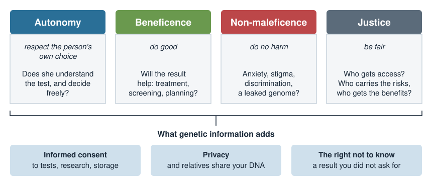
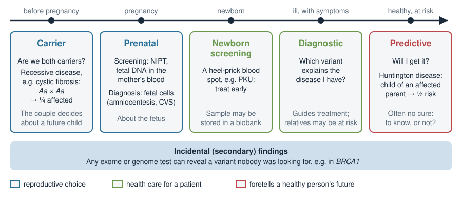
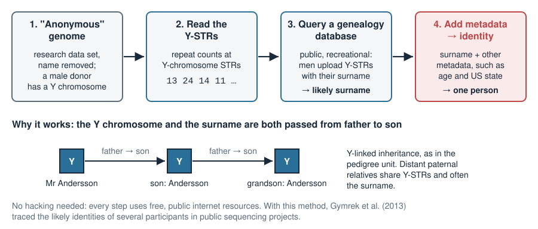
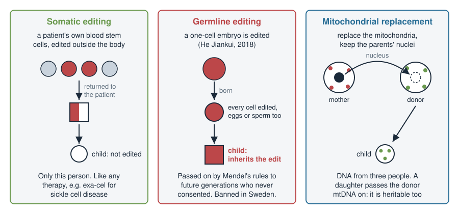
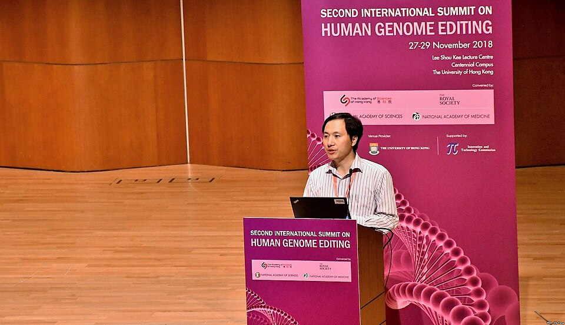
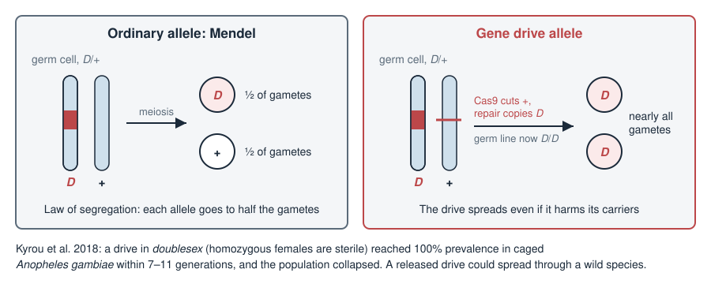
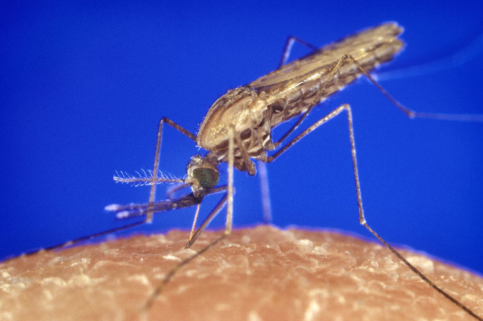

## About this lecture

All course long you have predicted genotypes, computed risks and looked up variants. This lecture asks: **what happens when those answers concern real people?**

- A **framework**: four principles, plus consent, privacy and the right not to know.
- **Genetic testing**: diagnostic, predictive, carrier and prenatal tests, and findings nobody asked for. **Direct-to-consumer** tests.
- **Privacy**: why a genome cannot be made anonymous, and how genealogy databases now solve crimes.
- **Editing the germline**: embryo editing, mitochondrial replacement and gene drives.
- **History**: eugenics, and the Swedish Institute for Racial Biology and sterilisation laws.
- **Ethical review** of research in Sweden, and the laws on biobanks and genetic data.
- A **method** for analysing a case in six steps, worked through on one example.

The aim is not to give you the right answers. It is to help you **see the conflict**, name the principles involved and argue for a position. The exercise gives you cases and a literature search.

::: notes
This is the ethics module of the course (1 ECTS). It links back to almost every unit: Huntington disease and the half risk from the Mendel unit, Y-linked inheritance from pedigrees, mitochondrial inheritance from Part 5, CRISPR-based tools and databases from Part 4. Make it clear from the start that ethics is not opinion without structure. We use a small, standard vocabulary (four principles, consent, privacy, the right not to know), and a good argument uses the facts of genetics correctly. Many questions have no single right answer, but there are clearly bad answers: ones that get the genetics wrong, or ignore someone whose interests are at stake.
:::

## Why genetic information is special

A blood glucose value is about you, today. A genotype is different:

- **It is shared.** Your relatives carry half, a quarter or an eighth of your alleles. A result about you is also partly a result about them, and they did not consent.
- **It predicts.** A Huntington disease allele says something about your health decades from now, sometimes with no treatment available.
- **It is permanent and identifying.** You can change a password, not a genome. A genome is a unique identifier, and it can be read from a few cells.
- **It is reproductive.** Carrier and prenatal tests inform choices about *future* people.
- **Its meaning changes.** A variant of uncertain significance today may be classified as pathogenic next year (think of the ClinVar classification from the pedigree exercise).

::: notes
Each bullet links to genetics they have done. Shared: the coefficient of relationship, one half for first-degree relatives, is Mendelian segregation. Predictive: an autosomal dominant late-onset disease with full penetrance turns a genotype into a forecast. Identifying: we will see how few markers are needed. Reproductive: carrier testing is the Aa x Aa cross. Changing meaning: ClinVar classifications and review status change as evidence accumulates; a result from five years ago may need to be re-read. These five properties are why genetics gets its own laws in many countries, including Sweden's Genetic Integrity Act, which we meet at the end.
:::

## A framework: four principles {.smaller}

{width="78%" fig-align="center"}

The four principles of **biomedical ethics** (Beauchamp and Childress, *Principles of Biomedical Ethics*, 1st edition 1979). Each is a reason that counts; in real cases they **conflict**, and the work is to weigh them.

::: notes
These four principles are the most widely used framework in medical ethics. Autonomy: respect people's own informed choices. Beneficence: act for the person's good. Non-maleficence: avoid causing harm. Justice: distribute benefits, risks and costs fairly. None of them is absolute, and the interesting cases are the ones where they pull in different directions. Example: a doctor finds a BRCA1 variant. Beneficence says tell the patient's sisters, who could get screening. Autonomy and privacy say the patient decides whom to tell. Justice asks whether everyone has access to the screening that would follow. In the exercise, every case asks you to name which principles are in tension. Other frameworks exist (consequences, duties, virtues, rights), and the principles are a practical summary rather than a full theory.
:::

## Consent, privacy and the right not to know

- **Informed consent**: a person agrees to a test or to research **voluntarily**, after understanding what it involves, its risks, and what will happen to the sample and the data. Consent can be **withdrawn**.
- **Broad consent**: agreeing that a stored sample may be used in **future research** that nobody can describe yet. Common in biobanks; debated, because it is hard to be "informed" about the unknown.
- **Privacy and confidentiality**: genetic results are sensitive data. Who may see them: relatives, employers, insurers, the police?
- **The right not to know**: a person may choose **not** to learn a genetic result about themselves. This is part of autonomy, and it is why tests are offered, never imposed.
- **The family problem**: one person's result reveals risk for relatives. The right to know of one person can collide with the right not to know of another.

::: notes
These are the concepts that make genetics different from most of medicine. Stress the right not to know: in most of medicine, more information is assumed to be better, but for an untreatable late-onset disease many at-risk people choose not to be tested, and that choice must be respected. The family problem is the core of several cases in the exercise: a test on one identical twin is a test on both; a test on a grandchild of a Huntington patient can reveal the status of the parent in between. In Sweden, the Ethical Review Act requires consent to be voluntary, explicit and specific to the research (section 17); broad consent is handled through ethical review and the Biobanks Act.
:::

## Kinds of genetic testing {.smaller}

{width="80%" fig-align="center"}

The **same lab method** can serve very different purposes. The ethics depends on **who** is tested, **why**, and **what can be done** with the answer.

::: notes
Walk along the life course. Carrier testing applies the Aa x Aa cross from the Mendel unit: two healthy carriers have a one in four risk per child. Prenatal testing is about a fetus, and the decision belongs to the pregnant woman. Newborn screening in Sweden (the PKU test) is offered to all newborns for treatable conditions; the dried blood spots are stored in the PKU biobank, which we return to under biobanks. Diagnostic testing explains a disease someone already has; it is the least controversial, but it can still reveal risks for relatives. Predictive testing of a healthy person is the most ethically loaded, especially when there is no treatment. The band at the bottom is the reason incidental findings come up in every kind of test once we sequence exomes or genomes. The colour code says who the result is mainly for.
:::

## Predictive testing: Huntington disease

Recall the Mendel unit: Huntington disease is **autosomal dominant** with late onset. A child of an affected parent (*Aa* × *aa*) has a **½** risk. Since the *HTT* CAG-repeat expansion was found (Huntington's Disease Collaborative Research Group 1993, PMID 8458085), a healthy person at risk can learn their genotype.

- **No cure.** A positive result is a forecast, not a treatment plan.
- International guidelines: **counselling** before and after, a free choice without coercion, and a **minimum age of 18** (MacLeod et al. 2013, PMID 22642570). The child's own future choice is protected.
- Most people at risk choose **not** to know: in the UK, cumulative uptake among people at 50% risk (1994–2014) was about **17%** (Baig et al. 2016, PMID 27165004).
- **Testing reveals others.** A positive result in a grandchild means the parent in between carries the allele too. Testing one **identical twin** tests both.

::: notes
Huntington disease is the classic case for the right not to know, and it is the first case in the exercise. Remind students of the genetics: one affected parent, a testcross, one half. With full penetrance for long expanded repeats, a positive result means the person will develop the disease if they live long enough. Predictive testing protocols built for Huntington disease have become the model for other late-onset conditions: counselling before the test, time to reflect, and support afterwards. Point out the two family problems: a 25% at-risk grandchild whose result reveals the status of the 50% at-risk parent, and monozygotic twins, who share the genotype, so one twin's wish to know collides with the other's wish not to know. There is no clean solution; the exercise asks students to weigh it.
:::

## Prenatal testing and NIPT

- **Prenatal diagnosis** tests fetal cells, obtained by **amniocentesis** or **chorionic villus sampling** (CVS). Both carry a small risk of miscarriage.
- **NIPT** (non-invasive prenatal testing) analyses **cell-free fetal DNA** in the mother's blood. Fetal DNA in maternal plasma was first shown by Lo et al. (1997, *Lancet*, PMID 9274585). NIPT is a **screening** test, mainly for trisomies 21, 18 and 13; a positive result is confirmed by a diagnostic test.
- In Sweden, all pregnant women must be offered **general information** about prenatal diagnosis, and the woman decides whether to be tested (Genetic Integrity Act, 2006:351, ch. 4).

Ethical questions: a simple blood test makes testing **routine**, so is the choice still informed? What does wide screening say to people who live with Down syndrome? Where is the line between serious disease and **choosing traits**?

::: notes
The key change NIPT brought is that a screening test with no miscarriage risk can be done from a blood sample early in pregnancy. That is a benefit, but it also lowers the threshold: when something is easy and routine, people may not think of it as a choice. Disability-rights critics argue that routine screening sends a message about the value of people with the conditions screened for. Stress the difference between screening and diagnosis: NIPT gives a risk, not a diagnosis, partly because some of the cell-free DNA comes from the placenta. The Swedish law puts the decision with the woman, after information. Preimplantation genetic testing of IVF embryos is regulated in the same act: only for serious monogenic or chromosomal disease, and not for choosing traits (ch. 4, section 2).
:::

## Incidental and secondary findings

Sequence an exome to explain a child's epilepsy, and you may also find a **pathogenic *BRCA1* variant** in a parent: a high risk of breast and ovarian cancer that nobody was looking for.

- **Incidental finding**: found by chance, unrelated to the question asked.
- **Secondary finding**: deliberately looked for in a short list of **actionable** genes, where knowing allows prevention. The ACMG publishes such a list (v3.2: Miller et al. 2023, PMID 37347242; updated in v3.3, 2025, PMID 40568962). *BRCA1* is on it.
- Labs and clinics must decide **in advance**, with the patient: which findings will be reported, and may the patient opt out?

Principles in tension: **beneficence** (prevention saves lives; relatives could be tested too) against **autonomy** and the **right not to know**.

::: notes
Whole-exome and whole-genome sequencing look at everything, so they find everything. The American College of Medical Genetics and Genomics (ACMG) keeps a list of genes where a pathogenic variant should be reported even if the test was ordered for something else, because something can be done about it: extra screening, preventive surgery, or drugs. BRCA1 and BRCA2 are standard examples. Guidelines differ between countries on whether to look for such findings at all; the policy choice is: look or not, report or not, and who decides. In the exercise, case 2 asks students to apply this. Note the family dimension again: a BRCA1 result in a mother concerns her sisters and daughters, who each have a half chance of carrying it.
:::

## Direct-to-consumer genomics

Companies sell genotyping **directly to the public**, without a doctor: ancestry, relative matching, traits and some health risks. The customer spits in a tube and gets results online.

- **Autonomy and access**: people can learn about themselves without a gatekeeper.
- **Without counselling**: a health result can frighten or falsely reassure. Genotyping arrays test selected variants, so a "no variant found" for *BRCA1* does not mean "no risk".
- **Relatives**: matching reveals unknown siblings, donor-conceived children, misattributed paternity. Your relatives never agreed to be found.
- **Data as an asset**: the company holds a large genetic database. Its terms of use, a data breach, or a change of owner decide what happens to it.

- **Raw data mislead**: in one clinical lab, 40% of variants from DTC raw data sent for confirmation were false positives (Tandy-Connor et al. 2018, PMID 29565420).

US example, **23andMe**: an FDA warning letter stopped its health reports in 2013; the FDA authorised its first health-risk reports in 2017; in 2023 a breach of about 14,000 accounts exposed millions of relative-matching profiles; it filed for bankruptcy in March 2025 and was sold in July 2025.

::: notes
Direct-to-consumer (DTC) testing removed the doctor and the genetic counsellor from the loop. Benefits: access, curiosity satisfied, and genuinely useful findings for some people. Risks: misinterpretation, false reassurance from limited arrays, and the fact that matching services connect relatives who did not ask to be connected. Stress that a DTC customer's database entry affects their relatives' privacy, which leads directly to the next two slides. The 23andMe story shows that a privacy promise is only as durable as the company: when a company is sold or goes bankrupt, the database is an asset. In Sweden, the Genetic Integrity Act bans making a genetic test or genetic information a condition of a contract, and limits insurers' use of genetic information to narrow cases.
:::

## Genetic privacy: you cannot anonymise a genome {.smaller}

{width="72%" fig-align="center"}

Gymrek et al. (2013, *Science*, PMID 23329047) recovered **surnames** from "anonymous" research genomes by reading **Y-chromosome STRs** and querying public genealogy databases; combined with age and US state, this traced the identities of research participants. They projected that surnames of about 12% of US white males could be recovered this way.

::: notes
This paper was a turning point in the debate on how genomic data should be shared. The research data had no names, but the Y chromosome carries a surname-like signal: it is passed from father to son, as is the surname in many cultures. That is Y-linked inheritance from the pedigree unit, used as an identifier. Recreational genealogy databases let men upload their Y-STR profiles with their surnames, so matching the anonymous profile gives a likely surname. Add metadata that was published with the research data, such as age and US state, and the candidate list shrinks to one. Two lessons. First, removing names is not anonymisation for genomes. Second, the leak comes through relatives: the people in the genealogy database identified someone else. One response is controlled access: individual-level data are released only to researchers who apply and agree to terms of use.
:::

## Genetic genealogy and the police

**Investigative genetic genealogy**: genotype a crime-scene sample with a SNP array, upload it to a genealogy database, find **distant cousins**, then build their family trees until one person fits.

- **Golden State Killer**: a suspect in a series of 1970s–80s California murders and rapes was arrested on **24 April 2018** after relatives were found in the free genealogy database GEDmatch (Guerrini et al. 2018, PMID 30278047). He pleaded guilty in 2020 and was sentenced to life without parole. In 2019 GEDmatch made police matching **opt-in**.
- **Scale**: from 1.28 million consumer genomes, Erlich et al. (2018, PMID 30309907) projected that about **60%** of searches for people of European descent would find a **third cousin or closer**.
- **Sweden**: first used in 2019, on a 16-year-old double murder in Linköping. The Authority for Privacy Protection (IMY) halted further use in 2021; a new law allows the police to use it from **1 July 2025**, only for murder and aggravated rape, as a last resort (Ansell & Fagerholm 2025, PMID 40995235).

::: notes
Explain the genetics: a third cousin shares on average about one 128th of the genome, but in long identical segments that a SNP array can detect. Each cousin match points to a pair of shared great-great-grandparents; genealogists then work down through all their descendants, using public records, until the candidate list is short; a direct DNA test confirms. The ethical issue is consent: the cousins who uploaded their DNA to trace their ancestry did not agree to become police informants, and the suspect never uploaded anything. In favour: serious crimes solved, and innocent suspects cleared. Against: everyone's privacy depends on what their relatives do; function creep from murder to lesser crimes. Sweden's approach shows the regulatory answer: a specific law, limited to the most severe crimes. This is case 4 in the exercise.
:::

## You used these databases all course

| Database (unit) | What it shares | Who it could identify? |
|---|---|---|
| NCBI Gene, Ensembl, OMIM (Part 1) | reference genes and diseases | no one |
| ClinVar (pedigrees) | variants and their interpretation, without names | rarely, for very rare variants |
| gnomAD (Part 7) | **aggregate** allele counts only | very hard |
| 1000 Genomes (Part 4) | **individual genotypes**, openly | possible: no names or medical data, but open consent to public release |
| A genealogy site | individual genotypes **with names and family trees** | you, and your relatives |

The same data type, a genotype, can be **harmless or identifying** depending on how it is shared. Open data speeds up research; controlled access and aggregation protect participants.

::: notes
Make the link to their own work. Reference genomes and gene records contain nobody's private data. ClinVar records variants submitted by labs; it contains no names, but a very rare variant together with a rare disease and a hospital could narrow down a family. gnomAD only shows how many people carry each allele, never which people, which is a privacy design choice. The 1000 Genomes Project released full individual genotypes openly, from openly consented samples, without names or medical data. Gymrek's and Erlich's studies showed that people in public data sets of this kind can still be identified, through relatives in genealogy databases. Ask the students: which of these would you be happy to have your own genome in? This prepares the discussion of biobank consent at the end.
:::

## Germline editing {.smaller}

{width="70%" fig-align="center"}

- **Somatic** editing treats one person. Example: exa-cel, CRISPR-edited blood stem cells for sickle cell disease (Frangoul et al. 2024, PMID 38661449).
- **Germline** editing changes an embryo, so **every cell, including the gametes**, carries the edit. The change is **inherited** by Mendel's rules.

::: notes
The distinction is the key concept. Somatic editing is ethically like any other new therapy: one consenting patient (or guardian), benefits and risks to that person. Exa-cel edits the patient's own blood stem cells outside the body to switch fetal haemoglobin back on, a nice link to the sickle cell example in the first unit. Germline editing affects people who cannot consent, the future children and their descendants, and errors cannot be recalled. Mitochondrial replacement, in the right panel, is not gene editing, but it is also a heritable change: a daughter passes on the donor's mitochondria, by the maternal inheritance we saw in the pedigree unit and will treat in Part 5. In Sweden, experiments and treatments that cause heritable genetic changes in humans are prohibited (Genetic Integrity Act, 2006:351, ch. 2, sections 3–4).
:::

## He Jiankui and the CRISPR babies

:::: {.columns}
::: {.column width="62%"}
On **25–26 November 2018**, just before an international summit on human genome editing in Hong Kong, He Jiankui announced the birth of twin girls whose embryos he had edited with CRISPR-Cas9 to disrupt ***CCR5***, the co-receptor HIV uses to enter cells (Cyranoski & Ledford 2018, PMID 30482929).
:::

::: {.column width="38%"}
{width="100%"}
[Photo: VOA / Iris Tong, public domain, via Wikimedia Commons](https://commons.wikimedia.org/wiki/File:He_Jiankui_at_Second_International_Summit_on_Human_Genome_Editing.jpg){.photo-credit}
:::
::::

- **No medical need**: the father had HIV, but sperm washing can prevent transmission to the child with no risk.
- **Not what was intended**: neither twin got the natural *CCR5*-Δ32 deletion; the edits made new mutations, and the children are **mosaics** (Greely 2019, PMID 31666967).
- **Consent and oversight**: how the parents were informed, and the ethics approval, could not be independently checked; the work was done in secret.
- On **30 December 2019** a court in Shenzhen sentenced him to **three years in prison** and a fine of 3 million yuan for illegal medical practice; it also confirmed a third edited baby (Cyranoski 2020, PMID 31911693).

The response was near-universal condemnation, and calls for a moratorium on heritable editing.

::: notes
The photo shows He presenting the work at the Second International Summit on Human Genome Editing in Hong Kong on 28 November 2018, where it was met with sharp questions from the audience. This case is the clearest example of a violation of almost every principle at once. Non-maleficence: unknown risks to healthy children for no medical benefit. Autonomy: questionable consent from the parents, and none from the children or their descendants. Justice and public trust: done in secret, presented to the media before peer review. Point out the genetics: CRISPR makes a double-strand break and the cell repairs it by error-prone end joining, so the alleles created were new small deletions, not the well-studied Δ32 allele, and different cells of an embryo can be repaired differently, which is mosaicism. That is the scientific reason, apart from ethics, why heritable editing is not safe today. Case 5 in the exercise asks students to evaluate a more plausible proposal.
:::

## Mitochondrial replacement

Diseases caused by **mtDNA mutations** pass from mother to all her children (pedigree unit; full story in Part 5, *Organelle inheritance*). **Mitochondrial replacement therapy** (MRT) moves the mother's nucleus into a donor egg with healthy mitochondria.

- The child gets **nuclear DNA from both parents** and **mtDNA from the donor**: DNA from three people.
- The **UK** allowed it by regulations in force from **29 October 2015**, under licence. In 2025 the Newcastle team reported **8 children** born after pronuclear transfer, healthy at birth, with mutant mtDNA in blood from undetectable up to 16% (Hyslop et al. 2025, PMID 40673696; McFarland et al. 2025, PMID 40689593).
- It is **heritable** through daughters, and carry-over of some mutant mtDNA means a risk that its level rises again.

Is replacing ~37 genes of mtDNA different from editing a nuclear gene? Should the donor have any status?

::: notes
MRT is useful for discussion because it is legal and regulated in one country, unlike nuclear germline editing. The genetics: the human mitochondrial genome has 37 genes, all for oxidative phosphorylation and its own translation, so the donor contributes nothing that shapes appearance or personality, which is one argument that it is less problematic. Counter-arguments: it is still a heritable modification; a small amount of the mother's mitochondria is carried over with the nucleus, and because of the heteroplasmy bottleneck (Part 5) that fraction can rise again in some cells or in the next generation. The donor is anonymous in the UK and has no parental role. A good discussion question: would MRT count as a heritable genetic change under the Swedish Genetic Integrity Act, which bans such changes?
:::

## Gene drives {.smaller}

:::: {.columns}
::: {.column width="72%"}
{width="100%"}
:::

::: {.column width="28%"}
{width="100%"}
[Photo: CDC / James Gathany, public domain, via Wikimedia Commons](https://commons.wikimedia.org/wiki/File:Anopheles_gambiae_mosquito_feeding_1354.p_lores.jpg){.photo-credit}

*Anopheles gambiae*, the main malaria vector in Africa, and the target of the doublesex gene drive.
:::
::::

A **gene drive** cheats Mendel's law of segregation: a heterozygote passes the drive to **nearly all** offspring, not half. It could eliminate malaria mosquitoes, or an invasive species.

::: notes
This links straight back to the Mendel unit: segregation gives each allele a one-half chance of reaching a gamete. A homing gene drive carries the genes for Cas9 and a guide RNA aimed at the same site on the homologous chromosome. In the germline of a heterozygote it cuts the wild-type homolog, and the cell repairs the break using the drive chromosome as a template, so the heterozygote becomes a homozygote and almost every gamete carries the drive. Kyrou and colleagues targeted doublesex in Anopheles gambiae, the main African malaria vector: females homozygous for the disruption are sterile, and caged populations collapsed within 7 to 11 generations. The ethics is different from human germline editing: the benefit could be huge (malaria is a major killer, especially of young children), but a release affects an ecosystem and other countries, and cannot easily be recalled. Who consents for a whole region? That is the justice question.
:::

## History: eugenics in Sweden

**Eugenics**: the idea of "improving" a population by controlling who reproduces. Francis Galton coined the word in 1883. It was mainstream science in many countries in the early 20th century, including Sweden.

- The **State Institute for Racial Biology** (*Statens institut för rasbiologi*) was set up by a decision of the Riksdag in 1921 and opened in **Uppsala in 1922**, with Herman Lundborg (director 1921–1935) in charge. It set out to divide the Swedish population into "racial" categories, measuring people and photographing them; Lundborg made repeated trips to Lapland to measure and photograph Sami people.
- His successor, **Gunnar Dahlberg**, questioned the scientific basis of race research, and the institute moved towards medical genetics. In 1958–59 its work was absorbed into Uppsala University's **Department of Medical Genetics**.
- Its archive, with about **12,000 photographs**, is kept by Uppsala University Library.

::: notes
This is part of Swedish scientific history, and of the history of human genetics itself: the institute is a direct forerunner of a university department of medical genetics. Under Lundborg it used biometric methods to try to give statistical support to the idea that ethnic differences had genetic causes. Make the point that the institute was set up by a broad parliamentary decision, and that the people involved were respected scientists; the lesson is that scientific authority does not protect against serious harm, and that the categories science uses can be shaped by politics. Uppsala University's own pages give 1958 or 1959 for when the institute's activities were taken over by the Department of Medical Genetics. Sources: Uppsala University Library's pages on the archive of the State Institute for Racial Biology, and the university's news article from December 2021 when the archive was made available.
:::

## The Swedish sterilisation laws, 1935–1975

- The **1934 act** (SFS 1934:171, in force **1 January 1935**) allowed sterilisation of people considered mentally ill or "feeble-minded" **without their consent** if they were judged unable to understand it. The **1941 act** (SFS 1941:282) was in principle voluntary, but still allowed sterilisation without consent of people judged legally incapable. The grounds were **eugenic, social and medical**.
- Nearly **63,000** sterilisations were reported in **1935–1975**; **93%** of those sterilised were women. About 9% were done without consent, and about 24% after a formally voluntary application under coercion-like conditions, e.g. as a condition for leaving an institution or for getting an abortion.
- The **1975 act** (SFS 1975:580, in force 1976) allows sterilisation only at the person's own request.
- A government inquiry appointed in 1997 (final report SOU 2000:20) investigated, and a 1999 law (SFS 1999:332) gave **SEK 175,000** in compensation to people sterilised under compulsion.

The genetics was also **wrong**: most alleles for recessive conditions are carried by healthy heterozygotes, so sterilising affected people barely changes their frequency (Part 7, *Hardy–Weinberg*).

::: notes
Not all of the 63,000 were coerced. The government's report to the Riksdag (Skr. 2000/01:73, summarising the inquiry) estimates that about half of those sterilised took the initiative themselves, about 9% were sterilised without consent, about 24% under coercion-like conditions and about 10% after persuasion or pressure; the rest could not be classified. Compulsion dominated early on; the 1950s were a turning point towards voluntariness and family-planning motives. The laws were passed with broad political agreement. Sweden was not alone: the first sterilisation law was in the US state of Indiana in 1907, and in the 1930s other Nordic countries and Germany passed laws. The point of the last line is that eugenics failed on its own terms. If a recessive allele has frequency q, affected people have frequency q squared and carriers 2pq; for a rare allele almost all copies are in carriers, who look healthy. Removing affected people from reproduction lowers q only very slowly. Students will be able to compute this after the Hardy-Weinberg unit. The lasting lessons for today: consent cannot be replaced by the state's idea of the common good, and vulnerable groups need special protection. These lessons are built into the modern ethical review system.
:::

## Ethical review of research in Sweden

**The Ethical Review Act** (*Lag (2003:460) om etikprövning av forskning som avser människor*, in force 2004). Research must be approved **before it starts** if it:

- processes **sensitive personal data** (e.g. health or **genetic** data) or data on criminal offences;
- involves a **physical intervention**, or a method meant to affect a person physically or mentally, or an obvious risk of harm;
- uses **biological material** from a living or dead person that can be **traced** to them.

Applications go to the **Swedish Ethical Review Authority** (*Etikprövningsmyndigheten*, Uppsala, since 1 January 2019). Consent must be **voluntary, explicit and specific** to the research. Doing such research without approval is a crime.

Internationally: the World Medical Association's **Declaration of Helsinki** (1964, last revised October 2024).

::: notes
Point out what this means for them. Student projects done only within first- or second-cycle education are not "research" under the act, so a bachelor's project does not need its own application; but a degree project inside a research group often uses data or samples covered by the group's approval, and they should know where that approval comes from. The criteria are in sections 3 and 4 of the act; the consent rules in sections 16 to 22; breaking the approval requirement can give fines or prison of up to two years (section 38). The authority replaced six regional ethical review boards. The Declaration of Helsinki is the international statement of research ethics for medical research on humans; its core ideas are independent review, informed consent, and that the interests of the individual come before those of science and society. Note that an amendment to the act, decided in 2026, takes effect on 1 July 2027 and changes how some studies are assessed; always check the authority's website for the current rules.
:::

## Biobanks, GDPR and genetic integrity

| Law | What it says, in short |
|---|---|
| **Biobanks Act** (*Biobankslag*, 2023:38; replaced 2002:297) | Identifiable human samples may be collected, stored and used, for care or research, with the donor's **informed consent**, which can be **withdrawn**. Includes the **PKU biobank** of newborn blood spots. |
| **GDPR** (EU 2016/679, applies from 25 May 2018) | **Genetic data** (Art. 4(13)) is a **special category** of personal data (Art. 9): processing is prohibited unless an exception applies, such as explicit consent or approved research. |
| **Genetic Integrity Act** (2006:351) | Nobody may make a genetic test a **condition of a contract**; insurers may use genetic information only in narrow cases. **Heritable genetic changes** in humans are banned. Rules for prenatal and preimplantation diagnosis. |

Sample re-use is common: newborn blood spots from the Swedish PKU biobank were used to trace PFAS exposure from contaminated drinking water in Ronneby back to 1985 (PMID 40089001).

::: notes
These three laws are the practical frame for any genetics project in Sweden. The Biobanks Act: a sample taken in health care stays linked to the person; using it for research needs consent and ethical approval. The PKU biobank is special: it stores the newborn screening blood spots of a very large share of the population, so it is a powerful research resource and a sensitive one; the act gives it its own chapter. The Ronneby study is a good example of beneficial re-use: nobody in 1985 could have consented to a PFAS study, so the decision rests on ethical review and the law. GDPR treats genetic data as a special category, alongside health data and ethnic origin. The Genetic Integrity Act protects individuals in contracts: an employer or insurer may not demand a genetic test; the insurance exception only applies to very large policies. Case 6 in the exercise is a biobank re-use request.
:::

## Analysing a case: six steps

| Step | Question to answer |
|---|---|
| 1. **Genetics** | What is the mode of inheritance, the risk, and what can (and cannot) a test tell? |
| 2. **Who is affected** | The person tested, relatives, children and future generations, research participants, society |
| 3. **Principles** | Which of autonomy, beneficence, non-maleficence and justice are involved, plus consent, privacy and the right not to know? **Where do they conflict?** |
| 4. **Law and guidelines** | What do Swedish law and professional guidelines say? |
| 5. **Options** | More than yes or no: list the middle ways |
| 6. **Position** | Argue for one option, and state the **strongest objection** to it |

::: notes
This is the structure from the exercise, and the structure of the written group analysis. It is deliberately mechanical: the first two steps are facts, the third names the values, the fourth checks the rules, and only the last two are judgement. Many weak answers jump straight to step 6. The next two slides apply the six steps to one case that is not in the exercise, so students see the method once before they use it themselves.
:::

## Worked case: a treatable family risk (1)

Erik, 45, has a heart attack. Genetic testing finds a pathogenic *LDLR* variant: **familial hypercholesterolaemia** (FH), very high LDL cholesterol from birth. He has two adult siblings and two children aged 12 and 15. He does not want his siblings told (they have not spoken in years) and thinks his children are too young.

1. **Genetics**: FH is **autosomal dominant**. Each sibling and each child has a **½** prior risk. Unlike Huntington disease, FH is **treatable**: lipid-lowering drugs (statins) and lifestyle greatly reduce the risk of early heart disease, and treatment can start in **childhood**.
2. **Who is affected**: Erik; his siblings and their children; his own children, who cannot yet decide for themselves.
3. **Principles in tension**: Erik's **autonomy** and **confidentiality** against **beneficence** and **non-maleficence** towards relatives who could avoid serious, preventable harm. **Justice**: relatives who are never told cannot use the screening others get.

::: notes
FH is a good contrast with the Huntington and BRCA cases in the exercise, because here a positive result leads directly to an effective, cheap treatment. The genes are LDLR, APOB and PCSK9, and FH is one of the conditions on the ACMG secondary-findings list. That changes the weight of the principles: the right not to know is weaker when knowing allows prevention, and the harm of not knowing is larger. The children are the other contrast: for adult-onset, non-actionable conditions we wait until children can decide themselves, but FH is treated from childhood, so testing them now serves their own interest. The facts here are general; numbers such as treatment ages differ between guidelines and are not needed for the argument.
:::

## Worked case: a treatable family risk (2)

4. **Law and guidelines**: health-care staff are bound by **confidentiality**; information to relatives normally goes **through the patient**, often with a **family letter** written by the clinic. Testing a child needs the parents' consent and should serve the child's own interest.
5. **Options**: accept the refusal · counsel Erik and return to it later · give him family letters to pass on · with his consent, let the clinic contact relatives · test the children now · disclose to siblings **without** consent.
6. **A position**: counsel Erik, explain that the result is treatable and what is at stake for his relatives, and offer family letters; recommend testing the children, since treatment starts in childhood. Disclosure without consent only as a last resort, if the harm is serious and preventable and every other route has failed.
   **Strongest objection**: breaking confidentiality, even rarely, can make patients avoid testing at all, which harms more families in the long run.

Another group could reasonably argue for a different line; what matters is that each step is covered.

::: notes
The point of step 5 is that there are many options between "tell everyone" and "tell no one"; good answers find them. The family letter is a common practice: the clinic writes a factual letter that the patient hands to relatives, so the patient keeps control while the relatives get accurate information. For step 6, stress that a position is only as good as its answer to the strongest objection. In discussion, ask how the analysis would change if the condition were untreatable, like Huntington disease: the balance swings back towards autonomy and the right not to know. Laws and professional guidance on disclosure to relatives differ between countries and change; students should check current Swedish rules for their own case.
:::

## Summary

- Genetic information is **shared, predictive, permanent, identifying and reproductive**. That is why it gets special ethical and legal treatment.
- **Four principles**: autonomy, beneficence, non-maleficence, justice. Add **consent**, **privacy** and the **right not to know**. Good arguments name the principles in tension and weigh them.
- **Testing**: predictive testing (Huntington disease), prenatal tests and NIPT, incidental findings (*BRCA1*), and DTC tests each raise different questions.
- **Privacy**: names can be recovered from genomes (Y-STRs, surnames); genealogy databases identify people through their **relatives**.
- **Germline**: editing an embryo, mitochondrial replacement and gene drives all make **heritable** changes.
- **History**: Sweden's racial biology institute and sterilisation laws are why consent and **independent ethical review** matter.
- **Sweden today**: Ethical Review Act (2003:460), Etikprövningsmyndigheten, Biobanks Act, GDPR, Genetic Integrity Act.
- **Method**: genetics → who is affected → principles → law → options → position and strongest objection.

::: notes
If students remember one structure, it should be: who is affected (including relatives and future generations), which principles conflict, what the genetics really says, and what the law requires. The cases in the exercise are built to make them practise exactly this.
:::

## Where this leads

- **Exercise**: six cases for group discussion, a check of when Swedish research needs ethical review, and a **PubMed** search strategy with MeSH terms to find literature for each case.
- **Group assignment**: a written analysis of one case and an oral presentation (details on Canvas).
- **Back to the course**: Huntington disease (*Mendel*), Y-linked and mitochondrial inheritance (*Pedigree analysis*, *Organelle inheritance*), CRISPR and sequencing (Part 4), allele frequencies and why eugenics failed (*Hardy–Weinberg*), and every database you used.

::: notes
The exercise is the main work of the module. Encourage the groups to choose the case for their assignment early, and to use the PubMed strategies to find at least one original paper and one review for it. Remind them that the same case can be argued in different directions; they are assessed on how well they use facts and principles, not on which side they take.
:::
