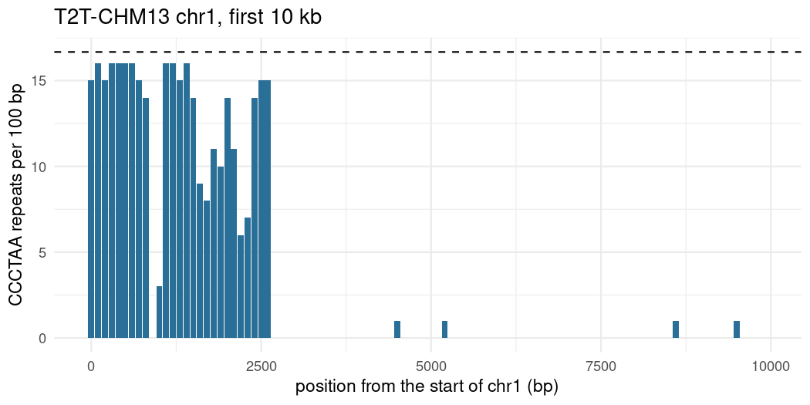
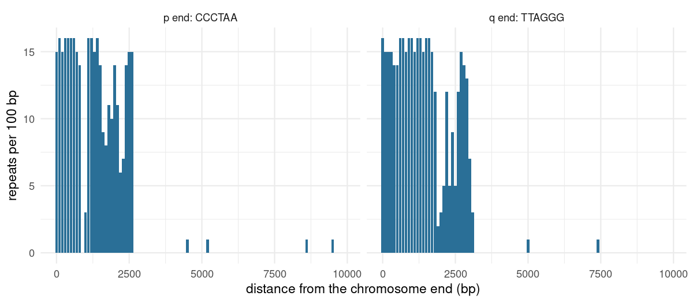

## Goal

By the end of this exercise you should be able to:

- read a FASTA file into one string, and count a motif in it with `str_count`;
- cut a sequence into **windows** with `str_sub` and count a motif in each, to see where along a sequence the motif is dense;
- use this to find where the telomere ends on a real human chromosome, and check the result against a shuffled control.

## Before you start

This page builds on the [Exercise](exercise.qmd), especially B9 (why one chromosome end reads CCCTAA and the other TTAGGG). You need the packages dplyr, ggplot2 and stringr.

Download the two data files into a folder `data/` next to your script or R Markdown file:

- [`data/chm13_chr1_pter_10kb.fa`](data/chm13_chr1_pter_10kb.fa): the first 10 kb of chromosome 1;
- [`data/chm13_chr1_qter_10kb.fa`](data/chm13_chr1_qter_10kb.fa): the last 10 kb of chromosome 1;
- [`data/README.md`](data/README.md) says where they come from.

Both are real sequence from the complete human genome **T2T-CHM13 v2.0** (UCSC genome `hs1`), downloaded on 2026-11-20 through the UCSC REST API, for example `https://api.genome.ucsc.edu/getData/sequence?genome=hs1;chrom=chr1;start=0;end=10000`. Each file is the top strand of the reference, read 5' → 3' from the p end of the chromosome towards the q end.

```r
library(dplyr)
library(ggplot2)
library(stringr)
```

## Tasks

You already know the stringr functions [`str_sub`](https://stringr.tidyverse.org/reference/str_sub.html) (cut out part of a string), [`str_count`](https://stringr.tidyverse.org/reference/str_count.html) (count matches of a pattern) and reading FASTA files by hand, from Parts 3 and 4. This unit's new idiom is **counting in windows**: make a table with one row per window start, cut out each window with `str_sub`, and count in each window with `str_count`. Because both functions work on whole vectors, one `mutate` does all the windows at once, without a loop.

**R1. (read the sequences)** Write a function `read_fasta_seq(path)` that reads a one-record FASTA file and returns the sequence as a single string. Read both files. Check the header line and the lengths, and print the first 60 bases of the p end and the last 60 bases of the q end.

```r
read_fasta_seq <- function(path) {
  lines <- readLines(path)
  paste(lines[-1], collapse = "")   # drop the header line, glue the rest together
}
pter <- read_fasta_seq("data/chm13_chr1_pter_10kb.fa")
qter <- read_fasta_seq("data/chm13_chr1_qter_10kb.fa")
readLines("data/chm13_chr1_pter_10kb.fa", n = 1)
nchar(pter)
nchar(qter)
str_sub(pter, 1, 60)
str_sub(qter, -60, -1)
```

**R2. (count the repeats)** Count TTAGGG and CCCTAA in each 10-kb sequence with `str_count`. Which motif dominates at which end? Explain with B9.

```r
tibble(end    = c("p end (start of chr1)", "q end (end of chr1)"),
       TTAGGG = str_count(c(pter, qter), "TTAGGG"),
       CCCTAA = str_count(c(pter, qter), "CCCTAA"))
```

**R3. (repeat density in windows)** Cut the p-end sequence into 100-bp windows, count CCCTAA in each, and plot the counts along the sequence. A window made only of telomere repeats holds 100/6 ≈ 16.7 repeats; draw that as a dashed line. Where does the telomere end? Use the rule "a window with at least 8 repeats is telomeric" and find the last such window.

```r
win <- 100
windows <- tibble(start = seq(1, nchar(pter), by = win)) |>
  mutate(window  = str_sub(pter, start, start + win - 1),
         repeats = str_count(window, "CCCTAA"))
windows |> select(start, repeats) |> slice(24:30)
windows |> filter(repeats >= 8) |> summarise(last_start = max(start))

ggplot(windows, aes(x = start, y = repeats)) +
  geom_col(fill = "#2a6f97", width = win * 0.9) +
  geom_hline(yintercept = win / 6, linetype = "dashed") +
  labs(x = "position from the start of chr1 (bp)",
       y = "CCCTAA repeats per 100 bp",
       title = "T2T-CHM13 chr1, first 10 kb") +
  theme_minimal()
```

**R4. (a gap inside the telomere)** Your plot has a dip to almost zero around position 900–1100, inside the telomere. Look at that stretch with `str_sub(pter, 880, 1000)`. Which slightly different repeat is there? Count it per window and in total.

```r
str_sub(pter, 880, 1000)
windows <- windows |> mutate(variant = str_count(window, "CCCTCA"))
windows |> select(start, repeats, variant) |> slice(8:12)
sum(windows$variant)
```

**R5. (both ends)** Put the window counting into a function `count_windows(seq, motif, win = 100)`. Use it for CCCTAA at the p end and TTAGGG at the q end, measure positions as **distance from the chromosome end**, and plot the two ends side by side with `facet_wrap`. Estimate how far each telomere reaches into the chromosome.

```r
count_windows <- function(seq, motif, win = 100) {
  tibble(start = seq(1, nchar(seq), by = win)) |>
    mutate(repeats = str_count(str_sub(seq, start, start + win - 1), motif))
}
both <- bind_rows(
  count_windows(pter, "CCCTAA") |> mutate(end = "p end: CCCTAA", from_end = start - 1),
  count_windows(qter, "TTAGGG") |> mutate(end = "q end: TTAGGG", from_end = nchar(qter) - (start + 99))
)
both |>
  group_by(end) |>
  summarise(telomere_windows = sum(repeats >= 8),
            reaches_bp       = max(from_end[repeats >= 8]) + 100)

ggplot(both, aes(x = from_end, y = repeats)) +
  geom_col(fill = "#2a6f97", width = 90) +
  facet_wrap(~ end) +
  labs(x = "distance from the chromosome end (bp)", y = "repeats per 100 bp") +
  theme_minimal()
```

**R6. (is it chance?)** How many times would CCCTAA turn up in 10 kb of random sequence? Shuffle the bases of the p-end sequence with `sample()` (this keeps the base composition but destroys the order) and count again. Compare with the rough expectation 10 000 / 4^6^, which assumes all four bases are equally common.

```r
set.seed(1)
bases <- str_split(pter, "")[[1]]
table(bases)
shuffled <- paste(sample(bases), collapse = "")
str_count(shuffled, "CCCTAA")
nchar(pter) / 4^6
```

## Solutions

::: {.callout-note collapse="true" title="Solutions: In R"}

All output below is from `Rscript --vanilla` run in the unit folder.

**R1.**

```
[1] ">hs1_chr1:1-10000 T2T-CHM13v2.0 (UCSC hs1) via api.genome.ucsc.edu getData/sequence, downloaded 2026-11-20"
[1] 10000
[1] 10000
[1] "CACCCTAAACCCTAACCCCTAACCCTAACCCTAACCCTAACCCTAACCCTAACCCCTAAA"
[1] "AGGGTTAGGGTTAGGGTTAGGGTTAGGGTTAGGGTTAGGGTTAGGGTTAGGGTTAGGGTT"
```

The p end starts with CCCTAA repeats (with a few irregular ones, CCCCTAA and CCCTAAA); the q end finishes with a clean run of TTAGGG.

**R2.**

```
# A tibble: 2 × 3
  end                   TTAGGG CCCTAA
  <chr>                  <int>  <int>
1 p end (start of chr1)      1    361
2 q end (end of chr1)      419      2
```

CCCTAA dominates at the p end and TTAGGG at the q end. They are the same telomere repeat seen from opposite strands: the reference strand runs **away from** the p end (so we read the C-rich strand there) and **towards** the q end (the G-rich strand). 361 repeats × 6 bp ≈ 2.2 kb and 419 × 6 ≈ 2.5 kb of perfect repeats.

**R3.**

```
# A tibble: 7 × 2
  start repeats
  <dbl>   <int>
1  2301       7
2  2401      14
3  2501      15
4  2601      15
5  2701       0
6  2801       0
7  2901       0
# A tibble: 1 × 1
  last_start
       <dbl>
1       2601
```

{width="80%" fig-align="center"}

The windows are almost full of repeats (14–16 of a possible 16.7) up to position 2700, then drop to zero at once. The p-end telomere of chromosome 1 in CHM13 is about **2.7 kb** long. Beyond it, only an occasional single CCCTAA appears, about what chance predicts (R6). The sharp edge is the boundary between the telomere and the subtelomeric sequence of the chromosome.

**R4.**

```
[1] "CCCTAACCCTCACCCTCACCCTCACCCTCACCCTCACCCTCACCCTCACCCTCACCCTCACCCTCACCCTCACCCTCACCCTCACCCTCACCCTCACCCTCACCCTCACCCTCACCCTCAC"
# A tibble: 5 × 3
  start repeats variant
  <dbl>   <int>   <int>
1   701      15       0
2   801      14       2
3   901       0      16
4  1001       3      12
5  1101      16       0
[1] 31
```

The gap is a run of the **variant repeat CCCTCA** (TGAGGG on the other strand), 31 copies in a row. Telomeres, especially their inner parts, contain such variant repeats. Our counting with an exact pattern misses them, which is why the window count dips. A window count is only as good as the pattern you search for.

**R5.**

```
# A tibble: 2 × 3
  end           telomere_windows reaches_bp
  <chr>                    <int>      <dbl>
1 p end: CCCTAA               23       2700
2 q end: TTAGGG               25       3000
```

{width="85%" fig-align="center"}

Both telomeres of chromosome 1 in this assembly are about **3 kb** (2.7 kb at the p end, 3.0 kb at the q end), with variant or degenerate repeats in their inner part. That is at the short end of the range for human cells (a few kb up to about 15 kb). The reference is one assembly from one cell line, CHM13, and telomere length differs between cells, chromosome ends, tissues and people, and shortens with age. A real cell's telomere length is a distribution, not a single number.

**R6.**

```
bases
   A    C    G    T
2999 3023 1722 2256
[1] 5
[1] 2.441406
```

In the shuffled sequence, CCCTAA appears **5** times in 10 kb; the rough expectation for random sequence with equal base frequencies is 10 000 / 4096 ≈ **2.4** (it is a bit higher here because this stretch is rich in C and A). The real sequence has **361** copies, almost all packed into the first 2.7 kb. The telomere is clearly not chance.
:::

## Where this leads

Counting a motif in windows is a general tool: the same code finds CpG islands, satellite arrays or restriction sites along a sequence. In **Rearrangements & aneuploidy** (next), you work with probabilities of aneuploid gametes and simulate how a translocation carrier's chromosomes segregate. In **Organelle inheritance** you return to `rbinom` and `replicate` to simulate the mitochondrial bottleneck.
