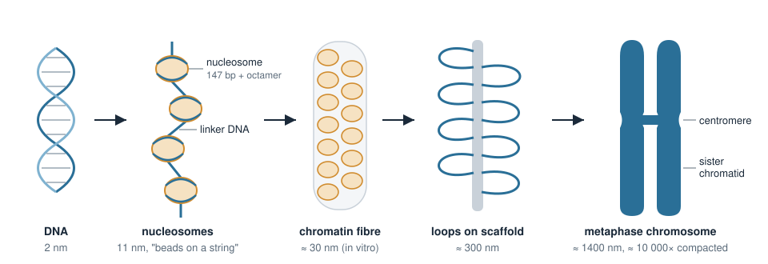
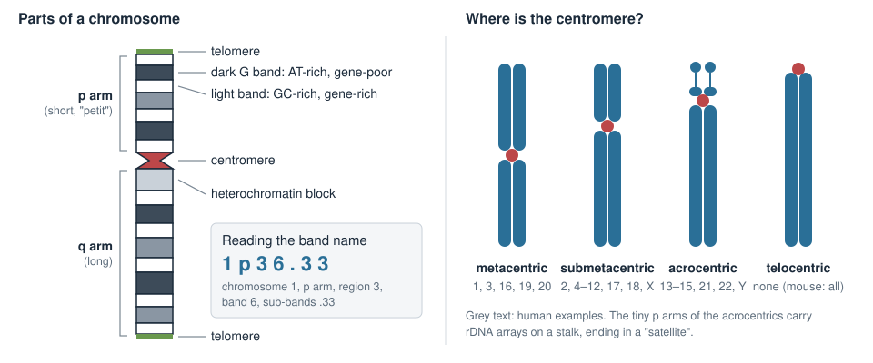
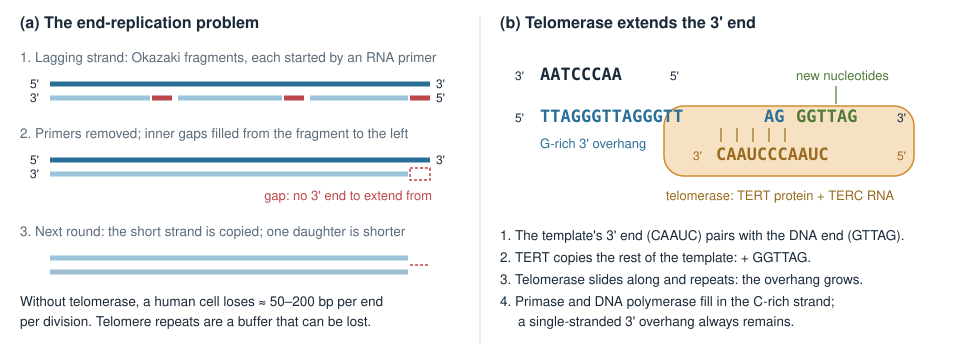
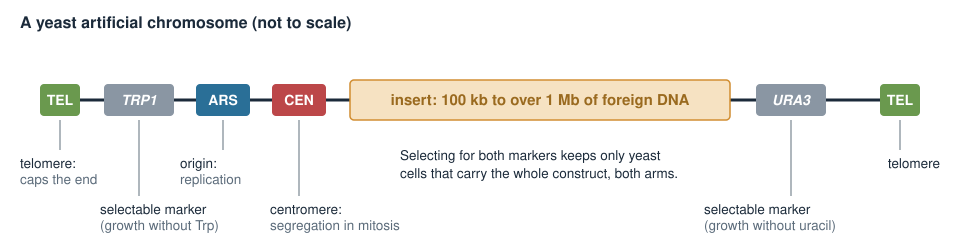
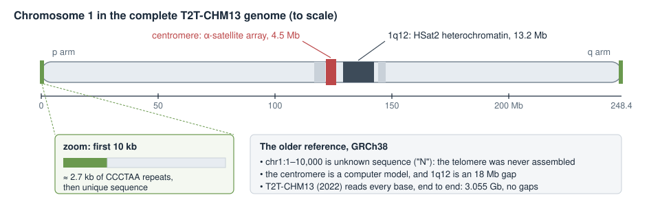

## About this lecture

In Part 2 a chromosome was a line with genes on it, and meiosis moved those lines around. This lecture looks at the **physical object**: a single, very long DNA molecule packed with proteins, with special sequences that let it be copied and segregated without falling apart.

- **Chromatin**: how 2 m of DNA fits in a nucleus; nucleosomes and higher-order packing.
- **Euchromatin and heterochromatin**, and what happens to a gene moved next to heterochromatin.
- **Banding and karyotypes**: how chromosomes are recognised and named (1p36.33, 47,XY,+21).
- **Centromeres**: the attachment point for the spindle.
- **Telomeres**: why linear ends are a problem, and how **telomerase** solves it.
- What a chromosome **needs**: yeast artificial chromosomes.
- The **telomere-to-telomere (T2T)** human genome, which finally sequenced centromeres and telomeres.

Book: Hartwell, *Genetics: From Genes to Genomes*, the eukaryotic chromosomes chapter.

::: notes
This opens Part 5, which follows the book's chapters on chromosomes in detail: the chromosome itself today, then rearrangements and aneuploidy, then bacterial genomes (a recap) and organelle genomes. Students know DNA replication from 5MO103, so the end-replication problem is a new application of something they know, not new biochemistry. Keep the questions genetic: what does a chromosome need in order to be inherited faithfully, and what goes wrong when it lacks it? Chromatin and gene regulation come back in Part 6 (eukaryotic regulation, X inactivation); today we only need the structural picture.
:::

## The packaging problem {.smaller}

| | Number |
|---|---:|
| Haploid human genome (T2T-CHM13) | 3.055 × 10^9^ bp |
| Diploid nucleus | ≈ 6.1 × 10^9^ bp in 46 molecules |
| Length of B-DNA | 0.34 nm per bp |
| Total DNA per diploid nucleus | ≈ 6.1 × 10^9^ × 0.34 nm ≈ **2 m** |
| Diameter of a nucleus | ≈ 5–10 µm |
| Chromosome 1 (248 Mb) as naked DNA | ≈ 8.4 cm |
| Chromosome 1 at metaphase | ≈ 10 µm |

The DNA must be compacted about **10 000-fold** at mitosis, yet stay readable for transcription and replication in interphase. Chromatin solves both problems.

::: notes
Do the arithmetic with the room. 248 million base pairs times 0.34 nanometres is 84 millimetres, about 8 centimetres of DNA for one chromosome, which at metaphase is around 10 micrometres long: roughly ten-thousand-fold compaction. The whole diploid set is about two metres in a nucleus a few micrometres across. The point is not the exact numbers but the scale: packaging cannot be a random tangle, because the cell has to find genes, copy every base exactly once per cycle, and separate 46 molecules without breaking them. Chromatin is DNA plus protein; by mass it is roughly half protein.
:::

## Nucleosomes: the first level of packing {.smaller}

{width="92%" fig-align="center"}

- A **nucleosome** core is **147 bp** of DNA wrapped about 1.7 turns around a **histone octamer**: two each of H2A, H2B, H3 and H4.
- **Linker DNA** (about 20–80 bp) joins the cores; histone **H1** binds where DNA enters and leaves. One nucleosome per ≈ 200 bp.
- Histones are small, very basic (Lys, Arg) proteins: their positive charge binds the negative phosphate backbone. They are among the most conserved proteins known.

::: notes
Walk the figure from left to right. The 11-nanometre fibre, beads on a string, is what you see when chromatin is spread out in low salt; nuclease digestion of chromatin gives DNA fragments in multiples of about 200 base pairs, which is how the nucleosome repeat was discovered. The compact 30-nanometre fibre is seen in vitro; in living cells, imaging suggests a less regular, irregularly folded fibre, so present it as "further folding" rather than a fixed structure. Loops anchored at their bases (by cohesin and condensin, which students will meet again) and condensation give the metaphase chromosome. Conservation: histone H4 differs at only two of its 102 amino acids between peas and cows, a classic example. The histone tails stick out of the core and carry chemical modifications; that is the hook for gene regulation in Part 6.
:::

## Euchromatin and heterochromatin {.smaller}

| | **Euchromatin** | **Heterochromatin** |
|---|---|---|
| Packing in interphase | open, decondensed | compact, stains darkly |
| Genes | gene-rich, mostly active | gene-poor, mostly silent |
| Replication | early in S phase | late in S phase |
| Typical histone marks | acetylation, H3K4 methylation | H3K9 methylation + HP1 protein |
| Examples | most of the chromosome arms | centromeres, telomeres, 1q12, 9q12, Yq12 |

- **Constitutive** heterochromatin is always condensed, in every cell: mostly **repetitive satellite DNA** around centromeres.
- **Facultative** heterochromatin is condensed in some cells only. The best-known example is the inactive X in female mammals (Part 6).

::: notes
The terms come from cytology in the 1920s: heterochromatin stayed dark through interphase while euchromatin faded. Today we define them by function and chemistry. Constitutive heterochromatin is built on repeats, mostly satellite DNA, that would be dangerous if they recombined freely: unequal crossing over between repeats makes deletions and duplications, which is the next unit. Facultative heterochromatin is the inactive X, the Barr body, which is a whole chromosome silenced in some cells and not others; X inactivation has its own demo in Part 6. The large heterochromatic blocks 1q12, 9q12 and 16q11.2 vary in size between healthy people; such variants are written for example 1qh+ on a karyotype and have no clinical effect.
:::

## Position effect: heterochromatin can spread {.smaller}

In *Drosophila*, the inversion *In(1)w^m4^* moves the eye-colour gene *white^+^* from the euchromatin of the X to a spot next to the centromeric heterochromatin.

- The *white^+^* allele is unchanged, but the eye is **mottled**: red and white patches.
- In some cells heterochromatin **spreads** into *white^+^* and silences it; in others it does not. Each choice is made early and inherited by the cell's descendants, so you see **clones** of red and white cells.
- This is **position-effect variegation (PEV)**: the phenotype depends on where a gene sits, not only on its sequence.

Genetic lessons: a **rearrangement** can change a phenotype without changing any gene, and chromatin state is passed from a cell to its daughters.

::: notes
PEV is the classic genetic evidence that heterochromatin is a state that can spread along the chromosome. Screens for mutations that suppress or enhance the mottling found the genes for heterochromatin proteins, among them HP1 (encoded by Su(var)2-5) and the H3K9 methyltransferase Su(var)3-9: genetics found the biochemistry. Point forward: inversions are one of the rearrangements in the next unit, and this is one way an inversion with no lost DNA can still have a phenotype. Variegation is also a clue for epigenetic inheritance, which is Part 6.
:::

## Chromosome anatomy and banding {.smaller}

{width="78%" fig-align="center"}

**G-banding**: metaphase chromosomes are treated with trypsin and stained with **Giemsa**. Each chromosome shows a fixed, reproducible pattern of dark and light bands, about 400–550 bands per haploid set in a routine karyotype, and up to about 850 at high resolution.

::: notes
The banding pattern is the chromosome's barcode; it is how cytogeneticists recognise each chromosome and spot a missing or extra piece. Dark G bands are AT-rich, gene-poor and replicate late; light bands are GC-rich and gene-rich. Band names are read from the centromere outward: chromosome, arm, region, band, then sub-bands after the dot. So 1p36.33 is near the tip of the short arm of chromosome 1, and 1q44 near the tip of the long arm. Students have already seen band names in NCBI Gene's Location field (for example CFTR at 7q31.2), and now they know what the name means. The right side of the figure classifies chromosomes by centromere position; the acrocentrics matter in the next unit, because two of them can fuse at their centromeres (a Robertsonian translocation) with almost no loss of genes.
:::

## The karyotype and its notation {.smaller}

A **karyotype** is the full set of chromosomes of a cell, arranged in pairs by size, centromere position and banding. It is written in a standard notation (ISCN):

| Karyotype | Meaning |
|---|---|
| 46,XX | normal female |
| 46,XY | normal male |
| 47,XY,+21 | male with trisomy 21 (Down syndrome) |
| 45,X | one X only (Turner syndrome) |
| 46,XX,del(5)(p15.2) | deletion in 5p, from band 5p15.2 to the end |
| 46,XY,t(9;22)(q34;q11.2) | reciprocal translocation between 9q34 and 22q11.2 |

The format is: **total chromosome number, sex chromosomes, then any abnormality** with its breakpoints.

::: notes
A karyotype is made from cells arrested in metaphase, usually blood lymphocytes stimulated to divide, or amniotic or chorionic villus cells before birth. Read each row aloud. The first number is always the chromosome count. Every row from the third down is the subject of the next unit: trisomy 21, monosomy X, a terminal deletion (5p15.2 deletion causes cri-du-chat syndrome), and the translocation between chromosomes 9 and 22 that makes the Philadelphia chromosome in chronic myeloid leukaemia. The resolution of a G-banded karyotype is a few megabases; smaller changes need molecular methods such as microarrays or sequencing, which is how the copy-number syndromes in the next unit are found today.
:::

## Centromeres {.smaller}

The **centromere** is where the **kinetochore** assembles and spindle microtubules attach. Without one, a chromosome is lost at cell division.

| | Budding yeast | Humans |
|---|---|---|
| Type | **point** centromere | **regional** centromere |
| DNA | ≈ 125 bp, three elements (CDEI–III) | **α-satellite**: 171-bp repeats in arrays of **several Mb** |
| Defined by | the DNA sequence | mainly by chromatin: the histone variant **CENP-A** |

- **CENP-A** replaces H3 in centromeric nucleosomes and marks the centromere **epigenetically**. Rare **neocentromeres** form on non-satellite DNA, and α-satellite without CENP-A does not work.
- A chromosome with **two** centromeres (dicentric) is torn apart at anaphase; one with **none** (acentric) is lost.

::: notes
Yeast is the exception that made centromeres tractable: its centromere is short enough to clone, and cloning it was how artificial chromosomes became possible (later today). Human centromeres are huge arrays of a 171-base-pair monomer, arranged in higher-order repeats that are nearly identical over megabases, which is why they could not be assembled until recently. The key concept is epigenetic specification: what makes a centromere a centromere is the CENP-A chromatin on it, and CENP-A is copied to the daughter chromosomes. Dicentric and acentric chromosomes come back in the next unit: a crossover inside a paracentric inversion loop makes exactly one of each. Some organisms, such as C. elegans, have holocentric chromosomes with kinetochores along their whole length.
:::

## Telomeres: protecting the ends {.smaller}

A **telomere** is the end of a linear chromosome: a long array of a short repeat, plus proteins.

- Vertebrates: **5'-TTAGGG-3'** repeated, a few kb up to about 15 kb in human cells. *Tetrahymena*: TTGGGG. *Arabidopsis*: TTTAGGG.
- The G-rich strand runs 5' → 3' towards the end and sticks out as a single-stranded **3' overhang** (≈ 50–300 nt).
- The overhang tucks back into the double helix to form a **t-loop**, held by a protein complex called **shelterin**.

Why ends need protecting: a cell treats a bare DNA end as a **double-strand break**. Unprotected ends get degraded or **fused** to each other, making dicentric chromosomes that break again at the next division.

::: notes
Telomeres solve two problems; this slide is the first, end protection. Hiding the end in a t-loop and coating it with shelterin stops the DNA damage response from "repairing" the end by joining it to another chromosome. Barbara McClintock saw this in maize in the 1930s and 40s: broken chromosome ends fused and went through breakage-fusion-bridge cycles, while natural ends did not. The repeat is remarkably conserved: humans and other vertebrates share TTAGGG, and many other organisms have similar G-rich repeats. In the reference genome, the chromosome's top strand at the p end reads CCCTAA, because it is the C-rich strand that runs 5' to 3' away from the p-terminal end; the R exercise shows this directly.
:::

## The end-replication problem {.smaller}

{width="94%" fig-align="center"}

DNA polymerase only **extends** an existing 3' end, and needs an RNA **primer** to start. On the lagging strand, the last primer at the very end cannot be replaced by DNA: there is no 3' end upstream of it to extend.

::: notes
This is replication from 5MO103, followed to the very end of the molecule. Panel (a): the parental strand whose 3' end is at the chromosome end is copied discontinuously. Each Okazaki fragment starts with an RNA primer; inner primers are removed and the gap is filled by extending the fragment to the left. The last primer has nothing to its right to extend from, so after removal its gap stays open, and the new strand is shorter. In the next round, that shorter strand is a template, so one of the daughter molecules is shorter. In practice, nucleases also resect the ends to make the 3' overhang, which adds to the loss. Panel (b) is the solution and the next slide. The problem was pointed out independently by Olovnikov and by Watson in the early 1970s.
:::

## Telomerase {.smaller}

**Telomerase** is a **reverse transcriptase** that carries its own RNA template.

- Two core parts: the protein **TERT** (telomerase reverse transcriptase, gene *TERT* on 5p15.33) and the RNA **TERC** (also called hTR, gene *TERC* on 3q26.2).
- The template in human TERC reads 3'-**CAAUCCCAAUC**-5'. It pairs with the 3' end of the overhang, and TERT adds TTAGGG units by copying it.
- Afterwards the ordinary replication machinery fills in the C-rich strand.

Discovered in the ciliate *Tetrahymena* by **Carol Greider and Elizabeth Blackburn** (1985). Changing bases in the RNA template changed the repeats added, which proved the RNA is the template. Nobel Prize 2009, with Jack Szostak.

::: notes
Telomerase is the reverse of the central dogma in a small way: RNA to DNA, like a retroviral reverse transcriptase, and TERT is in fact related to those enzymes. Ciliates were the right organism because their macronucleus has many thousands of small chromosomes (including thousands of copies of a tiny rDNA minichromosome) and so a huge number of telomeres. The template experiment is a lovely piece of genetics: Yu, Blackburn and colleagues mutated the template in Tetrahymena and the cells' telomeres acquired the mutant repeat. The exercise has a by-hand version. Both genes are on chromosomes you can look up in the Find it part; note that TERT itself sits only about 1.3 Mb from the end of chromosome 5.
:::

## Telomeres, ageing and cancer {.smaller}

| Cell type | Telomerase | Telomeres |
|---|---|---|
| Germline, early embryo | active | maintained |
| Stem and progenitor cells | low to moderate | shorten slowly |
| Most somatic cells | off | **shorten each division** |
| ≈ 85–90% of cancers | **re-activated** | maintained |
| Most other cancers | off; **ALT** (recombination) | maintained |

- Cultured human fibroblasts stop dividing after about 40–60 divisions (the **Hayflick limit**): short telomeres trigger **senescence**. Short telomeres act as a counter of cell divisions.
- Turning telomerase back on (often via mutations in the *TERT* promoter) lets cancer cells divide indefinitely.
- Loss-of-function mutations in telomerase genes cause **telomere biology disorders**, such as dyskeratosis congenita: bone-marrow failure and other tissues that need many divisions.

::: notes
The table summarises where telomerase is on. Replicative senescence is a tumour-suppressor mechanism: a cell that has divided too many times stops. Cancer cells must escape it, and most do so by reactivating telomerase; TERT promoter mutations are among the most common non-coding mutations in cancers such as melanoma and glioblastoma. The minority that do not use telomerase maintain telomeres by recombination between telomeres, called ALT, alternative lengthening of telomeres. The genetic diseases go the other way: patients inherit a faulty telomerase component and their highly proliferative tissues fail. Dyskeratosis congenita can be X-linked (DKC1, a telomerase-associated protein), autosomal dominant (TERC, TERT) or autosomal recessive: a good example of one phenotype with several genes and modes of inheritance. Students look it up in the exercise. Be careful with "telomeres explain ageing": short telomeres correlate with age, but ageing has many causes.
:::

## What does a chromosome need? {.smaller}

In the early 1980s, yeast geneticists tested which DNA elements a molecule needs to behave like a chromosome. They put each construct into yeast cells and measured how stably it was inherited:

| Construct | Behaviour in yeast |
|---|---|
| Circular plasmid, selectable marker only | not maintained: no replication |
| + **ARS** (origin of replication) | replicates, but is **lost** from many cells at each division |
| + ARS + **CEN** (centromere) | stable, about one copy per cell, segregates like a chromosome |
| Linear, ARS + CEN, **no telomeres** | degraded from its ends |
| Linear, ARS + CEN + **TEL** at both ends | a **minichromosome**; more stable the longer it is |

Three elements make a chromosome: an **origin**, a **centromere** and two **telomeres**.

::: notes
This is the genetic definition of a chromosome, found by building one. Each element was cloned by its function: ARS by its ability to make a plasmid replicate, CEN (Clarke and Carbon, 1980) by making a plasmid segregate stably, and TEL by Szostak and Blackburn, who showed that Tetrahymena telomere ends stabilise a linear plasmid in yeast, the first hint that telomere function is conserved. The last row has a surprise: short linear minichromosomes still segregate poorly, and stability improves with length. That observation made people try very large inserts, which gave the yeast artificial chromosome.
:::

## Yeast artificial chromosomes {.smaller}

{width="88%" fig-align="center"}

- A **YAC** (Burke, Carle and Olson, 1987) carries **100 kb to over 1 Mb** of foreign DNA, far more than a plasmid (≈ 10 kb) or a phage (≈ 20–45 kb).
- YACs were used to build the first physical maps of human chromosomes in the 1990s. Their weakness: inserts were often **chimeric** (two unrelated pieces joined) or rearranged.
- The Human Genome Project then switched mostly to **BACs**, bacterial artificial chromosomes of 100–300 kb based on the *E. coli* **F plasmid** (see the bacterial genetics recap, later in this part).

::: notes
The YAC puts the previous slide into practice: the vector is grown as a circular plasmid in E. coli, cut to expose the telomere sequences and the cloning site, and the two arms are ligated to a large fragment of genomic DNA. Selecting for both yeast markers, TRP1 on one arm and URA3 on the other, keeps only cells that carry a complete construct with both arms. The capacity was the selling point: whole human genes such as DMD, over 2 Mb, could be studied in a few clones. The drawback was instability and chimerism. BACs, built on the F factor that students know from conjugation, are smaller but much more stable, and they became the workhorses of the clone-by-clone human genome sequence. Artificial chromosomes are still used to build synthetic yeast chromosomes and to carry large human genes into mice.
:::

## Complete at last: the T2T human genome {.smaller}

{width="88%" fig-align="center"}

The reference genome from 2001–2013 (GRCh38) left about **8%** unsequenced: centromeres, big satellite blocks, the short arms of the acrocentrics, and the telomeres. In 2022 the **Telomere-to-Telomere (T2T) Consortium** published **T2T-CHM13**: 3.055 Gb with **no gaps**, adding nearly 200 Mb of sequence (Nurk et al., *Science* 2022).

::: notes
Why could the repeats not be assembled before? Short sequencing reads, a few hundred bases, cannot be placed inside a multi-megabase array of nearly identical 171-base-pair repeats. T2T used long reads: PacBio HiFi reads of about 20 kb that are very accurate, and Oxford Nanopore reads of more than 100 kb. CHM13 is a cell line from a complete hydatidiform mole, which arises when an egg without a nucleus is fertilised by one sperm whose genome then doubles. So the genome is almost entirely homozygous, with only one version of each chromosome to assemble. A later version, CHM13 v2.0, added a Y chromosome from another person. The figure is drawn to scale from the UCSC browser's CenSat track for this assembly: the active centromere of chromosome 1 is a 4.5 Mb alpha-satellite array, and the 1q12 heterochromatin block is 13 Mb of HSat2 satellite, which GRCh38 left as an 18 Mb gap. The new sequence includes 99 predicted protein-coding genes, many in segmental duplications. Students explore this assembly in the Find it and R tasks.
:::

## Try it: read a telomere {.smaller}

The first 60 bases of chromosome 1 in T2T-CHM13 (UCSC genome `hs1`), as stored in the reference:

```
CACCCTAAACCCTAACCCCTAACCCTAACCCTAACCCTAACCCTAACCCTAACCCCTAAA
```

and the last 60 bases of the same chromosome:

```
AGGGTTAGGGTTAGGGTTAGGGTTAGGGTTAGGGTTAGGGTTAGGGTTAGGGTTAGGGTT
```

- Find the repeat in each. Why does one end read **CCCTAA** and the other **TTAGGG**?
- Spot the slight irregularities at the start (CCCCTAA, CCCTAAA). Real telomeres are not perfect.
- In the R exercise you count the repeats along the first and last 10 kb and see where the telomere ends.

::: notes
Give them a minute. The reference stores one strand, the top strand, read 5' to 3' from the p end to the q end. At the q end, the top strand runs 5' to 3' towards the end, so it is the G-rich strand: TTAGGG. At the p end, the strand that runs towards the end is the bottom strand, which is G-rich, so the top strand there is its reverse complement: CCCTAA. Same telomere, read from the other side. The irregular repeats are real: telomeres contain occasional variant repeats, especially near the junction with the rest of the chromosome. These sequences were downloaded from the UCSC REST API for the hs1 assembly on 2026-11-20. In the older GRCh38 reference, the first 10 kb of chromosome 1 are all N.
:::

## Summary {.smaller}

| Concept | Key fact |
|---|---|
| Nucleosome | 147 bp around a histone octamer (H2A, H2B, H3, H4 ×2); one per ≈ 200 bp |
| Packing | ≈ 2 m of DNA per diploid nucleus; ≈ 10 000-fold compaction at metaphase |
| Heterochromatin | compact, gene-poor, late-replicating; constitutive (satellites) or facultative (inactive X) |
| Position-effect variegation | a gene moved next to heterochromatin is silenced in some cells only |
| G-banding, karyotype | reproducible band pattern; names like 1p36.33; notation 47,XY,+21 |
| Centromere | kinetochore site; yeast 125 bp; human Mb arrays of 171-bp α-satellite; marked by CENP-A |
| Telomere | TTAGGG repeats with a 3' overhang and shelterin; hides the end from DNA repair |
| End-replication problem | the last lagging-strand primer cannot be replaced: ends shorten each division |
| Telomerase | TERT + TERC RNA template; active in germline and most cancers |
| Minimal chromosome | origin (ARS) + centromere (CEN) + two telomeres (TEL): the YAC |
| T2T-CHM13 | first gapless human genome, 3.055 Gb, 2022 |

::: notes
The summary is the revision sheet. If they keep one idea: a chromosome is inherited faithfully only if it can be replicated (origins), segregated (one centromere) and kept whole (two telomeres). Each of these comes back in the next unit as something that can go wrong: dicentric and acentric fragments from inversions, fusions at centromeres in Robertsonian translocations, and lost or extra chromosomes in aneuploidy.
:::

## Where this leads

- **Next: Rearrangements & aneuploidy.** Deletions, duplications, inversions and translocations change the structure of chromosomes; nondisjunction changes their number. You will meet dicentric and acentric chromosomes, Robertsonian fusions of acrocentrics, and the 9;22 translocation from the karyotype slide.
- **Bacterial genetics (recap).** A circular chromosome has no end-replication problem; the F plasmid behind BACs is the agent of conjugation.
- **Organelle inheritance.** Mitochondria and chloroplasts have their own small, circular chromosomes.
- **Part 6: Eukaryotic regulation.** Histone modifications, chromatin and X inactivation as gene regulation.

::: notes
Point forward. The exercise has pen-and-paper problems on packing arithmetic, band names, the telomerase template and artificial chromosomes, then database tasks in NCBI Gene, the UCSC browser and MedGen. The R part reads the first and last 10 kb of chromosome 1 from the T2T genome and counts telomere repeats along them with str_count.
:::
