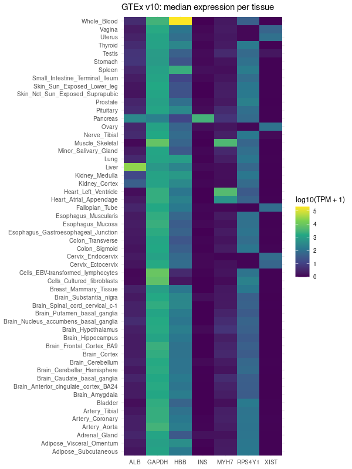
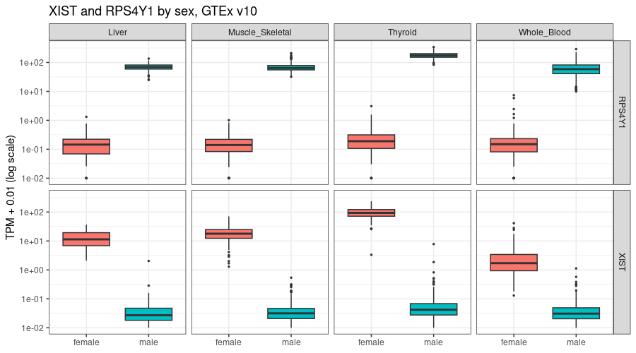

## Goal

By the end of this exercise you should be able to:

- turn a **wide** table (one column per gene) into a **long** one with `pivot_longer()`, and say why ggplot2 and dplyr want long data;
- summarise expression per gene, tissue and sex with **`group_by()` and `summarise()`**;
- see how a **pooled median** over a mixed group can hide a whole sex, using *XIST* in GTEx.

## Before you start

This page builds on the by-hand part of the [Exercise](exercise.qmd), so do that first. You need the packages readr, dplyr, tidyr and ggplot2. Download both files and save them in a `data/` folder of your R project:

- [gtex_median_tpm.csv](data/gtex_median_tpm.csv): median expression (TPM, transcripts per million) of seven genes in each of the 54 GTEx tissues, all samples pooled;
- [gtex_sex_tpm.csv](data/gtex_sex_tpm.csv): one row per sample, the TPM of *XIST* and of the Y-linked gene *RPS4Y1* in four tissues, with the donor's sex.

Both are real data from the **GTEx Portal API**, release **GTEx v10** (GENCODE v39), downloaded on 2026-11-20; see the [data README](data/README.md) for the exact queries. The first lines of each file, starting with `#`, record the source; `read_csv(..., comment = "#")` skips them.

```r
library(readr)
library(dplyr)
library(tidyr)
library(ggplot2)
```

## Tasks

New idiom today: **long vs wide**, and **grouped summaries**. A *wide* table has one column per gene. A *long* table has one row per measurement, with a column saying which gene it is. [`pivot_longer()`](https://tidyr.tidyverse.org/reference/pivot_longer.html) turns wide into long; [`pivot_wider()`](https://tidyr.tidyverse.org/reference/pivot_wider.html) goes back. Long tables are what [`group_by()`](https://dplyr.tidyverse.org/reference/group_by.html) + [`summarise()`](https://dplyr.tidyverse.org/reference/summarise.html) and ggplot2 work with: "for each gene", "colour by gene" and "facet by tissue" all need the gene as a **column**, not as column names.

The genes: *GAPDH* (a glycolysis enzyme, expressed everywhere), *ALB* (albumin, liver), *INS* (insulin, pancreatic β cells), *HBB* (β-globin, red blood cells), *MYH7* (β-myosin heavy chain, heart and slow skeletal muscle), *XIST* (X-inactivation lncRNA) and *RPS4Y1* (a ribosomal protein gene on the Y chromosome).

**R1. (wide to long)** Read `data/gtex_median_tpm.csv`. How many rows and columns does it have? Use `pivot_longer()` to make a long table `med_long` with columns `tissue`, `gene` and `tpm`. How many rows does it have now, and why?

```r
med <- read_csv("data/gtex_median_tpm.csv", comment = "#", show_col_types = FALSE)
med_long <- med |>
  pivot_longer(-tissue, names_to = "gene", values_to = "tpm")
```

**R2. (where is each gene on?)** For each gene, find the tissue with the highest median ([`slice_max()`](https://dplyr.tidyverse.org/reference/slice.html) after `group_by(gene)`). Then summarise each gene over tissues: the median of the medians, the maximum, and the number of tissues above 10 TPM. Which genes are **tissue-specific** and which are expressed nearly everywhere? Anything surprising?

**R3. (a heat map)** Plot `med_long` as a heat map with `geom_tile()`: genes on the x axis, tissues on the y axis, fill = `log10(tpm + 1)`. Why do we take the log, and why add 1?

**R4. (*XIST* and *RPS4Y1*)** Filter `med_long` to *XIST* and *RPS4Y1*, use `pivot_wider()` to put the two genes side by side, and sort by *XIST*. Which tissues top the list? *XIST* is expressed from the inactive X in every female cell, so why is its median close to 0 in, say, skeletal muscle?

**R5. (summarise by sex)** Read `data/gtex_sex_tpm.csv`. With `group_by(tissue, gene, sex)` and `summarise()`, compute for each group the number of samples, the median TPM and the fraction of samples above 1 TPM. Then compute the **pooled** median per tissue and gene (ignoring sex), with the number of female and male samples. Explain the pooled *XIST* median.

**R6. (plot by sex)** Make box plots of TPM by sex, with `facet_grid(gene ~ tissue)` and a log y axis (`scale_y_log10()`; add 0.01 so that zeros can be plotted). Are there samples that break the pattern? Suggest possible explanations, and say what you cannot conclude from these data.

## Solutions

::: {.callout-note collapse="true" title="Solutions: In R"}

**R1.** The wide table has 54 rows (tissues) and 8 columns (`tissue` + 7 genes). The long table has 54 × 7 = **378** rows: one per tissue–gene pair.

```r
med
```
```
# A tibble: 54 × 8
   tissue                             GAPDH   ALB   INS   HBB  MYH7  XIST RPS4Y1
   <chr>                              <dbl> <dbl> <dbl> <dbl> <dbl> <dbl>  <dbl>
 1 Adipose_Subcutaneous               1159. 0.751 0     140.  1.10  0.059  136.
 2 Adipose_Visceral_Omentum            975. 1.14  0.087 416.  1.03  0.044  127.
 3 Adrenal_Gland                      1247. 2.04  0.555  29.5 0.561 0.049  117.
 4 Artery_Aorta                       2839. 1.42  0.113 173.  1.20  0.072  112.
 5 Artery_Coronary                    2124. 1.40  0.08  134.  1.55  0.078  117.
 6 Artery_Tibial                      2124. 0.775 0     101.  1.42  0.059  110.
 7 Bladder                            1938. 0.376 0      50.1 0.43  0.05   145.
 8 Brain_Amygdala                     1400. 1.12  0     172.  1.31  0.015   34.6
 9 Brain_Anterior_cingulate_cortex_B… 1681. 1.08  0     113.  1.82  0.017   38.6
10 Brain_Caudate_basal_ganglia        1470. 1.93  0.014 146.  2.98  0.018   39.3
# ℹ 44 more rows
```
```r
med_long
```
```
# A tibble: 378 × 3
   tissue                   gene        tpm
   <chr>                    <chr>     <dbl>
 1 Adipose_Subcutaneous     GAPDH  1159.
 2 Adipose_Subcutaneous     ALB       0.751
 3 Adipose_Subcutaneous     INS       0
 4 Adipose_Subcutaneous     HBB     140.
 5 Adipose_Subcutaneous     MYH7      1.10
 6 Adipose_Subcutaneous     XIST      0.059
 7 Adipose_Subcutaneous     RPS4Y1  136.
 8 Adipose_Visceral_Omentum GAPDH   975.
 9 Adipose_Visceral_Omentum ALB       1.14
10 Adipose_Visceral_Omentum INS       0.087
# ℹ 368 more rows
```

**R2.**

```r
med_long |>
  group_by(gene) |>
  slice_max(tpm, n = 1) |>
  arrange(desc(tpm))
```
```
# A tibble: 7 × 3
# Groups:   gene [7]
  tissue                            gene       tpm
  <chr>                             <chr>    <dbl>
1 Whole_Blood                       HBB    207194
2 Liver                             ALB     25340.
3 Cells_EBV-transformed_lymphocytes GAPDH    8887.
4 Heart_Left_Ventricle              MYH7     4527.
5 Pancreas                          INS      2899.
6 Cells_Cultured_fibroblasts        RPS4Y1    207.
7 Ovary                             XIST      105.
```
```r
med_long |>
  group_by(gene) |>
  summarise(n_tissues = n(), median_over_tissues = median(tpm), max = max(tpm),
            n_above_10 = sum(tpm > 10))
```
```
# A tibble: 7 × 5
  gene   n_tissues median_over_tissues     max n_above_10
  <chr>      <int>               <dbl>   <dbl>      <int>
1 ALB           54              1.22    25340.          4
2 GAPDH         54           1482.       8887.         54
3 HBB           54            111.     207194          52
4 INS           54              0.0835   2899.          1
5 MYH7          54              1.07     4527.          3
6 RPS4Y1        54             76.1       207.         48
7 XIST          54              0.05      105.          6
```

Each gene peaks where you expect: albumin in liver (25 340 TPM, that is 2.5 % of all transcripts), insulin only in pancreas, *MYH7* in heart (and skeletal muscle), β-globin in whole blood (207 194 TPM: about a fifth of all blood mRNA). *GAPDH* is above 10 TPM in **all 54** tissues: a housekeeping gene. *ALB*, *INS* and *MYH7* are **tissue-specific**: above 10 TPM in 1–4 tissues. Surprising: *HBB* is above 10 TPM in 52 tissues. That is not regulation: every tissue sample contains some blood. *XIST* is above 10 TPM in only 6 tissues (see R4).

**R3.**

```r
ggplot(med_long, aes(gene, tissue, fill = log10(tpm + 1))) +
  geom_tile() +
  scale_fill_viridis_c(name = "log10(TPM + 1)") +
  labs(x = NULL, y = NULL, title = "GTEx v10: median expression per tissue") +
  theme_minimal(base_size = 9)
```

{width="60%" fig-align="center"}

Expression spans more than five orders of magnitude (0 to 207 194 TPM), so on a linear scale every gene except *HBB* in blood would look the same. The log compresses the range; adding 1 keeps zeros finite (log10(0 + 1) = 0). The bright single cells are the tissue-specific genes (*ALB* in liver, *INS* in pancreas, *MYH7* in heart and muscle); *GAPDH* is bright everywhere; *XIST* is dark except in a few rows, and *RPS4Y1* is bright except in those same rows.

**R4.**

```r
med_long |>
  filter(gene %in% c("XIST", "RPS4Y1")) |>
  pivot_wider(names_from = gene, values_from = tpm) |>
  arrange(desc(XIST)) |>
  print(n = 10)
```
```
# A tibble: 54 × 3
   tissue                  XIST  RPS4Y1
   <chr>                  <dbl>   <dbl>
 1 Ovary                105.      0.177
 2 Uterus                93.3     0.19
 3 Fallopian_Tube        82.5     0.084
 4 Cervix_Endocervix     81.1     0.125
 5 Cervix_Ectocervix     55.4     0.08
 6 Vagina                54.2     0.182
 7 Testis                 0.776  66.9
 8 Nerve_Tibial           0.249 140.
 9 Colon_Sigmoid          0.096 123.
10 Esophagus_Muscularis   0.079 101.
# ℹ 44 more rows
```

The six top tissues are the **female-only** tissues: only women donate them, so the median sample is female: high *XIST*, essentially no *RPS4Y1*. In all other tissues the median is close to 0 because **most samples come from men** (R5): the middle sample of the sorted values is a male sample. The median of a mixture describes the larger group and hides the smaller one. (Testis, 0.78 TPM, is slightly higher than other male tissues; *XIST* is expressed at a low level in male germ cells.)

**R5.**

```r
sex <- read_csv("data/gtex_sex_tpm.csv", comment = "#", show_col_types = FALSE)
sex |>
  group_by(tissue, gene, sex) |>
  summarise(n = n(), median_tpm = median(tpm), frac_above_1 = mean(tpm > 1), .groups = "drop") |>
  print(n = 20)
```
```
# A tibble: 16 × 6
   tissue          gene   sex        n median_tpm frac_above_1
   <chr>           <chr>  <chr>  <int>      <dbl>        <dbl>
 1 Liver           RPS4Y1 female    78     0.135       0.0128
 2 Liver           RPS4Y1 male     184    69.5         1
 3 Liver           XIST   female    78    11.4         1
 4 Liver           XIST   male     184     0.0170      0.00543
 5 Muscle_Skeletal RPS4Y1 female   266     0.130       0
 6 Muscle_Skeletal RPS4Y1 male     552    64.5         1
 7 Muscle_Skeletal XIST   female   266    17.9         1
 8 Muscle_Skeletal XIST   male     552     0.0215      0
 9 Thyroid         RPS4Y1 female   225     0.180       0.0133
10 Thyroid         RPS4Y1 male     459   174.          1
11 Thyroid         XIST   female   225    93.9         1
12 Thyroid         XIST   male     459     0.0319      0.00436
13 Whole_Blood     RPS4Y1 female   262     0.140       0.0191
14 Whole_Blood     RPS4Y1 male     541    58.9         1
15 Whole_Blood     XIST   female   262     1.70        0.714
16 Whole_Blood     XIST   male     541     0.0208      0.00185
```
```r
sex |>
  group_by(tissue, gene) |>
  summarise(pooled_median = median(tpm), n_female = sum(sex == "female"),
            n_male = sum(sex == "male"), .groups = "drop")
```
```
# A tibble: 8 × 5
  tissue          gene   pooled_median n_female n_male
  <chr>           <chr>          <dbl>    <int>  <int>
1 Liver           RPS4Y1       60.4          78    184
2 Liver           XIST          0.0337       78    184
3 Muscle_Skeletal RPS4Y1       55.8         266    552
4 Muscle_Skeletal XIST          0.0360      266    552
5 Thyroid         RPS4Y1      152.          225    459
6 Thyroid         XIST          0.0582      225    459
7 Whole_Blood     RPS4Y1       41.5         262    541
8 Whole_Blood     XIST          0.0376      262    541
```

Split by sex, *XIST* is expressed in women in every tissue (median 11–94 TPM in liver, muscle and thyroid; 100 % of female samples above 1 TPM) and absent in men (median ≈ 0.02 TPM). *RPS4Y1* is the mirror image. About **two thirds of the samples are male** in each tissue (e.g. 552 of 818 in muscle), so the pooled median falls among the male samples: 0.036 TPM for *XIST* in muscle, the number in `gtex_median_tpm.csv`. Whole blood is the odd one out: female *XIST* is much lower (median 1.7 TPM; 71 % of samples above 1 TPM), but still about 80 times the male level. Blood RNA comes mostly from a few cell types, so tissue composition matters as well as sex.

**R6.**

```r
ggplot(sex, aes(sex, tpm + 0.01, fill = sex)) +
  geom_boxplot(outlier.size = 0.5) +
  scale_y_log10() +
  facet_grid(gene ~ tissue) +
  labs(x = NULL, y = "TPM + 0.01 (log scale)", title = "XIST and RPS4Y1 by sex, GTEx v10") +
  theme_bw() + theme(legend.position = "none")
```

{width="90%" fig-align="center"}

The two sexes are separated by about three orders of magnitude for both genes. A few samples sit apart: some female samples have *RPS4Y1* between 1 and 8 TPM, and one male sample has *XIST* above 5 TPM:

```r
sex |>
  filter(gene == "XIST") |>
  count(sex, xist_high = tpm > 5)
```
```
# A tibble: 4 × 3
  sex    xist_high     n
  <chr>  <lgl>     <int>
1 female FALSE       237
2 female TRUE        594
3 male   FALSE      1735
4 male   TRUE          1
```

Possible explanations for odd samples: a sample mix-up or contamination between samples; a donor with an unusual sex-chromosome karyotype (a 47,XXY man expresses *XIST*; B6 of the exercise); or, for low female values, a tissue sample with little RNA from the relevant cells. What we **cannot** conclude: anything about an individual donor. The endpoint gives no sample IDs, so we cannot even check whether the same sample is odd for both genes, and GTEx does not report karyotypes. (The many female samples below 5 TPM are mostly whole blood; see R5.)
:::

## Where this leads

`group_by()` + `summarise()` and `pivot_longer()` are the workhorses for any table of measurements. In **RNA-mediated regulation** you go back to sequences: you find microRNA seed matches in a 3′UTR with `str_locate_all()` and plot where they are.
