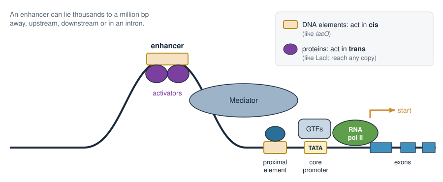
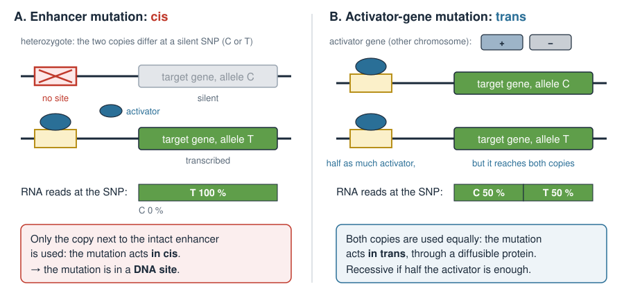
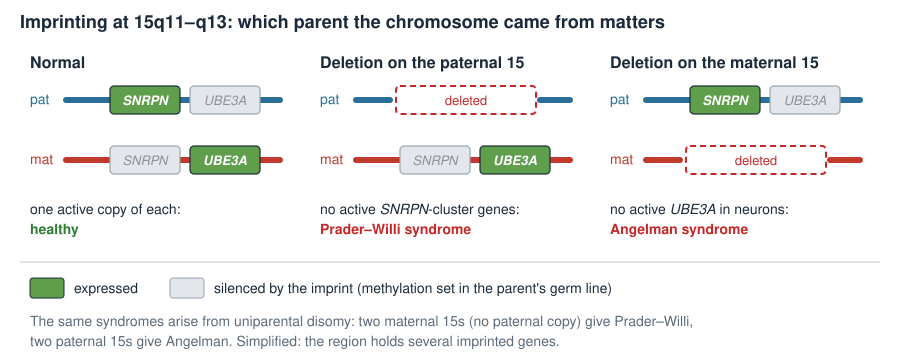
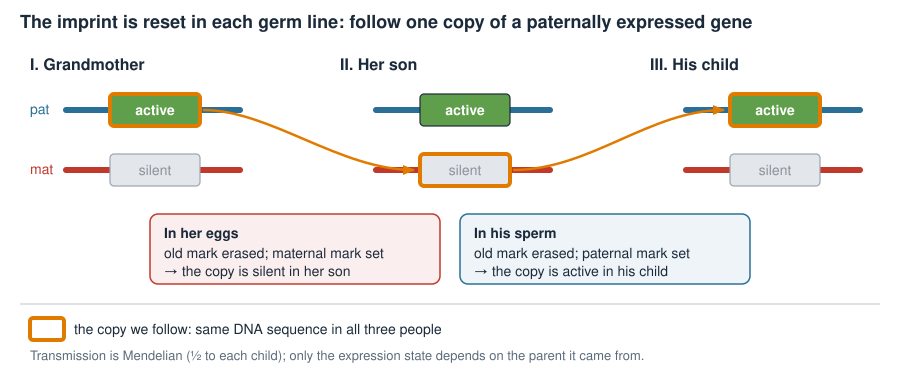
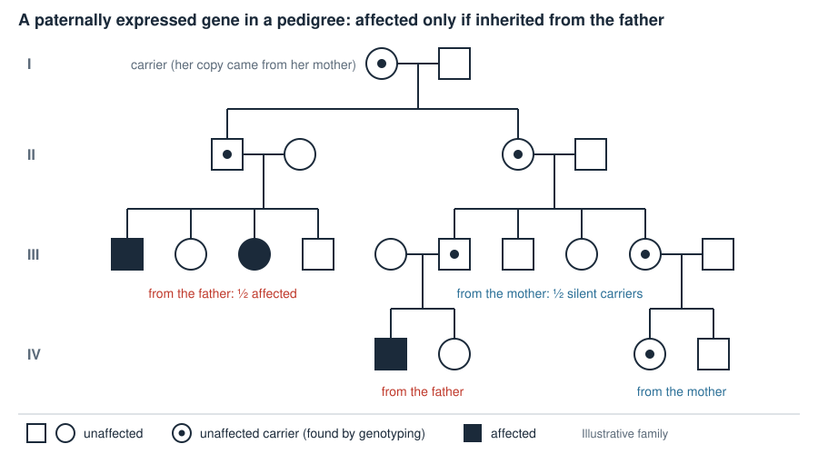
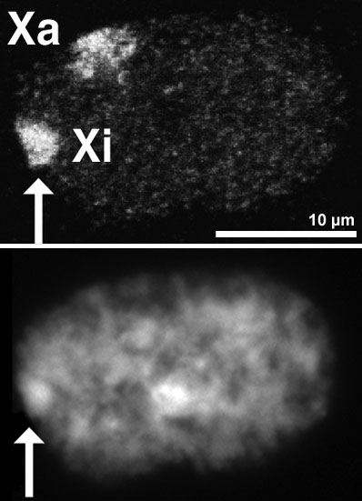
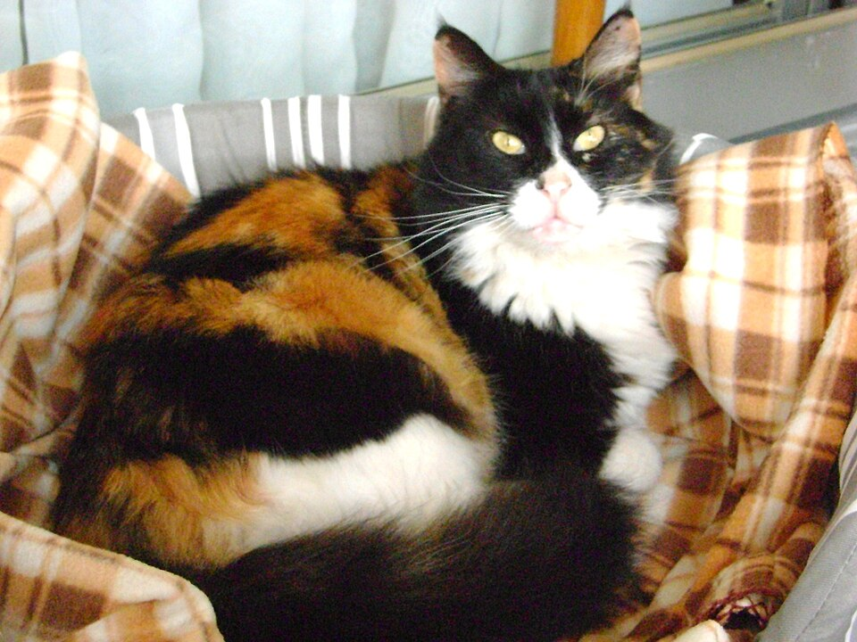
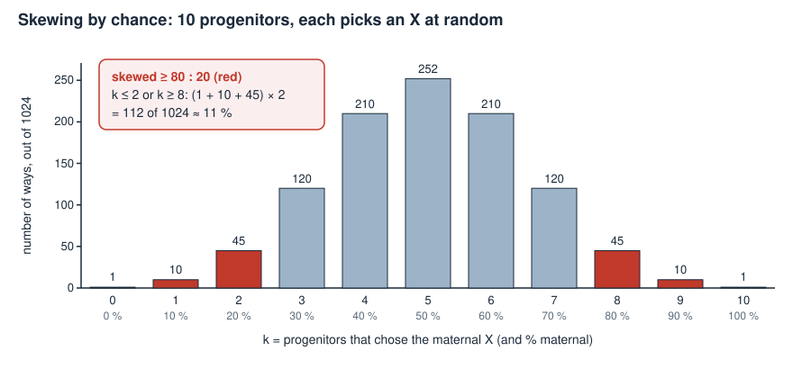

## About this lecture {.smaller}

Every cell in your body has the same genome, yet a liver cell makes albumin and a red-cell precursor makes haemoglobin. The difference is **regulation**. Eukaryotes use the same cis/trans logic as the lac operon, plus a layer that bacteria lack: **chromatin**, whose states can be copied from cell to cell without any change in the DNA sequence.

- **Promoters, enhancers and transcription factors**: telling **cis** from **trans** with allele-specific reads; counting motifs by chance; regulatory mutations.
- **Chromatin and epigenetics**: histone marks, DNA methylation, position-effect variegation.
- **Genomic imprinting**: how the imprint is reset each generation; imprinting in a **pedigree**, with risks; Prader–Willi and Angelman syndromes.
- **X inactivation**: *XIST*, Barr bodies, calico cats, mosaicism and **skewing**, with numbers.
- **Dosage compensation** in flies and worms.

Book: Hartwell, *Genetics: From Genes to Genomes*, the chapter on gene regulation in eukaryotes.

::: notes
This is the longest unit of Part 6. The thread through it: the same cis versus trans reasoning from the lac operon, then three phenomena that look non-Mendelian at first sight (imprinting, X-inactivation mosaics, position effects) and that make sense once you know that chromatin states are inherited through cell division. X inactivation connects back to X-linkage in Part 2 and to X-linked pedigrees in Part 1: it explains why carrier females are sometimes affected. Three parts are worked step by step with numbers, because the exercise asks for exactly these kinds of calculation: motif counts, imprinting risks in a pedigree, and the binomial chance of skewing.
:::

## What is different in eukaryotes? {.smaller}

| | Bacteria (*lac*) | Eukaryotes |
|---|---|---|
| Unit of transcription | operons: several genes, one mRNA | usually **one gene**, one promoter |
| DNA packaging | nearly naked DNA | **chromatin**: DNA wrapped on nucleosomes |
| Typical control | repressor blocks polymerase | **activators** recruit polymerase; default is often "off" |
| Regulatory DNA | operator next to the promoter | **enhancers** up to ~1 Mb away, combined with promoter elements |
| Signals | a few regulators per operon | many transcription factors **in combination** |
| Coupling | transcription and translation coupled | separated by the nuclear envelope; splicing, export |
| Memory | lost when the signal goes | chromatin states can be **inherited** through mitosis |

::: notes
Run through the table quickly. The two big differences for genetics: first, chromatin makes the default state of many genes "off", so activators matter more than repressors; second, chromatin states can be maintained through cell divisions, giving cellular memory. That memory is what we will call epigenetic. Attenuation, which we saw in the trp operon, cannot work in eukaryotes, because the ribosome never meets the nascent mRNA while it is being made.
:::

## Promoters, enhancers and transcription factors {.smaller}

{width="72%" fig-align="center"}

- **Core promoter** (e.g. TATA box): where general transcription factors (GTFs) and **RNA polymerase II** assemble.
- **Proximal elements** and **enhancers**: binding sites for **activators** (or repressors). Enhancers work at a distance, in either orientation; the DNA **loops**, and **Mediator** links them to the polymerase.
- In lac terms: enhancers and promoters are **cis-acting** sites (like *lacO*); transcription factors are **trans-acting** proteins (like LacI).

::: notes
The point to land is the parallel with the lac operon. A mutation in an enhancer affects only the copy of the gene on the same chromosome: cis. A mutation in a transcription factor gene affects every target gene on both chromosomes: trans. One gene usually has several enhancers, each driving expression in a different tissue or at a different stage, which is why a regulatory mutation can remove expression from one tissue only. Silencers and insulators also exist; we skip them here.
:::

## Cis or trans? Read the two alleles separately {.smaller}

{width="68%" fig-align="center"}

In a diploid we cannot make a merodiploid, but we can **tell the two alleles apart** with a silent SNP in the target gene and count RNA reads from each (allele-specific expression).

- **Cis**: the alleles become **unequal**: only the copy next to the intact site is used.
- **Trans**: the alleles stay **equal** (≈ 50 : 50), even if total expression drops.
- **Trans is not the same as dominant.** If half the activator is enough (haplosufficiency), the trans mutation is **recessive**.

::: notes
This is the diploid version of the merodiploid cis-trans test. Nature has done the merodiploid for us: every heterozygote has two copies, and a silent SNP is the label that tells them apart, just as Z plus and Z minus told the F-prime copy from the chromosomal one. Panel A: the enhancer on the chromosome carrying allele C is broken, so C is silent even though plenty of activator is around. Panel B: one copy of the activator gene is broken; the cell has half as much activator, but it diffuses to both target copies, so both are used equally. A common confusion is to equate trans with dominant. Trans says where the effect reaches, dominance says whether one copy is enough. A trans-acting loss-of-function mutation is usually recessive, like lacI minus. Allele-specific expression is measured routinely today with RNA-seq; in GTEx it is used to find cis-acting regulatory variants.
:::

## Transcription factors and their motifs

A transcription factor has a **DNA-binding domain** that recognises a short **motif** (6–12 bp), and an **activation** (or repression) domain that recruits co-factors.

- Motifs are **degenerate**: GATA1 binds (A/T)**GATA**(A/G); SOX2 binds **ACAAT**G-like sites. A **position weight matrix** gives the probability of each base at each position; a **sequence logo** draws it.
- Short motifs turn up **by chance** all over the genome (next slide). **Combinations** of factors, chromatin and spacing decide which sites matter.
- **Combinatorial control**: a few hundred to a couple of thousand factors, used in combinations, specify many cell types.

JASPAR is the open database of such motifs. You will look up GATA1 and SOX2 in the exercise.

::: notes
GATA1 is the master regulator of red blood cell and megakaryocyte development; its motif is literally the letters GATA, flanked by A or T before and A or G after. SOX2 is one of the factors that keeps embryonic stem cells pluripotent, often binding together with OCT4 at composite sites; JASPAR even has a matrix for the Pou5f1::Sox2 pair. In a logo, a tall letter means that base is strongly preferred; a short stack of several letters means the position is degenerate. The next slide shows how to count chance matches.
:::

## Motifs by chance: a worked count

**Method.** In random DNA with equal base frequencies, each position matches with probability (number of allowed bases)/4. Multiply over positions, multiply by the number of positions you scan, and count **both strands**.

**Example 1: the CCAAT box** (bound by NF-Y), 5 fixed bases, in a 2 kb promoter region.

- P(match at one position, one strand) = (¼)^5^ = 1/1024
- Expected = 2000 positions × 2 strands × 1/1024 ≈ **4 matches**, by chance alone.

**Example 2: the E-box CANNTG** (bound by bHLH factors such as MYC). An **N** allows all 4 bases, so it contributes 4/4 = 1.

- P = ¼ × ¼ × 1 × 1 × ¼ × ¼ = 1/256
- CANNTG is its own reverse complement: a site on one strand **is** a site on the other. Count one strand: 2000/256 ≈ **8 sites** per 2 kb.

A degenerate position with **2** allowed bases (like W = A/T) contributes 2/4 = ½.

::: notes
Go through the arithmetic slowly; the exercise asks for exactly this. The three rules: fixed base, one quarter; two allowed bases, one half; N, one. Then multiply by the length scanned and decide about strands. The palindrome point trips people up: the reverse complement of CANNTG is CANNTG, so scanning the second strand finds the same sites again, not new ones. For a non-palindromic motif like CCAAT, the other strand has its own, different matches (ATTGG on the top strand), so you count both. The message: with motifs this short, a promoter has several matches by chance, and the genome has hundreds of thousands. Whether a site is bound depends on chromatin, neighbouring sites and partner factors. Real genomes are not random (CpG is depleted, AT content varies), so these are rough expectations.
:::

## Regulatory mutations: same protein, different place or time {.smaller}

A mutation in a **cis-regulatory element** changes **where or when** a gene is expressed, not the protein it makes.

| Example | Mutation | Effect |
|---|---|---|
| **Lactase persistence** | −13910 C>T, in an intron of *MCM6*, ~14 kb upstream of *LCT* | enhancer stays active in adult gut: lactase made after weaning (**dominant**) |
| **Preaxial polydactyly** | point mutations in the **ZRS** enhancer, ~1 Mb from *SHH* | *SHH* switched on in the wrong part of the limb bud: extra thumb or toe |
| **Fly wing spots** (*yellow*) | gains and losses of enhancer sites between *Drosophila* species | pigment pattern changes; coding sequence unchanged |

Genetic signature: **cis-acting** (affects only the allele on the same chromosome), often **tissue-specific**, and often **dominant**.

::: notes
These are three classic examples of how evolution and disease use regulatory DNA. Lactase persistence: most mammals turn off lactase after weaning; in many Europeans an enhancer variant keeps it on. One copy is enough, so lactase persistence is dominant. The ZRS is a limb enhancer sitting in an intron of a different gene, LMBR1, a million base pairs from its target SHH; a single base change gives an extra digit, while SHH coding mutations cause holoprosencephaly, a completely different and much more severe phenotype. Why dominant: an enhancer gain switches on one allele where it should be off, and one active allele is enough to change the phenotype. Link forward: most GWAS hits for complex traits in Part 7 lie in non-coding, presumably regulatory, DNA.
:::

## Chromatin: open and closed {.smaller}

{width="72%" fig-align="center"}

- **Histone acetylation** loosens chromatin; acetyl groups are added by HATs and removed by HDACs. **H3K4me3** marks active promoters.
- **H3K9me3** and **H3K27me3** mark silent chromatin. Reader proteins (HP1, Polycomb) bind them and compact the fibre.
- Transcription factors recruit the enzymes that write these marks, so chromatin states follow, and then **stabilise**, regulatory decisions.

::: notes
Keep the chemistry light. The nomenclature H3K4me3 reads: histone H3, lysine 4, three methyl groups. Students need two lists: marks that go with active chromatin (acetylation, H3K4me3) and marks that go with silent chromatin (H3K9me3, H3K27me3). The reader-writer loop is what gives memory: a reader that binds a mark recruits a writer that puts the same mark on neighbouring nucleosomes, and after replication the marks on old histones guide marking of the new ones. Heterochromatin is the cytological name for the compact, silent state; euchromatin for the open state. The Eukaryotic chromosome unit in Part 5 covered heterochromatin at centromeres and telomeres.
:::

## DNA methylation: a pattern that is copied

In mammals, cytosines in **CpG** dinucleotides can be methylated (5-methylcytosine). Methylated CpG islands at promoters keep genes **silent**.

- CpG is a **palindrome**: the other strand also reads 5′-CG-3′. So a methylated site has a methyl group on **both** strands.
- After replication, each daughter site is **hemi-methylated** (old strand methylated, new strand not). The maintenance enzyme **DNMT1** recognises this and methylates the new strand: the pattern is **copied**, like the base sequence.
- *De novo* methyltransferases (DNMT3A/B) set new patterns, for example in the germ line.

**Epigenetics**: heritable changes in gene expression, through cell division (and sometimes across generations), **without** a change in DNA sequence.

::: notes
The key idea is that a pattern of methylation on a palindromic CpG site can be copied, just like the base sequence: the hemi-methylated site is the template. That is the textbook example of an epigenetic mechanism. Draw it on the board: a double-stranded CG/GC with a methyl on each C; replicate; two daughter duplexes each with one methyl; DNMT1 fills in the missing one. An unmethylated site stays unmethylated, because DNMT1 prefers hemi-methylated DNA. Note the careful definition: most "epigenetic" inheritance we discuss is through mitosis; inheritance across generations is rare in mammals, because the germ line erases most marks, except at imprinted genes, which comes next.
:::

## Position-effect variegation: chromatin memory, seen genetically

*Drosophila* **position-effect variegation** (Muller, 1930s): an inversion that puts *white*^+^ next to **heterochromatin** gives eyes with **red and white patches**.

- The *white*^+^ DNA is unchanged. In some cells heterochromatin **spreads** into it and silences it; in others it does not.
- Each patch is a **clone**: the cell's descendants keep its choice. The state is inherited through mitosis.
- **Modifier screens**: mutations that suppress variegation (*Su(var)*, more red) or enhance it (*E(var)*, more white) found many chromatin proteins, including **HP1** (*Su(var)205*).

The same three features return in X inactivation: a choice made in a cell, kept by its descendants, giving a **mosaic**.

::: notes
Position-effect variegation, discovered by Muller in the 1930s with X-ray induced rearrangements, is the genetic proof that chromatin states are clonally inherited: the patches in the eye are clones. A Su(var) mutation removes a protein needed for heterochromatin, so the white gene is silenced less often and the eye becomes redder; that is how HP1 was identified genetically as the product of Su(var)205 (Suppressor of variegation 2-5). That is a mutant screen in the Jacob-Monod tradition, applied to chromatin. Point out the parallel with X inactivation later in the lecture: random choice per cell, clonal memory, patchy phenotype.
:::

## Genomic imprinting {.smaller}

For a few hundred genes in mammals, only the copy from **one parent** is expressed. The other is silenced by methylation set in the parent's **germ line**.

{width="70%" fig-align="center"}

The **same deletion** in 15q11–q13 gives **Prader–Willi** syndrome if it is on the paternal chromosome and **Angelman** syndrome if it is on the maternal one.

::: notes
Imprinting breaks a Mendelian assumption: that it does not matter which parent an allele comes from (Mendel's reciprocal crosses in Part 1). For imprinted genes, it does. In the 15q11-q13 region, the SNRPN cluster (here one box for simplicity; it includes several snoRNA genes that matter most for Prader-Willi) is expressed only from the paternal chromosome, and UBE3A only from the maternal chromosome, at least in neurons. Delete the region on the paternal 15, and the child has no paternal-only genes: Prader-Willi (hypotonia, then overeating and obesity, learning disability). Delete it on the maternal 15: Angelman (severe learning disability, seizures, happy demeanour). Uniparental disomy gives the same results: two maternal 15s is Prader-Willi. In mice, Igf2 is paternally expressed and its neighbour H19 maternally expressed. The parental-conflict hypothesis: paternally expressed genes tend to promote growth of the fetus, maternally expressed genes restrain it.
:::

## The imprint is reset in every generation {.smaller}

{width="72%" fig-align="center"}

- In the germ line, old imprints are **erased**, then re-set according to the **sex of the parent**: all eggs carry the maternal mark, all sperm the paternal mark.
- So the **same copy** can be active in a grandmother, silent in her son and active again in his child. The DNA sequence never changes.
- **Transmission** is Mendelian (each child gets one copy, ½); only **expression** depends on the parent of origin.

::: notes
This is the step most students miss. An imprint is not a permanent property of an allele; it is a label that each parent rewrites. Follow the orange copy. The grandmother got it from her father, so in her it carries a paternal mark and is active. When she makes eggs, all marks are wiped and maternal marks are set, so the copy she gives her son is silent in him. When he makes sperm, the marks are wiped again and paternal marks are set, so the same copy is active in his child. This is why the phenotype of an imprinted mutation can switch on and off down a pedigree, which we look at next.
:::

## Imprinting in a pedigree {.smaller}

{width="62%" fig-align="center"}

A loss-of-function allele of a gene expressed only from the **paternal** copy (like mouse *Igf2*). A child is affected only if the allele came **from the father**. Through women the allele travels **silently**, then shows again when a carrier man passes it on.

::: notes
Walk down the generations. The woman in generation I carries the allele but is unaffected, because she got it from her mother. Both her children inherit it on their maternal copy, which is silent anyway: unaffected carriers. The son passes it on paternally, so about half of his children are affected. The daughter passes it on maternally, so none of her children are affected; about half are silent carriers. Her carrier son then passes it on paternally again, and the trait reappears in generation IV. Ask the room what they would conclude from such a pedigree if they did not know about imprinting: probably incomplete penetrance, or perhaps a sex-limited trait. The tell-tale sign is that affected children always have a carrier father, while affected people of both sexes occur. The exercise has the mirror-image case: a maternally expressed gene.
:::

## Worked example: risks in the imprinting pedigree

Use the pedigree on the last slide (paternally expressed gene). For each child, ask two questions: **Does the parent carry the allele?** and **Does this parent's copy get expressed in the child?**

| Child of… | P(parent carries) | P(passes it) | Expressed? | Risk |
|---|---|---|---|---|
| the carrier **son** in II | 1 | ½ | yes, paternal copy | **½** |
| the carrier **daughter** in II | 1 | ½ | no, maternal copy | **0** |
| a **son** of that daughter, not tested | ½ | ½ | yes, paternal copy | ½ × ½ = **¼** |
| a **daughter** of that daughter, not tested | ½ | ½ | no | **0** |

**Rule:** multiply along the path, as in any pedigree, and set the risk to 0 at the last step if the copy comes from the **silenced** parent.

::: notes
This is the same product rule as in the Pedigree analysis unit; the only new step is the last one. The untested grandson: he is a carrier with probability one half (his mother is a carrier), he passes it with probability one half, and he is a father, so the copy is expressed in his child: one quarter. The untested granddaughter: whatever she carries, it goes to her children on the maternal copy, which is silent: zero, although she can still pass the allele on to a son who then passes it on. In the exercise you do the same for a maternally expressed gene and for Igf2 reciprocal crosses in mice.
:::

## X inactivation: the Lyon hypothesis {.smaller}

{width="74%" fig-align="center"}

Mary **Lyon** (1961): in female mammals, **one X in each cell is inactivated early in development**, the choice is **random**, and it is **kept** in all descendant cells. The inactive X is coated by the long non-coding RNA ***XIST*** (from the X-inactivation centre, Xq13).

::: notes
Lyon reasoned from coat-colour mosaics in female mice heterozygous for X-linked coat genes: the patches meant that only one X allele was being used in each patch. XIST was found in 1991; it is expressed only from the inactive X and spreads along it in cis, recruiting silencing complexes (including Polycomb, H3K27me3) and later DNA methylation. XIST is itself a lncRNA, which is a bridge to the next unit. In humans the choice happens around implantation in the embryo proper; in mouse extra-embryonic tissues it is the paternal X that is always inactivated, an example of imprinting meeting X inactivation.
:::

## Seeing the inactive X: the Barr body {.smaller}

:::: {.columns}
::: {.column width="34%"}
{width="100%"}
[Photo: Steffen Dietzel, CC BY-SA 3.0, via Wikimedia Commons](https://commons.wikimedia.org/wiki/File:Sd4hi-unten-crop.jpg){.photo-credit}
:::
::: {.column width="66%"}
A nucleus from a female cell. **Top:** both X territories, stained by FISH: the active X (Xa) is spread out, the inactive X (Xi) is **compact**. **Bottom:** the same nucleus with a DNA stain: the Xi is the dense **Barr body** at the edge (arrow).

**Count:** every X beyond the first is inactivated, so **Barr bodies = number of X − 1**, whatever the Y.

| Karyotype | 46,XY | 46,XX | 47,XXY | 45,X | 47,XXX |
|---|---|---|---|---|---|
| Barr bodies | 0 | 1 | 1 | 0 | 2 |
:::
::::

::: notes
Barr and Bertram saw a dense body in the nuclei of female cat neurons in 1949, which turned out to be the inactive X. The photo is from an amniotic fluid cell: the FISH image shows the two X chromosome territories, and the inactive one is the more compact one; the DAPI image shows it as a bright body against the nuclear edge. The counting rule follows from the choice mechanism: the cell keeps exactly one X active and inactivates all the others. So an XXY man has one Barr body and expresses XIST, and a 45,X woman has none. This is why X aneuploidy is far less severe than autosomal aneuploidy (Part 5): extra X chromosomes are mostly silenced. Some genes escape inactivation, for example in the pseudoautosomal regions, which is why X0 and XXY are not normal.
:::

## Consequences: every female is a mosaic {.smaller}

:::: {.columns}
::: {.column width="38%"}
{width="100%"}
[Photo: Jimis919, CC0, via Wikimedia Commons](https://commons.wikimedia.org/wiki/File:My_calico_cat.jpg){.photo-credit}
:::
::: {.column width="62%"}
- Heterozygous women for X-linked conditions have **patches** of normal and mutant cells; e.g. carriers of **anhidrotic ectodermal dysplasia** have patches of skin without sweat glands.
- **Calico and tortoiseshell cats**: orange (*X*^O^) and black (*X*^o^) are alleles of an X-linked gene. Each orange patch is a clone that kept *X*^O^ active; each black patch, *X*^o^. They need **two** X alleles, so they are almost always **female**. A male calico is usually **XXY**.
- X-linked recessive carriers are usually **unaffected**: about half their cells use the normal X, which is enough for most genes. "Usually": see skewing.
:::
::::

::: notes
Connect to Part 2 and to Pedigree analysis: in X-linked recessive inheritance, carrier females are usually unaffected, because about half of their cells use the normal X. The calico is the most visible X-inactivation mosaic. The white areas come from a separate, autosomal white-spotting gene, which is why a calico has three colours and a tortoiseshell only two; the X-linked part is the orange versus black. An orange and black cat needs both X alleles, so it needs two X chromosomes: a male calico must be XXY or a chimera, and is usually sterile.
:::

## Worked example: a calico cross

**Cross:** calico female *X*^O^*X*^o^ × orange male *X*^O^Y.

| | *X*^O^ (from father) | Y (from father) |
|---|---|---|
| ***X*^O^** (from mother) | *X*^O^*X*^O^: orange female | *X*^O^Y: orange male |
| ***X*^o^** (from mother) | *X*^O^*X*^o^: **calico female** | *X*^o^Y: black male |

- **Daughters:** ½ orange, ½ calico. **Sons:** ½ orange, ½ black. No calico sons.
- Method: write the X-linked cross as in Part 2, **then** apply X inactivation: only females with **two different** alleles are mosaics.

::: notes
Do the Punnett square together. Sons get their only X from their mother, so they are orange or black, never calico. Daughters get the father's X^O for certain, and either X^O or X^o from the mother: half orange (homozygous), half calico (heterozygous, so mosaic). The two-step method is the point: first ordinary X-linked transmission, then ask which genotypes are heterozygous females, because only they can be mosaics. The exercise has two other crosses to practise on, and a male calico to explain.
:::

## Skewed X inactivation {.smaller}

On average, half the cells use the maternal X. But the choice is made in a **small number of progenitor cells**, so one female can be far from 50 : 50 **by chance**, like getting 7 heads in 8 coin tosses.

- **Skewed** X inactivation: ≥ 80 : 20 (some studies use 90 : 10) in a tissue.
- Causes: **chance** (few progenitors), **selection** against cells that use a harmful X, or mutations in the X-inactivation centre.
- Consequence: a heterozygous carrier of an X-linked recessive disease can be **affected** if most of her cells use the mutant X: a **manifesting carrier** (e.g. of Duchenne muscular dystrophy or haemophilia A).
- Monozygotic female twins can differ for an X-linked trait if their X inactivation differs.

::: notes
This is binomial sampling again, the same idea as Mendel's small samples in Part 1. Selection is the other big cause: in female carriers of some severe X-linked mutations, cells that use the mutant X die or grow slowly, giving extreme skewing in blood. That is used clinically to identify carriers. Identical twins: X inactivation in each twin is an independent draw, so they can differ.
:::

## Skewing by chance: the numbers {.smaller}

{width="64%" fig-align="center"}

If *N* progenitors each choose at random, the number *k* that choose the maternal X is **binomial**: P(*k*) = $\binom{N}{k}/2^N$. For *N* = 10: add the tails *k* ≤ 2 and *k* ≥ 8 to get P(skewed ≥ 80 : 20) = 112/1024 ≈ **0.11**. Fewer progenitors → fatter tails → more skewing.

::: notes
Work through the figure. Each bar is the number of ways out of 2 to the 10th, 1024, that k progenitors can pick the maternal X; these are the binomial coefficients from Pascal's triangle. Skewed at least 80:20 means k is 2 or less, or 8 or more, so add 1 + 10 + 45 on each side: 112, about 11 percent. The spread of the fraction maternal has standard deviation the square root of one quarter over N; for N = 10 that is about 0.16. With more progenitors the distribution narrows and skewing becomes rare; with fewer it becomes common. In the exercise you do the same sum for N = 8 and N = 16, and the demo simulates it.
:::

## Try it: an X-inactivation mosaic {.smaller}

```{=html}
<link rel="stylesheet" href="../demos/dist/demo.css">
<div data-demo="xinactivation" data-n="16"></div>
<script src="../demos/dist/xinactivation.js"></script>
```

::: notes
Interactive demo. Left: a patch of tissue from one female. N progenitor cells each choose the maternal (orange) or paternal (black) X at random, then grow into clonal patches. Right: the percentage of cells in this embryo, and a histogram over 1000 embryos with the same N, with the share that are skewed at least 80:20. Suggested tour: start at N = 16 (seed 1: 9 of 16 progenitors chose the maternal X, cells 50:50; 2.3 percent of embryos skewed). Press "new embryo" a few times. Then N = 2: half of all embryos are completely skewed, and the patches are huge. Then N = 256: almost exactly 50:50 every time, fine-grained. Finally "cell mixing": the same proportions, but salt and pepper, as in blood, where cells move. Ask: what decides patch size in a cat's coat? Mostly how much the cells migrate and mix, not N.
:::

## Dosage compensation in other species {.smaller}

{width="72%" fig-align="center"}

The problem is the same everywhere: one sex has two X chromosomes and the other has one. The solutions differ: **inactivate** one X (mammals), **double** the single X (*Drosophila* males, the MSL complex), or **halve** both X (*C. elegans* hermaphrodites). Mutations that break dosage compensation are **sex-specific lethals**, e.g. *msl* mutations kill *Drosophila* males but not females.

::: notes
The genetics point: the genes for dosage compensation were found as mutants that kill only one sex. In Drosophila the male-specific lethal (msl) genes encode a complex, with two non-coding roX RNAs, that binds the male X and raises its transcription about twofold through histone H4 lysine 16 acetylation. In C. elegans the dosage compensation complex, related to condensin, binds both X chromosomes of the hermaphrodite and halves their output. Birds (ZW females) compensate only partially. Note that sex determination is different again: in Drosophila it is set by the X-to-autosome ratio, not by the Y, which is why XO flies are sterile males (Part 2).
:::

## Seeing it in data: *XIST* in GTEx {.smaller}

The **GTEx** project measured RNA in 54 tissues from about 950 deceased donors. *XIST* is a clean test of what you just learned:

- In women, *XIST* is expressed in every tissue (from the inactive X); in men it is essentially absent.
- A Y-linked gene such as *RPS4Y1* shows the opposite pattern.
- **Careful:** GTEx's default summary is the **median over all samples**. Most tissues have about twice as many male as female samples, so the pooled median of *XIST* is the male value, close to 0, everywhere except female-only tissues.

You will see this in the exercise and pull the per-sex data in R.

::: notes
This slide previews the R exercise and makes a statistics point: a summary statistic over a mixture of two very different groups can hide one of them. In GTEx v10 the pooled median XIST in skeletal muscle is 0.04 TPM, while the female median is about 18 and the male median 0.02. In uterus, ovary and vagina, which only have female donors, the median XIST is 50 to 100 TPM. A handful of samples break the rule (for example a male sample with high XIST), which could be a sample mix-up or a donor with a 47,XXY karyotype; GTEx does not say, so we should not guess.
:::

## Check yourself: common mistakes

True or false? Decide, then give the reason.

1. "A trans-acting mutation is dominant."
2. "An imprinted allele is passed on less often than a normal one."
3. "Imprinting and X-linkage both make reciprocal crosses differ, so they are the same thing."
4. "A 47,XXY man has no Barr body, because he is male."
5. "If a carrier woman shows symptoms of an X-linked recessive disease, she must have two mutant copies."
6. "An enhancer variant that changes expression must change the protein too."

::: notes
Answers. 1: False. Trans means the product reaches both copies; dominance is a separate question. Loss of one copy of an activator is usually recessive (haplosufficiency); trans-acting gain-of-function alleles, like lacI-s, can be dominant. 2: False. Transmission is Mendelian, one half; only expression depends on the parent of origin. 3: False. X-linked genes differ in reciprocal crosses because sons get their only X from their mother; imprinted genes are autosomal, both sexes have two copies, and the difference is in which copy is expressed. Maternal effect, from the next units, is a third cause. 4: False. Barr bodies = X minus 1, whatever the Y: one Barr body, and XIST is expressed. 5: False. Skewed X inactivation, by chance or selection, can make most cells in a tissue use the mutant X: a manifesting carrier. (Turner syndrome, 45,X, is another explanation for a woman with an X-linked recessive disease.) 6: False. An enhancer variant changes where, when or how much; the protein is the same.
:::

## Summary {.smaller}

| Concept | Key fact |
|---|---|
| Promoter, enhancer | cis-acting DNA; enhancers act at a distance via looping and Mediator |
| Transcription factor | trans-acting protein; binds a short, degenerate motif (GATA1: WGATAR) |
| Cis vs trans in a diploid | allele-specific reads: cis → alleles unequal; trans → alleles equal. Trans ≠ dominant |
| Motifs by chance | P = ∏ (allowed bases/4); × positions × strands (palindromes: one strand) |
| Regulatory mutation | changes where/when, not what; cis-acting, often tissue-specific, often dominant |
| Chromatin marks | acetylation, H3K4me3 = active; H3K9me3, H3K27me3 = silent |
| DNA methylation | 5mC at CpG; DNMT1 copies the pattern after replication; PEV shows clonal memory |
| Imprinting | parent-of-origin expression; reset in each germ line; transmission ½, expression by parent's sex |
| X inactivation | one X per cell, random, clonal; *XIST*; Barr bodies = X − 1; calico females |
| Skewing | binomial chance with few progenitors, or selection; manifesting carriers |
| Dosage compensation | mammals: inactivate; flies: double in males; worms: halve in hermaphrodites |

::: notes
Revision sheet. The common theme across imprinting, X inactivation and position effects: a choice is made in one cell (or in a parent's germ line) and then copied to descendants through chromatin. Genetically, all three give phenotypes that look odd at first: patchy, parent-dependent, or variable between relatives. And in each case the probabilities are ordinary Mendelian or binomial ones, with one extra step: is this copy expressed?
:::

## Where this leads

- **Next: RNA-mediated regulation.** *XIST* is a long non-coding RNA. The next unit adds microRNAs and RNAi, a second layer of control after transcription.
- **Development & model organisms.** Transcription-factor cascades (gap, pair-rule, Hox genes) read by modular enhancers, maternal effects (a third reason for reciprocal crosses to differ), and chromatin memory (Polycomb keeps Hox genes off).
- **Part 7: Complex traits.** Most GWAS signals lie in non-coding, regulatory DNA, and allele-specific expression helps find them.

::: notes
Point forward. In the exercise students predict cis and trans effects, count motifs, work through imprinting crosses and pedigrees, calico crosses and skewing by hand, look up motifs in JASPAR and XIST in GTEx and NCBI Gene, and in R they reshape and summarise GTEx data to see how a pooled median hides the female XIST signal.
:::
