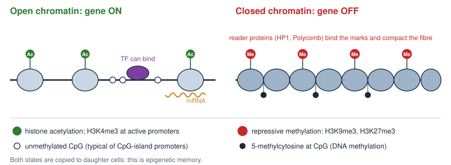
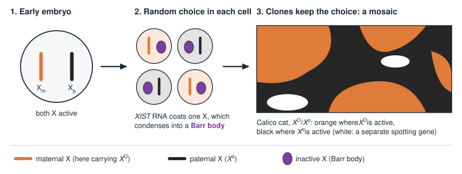
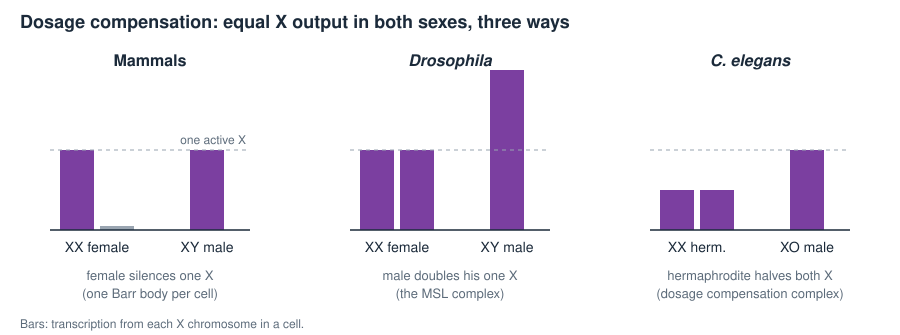

## About this lecture

Every cell in your body has the same genome, yet a liver cell makes albumin and a red-cell precursor makes haemoglobin. The difference is **regulation**. Eukaryotes use the same cis/trans logic as the lac operon, plus a layer that bacteria lack: **chromatin**, whose states can be copied from cell to cell without any change in the DNA sequence.

- **Promoters, enhancers and transcription factors**; motifs; regulatory mutations.
- **Chromatin and epigenetics**: histone modification, DNA methylation, position-effect variegation.
- **Genomic imprinting**: Prader–Willi and Angelman syndromes.
- **X inactivation**: *XIST*, the Lyon hypothesis, calico cats, mosaicism and **skewing**.
- **Dosage compensation** in flies and worms.

Book: Hartwell, *Genetics: From Genes to Genomes*, the chapter on gene regulation in eukaryotes.

::: notes
This is the longest unit of Part 6. The thread through it: the same cis versus trans reasoning from the lac operon, then three phenomena that look non-Mendelian at first sight (imprinting, X-inactivation mosaics, position effects) and that make sense once you know that chromatin states are inherited through cell division. X inactivation connects back to X-linkage in Part 2 and to X-linked pedigrees in Part 1: it explains why carrier females are sometimes affected.
:::

## What is different in eukaryotes? {.smaller}

| | Bacteria (*lac*) | Eukaryotes |
|---|---|---|
| Unit of transcription | operons: several genes, one mRNA | usually **one gene**, one promoter |
| DNA packaging | nearly naked DNA | **chromatin**: DNA wrapped on nucleosomes |
| Typical control | repressor blocks polymerase | **activators** recruit polymerase; default is often "off" |
| Regulatory DNA | operator next to the promoter | **enhancers** up to ~1 Mb away, combined with promoter elements |
| Signals | a few regulators per operon | many transcription factors **in combination** |
| Coupling | transcription and translation coupled | separated by the nuclear envelope; splicing, export |
| Memory | lost when the signal goes | chromatin states can be **inherited** through mitosis |

::: notes
Run through the table quickly. The two big differences for genetics: first, chromatin makes the default state of many genes "off", so activators matter more than repressors; second, chromatin states can be maintained through cell divisions, giving cellular memory. That memory is what we will call epigenetic. Attenuation, which we saw in the trp operon, cannot work in eukaryotes, because the ribosome never meets the nascent mRNA while it is being made.
:::

## Promoters, enhancers and transcription factors {.smaller}

{width="72%" fig-align="center"}

- **Core promoter** (e.g. TATA box): where general transcription factors (GTFs) and **RNA polymerase II** assemble.
- **Proximal elements** and **enhancers**: binding sites for **activators** (or repressors). Enhancers work at a distance, in either orientation; the DNA **loops**, and **Mediator** links them to the polymerase.
- In lac terms: enhancers and promoters are **cis-acting** sites (like *lacO*); transcription factors are **trans-acting** proteins (like LacI).

::: notes
The point to land is the parallel with the lac operon. A mutation in an enhancer affects only the copy of the gene on the same chromosome: cis. A mutation in a transcription factor gene affects every target gene on both chromosomes: trans. One gene usually has several enhancers, each driving expression in a different tissue or at a different stage, which is why a regulatory mutation can remove expression from one tissue only. Silencers and insulators also exist; we skip them here.
:::

## Transcription factors and their motifs {.smaller}

A transcription factor has a **DNA-binding domain** that recognises a short **motif** (6–12 bp), and an **activation** (or repression) domain that recruits co-factors.

- Motifs are **degenerate**: GATA1 binds (A/T)**GATA**(A/G); SOX2 binds **ACAAT**G-like sites. A **position weight matrix** gives the probability of each base at each position; a **sequence logo** draws it.
- A 6-bp motif turns up by chance about every 4^6^ = 4096 bp, so a genome has hundreds of thousands of copies. **Combinations** of factors, chromatin and spacing decide which sites matter.
- **Combinatorial control**: a few hundred to a couple of thousand factors, used in combinations, specify many cell types.

JASPAR is the open database of such motifs. You will look up GATA1 and SOX2 in the exercise.

::: notes
GATA1 is the master regulator of red blood cell and megakaryocyte development; its motif is literally the letters GATA, flanked by A or T before and A or G after. SOX2 is one of the factors that keeps embryonic stem cells pluripotent, often binding together with OCT4 at composite sites; JASPAR even has a matrix for the Pou5f1::Sox2 pair. Make the counting point: a motif of length 6 is expected once every 4096 bp in random sequence, so on 3 billion bp there are close to a million matches per strand. That is why motif scanning alone predicts far more sites than are bound in a cell. The R part of the RNA-regulation unit does exactly this counting for microRNA seed sites.
:::

## Regulatory mutations: same protein, different place or time {.smaller}

A mutation in a **cis-regulatory element** changes **where or when** a gene is expressed, not the protein it makes.

| Example | Mutation | Effect |
|---|---|---|
| **Lactase persistence** | −13910 C>T, in an intron of *MCM6*, ~14 kb upstream of *LCT* | enhancer stays active in adult gut: lactase made after weaning (**dominant**) |
| **Preaxial polydactyly** | point mutations in the **ZRS** enhancer, ~1 Mb from *SHH* | *SHH* switched on in the wrong part of the limb bud: extra thumb or toe |
| **Fly wing spots** (*yellow*) | gains and losses of enhancer sites between *Drosophila* species | pigment pattern changes; coding sequence unchanged |

Genetic signature: **cis-acting** (affects only the allele on the same chromosome), often **tissue-specific**, and often **dominant**.

::: notes
These are three classic examples of how evolution and disease use regulatory DNA. Lactase persistence: most mammals turn off lactase after weaning; in many Europeans an enhancer variant keeps it on. One copy is enough, so lactase persistence is dominant. The ZRS is a limb enhancer sitting in an intron of a different gene, LMBR1, a million base pairs from its target SHH; a single base change gives an extra digit, while SHH coding mutations cause holoprosencephaly, a completely different and much more severe phenotype. Why dominant: an enhancer gain switches on one allele where it should be off, and one active allele is enough to change the phenotype. Link forward: most GWAS hits for complex traits in Part 7 lie in non-coding, presumably regulatory, DNA.
:::

## Chromatin: open and closed {.smaller}

{width="72%" fig-align="center"}

- **Histone acetylation** loosens chromatin; acetyl groups are added by HATs and removed by HDACs. **H3K4me3** marks active promoters.
- **H3K9me3** and **H3K27me3** mark silent chromatin. Reader proteins (HP1, Polycomb) bind them and compact the fibre.
- Transcription factors recruit the enzymes that write these marks, so chromatin states follow, and then **stabilise**, regulatory decisions.

::: notes
Keep the chemistry light. The nomenclature H3K4me3 reads: histone H3, lysine 4, three methyl groups. Students need two lists: marks that go with active chromatin (acetylation, H3K4me3) and marks that go with silent chromatin (H3K9me3, H3K27me3). The reader-writer loop is what gives memory: a reader that binds a mark recruits a writer that puts the same mark on neighbouring nucleosomes, and after replication the marks on old histones guide marking of the new ones. Heterochromatin is the cytological name for the compact, silent state; euchromatin for the open state. The Eukaryotic chromosome unit in Part 5 covered heterochromatin at centromeres and telomeres.
:::

## DNA methylation and epigenetic memory {.smaller}

In mammals, cytosines in **CpG** dinucleotides can be methylated (5-methylcytosine). Methylated CpG islands at promoters keep genes **silent**.

- After replication, each CpG is **hemi-methylated** (old strand methylated, new strand not). The maintenance enzyme **DNMT1** recognises this and methylates the new strand: the pattern is **copied**.
- *De novo* methyltransferases (DNMT3A/B) set new patterns, for example in the germ line.

**Epigenetics**: heritable changes in gene expression, through cell division (and sometimes across generations), **without** a change in DNA sequence.

Genetic evidence: *Drosophila* **position-effect variegation**. An inversion that puts *white*^+^ next to heterochromatin gives eyes with red and white patches. The DNA of *white*^+^ is unchanged; heterochromatin spreads into it in some cells and not others, and each cell's descendants keep the state.

::: notes
The key idea is that a pattern of methylation on a palindromic CpG site can be copied, just like the base sequence: the hemi-methylated site is the template. That is the textbook example of an epigenetic mechanism. Position-effect variegation, discovered by Muller in the 1930s, is the genetic proof that chromatin states are clonally inherited: the patches in the eye are clones. Modifier screens for enhancers and suppressors of variegation found many of the chromatin proteins, including HP1 (Su(var)2-5). That is a mutant screen in the Jacob-Monod tradition, applied to chromatin. Note the careful definition: most "epigenetic" inheritance we discuss is through mitosis; inheritance across generations is rare in mammals because the germ line erases most marks, except at imprinted genes.
:::

## Genomic imprinting {.smaller}

For a few hundred genes in mammals, only the copy from **one parent** is expressed. The other is silenced by methylation set in the parent's **germ line**, and the imprint is reset each generation.

{width="70%" fig-align="center"}

The **same deletion** in 15q11–q13 gives **Prader–Willi** syndrome if it is on the paternal chromosome and **Angelman** syndrome if it is on the maternal one.

::: notes
Imprinting breaks a Mendelian assumption: that it does not matter which parent an allele comes from (Mendel's reciprocal crosses in Part 1). For imprinted genes, it does. In the 15q11-q13 region, the SNRPN cluster (here one box for simplicity; it includes several snoRNA genes that matter most for Prader-Willi) is expressed only from the paternal chromosome, and UBE3A only from the maternal chromosome, at least in neurons. Delete the region on the paternal 15, and the child has no paternal-only genes: Prader-Willi (hypotonia, then overeating and obesity, learning disability). Delete it on the maternal 15: Angelman (severe learning disability, seizures, happy demeanour). Uniparental disomy gives the same results: two maternal 15s is Prader-Willi. In mice, Igf2 is paternally expressed and its neighbour H19 maternally expressed. The parental-conflict hypothesis: paternally expressed genes tend to promote growth of the fetus, maternally expressed genes restrain it.
:::

## Imprinting in a pedigree {.smaller}

For a gene expressed only from the **maternal** allele (like *UBE3A* in neurons):

- A child is affected only if the mutation comes **from the mother**.
- A man carrying the mutation is **unaffected** (if he got it from his father) and passes it on silently: his children are unaffected carriers, but **his daughters' children** have a ½ risk.
- So the trait seems to **skip generations**, then appear in every child of carrier women at a ½ risk.

The allele is transmitted by normal Mendelian segregation; only its **expression** depends on the parent of origin.

::: notes
Draw a quick pedigree on the board: a carrier grandfather, his unaffected carrier son and carrier daughter; the son's children are all unaffected whether or not they inherit the mutation; the daughter's children are affected with probability one half. Ask the room what they would conclude from such a pedigree if they did not know about imprinting: probably incomplete penetrance or sex-limited expression. This is a good reminder from the Pedigree analysis unit that the mode of inheritance has to be inferred carefully. The exercise has a problem of exactly this kind.
:::

## X inactivation: the Lyon hypothesis {.smaller}

{width="74%" fig-align="center"}

Mary **Lyon** (1961): in female mammals, **one X in each cell is inactivated early in development**, the choice is **random**, and it is **kept** in all descendant cells. The inactive X is the **Barr body**; it is coated by the long non-coding RNA ***XIST*** (from the X-inactivation centre, Xq13).

::: notes
Lyon reasoned from coat-colour mosaics in female mice heterozygous for X-linked coat genes: the patches meant that only one X allele was being used in each patch. Barr and Bertram had seen a dense body in the nuclei of female cat neurons in 1949, which turned out to be the inactive X. XIST was found in 1991; it is expressed only from the inactive X and spreads along it in cis, recruiting silencing complexes (including Polycomb, H3K27me3) and later DNA methylation. XIST is itself a lncRNA, which is a bridge to the next unit. In humans the choice happens around implantation in the embryo proper; in mouse extra-embryonic tissues it is the paternal X that is always inactivated, an example of imprinting meeting X inactivation.
:::

## Consequences of X inactivation {.smaller}

- **Every female is a mosaic** for X-linked genes. Heterozygous women for X-linked recessive conditions have patches of normal and mutant cells; e.g. in **anhidrotic ectodermal dysplasia** carriers have patches of skin without sweat glands.
- **Calico and tortoiseshell cats** are almost always female: they need two X alleles (*X*^O^ and *X*^o^). A male calico is usually **XXY**.
- **Number of Barr bodies = number of X − 1**: XX and XXY have one; X0 (Turner) has none; XXX has two. That is why X aneuploidy is far less severe than autosomal aneuploidy (Part 5).
- Some genes **escape** inactivation (e.g. in the pseudoautosomal regions), which is why X0 and XXY are not normal.

::: notes
Connect to Part 2 and to Pedigree analysis: in X-linked recessive inheritance, carrier females are usually unaffected, because about half of their cells use the normal X, which is enough for most genes. "Usually" is the key word, and skewing on the next slide explains the exceptions. The calico point is a nice test of understanding: an orange and black cat needs both X alleles, so it needs two X chromosomes; a male calico must be XXY (Klinefelter-like) or a chimera. The aneuploidy point links to Rearrangements and aneuploidy in Part 5: trisomy 21 is severe, but XXX women are often unaware of it. The genes that escape inactivation are expressed from two X in females and one in males, which explains the phenotypes of Turner (missing a second dose) and Klinefelter syndromes.
:::

## Skewed X inactivation {.smaller}

On average, half the cells use the maternal X. But the choice is made in a **small number of progenitor cells**, so one female can be far from 50 : 50 **by chance**, like getting 7 heads in 8 coin tosses.

- **Skewed** X inactivation: ≥ 80 : 20 (some studies use 90 : 10) in a tissue.
- Causes: **chance** (few progenitors), **selection** against cells that use a harmful X, or mutations in the X-inactivation centre.
- Consequence: a heterozygous carrier of an X-linked recessive disease can be **affected** if most of her cells use the mutant X: a **manifesting carrier** (e.g. of Duchenne muscular dystrophy or haemophilia A).
- Monozygotic female twins can differ for an X-linked trait if their X inactivation differs.

::: notes
This is binomial sampling again, the same idea as Mendel's small samples in Part 1. If N progenitors each choose at random, the fraction that chose the maternal X has standard deviation the square root of one quarter over N. With N = 16 the standard deviation is 0.125, so about 2 percent of females are 80:20 or more by chance alone; with N = 4 it is much more common. The demo lets students see this. Selection is the other big cause: in female carriers of some severe X-linked mutations, cells that use the mutant X die or grow slowly, giving extreme skewing in blood. That is used clinically to identify carriers.
:::

## Try it: an X-inactivation mosaic {.smaller}

```{=html}
<link rel="stylesheet" href="../demos/dist/demo.css">
<div data-demo="xinactivation" data-n="16"></div>
<script src="../demos/dist/xinactivation.js"></script>
```

::: notes
Interactive demo. Left: a patch of tissue from one female. N progenitor cells each choose the maternal (orange) or paternal (black) X at random, then grow into clonal patches. Right: the percentage of cells in this embryo, and a histogram over 1000 embryos with the same N, with the share that are skewed at least 80:20. Suggested tour: start at N = 16 (seed 1: 9 of 16 progenitors chose the maternal X, cells 50:50; 2.3 percent of embryos skewed). Press "new embryo" a few times. Then N = 2: half of all embryos are completely skewed, and the patches are huge. Then N = 256: almost exactly 50:50 every time, fine-grained. Finally "cell mixing": the same proportions, but salt and pepper, as in blood, where cells move. Ask: what decides patch size in a cat's coat? Mostly how much the cells migrate and mix, not N.
:::

## Dosage compensation in other species {.smaller}

{width="72%" fig-align="center"}

The problem is the same everywhere: one sex has two X chromosomes and the other has one. The solutions differ: **inactivate** one X (mammals), **double** the single X (*Drosophila* males, the MSL complex), or **halve** both X (*C. elegans* hermaphrodites). Mutations that break dosage compensation are **sex-specific lethals**, e.g. *msl* mutations kill *Drosophila* males but not females.

::: notes
The genetics point: the genes for dosage compensation were found as mutants that kill only one sex. In Drosophila the male-specific lethal (msl) genes encode a complex, with two non-coding roX RNAs, that binds the male X and raises its transcription about twofold through histone H4 lysine 16 acetylation. In C. elegans the dosage compensation complex, related to condensin, binds both X chromosomes of the hermaphrodite and halves their output. Birds (ZW females) compensate only partially. Note that sex determination is different again: in Drosophila it is set by the X-to-autosome ratio, not by the Y, which is why XO flies are sterile males (Part 2).
:::

## Seeing it in data: *XIST* in GTEx {.smaller}

The **GTEx** project measured RNA in 54 tissues from about 950 deceased donors. *XIST* is a clean test of what you just learned:

- In women, *XIST* is expressed in every tissue (from the inactive X); in men it is essentially absent.
- A Y-linked gene such as *RPS4Y1* shows the opposite pattern.
- **Careful:** GTEx's default summary is the **median over all samples**. Most tissues have about twice as many male as female samples, so the pooled median of *XIST* is the male value, close to 0, everywhere except female-only tissues.

You will see this in the exercise and pull the per-sex data in R.

::: notes
This slide previews the R exercise and makes a statistics point: a summary statistic over a mixture of two very different groups can hide one of them. In GTEx v10 the pooled median XIST in skeletal muscle is 0.04 TPM, while the female median is about 18 and the male median 0.02. In uterus, ovary and vagina, which only have female donors, the median XIST is 50 to 100 TPM. A handful of samples break the rule (for example a male sample with high XIST), which could be a sample mix-up or a donor with a 47,XXY karyotype; GTEx does not say, so we should not guess.
:::

## Summary {.smaller}

| Concept | Key fact |
|---|---|
| Promoter, enhancer | cis-acting DNA; enhancers act at a distance via looping and Mediator |
| Transcription factor | trans-acting protein; binds a short, degenerate motif (GATA1: WGATAR) |
| Regulatory mutation | changes where/when, not what; cis-acting, often tissue-specific, often dominant |
| Chromatin marks | acetylation, H3K4me3 = active; H3K9me3, H3K27me3 = silent |
| DNA methylation | 5mC at CpG; DNMT1 copies the pattern after replication |
| Epigenetics | heritable expression state without sequence change; e.g. position-effect variegation |
| Imprinting | parent-of-origin expression; 15q11–q13: PWS (paternal loss), AS (maternal loss) |
| X inactivation | one X per cell, random, clonal; *XIST*; Barr bodies = X − 1 |
| Skewing | chance (few progenitors) or selection; manifesting carriers |
| Dosage compensation | mammals: inactivate; flies: double in males; worms: halve in hermaphrodites |

::: notes
Revision sheet. The common theme across imprinting, X inactivation and position effects: a choice is made in one cell (or in a parent's germ line) and then copied to descendants through chromatin. Genetically, all three give phenotypes that look odd at first: patchy, parent-dependent, or variable between relatives.
:::

## Where this leads

- **Next: RNA-mediated regulation.** *XIST* is a long non-coding RNA. The next unit adds microRNAs and RNAi, a second layer of control after transcription.
- **Development & model organisms.** Transcription-factor cascades (gap, pair-rule, Hox genes) and chromatin memory (Polycomb keeps Hox genes off) build the body plan.
- **Part 7: Complex traits.** Most GWAS signals lie in non-coding, regulatory DNA.

::: notes
Point forward. In the exercise students predict X-linked phenotypes with mosaicism and imprinting by hand, look up motifs in JASPAR and XIST in GTEx and NCBI Gene, and in R they reshape and summarise GTEx data to see how a pooled median hides the female XIST signal.
:::
