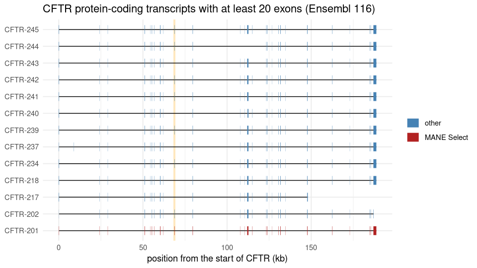
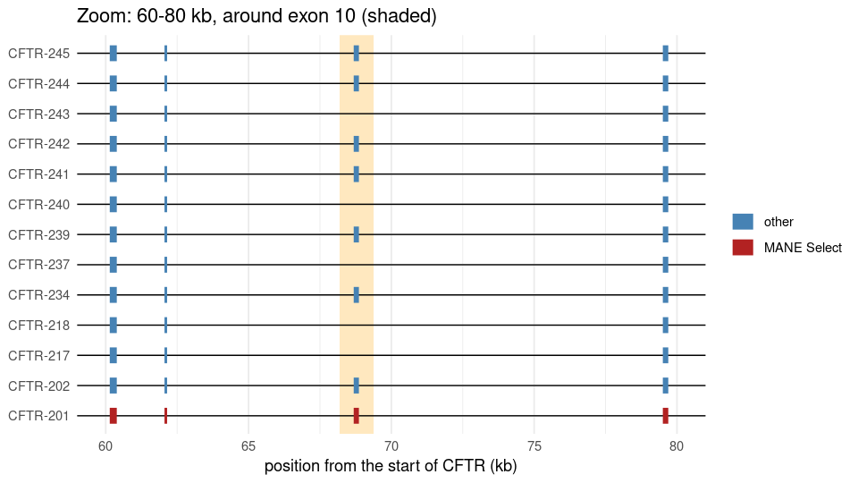

## Goal

By the end of this exercise you should be able to:

- summarise a database table **by groups** with `group_by()` and `summarise()`: here, exon and transcript lengths for every transcript of a gene;
- compare the exons of two transcripts to find a skipped exon;
- draw transcripts as an **exon diagram** with `geom_segment()`.

## Before you start

This page builds on F1–F3 of the [Exercise](exercise.qmd). You need the packages readr, dplyr and ggplot2. Download [cftr_exons_ensembl116.csv](data/cftr_exons_ensembl116.csv) and save it in a `data/` folder of your R project.

The file has one row per exon for all 45 *CFTR* transcripts in **Ensembl release 116** (GRCh38), downloaded from the Ensembl REST API on 2026-11-20; [data/README.md](data/README.md) gives the exact query. Coordinates are on chromosome 7 and include both ends, so an exon from `start` to `end` is `end - start + 1` nt long. *CFTR* is on the + strand, so `exon_rank` 1 is the leftmost exon.

## Tasks

**New idiom: grouped summaries.** [`group_by()`](https://dplyr.tidyverse.org/reference/group_by.html) splits a table into groups (here: one group per transcript), and [`summarise()`](https://dplyr.tidyverse.org/reference/summarise.html) then computes one row per group: `n()` counts rows, `sum()`, `min()` and `max()` work on a column within each group. `.groups = "drop"` removes the grouping afterwards. You have seen grouped summaries before; here they turn a long exon table into a transcript table.

```r
library(readr)
library(dplyr)
library(ggplot2)
```

**R1. (look at the table)** Read the file. How many rows are there? Count the transcripts of each biotype: use [`distinct()`](https://dplyr.tidyverse.org/reference/distinct.html) first, so that each transcript counts once rather than once per exon.

```r
exons <- read_csv("data/cftr_exons_ensembl116.csv")
exons
exons |> distinct(transcript_name, biotype) |> count(biotype, sort = TRUE)
```

**R2. (exon lengths)** Add an `exon_length` column. Keep only the MANE Select transcript, and find its number of exons, its shortest and longest exon, and the total length. Then list the **internal** exons (not the first or last) whose length is a multiple of 3, using the remainder operator `%%`. Skipping any of these keeps the reading frame (exercise B3).

```r
exons <- exons |> mutate(exon_length = end - start + 1)
mane <- exons |> filter(mane_select)
mane |> select(exon_rank, start, end, exon_length) |> print(n = 27)
mane |> summarise(n_exons = n(), shortest = min(exon_length), longest = max(exon_length),
                  total = sum(exon_length))
mane |> filter(exon_rank > 1, exon_rank < 27, exon_length %% 3 == 0) |>
  select(exon_rank, exon_length)
```

**R3. (transcript lengths)** Summarise **every** transcript: number of exons, transcript length (sum of exon lengths) and genomic span (first start to last end). What fraction of the span of the MANE transcript ends up in the mRNA? Then list the protein-coding transcripts by protein length, and compare biotypes.

```r
tx <- exons |>
  group_by(transcript_name, biotype, mane_select, protein_length) |>
  summarise(n_exons = n(),
            tx_length = sum(exon_length),
            span = max(end) - min(start) + 1,
            .groups = "drop") |>
  mutate(exon_fraction = tx_length / span)
tx |> filter(mane_select) |> select(transcript_name, n_exons, tx_length, span, exon_fraction)
tx |> filter(biotype == "protein_coding") |>
  arrange(desc(protein_length)) |>
  select(transcript_name, protein_length, n_exons, tx_length) |>
  print(n = 21)
tx |> group_by(biotype) |> summarise(transcripts = n(), median_exons = median(n_exons))
```

**R4. (which exon is skipped?)** UniProt isoform 2 has 1419 amino acids. In R3, find the Ensembl transcript with that protein length, and compare its exons with the MANE exons using `%in%`. First compare on `start`, then on `end`. Why do the two comparisons give different answers? How many nucleotides do 1480 − 1419 amino acids correspond to?

```r
cftr218 <- exons |> filter(transcript_name == "CFTR-218")
mane |> filter(!(start %in% cftr218$start)) |> select(exon_rank, start, end, exon_length)
mane |> filter(!(end %in% cftr218$end)) |> select(exon_rank, start, end, exon_length)
cftr218 |> filter(exon_rank == 1) |> select(exon_rank, start, end)
(1480 - 1419) * 3
```

**R5. (an exon diagram)** Draw the protein-coding transcripts with at least 20 exons, one per row, as [`geom_segment()`](https://ggplot2.tidyverse.org/reference/geom_segment.html): a thin line from the first to the last base of each transcript (the introns), and a thick segment for each exon. Shade exon 10 with [`annotate()`](https://ggplot2.tidyverse.org/reference/annotate.html). Positions are in kb from the start of the leftmost transcript. Then zoom in on 60–80 kb with [`coord_cartesian()`](https://ggplot2.tidyverse.org/reference/coord_cartesian.html). Which transcripts lack exon 10?

```r
keep <- tx |> filter(biotype == "protein_coding", n_exons >= 20) |> pull(transcript_name)
keep
plot_ex <- exons |> filter(transcript_name %in% keep)
gene_start <- min(plot_ex$start)
plot_ex <- plot_ex |> mutate(start_kb = (start - gene_start) / 1000, end_kb = (end - gene_start) / 1000)
introns <- plot_ex |> group_by(transcript_name, mane_select) |>
  summarise(from = min(start_kb), to = max(end_kb), .groups = "drop")
exon10 <- mane |> filter(exon_rank == 10) |>
  mutate(start_kb = (start - gene_start) / 1000, end_kb = (end - gene_start) / 1000)

p <- ggplot(plot_ex, aes(y = transcript_name)) +
  annotate("rect", xmin = exon10$start_kb - 0.5, xmax = exon10$end_kb + 0.5, ymin = -Inf, ymax = Inf,
           fill = "orange", alpha = 0.25) +
  geom_segment(data = introns, aes(x = from, xend = to, yend = transcript_name), linewidth = 0.4) +
  geom_segment(aes(x = start_kb, xend = end_kb, yend = transcript_name, colour = mane_select),
               linewidth = 5) +
  scale_colour_manual(values = c(`TRUE` = "firebrick", `FALSE` = "steelblue"),
                      labels = c(`TRUE` = "MANE Select", `FALSE` = "other")) +
  labs(x = "position from the start of CFTR (kb)", y = NULL, colour = NULL,
       title = "CFTR protein-coding transcripts with at least 20 exons (Ensembl 116)") +
  theme_minimal()
p
p + coord_cartesian(xlim = c(60, 80)) + labs(title = "Zoom: 60-80 kb, around exon 10 (shaded)")
```

## Solutions

::: {.callout-note collapse="true" title="Solutions: In R"}

All output below is from `Rscript --vanilla` run in the unit folder (messages from loading packages left out).

**R1.**

```
Rows: 728 Columns: 9
── Column specification ────────────────────────────────────────────────────────
Delimiter: ","
chr (4): transcript_id, transcript_name, biotype, exon_id
dbl (4): protein_length, exon_rank, start, end
lgl (1): mane_select

ℹ Use `spec()` to retrieve the full column specification for this data.
ℹ Specify the column types or set `show_col_types = FALSE` to quiet this message.
# A tibble: 728 × 9
   transcript_id    transcript_name biotype mane_select protein_length exon_rank
   <chr>            <chr>           <chr>   <lgl>                <dbl>     <dbl>
 1 ENST00000003084… CFTR-201        protei… TRUE                  1480         1
 2 ENST00000003084… CFTR-201        protei… TRUE                  1480         2
 3 ENST00000003084… CFTR-201        protei… TRUE                  1480         3
 4 ENST00000003084… CFTR-201        protei… TRUE                  1480         4
 5 ENST00000003084… CFTR-201        protei… TRUE                  1480         5
 6 ENST00000003084… CFTR-201        protei… TRUE                  1480         6
 7 ENST00000003084… CFTR-201        protei… TRUE                  1480         7
 8 ENST00000003084… CFTR-201        protei… TRUE                  1480         8
 9 ENST00000003084… CFTR-201        protei… TRUE                  1480         9
10 ENST00000003084… CFTR-201        protei… TRUE                  1480        10
# ℹ 718 more rows
# ℹ 3 more variables: exon_id <chr>, start <dbl>, end <dbl>
# A tibble: 4 × 2
  biotype                            n
  <chr>                          <int>
1 protein_coding                    21
2 nonsense_mediated_decay           11
3 protein_coding_CDS_not_defined    11
4 retained_intron                    2
```

728 exons in 45 transcripts: 21 protein-coding, 11 with a premature stop (`nonsense_mediated_decay`), 11 with no defined coding sequence (often fragments), and 2 that keep an intron. `read_csv()` reads `mane_select` as logical (TRUE/FALSE), which is why `filter(mane_select)` works in R2.

**R2.**

```
# A tibble: 27 × 4
   exon_rank     start       end exon_length
       <dbl>     <dbl>     <dbl>       <dbl>
 1         1 117480025 117480147         123
 2         2 117504253 117504363         111
 3         3 117509034 117509142         109
 4         4 117530899 117531114         216
 5         5 117534276 117534365          90
 6         6 117535248 117535411         164
 7         7 117536548 117536673         126
 8         8 117540100 117540346         247
 9         9 117542016 117542108          93
10        10 117548641 117548823         183
11        11 117559464 117559655         192
12        12 117587739 117587833          95
13        13 117590353 117590439          87
14        14 117591934 117592657         724
15        15 117594930 117595058         129
16        16 117602826 117602863          38
17        17 117603532 117603782         251
18        18 117606674 117606753          80
19        19 117610519 117610669         151
20        20 117611581 117611808         228
21        21 117614613 117614713         101
22        22 117627522 117627770         249
23        23 117642438 117642593         156
24        24 117652842 117652931          90
25        25 117664688 117664860         173
26        26 117665459 117665564         106
27        27 117666908 117668665        1758
# A tibble: 1 × 4
  n_exons shortest longest total
    <int>    <dbl>   <dbl> <dbl>
1      27       38    1758  6070
# A tibble: 13 × 2
   exon_rank exon_length
       <dbl>       <dbl>
 1         2         111
 2         4         216
 3         5          90
 4         7         126
 5         9          93
 6        10         183
 7        11         192
 8        13          87
 9        15         129
10        20         228
11        22         249
12        23         156
13        24          90
```

27 exons, from 38 nt (exon 16) to 1758 nt (exon 27, mostly 3′ UTR), 6070 nt in total, as on the Ensembl page (F1). 13 of the 25 internal exons are a multiple of 3 long, exon 10 (183 nt) among them; skipping any of them keeps the frame. Exon 12 (95 nt), which carries G542X and whose acceptor c.1585-1G>A destroys, is not.

**R3.**

```
# A tibble: 1 × 5
  transcript_name n_exons tx_length   span exon_fraction
  <chr>             <int>     <dbl>  <dbl>         <dbl>
1 CFTR-201             27      6070 188641        0.0322
# A tibble: 21 × 4
   transcript_name protein_length n_exons tx_length
   <chr>                    <dbl>   <int>     <dbl>
 1 CFTR-201                  1480      27      6070
 2 CFTR-245                  1480      27      6136
 3 CFTR-234                  1478      27      6130
 4 CFTR-239                  1451      26      6049
 5 CFTR-242                  1450      26      6046
 6 CFTR-202                  1438      26      4316
 7 CFTR-241                  1437      26      6007
 8 CFTR-218                  1419      26      5953
 9 CFTR-243                  1376      25      5824
10 CFTR-240                  1354      26      5758
11 CFTR-237                  1338      27      5996
12 CFTR-217                  1187      21      3810
13 CFTR-244                  1135      23      5101
14 CFTR-216                   842      17      2775
15 CFTR-228                   536      11      1977
16 CFTR-229                   478      11      1973
17 CFTR-220                   333      13      1706
18 CFTR-223                   280       7      2842
19 CFTR-206                   190       3       682
20 CFTR-209                   156       4       559
21 CFTR-205                    36       6       690
# A tibble: 4 × 3
  biotype                        transcripts median_exons
  <chr>                                <int>        <dbl>
1 nonsense_mediated_decay                 11         27
2 protein_coding                          21         25
3 protein_coding_CDS_not_defined          11          3
4 retained_intron                          2          2.5
```

The MANE transcript spans **188,641 bp** of chromosome 7, but its exons add up to only **6,070 nt**: about **3.2 %**. The other 97 % is intron. Protein-coding transcripts encode proteins from 36 to 1480 amino acids; only **CFTR-218** has 1419 amino acids, the length of UniProt isoform 2. The NMD transcripts are full-length (median 27 exons) but carry a premature stop; the transcripts with no coding sequence are mostly short fragments (median 3 exons).

**R4.**

```
# A tibble: 2 × 4
  exon_rank     start       end exon_length
      <dbl>     <dbl>     <dbl>       <dbl>
1         1 117480025 117480147         123
2        10 117548641 117548823         183
# A tibble: 1 × 4
  exon_rank     start       end exon_length
      <dbl>     <dbl>     <dbl>       <dbl>
1        10 117548641 117548823         183
# A tibble: 1 × 3
  exon_rank     start       end
      <dbl>     <dbl>     <dbl>
1         1 117479959 117480147
[1] 183
```

Comparing starts flags exon 1 and exon 10. But CFTR-218's first exon **starts 66 nt earlier** (117,479,959 instead of 117,480,025: a different transcription start) and ends at the same base, so comparing ends flags only **exon 10**. CFTR-218 has every MANE exon except exon 10, and 61 amino acids × 3 = **183 nt**, exactly the length of exon 10. This is the exon-10-skipped isoform from the lecture and from F3.

**R5.**

```
 [1] "CFTR-201" "CFTR-202" "CFTR-217" "CFTR-218" "CFTR-234" "CFTR-237"
 [7] "CFTR-239" "CFTR-240" "CFTR-241" "CFTR-242" "CFTR-243" "CFTR-244"
[13] "CFTR-245"
```

{width="90%" fig-align="center"}

{width="90%" fig-align="center"}

At the scale of the whole gene the exons are thin slivers on long introns: the 3 % from R3. The zoom shows that **CFTR-217, CFTR-218, CFTR-237, CFTR-240 and CFTR-243** have no exon in the shaded region: they skip exon 10. Most transcripts share the same exons and differ in one or two of them, or in where they start and end. (CFTR-217 also ends early, at about 148 kb.)
:::

## Where this leads

The exon table is the same information a genome browser draws as its gene track. In **Part 4: Genome analysis** you read a larger table exported from Ensembl BioMart, count genes per chromosome, and join tables with `left_join()`. In **Part 6**, `group_by()` and `summarise()` summarise gene expression across tissues from GTEx.
