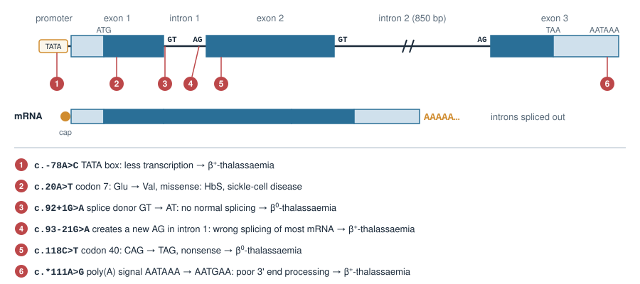
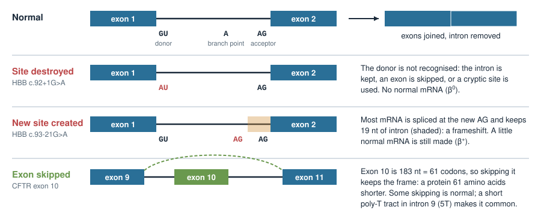
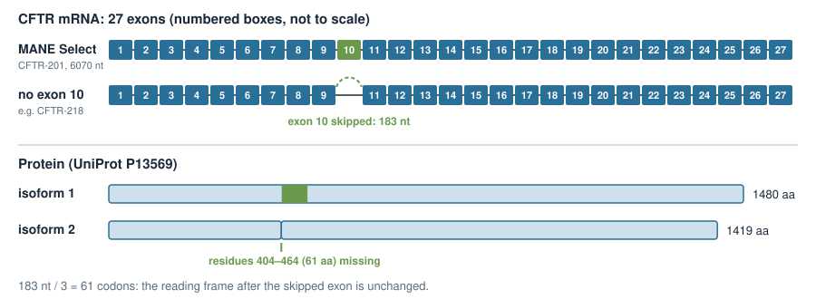
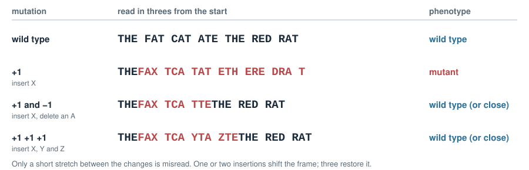

## About this lecture

**Recap of 5MO103** (Microbiology and basic molecular biology). You know how a cell reads a gene. Here we ask the geneticist's version of the question: **where in a gene can a mutation act, and what does it do?**

- The anatomy of a gene, and six real *HBB* mutations that hit six different steps.
- **Transcription** and **RNA processing**: promoters, caps, poly(A) tails and **splicing**.
- **Splicing mutations**, and **alternative splicing**: one gene, many transcripts (*CFTR* in Ensembl and UniProt).
- **Translation** and the **genetic code**, and how **frameshift mutants** proved that the code is read in triplets (Crick and Brenner).

Book: Hartwell, *Genetics: From Genes to Genomes*, Gene expression: the flow of information from DNA to RNA to protein chapter.

::: notes
This is a recap unit, so keep the biochemistry short; students have the full mechanism from 5MO103. The new angle is the mutation one: in the previous unit every mutation was a change in a codon. Here we see that a mutation in a promoter, a splice site or a poly(A) signal can be just as damaging, and that one gene can give several proteins. The beta-thalassaemias are the running example because HBB is so small and so well studied; nearly every step of expression has a known disease mutation. About eight content slides.
:::

## Where can a mutation act? {.smaller}

{width="78%" fig-align="center"}

Six real disease variants in one small gene, *HBB* (all classified as pathogenic in ClinVar). Only two of them change a codon.

::: notes
Walk along the gene from left to right. The promoter variant at c.-78 sits in the TATA box, 28 bases before the transcription start, and reduces transcription, so less beta-globin is made: beta-plus thalassaemia (reduced output). HbS is the missense change students know. The two intron 1 variants damage splicing: c.92+1 destroys the GT of the donor site, c.93-21 creates a new AG acceptor inside the intron. c.118C>T is the codon 39 nonsense allele from the mutation unit. The last one is in the poly(A) signal AATAAA in the 3' UTR. Beta-zero means no beta-globin at all from that allele, beta-plus means some. Numbering: c.-78 is 78 bases before the A of ATG; c.92+1 is the first intron base after coding base 92; c.93-21 is 21 bases before coding base 93; c.*111 is 111 bases after the stop codon. The numbers are from the HGVS names in ClinVar.
:::

## Transcription, in brief {.smaller}

- **RNA polymerase II** binds the **promoter** with general transcription factors (TFIID binds the **TATA box**, about 25–30 bp upstream of the start).
- It reads the **template strand** 3′ → 5′ and makes RNA 5′ → 3′, so the RNA has the same sequence as the **coding strand** (with U for T). That is why genes are written as the coding strand.
- **Enhancers** and **transcription factors** set how much RNA is made, and where and when: Part 6.

**The genetic lens.** Promoter mutations change **how much** product is made, not what it is. *HBB* c.-78A>C changes the TATA box CATAAAA to CATACAA: less transcription, β^+^-thalassaemia. Such *cis*-acting mutations affect only the copy of the gene on the same chromosome.

::: notes
The template versus coding strand point links back to the DNA recap: the coding strand is the one that matches the mRNA, and it is also the strand used for c. numbering. A cis-acting element is a DNA sequence that controls only the gene on the same molecule; a trans-acting factor is a diffusible product (a protein or RNA) that can act on both copies. The cis/trans distinction is the core of the lac operon logic in Part 6, so plant it here. The TATA sequence on the slide is the genomic sequence around c.-78 from Ensembl.
:::

## Processing: cap, tail and splicing {.smaller}

A eukaryotic pre-mRNA is processed while it is being made:

| Step | What happens | A mutation that breaks it |
|---|---|---|
| **5′ cap** | a 7-methylguanosine is added to the 5′ end; needed for export and translation | |
| **3′ end** | the RNA is cut about 10–30 nt after **AAUAAA**, and a **poly(A) tail** is added | *HBB* c.*111A>G: AATAAA → AATGAA, β^+^ |
| **Splicing** | the **spliceosome** removes introns: **GU** at the 5′ end (donor), a **branch-point A**, **AG** at the 3′ end (acceptor) | *HBB* c.92+1G>A (donor), c.93-21G>A (new acceptor) |

Introns can be long. *CFTR* spans about 189 kb of chromosome 7, and its mRNA is 6.1 kb: only about 3 % of the gene ends up in the mRNA.

::: notes
The point to land is that the splice signals are short and simple: GU, AG, a branch point and some weaker flanking sequences. That means a single base change can destroy a site or create a new one. The spliceosome is made of snRNPs that recognise these sites by base pairing, which is why the consensus is so important. The CFTR numbers come from the Ensembl snapshot used in the R exercise: the MANE Select transcript has 27 exons, 6070 nt of exon, over a span of 188,641 bp of genome.
:::

## Splicing mutations {.smaller}

{width="78%" fig-align="center"}

About one in ten disease-causing point mutations affects splicing. A "silent" or intronic change is not always harmless.

::: notes
Three patterns. Destroying a donor or acceptor site (c.92+1G>A in HBB, or CFTR c.1585-1G>A, the acceptor of exon 12) means the normal splice is lost: the spliceosome skips the exon, keeps the intron, or uses a weaker cryptic site nearby. Creating a new site: HBB c.93-21G>A (traditionally IVS-I-110) makes a new AG 19 bases upstream of the normal acceptor; most transcripts use it and keep 19 nt of intron, which shifts the reading frame, but some normal splicing remains, so it is a beta-plus allele. It is one of the most common beta-thalassaemia alleles around the Mediterranean. Exon skipping: if the skipped exon is a multiple of 3 long, the frame is kept and the protein just lacks a piece; CFTR exon 10 (183 nt) is the example on the next slide. The one-in-ten figure is a rough literature estimate; give it as an order of magnitude.
:::

## Alternative splicing: one gene, many products {.smaller}

:::: {.columns}
::: {.column width="40%"}

Most human multi-exon genes are **alternatively spliced**: exons can be included or skipped, and different starts and ends can be used.

*CFTR* in **Ensembl** (release 116): **45 transcripts**, of which one is the **MANE Select** transcript (ENST00000003084, = RefSeq NM_000492.4): 27 exons, a protein of 1480 amino acids.

**UniProt** P13569 lists **3 isoforms**. Isoform 2 lacks residues 404–464: exactly the 61 codons of **exon 10**.

:::
::: {.column width="60%"}

{width="100%"}

:::
::::

::: notes
Ensembl's transcripts include everything with evidence: full-length coding transcripts, fragments, transcripts that keep an intron, and transcripts predicted to be destroyed by nonsense-mediated decay. Many are rare. MANE Select is one transcript per gene, agreed between NCBI and Ensembl, that is used as the default for reporting variants; ClinVar's CFTR names all use NM_000492.4. UniProt lists isoforms only when there is protein-level or strong evidence, which is why it has 3 rather than 45. Exon 10 (exon 9 in the old legacy numbering) is 183 nt. A poly-T tract just upstream of it in intron 9 varies in length between people: with only five Ts (the 5T allele), exon 10 is skipped in most transcripts, and the protein without exon 10 does not work. 5T is associated with male infertility from absent vas deferens and with mild CF when combined with a severe allele. Students compute these numbers themselves in the R exercise.
:::

## Translation, and nonsense-mediated decay {.smaller}

- The ribosome starts at the first **AUG** in a good context, and reads **codons** in one frame until a **stop** codon (UAA, UAG, UGA).
- **tRNAs** match codons by base pairing with their **anticodon**; the third position pairs loosely (**wobble**), which is why many synonymous codons differ only in the third base.
- **Nonsense-mediated decay (NMD).** In a normal mRNA the stop codon is in the last exon. If a **premature** stop codon lies well upstream of the last exon–exon junction, the mRNA is recognised and **destroyed**.

**The genetic lens.** NMD means that a nonsense allele such as *CFTR* G542X (in exon 12 of 27) usually makes **almost no protein**, not a short one: it behaves as a **null allele**. Ensembl labels transcripts with such early stops with the biotype `nonsense_mediated_decay`: *CFTR* has 11 of them.

::: notes
Wobble explains the pattern students found in the mutation R exercise: almost all silent changes are at the third codon position. NMD is a quality-control system: during splicing, protein complexes are deposited at each exon-exon junction; the first ribosome removes them as it translates; a stop codon that leaves junction complexes behind it marks the mRNA as faulty. The genetic consequence is that most nonsense and frameshift alleles act as nulls, which is why they are usually recessive, and why truncated dominant-negative proteins are rare. A nonsense codon in the last exon escapes NMD and can make a truncated protein. Drugs that make the ribosome read through stop codons have been tried for nonsense alleles such as G542X.
:::

## The genetic code {.smaller}

| Property | Meaning | How we know |
|---|---|---|
| **Triplet** | 3 bases per amino acid (4^3^ = 64 codons ≥ 20 amino acids) | Crick–Brenner frameshifts (next slide) |
| **Non-overlapping, no gaps** | each base belongs to one codon; reading from a fixed start | single base changes alter one amino acid (HbS) |
| **Degenerate** | 61 sense codons for 20 amino acids; 3 stops | silent mutations |
| **(Nearly) universal** | the same in bacteria, plants and animals, with small exceptions (e.g. UGA = Trp in vertebrate mitochondria) | human genes are expressed correctly in *E. coli* |

The meaning of the codons was found biochemically: Nirenberg and Matthaei (1961) showed that poly-U RNA makes poly-phenylalanine, so **UUU = Phe**; by 1966 all 64 codons were assigned.

::: notes
Each property has a genetic or biochemical proof. Non-overlapping: if codons overlapped, a single base change would alter two or three adjacent amino acids; HbS and every other point mutation change only one. Degenerate: silent substitutions exist, and the codon table in the R exercise shows six codons for Leu, Ser and Arg. Universal: that is what makes it possible to make human insulin in bacteria. The mitochondrial exceptions come back in the organelle inheritance unit in Part 5. The cell-free translation experiments with synthetic RNAs (Nirenberg, Khorana) cracked the meanings; Crick and Brenner's genetic experiment established the triplet nature before any codon was assigned.
:::

## Crick & Brenner: the code is read in triplets {.smaller}

{width="80%" fig-align="center"}

Crick, Barnett, Brenner and Watts-Tobin (1961) used **proflavin** to make **frameshift** mutants in the *rII* gene of phage T4. Combining them:

- one (+) or one (−): mutant. **(+)(−)** close together: **wild type** again (**intragenic suppression**).
- **(+)(+)** or **(−)(−)**: mutant. **(+)(+)(+)** or **(−)(−)(−)**: **wild type**.

Only a code read **in threes** from a **fixed start** explains this, years before any codon was known.

::: notes
This is the genetic proof that matters for this course, because it used only crosses and phenotypes. Proflavin causes single-base insertions or deletions. They started with one rII mutant, called it plus by definition, and selected revertants; most revertants carried a second mutation nearby of the opposite sign, minus. Recombining mutations of the same sign showed that two pluses are still mutant but three pluses restore function. The region between the changes is translated in the wrong frame, so the protein is only near normal if that region is short and tolerant, which is why the suppressed mutants were close together and near the start of the gene, in a non-essential region. The sentence analogy in the figure is the one Crick used. Exercise B2 in the mutation unit did exactly this with the HBB sequence.
:::

## Summary {.smaller}

| Step | Key fact | Mutation example (*HBB* unless noted) |
|---|---|---|
| Transcription | Pol II at the promoter; RNA = coding strand sequence | c.-78A>C, TATA box: less mRNA (β^+^) |
| 3′ end | cut after AAUAAA, poly(A) added | c.*111A>G in AATAAA (β^+^) |
| Splicing | GU…A…AG; spliceosome | c.92+1G>A destroys a donor (β^0^); c.93-21G>A creates an acceptor (β^+^) |
| Alternative splicing | one gene, many transcripts; MANE Select = default | *CFTR*: 45 Ensembl transcripts, 3 UniProt isoforms; exon 10 skipping |
| Translation | AUG to stop, in one frame; wobble at codon position 3 | c.20A>T, missense (HbS) |
| NMD | premature stop → mRNA destroyed | c.118C>T (β^0^); *CFTR* G542X: null alleles |
| Genetic code | triplet, non-overlapping, degenerate, nearly universal | Crick–Brenner (+)(+)(+) restores function |

::: notes
The revision sheet. The table can be read row by row as "a step of expression, and the kind of mutation that breaks it". Ask students to place each of the HBB variants on the gene diagram from the first slide without looking.
:::

## Where this leads

- **Exercise in R:** an exon-coordinate table for all 45 *CFTR* transcripts (Ensembl 116): exon and transcript lengths with `group_by()` and `summarise()`, and an exon diagram with `geom_segment()`.
- **Part 4: Genome analysis.** Finding genes and open reading frames in raw sequence, and browsing exons, transcripts and variants in Ensembl and UCSC.
- **Part 6: Gene regulation.** How transcription factors, enhancers, chromatin and RNAs control how much of each transcript is made.

::: notes
Point forward. This closes Part 3: DNA, how it changes, and how it is read. Part 4 turns to the tools for reading whole genomes. The R exercise of this unit is the first one to summarise a real database table by groups, which is the main R skill for the rest of the course.
:::
