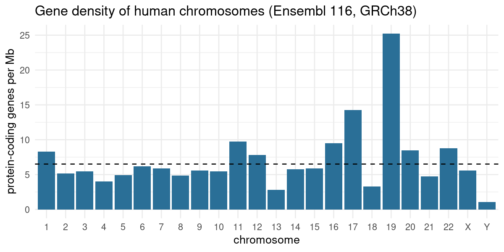
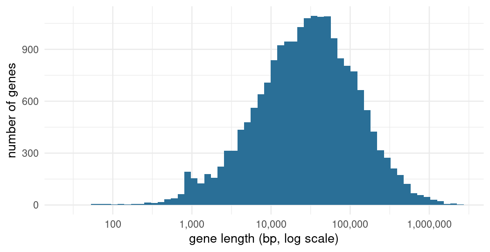

## Goal

By the end of this exercise you should be able to:

- read a tab-separated export from a database (Ensembl **BioMart**) with **`read_tsv()`** and give its columns usable names;
- count rows per group and put chromosomes in their natural order with a factor;
- combine two tables on a shared column with **`left_join()`**;
- plot gene density and gene length with ggplot2.

## Before you start

This page builds on the [Exercise](exercise.qmd); do Find it F3 (the BioMart export) first, so you know where the file comes from. You need the packages readr, dplyr and ggplot2. Download the two files and save them in a `data/` folder of your R project:

- [human_genes.tsv](data/human_genes.tsv) (830 kB): all 20,107 human protein-coding genes on chromosomes 1–22, X, Y and MT, from **Ensembl BioMart, release 116** (GRCh38).
- [chromosome_lengths.tsv](data/chromosome_lengths.tsv): the length of each chromosome, from the Ensembl REST API (GRCh38.p14).

See [data/README.md](data/README.md) for the exact queries.

## Tasks

**New idiom: `read_tsv()` on a database export.** [`read_tsv()`](https://readr.tidyverse.org/reference/read_delim.html) reads tab-separated files, the format most databases use for downloads (BioMart, UCSC Table Browser, GWAS Catalog …). Exports often have column names with spaces and brackets, such as `Gene start (bp)`. In R you refer to such a name with backticks, `` `Gene start (bp)` ``, and the easiest thing is to [`rename()`](https://dplyr.tidyverse.org/reference/rename.html) the columns once, right after reading.

**Also new: `left_join()`.** [`left_join(x, y, by = "key")`](https://dplyr.tidyverse.org/reference/mutate-joins.html) keeps every row of `x` and adds the columns of `y` from the row with the same value in the `key` column. You will use it again in the next unit.

```r
library(readr)
library(dplyr)
library(ggplot2)
```

**R1. (read the export)** Read the file, look at what `read_tsv()` reports about the column types, and rename the columns. Check that every gene has the biotype you asked for, and count the genes without a name.

```r
genes <- read_tsv("data/human_genes.tsv")
genes
genes <- genes |>
  rename(gene = `Gene name`, chromosome = `Chromosome/scaffold name`,
         start = `Gene start (bp)`, end = `Gene end (bp)`, biotype = `Gene type`)
genes |> count(biotype)
genes |> filter(is.na(gene)) |> nrow()
```

Why does `read_tsv()` read `chromosome` as text (`chr`) and not as a number?

**R2. (genes per chromosome)** Count the genes on each chromosome with [`count()`](https://dplyr.tidyverse.org/reference/count.html). Alphabetical order would put "10" before "2", so turn the chromosome into a factor with the levels in their natural order.

```r
chrom_order <- c(1:22, "X", "Y", "MT")
per_chrom <- genes |>
  count(chromosome, name = "n_genes") |>
  mutate(chromosome = factor(chromosome, levels = chrom_order)) |>
  arrange(chromosome)
print(per_chrom, n = 25)
```

Which chromosome has the most genes? Is that surprising, given its size?

**R3. (join with chromosome lengths)** The number of genes means more per Mb of DNA. Read the second table and join it to the counts by chromosome. The join key must have the same type in both tables, so we turn the factor back into text before joining. Then compute genes per Mb, and look at the densest and the sparsest chromosomes.

```r
lengths <- read_tsv("data/chromosome_lengths.tsv", col_types = "cd")
lengths
density <- per_chrom |>
  mutate(chromosome = as.character(chromosome)) |>
  left_join(lengths, by = "chromosome") |>
  mutate(length_mb = length_bp / 1e6,
         genes_per_mb = n_genes / length_mb,
         chromosome = factor(chromosome, levels = chrom_order))
density |> arrange(desc(genes_per_mb)) |> print(n = 6)
density |> arrange(genes_per_mb) |> print(n = 4)
overall <- sum(density$n_genes) / (sum(density$length_bp) / 1e6)
overall
```

(`col_types = "cd"` tells `read_tsv()` that the first column is character and the second double, so chromosome "1" is read as text, matching the gene table.)

**R4. (plot gene density)** Plot genes per Mb for the nuclear chromosomes as a bar chart, with a dashed line at the genome average. Leave out the mitochondrial genome (why?).

```r
density |>
  filter(chromosome != "MT") |>
  ggplot(aes(x = chromosome, y = genes_per_mb)) +
  geom_col(fill = "#2a6f97") +
  geom_hline(yintercept = overall, linetype = "dashed") +
  labs(x = "chromosome", y = "protein-coding genes per Mb",
       title = "Gene density of human chromosomes (Ensembl 116, GRCh38)") +
  theme_minimal(base_size = 13)
```

Compare with your answers to B6 in the exercise.

**R5. (gene length)** Add a column with the length of each gene (`end - start + 1`, because both ends are included). Summarise it, list the five longest genes, and look up four genes you know from earlier units. Then plot the distribution on a log scale.

```r
genes <- genes |> mutate(length = end - start + 1)
summary(genes$length)
genes |> arrange(desc(length)) |> select(gene, chromosome, length) |> head(5)
genes |> filter(gene %in% c("HBB", "DMD", "CFTR", "HTT")) |> select(gene, chromosome, start, end, length)

ggplot(genes, aes(x = length)) +
  geom_histogram(bins = 60, fill = "#2a6f97") +
  scale_x_log10(labels = scales::label_comma()) +
  labs(x = "gene length (bp, log scale)", y = "number of genes") +
  theme_minimal(base_size = 13)
```

Why are the mean and the median so different? There is a small extra peak just below 1,000 bp: what kind of gene could be that short? (Hint: which genes have no introns?)

**R6. (the globin cluster in the table)** Filter the table to the genes that start between 5.2 and 5.3 Mb on chromosome 11 and sort them by position. Compare with the browser view in the lecture and with B5.

```r
genes |>
  filter(chromosome == "11", start >= 5200000, start < 5300000) |>
  arrange(start) |>
  select(gene, start, end, length)
```

Some of these "genes" are hundreds of kb long, much longer than in B5, and two have no name. What does that tell you about using the gene start and end from an annotation table?

## Solutions

::: {.callout-note collapse="true" title="Solutions: In R"}

All output below is from `Rscript --vanilla` (R 4.6.2) run in the unit folder. Long tables are shortened where marked with `...`.

**R1.**

```
Rows: 20107 Columns: 5
── Column specification ────────────────────────────────────────────────────────
Delimiter: "\t"
chr (3): Gene name, Chromosome/scaffold name, Gene type
dbl (2): Gene start (bp), Gene end (bp)
# A tibble: 20,107 × 5
   `Gene name` `Chromosome/scaffold name` `Gene start (bp)` `Gene end (bp)`
   <chr>       <chr>                                  <dbl>           <dbl>
 1 MT-ND1      MT                                      3307            4262
 2 MT-ND2      MT                                      4470            5511
 3 MT-CO1      MT                                      5904            7445
 ...
# ℹ 20,097 more rows
# ℹ 1 more variable: `Gene type` <chr>
# A tibble: 1 × 2
  biotype            n
  <chr>          <int>
1 protein_coding 20107
[1] 629
```

All 20,107 genes are protein-coding, as filtered in BioMart; 629 have no gene name (they are known only by their Ensembl ID). The chromosome column is text because it contains "X", "Y" and "MT", not only numbers.

**R2.**

```
# A tibble: 25 × 2
   chromosome n_genes
   <fct>        <int>
 1 1             2066
 2 2             1252
 3 3             1084
 4 4              759
 5 5              895
 6 6             1052
 7 7              935
 8 8              706
 9 9              776
10 10             732
11 11            1319
12 12            1041
13 13             322
14 14             619
15 15             603
16 16             856
17 17            1187
18 18             267
19 19            1479
20 20             548
21 21             221
22 22             447
23 X              867
24 Y               61
25 MT              13
```

Chromosome 1, the largest, has the most genes (2,066). But chromosome 19 (1,479) has more than chromosome 2 (1,252), which is four times as long.

**R3.**

```
# A tibble: 25 × 2
   chromosome length_bp
   <chr>          <dbl>
 1 1          248956422
 2 2          242193529
 ...
# A tibble: 25 × 5
  chromosome n_genes length_bp length_mb genes_per_mb
  <fct>        <int>     <dbl>     <dbl>        <dbl>
1 MT              13     16569    0.0166       785.
2 19            1479  58617616   58.6           25.2
3 17            1187  83257441   83.3           14.3
4 11            1319 135086622  135.             9.76
5 16             856  90338345   90.3            9.48
6 22             447  50818468   50.8            8.80
# A tibble: 25 × 5
  chromosome n_genes length_bp length_mb genes_per_mb
  <fct>        <int>     <dbl>     <dbl>        <dbl>
1 Y               61  57227415      57.2         1.07
2 13             322 114364328     114.          2.82
3 18             267  80373285      80.4         3.32
4 4              759 190214555     190.          3.99
[1] 6.51073
```

The mitochondrial genome is by far the densest (13 protein-coding genes in 16.6 kb, 785 per Mb, almost no non-coding DNA, like a bacterial genome). Among the nuclear chromosomes, 19 (25.2 per Mb) and 17 (14.3) are the densest; Y (1.1), 13 (2.8) and 18 (3.3) the sparsest. The genome average is **6.5 genes per Mb**.

**R4.**

{width="85%" fig-align="center"}

The mitochondrial genome is left out because its density (785 per Mb) would squash all the other bars. The plot shows a roughly ten-fold range among the nuclear chromosomes, with 19 as the outlier. The values for 13, 18, 19 and 21 match B6.

**R5.**

```
   Min. 1st Qu.  Median    Mean 3rd Qu.    Max.
     27   10698   29403   70706   74722 2473539
# A tibble: 5 × 3
  gene    chromosome  length
  <chr>   <chr>        <dbl>
1 RBFOX1  16         2473539
2 CNTNAP2 7          2304997
3 PTPRD   9          2298757
4 DMD     X          2241933
5 LSAMP   3          2195219
# A tibble: 4 × 5
  gene  chromosome     start       end  length
  <chr> <chr>          <dbl>     <dbl>   <dbl>
1 HBB   11           5225464   5229395    3932
2 HTT   4            3041363   3243957  202595
3 DMD   X           31097677  33339609 2241933
4 CFTR  7          117287120 117715971  428852
```

{width="75%" fig-align="center"}

The median gene is **29 kb**, but the mean is 71 kb: a few enormous genes (up to 2.5 Mb) pull the mean up. On a log scale the distribution is roughly symmetric. *DMD* (Duchenne muscular dystrophy, from the pedigree unit) is the 4th longest gene at 2.24 Mb; *HBB* is only about 4 kb (the 3.9 kb here includes a longer alternative transcript; the canonical one is 1.6 kb). The small peak just below 1 kb are genes with a single exon and no introns, many of them **olfactory receptor** genes, the largest gene family in the human genome. Olfactory receptor genes even flank the globin cluster: *OR51V1*, *OR52A1* and *OR52A5* lie just below 5.2 Mb on chromosome 11.

**R6.**

```
# A tibble: 7 × 4
  gene    start     end length
  <chr>   <dbl>   <dbl>  <dbl>
1 HBB   5225464 5229395   3932
2 HBD   5232678 5243698  11021
3 HBG1  5248204 5249859   1656
4 <NA>  5248270 5254783   6514
5 HBG2  5253188 5505605 252418
6 <NA>  5254392 5678434 424043
7 HBE1  5268345 5505652 237308
```

The five globin genes are in the same order as in the browser and in B5. But *HBG2* and *HBE1* reach to 5.5 Mb, and *HBD* to 5.24 Mb, in this table: the gene start and end in BioMart span **all** annotated transcripts, including rare long "read-through" transcripts that continue into neighbouring genes. The two unnamed genes are also such read-through models. The canonical transcripts (B5) are all about 1.6 kb. So gene coordinates from a table are a summary of the annotation; for the structure of a gene, look at its canonical transcript in a browser. (*HBBP1* is missing because it is a pseudogene, not protein-coding.)
:::

## Where this leads

In **Genomic variation** you download another small table from Ensembl, allele frequencies of a few SNPs in the 1000 Genomes populations, and use `left_join()` again, this time to add each population's continent before plotting.
