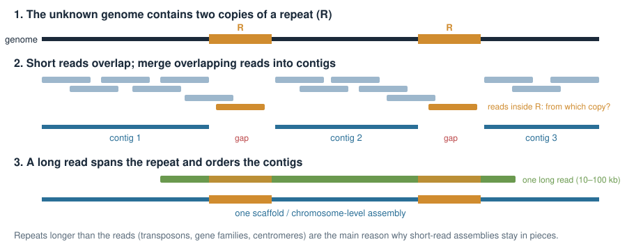
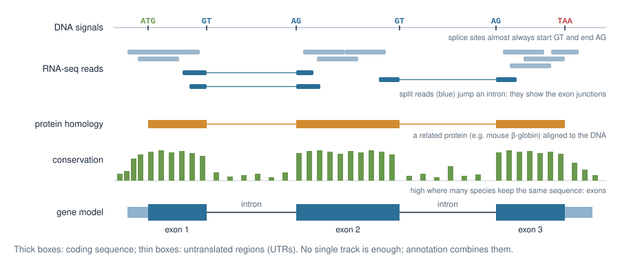
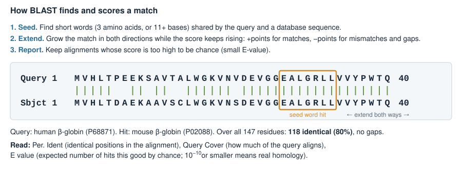
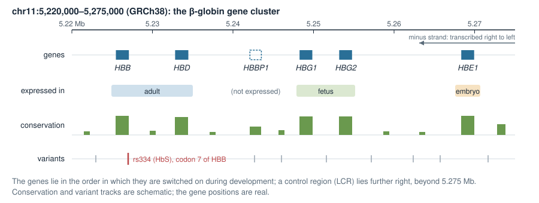
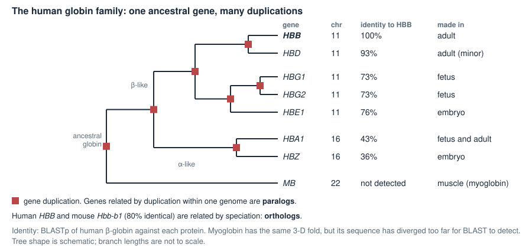

## About this lecture

The last unit read DNA in pieces: one PCR product, or millions of short reads. A **genome project** puts the pieces together into chromosomes, and **annotation** marks what is on them: where the genes are, what they encode, and which genes in other species they resemble.

- **Assembly**: from reads to contigs to chromosomes, and why repeats make it hard.
- **Finding genes**: open reading frames (ORFs) in bacteria; exons, splice signals and codon bias in eukaryotes.
- **Evidence**: RNA-seq, homology (**BLAST**) and conservation.
- **Genome browsers**: one gene seen as stacked tracks.
- **Comparative genomics** and **gene families**: orthologs, paralogs, and the globins as an example.

The running example is again *HBB*, now seen in its genomic neighbourhood.

Book: Hartwell, *Genetics: From Genes to Genomes*, chapter on genome sequencing and annotation.

::: notes
This lecture is the most bioinformatic of the course, but the questions are genetic: where is a gene, what does it do, and how is it related to other genes? Students used NCBI Gene and Ensembl in the first unit to find the chromosome of HBB and CFTR. Today they find out where those annotations come from. The exercise has a six-frame ORF finder demo, a BLASTp search with the beta-globin protein, a look at the beta-globin locus in a genome browser, and the R part reads a BioMart export of all human protein-coding genes.
:::

## Genome projects: a short history {.smaller}

| Year | Genome | Size | Why it mattered |
|---|---|---:|---|
| 1977 | phage φX174 | 5.4 kb | first DNA genome sequenced (Sanger) |
| 1995 | *Haemophilus influenzae* | 1.8 Mb | first free-living organism |
| 1996 | *Saccharomyces cerevisiae* | 12 Mb | first eukaryote |
| 1998 | *Caenorhabditis elegans* | 100 Mb | first animal |
| 2000 | *Drosophila melanogaster*, *Arabidopsis thaliana* | 140 Mb, 120 Mb | genetic model organisms |
| 2001–2004 | human (Human Genome Project) | 3.1 Gb | reference genome, about 20,000 protein-coding genes |
| 2022 | human, telomere to telomere (T2T) | 3.1 Gb | first gap-free human genome, with centromeres |

Today a bacterial genome costs less than a lab course, and projects aim at all eukaryotic species.

::: notes
The table is not for memorising; it shows the pace. The first genomes were read with Sanger sequencing and clone-by-clone strategies; from the late 2000s, next-generation sequencing made genomes cheap, and long reads made them complete. The human reference used everywhere in this course, GRCh38, still has gaps in the most repetitive regions; the T2T assembly filled them in 2022. The organisms in the table are the same as in the genome-size table from Genetics as information, and the size column links back to the C-value paradox: genome size says little about gene number.
:::

## Assembly: putting the reads together {.smaller}

{width="72%" fig-align="center"}

- Reads that **overlap** come from neighbouring positions; merging them gives **contigs** (contiguous sequences).
- A **repeat** longer than the reads cannot be placed: its reads fit at every copy. The assembly breaks there.
- **Long reads** (10–100 kb) span repeats and join contigs into scaffolds and whole chromosomes.

::: notes
Assembly is a puzzle with millions of pieces, many of them identical. The key concept is the repeat: about half of the human genome consists of repeated sequences, mostly transposable elements, plus segmental duplications and the huge satellite arrays at centromeres. With 150-base reads, any repeat longer than about 150 bases is ambiguous. That is why the early human genome had hundreds of gaps, and why long-read technologies changed genome assembly. Gene families come back at the end of the lecture: recently duplicated genes are themselves long repeats and are hard to assemble.
:::

## What does annotation mean? {.smaller}

| Kind | Question | Example for *HBB* |
|---|---|---|
| **Structural** | Where are the genes, exons, start and stop codons? | chr11:5,225,464–5,229,395, minus strand, 3 exons |
| **Functional** | What does the product do? | β-globin, the β chain of adult haemoglobin, carries O~2~ |
| **Relational** | Which genes is it related to? | paralogs *HBD*, *HBG1*, *HBA1* …; ortholog mouse *Hbb-b1* |

- The human genome has about **20,000 protein-coding genes** (20,107 in Ensembl release 116), plus many genes for non-coding RNAs.
- Protein-coding sequence is only about **1–2%** of the genome.
- Annotation is a **model** built from evidence, and it changes between releases. Always note the release you used.

::: notes
The HBB coordinates are those of Ensembl release 116 on GRCh38; they are the span of all annotated transcripts, so they can change slightly between releases even when the gene does not. The 20,107 comes from the BioMart export used in the R exercise. Make the point that annotation is not observed directly; it is predicted from evidence and curated, which is why NCBI RefSeq and Ensembl give slightly different gene counts, and why the count has drifted down over the years from early guesses of 100,000 genes. The last bullet is the reason every data file in this course records its release.
:::

## Finding genes in bacteria: open reading frames {.smaller}

An **open reading frame** (ORF) is a stretch from a start codon (ATG) to the next in-frame stop codon (TAA, TAG, TGA) with no stop in between.

- DNA has **six reading frames**: three on each strand.
- In random DNA, 3 of 64 codons are stops, so a stop comes on average every 64/3 ≈ **21 codons**.
- The chance of 100 codons in a row without a stop is (61/64)^100^ ≈ **0.008**. A long ORF is unlikely by chance, so it is probably a gene.
- Bacterial genes have no introns and are densely packed (about 1 gene per kb), so long ORFs find most of them.

::: notes
This is the probability reasoning from Part 1 applied to sequences. Each codon is a stop with probability 3/64, independently in random sequence, so the run length until a stop is geometric with mean 64/3. The product rule gives the chance of a run of 100 non-stop codons: 61/64 to the power 100, about 0.8 percent. In a genome of several megabases there are many thousands of ORF-sized windows, so some random long ORFs still appear, and real gene finders also use codon usage, ribosome binding sites and homology. Short genes are the hard case: the lambda cro gene is only 66 codons and is easy to miss with a 100-codon cut-off, which the demo shows.
:::

## Try it: six-frame ORF finder {.smaller}

```{=html}
<link rel="stylesheet" href="../demos/dist/demo.css">
<div data-demo="orf" data-preset="lambda"></div>
<script src="../demos/dist/orf.js"></script>
```

::: notes
Interactive demo. It starts on a 3.3 kb region of phage lambda around the repressor gene cI and the cro gene, with a 100 amino acid cut-off. Grey ticks are stop codons. Point out that ORFs appear where stops are missing over long stretches. Compare with the green annotation track: rexA and cI on the reverse strand, cII and O on the forward strand. cro (66 aa) is missing at 100 aa; lower the cut-off to 60 and it appears, together with a few random ORFs. The cII ORF is longer than the annotated gene because the finder takes the first ATG; the real start is a later ATG. Then switch to random DNA: at 100 aa almost nothing; the longest ORF is under 100 aa. Then the HBB mRNA: a single long ORF of 147 aa in frame +3, which is beta-globin.
:::

## Eukaryotic genes are harder to find {.smaller}

| Feature | Problem for a gene finder | Signal that helps |
|---|---|---|
| **Introns** | the ORF is split into exons, often short | splice sites: introns start with **GT** and end with **AG** |
| Large intergenic regions | genes are far apart (human: about 6 genes per Mb) | promoters, CpG islands near the 5' end |
| Alternative splicing | one gene, several transcripts | RNA evidence |
| Pseudogenes | look like genes but are broken | stop codons or frameshifts in the "ORF" |
| **Codon bias** | | each species prefers some synonymous codons in real genes |

*HBB* is 1.6 kb from transcription start to end but codes for only 147 amino acids (444 nt): 3 exons, 2 introns.

::: notes
The contrast with bacteria is the point. In a bacterium, a long ORF is nearly always a gene; in human DNA, the coding parts are short exons separated by introns that are often thousands of bases long, so there is rarely a long ORF to find. Gene finders therefore look for combinations of signals: splice sites, start and stop codons in the right frame across exons, codon usage typical of real genes, and promoter features. Codon bias is the observation that synonymous codons are not used equally; real coding sequence has the species' typical bias, random sequence does not. Pseudogenes such as HBBP1 in the globin cluster look gene-like but carry disabling mutations. Recall the genetic code from the Mutation unit: the third codon position is where most synonymous variation sits.
:::

## Evidence: RNA, protein and conservation {.smaller}

{width="74%" fig-align="center"}

Modern annotation pipelines (Ensembl, NCBI RefSeq) combine **RNA-seq** reads (where transcripts are), **protein homology** (a known protein from another species aligned back to the DNA), **conservation** across species, and **ab initio** signals (ORFs, splice sites). Curators check difficult genes by hand.

::: notes
Walk through the tracks from top to bottom. RNA-seq: reads from messenger RNA pile up on exons; reads that are split across an intron show exactly where the exon junctions are. Protein homology: if a mouse or zebrafish protein aligns to the human DNA in three blocks, those blocks are probably exons. Conservation: sequence that has stayed the same over millions of years of evolution is likely to have a function, because mutations there were removed by selection; exons stand out. Each kind of evidence has blind spots, for example a gene expressed only in one embryonic tissue has little RNA-seq support, which is why pipelines combine them.
:::

## Homology search with BLAST {.smaller}

{width="72%" fig-align="center"}

**Homologous** genes share an ancestor. When two sequences are much more similar than chance allows, we infer homology, and often a similar function.

::: notes
BLAST, the Basic Local Alignment Search Tool, is the most used program in biology. The idea is a heuristic: instead of aligning the query to every database sequence fully, which would be too slow, it looks for short exact word matches (seeds) and extends only those. The alignment here is real: human versus mouse beta-globin, first 40 residues; over the whole 147 residues, 118 are identical. Stress the language: similarity is measured, homology is inferred. Two proteins are homologous or not; there is no such thing as 80 percent homologous. 80 percent identical is correct.
:::

## Which BLAST, and how to read it {.smaller}

| Program | Query | Database | Use |
|---|---|---|---|
| **blastn** | DNA | DNA | identify a read or PCR product (the mystery read in the last unit) |
| **blastp** | protein | protein | find homologous proteins |
| **blastx** | DNA, translated in 6 frames | protein | what might this DNA encode? |
| **tblastn** | protein | DNA, translated in 6 frames | find unannotated genes for a protein in a genome |

| Column | Meaning | Rule of thumb |
|---|---|---|
| Per. Ident | % identical positions in the aligned region | high identity over a short stretch can still be chance |
| Query Cover | % of the query in the alignment | low cover: only one domain matches |
| E value | hits this good expected by chance in this database | < 10^−10^: homologous; > 0.01: be careful |

Proteins detect distant relatives better than DNA: the code is redundant, and similar amino acids score positively.

::: notes
The E value depends on the database size, so the same alignment gets a larger E value in a bigger database; it is not a p-value, but it can be read in a similar way. The protein point is important for the exercise: human and fish beta-globin genes have diverged a lot at the DNA level, especially at third codon positions, but the proteins are still clearly similar. blastx and tblastn translate in all six frames, which is exactly what the ORF finder did by hand. In the exercise students run blastp with the human beta-globin protein and see paralogs and orthologs in the same hit list.
:::

## Genome browsers: tracks on a coordinate {.smaller}

{width="74%" fig-align="center"}

The [UCSC Genome Browser](https://genome.ucsc.edu) and [Ensembl](https://www.ensembl.org) show a region of a chromosome with **tracks** stacked underneath: genes and transcripts, RNA-seq, conservation, variants (dbSNP, ClinVar), regulatory elements. Always check the **assembly** (GRCh38 here); coordinates differ between assemblies.

::: notes
The figure is drawn from the Ensembl 116 positions of the five globin genes and the pseudogene HBBP1; the conservation and variant tracks are schematic. The important things to read in a browser are the coordinate and assembly at the top, the strand of each gene (here all on the minus strand, so the genes are read from right to left), and the exon structure. The beta-globin cluster is a classic: the genes lie in the same order as they are switched on during development, embryonic epsilon first, then the fetal gamma genes, then adult delta and beta. A locus control region further upstream (to the right here) is needed for high expression of all of them; that comes back in the eukaryotic regulation unit. Note rs334, the HbS variant, in the variant track: it is the subject of the Genomic variation unit.
:::

## Comparative genomics: conservation means function {.smaller}

- Compare genomes of related species: what stayed the **same** is probably important; what differs may explain differences between species.
- **Orthologs** (same gene in different species) usually keep the **same function**, so model organisms tell us about human genes: mouse *Hbb-b1* vs human *HBB*, 80% identical proteins.
- **Synteny**: blocks of genes stay in the same order on chromosomes of related species. A gene's neighbours help to identify its ortholog.
- Only a few percent of the human genome is under strong evolutionary constraint, but that includes many **non-coding** elements, such as enhancers.

::: notes
Comparative genomics is how most human genes were first given a function: a human gene is assigned the function of its yeast, fly or mouse ortholog, which was studied genetically, with mutants. This is the link to Part 6, development and model organisms. Conservation also finds regulatory DNA: the locus control region of the globin cluster is conserved between human and mouse although it codes for nothing. The figure of a few percent under constraint comes from comparisons of many mammal genomes; it is clearly larger than the 1 to 2 percent that is protein-coding, so a lot of functional DNA is non-coding.
:::

## Gene families: duplication and divergence {.smaller}

{width="68%" fig-align="center"}

**Gene duplication** gives a spare copy, which can keep the old function, take a new one (fetal vs adult haemoglobin) or decay into a **pseudogene** (*HBBP1*). Related genes in one genome are **paralogs**; the same gene in two species are **orthologs**.

::: notes
The globin family is the textbook example. An ancestral globin gene duplicated into the myoglobin and haemoglobin lineages, then the haemoglobin gene into alpha-like and beta-like genes, which ended up on different chromosomes (16 and 11), and then each cluster duplicated further. The identity column is from BLASTp of human beta-globin against each protein, run for this course: delta is 93 percent identical (a recent duplication), the gamma and epsilon genes about 73 to 76 percent, alpha only 43 percent. Myoglobin has exactly the same three-dimensional fold, but BLAST cannot detect the similarity from sequence: a lesson that no hit does not prove no homology. The fetal gamma chains bind oxygen more tightly than adult beta chains, which lets the fetus take oxygen from the mother's blood: a new function after duplication. In sickle-cell disease, drugs that turn fetal haemoglobin back on (hydroxyurea) help because gamma chains do not carry the HbS mutation.
:::

## The human genome in numbers {.smaller}

From the Ensembl BioMart export used in the R exercise (release 116, GRCh38):

| Measure | Value |
|---|---|
| Protein-coding genes (chromosomes 1–22, X, Y, MT) | 20,107 |
| Average density | 6.5 genes per Mb |
| Densest chromosome | 19: 25 genes per Mb |
| Sparsest | Y: 1.1 per Mb; 13: 2.8; 18: 3.3 |
| Median gene length (first to last base of all transcripts) | 29 kb |
| Longest genes | *RBFOX1* 2.47 Mb, *CNTNAP2* 2.30 Mb, … *DMD* 2.24 Mb |

Gene density differs ten-fold between chromosomes. The trisomies that are compatible with survival to birth (13, 18, 21) involve gene-poor chromosomes.

::: notes
These are the numbers students get in R; they should not memorise them, but the patterns are worth noticing. Chromosome 19 is famously gene-dense; chromosomes 13, 18 and the Y are gene-poor. The link to the aneuploidy unit in Part 5: the only autosomal trisomies seen in live births are of chromosomes 13, 18 and 21, which carry relatively few genes, so having an extra copy upsets fewer gene doses. The longest genes are huge mostly because of enormous introns; DMD, the Duchenne muscular dystrophy gene from the pedigree unit, is 2.2 Mb, and its size is one reason why new mutations in it are common. HBB, at 4 kb, is short.
:::

## Summary {.smaller}

| Concept | Key fact |
|---|---|
| Assembly | overlapping reads → contigs → scaffolds; repeats longer than reads break assemblies; long reads help |
| Annotation | structural (where), functional (what), relational (related to what); a model that changes between releases |
| ORF | ATG to stop with no stop between; random DNA has a stop every ~21 codons; long ORFs are likely genes |
| Eukaryotic gene finding | exons and introns (GT…AG), codon bias, promoters; combined with RNA-seq, homology and conservation |
| BLAST | seed, extend, report; blastn/blastp/blastx/tblastn; read identity, coverage and E-value |
| Genome browser | tracks on a chromosome coordinate; note the assembly (GRCh38) and strand |
| Orthologs / paralogs | same gene in two species / related genes in one genome, from duplication |
| Human genome | ~20,000 protein-coding genes, 1–2% coding, 6.5 genes per Mb on average |

::: notes
The revision table. If students remember three things: annotation is evidence-based and versioned; an ORF's length is a statistical argument; and BLAST hits are read through identity, coverage and E-value, with orthologs and paralogs in the same hit list.
:::

## Where this leads

- **Exercise**: find ORFs in the demo, BLASTp the β-globin protein, look at the globin locus in Ensembl or UCSC, and export a gene list from BioMart.
- **Exercise in R**: read the BioMart export with `read_tsv()`, count genes per chromosome, join with chromosome lengths and plot gene density.
- **Next: Genomic variation.** Annotation describes one reference genome; sequencing many people shows how genomes **differ**: SNPs such as rs334, indels and copy-number variants.
- **Part 5: Rearrangements and aneuploidy.** Gene density helps to explain which aneuploidies are survivable.

::: notes
Point forward to the variation unit, which uses the same browsers and the Ensembl REST API to pull allele frequencies across populations. BioMart comes back in R in the next unit as the idea of downloading a table from a database and joining it with another table.
:::
