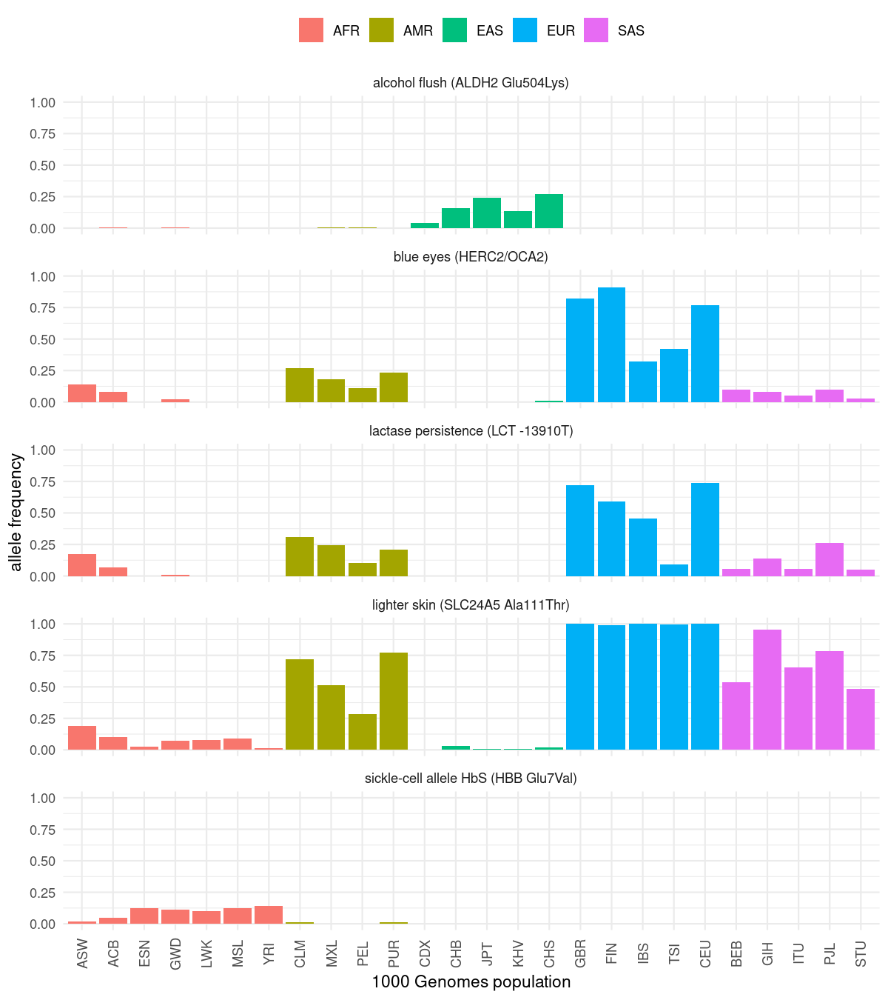

## Goal

By the end of this exercise you should be able to:

- join a table of allele frequencies with a table of population information using **`left_join()`**, also when the key columns have different names;
- check a join with `anti_join()`, and fill in missing combinations (alleles with count 0) with a join and `coalesce()`;
- summarise and plot allele frequencies by population and continental group.

## Before you start

This page builds on the [Exercise](exercise.qmd); do Find it F3 (Ensembl population genetics for rs4988235) first. You need the packages readr, dplyr and ggplot2. Download the two files and save them in a `data/` folder of your R project:

- [snp_frequencies.csv](data/snp_frequencies.csv): allele counts and frequencies of five SNPs in the 26 populations of the 1000 Genomes Project (phase 3), from the **Ensembl REST API, release 116** (`/variation/human/<rsid>?pops=1`).
- [populations.csv](data/populations.csv): the 26 population codes, their description and their continental group (superpopulation), from the 1000 Genomes data portal.

See [data/README.md](data/README.md) for the exact sources. The five SNPs:

| SNP | Gene | Effect allele (plus strand) | Trait |
|---|---|---|---|
| rs4988235 | *MCM6*/*LCT* | A (= −13910T) | lactase persistence |
| rs334 | *HBB* | A (c.20A>T) | sickle-cell allele HbS |
| rs1426654 | *SLC24A5* | A (Thr111) | lighter skin pigmentation |
| rs12913832 | *HERC2*/*OCA2* | G | blue eyes |
| rs671 | *ALDH2* | A (Lys504) | alcohol flush reaction |

## Tasks

You met [`left_join()`](https://dplyr.tidyverse.org/reference/mutate-joins.html) in Genome annotation, where both tables had a column called `chromosome`. This time the key has **different names** in the two tables (`population` in one, `code` in the other); [`join_by(population == code)`](https://dplyr.tidyverse.org/reference/join_by.html) says which columns to match. Two more join verbs help you check your data: [`anti_join(x, y)`](https://dplyr.tidyverse.org/reference/filter-joins.html) returns the rows of `x` that have **no** match in `y`, and [`cross_join(x, y)`](https://dplyr.tidyverse.org/reference/cross_join.html) makes every combination of rows.

```r
library(readr)
library(dplyr)
library(ggplot2)
```

**R1. (look at the data)** Read both files. How many rows does each SNP have in the frequency table? With 26 populations and two alleles, you might expect 52. Look at rs4988235 in three populations to see why some are missing.

```r
freqs <- read_csv("data/snp_frequencies.csv")
pops <- read_csv("data/populations.csv")
freqs
pops
freqs |> count(snp, gene)
freqs |> filter(snp == "rs4988235", population %in% c("YRI", "CEU", "CHB"))
```

**R2. (join the population information)** Add the superpopulation to each frequency row. Then use `anti_join()` to check that every population code in `freqs` was found in `pops`.

```r
freqs_pop <- freqs |>
  left_join(pops, by = join_by(population == code))
freqs_pop |> select(snp, population, allele, frequency, superpopulation) |> head(4)
freqs |> anti_join(pops, by = join_by(population == code)) |> nrow()
```

**R3. (one effect allele per SNP, zeros included)** We want the frequency of the **effect allele** of each SNP in **all** 26 populations, including those where it was not seen. Make a small table of the effect alleles, combine every population with every SNP using `cross_join()`, then `left_join()` the frequencies. Combinations without a match get `NA`, which here means "not observed", so replace it with 0 using [`coalesce()`](https://dplyr.tidyverse.org/reference/coalesce.html).

```r
effect <- tribble(
  ~snp,         ~allele, ~trait,
  "rs4988235",  "A",     "lactase persistence (LCT -13910T)",
  "rs334",      "A",     "sickle-cell allele HbS (HBB Glu7Val)",
  "rs1426654",  "A",     "lighter skin (SLC24A5 Ala111Thr)",
  "rs12913832", "G",     "blue eyes (HERC2/OCA2)",
  "rs671",      "A",     "alcohol flush (ALDH2 Glu504Lys)"
)
eff <- pops |>
  cross_join(effect) |>
  left_join(freqs |> select(snp, population, allele, frequency),
            by = join_by(code == population, snp, allele)) |>
  mutate(frequency = coalesce(frequency, 0))
nrow(eff)
eff |> filter(snp == "rs4988235") |> arrange(desc(frequency)) |> select(code, superpopulation, frequency) |> head(6)
```

Why must the join use three columns (`code == population`, `snp` and `allele`)? Compare your top six with Find it F3.

**R4. (summarise by continent)** Compute the mean effect-allele frequency over the populations of each superpopulation, for each SNP.

```r
eff |>
  group_by(snp, superpopulation) |>
  summarise(mean_freq = round(mean(frequency), 3), .groups = "drop") |>
  print(n = 25)
```

Which SNP shows the largest difference between superpopulations? Which allele is found almost only in one continental group?

**R5. (plot frequency by population)** Order the populations by superpopulation, then draw one bar per population, coloured by superpopulation, with one panel per trait.

```r
eff <- eff |> mutate(code = factor(code, levels = pops |> arrange(superpopulation) |> pull(code)))
ggplot(eff, aes(x = code, y = frequency, fill = superpopulation)) +
  geom_col() +
  facet_wrap(~ trait, ncol = 1) +
  labs(x = "1000 Genomes population", y = "allele frequency", fill = NULL) +
  theme_minimal(base_size = 11) +
  theme(axis.text.x = element_text(angle = 90, vjust = 0.5), legend.position = "top")
```

Describe the pattern for lactase persistence within Europe (GBR, FIN, IBS, TSI, CEU). Where is HbS found?

**R6. (from allele to genotype frequencies)** For lactase persistence and HbS, compute in a few populations the expected fraction of heterozygotes (2*q*(1 − *q*)), homozygotes (*q*^2^) and people with at least one copy (1 − (1 − *q*)^2^), assuming Hardy–Weinberg proportions. For which trait is "at least one copy" the relevant number, and for which is "homozygotes"?

```r
eff |>
  filter(snp %in% c("rs4988235", "rs334"), code %in% c("YRI", "GWD", "LWK", "CEU", "GBR", "FIN", "TSI", "CHB")) |>
  mutate(q = frequency,
         het = round(2 * q * (1 - q), 3),
         hom = round(q^2, 4),
         at_least_one = round(1 - (1 - q)^2, 3)) |>
  select(snp, code, q, het, hom, at_least_one) |>
  arrange(snp, desc(q))
```

## Solutions

::: {.callout-note collapse="true" title="Solutions: In R"}

All output below is from `Rscript --vanilla` (R 4.6.2) run in the unit folder. The messages that `read_csv()` prints about column types are left out.

**R1.**

```
# A tibble: 205 × 6
   snp        gene       population allele allele_count frequency
   <chr>      <chr>      <chr>      <chr>         <dbl>     <dbl>
 1 rs12913832 HERC2/OCA2 ACB        A               177    0.922
 2 rs12913832 HERC2/OCA2 ACB        G                15    0.0781
 3 rs12913832 HERC2/OCA2 ASW        A               105    0.861
 4 rs12913832 HERC2/OCA2 ASW        G                17    0.139
 5 rs12913832 HERC2/OCA2 BEB        A               155    0.901
 6 rs12913832 HERC2/OCA2 BEB        G                17    0.0988
 7 rs12913832 HERC2/OCA2 CDX        A               186    1
 8 rs12913832 HERC2/OCA2 CEU        A                46    0.232
 9 rs12913832 HERC2/OCA2 CEU        G               152    0.768
10 rs12913832 HERC2/OCA2 CHB        A               206    1
# ℹ 195 more rows
# A tibble: 26 × 4
   code  description                        superpopulation superpopulation_name
   <chr> <chr>                              <chr>           <chr>
 1 CDX   Chinese Dai in Xishuangbanna, Chi… EAS             East Asian
 2 CHB   Han Chinese in Bejing, China       EAS             East Asian
 ...
# A tibble: 5 × 3
  snp        gene           n
  <chr>      <chr>      <int>
1 rs12913832 HERC2/OCA2    44
2 rs1426654  SLC24A5       48
3 rs334      HBB           35
4 rs4988235  MCM6/LCT      43
5 rs671      ALDH2         35
# A tibble: 4 × 6
  snp       gene     population allele allele_count frequency
  <chr>     <chr>    <chr>      <chr>         <dbl>     <dbl>
1 rs4988235 MCM6/LCT CEU        A               146     0.737
2 rs4988235 MCM6/LCT CEU        G                52     0.263
3 rs4988235 MCM6/LCT CHB        G               206     1
4 rs4988235 MCM6/LCT YRI        G               216     1
```

Each SNP has fewer than 52 rows because Ensembl lists only alleles that were **observed** in a population. In CHB and YRI, rs4988235 has only the G allele (frequency 1), so the A row is missing, not zero. (rs1426654 has 48 rows, not 52, for the same reason.)

**R2.**

```
# A tibble: 4 × 5
  snp        population allele frequency superpopulation
  <chr>      <chr>      <chr>      <dbl> <chr>
1 rs12913832 ACB        A         0.922  AFR
2 rs12913832 ACB        G         0.0781 AFR
3 rs12913832 ASW        A         0.861  AFR
4 rs12913832 ASW        G         0.139  AFR
[1] 0
```

All population codes matched: `anti_join()` returns 0 rows. (Always check: a misspelled code would silently give `NA` in the joined columns.)

**R3.**

```
[1] 130
# A tibble: 6 × 3
  code  superpopulation frequency
  <chr> <chr>               <dbl>
1 CEU   EUR                 0.737
2 GBR   EUR                 0.720
3 FIN   EUR                 0.591
4 IBS   EUR                 0.458
5 CLM   AMR                 0.308
6 PJL   SAS                 0.260
```

26 populations × 5 SNPs = **130** rows, one per population and SNP, now including the zeros. The join needs all three columns: the population alone would match every SNP and both alleles; `snp` and `allele` make sure we pick the effect allele of the right SNP. The top four are European populations, as in Ensembl (CEU 0.737, GBR 0.720, FIN 0.591, IBS 0.458).

**R4.**

```
# A tibble: 25 × 3
   snp        superpopulation mean_freq
   <chr>      <chr>               <dbl>
 1 rs12913832 AFR                 0.034
 2 rs12913832 AMR                 0.197
 3 rs12913832 EAS                 0.002
 4 rs12913832 EUR                 0.648
 5 rs12913832 SAS                 0.072
 6 rs1426654  AFR                 0.082
 7 rs1426654  AMR                 0.571
 8 rs1426654  EAS                 0.012
 9 rs1426654  EUR                 0.997
10 rs1426654  SAS                 0.681
11 rs334      AFR                 0.095
12 rs334      AMR                 0.006
13 rs334      EAS                 0
14 rs334      EUR                 0
15 rs334      SAS                 0
16 rs4988235  AFR                 0.036
17 rs4988235  AMR                 0.216
18 rs4988235  EAS                 0
19 rs4988235  EUR                 0.519
20 rs4988235  SAS                 0.113
21 rs671      AFR                 0.001
22 rs671      AMR                 0.003
23 rs671      EAS                 0.17
24 rs671      EUR                 0
25 rs671      SAS                 0
```

The largest difference is for **rs1426654** (*SLC24A5*): 0.997 in Europeans against 0.012 in East Asians and 0.082 in Africans. Alleles found almost only in one group: **HbS** (rs334, African populations, with traces in the admixed American samples), and the **ALDH2 Lys504** allele (rs671, East Asian, 0.17 on average). The *SLC24A5* allele is a reminder that light skin evolved separately in Europe and East Asia: East Asians are light-skinned without this allele.

**R5.**

{width="85%" fig-align="center"}

Lactase persistence shows a **north–south gradient** within Europe: high in the British (0.72), CEU (0.74) and Finns (0.59), intermediate in Spain (0.46) and low in Tuscany (0.09). It is also present in the admixed American and South Asian populations, and at low frequency in the African-Caribbean and African-American samples (ACB, ASW), through European admixture. HbS is found in the five African populations (0.10–0.14), less in ACB and ASW, and at very low frequency in the Colombian and Puerto Rican samples.

**R6.**

```
# A tibble: 16 × 6
   snp       code       q   het    hom at_least_one
   <chr>     <fct>  <dbl> <dbl>  <dbl>        <dbl>
 1 rs334     YRI   0.139  0.239 0.0193        0.259
 2 rs334     GWD   0.115  0.204 0.0132        0.217
 3 rs334     LWK   0.101  0.182 0.0102        0.192
 4 rs334     CHB   0      0     0             0
 5 rs334     GBR   0      0     0             0
 6 rs334     FIN   0      0     0             0
 7 rs334     TSI   0      0     0             0
 8 rs334     CEU   0      0     0             0
 9 rs4988235 CEU   0.737  0.387 0.544         0.931
10 rs4988235 GBR   0.720  0.403 0.518         0.921
11 rs4988235 FIN   0.591  0.483 0.349         0.833
12 rs4988235 TSI   0.0888 0.162 0.0079        0.17
13 rs4988235 GWD   0.0088 0.017 0.0001        0.018
14 rs4988235 CHB   0      0     0             0
15 rs4988235 LWK   0      0     0             0
16 rs4988235 YRI   0      0     0             0
```

Lactase persistence is **dominant**, so the fraction of persistent adults is **at least one copy**: 93% in CEU, 83% in FIN, 17% in TSI (as in B4). Sickle-cell disease is **recessive**, so the disease frequency is the **homozygote** fraction: about 1.9% of births in YRI, while about 24% are carriers (**het**), as in B5. These numbers assume random mating; the Hardy–Weinberg unit in Part 7 tests that assumption.
:::

## Where this leads

The same idea, joining a table of measurements with a table that describes the samples, is the core of most genomic data analysis. In **Part 6** you join gene-expression data with tissue information, and in **Part 7** you use genotype counts like these to test Hardy–Weinberg equilibrium with a χ² test.
