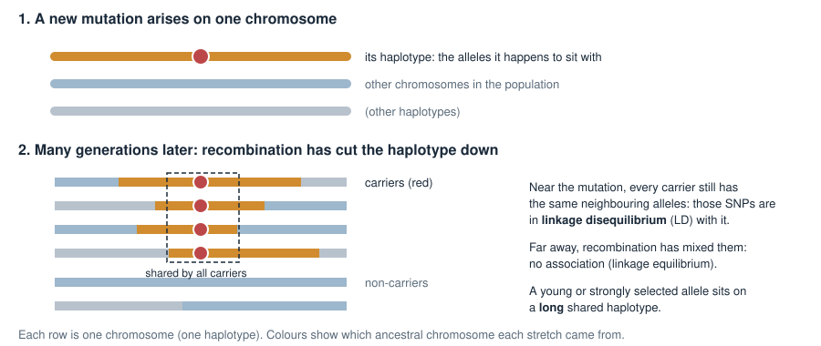
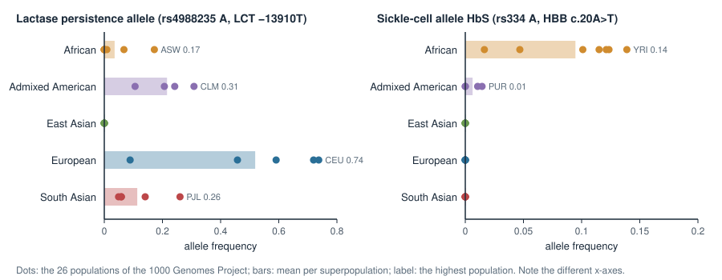
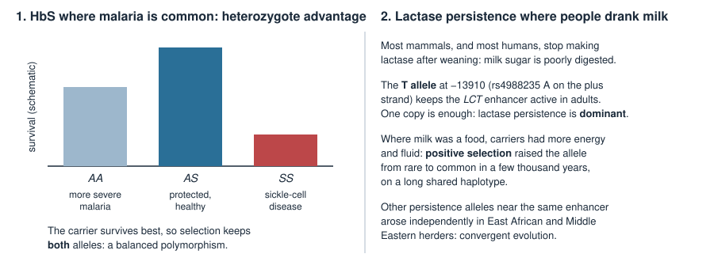

## About this lecture

The reference genome from the last unit is one genome. No living person has exactly that sequence. This lecture is about the **differences**: what kinds there are, how we find them in thousands of people, and why some alleles are common in one part of the world and rare in another.

- **Kinds of variant**: SNPs, indels, microsatellites (STRs) and copy-number variants (CNVs).
- **Naming** a variant: rs numbers, HGVS names, and the strand problem.
- **Haplotypes** and **linkage disequilibrium** (LD).
- **Genotyping** by arrays vs sequencing; the big databases: dbSNP, 1000 Genomes, gnomAD.
- **Population differences**, with two case stories: **lactase persistence** and the **sickle-cell allele and malaria**.
- **Personal genomics**: what a consumer genome test can and cannot tell you.

Book: Hartwell, *Genetics: From Genes to Genomes*, chapter on variation between individual genomes.

::: notes
This closes Part 4. The genetics leads: variants are alleles, and everything from Part 1 (dominance, segregation, pedigrees) applies to them. What is new is the scale: we can now see millions of alleles in thousands of people. The two case stories are chosen because they connect molecular genetics, population genetics and human history, and because students have met HBB and rs334 in every unit of this part. The exercise looks up both variants in gnomAD, Ensembl and dbSNP; the R part downloads allele frequencies from Ensembl and joins them with a population table.
:::

## How different are two genomes? {.smaller}

| Comparison | Differences |
|---|---|
| Two unrelated people | about 1 SNP per 1,000 bp, so a few million SNPs |
| One person vs the reference genome (1000 Genomes) | **4.1–5.0 million** sites: mostly SNPs, plus indels and structural variants |
| Variants in a typical genome that change a protein | about 10,000 amino-acid changes; on the order of 100 that break a gene (loss of function) |
| Human vs chimpanzee | about 1.2% of aligned bases (SNPs only) |

Most variants are **neutral**: in introns or between genes, or silent. A few change a protein (like HbS) or gene regulation (like lactase persistence).

::: notes
The numbers give a sense of scale. The 4.1 to 5.0 million figure comes from the final 1000 Genomes Project paper (2015); the range reflects ancestry, because the reference genome is mostly from a few people, and people of African ancestry, with the most genetic diversity, differ from it at the most sites. The loss-of-function point is surprising to students: a healthy person typically carries some broken genes, mostly heterozygous and mostly in genes where one working copy is enough. That is the recessive carrier state from Part 1, at genome scale. The chimp number is often misquoted; it is about 1.2 percent of single bases in aligned regions, and more if indels are counted.
:::

## Kinds of variant {.smaller}

{width="68%" fig-align="center"}

| Type | Size | Mutation rate | Example |
|---|---|---|---|
| **SNP** (SNV) | 1 bp | ~10^−8^ per bp per generation | HbS, rs334 |
| **Indel** | 1–50 bp | lower than SNPs | *CFTR* F508del |
| **STR** (microsatellite) | 1–6 bp unit, repeated | 10^−3^–10^−4^ per locus | *HTT* CAG repeat; forensic markers |
| **CNV** | 1 kb to Mb | | *AMY1* (salivary amylase) copy number |

::: notes
SNP strictly means a single-nucleotide variant common enough to be a polymorphism (often defined as at least 1 percent); SNV is the general term including rare ones. Indels inside a coding sequence cause frameshifts unless their length is a multiple of three, as in F508del, which removes one phenylalanine. Microsatellites mutate by polymerase slippage during replication, a thousand to ten thousand times faster than SNPs, so they have many alleles per locus. That made them the markers of choice for linkage mapping in the 1990s (the LOD-score unit in Part 2) and for forensic DNA profiles today. Expansions of some trinucleotide repeats cause disease: Huntington disease, met in the Mendel unit, appears with 40 or more CAG repeats in HTT. CNVs cover more base pairs in total than SNPs. A well-studied example is AMY1: populations with traditionally starch-rich diets have, on average, more copies of the salivary amylase gene.
:::

## Naming a variant {.smaller}

The sickle-cell variant has several names, and you need to recognise them all:

| Name | Meaning |
|---|---|
| **rs334** | dbSNP reference SNP number: a stable ID for the *position*, whatever the alleles |
| **NC_000011.10:g.5227002T>A** | genomic: chromosome 11 (GRCh38), position 5,227,002, T → A on the **plus** strand |
| **NM_000518.5:c.20A>T** | coding: position 20 of the *HBB* coding sequence, A → T on the **gene's** strand |
| **p.Glu7Val** (traditionally Glu6Val) | protein: glutamate 7 → valine (counting the start Met) |

*HBB* lies on the **minus** strand, so the plus-strand T>A and the coding A>T are the same change. Databases such as gnomAD and Ensembl list alleles on the **plus** strand; check the strand before you compare.

::: notes
This slide prevents a lot of confusion in the exercise. dbSNP gives each variant position an rs number; rs334 covers several possible alleles at that base (T to A is HbS; T to C and T to G are other, rare variants). HGVS names say exactly which sequence they are relative to. The c. numbering starts at the A of the ATG start codon; p. numbering counts the start methionine, which is why HbS is p.Glu7Val in HGVS but Glu6Val in the older haemoglobin literature, as noted in Genetics as information. The same strand issue applies to the lactase SNP: the literature calls it LCT minus 13910 C to T, on the gene's strand, while Ensembl and gnomAD list rs4988235 as G to A on the plus strand.
:::

## Haplotypes and linkage disequilibrium {.smaller}

{width="70%" fig-align="center"}

- A **haplotype** is the set of alleles on one chromosome. Nearby alleles are inherited together unless a crossover separates them.
- **Linkage disequilibrium** (LD): alleles at nearby sites are **associated** in a population. It decays with distance and with time.

::: notes
LD is linkage (Part 2) seen at population level. In a family, linkage means that alleles close together on a chromosome go into the same gamete unless there is a crossover between them. In a population, over many generations, crossovers gradually break up the associations, but between very close sites they rarely happen, so the associations survive. Walk through the figure: the new mutation appears on one chromosome, so at first it is always found with that chromosome's alleles. Each generation, crossovers swap in other chromosome stretches at the ends. After many generations only a short stretch around the mutation is still shared by all carriers. A young allele that rose fast because of selection, such as lactase persistence, sits on an unusually long shared haplotype, which is one of the ways selection is detected.
:::

## Why LD matters {.smaller}

- **Tag SNPs.** Within an LD block, one SNP predicts its neighbours. A genotyping array with ~0.5–1 million SNPs captures much of the common variation of a genome.
- **Association studies (GWAS).** A SNP associated with a trait may not be the cause itself; it may be in LD with the causal variant nearby. (Complex traits, Part 7.)
- **Mapping, old and new.** Linkage (Part 2) uses crossovers in families, a few per chromosome per meiosis, so it locates genes to a few Mb. LD uses the crossovers of thousands of generations, so it narrows the region down to kb.
- **Ancestry.** LD and haplotypes differ between populations; the longest LD blocks are in populations that went through bottlenecks.

::: notes
The practical point is tagging: you do not need to genotype every SNP, because many are redundant. That is what makes cheap genotyping arrays work, and why GWAS hits are regions rather than single bases. The comparison with Part 2 is worth making explicitly: a LOD-score study in a few families sees only the crossovers in those meioses, so it can only say that the gene is somewhere in a region of several megabases. A population sample implicitly contains the crossovers of all the ancestors, so association can be much finer. Populations of African ancestry have the shortest LD blocks, because they have the longest history at large population size; populations that passed through bottlenecks, such as the Finns, have longer blocks.
:::

## Genotyping: arrays vs sequencing {.smaller}

| | SNP array | Exome sequencing | Whole-genome sequencing |
|---|---|---|---|
| What is read | ~0.5–2 million **known** SNPs | the ~1–2% of the genome that codes for protein | (almost) all 3.1 Gb |
| Finds new or rare variants | no | yes, in exons | yes, everywhere |
| Indels, STRs, CNVs | poorly | some | yes (best with long reads) |
| Typical use | consumer tests, GWAS, ancestry | rare disease diagnosis | research, clinical genomics, gnomAD |
| Cost | lowest | middle | highest (falling) |

An array can only find what it was designed to look for. A disease variant that is rare or private to one family needs sequencing.

::: notes
Arrays work by hybridisation: each spot carries probes for the two alleles of one known SNP, and the sample DNA lights up one or both. They are cheap and accurate for common SNPs, which is why direct-to-consumer companies use them. Their weakness is the flip side: they cannot see variants they were not designed for, and they are unreliable for very rare variants even if a probe exists. Exome sequencing targets the coding part, where most known disease-causing variants lie, which is why it became the first-line test for rare monogenic diseases. Whole-genome sequencing is becoming cheap enough to replace both. The coverage concept from Digital analysis of DNA applies: a heterozygote is called when enough reads show each allele.
:::

## The variation databases {.smaller}

| Database | What it holds | Use it for |
|---|---|---|
| [dbSNP](https://www.ncbi.nlm.nih.gov/snp/) (NCBI) | catalogue of known variants with rs numbers | the ID, position and HGVS names of a variant |
| [1000 Genomes](https://www.internationalgenome.org/) | 2,504 people from **26 populations** in 5 continental groups | frequencies in well-defined populations (also in Ensembl) |
| [gnomAD](https://gnomad.broadinstitute.org/) | about 730,000 exomes and 76,000 genomes (v4) | frequencies in genetic ancestry groups; how rare is this variant? |
| [ClinVar](https://www.ncbi.nlm.nih.gov/clinvar/) (NCBI) | variants with a clinical interpretation | is this variant pathogenic? |
| [Ensembl](https://www.ensembl.org) / UCSC | all of the above on the genome | context: gene, consequence, LD |

A variant's population frequency is key evidence in diagnostics: an allele that is common in healthy people cannot cause a rare, severe, dominant disease.

::: notes
These are the databases of the Find it tasks. 1000 Genomes is small but carefully sampled by population, which is why we use it in R: each sample comes from a defined population such as the Yoruba in Ibadan (YRI) or the Finnish (FIN). gnomAD is much larger but groups people by genetic ancestry; it is the standard reference for how rare a variant is. The last sentence is the most important clinical use of population data: if a variant is found in one percent of healthy people in gnomAD, it cannot be the cause of a disease that affects one in a million, unless penetrance is very low. Ethics: these databases hold data from real people, which raises questions about consent and re-identification that the ethics module returns to.
:::

## Allele frequencies differ between populations {.smaller}

{width="76%" fig-align="center"}

- About 85–90% of human genetic variation is found **within** any population; only a small part separates populations.
- But some alleles differ sharply. The causes: **genetic drift** (chance, strongest in small populations), **migration**, and **natural selection**.

::: notes
The figure is drawn from the same Ensembl data that students use in R: each dot is one of the 26 populations of the 1000 Genomes Project. Make the first point before the second, because students easily over-interpret differences: Lewontin showed in 1972 that most variation is within populations, and genome data confirm it. Two people from the same population differ at nearly as many sites as two people from different continents. But for a few alleles, frequency differences are large, and those are interesting because drift alone rarely produces such large differences at a single locus while the rest of the genome stays similar. Selection is the usual explanation, as in the two stories that follow. Drift, selection and migration are treated quantitatively in Part 7.
:::

## Lactase persistence {.smaller}

| Population (1000 Genomes) | rs4988235 A (= LCT −13910T) | Expected lactase persistent (1 − (1 − *q*)^2^) |
|---|---:|---:|
| Utah, N. and W. European ancestry (CEU) | 0.74 | 0.93 |
| British (GBR) | 0.72 | 0.92 |
| Finnish (FIN) | 0.59 | 0.83 |
| Toscani, Italy (TSI) | 0.09 | 0.17 |
| Yoruba, Nigeria (YRI); Han Chinese (CHB) | 0 | 0 |

- The variant lies in an intron of the neighbouring gene *MCM6*, about 14 kb upstream of *LCT*, in an **enhancer** that keeps *LCT* on in adults. A regulatory variant, not a protein change.
- Persistence is **dominant**: one T allele is enough, so phenotype frequency is 1 − (1 − *q*)^2^ (assuming Hardy–Weinberg proportions, Part 7).
- Herding populations in East Africa and the Middle East have **other** persistence alleles in the same enhancer.

::: notes
The frequencies are from the R data (Ensembl REST, 1000 Genomes phase 3). The north–south gradient within Europe, 74 percent in CEU but 9 percent in Tuscany, is striking and matches the distribution of lactase persistence measured with lactose-tolerance tests. Do not overclaim the calculation: it assumes random mating, which is the Hardy–Weinberg unit in Part 7; here it is just the product rule from Part 1 applied to two alleles. The absence of the European allele in the Yoruba sample does not mean that no Africans are lactase persistent: several East African pastoralist populations carry different variants, for example −14010 G to C, which are not in the 1000 Genomes populations. This convergent evolution is strong evidence for selection: the same phenotype evolved several times where milk was drunk.
:::

## Sickle cell and malaria {.smaller}

{width="70%" fig-align="center"}

The HbS allele (rs334 A) reaches **0.10–0.14** in the West and East African 1000 Genomes samples (YRI, ESN, MSL, GWD, LWK), is lower in the African-diaspora samples (ACB, ASW) and is absent from the European and East Asian samples.

::: notes
This is the classic example of balancing selection. HbS/HbS is sickle-cell disease, which before modern medicine was usually fatal in childhood, so selection removes HbS alleles. But HbA/HbS carriers are protected against severe falciparum malaria, so where malaria is common they survive better than HbA/HbA people, and selection also keeps HbS alleles in the population. The equilibrium frequency depends on the balance between these two costs. The geographic distribution of HbS matches the historical range of malaria; similar stories exist for HbC, the thalassaemias and G6PD deficiency. In the diaspora populations in Barbados and the US, HbS is at lower frequency because of admixture and because malaria selection stopped. The quantitative treatment, with fitness values and the equilibrium formula, is in the drift and selection unit in Part 7. With q = 0.14 in YRI, about 24 percent of people are carriers and about 2 percent of births have sickle-cell disease, if genotypes follow Hardy–Weinberg proportions; students compute this in R.
:::

## Variants and families: back to pedigrees {.smaller}

Population frequencies feed directly into the risk calculations of Part 1:

- **Carrier probability of a partner.** For a recessive disease with allele frequency *q*, a random partner is a carrier with probability about 2*q*: for HbS in YRI (*q* = 0.14), 2 × 0.14 × 0.86 ≈ **0.24**.
- **Risk for a child** of a known carrier and a random partner: ¼ × 0.24 = **0.06**.
- **Interpreting a new variant** in a family: is it in gnomAD? At what frequency? Does it co-segregate with the disease in the pedigree?

The same variant can be common and protective in one setting and a cause of disease in another: genotype and environment together make the phenotype.

::: notes
This links the population view back to the pedigree unit, where the probability that an unrelated partner was a carrier was often just given. Now students can look it up. Use the 2pq approximation (Part 7 gives the justification); for rare alleles it is about 2q. The second bullet multiplies the probability that the partner is a carrier by the one-quarter risk of a carrier-by-carrier cross. The third bullet is how clinical geneticists classify variants of uncertain significance: rarity in population databases, segregation in the family, predicted effect on the protein. It sets up the ethics module's discussion of what to tell patients about uncertain findings.
:::

## Personal genomics {.smaller}

| A consumer genome test (array) can tell you | It cannot tell you |
|---|---|
| your genotype at known common SNPs (e.g. rs4988235, rs671, rs12913832) | rare or private variants in your genes (unless sequenced) |
| carrier status for some common recessive alleles | that you are *not* a carrier of every allele of a disease |
| ancestry estimates by comparison with reference populations | a single "true" ancestry: results depend on the reference panels |
| relatives who used the same service | your risk of complex diseases with certainty: effects are small, and environment matters |

Your genome is also partly your relatives' genome, and it is hard to make anonymous. These are questions for the **ethics** module.

::: notes
Bring it to the students' own lives. The SNPs from the R exercise are typical consumer-test SNPs: lactase persistence, alcohol flush (ALDH2 rs671, common in East Asia, where the A allele reduces the activity of the enzyme that breaks down acetaldehyde), eye colour (HERC2 rs12913832, which affects OCA2 expression). The limits are the array limits from two slides back, plus interpretation: most traits are complex (Part 7) and each SNP explains little. A negative carrier result on an array only covers the alleles on the array. Privacy: because relatives share half their genome, a person who uploads their data also reveals information about relatives who did not consent; consumer databases have been used to identify suspects via distant relatives. The ethics module takes this up.
:::

## Summary {.smaller}

| Concept | Key fact |
|---|---|
| Kinds of variant | SNP (1 bp), indel (1–50 bp), STR (repeat count, fast-mutating), CNV (kb–Mb copy number) |
| One genome vs the reference | 4.1–5.0 million sites differ (1000 Genomes) |
| Naming | rs number (dbSNP); HGVS g./c./p.; watch the strand: rs334 is T>A on plus, c.20A>T on *HBB* |
| Haplotype, LD | alleles on one chromosome; nearby alleles stay associated; LD decays with distance and time |
| Arrays vs sequencing | arrays read known common SNPs cheaply; sequencing finds rare and new variants |
| Databases | dbSNP, 1000 Genomes (26 populations), gnomAD (frequencies), ClinVar (clinical meaning) |
| Population differences | most variation is within populations; large differences at single loci suggest selection |
| Lactase persistence | rs4988235 A: 0.74 in CEU, 0 in YRI and CHB; regulatory; dominant; positive selection |
| Sickle cell | rs334 A: 0.10–0.14 in West and East African samples; heterozygote advantage against malaria |

::: notes
The revision table. The habit to take away: when you meet a variant, find its rs number, its position and strand, its consequence and its frequency in populations, and ask why it is as common as it is.
:::

## Where this leads

- **Exercise**: variant types and LD by hand; gnomAD, Ensembl and dbSNP for rs4988235 and rs334.
- **Exercise in R**: download-style tables of allele frequencies and populations, `left_join()` them, and plot frequencies by population.
- **Part 5: Rearrangements and aneuploidy.** The large structural variants: deletions, inversions, translocations.
- **Part 7: Hardy–Weinberg, drift and selection.** The quantitative theory behind today's stories: why HbS stays at about 10% in malaria regions, and how fast an allele like lactase persistence can spread.
- **Ethics.** Consent, privacy and personal genomics.

::: notes
Point forward. Part 7 returns to both case stories with numbers: the Hardy–Weinberg unit uses genotype counts like those in gnomAD, and the drift and selection unit simulates heterozygote advantage.
:::
