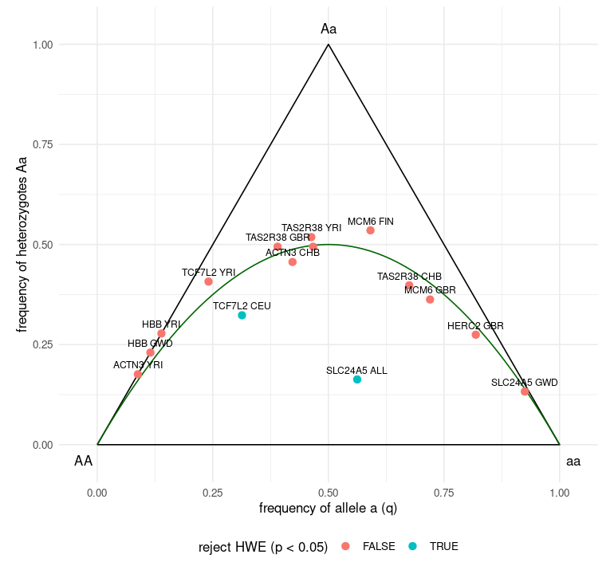

## Goal

By the end of this exercise you should be able to:

- write a function `hwe_test(nAA, nAa, naa)` that returns *p*, the expected counts, χ², the p-value and *F* as a one-row tibble;
- apply it to every row of a table of real genotype counts with **`pmap`**, and spread the results into columns with `unnest`;
- draw a de Finetti triangle with ggplot2;
- compute carrier frequencies and the effect of inbreeding for many values at once.

## Before you start

This page builds on the by-hand part of the [Exercise](exercise.qmd), so do that first. You need the packages dplyr, purrr, tidyr, readr and ggplot2. Download [hwe_snps.csv](data/hwe_snps.csv) and save it in a `data/` folder of your R project.

The file holds genotype counts for 7 SNPs in 1000 Genomes phase 3 populations, downloaded from the Ensembl REST API (release 116, endpoint `/variation/human/<rsid>?population_genotypes=1`) on 20 November 2026. `allele_A` is the reference allele on the forward strand of GRCh38 and `allele_a` the other allele; the `source` column records the query. Population codes: GBR British, FIN Finnish, CEU Utah residents of north-west European ancestry, YRI Yoruba, GWD Gambian, CHB Han Chinese, ALL all 26 populations pooled.

## Tasks

New idiom today: **`pmap`**. In [Extensions to Mendel](../mendel-extensions/exercise-r.qmd) you used `map_dbl(xs, f)` to call a function once for each element of **one** list. [`pmap(list(a, b, c), f)`](https://purrr.tidyverse.org/reference/pmap.html) walks along **several** vectors in parallel and calls `f(a[1], b[1], c[1])`, then `f(a[2], b[2], c[2])`, and so on. Inside `mutate`, the vectors are columns, so `pmap` calls `f` once per **row**. If `f` returns a one-row tibble, the result is a list-column of tibbles, which [`tidyr::unnest`](https://tidyr.tidyverse.org/reference/unnest.html) spreads into ordinary columns.

```r
library(dplyr)
library(purrr)
library(tidyr)
library(readr)
library(ggplot2)
```

### A function for the HWE test

**R1.** Write `hwe_test(nAA, nAa, naa)`. It should compute *N*, *p*, the three expected counts, χ², the p-value with `pchisq(chisq, df = 1, lower.tail = FALSE)`, and *F* = 1 − *H*<sub>obs</sub>/*H*<sub>exp</sub>, and return them as a one-row tibble. Test it on the MN blood group sample (1787, 3039, 1303) and on the "excess heterozygotes" preset of the demo at *N* = 200 (40, 140, 20), and compare with the [exercise](exercise.qmd).

```r
hwe_test <- function(nAA, nAa, naa) {
  n <- nAA + nAa + naa
  p <- (2 * nAA + nAa) / (2 * n)
  q <- 1 - p
  obs <- c(nAA, nAa, naa)
  expd <- n * c(p^2, 2 * p * q, q^2)
  chisq <- sum((obs - expd)^2 / expd)
  tibble(n = n, p = p,
         exp_AA = expd[1], exp_Aa = expd[2], exp_aa = expd[3],
         chisq = chisq,
         p_value = pchisq(chisq, df = 1, lower.tail = FALSE),
         F = 1 - (nAa / n) / (2 * p * q))
}
hwe_test(1787, 3039, 1303)   # MN blood group
hwe_test(40, 140, 20)        # excess heterozygotes
```

### Many SNPs at once

**R2.** Read `data/hwe_snps.csv`. Use `pmap` inside `mutate` to run `hwe_test` on every row, and `unnest` the result. Show gene, population, *N*, *p*, χ², the p-value and *F*, rounded. Which SNP–population pairs depart from HWE at the 5% level?

```r
snps <- read_csv("data/hwe_snps.csv")
snps |> select(rsid, gene, population, n_AA, n_Aa, n_aa)

results <- snps |>
  mutate(test = pmap(list(n_AA, n_Aa, n_aa), hwe_test)) |>
  unnest(test)

results |>
  select(gene, population, n, p, chisq, p_value, F) |>
  mutate(across(c(p, chisq, F), \(x) round(x, 3)),
         p_value = format.pval(p_value, digits = 2, eps = 1e-300))
```

**R3.** Look more closely at the two kinds of departure.
(a) For *HBB* (rs334, HbS), compare the observed and expected numbers of HbS homozygotes (`n_aa` and `exp_aa`).
(b) List the rows with p < 0.05, with observed and expected heterozygotes. For each one, decide whether it is most likely chance, population structure, or selection. How many rejections at the 5% level would you expect among 15 tests if every population were in HWE?

```r
results |> filter(gene == "HBB") |> select(population, n_aa, exp_aa)
results |> filter(p_value < 0.05) |> select(gene, population, n_Aa, exp_Aa, F, p_value)
```

### A de Finetti triangle in ggplot2

**R4.** Draw the triangle, the HWE parabola and one point per SNP–population pair, at *x* = *q* and *y* = *n*<sub>*Aa*</sub>/*N*. Colour the points by whether HWE is rejected. `coord_fixed(ratio = sqrt(3) / 2)` makes the triangle equilateral. `check_overlap = TRUE` drops labels that would overlap.

```r
tri <- tibble(x = c(0, 1, 0.5, 0), y = c(0, 0, 1, 0))
parab <- tibble(q = seq(0, 1, by = 0.01), H = 2 * q * (1 - q))
pts <- results |>
  mutate(q = 1 - p, H = n_Aa / n, label = paste(gene, population))

ggplot() +
  geom_path(data = tri, aes(x, y)) +
  geom_line(data = parab, aes(q, H), colour = "darkgreen") +
  geom_point(data = pts, aes(q, H, colour = p_value < 0.05), size = 2.5) +
  geom_text(data = pts, aes(q, H, label = label), size = 2.8, vjust = -0.8,
            check_overlap = TRUE) +
  annotate("text", x = c(-0.03, 1.03, 0.5), y = c(-0.04, -0.04, 1.04),
           label = c("AA", "aa", "Aa")) +
  coord_fixed(ratio = sqrt(3) / 2) +
  labs(x = "frequency of allele a (q)", y = "frequency of heterozygotes Aa",
       colour = "reject HWE (p < 0.05)") +
  theme_minimal() + theme(legend.position = "bottom")
```

### Carriers and inbreeding

**R5.** Write `carrier_freq(incidence)` that returns 2*pq* for a recessive disease of a given incidence. Apply it to PKU (1/10 000), cystic fibrosis (1/2500) and a rare disease (1/100 000) in one call. Show the answers as "1 in …".

```r
carrier_freq <- function(incidence) {
  q <- sqrt(incidence)
  2 * q * (1 - q)
}
incidence <- c(PKU = 1/10000, CF = 1/2500, rare = 1/100000)
round(carrier_freq(incidence), 4)
round(1 / carrier_freq(incidence))
```

**R6.** Make a tibble with *q* = 0.1, 0.01 and 0.001, and compute f(*aa*) under random mating and for a child of first cousins (*F* = 1/16), and their ratio. Compare with E3 in the exercise.

```r
inbreeding <- tibble(q = c(0.1, 0.01, 0.001)) |>
  mutate(random = q^2,
         cousins = q^2 + (1/16) * (1 - q) * q,
         ratio = cousins / random)
inbreeding
```

## Solutions

::: {.callout-note collapse="true" title="Solutions: In R"}

Run with `Rscript --vanilla` from the unit folder. Messages from loading packages and reading the CSV are not shown.

**R1.**

```
# A tibble: 1 × 8
      n     p exp_AA exp_Aa exp_aa  chisq p_value       F
  <dbl> <dbl>  <dbl>  <dbl>  <dbl>  <dbl>   <dbl>   <dbl>
1  6129 0.539  1784.  3045.  1300. 0.0270   0.870 0.00210
# A tibble: 1 × 8
      n     p exp_AA exp_Aa exp_aa chisq       p_value      F
  <dbl> <dbl>  <dbl>  <dbl>  <dbl> <dbl>         <dbl>  <dbl>
1   200  0.55   60.5     99   40.5  34.3 0.00000000472 -0.414
```

Both match the exercise: the MN sample is in HWE (χ² = 0.027, p = 0.87); the excess-heterozygote sample is not (χ² = 34.3, *F* = −0.41).

**R2.**

```
# A tibble: 15 × 6
   rsid       gene    population  n_AA  n_Aa  n_aa
   <chr>      <chr>   <chr>      <dbl> <dbl> <dbl>
 1 rs713598   TAS2R38 GBR           33    45    13
 2 rs713598   TAS2R38 YRI           30    56    22
 3 rs713598   TAS2R38 CHB           13    41    49
 4 rs1815739  ACTN3   GBR           26    45    20
 5 rs1815739  ACTN3   CHB           36    47    20
 6 rs1815739  ACTN3   YRI           89    19     0
 7 rs7903146  TCF7L2  CEU           52    32    15
 8 rs7903146  TCF7L2  YRI           60    44     4
 9 rs4988235  MCM6    FIN           14    53    32
10 rs4988235  MCM6    GBR            9    33    49
11 rs12913832 HERC2   GBR            4    25    62
12 rs334      HBB     YRI           78    30     0
13 rs334      HBB     GWD           87    26     0
14 rs1426654  SLC24A5 GWD            1    15    97
15 rs1426654  SLC24A5 ALL          892   408  1204
# A tibble: 15 × 7
   gene    population     n     p    chisq p_value       F
   <chr>   <chr>      <dbl> <dbl>    <dbl> <chr>     <dbl>
 1 TAS2R38 GBR           91 0.61     0.14  0.708    -0.039
 2 TAS2R38 YRI          108 0.537    0.197 0.657    -0.043
 3 TAS2R38 CHB          103 0.325    0.893 0.345     0.093
 4 ACTN3   GBR           91 0.533    0.004 0.949     0.007
 5 ACTN3   CHB          103 0.578    0.433 0.511     0.065
 6 ACTN3   YRI          108 0.912    1.00  0.316    -0.096
 7 TCF7L2  CEU           99 0.687    6.12  0.013     0.249
 8 TCF7L2  YRI          108 0.759    1.42  0.234    -0.114
 9 MCM6    FIN           99 0.409    1.14  0.286    -0.107
10 MCM6    GBR           91 0.28     0.929 0.335     0.101
11 HERC2   GBR           91 0.181    0.507 0.476     0.075
12 HBB     YRI          108 0.861    2.81  0.094    -0.161
13 HBB     GWD          113 0.885    1.91  0.167    -0.13
14 SLC24A5 GWD          113 0.075    0.238 0.626     0.046
15 SLC24A5 ALL         2504 0.438 1121.    1.1e-245  0.669
```

The rows for *TAS2R38* CHB and *TCF7L2* YRI match B1 and B2. Two rows are rejected at 5%: *TCF7L2* in CEU (χ² = 6.1, p = 0.013) and *SLC24A5* in the pooled sample of all populations (χ² = 1121, p ≈ 10<sup>−245</sup>). Every single-population sample of *SLC24A5*, *HBB* and the others is consistent with HWE.

**R3.**

```
# A tibble: 2 × 3
  population  n_aa exp_aa
  <chr>      <dbl>  <dbl>
1 YRI            0   2.08
2 GWD            0   1.50
# A tibble: 2 × 6
  gene    population  n_Aa exp_Aa     F   p_value
  <chr>   <chr>      <dbl>  <dbl> <dbl>     <dbl>
1 TCF7L2  CEU           32   42.6 0.249 1.34e-  2
2 SLC24A5 ALL          408 1233.  0.669 1.08e-245
```

(a) About 2 HbS homozygotes are expected in each sample and none is seen. The χ² test is not significant (expected counts are tiny), but the much larger gnomAD sample (Find it F3) shows the same deficit: **selection** against sickle-cell disease among sampled adults.
(b) *SLC24A5* ALL: 408 heterozygotes where 1233 are expected, *F* = 0.67. This is **population structure** (the Wahlund effect): the A allele is near fixation in Europe and rare in Africa, and pooling them creates a huge apparent deficit. *TCF7L2* CEU: probably **chance**. With 15 tests at the 5% level we expect 15 × 0.05 = 0.75 rejections even if all are in HWE, so one rejection at p = 0.013 is unremarkable. (A real population-wide test in a larger CEU sample would settle it.) This is the multiple-testing problem that GWAS solve with the 5 × 10<sup>−8</sup> threshold, in *Complex traits*.

**R4.**

{width="70%" fig-align="center"}

Most points sit on or near the parabola, spread along the whole range of *q*. The pooled *SLC24A5* point lies far below the curve, and *TCF7L2* CEU somewhat below it. The points for HbS (*HBB*) and *ACTN3* in YRI sit near the left corner, where the allele *a* is rare.

**R5.**

```
   PKU     CF   rare
0.0198 0.0392 0.0063
 PKU   CF rare
  51   26  159
```

PKU: 1 in **51** (the 1/50 of the pedigrees unit). CF: 1 in **26**. A disease of incidence 1 in 100 000: 1 in **159**. Note how slowly the carrier frequency falls: the incidence falls 10-fold from PKU to the rare disease, but the carrier frequency only about 3-fold, because carriers ≈ 2√incidence.

**R6.**

```
# A tibble: 3 × 4
      q   random   cousins ratio
  <dbl>    <dbl>     <dbl> <dbl>
1 0.1   0.01     0.0156     1.56
2 0.01  0.0001   0.000719   7.19
3 0.001 0.000001 0.0000634 63.4
```

As in E3: the ratio is 1.56 at *q* = 0.1, 7.2 at *q* = 0.01, and **63** at *q* = 0.001. For very rare recessive diseases, a large share of affected children have related parents.
:::

## Where this leads

`pmap` + a function that returns a tibble is a general pattern: one analysis per row of a table. In *Drift, selection* we turn from testing a population at one moment to following *p* over many generations, with a `for` loop.
