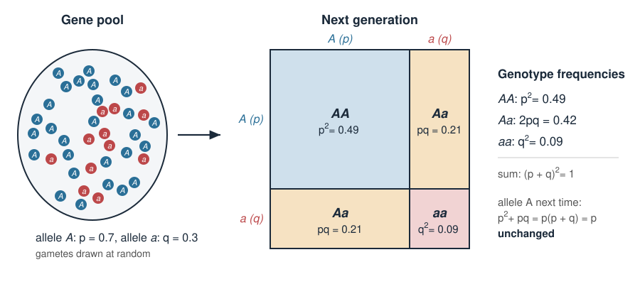
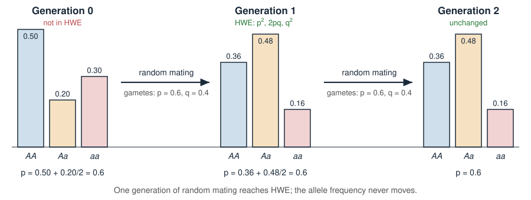
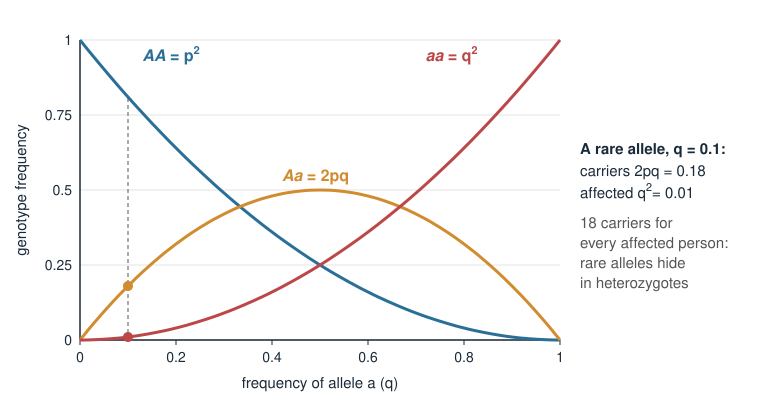

## About this lecture

So far we followed alleles through **one family**. Now we follow them through a whole **population**: what fraction of people carry each allele and each genotype?

- **Allele** and **genotype frequencies**, and how to count them.
- The **Hardy–Weinberg principle**, derived step by step: random mating turns allele frequencies *p* and *q* into genotype frequencies *p*², 2*pq*, *q*², and keeps them there.
- Its **assumptions**, and the **χ² test** for HWE (df = 1), worked through on real data.
- The **de Finetti triangle**, a picture of all possible populations.
- Uses: **carrier frequencies** from disease incidence (the 1/50 from the pedigrees unit), **X-linked** traits, and **inbreeding** (*F*), with the common mistakes to avoid.

Book: Hartwell, the population genetics chapter. You need the product rule and the χ² test from Part 1.

::: notes
This unit starts population genetics, which runs for the next two units. The key shift is from the Punnett square of one cross to the "Punnett square of a population", where the gametes come from a pool. Students have already used the result: in the pedigrees unit, the 1/50 carrier frequency was promised to come from Hardy–Weinberg. Today we deliver it. HWE is also a null model: like 3:1 in Mendel's crosses, it is what we expect when nothing interesting is happening, and departures tell us something about the population. The next unit, Drift and selection, is about the forces that make populations depart from it.
:::

## Allele and genotype frequencies

The MN blood group has two **codominant** alleles, *M* and *N*, so every genotype can be seen. A classic textbook sample of 6129 people:

| | *MM* | *MN* | *NN* | total |
|---|---|---|---|---|
| count | 1787 | 3039 | 1303 | 6129 |
| genotype frequency | 0.292 | 0.496 | 0.213 | 1 |

**Allele frequencies**: count alleles, two per person.

$$
p = f(M) = \frac{2 \times 1787 + 3039}{2 \times 6129} = \frac{6613}{12258} = 0.540, \qquad q = f(N) = 1 - p = 0.460.
$$

Shortcut: *p* = f(*MM*) + ½ f(*MN*) = 0.292 + 0.248 = 0.540.

::: notes
Two kinds of frequency, and students mix them up. A genotype frequency counts people; an allele frequency counts gene copies, two per person. Homozygotes contribute two copies of their allele, heterozygotes one of each. Codominance matters here only because it lets us see every genotype; with a dominant allele we could not count the heterozygotes directly, which is exactly why HWE is useful for recessive diseases. The numbers are from a classic textbook sample; we test them for HWE later in the lecture and in the demo.
:::

## Step 1: from genotypes to the gene pool

Take a population that is **not** in equilibrium: 50% *AA*, 20% *Aa*, 30% *aa*. Which gametes does it make?

| Parent genotype | frequency | gametes it makes | contributes *A* | contributes *a* |
|---|---|---|---|---|
| *AA* | 0.50 | all *A* | 0.50 | 0 |
| *Aa* | 0.20 | ½ *A*, ½ *a* (Mendel's first law) | 0.10 | 0.10 |
| *aa* | 0.30 | all *a* | 0 | 0.30 |
| **gene pool** | | | ***p* = 0.60** | ***q* = 0.40** |

The gamete frequencies **are** the allele frequencies: *p* = f(*AA*) + ½ f(*Aa*).

::: notes
The derivation has three steps, and this is the first. Each parent makes gametes by Mendelian segregation; the heterozygotes make half A and half a. Pool all the gametes of the population and the fraction carrying A is just the allele frequency p. Nothing about the genotype frequencies other than p survives into the gene pool: two populations with very different genotype frequencies but the same p give exactly the same gene pool. That is the reason the next generation forgets the past. We assume that all genotypes are equally fertile, which is the "no selection" assumption.
:::

## Step 2: random union of gametes {.smaller}

{width="82%" fig-align="center"}

- If gametes meet **at random**, an egg carrying *A* (probability *p*) meets a sperm carrying *A* (probability *p*) with probability *p*², by the product rule.
- *Aa* arises in **two** ways (*A* egg + *a* sperm, or *a* egg + *A* sperm): *pq* + *qp* = **2*pq***.
- So the genotype frequencies are ***p***² : 2***pq*** : ***q***², and they add up to (*p* + *q*)² = 1. In our example: 0.6² = **0.36**, 2 × 0.6 × 0.4 = **0.48**, 0.4² = **0.16**.

::: notes
This is the Punnett square of a population. The figure uses p equals 0.7, so the areas are 0.49, 0.21 twice, and 0.09; the example in the text uses the 0.6 from step 1. The product rule from the probability unit does all the work: two independent draws from a gene pool. The heterozygote appears twice, which is the source of the 2. Random mating between individuals gives the same result as random union of gametes; one can show this by listing all nine mating types, but the gamete argument is shorter. Hardy, a mathematician, wrote this in 1908 to answer the question why dominant alleles do not spread until they take over the population. Weinberg, a German physician, found it independently the same year.
:::

## Step 3: the allele frequency does not change

Count the *A* alleles in the new generation, as in step 1:

$$
p' = f(AA) + \tfrac{1}{2} f(Aa) = p^2 + \tfrac{1}{2}\cdot 2pq = p\,(p + q) = p.
$$

In numbers: *p*′ = 0.36 + 0.48/2 = 0.36 + 0.24 = **0.60**, the same as before.

- So the gene pool of the next generation is the same, and so are its genotype frequencies: the population has reached an **equilibrium**.
- Segregation is fair: each heterozygote passes on *A* and *a* equally often, and **nothing** in Mendel's laws favours the dominant allele.

::: notes
The algebra is one line: factor out p, and p plus q is one. Walk through the numbers too, because many students trust numbers more than symbols. The important consequence is that Mendelian inheritance by itself conserves allele frequencies. This answers the question Hardy was asked by the geneticist Punnett: why does a dominant allele not take over? Because dominance is about how a heterozygote looks, not about which allele it transmits. Anything that changes p must therefore be something outside Mendel's laws: selection, drift, mutation or migration, the subject of the next unit.
:::

## One generation is enough {.smaller}

{width="86%" fig-align="center"}

- Generation 0 had **too few** heterozygotes (0.20 instead of 0.48). After **one** round of random mating the genotypes are at *p*², 2*pq*, *q*² and stay there.
- The starting genotype frequencies do not matter, only *p*. This is why many real loci sit close to HWE even when the population's history was messy.

::: notes
This is unusual for an equilibrium: most systems approach equilibrium gradually, but HWE for one autosomal locus is reached in a single generation. Two caveats for later: for X-linked loci with unequal frequencies in the two sexes, it takes several generations, with the frequencies oscillating; and for two loci considered jointly, the approach to equilibrium (linkage equilibrium) is gradual, which is why linkage disequilibrium exists at all, something we use in GWAS. Exercise B3 asks the same question with a population of pure homozygotes.
:::

## The Hardy–Weinberg principle

In a large, randomly mating population with no selection, mutation or migration:

1. Genotype frequencies are ***p***², 2***pq***, ***q***², after **one** generation of random mating, whatever they were before (step 2).
2. Allele and genotype frequencies then stay **constant** from generation to generation (step 3).

Note what it does **not** say:

- It does not say *p* = *q* = 0.5. Any *p* can be in equilibrium.
- It does not say a **dominant** allele becomes common. Dominance affects phenotypes, not allele frequencies.
- It is a **null model**: like 3:1 in a cross, it is what we test against.

::: notes
Emphasise point 1: one generation is enough, which is very different from most equilibria in nature. Take a population made by mixing pure AA and aa: no heterozygotes at all. After one round of random mating, genotypes are p squared, 2pq, q squared. The demo shows this with the Mendel F2 preset: an F2 is one generation of random union of gametes and sits exactly on the HWE curve. The misconception that dominant alleles become common is very widespread; ask the class for a counterexample: Huntington disease is dominant and rare, and blood group O is recessive and common in many populations.
:::

## Rare alleles hide in heterozygotes {.smaller}

{width="72%" fig-align="center"}

- For a rare allele, almost all copies are in **heterozygotes**: at *q* = 0.1 there are 18 carriers for every *aa* person; at *q* = 0.01, about 200.
- So selection against a rare **recessive** phenotype removes very few copies. This is why recessive disease alleles persist (next unit).
- Heterozygote frequency 2*pq* is highest, 0.5, at *p* = *q* = 0.5.

::: notes
Read the plot at q equals 0.1. The orange curve is at 0.18, the red one at 0.01. The ratio 2pq over q squared is 2p over q, about 2 over q for rare alleles. At q equals 0.01 that is about 200 carriers per affected person. This matters for medicine: carrier screening finds far more people than disease screening. It matters for evolution: even if every aa person died, the allele frequency would fall only very slowly, because selection cannot see the carriers. Mention eugenics here briefly: early twentieth-century proposals to remove recessive diseases by sterilising affected people would have had almost no effect on allele frequencies, exactly for this reason.
:::

## When heterozygotes are hidden: start from *aa*

With **complete dominance**, *AA* and *Aa* look the same, so we cannot count alleles directly. Only *aa* is visible. If we **assume** HWE:

$$
f(aa) = q^2 \;\Rightarrow\; q = \sqrt{f(aa)}.
$$

Example: 16% of a population show a recessive phenotype.

1. *q* = √0.16 = **0.4**, so *p* = 0.6.
2. *AA* = 0.36, *Aa* = 0.48: together the 84% with the dominant phenotype.
3. Fraction of dominant-phenotype people who are carriers: 0.48 / 0.84 = **0.57**.

Caution: here HWE is an **assumption**, not a result. With only two visible classes there is no degree of freedom left to test it.

::: notes
This is the situation for most recessive diseases and for many textbook traits. The trick is that the one class we can see, the recessive homozygotes, is q squared under HWE. Taking the square root is the step students forget: they often use the frequency of aa as q. Step 3 is the kind of question exercise B4 asks with other numbers. The caveat matters: with two phenotype classes and one estimated parameter, df equals zero, so the data cannot tell us whether HWE holds. If there is inbreeding, the square root of the aa frequency overestimates q, because inbreeding inflates the aa class. The carrier-frequency calculation later in the lecture uses exactly this step.
:::

## The assumptions

| Assumption | If it fails | Covered in |
|---|---|---|
| **Random mating** | inbreeding or assortative mating changes genotype frequencies (not *p*) | today |
| **Large population** | **drift**: *p* changes by chance | *Drift, selection* |
| **No selection** | genotypes survive or reproduce differently | *Drift, selection* |
| **No mutation** | new alleles enter | *Drift, selection* |
| **No migration** | alleles enter from another population | *Drift, selection* |
| (One population) | pooled samples show a deficit of heterozygotes (**Wahlund effect**) | today |

In real human populations these are rarely all true, yet most loci are **close** to HWE: the forces are weak at most loci, and one generation of random mating restores the proportions.

::: notes
Random mating is with respect to this locus. People choose partners by height or language, but not by their MN blood group, so MN is in HWE even though mating is not random overall. Of the six rows, only non-random mating and population structure act on genotype frequencies directly while leaving allele frequencies alone; the other four change allele frequencies and are the subject of the next unit. The final point surprises students: if all the assumptions are false, why does HWE fit? Because most forces are weak per generation, and one generation of random mating is enough to reset the genotype proportions to match the current allele frequencies.
:::

## χ² test for HWE, step 1: expected counts

*TCF7L2* SNP rs7903146 in 99 people of north-west European ancestry (CEU, 1000 Genomes): 52 *CC*, 32 *CT*, 15 *TT*. Is this sample in HWE?

**1a. Estimate *p* from the data** (count alleles):
*p* = (2 × 52 + 32)/198 = 136/198 = **0.687**, *q* = **0.313**.

**1b. Expected counts** = *N* × HWE frequency:

| | *CC* | *CT* | *TT* | total |
|---|---|---|---|---|
| HWE frequency | *p*² = 0.472 | 2*pq* = 0.430 | *q*² = 0.098 | 1 |
| expected *E* | 99 × 0.472 = **46.7** | 99 × 0.430 = **42.6** | 99 × 0.098 = **9.7** | 99 |
| observed *O* | 52 | 32 | 15 | 99 |

Check: the expected counts add up to *N*.

::: notes
Go slowly; this is the χ² from Part 1 with one new idea. The expected counts do not come from a theoretical ratio like 1:2:1 but from the allele frequency estimated from the same sample. Always check that the expected counts add up to N; it catches most arithmetic slips. Keep two or three decimals in p, or rounding errors grow in the χ² sum. The data are real: from the 1000 Genomes CEU sample, via Ensembl. Ask the class which genotype class looks short before computing anything: heterozygotes, 32 against about 43.
:::

## χ² test, step 2: the statistic and its degrees of freedom

| | *CC* | *CT* | *TT* |
|---|---|---|---|
| *O* − *E* | 52 − 46.7 = 5.3 | 32 − 42.6 = −10.6 | 15 − 9.7 = 5.3 |
| (*O* − *E*)²/*E* | 0.60 | 2.63 | 2.89 |

χ² = 0.60 + 2.63 + 2.89 = **6.1**

**df = 3 − 1 − 1 = 1**:

- 3 classes,
- − 1 because the counts must add up to *N*,
- − 1 because *p* was **estimated from the same data**.

Critical value at 5% with df = 1: **3.84**. (With df = 2 it would be 5.99: using the wrong df changes the decision for χ² between 3.84 and 5.99.)

::: notes
In Mendel's crosses the expected ratio came from theory, so df was the number of classes minus one. Here we used the data once to estimate p, and each estimated parameter costs one degree of freedom. Intuition: once p is fixed and N is fixed, knowing one of the three counts determines the other two if the population is in HWE, so only one number is free to disagree with the model. The two homozygote classes contribute about equally here, because the missing heterozygotes went into both. The smallest class, TT, contributes most per person, because its expected count is small.
:::

## χ² test, step 3: decide, and interpret

- χ² = 6.1 > 3.84, p = 0.013: **reject** HWE at the 5% level.
- Direction: **fewer heterozygotes** than expected. *F* = 1 − *H*<sub>obs</sub>/*H*<sub>exp</sub> = 1 − (32/99)/0.430 = **0.25**.
- A useful check: for the HWE test, χ² = *N* *F*² = 99 × 0.25² ≈ 6.1.

But is this population really out of HWE? Probably not:

- In the R exercise we test **15** SNP–population pairs. At the 5% level we expect 15 × 0.05 ≈ 0.75 false rejections, so one p ≈ 0.01 is roughly what chance gives.
- A real biological cause (inbreeding, structure) would affect **all** loci, not one.
- This is the **multiple-testing** problem; it returns with the 5 × 10⁻⁸ threshold in GWAS.

::: notes
The decision rule is the same as in Part 1. The interpretation is where students need help. A significant departure has three kinds of explanation: biology at this locus (selection), biology of the population (inbreeding, structure, which would show at many loci), or chance and technical artefacts (multiple testing, genotyping errors). The N F squared identity is exact for the HWE test with df 1, and the demo shows it. Another sample of the same population would likely not reject. The same sample tested at many SNPs is how one would check for inbreeding or structure.
:::

## The de Finetti triangle {.smaller}

{width="64%" fig-align="center"}

- Every population is a **point**: horizontal position = *q*, height = frequency of *Aa*. The corners are pure *AA*, pure *Aa* and pure *aa*.
- Populations in HWE lie on the **parabola** *f*(*Aa*) = 2*pq*.
- **Below** the parabola: too few heterozygotes (inbreeding, population structure). **Above**: too many (heterozygote advantage, mixing of two distinct populations in one generation, genotyping errors).

::: notes
The triangle is a compact way to see all three genotype frequencies at once. Each point inside an equilateral triangle has three distances to the sides that add up to the height; those are the three genotype frequencies. In practice it is easiest to read it as in the slide: q along the base, heterozygote frequency as the height. The vertical distance to the parabola measures the departure, and the inbreeding coefficient F is that distance as a fraction of 2pq. The point at F equals 1 lies on the base: no heterozygotes, as in a set of fully inbred lines.
:::

## Demo: the de Finetti triangle

```{=html}
<link rel="stylesheet" href="../demos/dist/demo.css">
<div data-demo="hwe" data-preset="inbred"></div>
<script src="../demos/dist/hwe.js"></script>
```

::: notes
The demo starts at inbreeding F equals 0.25 with p equals 0.5. Drag the point onto the parabola: χ² falls to 0. Drag it up: excess heterozygotes. Then change N without moving the point: χ² grows in proportion to N. The same departure from HWE is invisible in 20 people and overwhelming in 1000. For the HWE test, χ² is in fact exactly N times F squared. Try the Mendel F2 preset: it sits on the parabola at its top.
:::

## Real data: sickle-cell genotypes

*HBB* rs334 (HbS) in 1000 Genomes, via Ensembl:

| Population | *AA* | *AS* | *SS* | *q*(S) | expected *SS* |
|---|---|---|---|---|---|
| Yoruba (YRI) | 78 | 30 | **0** | 0.139 | 2.1 |
| Gambian (GWD) | 87 | 26 | **0** | 0.115 | 1.5 |

gnomAD v4 genomes, African/African-American group: allele frequency 0.044 in about 20 800 people; HWE predicts about **39** *SS* homozygotes, gnomAD reports **9**.

- *SS* people (sickle-cell disease) are **missing** from samples of healthy adults: **selection** acts on genotypes, so HWE fails for this locus among adults.
- The χ² test is weak here: the expected counts are small (< 5). The direction is still informative.
- Why is HbS common at all? **Heterozygote advantage** against malaria: next unit.

::: notes
This connects the HBB thread of the course to populations. In both 1000 Genomes samples, there are no SS individuals at all, while HWE predicts one or two in each. That alone is weak evidence, but gnomAD, with tens of thousands of people, shows the same deficit clearly: about 9 observed against about 39 expected. Two reasons: sickle-cell disease shortens life, especially without treatment, and sequencing projects of adult cohorts often exclude people with severe childhood disease. Either way, the population of adults is not a random sample of the zygotes formed at fertilisation. HWE applies at conception, before selection. Ask: what would you expect at birth? Close to HWE. Note the χ² caveat: with expected counts below 5, the χ² approximation is poor; an exact test would be used in practice.
:::

## Population structure: the Wahlund effect

*SLC24A5* rs1426654 (a pigmentation SNP): the *A* allele is almost fixed in Europe and rare in Africa.

| Sample | *AA* | *AG* | *GG* | *F* |
|---|---|---|---|---|
| Gambian (GWD) | 1 | 15 | 97 | 0.05, in HWE |
| All 26 populations **pooled** (2504 people) | 892 | 408 | 1204 | **0.67** |

- Each population on its own is close to HWE. **Pooling** populations with different *p* gives far **too few heterozygotes**.
- No inbreeding is involved: people mate within populations, so the pooled "population" does not mate at random.
- Lesson: test HWE **within** a population, and remember that hidden structure looks like inbreeding.

::: notes
This is the Wahlund effect, named after the Swedish geneticist Sten Wahlund, who described it in 1928. Mixing two populations, one mostly AA and one mostly GG, gives many homozygotes of both types and few heterozygotes, compared with what the pooled allele frequency predicts. The pooled sample has F equals 0.67, which looks like heavy inbreeding, but it is pure structure. The same effect causes false associations in GWAS if cases and controls come from populations with different ancestry: a point we come back to in the complex traits unit.
:::

## X-linked genes {.smaller}

{width="74%" fig-align="center"}

- Males are **hemizygous**: the frequency of affected males **is** the allele frequency *q*.
- Females follow HWE: *q*² affected, 2*pq* carriers.
- So an X-linked recessive trait is about 1/*q* times more common in males. For red–green colour blindness (*q* ≈ 0.08), about 8% of men but under 1% of women.

::: notes
This links back to the pedigrees unit, where X-linked recessive traits were mostly seen in males. Hardy–Weinberg makes it quantitative. Males show the allele directly, so male incidence is the best estimate of q. Females need two copies. The colour-blindness numbers are typical textbook values for northern European men; frequencies vary between populations. For a rare X-linked disease such as haemophilia A, with q around 1 in 5000 males, affected females are vanishingly rare, about q squared.
:::

## Carrier frequency from disease incidence

The pedigrees unit assumed a carrier frequency of **1/50** for PKU. Where does it come from?

$$
\text{incidence} = q^2 = \frac{1}{10\,000} \;\Rightarrow\; q = \frac{1}{100}, \qquad 2pq = 2 \times 0.99 \times 0.01 \approx 0.0198 \approx \frac{1}{50}.
$$

- For a rare allele, carrier frequency ≈ **2*q*** = 2√incidence.
- Cystic fibrosis in north-west Europe, incidence about 1 in 2500 births: *q* ≈ 1/50, carriers ≈ **1/26**.
- Check in gnomAD: *CFTR* F508del (rs113993960) has allele frequency 0.014 in non-Finnish Europeans (carriers ≈ 1/35; F508del is not the only CF allele), but only 0.0015 in Finns.

::: notes
This is the slide that pays off the promise from the pedigrees unit. The calculation assumes HWE for the disease locus, which is reasonable: selection against a rare recessive disease barely affects genotype proportions at conception. It also assumes all disease alleles act as one allele; for CF, F508del is the commonest of many alleles, which is why its own frequency gives a lower carrier rate than the incidence. The Finnish value is a teaser for the next unit: CF is rare in Finland, while some other recessive diseases are much more common there. That is the founder effect.
:::

## Inbreeding: where the formulas come from

**F** = the probability that the two alleles in a person are **identical by descent** (IBD): copies of one ancestral allele. Build *f*(*aa*) in two cases:

| Case | probability | P(*aa*) in this case | contribution |
|---|---|---|---|
| the two alleles are IBD: really **one** allele, copied | *F* | *q* (one draw) | *F q* |
| not IBD: two **independent** draws, as in HWE | 1 − *F* | *q*² | (1 − *F*) *q*² |

$$
f(aa) = Fq + (1-F)\,q^2 = q^2 + F(q - q^2) = q^2 + Fpq.
$$

The same argument gives *f*(*AA*) = *p*² + *Fpq* and *f*(*Aa*) = 2*pq*(1 − *F*): an IBD pair can never be heterozygous.

::: notes
This is a direct use of the sum rule from the probability unit: split into two exclusive cases and add. If the two alleles are identical by descent, they are copies of one ancestral allele, so the person is aa if that one allele is a, with probability q. Otherwise the two alleles are independent draws from the population, as in Hardy–Weinberg. The algebra then factors: q minus q squared is q times p. Students met F for a child of first cousins in the pedigrees unit as a path-counting probability; this is how F enters genotype frequencies.
:::

## Inbreeding raises *aa* most for rare alleles

$$
f(AA) = p^2 + Fpq, \qquad f(Aa) = 2pq(1-F), \qquad f(aa) = q^2 + Fpq.
$$

- Heterozygotes fall by a factor (1 − *F*); the missing ones become homozygotes. **Allele frequencies do not change.**
- Child of first cousins: *F* = 1/16 (pedigrees unit). Selfing plants approach *F* = 1.
- The **rarer** the allele, the bigger the relative effect on *aa*:

| *q* | random mating *q*² | cousins *q*² + *pq*/16 | ratio |
|---|---|---|---|
| 0.1 | 0.01 | 0.0156 | 1.6 |
| 0.01 | 0.0001 | 0.00072 | 7.2 |
| 0.001 | 0.000001 | 0.000063 | 63 |

::: notes
F has two readings. As a probability: the chance that a person's two alleles at a locus are copies of the same ancestral allele. As a summary of genotype data: one minus observed over expected heterozygosity. In a population with inbreeding, both readings give the same number. The table shows why consanguinity matters most for very rare recessive diseases: when q is 0.001, almost every affected child of first cousins got both copies from a shared ancestor. Keep the tone neutral: in many countries cousin marriage is common and most children are healthy; the absolute risk increase is small for any one disease. The pedigrees unit computed the same thing for a single family.
:::

## Common mistakes

| Mistake | Correct |
|---|---|
| Using a genotype frequency as an allele frequency | *p* = f(*AA*) + ½ f(*Aa*): count gene copies, two per person |
| Using the incidence of a recessive disease as *q* | incidence = *q*², so *q* = √incidence (1/10 000 → *q* = 1/100) |
| df = 2 in the χ² test for HWE | df = 1: one more is lost because *p* is estimated from the data |
| Expected counts from 1 : 2 : 1 | expected counts from the sample's own *p*: *Np*², 2*Npq*, *Nq*² |
| "Dominant alleles become common" | dominance changes phenotypes, not transmission: *p* stays constant |
| X-linked: males affected at *q*² | males are hemizygous: affected males = *q*; females *q*² |
| A heterozygote deficit proves inbreeding | it can also be structure (Wahlund), selection, or genotyping error |

::: notes
Use this as a check-yourself slide: cover the right column and ask the class for the fix. The first three cover most errors in exam answers on this topic. The fourth comes from Part 1, where 1:2:1 was correct for an F2 cross; in a population the expected ratio depends on p. The last one is a reasoning error: one pattern, several possible causes, so look at many loci and at how the sample was collected before deciding.
:::

## What HWE is used for

- **Estimating carrier frequencies** for genetic counselling and screening.
- **Checking data**: in genome-wide genotyping, SNPs that depart strongly from HWE in healthy controls are often **genotyping errors** and are removed before a GWAS.
- **Detecting forces**: departures point to **selection**, **population structure** or **inbreeding**.
- **A starting point** for population genetics: the next unit asks what happens when the assumptions fail.

::: notes
Quality control is a very practical use that students will meet if they ever analyse genotyping data: a SNP assay that cannot tell heterozygotes from homozygotes shows a huge heterozygote deficit, and HWE filtering removes it. The usual threshold is very strict, such as p below 10 to the minus 6, because with a million SNPs some will fail HWE by chance. In cases, a departure could be a real association, which is why the filter is applied in controls.
:::

## Summary

- Allele frequency: count gene copies, *p* = f(*AA*) + ½ f(*Aa*).
- Derivation: gene pool (*p*) → random union of gametes (product rule) → ***p***², 2***pq***, ***q***² in one generation, with *p* constant. Dominance does not change allele frequencies.
- Assumptions: random mating, large population, no selection, mutation or migration, one population.
- With complete dominance, *q* = √f(*aa*), assuming HWE.
- **χ² test for HWE**: expected counts from the estimated *p*, **df = 1**; interpret with multiple testing in mind.
- Rare alleles are mostly in **carriers**: carrier frequency ≈ 2√incidence (PKU: 1/10 000 → 1/50).
- X-linked: males affected at *q*, females at *q*².
- Inbreeding (*F*: *aa* = *q*² + *Fpq*) and population structure (Wahlund) both give a **heterozygote deficit**; heterozygote advantage can give an excess.

::: notes
The three numbers to remember: p squared, 2pq, q squared; df equals 1; and carrier frequency about 2 times the square root of the incidence. Students should be able to do the χ² test for HWE by hand in an exam.
:::

## Where this leads

- **Next**: *Drift, selection, mutation, migration*: what happens to *p* when the assumptions fail, including why HbS is common where malaria is.
- **Complex traits**: HWE filters in GWAS quality control; population structure as a source of false associations.
- In the exercise: HWE by hand, the de Finetti demo, real genotype counts from 1000 Genomes and gnomAD, and an `hwe_test()` function in R applied to many SNPs with `pmap`.

::: notes
Today we kept p constant. Next time we let it move. The sickle-cell example will return as heterozygote advantage, and the Finnish CF value as the founder effect.
:::
