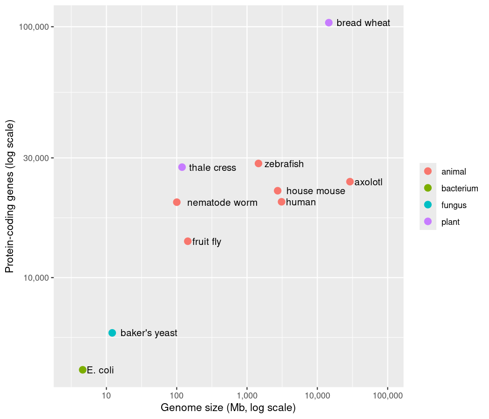

## Goal

By the end of this exercise you should be able to:

- read a CSV file into R, add a column with `mutate`, and plot on **log-scale axes** with **text labels**.

## Before you start

This page builds on the by-hand part of the [Exercise](exercise.qmd), so do that first. You need the packages tibble, readr, dplyr and ggplot2. Download [genomes.csv](data/genomes.csv) and save it in a `data/` folder of your R project.

## Tasks

The data for this part is in [`data/genomes.csv`](data/genomes.csv) (download it and put it in a `data/` folder next to your script). It lists ten organisms with genome size and protein-coding gene count. Every value comes from the **NCBI Datasets** reference genome and its current annotation, and the `source` column gives the assembly accession for each row.

**New idiom: log-scale axes and text labels.** When values span many orders of magnitude (here 4.6 to 29,118 Mb), a linear axis squashes most points into a corner. `scale_x_log10()` and `scale_y_log10()` space the axis by powers of ten instead, so 10, 100 and 1,000 are equally far apart. `geom_text(aes(label = ...))` writes a label at each point, so you can see which organism is which without a legend.

**R1. Build the table.** Create the tibble with [`tribble()`](https://tibble.tidyverse.org/reference/tribble.html) (one row per line, easy to read) and save it with [`write_csv()`](https://readr.tidyverse.org/reference/write_delim.html). If you downloaded the CSV, you can skip straight to R2, but read the code so you know where each number came from.

```r
library(tibble)
library(readr)

genomes <- tribble(
  ~organism,                  ~common_name,    ~group,      ~genome_mb, ~protein_coding_genes, ~source,
  "Escherichia coli",         "E. coli",       "bacterium",     4.6,    4290, "NCBI Datasets GCF_000005845.2 K-12 MG1655 (RefSeq annotation 2026-09)",
  "Saccharomyces cerevisiae", "baker's yeast", "fungus",       12.1,    6021, "NCBI Datasets GCF_000146045.2 (SGD R64-5-1)",
  "Caenorhabditis elegans",   "nematode worm", "animal",      100.3,   19983, "NCBI Datasets GCF_000002985.6 (WormBase WS298)",
  "Drosophila melanogaster",  "fruit fly",     "animal",      143.7,   13962, "NCBI Datasets GCF_000001215.4 (FlyBase 6.54)",
  "Arabidopsis thaliana",     "thale cress",   "plant",       119.1,   27562, "NCBI Datasets GCF_000001735.4 (TAIR/Araport)",
  "Danio rerio",              "zebrafish",     "animal",     1455.3,   28509, "NCBI Datasets GCF_052040795.2 (RefSeq annotation 2026-08)",
  "Mus musculus",             "house mouse",   "animal",     2728.2,   22198, "NCBI Datasets GCF_000001635.27 (RefSeq annotation 2024-02)",
  "Homo sapiens",             "human",         "animal",     3099.4,   20054, "NCBI Datasets GCF_000001405.40 (RefSeq annotation 2026-11)",
  "Triticum aestivum",        "bread wheat",   "plant",     14566.5,  103793, "NCBI Datasets GCF_018294505.1 (RefSeq annotation 2025-04)",
  "Ambystoma mexicanum",      "axolotl",       "animal",    29117.8,   24121, "NCBI Datasets GCF_040938575.1 (RefSeq annotation 2024-10)"
)
genomes
write_csv(genomes, "data/genomes.csv")
```

**R2. Read it back.** Load the file with [`read_csv()`](https://readr.tidyverse.org/reference/read_delim.html). Which columns did `read_csv` read as numbers (`dbl`) and which as text (`chr`)?

```r
library(readr)
library(dplyr)
library(ggplot2)

genomes <- read_csv("data/genomes.csv")
genomes
```

**R3. Genes per Mb.** Add a column `genes_per_mb` with [`mutate()`](https://dplyr.tidyverse.org/reference/mutate.html), then show it sorted from densest to least dense genome with [`arrange(desc(...))`](https://dplyr.tidyverse.org/reference/arrange.html). Check the *E. coli*, yeast and human values against your answer to **B6** in the [exercise](exercise.qmd).

```r
genomes <- genomes |>
  mutate(genes_per_mb = protein_coding_genes / genome_mb)

genomes |>
  select(common_name, genome_mb, protein_coding_genes, genes_per_mb) |>
  arrange(desc(genes_per_mb))
```

**R4. First, a linear plot.** Plot gene count against genome size on ordinary axes. Where do most of the organisms end up?

```r
ggplot(genomes, aes(x = genome_mb, y = protein_coding_genes)) +
  geom_point(aes(colour = group), size = 3) +
  geom_text(aes(label = common_name), hjust = -0.15, size = 3.5)
```

**R5. Now on log scales.** Add [`scale_x_log10()`](https://ggplot2.tidyverse.org/reference/scale_continuous.html) and `scale_y_log10()`. `hjust = -0.15` in [`geom_text()`](https://ggplot2.tidyverse.org/reference/geom_text.html) puts each label just to the right of its point; `limits` makes room on the right for the axolotl's label, and `scales::label_comma()` writes 10,000 instead of 1e+04.

```r
ggplot(genomes, aes(x = genome_mb, y = protein_coding_genes)) +
  geom_point(aes(colour = group), size = 3) +
  geom_text(aes(label = common_name), hjust = -0.15, size = 3.5) +
  scale_x_log10(limits = c(3, 100000), labels = scales::label_comma()) +
  scale_y_log10(labels = scales::label_comma()) +
  labs(x = "Genome size (Mb, log scale)",
       y = "Protein-coding genes (log scale)",
       colour = NULL)
```

a. Which organisms lie far to the **right** of the others with only an average number of genes?
b. Which organism has many more genes than the rest, and why (see the [Background](exercise.qmd#background) in the exercise)?
c. Among the **animals** only, by what factor does genome size vary, and by what factor does gene number vary? Use `filter()` and `summarise()` to find out.

**R6. The C-value paradox in words.** Using your plot and table, write three or four sentences explaining why genome size and gene number are not proportional. Name at least two kinds of DNA that make large genomes large.

## Hints

::: {.callout-tip collapse="true" title="Hint R5c: filter and summarise"}
Use [`filter()`](https://dplyr.tidyverse.org/reference/filter.html) to keep `group == "animal"`, then [`summarise()`](https://dplyr.tidyverse.org/reference/summarise.html) with `max(genome_mb) / min(genome_mb)` and `max(protein_coding_genes) / min(protein_coding_genes)`.
:::

## Solutions

::: {.callout-note collapse="true" title="Solutions: In R"}

Run from the unit folder with `Rscript --vanilla`. The output below is real output from R 4.6.2.

**R1.** Printing `genomes` gives:

```
# A tibble: 10 × 6
   organism              common_name group genome_mb protein_coding_genes source
   <chr>                 <chr>       <chr>     <dbl>                <dbl> <chr>
 1 Escherichia coli      E. coli     bact…       4.6                 4290 NCBI …
 2 Saccharomyces cerevi… baker's ye… fung…      12.1                 6021 NCBI …
 3 Caenorhabditis elega… nematode w… anim…     100.                 19983 NCBI …
 4 Drosophila melanogas… fruit fly   anim…     144.                 13962 NCBI …
 5 Arabidopsis thaliana  thale cress plant     119.                 27562 NCBI …
 6 Danio rerio           zebrafish   anim…    1455.                 28509 NCBI …
 7 Mus musculus          house mouse anim…    2728.                 22198 NCBI …
 8 Homo sapiens          human       anim…    3099.                 20054 NCBI …
 9 Triticum aestivum     bread wheat plant   14566.                103793 NCBI …
10 Ambystoma mexicanum   axolotl     anim…   29118.                 24121 NCBI …
```

and `write_csv` writes `data/genomes.csv`, identical to the file on this page.

**R2.** `read_csv` reports:

```
Rows: 10 Columns: 6
── Column specification ────────────────────────────────────────────────────────
Delimiter: ","
chr (4): organism, common_name, group, source
dbl (2): genome_mb, protein_coding_genes
```

The two numeric columns are `genome_mb` and `protein_coding_genes`; the rest are text. The tibble printed is the same as in R1.

**R3.**

```
# A tibble: 10 × 4
   common_name   genome_mb protein_coding_genes genes_per_mb
   <chr>             <dbl>                <dbl>        <dbl>
 1 E. coli             4.6                 4290      933.
 2 baker's yeast      12.1                 6021      498.
 3 thale cress       119.                 27562      231.
 4 nematode worm     100.                 19983      199.
 5 fruit fly         144.                 13962       97.2
 6 zebrafish        1455.                 28509       19.6
 7 house mouse      2728.                 22198        8.14
 8 bread wheat     14566.                103793        7.13
 9 human            3099.                 20054        6.47
10 axolotl         29118.                 24121        0.828
```

*E. coli* 933, yeast 498 and human 6.47 genes per Mb agree with B6. Gene density falls by more than a thousandfold from *E. coli* to the axolotl.

**R4.** On linear axes, the axolotl and wheat sit far to the right, and the eight other organisms are squashed into the bottom-left corner. You cannot read *E. coli* and yeast apart, or the worm, fly and cress. This is why we need log axes for data that span orders of magnitude.

**R5.** The log-log plot:

{width="85%"}

a. The **axolotl** (and to a lesser extent wheat, mouse and human) lies far to the right: its genome is about ten times larger than ours with a similar number of genes.
b. **Bread wheat** has about 104,000 protein-coding genes. It is **hexaploid**: it carries three ancestral genomes (A, B and D), so most genes are present in three copies.
c.

```r
genomes |>
  filter(group == "animal") |>
  summarise(size_range = max(genome_mb) / min(genome_mb),
            gene_range = max(protein_coding_genes) / min(protein_coding_genes))
```

```
# A tibble: 1 × 2
  size_range gene_range
       <dbl>      <dbl>
1       290.       2.04
```

Among the animals, genome size varies about **290-fold** (worm 100 Mb to axolotl 29,118 Mb), but gene number only about **2-fold** (fly 13,962 to zebrafish 28,509).

**R6.** Example answer: Genome size varies more than 6,000-fold in this table, but gene number only about 25-fold, and among animals 290-fold against 2-fold. Large genomes are not large because they have more genes, but because they have more non-coding DNA: long introns, large intergenic regions and especially repeated sequences such as transposable elements. Polyploidy (wheat) adds whole extra genomes, and with them extra gene copies. So the amount of DNA (the C-value) says little about the number of genes or the complexity of the organism.
:::

## Where this leads

The next unit, **Mendel**, simulates the cross *Aa* × *Aa* in R, and `scale_x_log10()` comes back there in a plot of how simulated ratios approach the expected ones.
