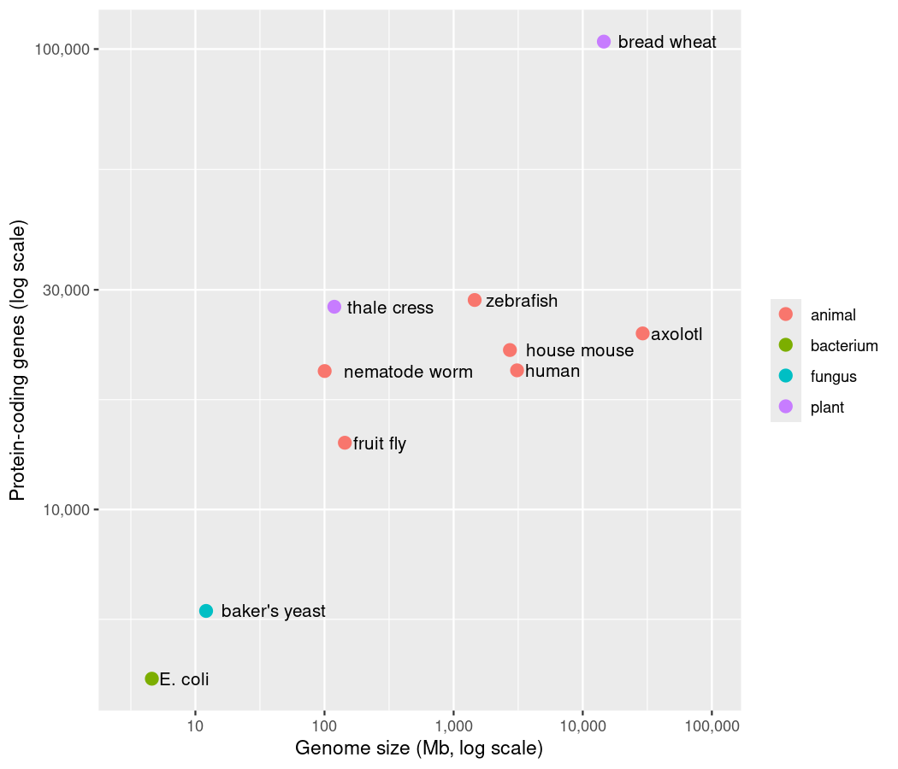

## Goal

By the end of this exercise you should be able to:

- use the words **gene, locus, allele, genotype, phenotype, homozygous, heterozygous, wild type, mutant, dominant** and **recessive** correctly;
- follow one gene, *HBB*, from a base change in the DNA to the sickle-cell phenotype;
- explain why "dominant" and "recessive" depend on which phenotype you look at;
- explain why genome size and gene number are not proportional (the **C-value paradox**);
- tell **orthologs** from **paralogs**, and explain why model organisms are useful;
- look up a gene in **NCBI Gene** and **Ensembl** and read its chromosome, location, transcripts and orthologs;
- read a CSV file into R, add a column with `mutate`, and plot on **log-scale axes** with **text labels**.

There is no demo in this unit. Do the pen-and-paper part first.

## Background

**Recap from 5MO103.** Information flows DNA → RNA → protein → phenotype. A **gene** is a DNA segment that encodes a functional product. Its position on a chromosome is its **locus**.

**Vocabulary.**

- An **allele** is one version of a gene. A diploid individual carries two alleles at each autosomal locus.
- **Genotype**: the alleles carried, e.g. *AA*, *Aa*, *aa*. **Phenotype**: what is observed or measured.
- **Homozygous**: two identical alleles. **Heterozygous**: two different alleles.
- **Wild type** (*w*^+^): the standard allele in a lab population. **Mutant**: a changed allele.
- If *Aa* has the same phenotype as *AA*, then *A* is **dominant** and *a* is **recessive** *for that phenotype*. In this unit we assume complete dominance; Extensions to Mendel adds the other cases.

**Sickle-cell disease.** The human gene *HBB* (chromosome 11) encodes β-globin. In the sickle allele HbS, codon 6 changes from GAG to GTG, and glutamate (Glu) becomes valine (Val). Databases count the start methionine too, so they write this change as **c.20A>T, p.Glu7Val**.

**Genomes.** Genome size (in megabases, **Mb** = 10^6^ bp) varies more than 10,000-fold across life, but the number of protein-coding genes varies far less. Most of a large genome is non-coding: introns, intergenic DNA, repeats such as transposable elements. Some genomes are also large because of **polyploidy**.

**Orthologs** are genes in different species that descend from one gene in their common ancestor. **Paralogs** arise by duplication within one genome.

A small part of the genetic code, enough for this exercise:

| Codon | Amino acid | Codon | Amino acid |
|---|---|---|---|
| ATG | Met (M) | CCT | Pro (P) |
| GTG | Val (V) | GAG | Glu (E) |
| CAT | His (H) | AAG | Lys (K) |
| CTG | Leu (L) | GCG | Ala (A) |
| ACT | Thr (T) | | |

## By hand

**B1. (vocabulary)** For each genotype, say whether it is homozygous or heterozygous, and give the phenotype. In the fly, *w*^+^ (red eyes) is dominant to *w* (white eyes).

a. *w*^+^/*w*^+^ &nbsp;&nbsp; b. *w*^+^/*w* &nbsp;&nbsp; c. *w*/*w*

Which allele is the wild type, and which is the mutant?

**B2. (gene vs allele)** Fill in the blanks with *gene*, *allele*, *locus*, *genotype* or *phenotype*:
"*HBB* is a ___ at a ___ on chromosome 11. HbA and HbS are two ___s of it. A person with the ___ HbS/HbS has the ___ sickle-cell disease."

**B3. (translate)** The coding sequence of *HBB* starts like this (coding strand, 5′→3′):

```
ATG GTG CAT CTG ACT CCT GAG GAG AAG
```

a. Translate it with the codon table above.
b. The start Met is removed from the mature protein. Number the remaining amino acids from 1 (so Val = 1). Which amino acid is number 6?
c. Now number the *nucleotides* of the coding sequence from 1 (A of ATG = 1). Which nucleotide is number 20? Change it from A to T and translate again. Which codon and which amino acid changed? Write the change in both the traditional form (Glu6Val) and the database form (p.Glu7Val).

**B4. (another allele)** A different *HBB* allele, HbC, has the change c.19G>A. Using the sequence in B3, which codon changes, what is the new codon, and what is the new amino acid? Write the change in the database form p.Xxx#Yyy.

**B5. (dominance depends on the phenotype)** For HbA/HbA, HbA/HbS and HbS/HbS, the following is observed:

| | HbA/HbA | HbA/HbS | HbS/HbS |
|---|---|---|---|
| Sickle-cell disease | no | no | yes |
| Haemoglobin bands on a gel | HbA | HbA and HbS | HbS |

For each row, say whether HbS is dominant, recessive or codominant. Why is this not a contradiction?

**B6. (genes per Mb)** Use these values from NCBI Datasets: *E. coli* 4.6 Mb and 4,290 protein-coding genes; baker's yeast 12.1 Mb and 6,021 genes; human 3,099.4 Mb and 20,054 genes.

a. Compute the number of genes per Mb for each.
b. If the human genome were packed as densely as the *E. coli* genome, how many Mb would it need for its 20,054 genes?
c. What fills the rest of the human genome?

**B7. (orthologs and paralogs)** An ancestral gene *G* duplicated into *G1* and *G2*. Later, the human and mouse lineages split, and each kept both copies: human *G1*, human *G2*, mouse *G1*, mouse *G2*.

a. Draw the gene tree.
b. Which pairs are orthologs, and which are paralogs?
c. If the duplication had instead happened *after* the split, and only in the human lineage, what would the mouse have, and how would the orthology change?

**B8. (choosing the approach)** For each question, name the approach (transmission, molecular, genomic or population) and a suitable organism from: yeast, fly, mouse, human families.

a. Do children of two HbA/HbS carriers get the disease in about 1 in 4 cases?
b. Which genes are needed for a cell to divide? You want to test thousands of mutants quickly.
c. Does a mouse with no working *Cftr* gene get lung and gut problems like people with cystic fibrosis?
d. Is HbS more common in regions where malaria was common?

## Find it

These are your first database tasks. Take them slowly and check the **organism** every time: searching a gene symbol gives hits in many species.

**F1. NCBI Gene: *HBB*.**
Go to [NCBI Gene](https://www.ncbi.nlm.nih.gov/gene/). Type `HBB human` in the search box and press Search. In the results table, click the row where the **Name/Gene ID** is *HBB* and the **Organism** is *Homo sapiens*.

On the gene page, read the **Summary** box at the top:

a. What is the **Official Full Name**?
b. What is the **Gene ID** (a number)?
c. On which **chromosome** is *HBB*? (Look for "Chromosome" in the Genomic context section, or "Location" in the summary.)
d. What is the **cytogenetic location**? (The field is called "Location" or "Map location" and looks like 11p15.4.) What do the "p" and "15.4" mean?
e. Under "Also known as", which familiar name for the protein do you see?

**F2. Ensembl: *HBB*.**
Go to [Ensembl](https://www.ensembl.org/). Choose **Human** in the species box, type `HBB` and press Go. Click the gene result *HBB* (Human Gene). On the gene page:

a. What is the Ensembl gene ID (it starts with ENSG)?
b. The **Location** line gives the chromosome, start and end, and strand. Write it down. Is the gene on the forward or the reverse strand?
c. Click **Show transcript table**. How many transcripts are listed? This number changes between Ensembl releases, so also note the release number (bottom of the page).
d. One transcript is flagged **MANE Select** (and Ensembl canonical). What is its name (HBB-2xx), and how long is its protein (aa)?

**F3. *CFTR*: chromosome and mouse ortholog.**
a. In [NCBI Gene](https://www.ncbi.nlm.nih.gov/gene/), search `CFTR human` and open the *Homo sapiens* entry. On which **chromosome** is *CFTR*, and what is its cytogenetic location? What is the official full name?
b. In [Ensembl](https://www.ensembl.org/), open human *CFTR*. In the left-hand menu, under **Comparative Genomics**, click **Orthologues**. Find **Mouse** in the table. What is the mouse gene called? What type of orthology is it (the "Type" column, e.g. 1-to-1)? What is the "Target %id"?
c. Click the mouse gene. On which mouse chromosome is it?

**F4. (optional) The Alliance of Genome Resources: is there a *CFTR* in fly or yeast?**
Go to the [Alliance of Genome Resources](https://www.alliancegenome.org/), search `CFTR` and open the *Homo sapiens* gene. Scroll to **Orthology**.

a. With the default (stringent) filter, which species are listed?
b. Change the stringency filter to the least strict setting ("No filter"/"All"). Do any fly (*D. melanogaster*) or yeast (*S. cerevisiae*) genes appear? How many prediction methods support them?
c. What does this tell you about whether fly or yeast has a true *CFTR* ortholog?

## In R

The data for this part is in [`data/genomes.csv`](data/genomes.csv) (download it and put it in a `data/` folder next to your script). It lists ten organisms with genome size and protein-coding gene count. Every value comes from the **NCBI Datasets** reference genome and its current annotation, and the `source` column gives the assembly accession for each row.

**New idiom: log-scale axes and text labels.** When values span many orders of magnitude (here 4.6 to 29,118 Mb), a linear axis squashes most points into a corner. `scale_x_log10()` and `scale_y_log10()` space the axis by powers of ten instead, so 10, 100 and 1,000 are equally far apart. `geom_text(aes(label = ...))` writes a label at each point, so you can see which organism is which without a legend.

**R1. Build the table.** Create the tibble with [`tribble()`](https://tibble.tidyverse.org/reference/tribble.html) (one row per line, easy to read) and save it with [`write_csv()`](https://readr.tidyverse.org/reference/write_delim.html). If you downloaded the CSV, you can skip straight to R2, but read the code so you know where each number came from.

```r
library(tibble)
library(readr)

genomes <- tribble(
  ~organism,                  ~common_name,    ~group,      ~genome_mb, ~protein_coding_genes, ~source,
  "Escherichia coli",         "E. coli",       "bacterium",     4.6,    4290, "NCBI Datasets GCF_000005845.2 K-12 MG1655 (RefSeq annotation 2026-09)",
  "Saccharomyces cerevisiae", "baker's yeast", "fungus",       12.1,    6021, "NCBI Datasets GCF_000146045.2 (SGD R64-5-1)",
  "Caenorhabditis elegans",   "nematode worm", "animal",      100.3,   19983, "NCBI Datasets GCF_000002985.6 (WormBase WS298)",
  "Drosophila melanogaster",  "fruit fly",     "animal",      143.7,   13962, "NCBI Datasets GCF_000001215.4 (FlyBase 6.54)",
  "Arabidopsis thaliana",     "thale cress",   "plant",       119.1,   27562, "NCBI Datasets GCF_000001735.4 (TAIR/Araport)",
  "Danio rerio",              "zebrafish",     "animal",     1455.3,   28509, "NCBI Datasets GCF_052040795.2 (RefSeq annotation 2026-08)",
  "Mus musculus",             "house mouse",   "animal",     2728.2,   22198, "NCBI Datasets GCF_000001635.27 (RefSeq annotation 2024-02)",
  "Homo sapiens",             "human",         "animal",     3099.4,   20054, "NCBI Datasets GCF_000001405.40 (RefSeq annotation 2026-11)",
  "Triticum aestivum",        "bread wheat",   "plant",     14566.5,  103793, "NCBI Datasets GCF_018294505.1 (RefSeq annotation 2025-04)",
  "Ambystoma mexicanum",      "axolotl",       "animal",    29117.8,   24121, "NCBI Datasets GCF_040938575.1 (RefSeq annotation 2024-10)"
)
genomes
write_csv(genomes, "data/genomes.csv")
```

**R2. Read it back.** Load the file with [`read_csv()`](https://readr.tidyverse.org/reference/read_delim.html). Which columns did `read_csv` read as numbers (`dbl`) and which as text (`chr`)?

```r
library(readr)
library(dplyr)
library(ggplot2)

genomes <- read_csv("data/genomes.csv")
genomes
```

**R3. Genes per Mb.** Add a column `genes_per_mb` with [`mutate()`](https://dplyr.tidyverse.org/reference/mutate.html), then show it sorted from densest to least dense genome with [`arrange(desc(...))`](https://dplyr.tidyverse.org/reference/arrange.html). Check the *E. coli*, yeast and human values against your answer to **B6**.

```r
genomes <- genomes |>
  mutate(genes_per_mb = protein_coding_genes / genome_mb)

genomes |>
  select(common_name, genome_mb, protein_coding_genes, genes_per_mb) |>
  arrange(desc(genes_per_mb))
```

**R4. First, a linear plot.** Plot gene count against genome size on ordinary axes. Where do most of the organisms end up?

```r
ggplot(genomes, aes(x = genome_mb, y = protein_coding_genes)) +
  geom_point(aes(colour = group), size = 3) +
  geom_text(aes(label = common_name), hjust = -0.15, size = 3.5)
```

**R5. Now on log scales.** Add [`scale_x_log10()`](https://ggplot2.tidyverse.org/reference/scale_continuous.html) and `scale_y_log10()`. `hjust = -0.15` in [`geom_text()`](https://ggplot2.tidyverse.org/reference/geom_text.html) puts each label just to the right of its point; `limits` makes room on the right for the axolotl's label, and `scales::label_comma()` writes 10,000 instead of 1e+04.

```r
ggplot(genomes, aes(x = genome_mb, y = protein_coding_genes)) +
  geom_point(aes(colour = group), size = 3) +
  geom_text(aes(label = common_name), hjust = -0.15, size = 3.5) +
  scale_x_log10(limits = c(3, 100000), labels = scales::label_comma()) +
  scale_y_log10(labels = scales::label_comma()) +
  labs(x = "Genome size (Mb, log scale)",
       y = "Protein-coding genes (log scale)",
       colour = NULL)
```

a. Which organisms lie far to the **right** of the others with only an average number of genes?
b. Which organism has many more genes than the rest, and why (see the Background)?
c. Among the **animals** only, by what factor does genome size vary, and by what factor does gene number vary? Use `filter()` and `summarise()` to find out.

**R6. The C-value paradox in words.** Using your plot and table, write three or four sentences explaining why genome size and gene number are not proportional. Name at least two kinds of DNA that make large genomes large.

## Hints

::: {.callout-tip collapse="true" title="Hint B3: counting codons and nucleotides"}
Write the sequence in triplets and number the codons 1, 2, 3, … from ATG. Codon *n* covers nucleotides $3n-2$ to $3n$. So nucleotide 20 is in codon 7 (nucleotides 19–21). Codon 7 counting the Met is amino acid 6 without the Met.
:::

::: {.callout-tip collapse="true" title="Hint B7: orthologs and paralogs"}
Find the node in the tree where two genes last shared an ancestor. If that node is a **speciation** (the human–mouse split), the genes are orthologs. If it is a **duplication**, they are paralogs.
:::

::: {.callout-tip collapse="true" title="Hint F1–F3: finding your way in NCBI Gene and Ensembl"}
In [NCBI Gene](https://www.ncbi.nlm.nih.gov/gene/), the search result is a table with columns Name/Gene ID, Description, Location and Organism. The Location column already shows the cytogenetic band. In [Ensembl](https://www.ensembl.org/), the gene page has a left-hand menu; **Orthologues** is under *Comparative Genomics*. If you land on a "Search results" page, make sure you click a **Gene** result for **Human**.
:::

::: {.callout-tip collapse="true" title="Hint R5c: filter and summarise"}
Use [`filter()`](https://dplyr.tidyverse.org/reference/filter.html) to keep `group == "animal"`, then [`summarise()`](https://dplyr.tidyverse.org/reference/summarise.html) with `max(genome_mb) / min(genome_mb)` and `max(protein_coding_genes) / min(protein_coding_genes)`.
:::

## Solutions

::: {.callout-note collapse="true" title="Solutions: By hand"}

**B1.** a. *w*^+^/*w*^+^: homozygous, red eyes. b. *w*^+^/*w*: heterozygous, red eyes (*w*^+^ is dominant). c. *w*/*w*: homozygous, white eyes. *w*^+^ is the wild type; *w* is the mutant.

**B2.** "*HBB* is a **gene** at a **locus** on chromosome 11. HbA and HbS are two **alleles** of it. A person with the **genotype** HbS/HbS has the **phenotype** sickle-cell disease."

**B3.**
a. ATG GTG CAT CTG ACT CCT GAG GAG AAG → **Met Val His Leu Thr Pro Glu Glu Lys**.
b. Without Met: Val(1) His(2) Leu(3) Thr(4) Pro(5) **Glu(6)** Glu(7) Lys(8). Amino acid 6 is **glutamate**.
c. Nucleotides 19–21 are codon 7 (GAG), so nucleotide 20 is the **A** in the middle of GAG. A→T gives **GTG**, which codes for **Val**. The protein becomes Met Val His Leu Thr Pro **Val** Glu Lys. Traditional name: **Glu6Val**; database name: **c.20A>T, p.Glu7Val** (the same change, counted with the Met).

**B4.** c.19 is the first base of codon 7 (GAG). G→A gives **AAG**, which codes for **Lys**. The change is **p.Glu7Lys** (traditionally Glu6Lys). This is the haemoglobin C allele; ClinVar lists NM_000518.4(HBB):c.19G>A (p.Glu7Lys).

**B5.** Disease row: the heterozygote looks like HbA/HbA, so HbS is **recessive** for disease. Gel row: the heterozygote shows both bands, so the alleles are **codominant** for the haemoglobin protein. It is not a contradiction because dominance is a statement about **one phenotype**. Each allele makes its own protein (codominance at the protein level), but half normal haemoglobin is enough to avoid disease under normal conditions (recessive at the level of disease).

**B6.**
a. *E. coli*: $4{,}290 / 4.6 \approx 933$ genes per Mb. Yeast: $6{,}021 / 12.1 \approx 498$. Human: $20{,}054 / 3{,}099.4 \approx 6.5$.
b. $20{,}054 / 933 \approx 21.5$ Mb, which is less than 1% of the real 3,099 Mb.
c. Introns, large intergenic regions, and repeated sequences (especially transposable elements), plus centromeres, telomeres, regulatory DNA and genes for non-coding RNAs.

**B7.**
a. The tree has a duplication node at the root (*G* → *G1*, *G2*). Below each of *G1* and *G2* is a speciation node (human, mouse).
b. **Orthologs**: human *G1*–mouse *G1*, and human *G2*–mouse *G2* (they last shared an ancestor at the speciation). **Paralogs**: human *G1*–human *G2*, mouse *G1*–mouse *G2*, and also human *G1*–mouse *G2* and human *G2*–mouse *G1* (their last common ancestor is the duplication).
c. The mouse would have a single gene *G*. Both human *G1* and human *G2* would be orthologs of mouse *G*: a **one-to-many** (in Ensembl, "1-to-many") orthology. Human *G1* and *G2* would be paralogs of each other. This is roughly what has happened in the β-globin cluster, which is why there is no simple 1-to-1 mouse ortholog of human *HBB*.

**B8.**
a. **Transmission**, human families (a pedigree or family study).
b. **Molecular/transmission genetics** in **yeast**: a fast, single-celled organism where thousands of mutants can be screened. (A genomic screen, testing every gene, also fits.)
c. **Molecular**, in the **mouse**: knock out the *Cftr* ortholog and look at the phenotype. The mouse is a mammal with lungs and a gut similar to ours.
d. **Population**, in **humans**: compare HbS allele frequencies between populations.
:::

::: {.callout-note collapse="true" title="Solutions: Find it"}

All facts checked in November 2026 (NCBI Gene; Ensembl release 116 on GRCh38; Alliance of Genome Resources).

**F1. NCBI Gene, *HBB*.** Click path: [NCBI Gene](https://www.ncbi.nlm.nih.gov/gene/) → search `HBB human` → row *HBB*, *Homo sapiens* → [Gene ID 3043](https://www.ncbi.nlm.nih.gov/gene/3043).
a. Official full name: **hemoglobin subunit beta**.
b. Gene ID: **3043**.
c. Chromosome **11**.
d. Location **11p15.4**: "p" is the short arm of chromosome 11 ("q" is the long arm), and 15.4 is the band (region 1, band 5, sub-band 4) counted outwards from the centromere. *HBB* lies near the tip of the short arm.
e. Also known as: **beta-globin** (other aliases listed are CD113t-C and ECYT6). The gene has **3 exons**.

**F2. Ensembl, *HBB*.** Click path: [Ensembl](https://www.ensembl.org/) → Human → `HBB` → Go → *HBB* (Human Gene) → [ENSG00000244734](https://www.ensembl.org/Homo_sapiens/Gene/Summary?g=ENSG00000244734).
a. **ENSG00000244734**.
b. **Chromosome 11: 5,225,464–5,229,395, reverse strand** (GRCh38). The gene is read from right to left on the standard chromosome map.
c. In release 116 the transcript table lists **19 transcripts** (most protein-coding, some "nonsense mediated decay" or "retained intron"). Your number may differ in a later release, which is why we note the release. Many extra transcripts come from new long-read evidence; most of the protein is made from one main transcript.
d. **HBB-201** (ENST00000335295) is the MANE Select and Ensembl canonical transcript. It matches RefSeq NM_000518.5 and encodes **147 aa** (146 aa in the mature chain, after the start Met is removed).

Optional observation: if you open **Orthologues** for *HBB*, Ensembl lists orthologs in many species, but **no mouse** gene. The β-globin genes duplicated separately in the primate and rodent lineages, so mouse *Hbb-bs* and *Hbb-bt* do not pair one-to-one with human *HBB* (compare B7c). That is why F3 uses *CFTR* for the mouse ortholog.

**F3. *CFTR*.**
a. Click path: [NCBI Gene](https://www.ncbi.nlm.nih.gov/gene/) → `CFTR human` → [Gene ID 1080](https://www.ncbi.nlm.nih.gov/gene/1080). Chromosome **7**, location **7q31.2** (long arm). Official full name: **CF transmembrane conductance regulator** (the older name "cystic fibrosis transmembrane conductance regulator" is still widely used).
b. Click path: Ensembl → Human → `CFTR` → [ENSG00000001626](https://www.ensembl.org/Homo_sapiens/Gene/Summary?g=ENSG00000001626) → Comparative Genomics → Orthologues → Mouse. The mouse gene is ***Cftr*** (ENSMUSG00000041301). Type: **1-to-1**. Target %id: about **79%** (78.7% in release 116), meaning about 79% of the mouse protein's amino acids are identical to the aligned human ones.
c. Mouse *Cftr* is on mouse **chromosome 6** (GRCm39). Chromosome numbers are not shared between species.

**F4. Alliance of Genome Resources.** Click path: [alliancegenome.org](https://www.alliancegenome.org/) → search `CFTR` → *CFTR* (*Homo sapiens*, [HGNC:1884](https://www.alliancegenome.org/gene/HGNC:1884)) → Orthology.
a. With the stringent default filter, only vertebrates are listed: **zebrafish** *cftr*, **mouse** *Cftr*, **rat** *Cftr*, and **frog** (*Xenopus tropicalis* *cftr*; *X. laevis* *cftr.L* and *cftr.S*).
b. With no filter, many fly and yeast genes appear: in fly a gene actually named *Cftr*, plus *Mrp4*, *Mrp5*, *Sur* and several CG-numbered genes; in yeast *YOR1*, *YCF1*, *STE6*, *YBT1* and others. Each is supported by only **one or two** prediction methods (e.g. Ensembl Compara, PANTHER), against about ten for the mouse ortholog.
c. Fly and yeast have **related ABC-transporter genes**, the same protein family as CFTR, but no high-confidence one-to-one ortholog. Gene **families** are conserved across all eukaryotes; a specific member like CFTR may only be clearly traceable among vertebrates.
:::

::: {.callout-note collapse="true" title="Solutions: In R"}

Run from the unit folder with `Rscript --vanilla`. The output below is real output from R 4.6.2.

**R1.** Printing `genomes` gives:

```
# A tibble: 10 × 6
   organism              common_name group genome_mb protein_coding_genes source
   <chr>                 <chr>       <chr>     <dbl>                <dbl> <chr>
 1 Escherichia coli      E. coli     bact…       4.6                 4290 NCBI …
 2 Saccharomyces cerevi… baker's ye… fung…      12.1                 6021 NCBI …
 3 Caenorhabditis elega… nematode w… anim…     100.                 19983 NCBI …
 4 Drosophila melanogas… fruit fly   anim…     144.                 13962 NCBI …
 5 Arabidopsis thaliana  thale cress plant     119.                 27562 NCBI …
 6 Danio rerio           zebrafish   anim…    1455.                 28509 NCBI …
 7 Mus musculus          house mouse anim…    2728.                 22198 NCBI …
 8 Homo sapiens          human       anim…    3099.                 20054 NCBI …
 9 Triticum aestivum     bread wheat plant   14566.                103793 NCBI …
10 Ambystoma mexicanum   axolotl     anim…   29118.                 24121 NCBI …
```

and `write_csv` writes `data/genomes.csv`, identical to the file on this page.

**R2.** `read_csv` reports:

```
Rows: 10 Columns: 6
── Column specification ────────────────────────────────────────────────────────
Delimiter: ","
chr (4): organism, common_name, group, source
dbl (2): genome_mb, protein_coding_genes
```

The two numeric columns are `genome_mb` and `protein_coding_genes`; the rest are text. The tibble printed is the same as in R1.

**R3.**

```
# A tibble: 10 × 4
   common_name   genome_mb protein_coding_genes genes_per_mb
   <chr>             <dbl>                <dbl>        <dbl>
 1 E. coli             4.6                 4290      933.
 2 baker's yeast      12.1                 6021      498.
 3 thale cress       119.                 27562      231.
 4 nematode worm     100.                 19983      199.
 5 fruit fly         144.                 13962       97.2
 6 zebrafish        1455.                 28509       19.6
 7 house mouse      2728.                 22198        8.14
 8 bread wheat     14566.                103793        7.13
 9 human            3099.                 20054        6.47
10 axolotl         29118.                 24121        0.828
```

*E. coli* 933, yeast 498 and human 6.47 genes per Mb agree with B6. Gene density falls by more than a thousandfold from *E. coli* to the axolotl.

**R4.** On linear axes, the axolotl and wheat sit far to the right, and the eight other organisms are squashed into the bottom-left corner. You cannot read *E. coli* and yeast apart, or the worm, fly and cress. This is why we need log axes for data that span orders of magnitude.

**R5.** The log-log plot:

{width="85%"}

a. The **axolotl** (and to a lesser extent wheat, mouse and human) lies far to the right: its genome is about ten times larger than ours with a similar number of genes.
b. **Bread wheat** has about 104,000 protein-coding genes. It is **hexaploid**: it carries three ancestral genomes (A, B and D), so most genes are present in three copies.
c.

```r
genomes |>
  filter(group == "animal") |>
  summarise(size_range = max(genome_mb) / min(genome_mb),
            gene_range = max(protein_coding_genes) / min(protein_coding_genes))
```

```
# A tibble: 1 × 2
  size_range gene_range
       <dbl>      <dbl>
1       290.       2.04
```

Among the animals, genome size varies about **290-fold** (worm 100 Mb to axolotl 29,118 Mb), but gene number only about **2-fold** (fly 13,962 to zebrafish 28,509).

**R6.** Example answer: Genome size varies more than 6,000-fold in this table, but gene number only about 25-fold, and among animals 290-fold against 2-fold. Large genomes are not large because they have more genes, but because they have more non-coding DNA: long introns, large intergenic regions and especially repeated sequences such as transposable elements. Polyploidy (wheat) adds whole extra genomes, and with them extra gene copies. So the amount of DNA (the C-value) says little about the number of genes or the complexity of the organism.
:::

## Where this leads

The next unit, **Mendel**, uses the vocabulary from today to predict what happens when two heterozygotes are crossed (*Aa* × *Aa*), first by hand and then by simulating the cross in R. You will look up the *HBB* gene again in **Mutation** (its variants in ClinVar) and in **Hardy–Weinberg** (allele frequencies).
