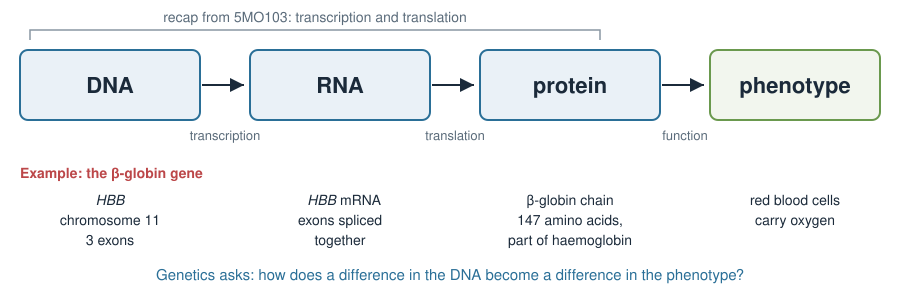
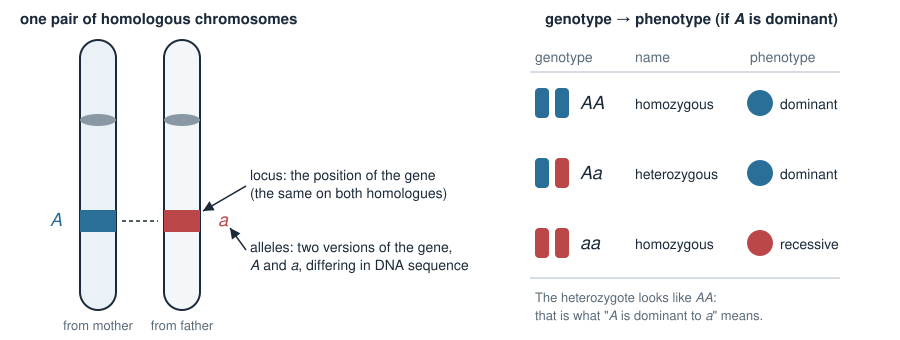
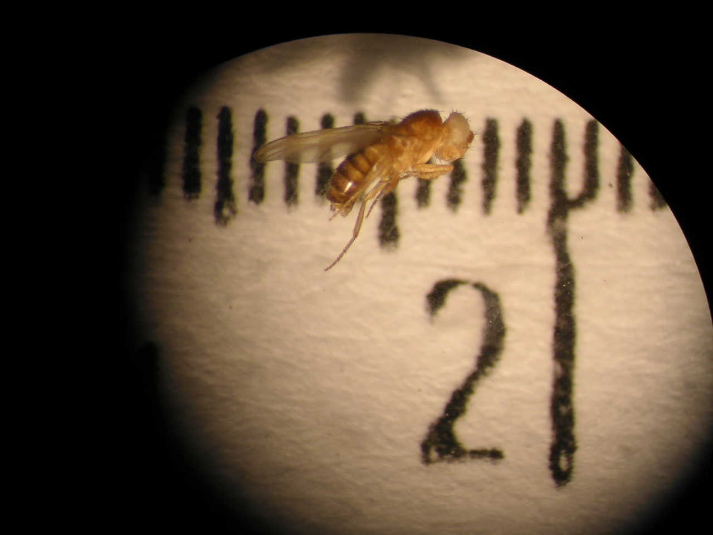
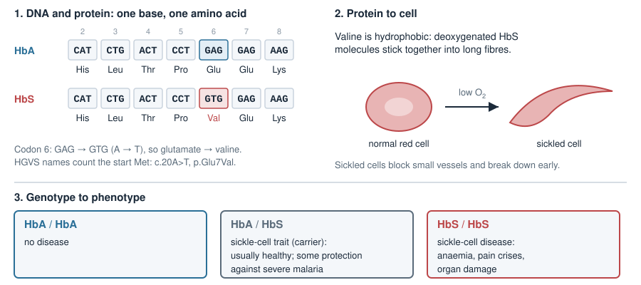
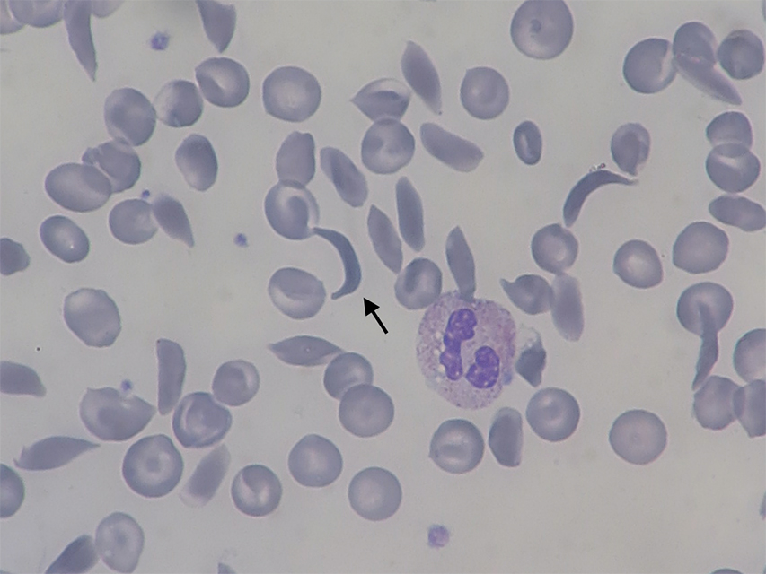
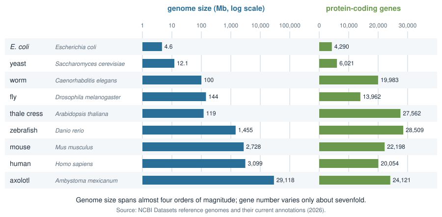
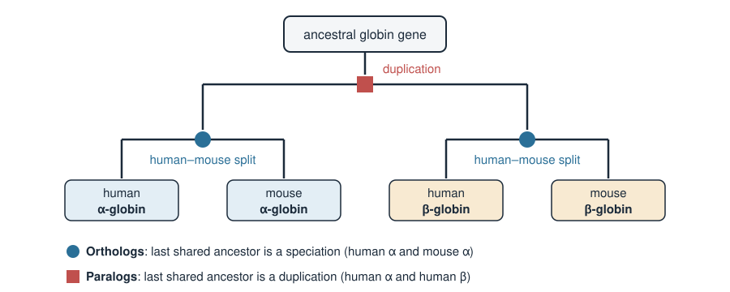
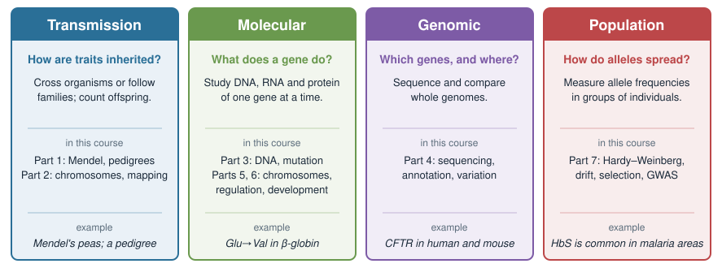

## About this lecture

Genetics is the study of **biological information**: how it is stored in DNA, how it is copied and passed on, and how differences in it become differences between individuals.

- A short **recap** of DNA → RNA → protein → phenotype (from 5MO103).
- The words we will use all course: **gene, allele, locus, genotype, phenotype, homozygous, heterozygous, wild type, mutant, dominant, recessive**.
- How to read a gene's **address** (11p15.4) and a mutation's **name** (Glu6Val = p.Glu7Val).
- One gene followed all the way from DNA to disease: ***HBB*** and sickle-cell disease.
- Genomes differ hugely in size, but many genes are **shared** (orthologs and paralogs, drawn as a gene tree). That is why **model organisms** work.
- Four ways to study genetics, which are also a **map of this course**.

Book: Hartwell, *Genetics: From Genes to Genomes*, introductory chapter ("Genetics: the study of biological information").

::: notes
This is the orientation lecture. Nothing here is hard, but almost every later unit leans on the vocabulary, so the aim is precision rather than depth. Say clearly that the molecular part is a recap from 5MO103 and that we will not re-teach transcription or translation; what is new is the genetic way of looking at it: we care about how differences in DNA become differences in phenotype. The sickle-cell example will come back several times in the course (dominance, pedigrees, population genetics), so it is worth setting it up carefully today.
:::

## Genetics is about information {.smaller}

**Recap from 5MO103.** The information in DNA is copied into RNA and read into protein. Proteins do the work that we see as the **phenotype**.

{width="85%" fig-align="center"}

- DNA is the **store**: it is replicated and passed to the next generation.
- RNA and protein are the **readout**: they are made fresh in each cell.
- The genetic question is about **differences**: a change in the DNA can change the protein, which can change the phenotype.

::: notes
Keep this brief: students have seen the central dogma in detail in 5MO103. The new emphasis is the last bullet. A geneticist almost never studies a gene by itself; we study a difference (a variant, a mutation) and ask what difference it makes. That comparative mindset is what unites Mendel's crosses with modern genome sequencing. Point out that "function" on the last arrow hides a lot of biology (metabolism, development, environment), which is why one gene rarely maps simply to one trait; we simplify today and return to it in Extensions to Mendel and Complex traits.
:::

## What is a gene? {.smaller}

A **gene** is a stretch of DNA that carries the information for one functional product, usually a protein (sometimes only an RNA).

- A gene has a **position** on a chromosome. Human *HBB*, for example, sits on chromosome 11.
- A gene is named with a **symbol** in *italics*: *HBB* (human), *Cftr* (mouse), *w* (*white*, fly).
- The protein is written in plain type: the β-globin protein, the CFTR protein.

| Level | What it is | *HBB* example |
|---|---|---|
| gene | DNA sequence at one position | *HBB* on chromosome 11 |
| transcript | RNA copy, spliced | *HBB* mRNA |
| protein | the product | β-globin, one chain of haemoglobin |

::: notes
The definition of "gene" has moved over a century, from Mendel's abstract "factor" to a DNA sequence. For this course, a working definition is enough: a DNA segment whose product does something. Stress the notation convention now, because students will meet it in every database: gene symbols in italics, human symbols in upper case, mouse symbols with only the first letter capital, fly genes named after their mutant phenotype. Proteins are not italic. This is a small thing that marks the difference between sloppy and professional writing.
:::

## Genes, alleles and loci {.smaller}

{width="80%" fig-align="center"}

- **Locus** (plural *loci*): the place on a chromosome where a gene sits.
- **Allele**: one version of a gene. Different alleles differ in DNA sequence.
- A diploid organism has **two copies** of each autosomal locus, one from each parent. So it carries **two alleles**, which can be the same or different.

::: notes
The classic confusion is between gene and allele. Use the language: "the gene" is HBB; "the alleles" are the normal version and the sickle version. A population can have many alleles at one locus, but one diploid individual carries at most two. The locus is the address, the gene is what lives at the address, and the alleles are the different versions that can live there. The notation A and a is the Mendelian shorthand; we will use it from the next unit onwards.
:::

## Reading a gene's address

Databases give a gene's position in two ways.

**1. Cytogenetic band**, from the stripes a stained chromosome shows under the microscope. *HBB* is at **11p15.4**:

| 11 | p | 1 | 5 | .4 |
|---|---|---|---|---|
| chromosome 11 | short arm (**p**; the long arm is **q**) | region 1 | band 5 | sub-band 4 |

Regions and bands are numbered **outwards from the centromere**, so 11p15.4 is far out on the short arm, near the tip. *CFTR* at **7q31.2** is on the long arm of chromosome 7.

**2. Coordinates** on a reference genome sequence: chromosome, start and end in base pairs, and strand (forward or reverse), on a named assembly such as the human **GRCh38**. Coordinates are exact to the base but change between assemblies; the band does not.

::: notes
Students will read both kinds of address in the first Find it tasks, and nobody tells them what the letters and numbers mean. The band notation comes from Giemsa staining of metaphase chromosomes, which gives a reproducible pattern of light and dark bands; it is coarse, a band is millions of bases. Read 11p15.4 aloud as "eleven p one five point four", not "fifteen", because the digits are region and band. The genome coordinates are what Ensembl and the genome browsers show; we leave the exact numbers for the exercise, where students read them off the Ensembl page. Stress that coordinates always belong to an assembly: GRCh38 is the current human reference, and the older GRCh37 numbers are different for the same gene. A gene on the reverse strand is read from right to left on the standard map.
:::

## Genotype and phenotype {.smaller}

- **Genotype**: the alleles an individual carries at a locus, e.g. *AA*, *Aa* or *aa*.
- **Phenotype**: what we can observe or measure: a colour, a disease, an enzyme activity, a protein band on a gel.
- **Homozygous**: two identical alleles (*AA* or *aa*). **Heterozygous**: two different alleles (*Aa*).

The phenotype depends on the genotype **and** on the environment. Sickle-cell symptoms, for example, get worse at low oxygen.

The same genotype can be described at different **levels** of phenotype: the whole organism, the cell, or the protein. We will see that this matters for the word "dominant".

::: notes
Phenotype is a much broader word than students expect. It is not only visible traits; a band on a protein gel or the level of an enzyme is also a phenotype. That breadth is important for the sickle-cell example in a few slides, where the "dominance" relationship changes with the level at which we look. Also introduce the environment early: a genotype gives a range of possible phenotypes, and the environment picks one. Homozygous and heterozygous apply to one locus at a time; an individual can be homozygous at one locus and heterozygous at the next.
:::

## Wild type and mutant

:::: {.columns}
::: {.column width="60%"}
- **Wild type**: the allele (or phenotype) that is most common in natural or laboratory populations. Written with a plus: *w*^+^ in the fly.
- **Mutant**: an allele that differs from wild type, usually because of a **mutation**, a heritable change in the DNA.
- In the fly, the *white* gene is named after its mutant phenotype: *w* flies have **white** eyes, *w*^+^ flies have red eyes.
:::
::: {.column width="40%"}
{width="100%"}
[Photo: Paul Reynolds, CC BY 2.5, via Wikimedia Commons](https://commons.wikimedia.org/wiki/File:White-eyed_Drosophila.jpg){.photo-credit}

A *w*/*w* fruit fly: no red eye pigment.
:::
::::

In humans and other natural populations, many loci have **several common alleles**, and none is the obvious "wild type". Then we just name the alleles, for example the ABO blood groups.

::: notes
Wild type is a model-organism idea. It works well in lab stocks of flies, worms or mice, where one standard allele exists. It works less well in humans, where many alleles at a locus are common and calling one of them "normal" is arbitrary. Keep the word mutant neutral: it simply means changed, not harmful. Many mutations have no visible effect at all. The fly white gene is the textbook example of naming genes after the mutant phenotype, which confuses students at first: the white gene is needed to make red eyes. The photo shows a white-eyed mutant; a wild-type fly has bright red eyes. The white-eyed fly is also the mutant Morgan found in 1910, which comes back in Chromosome theory.
:::

## Dominant and recessive: a first pass {.smaller}

In a heterozygote *Aa*:

- if *Aa* looks like *AA*, then *A* is **dominant** and *a* is **recessive**;
- the recessive phenotype appears only in *aa*.

**Common misunderstandings.**

- Dominant does **not** mean common. Huntington disease alleles are dominant and rare.
- Dominant does **not** mean "better" or "stronger".
- Dominance describes the **relationship between two alleles** for one phenotype. It is not a property of one allele alone.

This is a **simplification**: complete dominance. Incomplete dominance and codominance come in the Extensions to Mendel unit.

::: notes
Students come with secondary-school ideas, and the most persistent one is that dominant alleles spread or are common. Kill that early: frequency in the population is a separate question that belongs to population genetics. Also make the point that dominance is a statement about a pair of alleles and a particular phenotype. The sickle-cell example on the next slides shows that the same pair of alleles can be recessive for one phenotype and codominant for another. Flag the simplification honestly and name where the full story comes.
:::

## Worked example: sickle-cell disease (1) {.smaller}

**The gene.** *HBB*, "hemoglobin subunit beta", on human chromosome **11** (band 11p15.4).

- *HBB* encodes **β-globin**. Two β-globin and two α-globin chains make one **haemoglobin** molecule, which carries oxygen in red blood cells.
- The gene is small: **3 exons**, about 1.6 kb of DNA.
- The normal allele is called **HbA**. The sickle allele is **HbS**.

**The difference.** HbS has **one base change**: codon 6 is GAG in HbA and **GTG** in HbS. The amino acid changes from glutamate (**Glu**) to valine (**Val**).

You will look *HBB* up in NCBI Gene and Ensembl in the exercise.

::: notes
Sickle-cell disease was the first disease explained at the molecular level (Pauling and colleagues in 1949 showed that the haemoglobin was different; Ingram in the 1950s found the single amino-acid change). It is therefore the cleanest possible example of genotype to phenotype. Numbering: the classic name is Glu6Val, which counts amino acids in the mature chain without the initiator methionine. Databases use the HGVS standard, which counts the methionine, so they write p.Glu7Val and c.20A>T. Mention this now so students are not confused when they meet it in ClinVar. All facts on this slide are on the NCBI Gene and Ensembl pages they will open.
:::

## Worked example: sickle-cell disease (2) {.smaller}

:::: {.columns}
::: {.column width="66%"}
{width="100%"}
:::
::: {.column width="34%"}
{width="100%"}
[Photo: Paulo Henrique Orlandi Mourao, CC BY-SA 4.0, via Wikimedia Commons](https://commons.wikimedia.org/wiki/File:Sickle-cell_smear_2015-09-10.jpg){.photo-credit}

A blood smear from a person with sickle-cell disease (HbS/HbS), under the light microscope. Next to normal round red cells lie the stiff, elongated **sickle cells** (drepanocytes).
:::
::::

::: notes
The photo on the right is the phenotype at the level of the cell, the middle level between the protein change and the disease.
Walk through the figure from top left. One base (A to T in the coding strand) changes one codon (GAG to GTG) and one amino acid (Glu to Val). Valine is hydrophobic; on the surface of deoxygenated haemoglobin it creates a sticky patch, so HbS molecules polymerise into long fibres when oxygen is low. The fibres bend the red cell into a sickle shape. Sickled cells are stiff, block small vessels, causing pain and organ damage, and are destroyed early, causing anaemia. At the bottom, the three genotypes: two normal alleles, carrier, and two sickle alleles. The carrier state also gives partial protection against severe malaria, which is why HbS is common in regions where malaria is or was common. We return to that in population genetics.
:::

## Worked example: sickle-cell disease (3) {.smaller}

Is HbS dominant or recessive? **It depends on the phenotype you look at.**

| Phenotype level | HbA/HbA | HbA/HbS | HbS/HbS | HbS is... |
|---|---|---|---|---|
| Disease (anaemia, crises) | no | no (usually) | yes | **recessive** |
| Red cells sickle at very low O~2~ | no | some | yes | (partly) **dominant** |
| Haemoglobin type on a gel | only HbA | HbA **and** HbS | only HbS | **codominant** |

- At the protein level, each allele makes its own product. The heterozygote has both.
- So "recessive" is a statement about one phenotype, not about the allele itself.

::: notes
This slide is the payoff of the vocabulary. The disease is inherited as an autosomal recessive trait; that is how it appears in pedigrees and in OMIM. But a carrier's red cells can sickle under extreme low oxygen, and on an electrophoresis gel both haemoglobin types are seen side by side, which is codominance. This is not a contradiction; it shows that dominance is defined relative to a phenotype. Students will meet codominance again in the Extensions to Mendel unit, and the electrophoresis view is the cleanest way to understand it. Use this to reinforce that "recessive" does not mean "does nothing" in the heterozygote.
:::

## Naming a mutation: two numbering systems

The sickle mutation has two names, and you will meet both.

| | Traditional (papers, textbooks) | Database (HGVS standard) |
|---|---|---|
| Protein | **Glu6Val** | **p.Glu7Val** |
| DNA | "codon 6, GAG → GTG" | **c.20A>T** |
| Counting from | first amino acid of the **mature** protein (start Met removed) | the **A of the ATG** start codon (c.) and the start **Met** (p.) |

How to move between them:

- Protein: HGVS number = traditional number **+ 1** here, because the start Met is counted.
- DNA to codon: codon *n* covers coding nucleotides **3*n* − 2 to 3*n***. So c.20 is the middle base of codon 7 (nucleotides 19–21).
- "c." means coding DNA, "p." protein; "A>T" means the base A is replaced by T.

::: notes
This slide moves material that was in the notes onto the screen, because the exercise asks students to do exactly this conversion. The traditional numbering of haemoglobin variants skips the initiator methionine, which is removed from the mature beta-globin chain; the HGVS standard used by ClinVar and Ensembl counts it, so all protein positions differ by one. For the DNA, numbering starts at the A of ATG as c.1. The formula 3n − 2 to 3n is what they need for the translation task. Do not convert other variants here; the exercise has HbC to practise on.
:::

## Genomes differ hugely in size {.smaller}

{width="78%" fig-align="center"}

- **Genome**: all the DNA of an organism (one copy of each chromosome).
- Genome size runs from about 5 Mb (*E. coli*) to over 29,000 Mb (axolotl).
- The number of protein-coding genes is far less variable: about 4,000 to 28,000 in this set.

::: notes
The numbers come from NCBI Datasets, the reference genome for each species and its current annotation. Gene counts are approximate and change a little with each annotation release, so we round in speech. The key observation: genome size spans almost four orders of magnitude; gene number varies about sevenfold. A human has roughly the same number of protein-coding genes as a mouse or a worm. The axolotl, a salamander, has a genome ten times larger than ours with a similar gene number. Students will plot these exact data in R in the exercise.
:::

## The C-value paradox {.smaller}

The **C-value** is the amount of DNA in one haploid genome. The **paradox**: C-value does not follow organism complexity or gene number.

Why? Most of a large eukaryotic genome **does not code for protein**:

- **introns** inside genes, and large **intergenic** regions;
- **repeated sequences**, especially transposable elements, which can make up most of a genome;
- **polyploidy**: bread wheat has three ancestral genomes, which is why it has so many genes.

Bacteria are the exception. Their genes are packed tightly: *E. coli* has about 900 genes per Mb, humans about 6.

::: notes
The C in C-value originally meant constant: each species has a characteristic amount of DNA per haploid nucleus. The paradox was that this amount is not related to complexity: some amphibians and plants have far more DNA than mammals. Today we understand it mainly as differences in non-coding DNA, especially transposable elements, and in polyploidy. It is sometimes called the C-value enigma, because once we know about repeats it is not really a paradox any more. The genes-per-Mb comparison is the R task in the exercise, so do not give away too many numbers; the two quoted here are rounded.
:::

## Many genes are shared {.smaller}

Genes in different species that descend from **one gene in their common ancestor** are **orthologs**. Genes that arose by **duplication** within a genome are **paralogs**.

- Human *CFTR* (chromosome 7) and mouse *Cftr* (chromosome 6) are **one-to-one orthologs**. Their proteins are about **79%** identical (Ensembl).
- The zebrafish *cftr* protein is still about **56%** identical to the human one.
- *HBB* is part of a **gene family**: α-, β-, γ-, δ-globins are paralogs, made by old duplications. Families like this can make one-to-one orthologs hard to define.

Because genes and their functions are conserved, what we learn about a gene in one species often holds in others.

::: notes
Orthology is the reason comparative genetics works. The identity figures come from the Ensembl Compara orthologue pages (release 116). Mention that the globin family is a nice example of duplication: humans have several β-like globin genes expressed at different developmental stages, and the duplications happened separately in different mammal lineages, so the mouse β-like globins do not pair one-to-one with ours. That is why Ensembl does not list a simple mouse ortholog for HBB, and why the exercise uses CFTR for the mouse ortholog task. Paralogs come back in Genome annotation.
:::

## Orthologs and paralogs in a gene tree

{width="78%" fig-align="center"}

To classify two genes, find the node where they **last shared an ancestor**:

- a **speciation** (●) → **orthologs**: the "same" gene in two species;
- a **duplication** (■) → **paralogs**: two genes that arose by copying, even if they are now in different species (human α and mouse β are paralogs too).

::: notes
The gene tree is the tool behind the words. Simplified globin family: one ancestral globin gene duplicated, long before mammals, into the alpha and beta lineages. Much later the human and mouse lineages split, and each species kept both genes. So human alpha and mouse alpha are orthologs, and human alpha and human beta are paralogs. The less obvious case in the last bullet is worth asking: human alpha and mouse beta last shared an ancestor at the duplication, so they are paralogs, even though they are in different species. The tree leaves out later duplications within the alpha and beta clusters; those are why human HBB has no simple one-to-one mouse ortholog. In the exercise students draw such a tree for a hypothetical gene and see what happens if the duplication comes after the split.
:::

## Why model organisms work {.smaller}

A **model organism** is easy to grow, cross and manipulate, and what we learn in it often applies to other species, because many genes are shared.

| Organism | Generation time (roughly) | Good for |
|---|---|---|
| Yeast, *Saccharomyces cerevisiae* | hours | cell cycle, haploid genetics |
| Worm, *Caenorhabditis elegans* | days | development, every cell mapped |
| Fly, *Drosophila melanogaster* | about 10 days | classical genetics, development |
| Thale cress, *Arabidopsis thaliana* | about 2 months | plant genetics |
| Zebrafish, *Danio rerio* | months | vertebrate development, transparent embryos |
| Mouse, *Mus musculus* | about 2 months | mammalian genetics, disease models |

Each has its own database, joined in the **Alliance of Genome Resources**.

::: notes
The trade-off is between ease and similarity to humans. Yeast and worms are fast and cheap but distant; mice are close but slow and expensive. Most human disease genes have counterparts in mouse, many in fly and fewer in yeast. Generation times are rough, under lab conditions, and vary with temperature and strain; do not let students memorise them, only the order. Mention the community databases: SGD, WormBase, FlyBase, TAIR, ZFIN and MGI, now joined in the Alliance of Genome Resources, which the exercise uses for an optional task.
:::

## Four ways to study genetics {.smaller}

{width="82%" fig-align="center"}

These four approaches are also the **map of this course**. Each one asks a different question about the same information.

::: notes
Use the figure as a map. Transmission genetics is Mendel's approach: crosses and pedigrees, inferring genes from patterns of inheritance, without seeing any DNA. Molecular genetics looks at the DNA and its products directly. Genomics looks at whole genomes at once. Population genetics asks how allele frequencies change over generations and between populations. The approaches complement each other: sickle-cell disease was first recognised by transmission (a recessive pattern in families), explained molecularly (Glu to Val), and its frequency explained by population genetics (malaria). Point out where each part of the course sits.
:::

## Where genetic information lives {.smaller}

Every gene you meet in this course has an entry in public databases. You will use them in every exercise.

| Database | Use it for | Example |
|---|---|---|
| [NCBI Gene](https://www.ncbi.nlm.nih.gov/gene/) | name, location, summary of a gene | *HBB* → chromosome 11, 11p15.4 |
| [Ensembl](https://www.ensembl.org/) | transcripts, genome view, orthologs | *CFTR* → mouse *Cftr* |
| [Alliance of Genome Resources](https://www.alliancegenome.org/) | one gene across model organisms | *CFTR* in fish, frog, mouse, rat |
| OMIM, ClinVar | human disease and variants | later units |

Tip: always check the **species** in the search result. Searching "HBB" gives hits in many species.

::: notes
This slide prepares the Find it tasks. The most common beginner error in NCBI Gene is to click the first hit without checking the organism. Show a live search if there is time: type HBB in NCBI Gene, point out the organism column, open the human entry and show where the chromosome and the map location are written. Then do the same in Ensembl and show the left-hand menu with the Orthologues link. Do not ask students to remember counts (like the number of transcripts), because they change between releases.
:::

## Check yourself

True or false? Correct the false ones.

1. "*HBB* and HbS are two alleles."
2. "A person can carry three alleles of *ABO*, since the population has three."
3. "Dominant alleles are the common ones."
4. "HbS is recessive, so a carrier makes no HbS protein."
5. "Mutant means harmful."
6. "Human *CFTR* and mouse *Cftr* are paralogs, because they are in different species."
7. "A bigger genome means more genes."

::: notes
Answers. 1: false; HBB is the gene, HbA and HbS are its alleles. 2: false; a diploid person carries at most two alleles at an autosomal locus. 3: false; dominance says nothing about frequency (Huntington). 4: false; recessive for the disease, but the carrier makes both HbA and HbS (codominant on a gel). 5: false; mutant only means changed, many mutations have no visible effect. 6: false; they are orthologs, related by speciation; species alone does not decide it. 7: false; the C-value paradox (axolotl versus human). Let students discuss in pairs for two minutes, then go through them.
:::

## Summary {.smaller}

| Term | Meaning |
|---|---|
| gene | DNA segment encoding a functional product |
| locus | position of a gene on a chromosome |
| allele | one version of a gene |
| genotype / phenotype | alleles carried / traits observed |
| homozygous / heterozygous | two identical / two different alleles |
| wild type / mutant | the standard allele / a changed allele |
| dominant / recessive | in *Aa*, whose phenotype is seen; defined for one phenotype |
| genome | all the DNA of an organism; size not proportional to gene number |
| ortholog / paralog | related by speciation / by duplication |

Sickle-cell disease: *HBB*, one base change, Glu→Val, recessive disease, codominant on a gel.

::: notes
The summary table is the vocabulary sheet for the whole course. Ask students to be able to give the sickle-cell version of each word: gene HBB, locus 11p15.4, alleles HbA and HbS, genotypes HbA/HbA, HbA/HbS, HbS/HbS, phenotype disease or no disease, carrier is heterozygous. If they can do that, they are ready for Mendel.
:::

## Where this leads

- **Mendel**: alleles segregate into gametes, and we predict genotype ratios in crosses (*Aa* × *Aa*).
- **Extensions to Mendel**: incomplete dominance, codominance and the other complications we postponed today.
- **Gene expression recap** and **Genome annotation**: transcripts, exons and orthologs in more depth.
- **Hardy–Weinberg** and **Drift and selection**: why HbS is common where malaria is.

::: notes
Point forward. The next unit starts with Mendel's peas, which is transmission genetics with no molecular knowledge at all. Ask students to keep the sickle-cell example in mind: every Mendelian rule we learn can be checked against it.
:::
