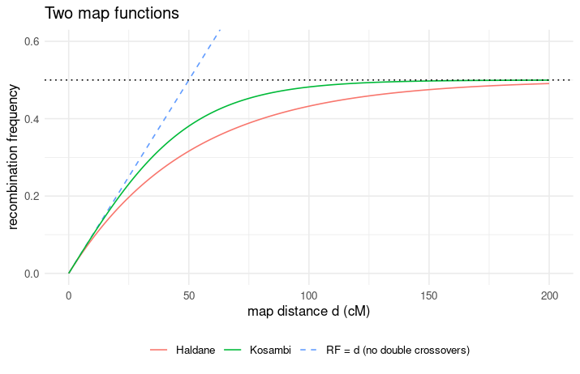
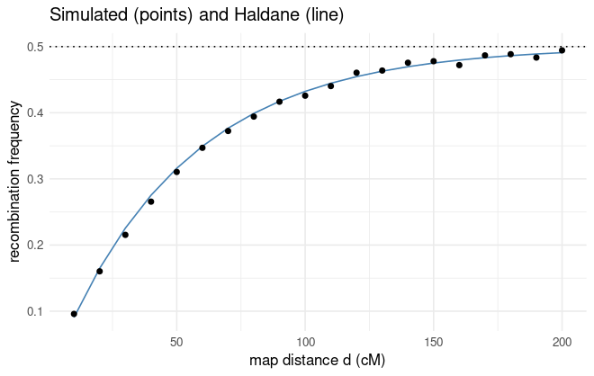

## Goal

By the end of this exercise you should be able to:

- compute a recombination frequency from a testcross table with dplyr;
- write R **functions with a default argument**, `cM_to_rf(d, method = "haldane")` and `rf_to_cM(rf, method = "haldane")`, and call them with and without the argument;
- use `map_dbl()` to apply a function over a range of map distances, and plot Haldane's and Kosambi's map functions;
- re-analyse Sturtevant's original 1913 data, and simulate crossovers with `rpois()` to see where Haldane's function comes from;
- test for linkage with `chisq.test()`.

## Before you start

This page builds on the by-hand part of the [Exercise](exercise.qmd), so do that first. You need the packages dplyr, purrr, readr and ggplot2. Download [sturtevant1913.csv](data/sturtevant1913.csv) and save it in a `data/` folder of your R project.

```r
library(dplyr)
library(purrr)
library(readr)
library(ggplot2)
```

## Tasks

The new idiom today is a **function argument with a default value**. In `function(d, method = "haldane")`, `d` must always be given, but `method` can be left out: then it is `"haldane"`. You can still write `method = "kosambi"` to override it. [`match.arg()`](https://rdrr.io/r/base/match.arg.html) checks that the value is one of the allowed choices and stops with a clear error message otherwise (try `cM_to_rf(10, "kosambo")`). Many R functions you already use work like this: `chisq.test(x, p = ...)` has a default `p` (equal proportions), and `mean(x, na.rm = FALSE)` a default `na.rm`.

You met [`map_dbl()`](https://purrr.tidyverse.org/reference/map.html) in *Extensions to Mendel*: `map_dbl(xs, f)` calls `f` once for each element of `xs` and returns the results as a numeric vector. Inside it, `\(x) ...` is a short function of one argument `x`.

### R1. RF from a testcross

The testcross from the lecture (*pr* and *vg* in *Drosophila*; invented numbers):

```r
testcross <- tibble(
  phenotype = c("wild type", "purple vestigial", "purple", "vestigial"),
  genotype  = c("pr+ vg+ / pr vg", "pr vg / pr vg", "pr vg+ / pr vg", "pr+ vg / pr vg"),
  type      = c("parental", "parental", "recombinant", "recombinant"),
  n         = c(1170, 1149, 155, 146)
)
testcross

testcross |>
  group_by(type) |>
  summarise(n = sum(n)) |>
  mutate(fraction = n / sum(n))
```

What is the RF? Then change `testcross` to the maize data of B1 in the [exercise](exercise.qmd) and check your answer.

### R2. Two map functions, with a default

Write two functions that convert between map distance in **centimorgans** and RF. Both have the argument `method`, with Haldane as the default.

```r
cM_to_rf <- function(d, method = "haldane") {
  method <- match.arg(method, c("haldane", "kosambi"))
  m <- d / 100                       # centimorgans -> morgans
  if (method == "haldane") {
    0.5 * (1 - exp(-2 * m))
  } else {
    0.5 * tanh(2 * m)
  }
}

rf_to_cM <- function(rf, method = "haldane") {
  method <- match.arg(method, c("haldane", "kosambi"))
  if (method == "haldane") {
    m <- -0.5 * log(1 - 2 * rf)
  } else {
    m <- 0.25 * log((1 + 2 * rf) / (1 - 2 * rf))
  }
  100 * m                            # morgans -> centimorgans
}

cM_to_rf(10)                         # method left out: Haldane
cM_to_rf(10, method = "kosambi")
cM_to_rf(c(1, 10, 50, 100, 200))     # works on a whole vector
rf_to_cM(0.115)                      # pr-vg
rf_to_cM(0.115, "kosambi")           # arguments can also be given by position
rf_to_cM(cM_to_rf(37))               # there and back again
rf_to_cM(0.5)
```

Check your answers to B6 in the [exercise](exercise.qmd) with these functions. Why does `rf_to_cM(0.5)` give `Inf`?

### R3. Plot the map functions with `map_dbl()`

Compute RF for every distance from 0 to 200 cM with both functions. For Kosambi, the extra argument goes inside a short function `\(x) cM_to_rf(x, method = "kosambi")`.

```r
curves <- tibble(d = 0:200) |>
  mutate(haldane = map_dbl(d, cM_to_rf),
         kosambi = map_dbl(d, \(x) cM_to_rf(x, method = "kosambi")))
curves |> filter(d %in% c(5, 10, 25, 50, 100, 200))

ggplot(curves, aes(x = d)) +
  geom_line(aes(y = d / 100, colour = "RF = d (no double crossovers)"), linetype = "dashed") +
  geom_line(aes(y = haldane, colour = "Haldane")) +
  geom_line(aes(y = kosambi, colour = "Kosambi")) +
  geom_hline(yintercept = 0.5, linetype = "dotted") +
  coord_cartesian(ylim = c(0, 0.6)) +
  labs(x = "map distance d (cM)", y = "recombination frequency",
       colour = NULL, title = "Two map functions") +
  theme_minimal() +
  theme(legend.position = "bottom")
```

Up to which distance do the three lines agree to within 0.01?

### R4. Sturtevant's 1913 data

The file `sturtevant1913.csv` has Sturtevant's real counts: for each pair of X-linked genes, the number of recombinant flies and the total. His map put *y* at 0.0, *w* 1.0, *v* 30.7, *m* 33.7 and *r* 57.6. Compute the RF for each pair, the map distance from his map, and the distance that each map function gives for the measured RF.

```r
sturtevant <- read_csv("data/sturtevant1913.csv", show_col_types = FALSE)
map_1913 <- c(y = 0, w = 1.0, v = 30.7, m = 33.7, r = 57.6)

sturtevant |>
  mutate(rf         = recombinant / total,
         map_dist   = abs(map_1913[gene2] - map_1913[gene1]),
         haldane_cM = rf_to_cM(rf),
         kosambi_cM = rf_to_cM(rf, method = "kosambi")) |>
  select(gene1, gene2, rf, map_dist, haldane_cM, kosambi_cM) |>
  arrange(map_dist) |>
  mutate(across(where(is.double), \(x) round(x, 3)))
```

`map_1913[gene2]` looks up each gene's map position by name in the named vector. For which pairs do RF and map distance agree? For *y*–*r*, which map function comes closer to Sturtevant's 57.6?

### R5. Simulate crossovers: where Haldane comes from

If crossovers happen independently, the number of crossovers on one chromatid in an interval of *d* cM is a Poisson random number with mean *d*/100. [`rpois(n, lambda)`](https://rdrr.io/r/stats/Poisson.html) draws `n` such numbers. The chromatid is recombinant if the number is **odd**: `k %% 2 == 1` (`%%` is the remainder after division).

```r
set.seed(1)
table(rpois(10, lambda = 0.5))       # 10 chromatids, 50 cM

sim_rf <- function(d, n = 10000) {
  crossovers <- rpois(n, lambda = d / 100)   # crossovers on one chromatid, between the loci
  mean(crossovers %% 2 == 1)                 # recombinant if the number is odd
}

set.seed(1913)
sim <- tibble(d = seq(10, 200, by = 10)) |>
  mutate(simulated = map_dbl(d, sim_rf),
         haldane   = cM_to_rf(d))
sim |> filter(d %in% c(10, 50, 100, 150, 200))

ggplot(sim, aes(x = d)) +
  geom_line(aes(y = haldane), colour = "steelblue") +
  geom_point(aes(y = simulated)) +
  geom_hline(yintercept = 0.5, linetype = "dotted") +
  labs(x = "map distance d (cM)", y = "recombination frequency",
       title = "Simulated (points) and Haldane (line)") +
  theme_minimal()
```

`sim_rf` also has a default argument, `n = 10000`. Call `sim_rf(50, n = 100)` a few times: how much does the answer vary? Why does the simulation match Haldane's curve and not Kosambi's?

### R6. Testing for linkage with `chisq.test()`

A testcross gives 15 *A B*, 17 *a b*, 9 *A b* and 9 *a B* (the lecture example). First check that each gene segregates 1 : 1, then test parental against recombinant.

```r
gene_A   <- c(A = 15 + 9,  a = 17 + 9)
gene_B   <- c(B = 15 + 9,  b = 17 + 9)
par_rec  <- c(parental = 15 + 17, recombinant = 9 + 9)

chisq.test(gene_A)$p.value           # default p: equal proportions
chisq.test(gene_B)$p.value
chisq.test(par_rec)

chisq.test(c(parental = 1170 + 1149, recombinant = 155 + 146))
```

`chisq.test()` uses its own default here: without `p =`, it tests against equal proportions, which is exactly 1 : 1. Then check B7 in the [exercise](exercise.qmd).

## Solutions

::: {.callout-note collapse="true" title="Solutions: In R"}

All output below is from `Rscript --vanilla` run in the unit folder.

**R1.**

```
# A tibble: 4 × 4
  phenotype        genotype        type            n
  <chr>            <chr>           <chr>       <dbl>
1 wild type        pr+ vg+ / pr vg parental     1170
2 purple vestigial pr vg / pr vg   parental     1149
3 purple           pr vg+ / pr vg  recombinant   155
4 vestigial        pr+ vg / pr vg  recombinant   146
# A tibble: 2 × 3
  type            n fraction
  <chr>       <dbl>    <dbl>
1 parental     2319    0.885
2 recombinant   301    0.115
```

RF = **0.115**. For the maize data of B1: parental 3998, recombinant 152, RF = 0.0366.

**R2.**

```
[1] 0.09063462
[1] 0.09868766
[1] 0.009900663 0.090634623 0.316060279 0.432332358 0.490842181
[1] 13.06824
[1] 11.70947
[1] 37
[1] Inf
```

Haldane turns 10 cM into RF 0.091, Kosambi into 0.099. *pr*–*vg* (RF 0.115) is 13.1 cM by Haldane and 11.7 cM by Kosambi. `rf_to_cM(0.5)` is `Inf`: RF = 0.5 is what an infinitely long distance gives, so it corresponds to no finite map distance (in the formula, log(1 − 1) = log(0) = −∞).

**R3.**

```
# A tibble: 6 × 3
      d haldane kosambi
  <int>   <dbl>   <dbl>
1     5  0.0476  0.0498
2    10  0.0906  0.0987
3    25  0.197   0.231
4    50  0.316   0.381
5   100  0.432   0.482
6   200  0.491   0.500
```

{width="80%" fig-align="center"}

Kosambi stays within 0.01 of RF = *d* up to about 20 cM, Haldane only up to about 10 cM (at 10 cM, 0.0906 vs 0.10). Beyond 25 cM, the choice of map function matters.

**R4.**

```
# A tibble: 9 × 6
  gene1 gene2    rf map_dist haldane_cM kosambi_cM
  <chr> <chr> <dbl>    <dbl>      <dbl>      <dbl>
1 y     w     0.01       1        0.994      0.985
2 v     m     0.03       3        3.06       2.97
3 v     r     0.269     26.9     38.6       30.1
4 w     v     0.297     29.7     45.2       34.2
5 y     v     0.322     30.7     51.6       38.2
6 w     m     0.337     32.7     56.1       40.9
7 y     m     0.355     33.7     61.9       44.3
8 w     r     0.452     56.6    117.        74.7
9 y     r     0.375     57.6     69.4       48.7
```

For the two short intervals (*y*–*w*, *v*–*m*), RF, map distance and both map functions agree. For intervals around 30 cM, the map functions already give larger distances than Sturtevant's map: his map used raw RFs of about 0.3 as distances, so it underestimates. For *y*–*r*, Haldane gives 69.4 cM and Kosambi 48.7 cM, on either side of 57.6; Kosambi is closer. *w*–*r* shows the problem with long intervals: RF 0.452 from only 898 flies gives 117 cM by Haldane, far more than *y*–*r*, although *y* and *w* are only 1 cM apart. Near RF = 0.5 the map functions magnify small sampling errors enormously.

**R5.**

```

0 1 2
5 4 1
# A tibble: 5 × 3
      d simulated haldane
  <dbl>     <dbl>   <dbl>
1    10    0.0959  0.0906
2    50    0.310   0.316
3   100    0.426   0.432
4   150    0.478   0.475
5   200    0.494   0.491
```

{width="75%" fig-align="center"}

Of 10 simulated chromatids at 50 cM, 5 had no crossover, 4 had one (recombinant) and 1 had two (parental again). The simulated RFs lie on Haldane's curve because the simulation makes exactly Haldane's assumption: crossovers independent of each other (Poisson). Kosambi's function assumes **interference**, which `rpois` does not have. With `n = 100`, `sim_rf(50, n = 100)` varies by several percentage points from call to call; with the default `n = 10000`, by about half a percentage point.

**R6.**

```
[1] 0.7772974
[1] 0.7772974

	Chi-squared test for given probabilities

data:  par_rec
X-squared = 3.92, df = 1, p-value = 0.04771


	Chi-squared test for given probabilities

data:  c(parental = 1170 + 1149, recombinant = 155 + 146)
X-squared = 1554.3, df = 1, p-value < 2.2e-16
```

Both genes segregate 1 : 1 (p = 0.78). Parental 32 vs recombinant 18 gives χ² = 3.92, p = 0.048: just significant, weak evidence for linkage, as in the lecture. The *pr*–*vg* testcross gives χ² = 1554: no doubt at all.
:::

## Where this leads

The two map functions you wrote will be reused in **Three-point crosses**, where three genes in one testcross reveal the double crossovers directly and let you measure interference. In **Human linkage & LOD scores** you write another function of RF, the LOD score, and use `map_dbl()` again to draw it as a curve over all possible RFs.
