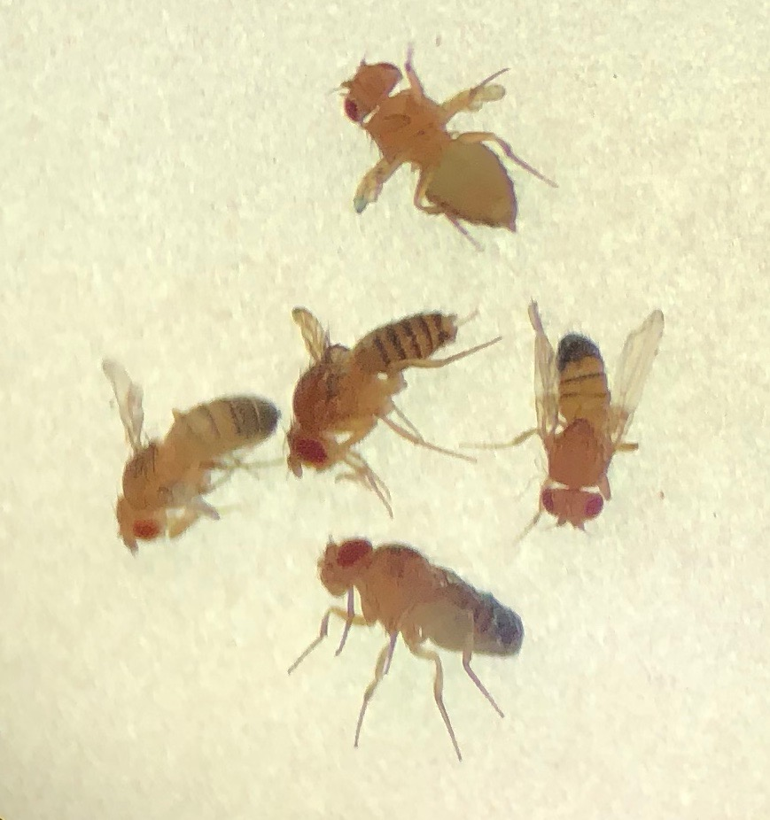
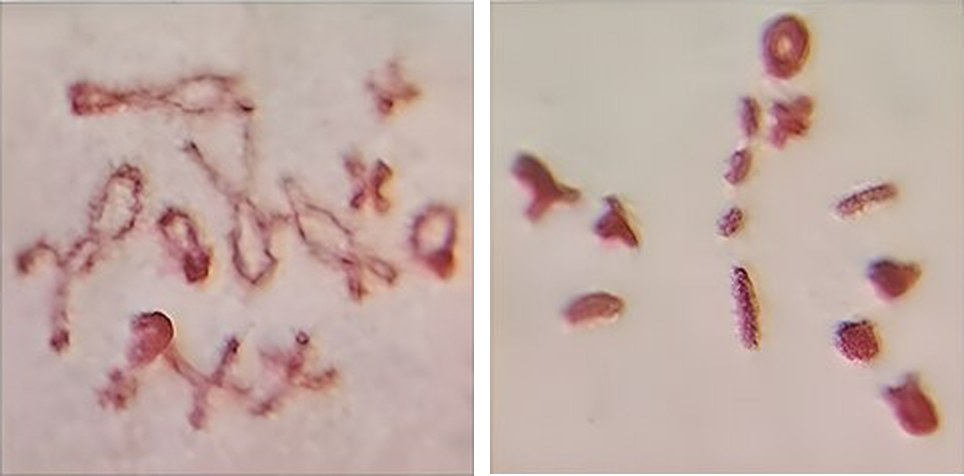
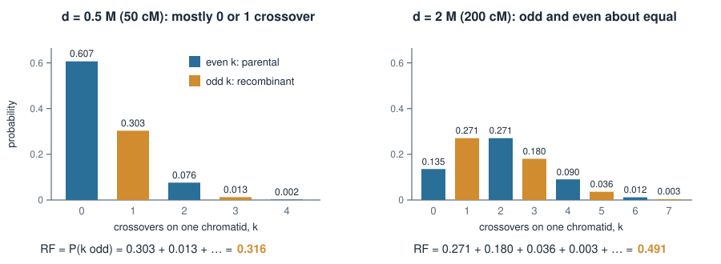
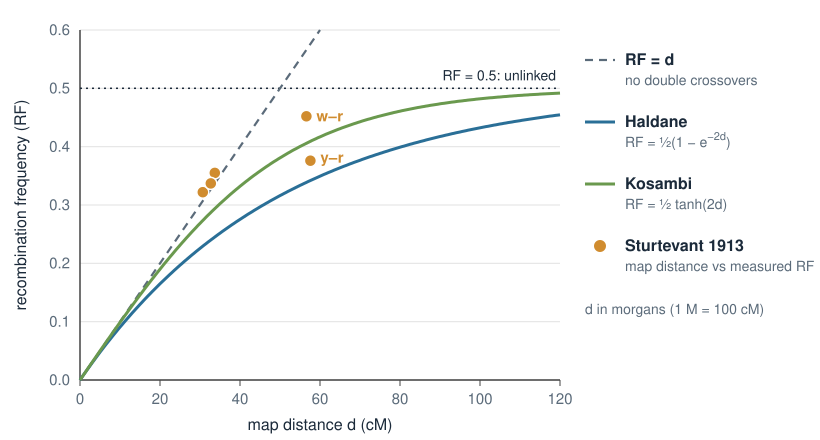

## About this lecture {.smaller}

Mendel's second law says that alleles of different genes go into gametes independently. That is only true for genes on **different chromosomes**, or far apart on one. Genes close together on a chromosome are **linked**: they tend to travel together. Measuring *how much* they travel together turns out to be a ruler for the chromosome.

- **Linkage**: excess parental types in a testcross. **Coupling** and **repulsion**, and predicting a testcross from an RF.
- **Recombination frequency** (RF), and where recombinants come from: **crossing over** at the **four-strand stage**, seen as **chiasmata** in the microscope.
- From chiasmata to RF, step by step. **Map distance** in centimorgans (cM), and Sturtevant's first genetic map (1913).
- Why RF never exceeds **50%**: odd and even numbers of crossovers.
- **Map functions** (Haldane, built step by step from the Poisson distribution, and Kosambi), worked in both directions.
- **Testing for linkage** with the χ² test, and why loose linkage needs large samples.

Book: Hartwell, *Genetics: From Genes to Genomes*, linkage, recombination and mapping chapter.

::: notes
This unit picks up two threads. From Mendel: the law of independent assortment, which we flagged as needing genes on different chromosomes. From Chromosome theory & sex linkage: genes sit on chromosomes, chromosomes are replicated into two sister chromatids, and homologues pair in prophase I. Put those together and you can predict linkage before seeing any data. The rest of Part 2 builds on today: Three-point crosses uses the same ideas to order three genes at once and to measure interference; Human linkage & LOD scores does the same thing in families, where we cannot set up testcrosses. The R part today is about writing functions with default arguments: two map functions.
:::

## Independent assortment has exceptions {.smaller}

- **1905**: Bateson, Saunders and Punnett crossed sweet peas differing in flower colour and pollen shape. The F~2~ was far from 9 : 3 : 3 : 1: the two **parental combinations** were much too common. They called it **coupling** (and, for the reverse arrangement, **repulsion**), without an explanation.
- **1911**: Thomas Hunt Morgan saw the same in *Drosophila* with X-linked genes, and proposed the explanation: the genes are on the **same chromosome**, and they are separated only when the homologues **exchange segments**.

For a dihybrid **testcross** *AaBb* × *aabb*, recall what Mendel predicts:

| Unlinked genes (Mendel) | Linked genes |
|---|---|
| 4 classes, **1 : 1 : 1 : 1** | 4 classes, **2 large + 2 small** |
| 50% new combinations | **less than 50%** new combinations |

::: notes
The sweet pea story is worth telling because it shows how a good observation can sit unexplained for years. Bateson was a champion of Mendel but sceptical of the chromosome theory, and he did not connect coupling to chromosomes. Morgan did, and with his students Sturtevant and Bridges turned it into gene mapping. Recall the testcross from the Mendel unit: the tester gives only recessive alleles, so the offspring classes are a direct readout of the gametes of the dihybrid. That is why all mapping in experimental organisms is done with testcrosses, or crosses that act like them.
:::

## Three ways a dihybrid can make gametes {.smaller}

Take a dihybrid that got *A B* from one parent and *a b* from the other. Which gametes can it make?

| | Genes on different chromosomes | Same chromosome, **never** separated | Same chromosome, **sometimes** separated |
|---|---|---|---|
| *A B* | ¼ | ½ | more than ¼ |
| *a b* | ¼ | ½ | more than ¼ |
| *A b* | ¼ | 0 | less than ¼ |
| *a B* | ¼ | 0 | less than ¼ |
| New combinations | 50% | 0% (**complete linkage**) | between 0 and 50% |
| What happens in meiosis | homologue pairs orient independently | the two alleles ride on one chromosome | a **crossover** between the genes swaps them |

Real linked genes are in the third column. *How* much less than 50% is the measurement we use for mapping.

::: notes
Build this column by column. Left: Mendel's independent assortment, from the Chromosome theory unit: the two chromosome pairs orient independently at metaphase I, so all four combinations are equally likely. Middle: if two genes sat on one chromosome and nothing ever broke it, the gamete would carry the whole chromosome, so only the two parental combinations appear, half each. That is complete linkage; it is what Drosophila males show, as we see later. Right: real chromosomes exchange segments in prophase I, so new combinations appear, but less often than for unlinked genes. Note that the two parental classes are still equal to each other, and the two recombinant classes are equal to each other: that symmetry is the check you use when reading real data.
:::

## A testcross with linked genes {.smaller}

:::: {.columns}
::: {.column width="68%"}
*Drosophila*: *pr* (purple eyes) and *vg* (vestigial wings), both recessive, both on chromosome 2. F~1~ females from *pr*^+^ *vg*^+^ / *pr*^+^ *vg*^+^ × *pr vg* / *pr vg* are testcrossed to *pr vg* / *pr vg* males.

| Offspring | Gamete from the F~1~ mother | Class | Number |
|---|---|---|---:|
| wild type | *pr*^+^ *vg*^+^ | parental | 1170 |
| purple, vestigial | *pr vg* | parental | 1149 |
| purple | *pr vg*^+^ | **recombinant** | 155 |
| vestigial | *pr*^+^ *vg* | **recombinant** | 146 |
| | | total | 2620 |

$$\text{RF} = \frac{155 + 146}{2620} = 0.115 = 11.5\%$$

Invented teaching numbers, consistent with the real *pr*–*vg* distance in FlyBase.
:::
::: {.column width="32%"}
{width="100%"}

[Photo: Salem.slima, CC BY-SA 4.0, via Wikimedia Commons](https://commons.wikimedia.org/wiki/File:Drosophila_melanogaster_vestigial.jpg){.photo-credit}

A vestigial-winged fly (top) among flies with normal wings.
:::
::::

::: notes
Read the table as gametes of the F1 mother, because the father only contributes pr vg. The two big classes have the allele combinations the F1 got from its parents: pr+ vg+ from one, pr vg from the other. Those are parental. The two small classes are new combinations, recombinants. The photo shows how easy vestigial is to score: the wings are crumpled stubs, visible by eye under a dissecting microscope. Why F1 females? Drosophila males do not cross over in meiosis, so a testcross of F1 males would give only parental types. That is a quirk of flies, not a general rule, and it is a question in the exercise. The numbers are invented for teaching, but chosen to fit the FlyBase map positions of pr and vg, about 13 cM apart.
:::

## Reading a testcross in three steps {.smaller}

1. **Translate phenotypes into gametes.** The tester gives only recessive alleles, so each offspring shows the alleles it got from the heterozygous parent: "purple" = *pr vg*^+^.
2. **Find the parentals: the two largest classes.** They are the allele combinations the heterozygote received from its own parents (here *pr*^+^ *vg*^+^ and *pr vg*).
3. **The two smallest classes are the recombinants.** RF = recombinants / total.

**Checks** before you trust the answer:

| Check | Here | If it fails |
|---|---|---|
| The two parental classes are about equal | 1170 vs 1149 | one genotype may survive less well |
| The two recombinant classes are about equal | 155 vs 146 | same; or the classes are paired wrongly |
| Recombinants are well below half | 301 of 2620 | if near 50%, the genes may be unlinked |

::: notes
This is the routine for every two-point problem in the exercise. The first step is where students go wrong in exams: they classify phenotypes as parental because they look wild type. Parental means "as the heterozygote received them", which can be anything, as the next slide shows. The two checks come from the symmetry of meiosis: one crossover produces both recombinant products, so they should be equally common, and the two parental chromosomes are equally likely to go into a gamete. A big asymmetry within a pair is a warning sign of differential viability, the same thing we saw with Morgan's white-eyed flies.
:::

## Coupling and repulsion {.smaller}

{width="80%" fig-align="center"}

- **Coupling** (cis): the two dominant alleles on one homologue, *A B* / *a b*.
- **Repulsion** (trans): one dominant allele on each homologue, *A b* / *a B*.
- "Parental" means **as in the chromosomes the F~1~ received**, not "dominant" or "wild type".

::: notes
The slash notation separates the two homologues: what is to the left of the slash is on one chromosome, what is to the right on the other. This is the first time in the course that the genotype AaBb is not enough: Ab/aB and AB/ab have the same alleles but different arrangements, called the linkage phase. Same recombination frequency, opposite labels: in repulsion, the wild-type and double-mutant flies are the rare recombinant classes. A quick way to find the parental classes in any data set: they are the two largest classes, as long as the genes are linked. Phase becomes a central problem in human linkage, where we usually do not know it.
:::

## Worked example: predict a testcross {.smaller}

Two genes are **8 cM** apart (RF = 0.08). A dihybrid in **repulsion**, *A b* / *a B*, is testcrossed to *a b* / *a b*. Predict 500 offspring.

| Step | Reasoning | Result |
|---|---|---|
| 1. Parental gametes | the two homologues as written: *A b* and *a B* | together 1 − 0.08 = 0.92 |
| 2. Split equally | each parental homologue is equally likely | 0.46 each |
| 3. Recombinant gametes | swap the alleles: *A B* and *a b* | together 0.08, so 0.04 each |
| 4. Multiply by *N* | 0.46 × 500, 0.04 × 500 | |

| Offspring | *A b* | *a B* | *A B* | *a b* |
|---|---:|---:|---:|---:|
| Expected | **230** | **230** | **20** | **20** |

In repulsion, the double dominant and the double recessive are the **rare** classes. Same RF in coupling would give 230 *A B*, 230 *a b*, 20 *A b*, 20 *a B*.

::: notes
This is the reverse of reading a testcross, and it is the same reasoning used in genetic counselling and in breeding: given a map distance and a phase, what fraction of offspring carry a given combination? The trick is to split the RF equally between the two recombinant classes, and 1 minus RF equally between the two parental classes. A common error is to give each recombinant class the full RF, so that the four classes add up to more than 100 percent. Always check that the four predictions add up to N. The exercise has the same kind of problem with purple and vestigial.
:::

## Recombination frequency {.smaller}

$$\text{RF} = \frac{\text{number of recombinant offspring}}{\text{total number of offspring}}$$

| RF | Meaning |
|---|---|
| 0 | **complete linkage**: no recombinants at all (genes very close) |
| between 0 and 0.5 | **linked**: parental types in excess |
| 0.5 | **unlinked**: 1 : 1 : 1 : 1, as for genes on different chromosomes |

- RF is a property of the **pair of genes** (and of the organism and sex), not of the cross: coupling and repulsion give the same RF.
- RF is measured in **gametes**. A testcross lets you count them directly.
- The **larger** the distance between two genes on the chromosome, the **larger** the RF, up to 0.5.

::: notes
RF of 0.5 is what independent assortment gives: half of the gametes of AaBb are parental (AB, ab) and half are new (Ab, aB). So unlinked genes and genes far apart on the same chromosome look the same in a cross. That is an important point: "unlinked" is a statement about inheritance, not about which chromosome a gene is on. We come back to why RF cannot exceed 0.5 later today. The idea that RF grows with distance is Morgan's: a longer stretch of chromosome gives more room for an exchange.
:::

## Where recombinants come from: crossing over {.smaller}

Recap from *Chromosome theory & sex linkage*: in **prophase I**, homologous chromosomes pair. Each is already replicated into **two sister chromatids**, so the pair (a **bivalent**) has **four chromatids**.

- Non-sister chromatids can **break and rejoin**, swapping segments: a **crossover**.
- Under the microscope a crossover is a **chiasma** (plural chiasmata), where non-sister chromatids cross.
- Most chromosome pairs need at least one chiasma to segregate correctly in meiosis I.
- **Physical proof** (1931): Creighton & McClintock in maize, and Stern in *Drosophila*, used chromosomes with visible marks. Genetic recombinants always carried the physically swapped chromosome.

::: notes
Janssens described chiasmata in 1909 and suggested they were sites of exchange; Morgan used that to explain linkage. The 1931 experiments are elegant: in maize, one chromosome 9 carried a knob at one end and a piece of another chromosome at the other, so it could be recognised in the microscope. When the genetic markers recombined, the cytological markers recombined too. That tied genetic recombination to a physical exchange between chromosomes. The molecular mechanism, double-strand breaks repaired using the homologue, is beyond this course. One point to keep: crossing over happens between non-sister chromatids, after replication. Next slide shows what that looks like.
:::

## Chiasmata in the microscope {.smaller}

{width="56%" fig-align="center"}

[Photo: Durbadal's micro observations, CC0, via Wikimedia Commons (two panels cropped from a collage)](https://commons.wikimedia.org/wiki/File:Grasshopper_meiosis_stages.jpg){.photo-credit}

Grasshopper testis, stained with aceto-orcein. **Left, diplotene**: the paired homologues start to separate but stay held together at crosses and loops, the **chiasmata**. **Right, diakinesis**: the bivalents condense into X, ring and rod shapes; a ring has a chiasma near each end, a rod or X has one.

::: notes
These are real cells from a grasshopper, the same kind of material Sutton used in 1902. In diplotene the homologues of each bivalent pull apart everywhere except at the chiasmata, so each bivalent looks like a string with one or more crosses or loops in it. In diakinesis the bivalents are short and thick, and the shape tells you roughly how many chiasmata it has: a cross-shaped bivalent has one, a ring has two, one near each end. Counting chiasmata per bivalent in cells like these was how cytologists estimated the total map length of a chromosome before DNA markers existed. The next slides connect the chiasma count to recombination frequency.
:::

## The four-strand stage {.smaller}

{width="82%" fig-align="center"}

- A crossover involves **2 of the 4** chromatids. The other two stay parental.
- So a meiosis with one crossover between *A* and *B* gives **2 parental and 2 recombinant** products: 50%, not 100%.
- If a fraction *f* of meioses have one crossover between *A* and *B* (and none have two): RF = *f* / 2.

::: notes
This is the most common source of confusion in linkage problems, so spend time here. Students often think: a crossover happened, so the gamete is recombinant. No: a crossover makes two of the four meiotic products recombinant. Hence the factor one half. Example: if 20 percent of meioses have a chiasma between A and B, RF is 10 percent and the map distance is 10 cM. Evidence that crossing over happens at the four-strand stage, not before replication, comes from tetrad analysis in fungi, where all four products of one meiosis can be recovered together: tetrads with exactly two recombinant spores are the rule.
:::

## From chiasmata to RF: a worked example {.smaller}

A cytologist scores 100 meioses for chiasmata between loci *P* and *Q* (invented numbers): **70** have none, **24** have one, **6** have two.

| Step | Calculation | Result |
|---|---|---|
| 1. Mean chiasmata per meiosis | (0 × 70 + 1 × 24 + 2 × 6) / 100 | 0.36 |
| 2. Map distance = ½ × mean chiasmata | ½ × 0.36 | **0.18 M = 18 cM** |
| 3. Recombinant products from 1 chiasma | 2 of 4 | ½ |
| 4. Recombinant products from 2 chiasmata | 0, 2, 2 or 4 of 4, on average | ½ |
| 5. RF | ½ × (24 + 6) / 100 | **0.15** |

**RF (0.15) < map distance (0.18).** The 6 meioses with two chiasmata count **twice** towards the distance, but give only ½ recombinants, like a single chiasma. Double crossovers are partly hidden.

::: notes
Go through it line by line; this is the pattern of problem B3 in the exercise, with different numbers. Step 2 is the definition of map distance: the mean number of crossovers per chromatid, which is half the mean number of chiasmata per bivalent, because each chiasma involves two of four chromatids. Steps 3 and 4 are the four-strand picture: one chiasma gives half recombinant products, and two chiasmata also give half on average, as the double-crossover figure later today shows. So the RF only counts whether a meiosis had at least one chiasma, while the map distance counts every chiasma. That gap is the whole reason for map functions.
:::

## From RF to map distance {.smaller}

**Map unit** or **centimorgan (cM)**: the distance in which, on average, **1 crossover per 100 chromatids** occurs.

- For **short** distances, a crossover rarely happens twice, so **1 cM ≈ 1% recombinants**: *pr*–*vg* RF = 11.5% → about 11.5 cM.
- Equivalently: *d* (in morgans) = expected number of crossovers per chromatid = ½ × mean number of chiasmata in the interval.
- Map distances **add up**: if *A*–*B* = 5 cM and *B*–*C* = 8 cM, then *A*–*C* = 13 cM (if *B* is in the middle).
- Additivity gives the **gene order**: the gene in the middle is the one whose two distances add up to the third.

Named after Morgan; 100 cM = 1 morgan (M).

::: notes
Two definitions of map distance compete in students' heads: the percentage of recombinants, which you can measure, and the expected number of crossovers, which is what is additive. They agree for short intervals, and the rest of the lecture is about why they diverge for long ones. The chiasma version: each chiasma involves two of four chromatids, so the expected number of crossovers per chromatid is half the expected number of chiasmata per bivalent. A chromosome arm with one chiasma on average in every meiosis is 50 cM long. Additivity is what makes a map a map: it is the reason the genes can be drawn on a line.
:::

## Sturtevant's first genetic map (1913) {.smaller}

{width="88%" fig-align="center"}

Alfred Sturtevant, an undergraduate in Morgan's lab, put five X-linked genes in order using his own and others' crosses: **y – w – v – m – r**. The order still holds. Data: *J. Exp. Zool.* 14: 43–59 (1913).

::: notes
Sturtevant was still an undergraduate. He realised, in his own words, that the percentage of crossovers could be used as an index of distance, and he spent most of a night making the map. He used neighbouring intervals to build it and added them up, exactly as on the previous slide: yellow to white 1.0, white to vermilion 29.7, vermilion to miniature 3.0, and vermilion to rudimentary 26.9, which puts rudimentary at 57.6. Then he checked the long distances directly. Yellow to rudimentary came out at 37.6 percent, not 57.6, and he guessed the reason: double crossing over. He even saw that the long intervals are measured less precisely. We use his real numbers in the R exercise. The letters in his paper are different from modern symbols: B, C and O, P, R, M stand for y, w, v, m and r.
:::

## Why RF can never exceed 50% {.smaller}

{width="86%" fig-align="center"}

- Two crossovers between *A* and *B* can involve 2, 3 or 4 of the chromatids, and on average give **50%** recombinants.
- A **double crossover** inside the interval is invisible with two markers: the two-strand kind restores both parental chromatids.

::: notes
The figure shows the four equally likely kinds of double crossover, assuming that each crossover picks its two chromatids at random (no chromatid interference). Two-strand: the same two chromatids cross over twice; the middle segment is swapped and swapped back, so all four products are parental for A and B. Three-strand, two ways: two of four recombinant. Four-strand: all four recombinant. Average: two of four products recombinant, exactly the same as for a single crossover. So once an interval almost always has at least one crossover, adding more crossovers no longer adds recombinants. The next slide states the general rule.
:::

## Odd and even: follow one chromatid {.smaller}

Look at **one chromatid** (one future gamete), and count the crossovers it took part in between *A* and *B*:

| Crossovers on this chromatid | 0 | 1 | 2 | 3 | 4 |
|---|---|---|---|---|---|
| *A* … *B* alleles from | same homologue | switched once | switched and back | switched 3 × | back again |
| Gamete is | parental | **recombinant** | parental | **recombinant** | parental |

**Rule:** a gamete is recombinant for *A* and *B* if it has an **odd** number of crossovers between them, and parental if **even** (0, 2, 4…).

- Short interval: almost all chromatids have 0 or 1 crossover, so RF ≈ the mean number of crossovers = map distance.
- Long interval: 0, 1, 2, 3… are all common, and odd and even become **equally likely**: RF → **0.5**.

::: notes
This is the key fact of the lecture, and the bridge to map functions. Each crossover a chromatid takes part in switches it from one homologue's alleles to the other's. After an even number of switches it carries the alleles of the same homologue at both ends, so it looks parental; after an odd number it looks recombinant. So the recombination frequency is not the number of crossovers, it is the probability that the number is odd. For a long interval, odd and even are like heads and tails, and RF levels off at one half. This is why unlinked genes and genes far apart on the same chromosome look the same. The demo shows it moving.
:::

## RF underestimates long distances {.smaller}

| | Map distance (sum of short intervals) | RF measured directly |
|---|---:|---:|
| *y* – *w* | 1.0 cM | 1.0% |
| *v* – *m* | 3.0 cM | 3.0% |
| *y* – *v* | 30.7 cM | 32.2% |
| *w* – *r* | 56.6 cM | 45.2% |
| *y* – *r* | 57.6 cM | **37.6%** |

Sturtevant (1913). Short distances: RF ≈ map distance. Long distances: RF falls **below** the map distance, because double crossovers are missed.

**Rule:** build maps from **short** intervals, then **add**. Never read a long RF directly as map distance.

::: notes
These are Sturtevant's own numbers. The first two rows are short intervals and agree by construction. The middle row is fine too. The last two are long, and RF is well below the sum of the intervals. Note also that the w–r and y–r numbers do not agree well with each other, although y and w are only 1 cM apart. The samples behind them are small, 898 and 693 flies; a long distance is measured less precisely. Even Sturtevant's intervals of about 30 cM were already long enough to hide some double crossovers, which is one reason modern positions are a bit larger: FlyBase puts vermilion at 33 and rudimentary at 54. The exercise has students look these up.
:::

## Haldane, step 1: count crossovers on a chromatid {.smaller}

Haldane (1919) assumed crossovers occur **independently, at random** along the chromosome. Then the number of crossovers *k* on one chromatid in an interval of *d* morgans follows a **Poisson distribution** with mean *d*: $P(k) = e^{-d} d^{k} / k!$.

{width="82%" fig-align="center"}

RF is the total height of the **orange** bars. At 50 cM it is 0.316, not 0.50; at 200 cM it is 0.491, not 2.

::: notes
Work the left panel with numbers. d = 0.5 morgan. P(0) = e to the minus 0.5 = 0.607: most chromatids have no crossover in a 50 cM interval. P(1) = 0.5 times 0.607 = 0.303. P(2) = 0.25/2 times 0.607 = 0.076. P(3) = 0.013. The recombinants are the odd ones: 0.303 + 0.013 + a little = 0.316. Compare with the naive answer, RF = d = 0.5: the difference is the even-numbered crossovers, 0.076 + 0.002, plus the fact that each double crossover counts twice in d. Right panel: at 2 morgans the distribution is wide, odd and even bars balance, and RF is 0.491, almost one half. You do not need to remember the Poisson formula; the point is that the map function is just "probability of an odd number".
:::

## Haldane, step 2: the map function {.smaller}

Adding up the odd terms of the Poisson distribution gives a closed formula:

$$\text{RF} = P(k \text{ odd}) = \tfrac{1}{2}\left(1 - e^{-2d}\right) \qquad\Longleftrightarrow\qquad d = -\tfrac{1}{2}\ln(1 - 2\,\text{RF})$$

| *d* | 0.01 M (1 cM) | 0.10 M | 0.50 M | 1 M | 2 M |
|---|---:|---:|---:|---:|---:|
| RF (Haldane) | 0.010 | 0.091 | 0.316 | 0.432 | 0.491 |

- Small *d*: e^−2*d*^ ≈ 1 − 2*d*, so RF ≈ *d*. Short distances agree.
- Large *d*: e^−2*d*^ → 0, so RF → ½.
- Back the other way: *y*–*r*, RF = 0.376 → *d* = −½ ln(1 − 0.752) = **0.70 M = 70 cM**.

::: notes
The derivation: the probability of an odd number from a Poisson with mean d is one half times one minus e to the minus 2d. Students do not need to derive it, but check it against the bars: at d = 0.5, one half times one minus e to the minus 1 is 0.316, as on the previous slide. They do need to use it in both directions, with a calculator. Applied to Sturtevant's y–r value, Haldane gives 70 cM, more than his 57.6 from adding intervals. That overshoots, and the reason is interference, on the next slide.
:::

## Map functions: Kosambi, and interference {.smaller}

:::: {.columns}
::: {.column width="56%"}
{width="100%"}
:::
::: {.column width="44%"}
Real crossovers are **not** independent: one crossover makes another one nearby **less** likely. This is **interference**, measured properly in *Three-point crosses*.

**Kosambi** (1944) allows for interference:

$$\text{RF} = \tfrac{1}{2}\tanh(2d)$$
$$d = \tfrac{1}{4}\ln\frac{1 + 2\,\text{RF}}{1 - 2\,\text{RF}}$$

*y*–*r*: Kosambi gives **49 cM**, Haldane 70 cM, the sum of intervals 57.6 cM.
:::
::::

All three agree for short intervals. They differ only when RF is large.

::: notes
The graph shows the three relationships. The dashed line is RF equals d, valid only without multiple crossovers. Haldane is the lowest curve: with independent crossovers, doubles are most common. Kosambi lies between: with interference, double crossovers are rarer, so RF stays closer to d for longer. Sturtevant's two long pairs, the orange points labelled w–r and y–r, sit near or between the curves, and the three short ones lie a little above the dashed line, which says his map slightly underestimated those distances. Kosambi is the usual choice for plant and animal maps; Haldane is common in human genetics software. Which is right depends on the organism. The practical message: use a map function only for moderate RF; above about 0.35 the answer is very sensitive to the function and to sampling noise. In R today you write both functions, with Haldane as the default.
:::

## Worked example: map functions both ways {.smaller}

**From RF to distance.** A testcross gives RF = 0.20.

| | Formula | Calculation | *d* |
|---|---|---|---:|
| Naive | *d* = RF | | 20 cM |
| Haldane | *d* = −½ ln(1 − 2 RF) | −½ ln(0.60) = −½ × (−0.511) | **25.5 cM** |
| Kosambi | *d* = ¼ ln[(1 + 2 RF)/(1 − 2 RF)] | ¼ ln(1.4/0.6) = ¼ × 0.847 | **21.2 cM** |

**From distance to RF.** Two genes are 40 cM apart (*d* = 0.40 M).

| | Formula | Calculation | RF |
|---|---|---|---:|
| Naive | RF = *d* | | 0.40 |
| Haldane | RF = ½(1 − e^−2*d*^) | ½(1 − e^−0.8^) = ½(1 − 0.449) | **0.275** |
| Kosambi | RF = ½ tanh(2*d*) | ½ tanh(0.8) = ½ × 0.664 | **0.332** |

Always convert cM to **morgans** first, and check: RF ≤ 0.5, and Haldane's *d* ≥ Kosambi's *d* ≥ RF.

::: notes
Do one of these on the board with a calculator, in the order of the columns. Two habits prevent most errors: work in morgans inside the formulas (40 cM is d = 0.40, so 2d = 0.8), and run the sanity check at the end. Haldane assumes the most hidden double crossovers, so for a given RF it gives the longest distance, and for a given distance the smallest RF. Kosambi sits between Haldane and the naive line. The exercise asks the same for RF 0.10, 0.25 and 0.40, and the R page turns both formulas into functions.
:::

## Demo: crossovers and saturation

```{=html}
<link rel="stylesheet" href="../demos/dist/demo.css">
<div data-demo="crossover" data-loci="3" data-spacing="25"></div>
<script src="../demos/dist/crossover.js"></script>
```

::: notes
The demo draws one bivalent, with crossovers placed at random (Poisson, no interference) and each crossover joining a random blue and a random red chromatid. Press "1 meiosis" a few times: point out that a single crossover between A and C makes two of the four products recombinant, and two crossovers can give zero, two or four. Then press "+1000": the table shows RF for each pair of loci next to Haldane's prediction and d/100. A–B and B–C at 25 cM come out near 0.20 (Haldane 0.197), but A–C at 50 cM comes out near 0.32, not 0.40, the sum of the two RFs, and not 0.50. Turn on "simulate the curve": the grey points follow Haldane and level off at one half. Finally set spacing to 80: A–C is 160 cM apart, and RF is indistinguishable from 0.5, as for genes on different chromosomes.
:::

## Testing for linkage with χ² {.smaller}

Is an excess of parental types real, or chance? Use the χ² test from *Probability & the χ² test*.

1. First check that each gene alone segregates **1 : 1** (otherwise poor viability of one class can mimic linkage).
2. Then test **parental vs recombinant** against **1 : 1** (H~0~: unlinked, RF = 0.5), with df = 1.

Example (invented): testcross, 50 offspring: 15 *A B*, 17 *a b*, 9 *A b*, 9 *a B*.

- Gene *A*: 24 *A* : 26 *a*; gene *B*: 24 *B* : 26 *b*. Both fine.
- Parental 32, recombinant 18, expected 25 : 25.

$$\chi^2 = \frac{(32-25)^2}{25} + \frac{(18-25)^2}{25} = 3.92, \quad \text{df} = 1, \quad p = 0.048$$

Just significant at 5%: weak evidence for linkage, RF ≈ 18/50 = 0.36.

::: notes
Why not just test all four classes against 1:1:1:1 with three degrees of freedom? Because a deviation from 1:1:1:1 can have three causes: linkage, or one gene segregating unequally (for example because the mutant flies survive less well), or both. The 1-df parental versus recombinant test isolates linkage. Testing each gene first is good practice. In the pr vg example the test is overwhelming: chi-square is over 1500.
:::

## Loose linkage needs large samples {.smaller}

Keep the proportions of the last example (64% parental, 36% recombinant) and change only the number of offspring:

| Offspring | Parental : recombinant | Expected | χ² (df = 1) | p | Conclusion |
|---:|---|---|---:|---:|---|
| 50 | 32 : 18 | 25 : 25 | 3.92 | 0.048 | barely linked |
| 200 | 128 : 72 | 100 : 100 | **15.68** | 0.00008 | clearly linked |

- For the same proportions, **χ² grows in proportion to the sample size**.
- Genes with RF 0.35–0.45 are linked, but need **hundreds** of offspring to tell from 0.5.
- A non-significant test does **not** show that genes are unlinked; it may just be a small sample.

In human families, where samples are tiny and cannot be pooled into one testcross, the χ² approach fails altogether: that is why we need **LOD scores**.

::: notes
Four times the offspring gives four times the chi-square, because every deviation O minus E scales with N, so its square scales with N squared, divided by E which scales with N. This is the statistical side of the saturation we saw earlier: as RF approaches one half, the signal shrinks and only large samples can detect it. Exercise B7 makes the same point with its own numbers. The last line points ahead to the last unit of Part 2, Human linkage & LOD scores.
:::

## Real maps: some facts {.smaller}

- **Sex differences.** *Drosophila* **males** have no meiotic crossing over: their genes are completely linked. That is why mapping crosses use F~1~ **females**. In humans the female map is roughly one and a half times longer than the male map.
- **cM is not bp.** In humans, about **1 cM ≈ 1 Mb** on average, but crossovers cluster in **hotspots**, and are rare near centromeres.
- **Same chromosome ≠ linked.** Genes more than about 50 cM apart on one chromosome assort (nearly) independently. *y* and *r* on the *Drosophila* X are about 54 cM apart in FlyBase.
- **Uses.** Gene order and distance; finding markers close to a gene of interest, for plant and animal breeding and for human disease genes.

::: notes
These are the facts that make linkage maps different from physical maps. A genetic map measures how often crossovers happen, not how many base pairs there are, so it stretches where crossovers are frequent and shrinks where they are rare. The fly male oddity is real and useful: a male fly's chromosomes pass on intact. Mendel's seven traits are a nice illustration of the third point: some of his genes are on the same pea chromosome, but far enough apart to assort independently. The last bullet points ahead: in human genetics, linkage to a nearby DNA marker was how disease genes such as HTT were first located, the topic of the last unit in this part.
:::

## Common mistakes {.smaller}

| Mistake | Why it is wrong | Instead |
|---|---|---|
| "Parental = wild type and double mutant" | true only in coupling | parentals are the **two largest** classes |
| "A crossover makes the gamete recombinant" | a crossover involves only 2 of 4 chromatids | one crossover → ½ recombinant products |
| "RF = 0.5, so the genes are on different chromosomes" | far-apart genes on one chromosome also give 0.5 | say "unlinked", not "different chromosomes" |
| "Two genes 80 cM apart give 80% recombinants" | RF can never exceed 0.5 | use a map function: Haldane 0.40 |
| Adding long RFs to get a map | RFs do not add; distances do | add **short** intervals |
| Giving each recombinant class the full RF | the four classes then sum to more than 1 | split RF equally over the two classes |
| A non-significant χ² "proves" no linkage | loose linkage needs a large sample | report the RF and the sample size |

::: notes
Use this as a check-yourself slide: read the left column and ask the room what is wrong before revealing the middle column. Each line corresponds to a question in the quiz or the exercise. The 80 cM line uses Haldane: one half times one minus e to the minus 1.6 is 0.40; Kosambi would give 0.46.
:::

## Summary {.smaller}

| Concept | Key fact |
|---|---|
| Linkage | genes close on one chromosome: parental combinations in excess, RF < 0.5 |
| Coupling / repulsion | *A B* / *a b* vs *A b* / *a B*: same RF, opposite parental classes |
| Recombination frequency | RF = recombinants / total offspring of a testcross; split equally over the two recombinant classes |
| Crossing over | between **non-sister** chromatids at the **four-strand** stage, seen as chiasmata; one crossover → 2 of 4 products recombinant |
| Map distance | 1 cM = 1 crossover per 100 chromatids = ½ × mean chiasmata × 100; ≈ 1% RF for short distances; distances add |
| RF ≤ 0.5 | recombinant ⇔ odd number of crossovers; multiple crossovers make RF level off at ½ |
| Haldane | RF = ½(1 − e^−2*d*^), *d* = −½ ln(1 − 2RF); Poisson, independent crossovers |
| Kosambi | RF = ½ tanh(2*d*); allows for interference |
| χ² for linkage | check 1 : 1 per gene, then parental vs recombinant against 1 : 1, df = 1; power grows with *N* |

::: notes
The revision sheet. The three ideas that do most of the work: recombinants are the small classes; one crossover gives half recombinant products; and RF is a saturating function of distance, because only odd numbers of crossovers show, so map from short intervals and add. The formulas for the map functions are worth knowing in both directions.
:::

## Where this leads

- **Next: Three-point crosses.** With three genes in one testcross, the double crossovers become visible: they give the **gene order** at once, and show whether crossovers **interfere** with each other.
- **Human linkage & LOD scores.** In human families there are no testcrosses and few offspring. The LOD score asks how much more likely the data are under linkage than under RF = 0.5, and maps disease genes such as *HTT*.
- **Rearrangements & aneuploidy** (Part 5): inversions suppress recombination in heterozygotes, and a chromosome without a crossover can missegregate.
- **Complex traits** (Part 7): genome-wide association is linkage thinking on a population scale.

::: notes
Point forward. Today's exercise: testcross problems on paper, the crossover demo, FlyBase map positions for the classic X-linked markers, and in R two map functions with a default argument, applied to Sturtevant's original data. Three-point crosses is the natural next step: Sturtevant himself already noticed that one crossover tends to prevent another nearby, which is interference.
:::
