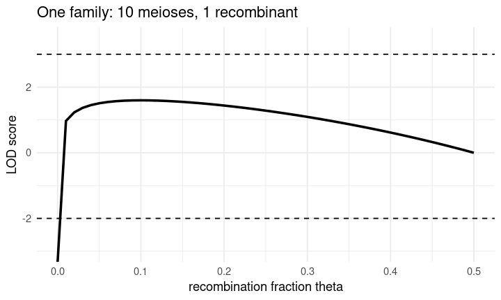
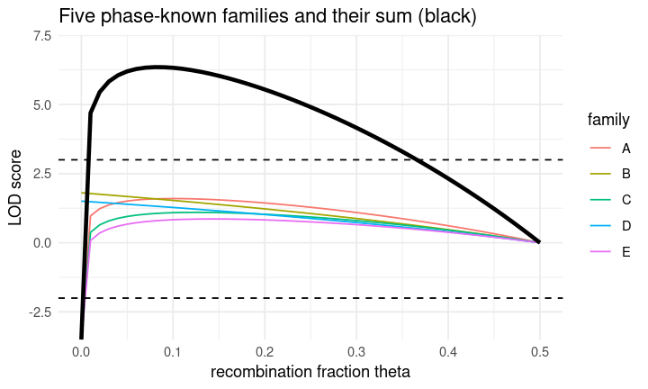

## Goal

By the end of this exercise you should be able to:

- write a function `lod(theta, n, k)` for a phase-known family, and check it against your hand calculations;
- evaluate a function over a **grid of parameter values** with `map_dbl()` to draw a **LOD curve**;
- **add LOD curves across families** in a table, and find **θ̂** both on the grid (`which.max`) and exactly (`optimize()`);
- extend the function to a **phase-unknown** family, and use it to ask how many meioses are needed for LOD 3.

## Before you start

This page builds on the by-hand part of the [Exercise](exercise.qmd), so do that first. You need the packages dplyr, ggplot2, purrr, readr and tidyr. Download [hd_families.csv](data/hd_families.csv) and save it in a `data/` folder of your R project. The families in it are **invented** teaching data.

```r
library(dplyr)
library(ggplot2)
library(purrr)
library(readr)
library(tidyr)
```

## Tasks

You already know how to write functions with arguments (Mendel, Linkage & recombination) and how to apply a function to a list with [`map_dbl()`](https://purrr.tidyverse.org/reference/map.html) (Extensions to Mendel). This unit's new idiom is to **evaluate a function over a grid of parameter values**, here θ = 0, 0.01, …, 0.5, to get a curve, and then to **find the maximum** of that curve, first by looking it up on the grid with [`which.max()`](https://rdrr.io/r/base/which.min.html), then exactly with [`optimize()`](https://rdrr.io/r/stats/optimize.html). `optimize(f, interval, maximum = TRUE)` searches an interval for the value of x where the one-argument function `f(x)` is largest, and returns it as `$maximum` together with the function value `$objective`.

**R1. (the LOD function)** Write `lod(theta, n, k)` for a phase-known family with `n` informative meioses and `k` recombinants. Check it against your answers: the family of fig. 1 in the lecture (n = 6, k = 1) at θ = 0.1 gave 0.58, and your B2 family (n = 8, k = 2) gave 0.45 at θ = 0.25. What do you get at θ = 0.5? At θ = 0, with and without recombinants?

```r
lod <- function(theta, n, k) {
  L_theta <- theta^k * (1 - theta)^(n - k)   # likelihood if linked at theta
  L_half  <- 0.5^n                           # likelihood if unlinked
  log10(L_theta / L_half)
}
lod(0.1, n = 10, k = 1)
lod(0.5, n = 10, k = 1)
lod(0, n = 10, k = 1)
lod(0, n = 10, k = 0)
```

Add your own calls for n = 6, k = 1 and n = 8, k = 2.

**R2. (a LOD curve with `map_dbl`)** Make a grid of θ values from 0 to 0.5 in steps of 0.01. Use `map_dbl()` to compute the LOD for one family (n = 10, k = 1) at every θ, put the result in a tibble, and plot the curve with the thresholds +3 and −2. Where is the maximum?

```r
thetas <- seq(0, 0.5, by = 0.01)
curve1 <- tibble(theta = thetas,
                 lod   = map_dbl(thetas, \(t) lod(t, n = 10, k = 1)))
curve1 |> filter(theta %in% c(0, 0.05, 0.1, 0.2, 0.3, 0.5))
curve1 |> slice_max(lod)

ggplot(curve1, aes(theta, lod)) +
  geom_line(linewidth = 1) +
  geom_hline(yintercept = c(3, -2), linetype = "dashed") +
  coord_cartesian(ylim = c(-3, 3.5)) +
  labs(x = "recombination fraction theta", y = "LOD score",
       title = "One family: 10 meioses, 1 recombinant") +
  theme_minimal()
```

At θ = 0 the LOD is `-Inf`; ggplot draws that point at the bottom edge of the panel, which is why the curve drops straight down there.

**R3. (adding families)** Read `data/hd_families.csv` (the `comment = "#"` argument skips the description lines at the top). Keep the phase-known families. Because the arithmetic in `lod()` works element by element, it accepts whole columns: [`expand_grid()`](https://tidyr.tidyverse.org/reference/expand_grid.html) makes one row per family and θ, and `mutate()` computes all LODs at once. Then add the families at each θ with `group_by(theta)` and `summarise()`. Plot each family and the total.

```r
fams <- read_csv("data/hd_families.csv", comment = "#", show_col_types = FALSE)
fams
known <- fams |> filter(phase == "known")

curves <- expand_grid(known, theta = thetas) |>
  mutate(lod = lod(theta, n, k))
nrow(curves)

total <- curves |>
  group_by(theta) |>
  summarise(lod = sum(lod))
total |> filter(theta %in% c(0, 0.05, 0.1, 0.2, 0.3, 0.5))

ggplot(curves, aes(theta, lod)) +
  geom_line(aes(colour = family)) +
  geom_line(data = total, linewidth = 1.3) +
  geom_hline(yintercept = c(3, -2), linetype = "dashed") +
  coord_cartesian(ylim = c(-3, 7)) +
  labs(x = "recombination fraction theta", y = "LOD score",
       title = "Five phase-known families and their sum (black)") +
  theme_minimal()
```

Why is `nrow(curves)` 255? Does any single family reach 3? Does the total?

**R4. (finding θ̂)** Find the maximum of the total on the grid with `slice_max()` and with `which.max()`. Then write a function `total_lod(theta)` of θ alone and maximise it exactly with `optimize()`. Compare θ̂ with total recombinants / total meioses.

```r
total |> slice_max(lod)
total$theta[which.max(total$lod)]

total_lod <- function(theta) sum(lod(theta, known$n, known$k))
best <- optimize(total_lod, interval = c(0, 0.5), maximum = TRUE)
best
sum(known$k) / sum(known$n)
```

Why does the grid give 0.08 and not the exact value?

**R5. (phase unknown)** Family F in the file has an unknown phase. Write `lod_unknown(theta, n, k)`, which averages the likelihood over both phases. Compare the known and unknown versions for n = 6, k = 1 at θ = 0.1 and at their maxima. Then add family F to the five others and find the new θ̂ and maximum LOD.

```r
lod_unknown <- function(theta, n, k) {
  L_theta <- 0.5 * (theta^k * (1 - theta)^(n - k) + theta^(n - k) * (1 - theta)^k)
  log10(L_theta / 0.5^n)
}
c(known = lod(0.1, 6, 1), unknown = lod_unknown(0.1, 6, 1))
optimize(\(t) lod(t, 6, 1), c(0, 0.5), maximum = TRUE)$objective
optimize(\(t) lod_unknown(t, 6, 1), c(0, 0.5), maximum = TRUE)$objective

all_lod <- function(theta) total_lod(theta) + lod_unknown(theta, 6, 1)
optimize(all_lod, c(0, 0.5), maximum = TRUE)
```

**R6. (how many meioses?)** Use `map_dbl()` over the family size *n* this time. (a) For a phase-known family with no recombinants, compute LOD(0) for n = 1, …, 15. Which is the smallest n with LOD ≥ 3? (b) With exactly one recombinant, the maximum is at θ̂ = 1/n. What is the smallest n that reaches 3? (c) And with two recombinants?

```r
ns <- 1:15
tibble(n = ns, lod_at_0 = map_dbl(ns, \(n) lod(0, n, 0))) |> filter(n >= 8)

tibble(n = 10:30, max_lod = map_dbl(10:30, \(n) lod(1 / n, n, 1))) |>
  filter(max_lod >= 3) |> head(1)
tibble(n = 10:40, max_lod = map_dbl(10:40, \(n) lod(2 / n, n, 2))) |>
  filter(max_lod >= 3) |> head(1)
```

## Solutions

::: {.callout-note collapse="true" title="Solutions: In R"}

All output below is from `Rscript --vanilla` run in the unit folder.

**R1.**

```
[1] 1.598483
[1] 0
[1] -Inf
[1] 3.0103
```

At θ = 0.5 the LOD is always 0 (numerator = denominator). At θ = 0 with a recombinant, L(0) = 0 and the LOD is −∞; with no recombinants, LOD(0) = 10 × log~10~ 2 = 3.01. `lod(0.1, 6, 1)` gives 0.577 and `lod(0.25, 8, 2)` gives 0.454, matching the hand calculations.

**R2.**

```
# A tibble: 6 × 2
  theta     lod
  <dbl>   <dbl>
1  0    -Inf
2  0.05    1.51
3  0.1     1.60
4  0.2     1.44
5  0.3     1.09
6  0.5     0
# A tibble: 1 × 2
  theta   lod
  <dbl> <dbl>
1   0.1  1.60
```

{width="75%" fig-align="center"}

The maximum is **1.60 at θ = 0.1** = k/n. Far below 3: one family of ten is not enough.

**R3.**

```
# A tibble: 6 × 4
  family     n     k phase
  <chr>  <dbl> <dbl> <chr>
1 A         10     1 known
2 B          6     0 known
3 C          8     1 known
4 D          5     0 known
5 E          7     1 known
6 F          6     1 unknown
[1] 255
# A tibble: 6 × 2
  theta     lod
  <dbl>   <dbl>
1  0    -Inf
2  0.05    6.20
3  0.1     6.33
4  0.2     5.54
5  0.3     4.16
6  0.5     0
```

{width="75%" fig-align="center"}

`curves` has 5 families × 51 θ values = **255** rows. No single family reaches 3 (the best, B with 6 non-recombinants, reaches 1.81 at θ = 0), but the total passes 3 for every θ between about 0.003 and 0.37, with a maximum above 6.

**R4.**

```
# A tibble: 1 × 2
  theta   lod
  <dbl> <dbl>
1  0.08  6.35
[1] 0.08
$maximum
[1] 0.08332633

$objective
[1] 6.352514

[1] 0.08333333
```

On the grid, θ̂ = **0.08**; `optimize()` gives **0.0833** with maximum LOD **6.35**, which equals 3/36 (3 recombinants in 36 meioses). The grid can only return one of the values it contains (0.08 or 0.09), so it is only as precise as its step; `optimize()` searches between the grid points. Note that we had to add the families **before** maximising: the sum of the five separate maxima would be 6.9.

**R5.**

```
    known   unknown
0.5773925 0.2764287
[1] 0.6321225
[1] 0.3317978
$maximum
[1] 0.09524051

$objective
[1] 6.60583
```

With the phase unknown the same family gives about half the LOD (max 0.33 instead of 0.63). Adding family F to the others raises the total maximum only from 6.35 to **6.61**, and moves θ̂ to **0.095**.

**R6.**

```
# A tibble: 8 × 2
      n lod_at_0
  <int>    <dbl>
1     8     2.41
2     9     2.71
3    10     3.01
4    11     3.31
5    12     3.61
6    13     3.91
7    14     4.21
8    15     4.52
# A tibble: 1 × 2
      n max_lod
  <int>   <dbl>
1    16    3.19
# A tibble: 1 × 2
      n max_lod
  <int>   <dbl>
1    20    3.20
```

(a) **10** non-recombinant meioses (3.01). (b) With one recombinant, **16** meioses (3.19). (c) With two, **20** meioses (3.20). Each recombinant costs about as much evidence as 5–6 extra meioses. In a real study, these meioses come from many families, which is why the LOD's additivity matters.
:::

## Where this leads

The pattern of this page, a function of one parameter evaluated over a grid and then maximised, is **maximum likelihood estimation**, the workhorse of statistical genetics. You meet curves over a parameter again in **Drift and selection** (Part 7). In **Complex traits** (Part 7), GWAS replaces family LOD scores with association tests at hundreds of thousands of SNPs.
