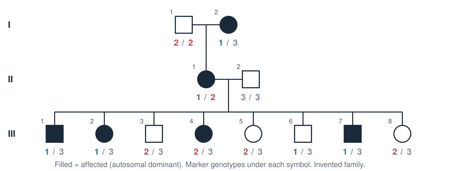

## Goal

By the end of this exercise you should be able to:

- decide whether a meiosis in a human pedigree is **informative**, work out the **phase** of a parent from the grandparents, and score each child as **recombinant** or **non-recombinant**;
- write the **likelihood** L(θ) of a family and compute the **LOD score** LOD(θ) = log~10~[L(θ) / L(0.5)] by hand;
- read a **LOD curve**: θ̂, the maximum LOD, the threshold of **3** for linkage and **−2** for exclusion;
- **add LOD scores** across families, and explain why an unknown phase weakens the evidence;
- find a disease gene's region in the **UCSC Genome Browser**, and find the original mapping papers in **PubMed**.

Work on paper first. The demo then draws the curves for you, and R scales the calculation up.

## Background

**Informative meiosis.** The parent is heterozygous at the disease locus (*Dd*) and at the marker (e.g. 1/2), so each child shows which disease allele and which marker allele it received from that parent. The other parent should carry different marker alleles (e.g. 3/3), so the child's two alleles can be told apart.

**Phase.** Which marker allele sits on the same homologue as *D*. Written *D 1* / *d 2* (coupling of *D* with 1). It is **known** if the grandparents show it, and **unknown** otherwise.

**Scoring.** With the parent *D 1* / *d 2*: children who got *D 1* or *d 2* are **non-recombinant (NR)**; *D 2* or *d 1* are **recombinant (R)**.

**Likelihood and LOD.** For a phase-known family with *n* informative meioses and *k* recombinants, with θ the recombination fraction (the RF of Linkage & recombination):

$$
L(\theta) = \theta^{k}(1-\theta)^{n-k}, \qquad
\text{LOD}(\theta) = \log_{10}\frac{\theta^{k}(1-\theta)^{n-k}}{0.5^{\,n}} = k\log_{10}\theta + (n-k)\log_{10}(1-\theta) + 0.301\,n.
$$

The maximum is at **θ̂ = k/n**. LOD(0.5) = 0. If k = 0, LOD(0) = 0.301 n; if k ≥ 1, LOD(0) = −∞.

**Phase unknown.** Average over both phases: L(θ) = ½ θ^k^(1 − θ)^n−k^ + ½ θ^n−k^(1 − θ)^k^.

**Decisions.** LOD ≥ **3**: linkage (odds 1000 : 1). LOD ≤ **−2**: linkage at that θ excluded. In between: inconclusive. **LODs of independent families add at the same θ**; find the maximum of the sum.

Useful logs: log~10~ 0.1 = −1, log~10~ 0.2 = −0.699, log~10~ 0.25 = −0.602, log~10~ 0.3 = −0.523, log~10~ 0.7 = −0.155, log~10~ 0.75 = −0.125, log~10~ 0.8 = −0.097, log~10~ 0.9 = −0.046, log~10~ 2 = 0.301.

## By hand

**B1. (phase and scoring)** The family below (invented) has an autosomal dominant disease and a marker with alleles 1, 2, 3.

{width="95%" fig-align="center"}

a) Which marker allele did II-1 get from her mother, and which from her father? On which of her homologues is the disease allele *D*? Write her phase.
b) Is the phase of II-1 affected by whether a crossover happened in her mother's meiosis? Explain.
c) Which parent's meioses are informative for linkage, II-1's or II-2's? Why?
d) Score each child III-1 to III-8 as R or NR. What are *n* and *k*?

**B2. (likelihood and LOD)** For the family in B1:

a) Write L(θ). What is θ̂?
b) Compute LOD(θ) at θ = 0.1, 0.2, 0.25 and 0.3. What is the maximum LOD?
c) Is there evidence for linkage? Is linkage excluded at any θ?

**B3. (how many meioses?)** A phase-known family has *n* informative meioses and no recombinants.

a) Show that LOD(0) = 0.301 n.
b) What is the smallest *n* that gives LOD ≥ 3?
c) A large family has 12 informative meioses, 1 of them recombinant. Compute the maximum LOD. Is it above 3?

**B4. (adding families)** Three phase-known families were typed for the same marker. The table gives their LOD scores (computed with the formula above).

| Family (n, k) | θ = 0 | 0.05 | 0.1 | 0.2 | 0.3 | 0.4 |
|---|---:|---:|---:|---:|---:|---:|
| F1 (10, 0) | 3.01 | 2.79 | 2.55 | 2.04 | 1.46 | 0.79 |
| F2 (8, 1) | −∞ | 0.95 | 1.09 | 1.03 | 0.80 | 0.46 |
| F3 (6, 1) | −∞ | 0.39 | 0.58 | 0.62 | 0.51 | 0.30 |

a) Add the rows. At which θ in the table is the total LOD largest, and how large is it?
b) Which family alone already passes 3, and at which θ? Why does adding F2 and F3 not make θ = 0 the best estimate?
c) Without the table: what is θ̂ for the three families together? (Hint: for phase-known families, θ̂ = total recombinants / total meioses.)
d) Check one entry: compute the LOD of F2 at θ = 0.1 yourself.

**B5. (uninformative meioses)** In each case, can the child's meiosis from the affected father be scored? Explain.

a) Father *D 1* / *d 1*, mother 2/2.
b) Father *D 1* / *d 2*, mother 1/2, child 1/2 and affected.
c) Father *D 1* / *d 2*, mother 1/2, child 1/1 and affected.

**B6. (phase unknown)** Suppose the grandparents in B1 had not been typed.

a) What are the two possible phases of II-1? How many recombinants does each give among the 8 children?
b) Write L(θ) and compute LOD(0.25). Compare with B2.

**B7. (real numbers)** Two published results with markers near the Huntington gene:

a) Youngman et al. (1989) found a maximum LOD of **2.14 at θ = 0.00** between HD and the marker D4S90. What does θ̂ = 0 tell you about the recombinants in their families? How many more phase-known, non-recombinant, informative meioses would bring the LOD at θ = 0 above 3?
b) Kondo et al. (1990) found a LOD of **−2.215 at θ = 0.15** between DRPLA, a disease resembling HD, and the HD-linked marker D4S10, and negative scores at all θ. What can you conclude?

**B8. (why 3?)** Suppose that, before any data, the chance that a random marker is linked to the disease gene is 1/50 (prior odds 1 : 49).

a) After a LOD of 3, what are the odds of linkage? The probability?
b) Do the same after a LOD of 2. Would you publish the linkage?

## Explore {#explore}

Do the by-hand part first. In the demo, each row is one family, with sliders for the number of informative meioses *n* and recombinants *k*; tick "phase ?" for an unknown phase. The plot shows each family's LOD curve (thin), the total (thick), the thresholds +3 and −2, and the maximum with θ̂. "+ random family" adds a family simulated under true linkage at θ = 0.05.

```{=html}
<link rel="stylesheet" href="../demos/dist/demo.css">
<div data-demo="lod" data-families="8:2"></div>
<script src="../demos/dist/lod.js"></script>
```

**E1.** The demo starts with your family from B1 (n = 8, k = 2). Check your θ̂ and maximum LOD from B2. Then set k = 0: what is the maximum now, and where? Set n = 10 with k = 0: why is this the smallest family that passes 3?

**E2.** Rebuild the three families of B4 (use "+ add family" and the sliders). Check your answers to B4 a–c. Then remove F1: do F2 and F3 together reach 3?

**E3.** Tick "phase ?" for the B1 family (n = 8, k = 2) and compare with B6. Then tick it for each family in "five families". How much does the maximum total LOD fall when every phase is unknown?

**E4.** Click "unlinked marker". Where is the maximum, and how large is it? Over which range of θ is linkage excluded? Now add families with k = n/2 until linkage is excluded up to θ = 0.3.

**E5.** Press "reset", click "one family (10, 1)", then press "+ random family" until the total LOD passes 3. How many families and meioses did it take? Is θ̂ close to the true value of 0.05?

::: {.callout-note collapse="true" title="Solutions: Explore"}

**E1.** n = 8, k = 2: max **0.45 at θ̂ = 0.25**, as in B2. With k = 0 the maximum is at **θ̂ = 0**, LOD = 8 × 0.301 = **2.41**. With n = 10, k = 0: **3.01**; 9 meioses give 2.71, so 10 is the minimum.

**E2.** The total peaks at **4.24 at θ̂ = 0.083** (= 2/24). The table gave 4.13 at 0.05 and 4.22 at 0.1, on either side of the true maximum. Without F1, F2 + F3 peak at about **1.7** (at θ ≈ 0.14): not enough.

**E3.** Phase unknown, n = 8, k = 2: max **0.16 at θ̂ ≈ 0.26**, compared with 0.45 for phase known (B6 gives LOD(0.25) = 0.16). In "five families" the total maximum drops from **6.35** (all phase known) to **4.85** (all phase unknown), still at θ̂ ≈ 0.083 and still above 3. Families with k = 0 lose least (6, 0: 1.81 → 1.51), because the other phase would mean that all n children are recombinant, which is very unlikely at small θ. Families with recombinants lose most (7, 1: 0.86 → 0.56).

**E4.** "unlinked marker" (24 meioses, 11 recombinants): max about **0.04 at θ̂ = 0.458**, essentially 0. LOD < −2 for **θ < about 0.18**, so linkage closer than that is excluded. Adding families with k = n/2 pushes the excluded range further out; reaching 0.3 needs many more meioses (several more families of n = 10, k = 5), because the curve near 0.3 is flat.

**E5.** With the demo's fixed seed, the first random family is (9, 1): total max 2.94 at θ̂ ≈ 0.105, just short of 3. The second is (8, 0): total **5.03 at θ̂ ≈ 0.074**, so **two** random families (27 meioses in all, 2 recombinants) were enough. θ̂ = 2/27 = 0.074 is close to the true 0.05, but with so few recombinants it is a rough estimate: one more or one fewer recombinant would move it a lot. ("reset" restarts the random families from the same seed, so everyone gets these numbers.)
:::

## Find it

The [UCSC Genome Browser](https://genome.ucsc.edu/) shows a region of the human genome with tracks of genes and other features. The top line gives the **position** (chromosome:start-end) and the genome assembly (use **hg38**, also called GRCh38). Genes are drawn as boxes (exons) joined by lines (introns), with arrows showing the strand. [PubMed](https://pubmed.ncbi.nlm.nih.gov/) searches the biomedical literature (see Probability & the χ² test for the search syntax).

**F1. The *HTT* region.** Open the [UCSC Genome Browser at *HTT*, hg38](https://genome.ucsc.edu/cgi-bin/hgTracks?db=hg38&position=chr4:3074681-3243957) (or go to the browser, choose human hg38 and type `HTT` in the search box). Read:
a) the position of *HTT* (chromosome, start, end) and its approximate length in kb;
b) which strand it is on (do the arrows point right, +, or left, −?), and how many exons the main transcript has (click the gene, read "Exon count");
c) the chromosome band (the red box on the chromosome ideogram at the top, or the "Chromosome Band" track). How far is *HTT* from the end of 4p?

**F2. Neighbours.** Zoom out 3× twice. Name the protein-coding gene immediately to the left of *HTT* and the one immediately to the right. Linkage in families placed HD within a few cM; roughly how many base pairs is that, and how many genes like these could such a region hold?

**F3. The 1983 paper.** In PubMed, search `Gusella[au] AND Huntington AND 1983[dp]`. Find the *Nature* paper. Report its **title, volume, pages and PMID**, and summarise the **abstract** in one sentence. What kind of marker was used (read the title)?

**F4. The 1993 paper.** Search `trinucleotide repeat expanded unstable Huntington's disease chromosomes`. Open the 1993 *Cell* paper. Who are the authors? What did the gene they found (IT15) contain, and in how many HD families was it expanded?

**F5. An exclusion.** Search `DRPLA D4S10`. Find the 1990 *J Med Genet* paper. What LOD score did the authors report, at which θ, and what did they conclude?

::: {.callout-tip collapse="true" title="Hint"}
In UCSC, click on the gene in the "GENCODE" or "NCBI RefSeq" track to open its details page. In PubMed, `[au]` restricts a term to authors and `[dp]` to the publication date.
:::

## Solutions

::: {.callout-note collapse="true" title="Solutions: By hand"}

**B1.** a) II-1 is 1/2. Her father I-1 is 2/2, so she got **2 from her father** and therefore **1 from her mother**. Her father is unaffected, so her *D* came from her affected mother, on the same chromosome as the 1. Phase: ***D 1* / *d 2***.
b) No. A crossover in I-2's meiosis may have changed which of I-2's alleles travel together, but what matters is the chromosome II-1 actually **received**: it carries both *D* and 1. (It matters for scoring I-2's meiosis, not for II-1's phase.)
c) **II-1's**. She is heterozygous at both loci (*Dd*, 1/2). II-2 is unaffected (*dd*) and 3/3: homozygous at both, so his meioses tell us nothing.
d) Each child got 3 from the father, so the other allele came from II-1.

| Child | Affected? | From II-1 | Score |
|---|---|---|---|
| III-1 | yes | *D 1* | NR |
| III-2 | yes | *D 1* | NR |
| III-3 | no | *d 2* | NR |
| III-4 | yes | *D 2* | **R** |
| III-5 | no | *d 2* | NR |
| III-6 | no | *d 1* | **R** |
| III-7 | yes | *D 1* | NR |
| III-8 | no | *d 2* | NR |

**n = 8, k = 2.**

**B2.** a) L(θ) = θ^2^ (1 − θ)^6^; θ̂ = 2/8 = **0.25**.
b) LOD(θ) = 2 log~10~ θ + 6 log~10~(1 − θ) + 8 × 0.301 = 2 log~10~ θ + 6 log~10~(1 − θ) + 2.408.

| θ | 2 log~10~ θ | 6 log~10~(1 − θ) | LOD |
|---|---:|---:|---:|
| 0.1 | −2.000 | −0.275 | **0.13** |
| 0.2 | −1.398 | −0.581 | **0.43** |
| 0.25 | −1.204 | −0.750 | **0.45** (maximum) |
| 0.3 | −1.046 | −0.929 | **0.43** |

c) No: the maximum, 0.45, is far below 3. Nor is anything excluded: LOD is never below −2 except very close to θ = 0 (LOD(0) = −∞, so θ = 0 itself is ruled out by the recombinants). The family is **inconclusive**.

**B3.** a) With k = 0, L(0) = 1^n^ = 1, so LOD(0) = log~10~(1 / 0.5^n^) = n log~10~ 2 = **0.301 n**.
b) 0.301 n ≥ 3 → n ≥ 9.97 → **n = 10**.
c) θ̂ = 1/12. LOD = log~10~(1/12) + 11 log~10~(11/12) + 12 × 0.301 = −1.079 − 0.416 + 3.612 = **2.12**. Below 3: one recombinant costs a lot in a single family.

**B4.** a) Totals: θ = 0: −∞; 0.05: **4.13**; 0.1: **4.22**; 0.2: 3.69; 0.3: 2.77; 0.4: 1.55. Largest in the table: **4.22 at θ = 0.1**. Linkage is established (> 3).
b) **F1 alone**, at θ = 0 (3.01). But F2 and F3 each have a recombinant, so their LOD at θ = 0 is −∞: the total at θ = 0 is −∞. The recombinants show that the genes are close but **not** completely linked.
c) θ̂ = (0 + 1 + 1) / (10 + 8 + 6) = 2/24 = **0.083**. (The true maximum is 4.24, between the table columns.)
d) F2 at 0.1: 1 × (−1) + 7 × (−0.046) + 8 × 0.301 = −1 − 0.320 + 2.408 = **1.09** ✓.

**B5.** a) **No.** The father is homozygous 1/1 at the marker: every child gets a 1 from him, whichever homologue it is, so we cannot see recombination.
b) **No.** The child is 1/2, but it could have 1 from the father and 2 from the mother, or the reverse. We cannot tell which allele came from the father.
c) **Yes.** The child is 1/1, so it got 1 from the father; it is affected, so it got *D* (the mother is unaffected). *D 1* = **NR**.

**B6.** a) *D 1* / *d 2* (2 recombinants) or *D 2* / *d 1* (then the 6 children counted NR become recombinant: **6** recombinants). Each phase has probability ½.
b) L(θ) = ½ θ^2^(1 − θ)^6^ + ½ θ^6^(1 − θ)^2^. At θ = 0.25: first term 0.0625 × 0.178 = 0.01112; second term 0.000244 × 0.5625 = 0.000137; L = ½ (0.01112 + 0.000137) = 0.00563. L(0.5) = 1/256 = 0.00391. LOD = log~10~(0.00563 / 0.00391) = log~10~ 1.44 = **0.16**, compared with 0.45 when the phase is known. Not knowing the phase costs about two thirds of the evidence here.

**B7.** a) θ̂ = 0 means **no recombinants** were seen between HD and D4S90 in their informative meioses. Each further non-recombinant, phase-known meiosis adds 0.301 at θ = 0. They need 3 − 2.14 = 0.86 more, so 0.86 / 0.301 = 2.9 → **3 more meioses** (assuming none of them is recombinant).
b) Negative everywhere and below −2 at θ = 0.15, so linkage of DRPLA to D4S10 at θ ≤ 0.15 is **excluded**. Since the HD gene lies only about 4 cM from D4S10, DRPLA is **not** caused by the HD gene; it is a distinct disease (its gene was later found on chromosome 12).

**B8.** a) Posterior odds = prior odds × likelihood ratio = (1/49) × 1000 ≈ **20 : 1**, so P(linkage) ≈ 20/21 ≈ **0.95**. A 5 % chance that the linkage is false.
b) (1/49) × 100 ≈ **2 : 1**, P ≈ 0.67. A one-in-three chance of being wrong: not good enough to publish as proof; collect more families.
:::

::: {.callout-note collapse="true" title="Solutions: Find it"}

These facts were checked against the UCSC Genome Browser API (hg38, NCBI RefSeq Select track and cytoBand track) and PubMed (E-utilities).

**F1.** a) *HTT* is at **chr4:3,074,681-3,243,957** (hg38, MANE Select transcript NM_001388492.1; the gene record in GENCODE/HGNC starts slightly earlier, at about 3.04 Mb), about **169 kb** long. b) **+ strand** (arrows point right); the main transcript has **67 exons**. c) Band **4p16.3**, which runs from the start of chromosome 4 to 4.5 Mb. *HTT* starts about **3.1 Mb from the tip of 4p**: close to the telomere, in the "distal portion of the short arm" where linkage had placed HD. Click path: UCSC → Genomes → Human hg38 → search `HTT` → choose the RefSeq/MANE match → click the gene → details page (Position, Strand, Exon count).

**F2.** To the left: ***GRK4*** (G protein-coupled receptor kinase 4, ends at about 3.04 Mb). To the right: ***MSANTD1*** (starts at about 3.25 Mb). (There is also an antisense RNA gene, *HTT-AS*, at the start of *HTT* on the − strand.) A few cM in humans is roughly a few million base pairs (on average about 1 cM per Mb); in the 1 Mb around *HTT* alone there are more than ten genes, so a linked region can hold dozens of candidate genes.

**F3.** **"A polymorphic DNA marker genetically linked to Huntington's disease."** Gusella JF, Wexler NS, Conneally PM, et al. *Nature* 1983 Nov 17–23; **306**(5940):**234–238**. **PMID 6316146**. Abstract: family studies show that the HD gene is linked to a polymorphic DNA marker that maps to human **chromosome 4**, a first step towards identifying the defect with recombinant DNA technology. The marker is a **polymorphic DNA marker** (an RFLP, detected by the probe G8; later named locus D4S10).

**F4.** "A novel gene containing a trinucleotide repeat that is expanded and unstable on Huntington's disease chromosomes." **The Huntington's Disease Collaborative Research Group** (a consortium; PubMed lists no individual authors). *Cell* 1993;72(6):971–983, **PMID 8458085**. The gene **IT15** (now *HTT*) contains a polymorphic **(CAG)~n~ trinucleotide repeat** that is longer than normal on HD chromosomes, in **all 75 HD families** examined. The repeat lies within the coding sequence of a predicted ~348 kDa protein.

**F5.** Kondo et al. 1990, "Exclusion mapping of the hereditary dentatorubropallidoluysian atrophy gene from the Huntington's disease locus", *J Med Genet* 27(2):105–108, **PMID 1969487**. Four families; negative LOD scores at all recombination fractions, **−2.215 at θ = 0.15**. Conclusion: the DRPLA locus is not closely linked to D4S10, so DRPLA is a **distinct disease** from HD.
:::

## Where this leads

Today's LOD scores close Part 2: the recombination fraction θ that you measured directly in *Drosophila* testcrosses (Linkage & recombination, Three-point crosses) is now estimated by maximum likelihood from human families. The markers used for mapping return in **Genomic variation** (Part 4), and the move from families to unrelated people, genome-wide association studies, is in **Complex traits** (Part 7).

**Next:** [Exercise in R](exercise-r.qmd): write a `lod()` function, draw LOD curves with `map_dbl()`, add families, and find θ̂ with `optimize()`.
