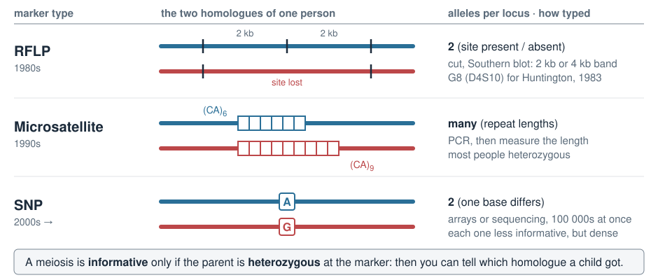
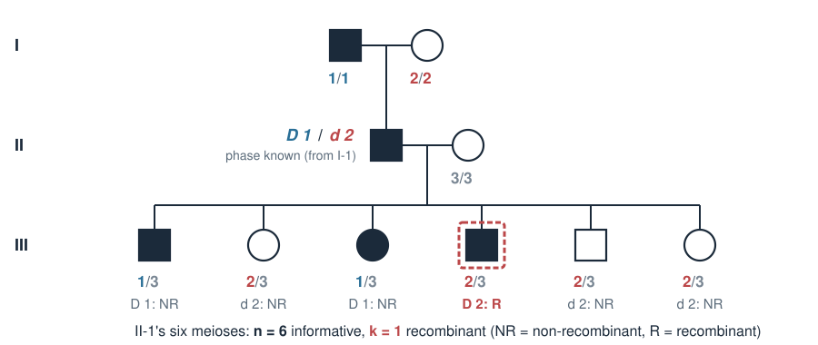
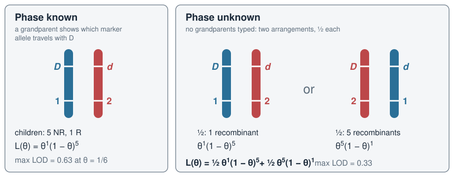
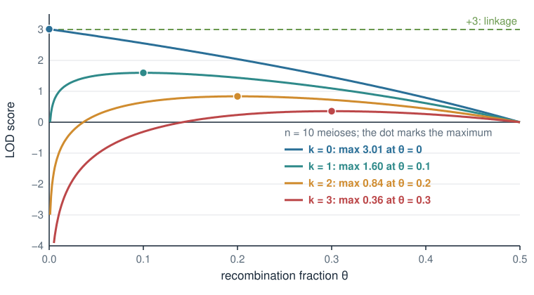
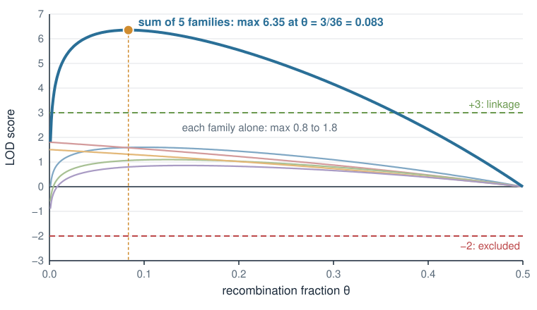
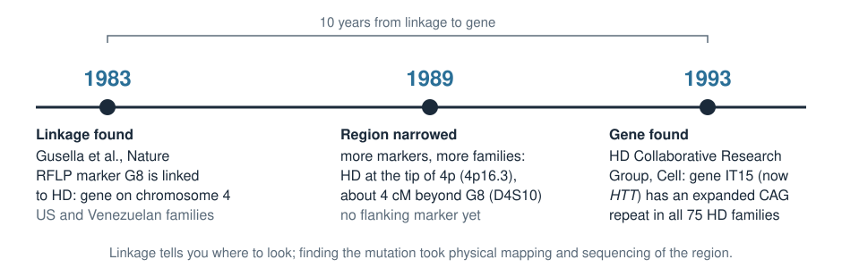

## About this lecture

In flies we map genes with designed testcrosses and thousands of offspring. In humans we have neither: we get the families that exist, with a handful of children each. So we need **statistics** to say whether a disease gene is linked to a marker, and how far apart they are.

- Why human linkage needs a different approach, and what a **DNA marker** is.
- Counting recombinants in a pedigree: **informative meioses** and **phase**.
- The **likelihood** L(θ) of the data, and the **LOD score**: $\text{LOD}(\theta) = \log_{10} \dfrac{L(\theta)}{L(0.5)}$.
- The **LOD curve**, its maximum θ̂, the **threshold of 3** for linkage and **−2** for exclusion.
- **Adding LODs** across families.
- The story of **Huntington disease**: from a linked marker in 1983 to the gene in 1993.

Book: Hartwell, *Genetics: From Genes to Genomes*, linkage and mapping chapter (the section on mapping in humans).

::: notes
This unit closes Part 2. Everything so far in Part 2 assumed we could choose the crosses: testcrosses in Drosophila, thousands of flies, recombination frequency read off directly. In humans the logic of linkage is exactly the same (recombination fraction theta is the RF from Linkage & recombination), but the data are small and messy. The new idea is to compare two hypotheses, linked at theta versus unlinked, by how probable each makes the observed family. Students have met the binomial in Probability & the chi-square test, and pedigrees in Pedigree analysis; today combines them.
:::

## Why humans need statistics {.smaller}

| In *Drosophila* (Linkage & recombination) | In humans |
|---|---|
| We **choose** the cross: a testcross with a known double heterozygote | We take the families that **exist** |
| Hundreds or thousands of offspring | 2–5 children per family |
| Phase known: we built the parent's chromosomes | **Phase often unknown**: which marker allele is with the disease allele? |
| Mutant markers chosen to be visible | Markers must be **DNA variants** that differ between the parent's two homologues |
| RF = recombinants / total; test with χ² | Combine **many small families**, each too small for χ² |

So for humans we ask a different question: **how much more probable are these families if the disease gene and the marker are linked at distance θ than if they are unlinked?**

::: notes
Go row by row. The first row is the fundamental problem: no experimental crosses in humans, for obvious ethical reasons. The second is the size problem: a single family gives at most a few meioses, so a chi-square test (which needs expected counts of at least 5) cannot be used family by family. The third is phase, which gets its own slide. The fourth is markers: in flies we use visible mutants; in humans we use DNA differences that have no effect on the phenotype at all. The solution, due to Newton Morton in 1955, is a likelihood-based score that can be computed for each family and simply added across families.
:::

## Markers: something we can follow {.smaller}

{width="82%" fig-align="center"}

A **marker** is a DNA site where people differ. It need not do anything; we only need to tell the two homologues of a parent apart, so that we can see which one each child got.

::: notes
The first human disease linkages with DNA markers used RFLPs, restriction fragment length polymorphisms: a single base change creates or destroys a restriction site, which changes the length of a fragment on a Southern blot. RFLPs usually have two alleles, so many parents are homozygous and their meioses tell us nothing. Microsatellites, short tandem repeats such as CA repeated 6 to 30 times, have many alleles, so most people are heterozygous: they made the human genetic maps of the 1990s. Today SNP arrays or sequencing type hundreds of thousands of single-base variants at once; each is less informative, but there are so many that several are always close to any gene. Part 4 (Genomic variation) returns to SNPs. Stress the take-home line: a meiosis is informative only if the parent is heterozygous at the marker, and (for the disease) we can tell which disease allele was passed on.
:::

## Counting recombinants in a family {.smaller}

{width="78%" fig-align="center"}

Autosomal dominant disease (*D*), marker with alleles 1, 2, 3. II-1's mother is 3/3, so each child's **paternal** marker allele can be read: 1 or 2. Children who got *D* with 1, or *d* with 2, are **non-recombinant**; III-4 got *D* with 2: **recombinant**.

::: notes
Walk through it. Generation I: the affected grandfather is homozygous 1/1 at the marker, so the D he passed to II-1 must sit on a chromosome with marker allele 1. II-1 therefore has D 1 on one homologue and d 2 on the other: his phase is known. His wife is 3/3, so she always passes 3, and the other allele of each child came from II-1. Affected children (D) who carry 1 got the parental D 1 chromosome; unaffected children with 2 got d 2; both are non-recombinant. III-4 is affected but carries 2: a crossover between the disease gene and the marker happened in his father's meiosis. Six meioses, one recombinant. The naive estimate of theta is 1/6, about 0.17. But is this evidence of linkage at all? With only 6 meioses, one recombinant could easily come from an unlinked marker. The rest of the lecture answers that.
:::

## Phase: known or unknown {.smaller}

{width="82%" fig-align="center"}

Without the grandparents we do not know which marker allele travels with *D*. Each **phase** has prior probability ½; under the other phase, the same children count as **5 recombinants** instead of 1. The likelihood averages over both phases, and the evidence is weaker.

::: notes
Phase is the linkage phase from Linkage & recombination: coupling versus repulsion, here D 1 / d 2 versus D 2 / d 1. In a testcross we built the parent, so we knew. In a human family we infer it from the previous generation, when it is available. If the grandparents are dead or untyped, we must consider both phases. Under phase 1 the family has 1 recombinant out of 6; under phase 2 it has 5. Each phase is equally likely before we look at the children, so the likelihood is the average. Today we mostly work with phase-known families, where the arithmetic is simplest; the demo and the R exercise also let you switch to phase unknown. Note the maximum LOD drops from 0.63 to 0.33: not knowing the phase costs information.
:::

## The likelihood of the data {.smaller}

Each informative meiosis is recombinant with probability θ and non-recombinant with probability 1 − θ, independently. A family with **n** informative meioses and **k** recombinants (phase known) has probability

$$
L(\theta) = \theta^{k}\,(1-\theta)^{n-k}.
$$

This is the binomial from Probability & the χ² test, without the binomial coefficient (it is the same for every θ, so it cancels below).

| θ | 0.01 | 0.1 | 1/6 | 0.3 | 0.5 |
|---|---:|---:|---:|---:|---:|
| L(θ) for n = 6, k = 1 | 0.0095 | 0.059 | **0.067** | 0.050 | 0.0156 |

Read as a function of θ with the data fixed, L(θ) is the **likelihood**. The θ with the highest likelihood, **θ̂ = k/n**, is the best estimate.

::: notes
Compute two columns on the board. At theta = 0.1: 0.1 times 0.9 to the 5th = 0.1 times 0.590 = 0.059. At theta = 0.5: 0.5 to the 6th = 1/64 = 0.0156. The shift in viewpoint is the important thing: a probability is about data given the parameter; a likelihood is the same number, read as a function of the parameter for the data we actually have. The maximum is at k/n, the obvious estimate, 1/6 here. Note that theta = 0.01 makes the data less likely than 0.1: a family with one recombinant out of six is not evidence for very tight linkage.
:::

## The LOD score: linked vs unlinked {.smaller}

Compare "linked at θ" with "unlinked" (θ = 0.5) by the ratio of likelihoods, on a log~10~ scale:

$$
\text{LOD}(\theta) = \log_{10}\frac{L(\theta)}{L(0.5)} = \log_{10}\frac{\theta^{k}(1-\theta)^{n-k}}{0.5^{\,n}}
$$

**Worked example** (fig. on the previous slides: n = 6, k = 1) at θ = 0.1:

- L(0.1) = 0.1 × 0.9^5^ = 0.0590; L(0.5) = 0.5^6^ = 1/64 = 0.0156.
- Ratio = 0.0590 / 0.0156 = **3.78**: the family is 3.8 times more probable if the genes are linked at θ = 0.1.
- LOD(0.1) = log~10~ 3.78 = **0.58**.

**LOD** = "logarithm of the odds". LOD 1 = odds 10 : 1; LOD 2 = 100 : 1; **LOD 3 = 1000 : 1**.

::: notes
The LOD score is a likelihood ratio, written as a base-10 logarithm. Why the logarithm? Because independent families multiply their likelihoods, and logarithms turn products into sums: that is what lets us add LOD scores later. Why base 10? Historical convenience: a LOD of 3 is easy to read as odds of a thousand to one. Positive LOD favours linkage, negative favours no linkage, zero is neutral. At theta = 0.5 the LOD is always exactly 0, because the numerator and denominator are the same.
:::

## The LOD curve {.smaller}

{width="68%" fig-align="center"}

One family, n = 10 meioses. Compute LOD(θ) for every θ from 0 to 0.5: the curve peaks at **θ̂ = k/n**, and its height is the strength of the evidence. With **k = 0**, LOD(0) = 10 × log~10~ 2 = **3.01**. With k > 0, LOD(0) = −∞: one recombinant rules out θ = 0.

::: notes
Read the curves from the top. k = 0: every child is non-recombinant, the curve is highest at theta = 0, where LOD = n log10 2 = 0.301 per meiosis. So you need at least 10 fully informative, phase-known meioses without a recombinant to reach 3. k = 1: the peak drops to 1.60 at theta = 0.1, and the curve plunges to minus infinity at 0, because a recombinant is impossible under complete linkage. k = 2 and 3: lower and flatter peaks. A single family of ten children is enormous in human terms and still rarely reaches 3. That is why we need many families. The curve is what the demo and the R exercise draw.
:::

## Why 3? And why −2? {.smaller}

- **LOD ≥ 3**: accept linkage. The data are 1000 times more likely under linkage at θ̂ than under no linkage.
- **LOD ≤ −2**: reject linkage at that θ (**exclusion**). The data are 100 times more likely under no linkage.
- In between: **inconclusive**, collect more families.

Why so strict? Before you look, linkage is **unlikely**: a randomly chosen marker has only about a 1 in 50 chance of lying close enough to a given gene to show linkage. Odds of 1000 : 1 from the data, against a prior of about 1 : 49, give roughly **20 : 1** in favour, so about a **5 %** chance that a "significant" linkage is false. That matches the familiar 5 % level.

Threshold from Morton (1955), *Am J Hum Genet* (PMID 13258560), who introduced the LOD score for human linkage.

::: notes
This is the key conceptual slide. The threshold of 3 is not arbitrary: it reflects that most markers are not linked to any given gene, so the prior odds of linkage are low. Multiply the prior odds, roughly 1 to 49, by the likelihood ratio, 1000, and you get posterior odds of about 20 to 1, which is the same as a 5 percent error rate. That is Bayes' rule in one line; students do not need to name it. The minus 2 threshold is used to exclude a region: if the LOD is below minus 2 for all theta below some value, the gene is not within that distance of the marker. For genome scans with many markers, stricter thresholds such as 3.3 are used; Complex traits in Part 7 meets the same multiple-testing problem in GWAS. The 1 in 50 prior is a rough classical figure; do not over-interpret it.
:::

## Adding families {.smaller}

{width="64%" fig-align="center"}

Families are independent, so their likelihoods **multiply** and their LODs **add**: $\text{LOD}_\text{total}(\theta) = \sum_\text{families} \text{LOD}_i(\theta)$. Five families (invented data), none above 1.8 alone, sum to **6.35** at θ̂ = 3/36 = 0.083.

::: notes
This is the practical power of the LOD score. Five small families, each inconclusive, together give strong evidence. Add the curves at each theta, then find the maximum of the sum. For phase-known families the total maximum is at total recombinants over total meioses, 3 out of 36. Note one subtlety: you must add the curves first and then take the maximum, not add the individual maxima, because each family peaks at a different theta. The sum of the individual maxima here would be 6.9, which is too high. The demo and R exercise make students do this.
:::

## Try it: the LOD curve

```{=html}
<link rel="stylesheet" href="../demos/dist/demo.css">
<div data-demo="lod" data-preset="one"></div>
<script src="../demos/dist/lod.js"></script>
```

::: notes
Start with one family, 10 meioses, 1 recombinant: maximum 1.60 at theta 0.1. Move k to 0: the maximum jumps to 3.01 at theta 0. Move n down to 6 with k 0: 1.81, not enough. Then click "five families": the thin curves are the families, the thick curve is the sum; max 6.35 at 0.083. Remove families one by one and watch the total drop below 3. Tick "phase ?" on one family to see how much an unknown phase costs. Finally "unlinked marker": three families with about half recombinants; the curve is never positive and is below minus 2 for theta below about 0.18, so linkage closer than that is excluded.
:::

## Exclusion: a real example {.smaller}

**DRPLA** (dentatorubral–pallidoluysian atrophy) is an autosomal dominant neurodegenerative disease that looks much like Huntington disease. Is it caused by the same gene?

Kondo et al. (1990, *J Med Genet*, PMID 1969487) typed **four DRPLA families** for the HD-linked marker **D4S10** (probe G8):

- The LOD score was **negative at all θ**, and **−2.215 at θ = 0.15**.
- So the DRPLA gene is **not within about 15 cM** of D4S10: it is not the HD gene, and DRPLA is a distinct disease.

Negative evidence is useful: exclusion rules out regions, and so narrows the search.

::: notes
This is a clean, published use of the minus 2 rule. The question was whether DRPLA and HD are allelic, that is, different mutations in the same gene. If they were, DRPLA families would show the same tight linkage to D4S10 that HD families do. Instead the LOD is negative everywhere, and below minus 2 at theta = 0.15, so linkage at that distance or closer is excluded. The DRPLA gene was later found on chromosome 12 (the ATN1 gene, again with an expanded CAG repeat); that is a pointer for curious students, not something to examine.
:::

## Not yet significant {.smaller}

Youngman et al. (1989, *Genomics*, PMID 2574148) tested a new marker, **D4S90**, near the tip of chromosome 4p:

- In HD families: **maximum LOD 2.14 at θ = 0.00**.
- 2.14 is **above 0** (favours linkage) but **below 3**: "provisional", not proof.
- In reference families, D4S90 mapped **6 cM** from D4S10, at the far end of 4p16.3; HD itself lay about **4 cM** distal to D4S10.

A LOD of 2 means odds of 100 : 1 from the data, which is still not enough given the low prior. The answer is **more meioses**.

::: notes
A real result that sits in the grey zone. Its maximum is at theta = 0, which means no recombinants were seen between HD and D4S90 in the families typed, but there were too few informative meioses to reach 3. Ask: how many more phase-known, non-recombinant meioses would push it over 3? Each adds 0.30, so 3 more. The CEPH reference families mentioned in the abstract are large three-generation families, typed for many markers by labs worldwide, which made the first human genetic maps; they are exactly the "many families" of the previous slides.
:::

## Huntington disease: from linkage to gene {.smaller}

{width="82%" fig-align="center"}

Gusella et al. (1983) "A polymorphic DNA marker genetically linked to Huntington's disease", *Nature* 306:234–238 (PMID 6316146). The 1993 gene: Huntington's Disease Collaborative Research Group, *Cell* 72:971–983 (PMID 8458085).

::: notes
Huntington disease was the first human disease gene mapped with an anonymous DNA marker, with no idea in advance of where it was. The 1983 paper reports that the HD gene is linked to a polymorphic DNA marker on chromosome 4. It was also lucky: very few DNA markers existed at the time, and one of them happened to lie close to the HD gene. Linkage gave the region, but finding the gene took ten more years: more markers, physical maps of 4p16.3, and finally haplotype analysis and exon trapping. The 1993 paper found a new gene, IT15, now called HTT, with a CAG repeat that was expanded on HD chromosomes in all 75 families examined. HTT is the gene students looked up in the Mendel exercise. Today, with a genome sequence, the step from a linked region to the gene is much shorter.
:::

## The Venezuelan families {.smaller}

Some of the key HD families live in **Venezuela**: very large extended kindreds with many affected people, studied by Nancy Wexler and a US–Venezuelan collaboration.

- By 2004 the Venezuelan kindreds comprised **18 149 individuals over 10 generations** (Wexler et al. 2004, *PNAS*, PMID 14993615).
- A large pedigree with many affected people and known phase gives **many informative meioses**: exactly what a LOD score needs.
- Such pedigrees made linkage possible, and later also the study of what modifies age of onset.

Mapping in humans depends on **families who agree to take part**. That raises ethical questions about consent, about learning one's own risk, and about benefit to the families, which come back in the Ethics module.

::: notes
A pedigree of this size is rare and extraordinarily valuable. Huntington disease is autosomal dominant with late onset; most people at risk in such a family do not know whether they carry the allele. The linkage marker immediately made predictive testing possible, years before the gene was known, which raised difficult questions: do you want to know? Many at-risk people chose not to. This is a good place to mention that the Ethics module discusses predictive genetic testing. The 18,149 individuals and 10 generations come from the 2004 PNAS abstract.
:::

## What linkage can and cannot do {.smaller}

| Linkage analysis is good for | It struggles with |
|---|---|
| **Monogenic** diseases with clear inheritance (HD, cystic fibrosis, DMD) | Traits influenced by **many genes**, each with a small effect |
| Large families with many affected members | Small families, uncertain diagnosis |
| Finding the **region**, often a few cM (millions of bases) | Pinpointing the variant: needs fine mapping and sequencing |
| Few markers needed (one every ~10 cM) | Incomplete penetrance and phenocopies blur recombinant counts |

Cystic fibrosis (*CFTR*, 1989) and many other disease genes were found this way: linkage first, then the gene. For common diseases, the field moved to **association studies** (GWAS), which use unrelated people instead of families.

::: notes
Linkage needs recombinants within families; there are only a few crossovers per chromosome per meiosis, so families localise a gene to a region of a few centimorgans, which in humans is a few million base pairs and can hold dozens of genes. For complex traits, where each gene has a small effect, linkage in families has little power; genome-wide association studies, which exploit very old recombinations in the population (linkage disequilibrium), took over in the 2000s. GWAS is in Complex traits, Part 7. Incomplete penetrance from Extensions to Mendel causes trouble here: an unaffected carrier looks like a recombinant. Real software models penetrance explicitly; we keep full penetrance.
:::

## Summary {.smaller}

| Concept | Key fact |
|---|---|
| Marker | a DNA variant (RFLP, microsatellite, SNP) used to tell a parent's homologues apart |
| Informative meiosis | the parent is heterozygous at the marker and at the disease locus, so the child can be scored R or NR |
| Phase | which marker allele is on the same homologue as the disease allele; known from grandparents, else average over both (½ each) |
| Likelihood (phase known) | L(θ) = θ^k^ (1 − θ)^n−k^; maximal at θ̂ = k/n |
| LOD score | LOD(θ) = log~10~[L(θ) / L(0.5)]; LOD(0.5) = 0 |
| Thresholds | ≥ 3 linkage (odds 1000 : 1); ≤ −2 excluded at that θ |
| Many families | LODs **add** at each θ; then find the maximum of the sum |
| k = 0 | LOD(0) = n × 0.301: at least 10 non-recombinant meioses for LOD 3 |
| Huntington | linked to G8 on chromosome 4 in 1983; gene (*HTT*, CAG repeat) in 1993 |

::: notes
If students remember three things: the LOD is a log likelihood ratio comparing linked with unlinked; 3 and minus 2 are the thresholds, and 3 is strict because linkage is unlikely a priori; and LODs add across families. Everything else follows from the binomial.
:::

## Where this leads

- **Part 2 complete.** From chromosomes (Chromosome theory & sex linkage) through recombination frequencies and maps (Linkage & recombination, Three-point crosses) to human families (today): the same θ throughout.
- **Genomic variation (Part 4).** SNPs and haplotypes: the markers behind modern mapping, and how to find their frequencies in gnomAD.
- **Complex traits (Part 7).** When many genes matter, families are replaced by **GWAS** in unrelated people, and the LOD threshold of 3 is replaced by a genome-wide p-value threshold.
- **Ethics.** Predictive testing for Huntington disease began with the linked marker.

::: notes
Close the loop of Part 2. The recombination fraction was measured directly in Drosophila; in humans it is estimated by maximum likelihood. The exercise today: count recombinants in pedigrees by hand, compute LODs, use the demo to add families, find the HTT region in the UCSC Genome Browser and Gusella's paper in PubMed, and in R write a lod() function and draw the curve.
:::
