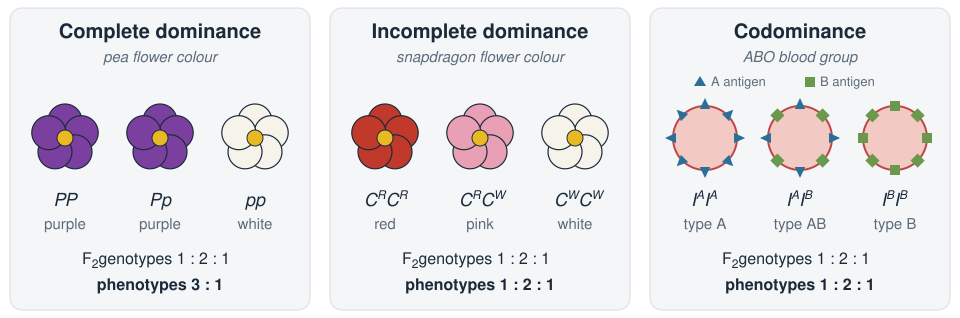
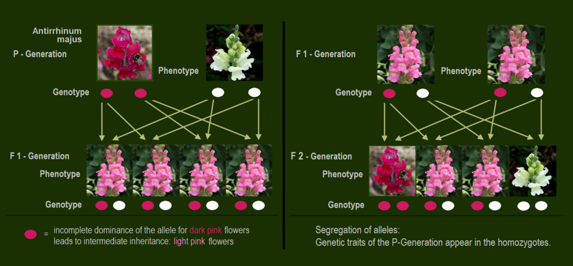
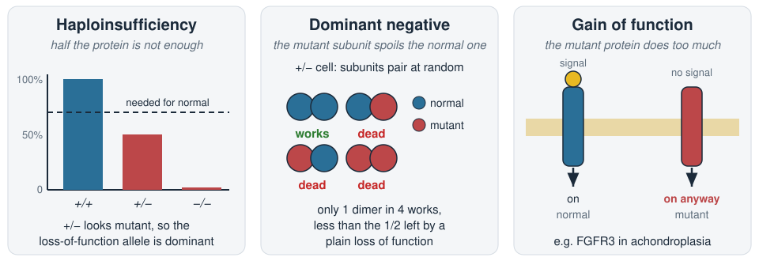
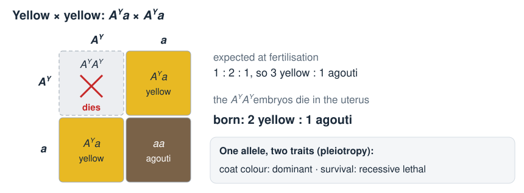
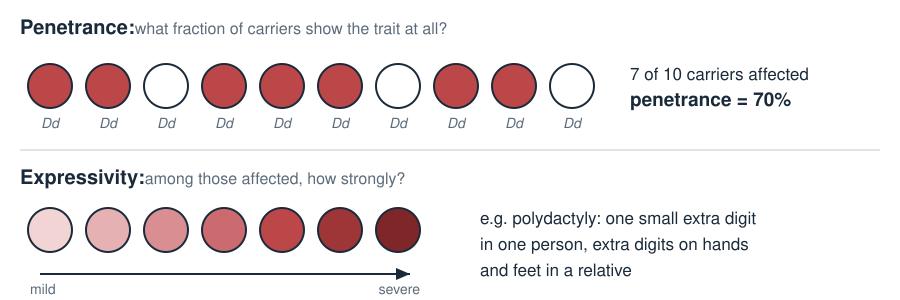
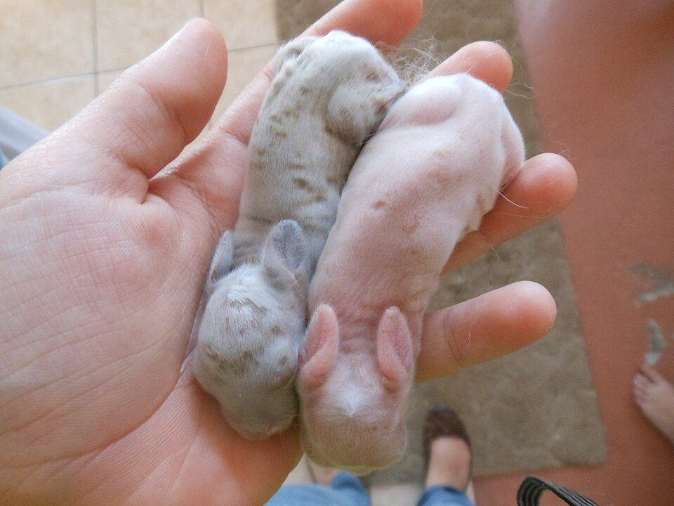
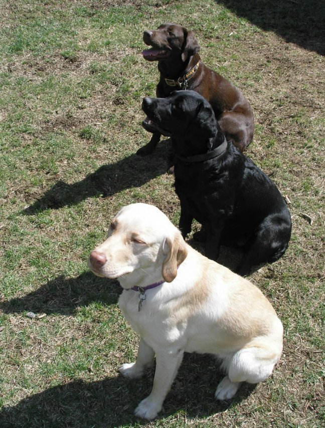
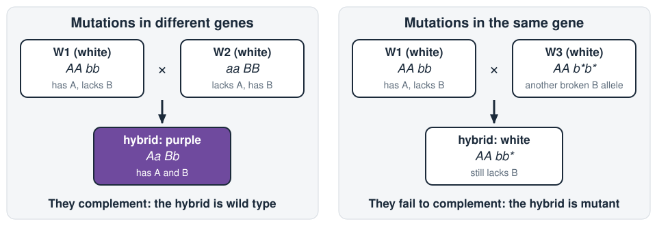
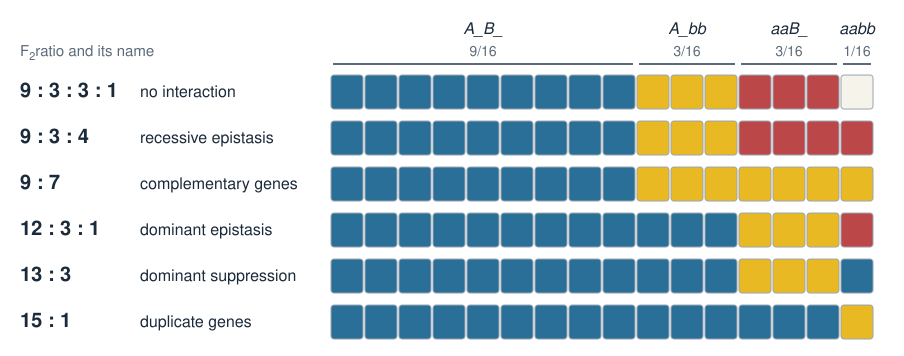

## About this lecture {.smaller}

Mendel picked traits that behave simply: **one gene, two alleles, one fully dominant, no interactions, no environment**. Most traits are not that tidy. Today we keep Mendel's two laws (segregation and independent assortment) and change the **assumptions about how genotype becomes phenotype**.

**Part A, one gene:**

- incomplete dominance and codominance; why an allele is dominant at the molecular level;
- multiple alleles and allelic series; lethal alleles and pleiotropy;
- penetrance, expressivity and the environment, with a risk calculation.

**Part B, two genes:**

- genes in one pathway turn 9 : 3 : 3 : 1 into **9 : 3 : 4, 9 : 7, 12 : 3 : 1, 13 : 3 or 15 : 1**: the same 16ths, merged;
- the complementation logic behind 9 : 7;
- a strategy: counts → 16ths → candidate ratios → χ² (from *Probability and the χ² test*) → pathway.

Book: Hartwell, the chapter on extensions to Mendel's laws.

::: notes
The key message: the laws of transmission do not change. Alleles still segregate 1:1 and unlinked genes still assort independently. What changes is the mapping from genotype to phenotype. Every odd ratio in this lecture can be derived from an ordinary Punnett square, then relabelled. Students who remember that will never need to memorise the ratios. The lecture has two halves with a clear break: first everything that can happen with a single gene, then what happens when two genes act on the same trait. The χ² test from the previous unit comes back at the end, as the tool for choosing between candidate ratios. Linkage, which breaks independent assortment, is a different story and comes in Part 2.
:::

## Dominance is a relation between two alleles {.smaller}

{width="88%" fig-align="center"}

- **Complete dominance:** the heterozygote looks like one homozygote (*Pp* is purple). F₂ phenotypes 3 : 1.
- **Incomplete dominance:** the heterozygote is **in between**.
- **Codominance:** the heterozygote shows **both** phenotypes in full.

"Dominant" describes a pair of alleles for one phenotype, not one allele on its own, and **not how common it is**.

::: notes
This is the overview; the next two slides take incomplete dominance and codominance one at a time. The three cases differ only in what the heterozygote looks like. Repeat the misconception from the first lecture: a dominant allele is not necessarily common; polydactyly alleles are dominant and rare, and in peas the green-pod allele is dominant while green seed colour is recessive. Dominance is also defined for one phenotype at a time, as the sickle-cell example in Genetics as information showed.
:::

## Incomplete dominance, step by step {.smaller}

{width="70%" fig-align="center"}
[Image: Jacek Halicki, I am Jim, Crochet.david and Sciencia58, CC BY-SA 4.0, via Wikimedia Commons](https://commons.wikimedia.org/wiki/File:Incomplete_dominance_-_Antirrhinum_majus.png){.photo-credit}

| Generation | Cross | Genotypes | Phenotypes |
|---|---|---|---|
| P | red *C^R^C^R^* × white *C^W^C^W^* | | |
| F₁ | | all *C^R^C^W^* | all **pink** |
| F₂ | *C^R^C^W^* × *C^R^C^W^* | 1 *C^R^C^R^* : 2 *C^R^C^W^* : 1 *C^W^C^W^* | **1 red : 2 pink : 1 white** |

Each genotype has its own phenotype, so the **phenotype ratio is the genotype ratio**.

::: notes
Walk through the snapdragon (Antirrhinum majus) generation by generation. The pink F1 looks like blending, like mixing red and white paint. The F2 is the test: blending would predict that all F2 are pink and that red and white are gone for good. Instead red and white come back unchanged, in a quarter each. So the alleles stayed separate in the pink F1; only the phenotype of the heterozygote was intermediate. A molecular reading: one dose of the pigment allele makes about half the pigment, and half is visibly less than full. Practical consequence for a gardener: pink plants never breed true, because selfing them always gives 1:2:1 again. Notation: when neither allele is dominant we use superscripts on one letter (C^R and C^W) rather than upper and lower case.
:::

## Codominance: both products show

The heterozygote makes **both** allele products, and we can see both.

- **ABO blood groups:** *I^A^I^B^* red cells carry **both** the A and the B antigen. Blood type AB is not "halfway between" A and B; it is A **and** B.
- **Haemoglobin on a gel** (recap from *Genetics as information*): an HbA/HbS carrier has **two bands**, HbA and HbS.

| | incomplete dominance | codominance |
|---|---|---|
| heterozygote | **intermediate** (pink) | shows **both** (AB) |
| F₂ phenotype ratio | 1 : 2 : 1 | 1 : 2 : 1 |
| how we see it | amount of one product | two distinct products |

Whether we call alleles codominant often depends on **how closely we look**: at the protein level, most pairs of alleles are codominant.

::: notes
Students often mix up incomplete dominance and codominance, because both give 1:2:1 in an F2. The difference is in what the heterozygote is. Incomplete dominance: one product in a smaller amount, so the phenotype is an average. Codominance: two different products side by side, so we can detect both. The last line connects to the sickle-cell example: for the disease, HbS is recessive; on a gel, it is codominant. It is the same pair of alleles looked at with a different method. Molecular tests often turn a "recessive" allele into a codominant one, which is why carriers can be detected by DNA testing.
:::

## Why is an allele dominant? The molecular view {.smaller}

{width="85%" fig-align="center"}

- Most loss-of-function alleles are **recessive**: half the normal protein is usually enough (**haplosufficient**).
- **Haploinsufficiency:** half is *not* enough, so a loss-of-function allele is dominant (e.g. *PAX6* and aniridia).
- **Dominant negative:** the mutant protein **spoils** the normal one in a complex (e.g. mutant collagen chains in osteogenesis imperfecta).
- **Gain of function:** the mutant protein does something new or too much (e.g. an over-active *FGFR3* receptor in achondroplasia).

::: notes
This links the Mendelian words to the molecular biology students know from 5MO103. Ask first: if a mutation destroys an enzyme, why is the heterozygote usually normal? Because one working copy gives about half the enzyme, and pathways usually have spare capacity. So recessive is the default for loss-of-function alleles. Then the three ways around this. Haploinsufficiency: a dosage-sensitive gene, where 50% is below the threshold. Dominant negative: the next slide does the numbers. Gain of function: the mutant protein is active when it should not be. Achondroplasia comes back in Find it: FGFR3 variants make the receptor overly active.
:::

## Dominant negative: the numbers

A heterozygote makes normal (N) and mutant (M) subunits in equal amounts, and they assemble **at random**. A complex works only if **every** subunit is normal.

| Protein made of | P(all subunits normal) | Working protein, dominant negative | Working protein, plain null allele |
|---|---|---|---|
| 1 subunit (monomer) | ½ | ½ | ½ |
| 2 subunits (dimer) | ½ × ½ | **¼** | ½ |
| 4 subunits (tetramer) | (½)⁴ | **1/16** | ½ |

- A **null** allele makes no protein: the cell has half the normal amount, all of it working.
- A **dominant-negative** allele makes protein that **poisons** the complexes it joins. The more subunits per complex, the worse it gets.
- So a mutation that **destroys** a protein can be *less* harmful in a heterozygote than one that makes a **faulty** protein.

::: notes
This was in the notes before; it deserves its own slide because it is a neat use of the product rule from the probability unit. Each subunit is normal with probability one half, independently, so a complex of n subunits is fully normal with probability one half to the n. Compare with a null allele: a heterozygote for a null makes half as many subunits, but all of them normal, so it still has half the normal amount of working complex, whatever n is. The counter-intuitive conclusion in the last bullet surprises students: a nonsense mutation that leads to no protein can be milder in a heterozygote than a missense mutation in the same gene. This is seen in collagen: in osteogenesis imperfecta, null alleles of COL1A1 tend to give a milder form than some missense alleles that build faulty chains into the triple helix.
:::

## Multiple alleles: ABO

A population can carry **many alleles** of one gene, even though each diploid person carries at most two.

**ABO blood groups** (gene *ABO*, which encodes a glycosyltransferase):

| Genotype | *I^A^I^A^*, *I^A^i* | *I^B^I^B^*, *I^B^i* | *I^A^I^B^* | *ii* |
|---|---|---|---|---|
| Blood type | A | B | AB | O |

*I^A^* and *I^B^* are codominant with each other; both are dominant over *i* (no working enzyme). Three alleles give **6 genotypes but 4 phenotypes**. With *n* alleles there are *n*(*n* + 1)/2 genotypes.

**Worked example.** *I^A^I^B^* (type AB) × *I^A^i* (type A):

| | ½ *I^A^* | ½ *i* |
|---|---|---|
| **½ *I^A^*** | *I^A^I^A^* (A) | *I^A^i* (A) |
| **½ *I^B^*** | *I^A^I^B^* (AB) | *I^B^i* (B) |

Children: **½ A : ¼ AB : ¼ B**, and **no O**: every child gets *I^A^* or *I^B^* from the AB parent.

::: notes
ABO combines two ideas: multiple alleles, and different dominance relations between different pairs. The A allele adds N-acetylgalactosamine and the B allele adds galactose to the same precursor (the H antigen); the O allele makes no active enzyme. So A and B are codominant, both products are present, and O is recessive because it makes nothing. The worked example is the method for the blood-group questions in the exercise: write each parent's gametes, fill the square, then translate genotypes into blood types, merging I^A I^A and I^A i into one type. Point out the useful rule that falls out: an AB parent can never have an O child. The formula n(n+1)/2 is n homozygotes plus n(n-1)/2 heterozygotes.
:::

## An allelic series

Rabbit coat colour, one gene with four alleles in a **dominance hierarchy**:

$$C \;(\text{full colour}) \;>\; c^{ch} \;(\text{chinchilla}) \;>\; c^{h} \;(\text{Himalayan}) \;>\; c \;(\text{albino})$$

Each allele is dominant over those to its right. Four alleles: 4 × 5/2 = **10 genotypes**, but only 4 phenotypes.

**Worked example.** *Cc^h^* (full colour) × *c^ch^c* (chinchilla):

| | ½ *c^ch^* | ½ *c* |
|---|---|---|
| **½ *C*** | *Cc^ch^*: full colour | *Cc*: full colour |
| **½ *c^h^*** | *c^ch^c^h^*: chinchilla | *c^h^c*: Himalayan |

Offspring: **½ full colour : ¼ chinchilla : ¼ Himalayan**. Read each cell by asking: which of the two alleles is further **left** in the series?

**Working backwards:** an offspring class tells you which alleles the parents must carry. Here, a Himalayan offspring proves that the chinchilla parent carries an allele below *c^h^*.

::: notes
The allelic series is a good drill in the same method. The trick in each cell is to find the highest-ranking allele. The last line is the reasoning students need for exercise problems that run backwards from offspring to parents: the rarest, most recessive class is the most informative, because it pins down hidden alleles in both parents. Here the Himalayan offspring c^h c needs a c from the chinchilla parent. The c^h allele returns on the environment slide: it encodes a temperature-sensitive form of tyrosinase.
:::

## Lethal alleles: the yellow mouse {.smaller}

{width="66%" fig-align="center"}

- Cuénot (1905): yellow × yellow mice gave yellow and agouti offspring near **2 : 1**, never 3 : 1. Yellow mice never bred true.
- Step by step: *A^Y^a* × *A^Y^a* → 1 *A^Y^A^Y^* : 2 *A^Y^a* : 1 *aa*. The *A^Y^A^Y^* quarter **dies** as embryos. Among survivors: 2 yellow : 1 agouti, so **⅔ yellow**.
- A 2 : 1 ratio among the survivors of a monohybrid cross is the signature of a **recessive lethal**.

::: notes
This is the classic case where a ratio looked wrong and the explanation was a missing class. Ask students to predict yellow x yellow first: they will say 3:1. Then show 2:1 and ask what has happened. Do the arithmetic on the board: start from the 1:2:1, cross out the dead quarter, and renormalise over the three quarters that are left. That is the same conditional-probability step as the 2/3 carrier probability, just in mice. In the exercise, students test 2:1 against 3:1 with χ².
:::

## Testing the lethal hypothesis; pleiotropy

A good hypothesis makes **new predictions**. If *A^Y^A^Y^* is lethal:

| Prediction | Why |
|---|---|
| **Every** yellow mouse is *A^Y^a* | the homozygote never survives |
| Yellow × agouti gives **1 yellow : 1 agouti**, no deaths | *A^Y^a* × *aa* cannot make *A^Y^A^Y^* |
| Yellow × yellow litters are about **¼ smaller** | a quarter of the embryos die early |
| Dissected yellow × yellow pregnancies show **dead embryos** | the missing class can be found |

**Pleiotropy:** one allele affects several traits. *A^Y^* is **dominant for coat colour** but **recessive for lethality**. Another example: the sickle-cell allele of *HBB* affects red-cell shape, anaemia, organ damage and resistance to malaria.

So "dominant" and "recessive" belong to a **trait**, not to an allele.

::: notes
This is the scientific method in miniature: the lethal hypothesis was not accepted because it explained 2:1, but because its other predictions came true. Yellow x agouti gives 1:1 with normal litter sizes, and dead embryos were later found in yellow x yellow females. Litter size is a nice quantitative check: if the same number of zygotes form, the surviving litter is three quarters of a yellow x agouti litter. Pleiotropy: the same allele has one effect we see (coat colour, dominant) and one we infer (lethality, recessive). That shows again that "dominant" belongs to a trait, not to an allele.
:::

## Penetrance and expressivity {.smaller}

{width="70%" fig-align="center"}

- **Penetrance:** the fraction of individuals with a genotype who show the trait at all: P(phenotype | genotype). Incomplete penetrance can make a dominant trait **skip a generation**.
- **Expressivity:** how strongly the trait shows in those who have it. Polydactyly can be one small extra digit, or extra digits on all four limbs.
- *BRCA1*: carriers of a pathogenic variant have a much higher lifetime risk of breast and ovarian cancer, **but not all of them get cancer**. They inherit a raised risk, not the disease.
- Causes: other genes (**modifiers**), the environment, and chance.

::: notes
Keep the two words apart: penetrance is yes/no at the level of individuals, expressivity is the degree among affected individuals. Penetrance is a fraction of genotypes, so it can only be measured when we know the genotype, which is why molecular testing changed our estimates of penetrance for BRCA1. Do not quote penetrance numbers for BRCA1 here: they differ between studies and populations, and they change. The important qualitative fact is: autosomal dominant, incomplete penetrance. In the pedigrees unit, incomplete penetrance is the classic trap: an unaffected parent between two affected generations does not rule out dominant inheritance. Writing penetrance as a conditional probability sets up the next slide.
:::

## Worked example: risk with incomplete penetrance

An autosomal dominant condition has **60% penetrance**. Tom is **unaffected**. His father is affected (*Aa*); his mother does not carry the allele (*aa*). What is the chance that Tom carries the allele?

**Step 1. Before we know his phenotype:** P(*Aa*) = ½, P(*aa*) = ½.

**Step 2. How likely is "unaffected" under each?**

| Tom's genotype | prior | P(unaffected \| genotype) | product |
|---|---|---|---|
| *Aa* | ½ | 1 − 0.6 = 0.4 | 0.20 |
| *aa* | ½ | 1 | 0.50 |

**Step 3. Keep only what is still possible, and renormalise:**

$$P(Aa \mid \text{unaffected}) = \frac{0.20}{0.20 + 0.50} = \frac{2}{7} \approx 0.29$$

**Step 4. Risk for Tom's child** (partner *aa*): 0.29 × ½ (passes *A*) × 0.6 (penetrant) ≈ **0.086**.

::: notes
This is the same "shrink the table" reasoning as the 2/3 carrier probability, with one twist: a carrier can now also be unaffected, so the carrier row does not disappear, it only shrinks. Being unaffected is evidence against carrying the allele, which lowers his carrier probability from 1/2 to 2/7. Common mistakes: forgetting to condition, and answering 1/2; or forgetting the penetrance again in step 4, when the child also has to show the trait. With full penetrance the same calculation gives 0/(0 + 0.5) = 0: an unaffected son of an affected parent cannot carry a fully penetrant dominant allele. The exercise has a problem of this type with different numbers.
:::

## The environment changes the phenotype

:::: {.columns}
::: {.column width="44%"}
{width="100%"}
[Photo: SableSteel, CC BY-SA 3.0, via Wikimedia Commons](https://commons.wikimedia.org/wiki/File:Chilled_and_Warm_Himalayan_rabbit_kits.JPG){.photo-credit}

Two Himalayan kits from one nest. Left: fell out of the nest, about 21 °C. Right: in the nest, about 35 °C.
:::
::: {.column width="56%"}
- **Himalayan rabbits** (*c^h^c^h^*) and **Siamese cats** carry a **temperature-sensitive** allele of the gene for tyrosinase, the first enzyme in melanin synthesis.
- The enzyme works at lower temperature and fails at body-core temperature, so only the **cool extremities** (ears, nose, paws, tail) are dark.
- Chill the skin and dark fur grows there: the kit that fell out of the nest is pigmented **all over**.
- In humans, **phenylketonuria** (PKU): the same genotype gives severe intellectual disability on a normal diet and near-normal development on a low-phenylalanine diet.

Genotype sets a **range of possible phenotypes**. The environment picks a point in that range.
:::
::::

::: notes
The photo is a natural experiment: two siblings, presumably the same genotype at the c locus since both are Himalayan kits, but one spent time at a much lower temperature and its fur is pigmented where the warm sibling's is not. The classic lab version shaves a patch on an adult Himalayan rabbit's back and keeps it cold while the fur regrows: the new fur grows in dark. The genotype of every skin cell is the same; only the temperature differs. The c^h allele makes a protein that folds and works at lower temperature. PKU is the human example where knowing the environment lets us change the phenotype: newborn screening plus diet. This leads to the idea of the norm of reaction, which returns with quantitative traits in Complex traits. It also explains part of incomplete penetrance and variable expressivity.
:::

## Check yourself: one gene

| Statement | True? |
|---|---|
| "The pink F₁ shows that red and white blended." | **No.** The F₂ gives back red and white unchanged. |
| "Incomplete dominance and codominance are the same, since both give 1 : 2 : 1." | **No.** Intermediate product vs two products side by side. |
| "*A^Y^* is a dominant allele." | **Only for coat colour.** For survival it is recessive. |
| "2 : 1 is just a 3 : 1 with sampling noise." | **Test it.** With enough mice χ² rejects 3 : 1; a missing class is the explanation. |
| "Penetrance and expressivity mean the same thing." | **No.** Whether it shows vs how strongly. |
| "An unaffected child of an affected parent cannot carry a dominant allele." | **Only with full penetrance.** |
| "A null allele is always the most harmful allele." | **No.** A dominant negative can be worse in a heterozygote. |

::: notes
Use this as a pause before the second half. Read each statement aloud and let students vote before you reveal the answer. These are the misunderstandings that show up most often in the exam. The 2:1 row connects to the χ² test: a 2:1 in a few mice can be noise, but with 180 pups the test separates the two ratios clearly, as in the R exercise.
:::

## Part B. Two genes, one trait

Start from Mendel's dihybrid F₂, *AaBb* × *AaBb*, with unlinked genes. Independent assortment still gives the **same 16 squares**:

| Class | *A_B_* | *A_bb* | *aaB_* | *aabb* |
|---|---|---|---|---|
| 16ths | 9 | 3 | 3 | 1 |

What changes is only how these classes **look**. When the two genes act on **one** trait, some classes give the same phenotype, and their 16ths **add up**.

**Dominance vs epistasis**

- **Dominance:** two **alleles of one gene**: which one shows in *Aa*.
- **Epistasis:** two **different genes**: the genotype at one gene **hides** the effect of the other. The gene that hides is **epistatic**; the hidden one is **hypostatic**.

The tool to think with: a **biochemical pathway**. A later step only matters if the earlier steps happen.

::: notes
This is the switch from one gene to two. Make students write the four classes and their 16ths on paper now; every ratio in the rest of the lecture is built from them. Say clearly that nothing about meiosis has changed: the gametes are still AB, Ab, aB, ab in a quarter each, and the 16 squares are still equally likely. Then the distinction that is most often muddled in exams: dominance is within one gene, epistasis is between genes. The pathway is the mental model; from biochemistry students know that a product cannot be made if an earlier enzyme in the pathway is missing.
:::

## Recessive epistasis: Labrador coat colour

:::: {.columns}
::: {.column width="34%"}
{width="100%"}
[Photo: Erikeltic, CC BY-SA 3.0, via Wikimedia Commons](https://commons.wikimedia.org/wiki/File:3labradorcols.jpg){.photo-credit}
:::
::: {.column width="66%"}
Labrador retrievers come in three colours: **black**, **chocolate** (brown) and **yellow**. Two genes are involved:

- ***B*/*b*** decides the **kind** of dark pigment: *B_* black, *bb* brown.
- ***E*/*e*** decides **whether** dark pigment goes into the hair at all: *E_* yes, *ee* no, so the coat is **yellow**.

An *ee* dog is yellow **whatever** its *B* genotype. So *ee* is **epistatic** to *B*, and *B* is **hypostatic**.

Clue that *B* is still there: yellow *bb* dogs have a **brown** nose and lips; yellow *B_* dogs have black ones. The *B* genotype is hidden in the coat, not gone.
:::
::::

::: notes
The three dogs in the photo are the three classes. Ask: two black dogs can have yellow and chocolate puppies; how? Both parents must be BbEe. The nose clue is worth showing: it proves that the B gene is not changed by being epistatically hidden; its effect is just invisible in the coat. The pathway is simplified: in reality E is MC1R, a receptor that acts as a switch between dark pigment (eumelanin) and yellow-red pigment (phaeomelanin) in the hair. The logic is the same as a two-step pathway, which the next slide draws.
:::

## Recessive epistasis: 9 : 3 : 4 {.smaller}

{width="72%" fig-align="center"}

- *B_E_* black **9**; *bbE_* chocolate **3**; *B_ee* and *bbee* both yellow: 3 + 1 = **4**.
- Merged classes: *A_bb*-type and *aabb*-type, the **last two**: here *B_ee* + *bbee*.
- **Test cross** *BbEe* × *bbee*: the four classes come in 1 : 1 : 1 : 1, and the two *ee* classes merge: **1 black : 1 chocolate : 2 yellow**.

::: notes
Point to the class bar: 9, 3, then the yellow 3 and 1 joined under one brace. The name "recessive epistasis" comes from the epistatic genotype being homozygous recessive (ee). Students should be able to produce the test-cross ratio by the same merging, applied to 1:1:1:1 instead of 9:3:3:1. That test cross is exactly the situation in the exercise problem with a litter of black, chocolate and yellow pups. Mice show the same 9:3:4 with albino: cc mice are white whatever their agouti genotype; we use that in a worked example at the end.
:::

## Complementary genes: 9 : 7

**Both** steps of the pathway are needed; losing **either** one gives the same mutant phenotype.

$$\text{colourless} \xrightarrow{\ \text{enzyme A}\ } \text{colourless} \xrightarrow{\ \text{enzyme B}\ } \text{purple}$$

- Bateson and Punnett (sweet pea): two **white** varieties crossed gave an all-**purple** F₁. The F₁ selfed gave about **9 purple : 7 white**.
- The parents were *AAbb* and *aaBB*. Each could make what the other could not, so the F₁ *AaBb* has both enzymes.
- Only *A_B_* is purple (9). *A_bb*, *aaB_* and *aabb* are all white (3 + 3 + 1 = 7).
- Also called **duplicate recessive epistasis**: *aa* hides *B*, and *bb* hides *A*.
- Test cross *AaBb* × *aabb*: only *AaBb* is purple: **1 purple : 3 white**.

::: notes
Point out the merged classes: 3 + 3 + 1 = 7. The pathway explains why: you get purple only if both steps work. Ask students to derive the test cross before you show it. A good exam question: of the white F2 plants, how many genotypes are there, and do any of them give purple offspring when selfed? (Five genotypes, and none does, because every white plant is homozygous recessive at one gene or the other.) The next slide turns the F1 into a general test.
:::

## Complementation: same gene or different genes? {.smaller}

{width="80%" fig-align="center"}

Two **recessive** mutants with the **same** phenotype are crossed:

- **Wild-type hybrid** → the mutations are in **different genes**. Each parent supplies the working copy the other lacks: they **complement**.
- **Mutant hybrid** → the mutations are in the **same gene**. Neither parent has a working copy of it.

This is the **complementation test**, the standard way to sort a pile of mutants into genes.

::: notes
The 9:7 F1 is the complementation test in disguise. The test only works for recessive mutations: a dominant mutation would show in the hybrid regardless. The right-hand panel shows a third white line, W3, whose mutation is another broken allele of the B gene (written b* here). The hybrid bb* has no working B, so it is white: no complementation. Geneticists use this to decide how many genes a collection of mutants hits: cross them pairwise, and group mutants that fail to complement. Each group is one gene, called a complementation group. The Mutation unit develops this with real screens.
:::

## Dominant epistasis: 12 : 3 : 1

A **dominant** allele at one gene blocks the pathway early, so it hides the other gene.

$$\text{white} \xrightarrow{\ \text{step 1}\ } \text{green} \xrightarrow{\ \text{enzyme from } Y\ } \text{yellow} \qquad (W\text{\_ blocks step 1})$$

Summer squash fruit colour, *WwYy* × *WwYy*:

| Class | *W_Y_* | *W_yy* | *wwY_* | *wwyy* |
|---|---|---|---|---|
| Fruit | white | white | yellow | green |
| 16ths | 9 | 3 | 3 | 1 |

White = 9 + 3 = **12**, yellow **3**, green **1**: **12 : 3 : 1**. Merged classes: the **first two**.

- The *W* allele (dominant) is epistatic to *Y*/*y*. Only *ww* plants show what the *Y* gene does.
- Test cross *WwYy* × *wwyy*: **2 white : 1 yellow : 1 green**.

::: notes
Now the first two classes merge instead of the last two. The dominant W allele stops pigment production early, so W_ fruit is white whatever Y is. In ww plants the pathway runs: green pigment is made, and Y_ converts it to yellow; yy plants stay green. Compare with recessive epistasis: there the epistatic genotype was the homozygous recessive (ee), here it is any genotype with one dominant allele (W_). That is why the merged class is 12 instead of 4.
:::

## Dominant suppression: 13 : 3

A dominant allele of one gene makes an **inhibitor** of the other gene's product. The pathway has only **one** step.

$$\text{colourless} \xrightarrow{\ \text{enzyme from } C\ } \text{pigment} \qquad (I\text{\_ inhibits it})$$

Chickens: White Leghorn (*CCII*) × White Wyandotte (*ccii*) → F₁ *CcIi*, **white**. F₂:

| Class | *C_I_* | *C_ii* | *ccI_* | *ccii* |
|---|---|---|---|---|
| Feathers | white (inhibited) | **coloured** | white (no enzyme) | white (no enzyme) |
| 16ths | 9 | 3 | 3 | 1 |

White = 9 + 3 + 1 = **13**, coloured **3**: **13 : 3**.

- Why is *ccii* white? It has no inhibitor, **but also no enzyme**. That is the difference from 12 : 3 : 1, where *wwyy* had its own colour.
- Test cross *CcIi* × *ccii*: only *Ccii* is coloured: **3 white : 1 coloured**.

::: notes
Two white breeds give white offspring, and yet colour appears in the F2. Make students explain why ccii is white: no inhibitor, but also no enzyme, so it joins the big class: 13. Compare with dominant epistasis: in both cases a dominant allele switches something off, but in 12:3:1 the double recessive still makes a coloured intermediate (green), so it is a class of its own. The demo shows the two side by side. In the chicken, I is the dominant white allele and C is needed for any colour; the exercise uses exactly these breeds.
:::

## Duplicate genes: 15 : 1

Two **redundant** genes do the same job; one working copy of **either** is enough.

$$\text{precursor} \xrightarrow{\ \text{enzyme A}\ \text{or}\ \text{enzyme B}\ } \text{product}$$

- Only *aabb* lacks the product: **1**. All other classes: 9 + 3 + 3 = **15**.
- Shepherd's purse (*Capsella bursa-pastoris*): **triangular** seed capsules unless *aabb* (**ovoid**).
- Test cross *AaBb* × *aabb*: only *aabb* is ovoid: **3 : 1**.

**Redundancy hides genes.** Knock out gene A alone and nothing happens, because gene B still does the job. Many single knockouts in model organisms have no visible phenotype for this reason.

A relative: if each working gene **adds** to the effect, *A_B_*, *A_bb* + *aaB_* and *aabb* give three classes, **9 : 6 : 1** (fruit shape in summer squash: disc, sphere, long).

::: notes
Duplicate genes are common in plants with genome duplications, such as shepherd's purse, which is tetraploid. Redundancy is also why many single knockouts in model organisms have no visible phenotype; you need to knock out both copies. Note that 13:3 and 15:1 give the same 3:1 test cross; only the F2 tells them apart. The 9:6:1 case is included because it turns up in the strategy slide: when one gene gives a partial effect and two give the full effect, the single-dominant classes merge into the middle class. Mention it but do not dwell on it.
:::

## One picture: the same 16 squares, recoloured {.smaller}

{width="80%" fig-align="center"}

Read each row: the 16 squares are **always** 9 *A_B_*, 3 *A_bb*, 3 *aaB_*, 1 *aabb*. Each ratio only **colours some of them the same**.

::: notes
This is the revision picture. Go through it row by row and ask students to name, for each, which classes merged: last two (9:3:4); last three (9:7); first two (12:3:1); first two plus the last (13:3); first three (15:1). Nothing about meiosis changed in any row. If a student can draw this figure from memory together with the pathways, they can derive any ratio in the lecture.
:::

## One table: ratio → pathway {.smaller}

| F₂ ratio | Name | Pathway logic | Example | Test cross *AaBb* × *aabb* |
|---|---|---|---|---|
| 9 : 3 : 3 : 1 | no interaction | separate pathways | pea seed shape and colour | 1 : 1 : 1 : 1 |
| 9 : 3 : 4 | recessive epistasis | *aa* blocks an early step; *B* acts later | Labrador coat | 1 : 1 : 2 |
| 9 : 7 | complementary genes | both steps needed | sweet pea flowers | 1 : 3 |
| 12 : 3 : 1 | dominant epistasis | *A*\_ blocks an early step | summer squash colour | 2 : 1 : 1 |
| 13 : 3 | dominant suppression | *A*\_ inhibits the other gene's product | chicken feathers | 3 : 1 |
| 15 : 1 | duplicate genes | either enzyme is enough | shepherd's purse | 3 : 1 |
| 9 : 6 : 1 | duplicate, additive | each gene adds to the effect | summer squash shape | 1 : 2 : 1 |

A test cross has the four classes in 1 : 1 : 1 : 1, so **merging the same classes** gives the test-cross ratio.

::: notes
The test-cross column is worth a minute: a test cross has the four classes in 1:1:1:1, so merging the same classes gives the test-cross ratio. 9:3:4 merges aaBb and aabb, giving 1:1:2. A test cross is a good second check when two ratios fit an F2 about equally well. Note that 13:3 and 15:1 give the same 3:1 test cross; only the F2 tells them apart.
:::

## Explore: pathways and the Punnett square {.smaller}

```{=html}
<link rel="stylesheet" href="../demos/dist/demo.css">
<div data-demo="epistasis" data-preset="recessive"></div>
<script src="../demos/dist/epistasis.js"></script>
```

::: notes
Interactive demo. It opens on recessive epistasis 9:3:4. Click the aaBB square: enzyme A is missing, so the pathway stops at yellow, even though enzyme B is there. Then click Aabb: enzyme A works, B does not, and the dog is brown. Then switch presets: complementary (9:7) and click aaBB and AAbb, the two white parents of the sweet pea cross; then AaBb, the purple F1. Dominant epistasis: click aabb (green) and AaBb (white, inhibitor on). Dominant suppression: only aaB_ squares are coloured. Duplicate: only aabb lacks the product. End on "no interaction" to show that the same 16 squares give 9:3:3:1 when the two pathways are separate. The static fallback for print is the figure two slides back.
:::

## Strategy: collapse the F₂ into 16ths

1. **How many phenotype classes?** Two classes from a dihybrid cross points to 9 : 7, 13 : 3 or 15 : 1; three classes to 9 : 3 : 4, 12 : 3 : 1 or 9 : 6 : 1; four to 9 : 3 : 3 : 1.
2. **Convert to 16ths:** count ÷ total × 16.
3. **Match to sums of 9, 3, 3, 1.** For example 4 = 3 + 1, 6 = 3 + 3, 7 = 3 + 3 + 1, 12 = 9 + 3, 13 = 9 + 3 + 1, 15 = 9 + 3 + 3.
4. **Test the candidates with χ²**, with df = number of classes − 1.
5. **Explain it with a pathway**, and check with a test cross if you can.

::: notes
The point of step 2 is that it turns counts into something you can compare with ratio tables at a glance. Students should be able to do steps 1 to 3 in their head. The χ² step is from the previous unit; the only new thing is that we now have several candidate ratios to compare. Step 1 matters more than it looks: the number of classes you can tell apart is part of the data, as the second worked example shows.
:::

## Worked example 1: two classes

Sweet pea F₂ from two white lines: **382 purple, 290 white** (672 plants; illustrative counts).

**16ths.** 382/672 × 16 = **9.1** and 290/672 × 16 = **6.9** → try **9 : 7**.

| | O | E under 9 : 7 | (O − E)²/E |
|---|---|---|---|
| purple | 382 | 672 × 9/16 = 378 | 16/378 = 0.042 |
| white | 290 | 672 × 7/16 = 294 | 16/294 = 0.054 |
| | | | **χ² = 0.097** |

df = 1, critical value 3.84: **fail to reject** 9 : 7 (*p* = 0.76).

Under 3 : 1 instead: E = 504 and 168, χ² = 118, *p* ≈ 10⁻²⁷: **rejected**.

**Pathway:** two enzymes in a row, both needed; the white parents were *AAbb* and *aaBB*.

::: notes
Work this through as the template for the exercise. The 16ths make the guess almost automatic; χ² then confirms it and rules out the naive 3:1 that a student who only sees "two classes" might try. Worked numbers: (382-378)^2/378 + (290-294)^2/294 = 0.042 + 0.054 = 0.097. Finish with the biology, not with the p-value: the conclusion is a pathway with two necessary steps.
:::

## Worked example 2: when two ratios fit

Mouse F₂ from *AaCc* × *AaCc*: **92 agouti, 29 black, 39 albino** (160 mice; illustrative counts). *cc* mice make no pigment at all.

**16ths:** 9.2 : 2.9 : 3.9 → try **9 : 3 : 4**.

| Hypothesis | Classes compared | χ² | df | *p* |
|---|---|---|---|---|
| 9 : 3 : 4 | agouti, black, albino | 0.10 | 2 | 0.95 |
| 9 : 7 | agouti vs (black + albino) | 0.10 | 1 | 0.75 |
| 12 : 3 : 1 | agouti, black, albino as 12, 3, 1 | 90.7 | 2 | ≈ 10⁻²⁰ |

Both 9 : 3 : 4 and 9 : 7 "fit". Which is right?

- 9 : 7 is 9 : 3 : 4 with black and albino **merged**. Merging throws information away, so a coarser ratio fits whenever the finer one does.
- But we **can see three** phenotypes, and 9 : 7 predicts two. A model must explain **every class you can tell apart**.
- So: **9 : 3 : 4**, recessive epistasis: *cc* is epistatic to the agouti gene. Do **not** pick the model with the highest *p*.

::: notes
This is the trap from the quiz and the R exercise. Do the 16ths first, then show the table. The 12:3:1 row matches the three classes in the order given (expected 120 agouti, 30 black, 10 albino); it fails badly, mostly because 39 albino mice are far more than the 10 expected. The wrong pathway gives a terrible fit. The important lesson is in the 9:7 row: it fits, but it ignores an observation. Choosing between models is not only a matter of p-values; it uses the biology, here the number of phenotypes you can distinguish. Also warn against comparing p-values between tests with different df and different groupings. Albino in mice: the c allele of the tyrosinase gene, the same gene as the Himalayan rabbit's c^h.
:::

## Check yourself: two genes

| Statement | True? |
|---|---|
| "9 : 7 means independent assortment failed." | **No.** The 16 squares are still there; only the phenotypes merged. |
| "Epistasis and dominance are the same idea." | **No.** Epistasis is between genes; dominance is between alleles of one gene. |
| "A dihybrid F₂ that is not 9 : 3 : 3 : 1 must be epistasis." | **Not necessarily.** Linked genes (Part 2) also change it, by changing the **frequencies** of the classes. |
| "In 13 : 3 the double recessive is coloured." | **No.** No inhibitor, but no enzyme either. |
| "If two ratios fit, take the one with the larger *p*." | **No.** Take the one that explains every class you can see. |
| "A test cross always separates the candidate ratios." | **No.** 13 : 3 and 15 : 1 both give 3 : 1. |

::: notes
Linkage versus epistasis is the conceptual line to draw clearly: linkage changes how often the genotype classes occur, so it changes the 16ths themselves; epistasis leaves the 16ths alone and changes how genotype classes map to phenotypes. A quick diagnostic: under epistasis the F2 still adds up to sums of 9, 3, 3 and 1; under linkage it usually does not.
:::

## Summary {.smaller}

| Concept | Key fact |
|---|---|
| Incomplete dominance | heterozygote in between; F₂ 1 : 2 : 1 (snapdragon) |
| Codominance | heterozygote shows both products; *I^A^I^B^* = type AB |
| Molecular dominance | haploinsufficiency, dominant negative (½ⁿ working complexes), gain of function |
| Multiple alleles | many alleles in a population; ABO; allelic series *C* > *c^ch^* > *c^h^* > *c* |
| Recessive lethal | 2 : 1 among survivors; yellow mouse *A^Y^*; pleiotropy |
| Penetrance / expressivity | *whether* a genotype shows / *how strongly*; P(carrier \| unaffected) shrinks but is not 0 |
| Environment | temperature-sensitive tyrosinase in Himalayan rabbits; PKU and diet |
| Epistasis | one gene hides another; F₂ ratios are merged 16ths |
| Ratios | 9 : 3 : 4, 9 : 7, 12 : 3 : 1, 13 : 3, 15 : 1 (and 9 : 6 : 1) |
| Complementation | recessive mutants with a wild-type hybrid are in different genes |
| Strategy | counts → 16ths → candidate ratios → χ² → pathway; explain every class |

::: notes
Run through the table as a quick check. The two ideas to take away: dominance is about alleles of one gene, epistasis is about two genes; and all the odd dihybrid ratios are the same 16 squares with some phenotypes merged. If students can draw the pathway and colour a 4 by 4 Punnett square, they can derive any ratio in the table.
:::

## Where this leads

- **Pedigree analysis (next unit):** incomplete penetrance, variable expressivity and new mutations make human pedigrees harder to read.
- **Mutation and complementation:** the 9 : 7 cross is a complementation test. Two recessive mutants that give a wild-type hybrid have mutations in **different genes**.
- **Linkage:** when two genes are close on a chromosome, the dihybrid classes are no longer 9 : 3 : 3 : 1, for a quite different reason.
- **Complex traits:** many genes and the environment together give continuous variation.

::: notes
Point forward. The most immediate use is pedigrees, where incomplete penetrance and de novo mutations (achondroplasia: about 80% of cases are new mutations) change how we read a family tree. Complementation is the experimental version of the 9:7 logic. Linkage is the other big reason a dihybrid ratio may not be 9:3:3:1, and students must not confuse it with epistasis: linkage changes the frequency of genotype classes, epistasis changes how genotype classes map to phenotypes. Finally, complex traits extend the environment and modifier ideas to many genes at once.
:::
