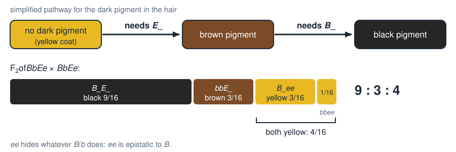

## About this lecture {.smaller}

Mendel picked traits that behave simply: **one gene, two alleles, one fully dominant, no interactions, no environment**. Most traits are not that tidy. Today we keep Mendel's two laws (segregation and independent assortment) and change the **assumptions about how genotype becomes phenotype**.

- **One gene:** incomplete dominance and codominance, why some alleles are dominant at the molecular level, multiple alleles, lethal alleles, pleiotropy, penetrance and expressivity, and the environment.
- **Two genes:** genes acting in the same pathway change the 9 : 3 : 3 : 1 into **9 : 3 : 4, 9 : 7, 12 : 3 : 1, 13 : 3 or 15 : 1**. These are still 16ths, merged.
- **Strategy:** given an F₂, turn the counts into 16ths, guess which classes merged, then test the guess with χ² (from *Probability and the χ² test*).

Book: Hartwell, the chapter on extensions to Mendel's laws.

::: notes
The key message: the laws of transmission do not change. Alleles still segregate 1:1 and unlinked genes still assort independently. What changes is the mapping from genotype to phenotype. Every odd ratio in this lecture can be derived from an ordinary Punnett square, then relabelled. Students who remember that will never need to memorise the ratios. The χ² test from the previous unit comes back at the end, as the tool for choosing between candidate ratios. Linkage, which breaks independent assortment, is a different story and comes in Part 2.
:::

## Dominance is a relation between two alleles {.smaller}

{width="88%" fig-align="center"}

- **Complete dominance:** the heterozygote looks like one homozygote (*Pp* is purple). F₂ phenotypes 3 : 1.
- **Incomplete dominance:** the heterozygote is **in between**. Red × white snapdragons give pink F₁, and the F₂ is **1 red : 2 pink : 1 white**: phenotype ratio = genotype ratio.
- **Codominance:** the heterozygote shows **both** phenotypes in full. *I^A^I^B^* red cells carry both A and B antigens: blood type AB.

"Dominant" describes a pair of alleles, not one allele, and **not how common it is**.

::: notes
Start from the snapdragon: it is the cleanest way to show that segregation still works perfectly. The F1 is pink, which looks like blending, but the F2 brings back red and white unchanged, in 1:2:1. Blending inheritance would never give back the parental types. In the incomplete-dominance case you can read the genotype straight off the phenotype, so the phenotype ratio is the genotype ratio. Codominance differs from incomplete dominance: the heterozygote is not an average, it shows both products side by side, as A and B antigens on the same red cell. Stress that dominance is a relation: the I-A allele is codominant with I-B but dominant over i. Also the misconception: a dominant allele is not necessarily common; polydactyly alleles are dominant and rare.
:::

## Why is an allele dominant? The molecular view {.smaller}

{width="85%" fig-align="center"}

- Most loss-of-function alleles are **recessive**: half the normal protein is usually enough (**haplosufficient**).
- **Haploinsufficiency:** half is *not* enough, so a loss-of-function allele is dominant (e.g. *PAX6* and aniridia).
- **Dominant negative:** the mutant protein **spoils** the normal one in a complex (e.g. mutant collagen chains in osteogenesis imperfecta).
- **Gain of function:** the mutant protein does something new or too much (e.g. an over-active *FGFR3* receptor in achondroplasia).

::: notes
This links the Mendelian words to the molecular biology students know from 5MO103. Ask first: if a mutation destroys an enzyme, why is the heterozygote usually normal? Because one working copy gives about half the enzyme, and pathways usually have spare capacity. So recessive is the default for loss-of-function alleles. Then the three ways around this. Haploinsufficiency: a dosage-sensitive gene, where 50% is below the threshold. Dominant negative: in a dimer, random pairing in a heterozygote leaves only 1/4 of dimers fully normal, which is worse than the 1/2 from a plain null allele; for tetramers it is only 1/16. Gain of function: the mutant protein is active when it should not be. Achondroplasia comes back in Find it: FGFR3 variants make the receptor overly active.
:::

## Multiple alleles

A population can carry **many alleles** of one gene, even though each diploid person carries at most two.

**ABO blood groups** (gene *ABO*, which encodes a glycosyltransferase):

| Genotype | *I^A^I^A^*, *I^A^i* | *I^B^I^B^*, *I^B^i* | *I^A^I^B^* | *ii* |
|---|---|---|---|---|
| Blood type | A | B | AB | O |

*I^A^* and *I^B^* are codominant with each other; both are dominant over *i* (no working enzyme). Three alleles give **6 genotypes but 4 phenotypes**.

**An allelic series:** rabbit coat colour, *C* (full colour) > *c^ch^* (chinchilla) > *c^h^* (Himalayan) > *c* (albino). Each allele is dominant over those to its right.

With *n* alleles there are *n*(*n* + 1)/2 genotypes: 3 alleles → 6, 4 alleles → 10.

::: notes
ABO combines two ideas: multiple alleles, and different dominance relations between different pairs. The A allele adds N-acetylgalactosamine and the B allele adds galactose to the same precursor (the H antigen); the O allele makes no active enzyme. So A and B are codominant, both products are present, and O is recessive because it makes nothing. The rabbit series is the textbook allelic series and sets up the Himalayan allele, which comes back on the environment slide. The formula n(n+1)/2 is n homozygotes plus n(n-1)/2 heterozygotes; a quick check of their combinatorics from the probability unit.
:::

## Lethal alleles and pleiotropy: the yellow mouse {.smaller}

{width="72%" fig-align="center"}

- Cuénot (1905): yellow × yellow mice always gave yellow and agouti offspring, in a ratio near **2 : 1**, never 3 : 1. Yellow mice never bred true.
- The *A^Y^A^Y^* embryos die. *A^Y^* is **dominant for coat colour** but **recessive for lethality**.
- One allele affecting several traits is **pleiotropy**. Another example: the sickle-cell allele of *HBB* affects red cell shape, anaemia, organ damage and resistance to malaria.
- A 2 : 1 ratio among the survivors of a monohybrid cross is the signature of a **recessive lethal**.

::: notes
This is the classic case where a ratio looked wrong and the explanation was a missing class. Ask students to predict yellow x yellow first: they will say 3:1. Then show 2:1 and ask what has happened. The test for the hypothesis: yellow mice are always heterozygous, so yellow x agouti should give 1:1, and pregnant yellow x yellow females should show about a quarter of embryos dying early. Pleiotropy: the same allele has one effect we see (coat colour, dominant) and one we infer (lethality, recessive). That shows again that "dominant" belongs to a trait, not to an allele. In the exercise, students test 2:1 against 3:1 with χ².
:::

## Penetrance and expressivity {.smaller}

{width="72%" fig-align="center"}

- **Penetrance:** the fraction of individuals with a genotype who show the trait at all. Incomplete penetrance can make a dominant trait **skip a generation** in a pedigree.
- **Expressivity:** how strongly the trait shows in those who have it. Polydactyly can be one small extra digit, or extra digits on all four limbs.
- *BRCA1*: carriers of a pathogenic variant have a much higher lifetime risk of breast and ovarian cancer, **but not all of them get cancer**. They inherit a raised risk, not the disease.
- Causes: other genes (**modifiers**), the environment, and chance.

::: notes
Keep the two words apart: penetrance is yes/no at the level of individuals, expressivity is the degree among affected individuals. Penetrance is a fraction of genotypes, so it can only be measured when we know the genotype, which is why molecular testing changed our estimates of penetrance for BRCA1. Do not quote penetrance numbers for BRCA1 here: they differ between studies and populations, and they change. The important qualitative fact is: autosomal dominant, incomplete penetrance. In the pedigrees unit, incomplete penetrance is the classic trap: an unaffected parent between two affected generations does not rule out dominant inheritance. In Find it students look up the mode of inheritance in MedGen/OMIM.
:::

## The environment changes the phenotype

The same genotype can give different phenotypes in different environments.

- **Himalayan rabbits** (*c^h^c^h^*) and **Siamese cats** carry a **temperature-sensitive** allele of the gene for tyrosinase, the first enzyme in melanin synthesis.
- The enzyme works at lower temperature and fails at body-core temperature, so only the **cool extremities** (ears, nose, paws, tail) are dark.
- Shave a patch on a Himalayan rabbit's back and keep it cold while the fur regrows: the new fur grows in **dark**.
- In humans, **phenylketonuria** (PKU): the same genotype gives severe intellectual disability on a normal diet and near-normal development on a low-phenylalanine diet.

Genotype sets a **range of possible phenotypes**. The environment picks a point in that range.

::: notes
The rabbit experiment is the cleanest demonstration that the genotype of every skin cell is the same; only the temperature differs. The allele makes a protein that folds correctly at lower temperature. PKU is the human example where knowing the environment lets us change the phenotype: newborn screening plus diet. This leads to the idea of the norm of reaction, which returns with quantitative traits in Complex traits. It also explains part of incomplete penetrance and variable expressivity from the previous slide.
:::

## Two genes, one pathway: epistasis {.smaller}

**Epistasis:** the genotype at one gene **hides** the effect of another gene. Mendel's 9 : 3 : 3 : 1 is still there underneath; some classes **look the same**.

{width="70%" fig-align="center"}

**Recessive epistasis, 9 : 3 : 4.** Labrador retrievers, *BbEe* × *BbEe*: *ee* dogs make no dark pigment in the hair, so they are yellow **whatever** their *B* genotype. *ee* is **epistatic** to *B*; *B* is **hypostatic**.

::: notes
Epistasis is about genes, not alleles: one gene masks another. Contrast with dominance, which is about two alleles of the same gene. The pathway picture: a later step only matters if the earlier step happens. Here E is needed for dark pigment in the hair at all, and B decides whether that dark pigment is black or brown. The pathway is simplified: in reality E (MC1R) acts as a switch between dark and yellow pigment, but the logic is the same. Yellow Labradors with bb still show it: their nose and lips are brown rather than black. That is a hint that the B genotype is still there, just hidden in the coat. Point out how 9:3:4 comes from 9:3:3:1 with the last two classes merged: B_ee (3) and bbee (1).
:::

## Complementary genes: 9 : 7

**Both** steps of the pathway are needed; losing **either** one gives the same mutant phenotype.

$$\text{colourless} \xrightarrow{\ \text{enzyme A}\ } \text{colourless} \xrightarrow{\ \text{enzyme B}\ } \text{purple}$$

- Bateson and Punnett (sweet pea): two **white** varieties crossed gave an all-**purple** F₁. The F₁ selfed gave **9 purple : 7 white**.
- The parents were *AAbb* and *aaBB*. Each could make what the other could not, so the F₁ *AaBb* has both enzymes.
- Only *A_B_* is purple (9). *A_bb*, *aaB_* and *aabb* are all white (3 + 3 + 1 = 7).
- Also called **duplicate recessive epistasis**: *aa* hides *B*, and *bb* hides *A*.

Two white parents with a coloured F₁ is the same logic as a **complementation test**: the mutations are in **different genes**.

::: notes
This is the slide that sets up the complementation test in the Mutation unit. When two recessive mutants with the same phenotype are crossed and the offspring are wild type, the mutations are in different genes; they complement. If they were in the same gene, the F1 would still be mutant. Point out the merged classes: 3 + 3 + 1 = 7. The pathway explains why: you get purple only if both steps work. Ask students what an F1 test cross AaBb x aabb would give: 1 purple : 3 white.
:::

## Dominant epistasis: 12 : 3 : 1

A **dominant** allele at one gene blocks the pathway, so it hides the other gene.

$$\text{white} \xrightarrow{\ \text{step 1}\ } \text{green} \xrightarrow{\ \text{enzyme B}\ } \text{yellow} \qquad \text{(}A\text{\_ blocks step 1)}$$

Summer squash fruit colour, *WwYy* × *WwYy*:

| Class | *W_Y_* | *W_yy* | *wwY_* | *wwyy* |
|---|---|---|---|---|
| Fruit | white | white | yellow | green |
| 16ths | 9 | 3 | 3 | 1 |

White = 9 + 3 = **12**, yellow **3**, green **1**: **12 : 3 : 1**.

The *W* allele (dominant) is epistatic to *Y*/*y*. Only *ww* plants show what the *Y* gene does.

::: notes
Now the first two classes merge instead of the last two. The dominant W allele stops pigment production early, so W_ fruit is white whatever Y is. In ww plants the pathway runs: green pigment is made, and Y_ converts it to yellow; yy plants stay green. Compare with recessive epistasis: there the epistatic genotype was the homozygous recessive (ee), here it is any genotype with one dominant allele (W_). That is why the merged class is 12 instead of 4. Test cross: WwYy x wwyy gives 2 white : 1 yellow : 1 green.
:::

## Dominant suppression 13 : 3 and duplicate genes 15 : 1

:::: {.columns}
::: {.column width="50%"}
**Dominant suppression, 13 : 3**

$$\text{colourless} \xrightarrow{\ \text{enzyme B}\ } \text{pigment}$$
$A$\_ makes an **inhibitor** of enzyme B.

- Coloured only if *aaB_*: **3**.
- *A_B_*, *A_bb*, *aabb* are colourless: 9 + 3 + 1 = **13**.
- Chickens: White Leghorn (*CCII*) × White Wyandotte (*ccii*) → F₂ 13 white : 3 coloured. *I* suppresses *C*.
:::
::: {.column width="50%"}
**Duplicate genes, 15 : 1**

$$\text{precursor} \xrightarrow{\ \text{enzyme A}\ \text{or}\ \text{enzyme B}\ } \text{product}$$

- Two **redundant** genes do the same job; one working copy of **either** is enough.
- Only *aabb* lacks the product: **1**. All others: **15**.
- Shepherd's purse: triangular seed capsules unless *aabb* (ovoid).
:::
::::

::: notes
Two more ways to merge classes. In dominant suppression, a dominant allele of one gene makes a suppressor that stops the other gene's product from acting. Unlike 12:3:1, the double recessive aabb is colourless too, because it lacks enzyme B, so it joins the big class: 13. Make students explain why aabb is white: no inhibitor, but also no enzyme. Duplicate genes are common in plants with genome duplications, such as shepherd's purse, which is tetraploid. Redundancy is also why many single knockouts in model organisms have no visible phenotype; you need to knock out both copies. Test crosses: 13:3 gives 3 colourless : 1 coloured; 15:1 gives 3 : 1.
:::

## One table: ratio → pathway {.smaller}

{width="52%" fig-align="center"}

| F₂ ratio | Name | Pathway logic | Example | Test cross *AaBb* × *aabb* |
|---|---|---|---|---|
| 9 : 3 : 3 : 1 | no interaction | separate pathways | pea seed shape and colour | 1 : 1 : 1 : 1 |
| 9 : 3 : 4 | recessive epistasis | *aa* blocks an early step; *B* acts later | Labrador coat | 1 : 1 : 2 |
| 9 : 7 | complementary genes | both steps needed | sweet pea flowers | 1 : 3 |
| 12 : 3 : 1 | dominant epistasis | *A*\_ blocks an early step | summer squash | 2 : 1 : 1 |
| 13 : 3 | dominant suppression | *A*\_ inhibits enzyme B | chicken feathers | 3 : 1 |
| 15 : 1 | duplicate genes | either enzyme is enough | shepherd's purse | 3 : 1 |

::: notes
This is the revision table. Read the figure row by row: the 16 squares are always the same four classes, 9 A_B_, 3 A_bb, 3 aaB_ and 1 aabb, and each ratio just colours some of them the same. Nothing about meiosis has changed. The test-cross column is worth a minute: a test cross has the four classes in 1:1:1:1, so merging the same classes gives the test-cross ratio. 9:3:4 merges aaBb and aabb, giving 1:1:2. A test cross is a good second check when two ratios fit an F2 about equally well. Note that 13:3 and 15:1 give the same 3:1 test cross; only the F2 tells them apart.
:::

## Explore: pathways and the Punnett square {.smaller}

```{=html}
<link rel="stylesheet" href="../demos/dist/demo.css">
<div data-demo="epistasis" data-preset="recessive"></div>
<script src="../demos/dist/epistasis.js"></script>
```

::: notes
Interactive demo. It opens on recessive epistasis 9:3:4. Click the aaBB square: enzyme A is missing, so the pathway stops at yellow, even though enzyme B is there. Then click Aabb: enzyme A works, B does not, and the dog is brown. Then switch presets: complementary (9:7) and click aaBB and AAbb, the two white parents of the sweet pea cross; then AaBb, the purple F1. Dominant epistasis: click aabb (green) and AaBb (white, inhibitor on). Dominant suppression: only aaB_ squares are coloured. Duplicate: only aabb lacks the product. End on "no interaction" to show that the same 16 squares give 9:3:3:1 when the two pathways are separate. The static fallback for print is the figure on the previous slide.
:::

## Strategy: collapse the F₂ into 16ths

1. **How many phenotype classes?** Two classes from a dihybrid cross points to 9 : 7, 13 : 3 or 15 : 1; three classes to 9 : 3 : 4, 12 : 3 : 1 (or 9 : 6 : 1); four to 9 : 3 : 3 : 1.
2. **Convert to 16ths:** count ÷ total × 16.
3. **Match to sums of 9, 3, 3, 1.** For example 4 = 3 + 1, 7 = 3 + 3 + 1, 12 = 9 + 3, 13 = 9 + 3 + 1, 15 = 9 + 3 + 3.
4. **Test the candidates with χ²**, with df = number of classes − 1.
5. **Explain it with a pathway**, and check with a test cross if you can.

**Worked example.** Sweet pea F₂: 382 purple, 290 white (672 plants).

- 382/672 × 16 = **9.1** and 290/672 × 16 = **6.9** → try 9 : 7.
- Expected 378 and 294: χ² = 4²/378 + 4²/294 = **0.097**, df = 1, *p* = 0.76. Fits.
- Under 3 : 1 instead: χ² = 118, *p* ≈ 10⁻²⁷. Rejected.

::: notes
The point of step 2 is that it turns counts into something you can compare with ratio tables at a glance. Students should be able to do steps 1 to 3 in their head. The χ² step is from the previous unit; the only new thing is that we now have several candidate ratios to compare. Note a warning: any ratio that merges classes of a ratio that fits will also fit, because merging throws away information. For example, if 9:3:4 fits, then 9:7 (merge brown with yellow) will usually fit too. Choose the ratio that has the same number of classes as the phenotypes you can actually tell apart. The exercise works through exactly that with R. Worked numbers: (382-378)^2/378 + (290-294)^2/294 = 0.042 + 0.054 = 0.097.
:::

## Summary {.smaller}

| Concept | Key fact |
|---|---|
| Incomplete dominance | heterozygote in between; F₂ 1 : 2 : 1 (snapdragon) |
| Codominance | heterozygote shows both; *I^A^I^B^* = type AB |
| Molecular dominance | haploinsufficiency, dominant negative, gain of function |
| Multiple alleles | many alleles in a population; ABO; allelic series |
| Recessive lethal | 2 : 1 among survivors; yellow mouse *A^Y^* |
| Pleiotropy | one gene, several traits |
| Penetrance / expressivity | *whether* a genotype shows / *how strongly* |
| Environment | temperature-sensitive tyrosinase in Himalayan rabbits |
| Epistasis | one gene hides another; F₂ ratios are merged 16ths |
| Ratios | 9 : 3 : 4, 9 : 7, 12 : 3 : 1, 13 : 3, 15 : 1 |
| Strategy | counts → 16ths → candidate ratios → χ² → pathway |

::: notes
Run through the table as a quick check. The two ideas to take away: dominance is about alleles of one gene, epistasis is about two genes; and all the odd dihybrid ratios are the same 16 squares with some phenotypes merged. If students can draw the pathway and colour a 4 by 4 Punnett square, they can derive any ratio in the table.
:::

## Where this leads

- **Pedigree analysis (next unit):** incomplete penetrance, variable expressivity and new mutations make human pedigrees harder to read.
- **Mutation and complementation:** the 9 : 7 cross is a complementation test. Two recessive mutants that give a wild-type F₁ have mutations in **different genes**.
- **Linkage:** when two genes are close on a chromosome, the dihybrid classes are no longer 9 : 3 : 3 : 1, for a quite different reason.
- **Complex traits:** many genes and the environment together give continuous variation.

::: notes
Point forward. The most immediate use is pedigrees, where incomplete penetrance and de novo mutations (achondroplasia: about 80% of cases are new mutations) change how we read a family tree. Complementation is the experimental version of the 9:7 logic. Linkage is the other big reason a dihybrid ratio may not be 9:3:3:1, and students must not confuse it with epistasis: linkage changes the frequency of genotype classes, epistasis changes how genotype classes map to phenotypes. Finally, complex traits extend the environment and modifier ideas to many genes at once.
:::
