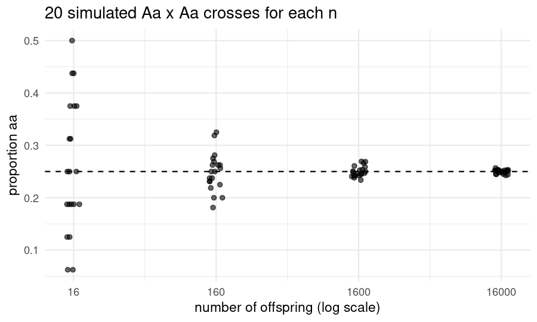

## Goal

By the end of this exercise you should be able to:

- write a small R **function** that uses `sample()` to simulate a cross, and see how observed ratios approach the expected ones as the number of offspring grows.

## Before you start

This page builds on the by-hand part of the [Exercise](exercise.qmd), so do that first. You need the packages dplyr and ggplot2.

## Tasks

In R we simulate crosses. The new idiom is **writing your own function** and using [`sample()`](https://rdrr.io/r/base/sample.html) to draw at random. A function packs a few lines of code under one name, so you can run them again with different inputs:

```r
my_function <- function(input1, input2) {
  # ... code that uses input1 and input2 ...
  result            # the last value is what the function returns
}
```

`sample(x, n, replace = TRUE)` draws `n` values from the vector `x` at random, with each value equally likely and the same value allowed more than once. That is exactly what a parent does when it passes one of its two alleles to each offspring.

We use [`set.seed()`](https://rdrr.io/r/base/Random.html) before each simulation, so you get the same random numbers as in the solutions.

```r
library(dplyr)
library(ggplot2)
```

**R1. (two functions)** Write `gametes(genotype)`, which splits a genotype like `"Aa"` into its two alleles, and `cross(p1, p2, n)`, which simulates `n` offspring of a single-gene cross: each offspring gets one allele drawn at random from each parent.

```r
gametes <- function(genotype) {
  strsplit(genotype, "")[[1]]          # "Aa" -> c("A", "a")
}

cross <- function(p1, p2, n) {
  a1 <- sample(gametes(p1), n, replace = TRUE)   # one allele from parent 1
  a2 <- sample(gametes(p2), n, replace = TRUE)   # one allele from parent 2
  # write the dominant (upper-case) allele first, so "aA" becomes "Aa"
  ifelse(a1 == toupper(a1), paste0(a1, a2), paste0(a2, a1))
}

gametes("Aa")
set.seed(1)
cross("Aa", "Aa", 16)
```

Count the genotypes in your 16 offspring by eye. Do you get exactly 4 : 8 : 4?

**R2. (monohybrid: 1 : 2 : 1 and 3 : 1)** Simulate 1000 offspring of *Aa* × *Aa*. Use [`table()`](https://rdrr.io/r/base/table.html) and [`prop.table()`](https://rdrr.io/r/base/proportions.html) to get the genotype counts and proportions, and compare them with 1 : 2 : 1. Then turn genotypes into phenotypes and compare with 3 : 1. Finally, compute the expected numbers for Mendel's 7324 seeds and his observed ratio.

```r
set.seed(2)
offspring <- cross("Aa", "Aa", 1000)
geno <- factor(offspring, levels = c("AA", "Aa", "aa"))   # fixes the order
table(geno)
prop.table(table(geno))

pheno <- ifelse(offspring == "aa", "aa", "A_")
prop.table(table(pheno))

7324 * c(3/4, 1/4)     # Mendel's 7324 seeds, expected round : wrinkled
5474 / 1850
```

**R3. (testcross)** Reuse `cross()` for the testcross *Aa* × *aa* with 1000 offspring. What ratio do you expect, and what do you get?

```r
set.seed(3)
tc <- cross("Aa", "aa", 1000)
table(factor(tc, levels = c("Aa", "aa")))
```

**R4. (two genes: 9 : 3 : 3 : 1)** Independent assortment means that we can simulate each gene **separately** and put the results side by side. Simulate 1000 offspring of *AaBb* × *AaBb*, build the phenotype of each offspring, count the four classes with [`count()`](https://dplyr.tidyverse.org/reference/count.html), and compare the proportions with 9/16, 3/16, 3/16, 1/16. Then compute the expected numbers for Mendel's 556 seeds.

```r
set.seed(44)
n <- 1000
dihybrid <- tibble(A = cross("Aa", "Aa", n),
                   B = cross("Bb", "Bb", n)) |>
  mutate(pheno = paste0(ifelse(A == "aa", "aa", "A_"),
                        ifelse(B == "bb", "bb", "B_")),
         pheno = factor(pheno, levels = c("A_B_", "A_bb", "aaB_", "aabb")))

dihybrid |>
  count(pheno) |>
  mutate(observed = n / sum(n),
         expected = c(9, 3, 3, 1) / 16)

556 * c(9, 3, 3, 1) / 16     # Mendel's 556 seeds
```

**R5. (more offspring, less noise)** Write a function `prop_aa(n)` that simulates one *Aa* × *Aa* cross with `n` offspring and returns the proportion of *aa*. Run it 20 times for each of n = 16, 160, 1600 and 16000, summarise, and plot the results with ggplot2. [`sapply()`](https://rdrr.io/r/base/lapply.html) calls a function once for each value in a vector and collects the answers; we meet it again in Part 2.

```r
prop_aa <- function(n) {
  mean(cross("Aa", "Aa", n) == "aa")     # TRUE counts as 1, FALSE as 0
}
set.seed(5)
sims <- tibble(n = rep(c(16, 160, 1600, 16000), each = 20))
sims$prop_aa <- sapply(sims$n, prop_aa)

sims |>
  group_by(n) |>
  summarise(lowest = min(prop_aa), mean = mean(prop_aa), highest = max(prop_aa))

ggplot(sims, aes(x = n, y = prop_aa)) +
  geom_hline(yintercept = 1/4, linetype = "dashed") +
  geom_jitter(width = 0.05, height = 0, alpha = 0.6) +
  scale_x_log10(breaks = c(16, 160, 1600, 16000)) +
  labs(x = "number of offspring (log scale)",
       y = "proportion aa",
       title = "20 simulated Aa x Aa crosses for each n") +
  theme_minimal()
```

How much does the spread shrink each time n grows ten-fold? Where would Mendel's 7324 seeds sit on this plot?

**R6. (three genes: the product rule)** Simulate 64000 offspring of *AaBbCc* × *AaBbCc*. Check the fraction that is *aa bb cc* against 1/64, the fraction dominant for all three traits against 27/64, and count the distinct genotypes (compare with $3^3$).

```r
set.seed(6)
n <- 64000
tri <- tibble(A = cross("Aa", "Aa", n),
              B = cross("Bb", "Bb", n),
              C = cross("Cc", "Cc", n))
mean(tri$A == "aa" & tri$B == "bb" & tri$C == "cc")
1/64
mean(tri$A != "aa" & tri$B != "bb" & tri$C != "cc")
27/64
tri |> distinct(A, B, C) |> nrow()
```

In every task, observed and expected are close but not equal. To decide whether a difference is small enough to be chance, we need a test: the χ² goodness-of-fit test (`chisq.test()`), in the next unit.

## Solutions

::: {.callout-note collapse="true" title="Solutions: In R"}

All output below is from `Rscript --vanilla` run in the unit folder. Note that `table()` sorts names alphabetically, and the order of "A" and "a" depends on your computer's language settings. That is why we use `factor(..., levels = ...)` to fix the order.

**R1.**

```
[1] "A" "a"
 [1] "Aa" "aa" "Aa" "AA" "Aa" "AA" "AA" "AA" "Aa" "Aa" "Aa" "AA" "AA" "Aa" "Aa"
[16] "aa"
```

Counting by eye gives 6 *AA* : 8 *Aa* : 2 *aa*, not 4 : 8 : 4. With 16 offspring, chance alone easily moves a class by 2.

**R2.**

```
geno
 AA  Aa  aa
247 503 250
geno
   AA    Aa    aa
0.247 0.503 0.250
pheno
  A_   aa
0.75 0.25
[1] 5493 1831
[1] 2.958919
```

The genotype proportions 0.247 : 0.503 : 0.250 are close to ¼ : ½ : ¼, and the phenotypes happen to come out at exactly 0.75 : 0.25. For Mendel's 7324 seeds, the expected numbers are 5493 : 1831; he observed 5474 : 1850, a ratio of 2.96 : 1.

**R3.**

```
 Aa  aa
493 507
```

Expected 1 : 1 (500 : 500); observed 493 : 507.

**R4.**

```
# A tibble: 4 × 4
  pheno     n observed expected
  <fct> <int>    <dbl>    <dbl>
1 A_B_    571    0.571   0.562
2 A_bb    182    0.182   0.188
3 aaB_    186    0.186   0.188
4 aabb     61    0.061   0.0625
[1] 312.75 104.25 104.25  34.75
```

Approximately 9 : 3 : 3 : 1, just from simulating each gene separately: independence alone produces the dihybrid ratio. Mendel's 315 : 108 : 101 : 32 are as close to 312.75 : 104.25 : 104.25 : 34.75 as our simulation is to its expected values.

**R5.**

```
# A tibble: 4 × 4
      n lowest  mean highest
  <dbl>  <dbl> <dbl>   <dbl>
1    16 0.0625 0.259   0.5
2   160 0.181  0.249   0.325
3  1600 0.234  0.250   0.269
4 16000 0.243  0.250   0.257
```

{width="80%" fig-align="center"}

The range of the 20 crosses shrinks by roughly a factor of 3 for each ten-fold increase in n (0.06–0.50, then 0.18–0.33, 0.23–0.27, 0.24–0.26). Noise in a proportion falls with $\sqrt{n}$, and $\sqrt{10} \approx 3.2$. Mendel's 7324 seeds sit between 1600 and 16000; his wrinkled proportion, 1850/7324 = 0.253, lies well inside the spread we would expect there.

**R6.**

```
[1] 0.01460938
[1] 0.015625
[1] 0.42025
[1] 0.421875
[1] 27
```

*aa bb cc*: 0.0146 against 1/64 = 0.0156. Dominant for all three: 0.420 against 27/64 = 0.422. All **27** = 3^3^ genotypes appear.
:::

## Where this leads

Every simulated cross above was a little off from its expected ratio, and so were all of Mendel's. In **Probability & the χ² test** you measure such deviations in R with `chisq.test()`, and use `replicate()` to run a simulation many times. `sapply()` comes back in Part 2.
