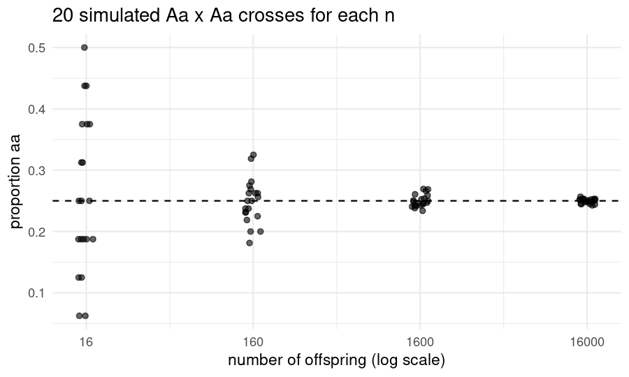

## Goal

By the end of this exercise you should be able to:

- predict the genotype and phenotype ratios of a **monohybrid** cross (1 : 2 : 1 and 3 : 1) and a **testcross** (1 : 1) with a Punnett square;
- predict the outcome of a **dihybrid** cross (9 : 3 : 3 : 1) and a dihybrid testcross (1 : 1 : 1 : 1);
- explain the **law of segregation** and the **law of independent assortment** in terms of what chromosomes do in meiosis;
- use the **branch-line method** and the **product rule** for crosses with three or more genes, and count $2^n$ gamete types and $3^n$ genotypes;
- look up the mode of inheritance and the gene of a human disease in **OMIM** (or NCBI MedGen);
- write a small R **function** that uses `sample()` to simulate a cross, and see how observed ratios approach the expected ones as the number of offspring grows.

Work on paper first. The demo and R then show the same crosses with random sampling added.

## Background

**Notation.** Each gene has two alleles; upper case is dominant (*R*, round), lower case is recessive (*r*, wrinkled). A diploid genotype has two alleles: *RR* and *rr* are **homozygous**, *Rr* is **heterozygous**. *R\_* means "*RR* or *Rr*", that is, the dominant phenotype. Throughout, we assume **complete dominance** (the Extensions to Mendel unit relaxes this) and **unlinked genes** (Linkage, Part 2, relaxes this).

**Law of segregation.** The two alleles of a gene separate into different gametes, so an *Rr* plant makes ½ *R* and ½ *r* gametes. The reason is meiosis I: the two homologous chromosomes, one carrying *R* and one carrying *r*, go to opposite poles.

**Law of independent assortment.** Alleles of different genes go into gametes independently. An *Rr Yy* plant makes *RY*, *Ry*, *rY*, *ry*, ¼ each. The reason: at metaphase I, each homologue pair lines up independently of the others. This holds for genes on different chromosomes.

**Key ratios.**

| Cross | Genotypes | Phenotypes |
|---|---|---|
| *Aa* × *Aa* | 1 *AA* : 2 *Aa* : 1 *aa* | 3 : 1 |
| *Aa* × *aa* (testcross) | 1 *Aa* : 1 *aa* | 1 : 1 |
| *AaBb* × *AaBb* | 9 genotypes, 1 : 2 : 1 : 2 : 4 : 2 : 1 : 2 : 1 | 9 : 3 : 3 : 1 |
| *AaBb* × *aabb* (testcross) | 1 : 1 : 1 : 1 | 1 : 1 : 1 : 1 |

**Product rule.** For independent genes, the probability of a combination is the product of the per-gene probabilities: P(*aa bb cc*) = ¼ · ¼ · ¼ = 1/64. An individual heterozygous for *n* genes makes $2^n$ gamete types; a cross between two such individuals gives $3^n$ genotypes.

**Mendel's numbers.** Seed shape F~2~: 5474 round : 1850 wrinkled. Dihybrid F~2~ (shape × colour): 315 round yellow : 108 round green : 101 wrinkled yellow : 32 wrinkled green.

## By hand

**B1. (monohybrid, peas)** In peas, yellow seeds (*Y*) are dominant to green (*y*). Mendel crossed a true-breeding yellow line with a true-breeding green line, then selfed the F~1~.

a) Give the genotypes of the P plants, the F~1~ and the F~1~ gametes.
b) Draw the Punnett square for the F~2~ and give the genotype and phenotype ratios.
c) Mendel counted 8023 F~2~ seeds. How many yellow and green seeds do you expect? He observed 6022 yellow and 2001 green.

**B2. (hidden genotypes)** Among the yellow F~2~ seeds of B1, what fraction are *YY* and what fraction are *Yy*? Describe an experiment Mendel could do (and did) to tell them apart without a testcross.

**B3. (testcross, mouse)** In mice, black coat (*B*) is dominant to brown (*b*). A black male is crossed to a brown female.

a) What offspring do you expect if the male is *BB*? If he is *Bb*?
b) The litter has 4 black and 3 brown pups. What is the male's genotype?
c) Another black male sires 6 pups, all black, with brown females. Can you be sure he is *BB*? What is the probability of this result if he is actually *Bb*?

**B4. (dihybrid, peas)** Mendel crossed true-breeding round yellow (*RR YY*) with wrinkled green (*rr yy*) peas and selfed the F~1~.

a) What gametes does the F~1~ make, and in what proportions? Which law are you using?
b) Give the four F~2~ phenotype classes with their expected fractions.
c) Mendel counted 556 F~2~ seeds. Compute the expected number in each class and compare with 315 : 108 : 101 : 32.
d) Add up the counts for seed shape alone, and for seed colour alone. What ratios do you get?

**B5. (dihybrid testcross)** The F~1~ from B4 (*Rr Yy*) is crossed to a wrinkled green plant (*rr yy*).

a) Give the expected offspring phenotypes and their ratio.
b) Why does the testcross show the F~1~'s gametes directly?
c) Suppose instead that *R* and *Y* were so close together on one chromosome that they never separated. What would the testcross give?

**B6. (branch-line)** Use the branch-line method for *Rr Yy* × *Rr yy*. Give every phenotype class and its probability.

**B7. (product rule, three genes)** Tall stem (*T*) is dominant to dwarf (*t*). Consider *Tt Rr Yy* × *Tt Rr Yy*.

a) How many kinds of gamete does each parent make? How many different genotypes can the offspring have?
b) What fraction of the offspring is tall, round and green?
c) What fraction is *tt rr yy*? What fraction is *Tt Rr Yy*?
d) What fraction is dominant for all three traits?

**B8. (working backwards)** In peas, purple flowers (*P*) are dominant to white (*p*), and axial flowers (*A*) are dominant to terminal (*a*). Two plants are crossed, giving offspring in the ratio 3 purple axial : 3 purple terminal : 1 white axial : 1 white terminal. What are the parents' genotypes?

**B9. (humans)** Cystic fibrosis is autosomal recessive; Huntington disease is autosomal dominant.

a) Two unaffected parents have a child with cystic fibrosis. What are the parents' genotypes? What is the chance that their next child is affected? That their next two children are both unaffected?
b) An unaffected sister of the affected child wants to know if she is a carrier. What is the probability?
c) A man with Huntington disease (heterozygous) and an unaffected woman have a child. What is the risk for the child? Which kind of cross is this?

## Explore {#explore}

Do the by-hand part first. In the demo you choose 1 or 2 genes and each parent's genotype. You see each parent's gametes with their frequencies, the Punnett square (coloured by phenotype, assuming complete dominance), and the genotype and phenotype ratios. Below, the demo simulates *N* offspring: filled bars are the observed counts, dashed bars the expected ones. "draw again" gives a new random sample (the seed number goes up by one).

```{=html}
<link rel="stylesheet" href="../demos/dist/demo.css">
<div data-demo="punnett" data-genes="1" data-preset="mono"></div>
<script src="../demos/dist/punnett.js"></script>
```

**E1.** The demo starts on the monohybrid F~1~ × F~1~ (*Aa* × *Aa*). Check the gametes, the Punnett square and both ratios against your answer to B1. Now set N = 16 and press "draw again" a few times, writing down the number of *aa* offspring each time. How often do you get exactly the expected 4?

**E2.** Set N = 1000. Compare the proportion of *aa* offspring with N = 16 and with N = 1000. In which case is the proportion closer to ¼? Which of Mendel's seven traits would you expect to deviate most from 3 : 1?

**E3.** Click "dihybrid F1 × F1". How many distinct gametes does each parent make, how many cells does the square have, and how many genotypes and phenotypes are there? Switch the bars to "genotypes": which genotype is the most common, and why?

**E4.** Click "dihybrid testcross". Why does the Punnett square have only one row? Compare the four phenotype classes with the gametes of the *AaBb* parent. Then look at N = 100: are the four classes equal?

**E5.** Before you click, predict the phenotype ratio of *AA Bb* × *aa bb*. Then set it up with the genotype buttons and check.

::: {.callout-note collapse="true" title="Solutions: Explore"}

**E1.** Each parent makes *A* and *a*, ½ each; the square has 4 cells: genotypes 1 : 2 : 1 (¼ *AA*, ½ *Aa*, ¼ *aa*) and phenotypes 3 : 1 (¾ *A\_*, ¼ *aa*), as in B1. With N = 16, seed 1 gives exactly 12 *A\_* : 4 *aa*, but the next draws give 15 : 1 (seed 2) and 13 : 3 (seed 3). Hitting the expected count exactly is the exception, not the rule. A 3 : 1 mechanism does not guarantee a 3 : 1 sample.

**E2.** At N = 1000 (seed 1) there are 757 *A\_* : 243 *aa*, so the proportion of *aa* is 0.243. At N = 16 the proportion jumped between 1/16 = 0.06 and 4/16 = 0.25 in the first three draws. Larger samples come closer to ¼ **in proportion**, even though the difference in counts (here 7) can be larger than at N = 16. Among Mendel's traits, pod colour (580 plants: 2.82 : 1) and stem length (1064 plants: 2.84 : 1) have the smallest samples and deviate most; seed shape and seed colour (7324 and 8023 seeds) are closest to 3 : 1.

**E3.** Each parent makes **4** gametes (*AB*, *Ab*, *aB*, *ab*, ¼ each), so the square has 4 × 4 = **16** cells. There are **9** genotypes (3^2^), with ratio 1 : 2 : 1 : 2 : 4 : 2 : 1 : 2 : 1, and **4** phenotypes (9 : 3 : 3 : 1). The most common genotype is *AaBb* (4/16 = ¼): it is heterozygous for both genes, and heterozygous is the most likely outcome for each gene (½ · ½ = ¼).

**E4.** The *aabb* parent makes only one kind of gamete (*ab*), so there is one row. The four cells (*AaBb*, *Aabb*, *aaBb*, *aabb*) correspond one to one to the four gametes of the *AaBb* parent (*AB*, *Ab*, *aB*, *ab*): the testcross reads off the gametes. Expected 1 : 1 : 1 : 1, that is 25 each at N = 100, but seed 1 gives 24 : 18 : 34 : 24. Even at N = 100, a class can be off by 9 by chance.

**E5.** *AA Bb* makes *AB* and *Ab* gametes (½ each); *aa bb* makes only *ab*. Offspring: ½ *AaBb* (*A\_B\_*) and ½ *Aabb* (*A\_bb*), so the phenotype ratio is **1 : 1**, and all offspring show the dominant *A* phenotype. The square is 2 × 1.
:::

## Find it

The **Online Mendelian Inheritance in Man** database ([OMIM](https://www.omim.org/)) has one entry per human genetic disease, each with a stable six-digit **MIM number**. At the top of a disease entry, the **Phenotype–Gene Relationships** table gives the chromosome location, the **Inheritance** (for example AR = autosomal recessive, AD = autosomal dominant) and the **Gene/Locus**. OMIM sometimes asks for a login or blocks heavy use; if so, use the NCBI pages linked in each task, which give the same facts.

**F1.** Open the OMIM entry for **cystic fibrosis**, [MIM 219700](https://www.omim.org/entry/219700). In the Phenotype–Gene Relationships table, read the **Inheritance** column and the **Gene/Locus** column. What is the mode of inheritance, and which gene is it? (Alternative: [NCBI MedGen, cystic fibrosis](https://www.ncbi.nlm.nih.gov/medgen/C0010674), section "Modes of inheritance".)

**F2.** Do the same for **Huntington disease**, [MIM 143100](https://www.omim.org/entry/143100). (Alternative: [NCBI MedGen, Huntington disease](https://www.ncbi.nlm.nih.gov/medgen/C0020179).)

**F3.** Open the NCBI Gene pages for the two genes, [*CFTR*](https://www.ncbi.nlm.nih.gov/gene/1080) and [*HTT*](https://www.ncbi.nlm.nih.gov/gene/3064). In the **Summary** box at the top, read the **Location** field. On which chromosomes are the two genes? Would you expect them to assort independently in a family that carries both disease alleles?

**F4.** In two or three sentences each:

a) Which of Mendel's laws does the transmission of each disease illustrate, and which of Mendel's crosses does a typical affected family resemble?
b) Why can a recessive disease such as cystic fibrosis appear in a child whose parents are both unaffected, while Huntington disease (with full penetrance) almost always has an affected parent?

::: {.callout-tip collapse="true" title="Hint"}
For F4, write the parents' genotypes with *A*/*a* and draw the Punnett square. What does each parent's gamete carry?
:::

## In R

In R we simulate crosses. The new idiom is **writing your own function** and using [`sample()`](https://rdrr.io/r/base/sample.html) to draw at random. A function packs a few lines of code under one name, so you can run them again with different inputs:

```r
my_function <- function(input1, input2) {
  # ... code that uses input1 and input2 ...
  result            # the last value is what the function returns
}
```

`sample(x, n, replace = TRUE)` draws `n` values from the vector `x` at random, with each value equally likely and the same value allowed more than once. That is exactly what a parent does when it passes one of its two alleles to each offspring.

We use [`set.seed()`](https://rdrr.io/r/base/Random.html) before each simulation, so you get the same random numbers as in the solutions.

```r
library(dplyr)
library(ggplot2)
```

**R1. (two functions)** Write `gametes(genotype)`, which splits a genotype like `"Aa"` into its two alleles, and `cross(p1, p2, n)`, which simulates `n` offspring of a single-gene cross: each offspring gets one allele drawn at random from each parent.

```r
gametes <- function(genotype) {
  strsplit(genotype, "")[[1]]          # "Aa" -> c("A", "a")
}

cross <- function(p1, p2, n) {
  a1 <- sample(gametes(p1), n, replace = TRUE)   # one allele from parent 1
  a2 <- sample(gametes(p2), n, replace = TRUE)   # one allele from parent 2
  # write the dominant (upper-case) allele first, so "aA" becomes "Aa"
  ifelse(a1 == toupper(a1), paste0(a1, a2), paste0(a2, a1))
}

gametes("Aa")
set.seed(1)
cross("Aa", "Aa", 16)
```

Count the genotypes in your 16 offspring by eye. Do you get exactly 4 : 8 : 4?

**R2. (monohybrid: 1 : 2 : 1 and 3 : 1)** Simulate 1000 offspring of *Aa* × *Aa*. Use [`table()`](https://rdrr.io/r/base/table.html) and [`prop.table()`](https://rdrr.io/r/base/proportions.html) to get the genotype counts and proportions, and compare them with 1 : 2 : 1. Then turn genotypes into phenotypes and compare with 3 : 1. Finally, compute the expected numbers for Mendel's 7324 seeds and his observed ratio.

```r
set.seed(2)
offspring <- cross("Aa", "Aa", 1000)
geno <- factor(offspring, levels = c("AA", "Aa", "aa"))   # fixes the order
table(geno)
prop.table(table(geno))

pheno <- ifelse(offspring == "aa", "aa", "A_")
prop.table(table(pheno))

7324 * c(3/4, 1/4)     # Mendel's 7324 seeds, expected round : wrinkled
5474 / 1850
```

**R3. (testcross)** Reuse `cross()` for the testcross *Aa* × *aa* with 1000 offspring. What ratio do you expect, and what do you get?

```r
set.seed(3)
tc <- cross("Aa", "aa", 1000)
table(factor(tc, levels = c("Aa", "aa")))
```

**R4. (two genes: 9 : 3 : 3 : 1)** Independent assortment means that we can simulate each gene **separately** and put the results side by side. Simulate 1000 offspring of *AaBb* × *AaBb*, build the phenotype of each offspring, count the four classes with [`count()`](https://dplyr.tidyverse.org/reference/count.html), and compare the proportions with 9/16, 3/16, 3/16, 1/16. Then compute the expected numbers for Mendel's 556 seeds.

```r
set.seed(44)
n <- 1000
dihybrid <- tibble(A = cross("Aa", "Aa", n),
                   B = cross("Bb", "Bb", n)) |>
  mutate(pheno = paste0(ifelse(A == "aa", "aa", "A_"),
                        ifelse(B == "bb", "bb", "B_")),
         pheno = factor(pheno, levels = c("A_B_", "A_bb", "aaB_", "aabb")))

dihybrid |>
  count(pheno) |>
  mutate(observed = n / sum(n),
         expected = c(9, 3, 3, 1) / 16)

556 * c(9, 3, 3, 1) / 16     # Mendel's 556 seeds
```

**R5. (more offspring, less noise)** Write a function `prop_aa(n)` that simulates one *Aa* × *Aa* cross with `n` offspring and returns the proportion of *aa*. Run it 20 times for each of n = 16, 160, 1600 and 16000, summarise, and plot the results with ggplot2. [`sapply()`](https://rdrr.io/r/base/lapply.html) calls a function once for each value in a vector and collects the answers; we meet it again in Part 2.

```r
prop_aa <- function(n) {
  mean(cross("Aa", "Aa", n) == "aa")     # TRUE counts as 1, FALSE as 0
}
set.seed(5)
sims <- tibble(n = rep(c(16, 160, 1600, 16000), each = 20))
sims$prop_aa <- sapply(sims$n, prop_aa)

sims |>
  group_by(n) |>
  summarise(lowest = min(prop_aa), mean = mean(prop_aa), highest = max(prop_aa))

ggplot(sims, aes(x = n, y = prop_aa)) +
  geom_hline(yintercept = 1/4, linetype = "dashed") +
  geom_jitter(width = 0.05, height = 0, alpha = 0.6) +
  scale_x_log10(breaks = c(16, 160, 1600, 16000)) +
  labs(x = "number of offspring (log scale)",
       y = "proportion aa",
       title = "20 simulated Aa x Aa crosses for each n") +
  theme_minimal()
```

How much does the spread shrink each time n grows ten-fold? Where would Mendel's 7324 seeds sit on this plot?

**R6. (three genes: the product rule)** Simulate 64000 offspring of *AaBbCc* × *AaBbCc*. Check the fraction that is *aa bb cc* against 1/64, the fraction dominant for all three traits against 27/64, and count the distinct genotypes (compare with $3^3$).

```r
set.seed(6)
n <- 64000
tri <- tibble(A = cross("Aa", "Aa", n),
              B = cross("Bb", "Bb", n),
              C = cross("Cc", "Cc", n))
mean(tri$A == "aa" & tri$B == "bb" & tri$C == "cc")
1/64
mean(tri$A != "aa" & tri$B != "bb" & tri$C != "cc")
27/64
tri |> distinct(A, B, C) |> nrow()
```

In every task, observed and expected are close but not equal. To decide whether a difference is small enough to be chance, we need a test: the χ² goodness-of-fit test (`chisq.test()`), in the next unit.

## Solutions

::: {.callout-note collapse="true" title="Solutions: By hand"}

**B1.** a) P: *YY* (yellow) × *yy* (green). F~1~: all *Yy* (yellow). F~1~ gametes: ½ *Y*, ½ *y*.

b)

|   | ½ *Y* | ½ *y* |
|---|---|---|
| **½ *Y*** | *YY* | *Yy* |
| **½ *y*** | *Yy* | *yy* |

Genotypes 1 *YY* : 2 *Yy* : 1 *yy*; phenotypes 3 yellow : 1 green.

c) 8023 × ¾ = **6017.25** yellow and 8023 × ¼ = **2005.75** green. Observed 6022 : 2001 (3.01 : 1), very close.

**B2.** Among yellow seeds, *YY* : *Yy* = ¼ : ½ = 1 : 2, so **⅓ *YY*** and **⅔ *Yy***. Experiment: grow each yellow seed into a plant and **self** it. A *YY* plant gives only yellow seeds; a *Yy* plant gives yellow and green, 3 : 1. (Mendel did this for seed shape: of 565 round F~2~ plants, 193 bred true and 372 segregated.)

**B3.** a) *BB* × *bb*: all *Bb*, all black. *Bb* × *bb*: ½ *Bb* black, ½ *bb* brown (1 : 1).
b) Brown pups (*bb*) must have received *b* from the father, so he is ***Bb***. 4 : 3 is close to 1 : 1.
c) No. If he were *Bb*, each pup would be black with probability ½, so 6 black pups has probability (½)^6^ = **1/64 ≈ 0.016**. *BB* is likely but not certain.

**B4.** a) *Rr Yy* makes *RY*, *Ry*, *rY*, *ry*, **¼ each** (law of segregation for each gene, plus independent assortment between the genes).
b) round yellow (*R\_Y\_*) 9/16; round green (*R\_yy*) 3/16; wrinkled yellow (*rrY\_*) 3/16; wrinkled green (*rryy*) 1/16.
c) 556 × 9/16 = **312.75**; 556 × 3/16 = **104.25** (twice); 556 × 1/16 = **34.75**. Observed 315 : 108 : 101 : 32, all within a few seeds of the expectation.
d) Shape: round 315 + 108 = **423**, wrinkled 101 + 32 = **133**, 3.18 : 1. Colour: yellow 315 + 101 = **416**, green 108 + 32 = **140**, 2.97 : 1. Both ≈ 3 : 1, so each gene still segregates normally.

**B5.** a) round yellow : round green : wrinkled yellow : wrinkled green = **1 : 1 : 1 : 1** (*RrYy*, *Rryy*, *rrYy*, *rryy*).
b) The *rr yy* parent only gives *ry* gametes, which add only recessive alleles. So each offspring's phenotype shows which alleles came from the F~1~ parent: offspring class = F~1~ gamete type.
c) The F~1~ would make only the parental gametes *RY* and *ry* (½ each), so the testcross would give **1 round yellow : 1 wrinkled green** and no round green or wrinkled yellow. (Real linked genes give mostly parental types plus a few recombinants: the Linkage unit.)

**B6.** Shape: *Rr* × *Rr* → ¾ round, ¼ wrinkled. Colour: *Yy* × *yy* → ½ yellow, ½ green.

| Shape | Colour | Probability |
|---|---|---|
| ¾ round | ½ yellow | **3/8** round yellow |
| ¾ round | ½ green | **3/8** round green |
| ¼ wrinkled | ½ yellow | **1/8** wrinkled yellow |
| ¼ wrinkled | ½ green | **1/8** wrinkled green |

Ratio 3 : 3 : 1 : 1.

**B7.** a) Gametes: 2^3^ = **8** kinds per parent. Genotypes: 3^3^ = **27**.
b) Tall ¾ × round ¾ × green ¼ = **9/64**.
c) *tt rr yy*: ¼ · ¼ · ¼ = **1/64**. *Tt Rr Yy*: ½ · ½ · ½ = **1/8**.
d) ¾ · ¾ · ¾ = **27/64**.

**B8.** Split the ratio by trait. Flower colour: purple 3 + 3 = 6, white 1 + 1 = 2, so **3 : 1** → *Pp* × *Pp*. Position: axial 3 + 1 = 4, terminal 3 + 1 = 4, so **1 : 1** → *Aa* × *aa* (a testcross for this gene). Parents: ***Pp Aa* × *Pp aa***. Check: (¾ purple, ¼ white) × (½ axial, ½ terminal) = 3/8 : 3/8 : 1/8 : 1/8 ✓.

**B9.** a) Both parents are carriers, ***Aa* × *Aa***. Next child affected: **¼**. Two unaffected children: ¾ × ¾ = **9/16** (the children are independent).
b) She is unaffected, so she is not *aa*. Among *AA* : *Aa* = 1 : 2, P(carrier) = **⅔** (the same reasoning as B2).
c) *Aa* × *aa*: risk **½**. This is formally a **testcross**.
:::

::: {.callout-note collapse="true" title="Solutions: Find it"}

**F1.** Cystic fibrosis (MIM 219700): **autosomal recessive** (Inheritance column: AR); gene ***CFTR*** (CF transmembrane conductance regulator, gene MIM 602421), location **7q31.2**. Click path: [omim.org/entry/219700](https://www.omim.org/entry/219700) → Phenotype–Gene Relationships table at the top → Inheritance and Gene/Locus columns. On MedGen ([C0010674](https://www.ncbi.nlm.nih.gov/medgen/C0010674)), "Modes of inheritance" says "Autosomal recessive inheritance" and the genes section lists *CFTR*. (MedGen also lists modifier genes such as *TGFB1*; *CFTR* is the disease gene.)

**F2.** Huntington disease (MIM 143100): **autosomal dominant** (AD); gene ***HTT*** (huntingtin, gene MIM 613004), location **4p16.3**. Click path: [omim.org/entry/143100](https://www.omim.org/entry/143100) → Phenotype–Gene Relationships table. MedGen ([C0020179](https://www.ncbi.nlm.nih.gov/medgen/C0020179)): "Autosomal dominant inheritance", gene *HTT*.

**F3.** NCBI Gene → Summary → Location: *CFTR* is at **7q31.2** (chromosome 7) and *HTT* at **4p16.3** (chromosome 4). They are on different chromosomes, so they **assort independently**: in a parent who carries a disease allele of each, the four gamete combinations are equally likely, ¼ each.

**F4.** a) Both diseases show the **law of segregation**: an affected or carrier parent (*Aa*) passes the disease allele to half of the gametes. A cystic fibrosis family with two carrier parents is Mendel's monohybrid F~1~ × F~1~ (*Aa* × *Aa*: ¼ affected). A Huntington family with one affected parent is a testcross (*Aa* × *aa*: ½ affected).
b) For a recessive disease, carriers (*Aa*) are **unaffected**, because one working allele is enough. Two carrier parents each pass *a* with probability ½, so ¼ of their children are *aa* and affected, although neither parent is. For a dominant disease, one copy of the allele is enough to cause it, so a child who has the allele usually got it from an affected parent (exceptions: new mutations, or a parent who died before the late onset).
:::

::: {.callout-note collapse="true" title="Solutions: In R"}

All output below is from `Rscript --vanilla` run in the unit folder. Note that `table()` sorts names alphabetically, and the order of "A" and "a" depends on your computer's language settings. That is why we use `factor(..., levels = ...)` to fix the order.

**R1.**

```
[1] "A" "a"
 [1] "Aa" "aa" "Aa" "AA" "Aa" "AA" "AA" "AA" "Aa" "Aa" "Aa" "AA" "AA" "Aa" "Aa"
[16] "aa"
```

Counting by eye gives 6 *AA* : 8 *Aa* : 2 *aa*, not 4 : 8 : 4. With 16 offspring, chance alone easily moves a class by 2.

**R2.**

```
geno
 AA  Aa  aa
247 503 250
geno
   AA    Aa    aa
0.247 0.503 0.250
pheno
  A_   aa
0.75 0.25
[1] 5493 1831
[1] 2.958919
```

The genotype proportions 0.247 : 0.503 : 0.250 are close to ¼ : ½ : ¼, and the phenotypes happen to come out at exactly 0.75 : 0.25. For Mendel's 7324 seeds, the expected numbers are 5493 : 1831; he observed 5474 : 1850, a ratio of 2.96 : 1.

**R3.**

```
 Aa  aa
493 507
```

Expected 1 : 1 (500 : 500); observed 493 : 507.

**R4.**

```
# A tibble: 4 × 4
  pheno     n observed expected
  <fct> <int>    <dbl>    <dbl>
1 A_B_    571    0.571   0.562
2 A_bb    182    0.182   0.188
3 aaB_    186    0.186   0.188
4 aabb     61    0.061   0.0625
[1] 312.75 104.25 104.25  34.75
```

Approximately 9 : 3 : 3 : 1, just from simulating each gene separately: independence alone produces the dihybrid ratio. Mendel's 315 : 108 : 101 : 32 are as close to 312.75 : 104.25 : 104.25 : 34.75 as our simulation is to its expected values.

**R5.**

```
# A tibble: 4 × 4
      n lowest  mean highest
  <dbl>  <dbl> <dbl>   <dbl>
1    16 0.0625 0.259   0.5
2   160 0.181  0.249   0.325
3  1600 0.234  0.250   0.269
4 16000 0.243  0.250   0.257
```

{width="80%" fig-align="center"}

The range of the 20 crosses shrinks by roughly a factor of 3 for each ten-fold increase in n (0.06–0.50, then 0.18–0.33, 0.23–0.27, 0.24–0.26). Noise in a proportion falls with $\sqrt{n}$, and $\sqrt{10} \approx 3.2$. Mendel's 7324 seeds sit between 1600 and 16000; his wrinkled proportion, 1850/7324 = 0.253, lies well inside the spread we would expect there.

**R6.**

```
[1] 0.01460938
[1] 0.015625
[1] 0.42025
[1] 0.421875
[1] 27
```

*aa bb cc*: 0.0146 against 1/64 = 0.0156. Dominant for all three: 0.420 against 27/64 = 0.422. All **27** = 3^3^ genotypes appear.
:::

## Where this leads

Every simulated cross above was a little off from its expected ratio, and so were all of Mendel's. In **Probability & the χ² test** we turn "a little off" into a number: the χ² goodness-of-fit test (`chisq.test()` in R) asks whether a deviation like 5474 : 1850 against 3 : 1 is the size that chance usually produces. Later, **Linkage** (Part 2) shows what happens when two genes sit close together on one chromosome and independent assortment fails.
