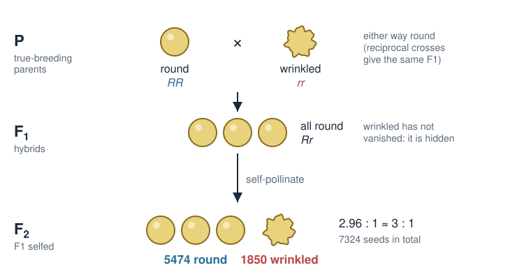
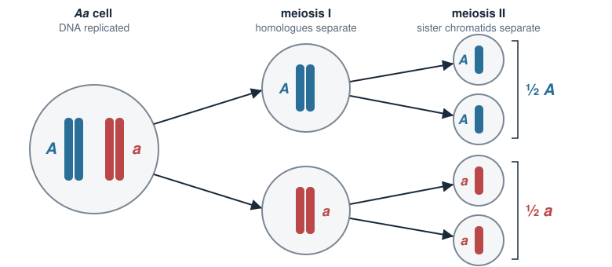
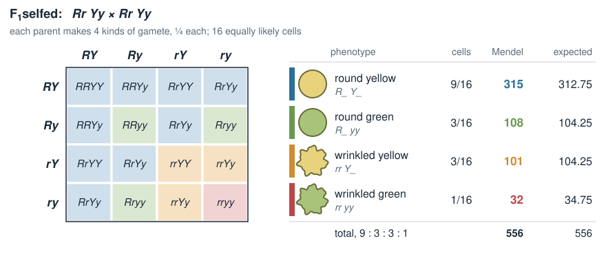
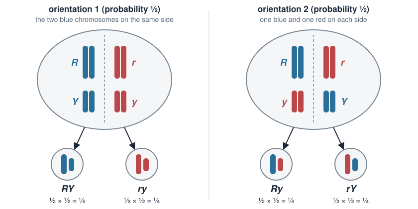
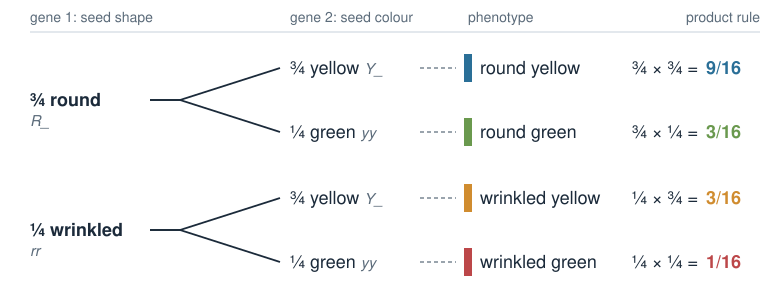

## About this lecture

In the 1850s and 1860s, Gregor Mendel crossed garden peas and **counted** the offspring. From the numbers alone he deduced that inheritance works through discrete **factors** (we now say *genes*), present in pairs, that separate cleanly when gametes form.

- Mendel's **experimental design**: true-breeding lines, controlled crosses, reciprocal crosses, seven clear-cut traits.
- The **monohybrid cross**: P → F~1~ → F~2~, the **3 : 1** phenotype ratio and the **1 : 2 : 1** genotype ratio.
- The **law of segregation**, and why **meiosis** makes it true.
- The **testcross**, to read an unknown genotype.
- The **dihybrid cross** (9 : 3 : 3 : 1), the **law of independent assortment**, and its basis in meiosis.
- Shortcuts for many genes: the **branch-line method**, the **product rule**, and counting $3^n$ genotypes and $2^n$ gametes.

Book: Hartwell, *Genetics: From Genes to Genomes*, Mendel's principles of heredity chapter.

::: notes
This is the foundation of the whole of Part 1. Students have seen Punnett squares at school, so the risk is that they think they already know it. The new things today are the reasoning (how Mendel got from counts to a model), the link to meiosis (why the rules hold), and the shortcuts for several genes. Keep two simplifications in view and name them: complete dominance (the Extensions to Mendel unit relaxes it) and unlinked genes (the Linkage unit in Part 2 relaxes it). Testing whether observed numbers fit a ratio, the chi-square test, is the next unit.
:::

## Why peas? Mendel's experimental design {.smaller}

| Design choice | Why it mattered |
|---|---|
| **True-breeding lines**: each line, when self-fertilised for generations, gave only one form of the trait | Mendel knew exactly what each parent would pass on |
| **Controlled crosses**: remove the anthers of one flower, dust its stigma with pollen from another | He chose both parents; peas normally self-fertilise, so nothing else got in |
| **Reciprocal crosses**: round ♀ × wrinkled ♂ *and* wrinkled ♀ × round ♂ | Same result both ways, so it does not matter which parent gives which form |
| **Either/or traits**: round or wrinkled, never "medium" | Offspring can be sorted into classes and **counted** |
| **Large numbers and several generations** | Ratios become visible above the noise |

Mendel's real innovation was **quantitative**: he counted, and he looked for ratios.

::: notes
The point of this slide is that the design made the answer possible. Before Mendel, the dominant idea was blending inheritance: offspring are an average of the parents, like mixing paint. Blending predicts that variation should disappear over generations, which it does not. Mendel avoided the traps others fell into by starting from pure lines, by controlling pollination, and by counting. The reciprocal crosses showed that the egg and the pollen contribute equally, which is not obvious and is not true for every trait (sex-linked genes in Part 2, mitochondrial genes in Part 5). Keep the emphasis on counting: this is the link to the chi-square test in the next unit and to the R part of today's exercise.
:::

## The seven traits {.smaller}

Mendel studied seven traits. In every case the F~1~ showed only one form (the **dominant** one), and the F~2~ showed both, at about 3 : 1.

| Trait | Dominant | Recessive | F~2~ dominant | F~2~ recessive | Ratio |
|---|---|---|---:|---:|---:|
| Seed shape | round | wrinkled | 5474 | 1850 | 2.96 : 1 |
| Seed colour | yellow | green | 6022 | 2001 | 3.01 : 1 |
| Flower colour | purple | white | 705 | 224 | 3.15 : 1 |
| Pod shape | inflated | constricted | 882 | 299 | 2.95 : 1 |
| Pod colour | green | yellow | 428 | 152 | 2.82 : 1 |
| Flower position | axial | terminal | 651 | 207 | 3.14 : 1 |
| Stem length | tall | dwarf | 787 | 277 | 2.84 : 1 |

None of the ratios is exactly 3 : 1. That is what **random sampling** looks like. Whether 2.82 : 1 is "close enough" is a question for the χ² test, in the next unit.

::: notes
Read the table row by row, quickly. Point out two things. First, "dominant" is a relation between two alleles, not a statement about which form is more common or better; green pods are dominant, while green seeds are recessive. That kills the common misconception that dominant means frequent. Second, the ratios scatter around 3 to 1, and the smaller samples (pod colour, 580 plants) scatter more than the large ones (seed shape, 7324 seeds). That is sampling noise; the demo and the R exercise make it visible, and the next unit gives the test. The numbers are those Mendel published in 1866.
:::

## The monohybrid cross {.smaller}

Follow **one** trait through three generations.

{width="72%" fig-align="center"}

- **P**: true-breeding round × true-breeding wrinkled.
- **F~1~**: all round. Wrinkled seems to have vanished, but…
- **F~2~** (F~1~ self-fertilised): wrinkled comes back, in about **a quarter** of the seeds.

::: notes
The surprise is the F2. Under blending, wrinkled should be gone for good once it was "diluted" in the F1. Instead it comes back unchanged: the F2 wrinkled seeds are just as wrinkled as the original parent. So the wrinkled factor must have been present in the F1, hidden but intact. A monohybrid cross is a cross between parents that differ in one trait, or, equivalently, a cross between two individuals heterozygous for one gene (the F1 x F1 step). Mendel did the same for all seven traits and got the same pattern each time.
:::

## Mendel's model {.smaller}

Mendel explained the numbers with five ideas. In modern words (recap of the vocabulary from Genetics as information):

1. Each trait is controlled by a **gene**, which comes in alternative forms, **alleles**: *R* (round) and *r* (wrinkled).
2. Each plant carries **two** alleles of the gene, one from each parent. *RR* and *rr* are **homozygous**; *Rr* is **heterozygous**.
3. In *Rr*, the **dominant** allele *R* decides the phenotype; *r* is **recessive**. So *RR* and *Rr* look the same.
4. Each **gamete** carries **one** allele, chosen at random: an *Rr* plant makes ½ *R* and ½ *r* gametes.
5. Fertilisation combines gametes **at random**.

The **genotype** is the pair of alleles (*Rr*). The **phenotype** is what you see (round).

::: notes
These five points are the whole model; everything else today follows from them. Point 4 is the key one and gets its own name on the next slides: the law of segregation. Point 5 is what makes the Punnett square work: each cell is equally likely because gametes meet at random. Stress the notation: italics for alleles and genotypes, upper case for the dominant allele, the same letter for both alleles of one gene. R_ (R blank) means "at least one R", that is RR or Rr, and is the usual shorthand for the dominant phenotype.
:::

## The Punnett square: 1 : 2 : 1 and 3 : 1 {.smaller}

:::: {.columns}
::: {.column width="42%"}

*Rr* × *Rr*:

|   | ½ *R* | ½ *r* |
|---|---|---|
| **½ *R*** | *RR* | *Rr* |
| **½ *r*** | *Rr* | *rr* |

:::
::: {.column width="58%"}

Four equally likely cells, each with probability ½ × ½ = ¼:

- **Genotypes**: ¼ *RR* : ½ *Rr* : ¼ *rr*, a **1 : 2 : 1** ratio.
- **Phenotypes**: ¾ round (*R\_*) : ¼ wrinkled (*rr*), a **3 : 1** ratio.

Mendel: 7324 seeds → expected 5493 round : 1831 wrinkled. Observed **5474 : 1850**.

:::
::::

The 3 : 1 ratio is a 1 : 2 : 1 ratio in disguise: dominance merges *RR* and *Rr* into one phenotype.

::: notes
Work through the square on the board. Rows and columns are the gametes of the two parents, each with its frequency; a cell is one fertilisation and its probability is the product of the two gamete frequencies. Because Rr appears in two cells, the genotype ratio is 1:2:1. Then collapse it by phenotype: RR and Rr are both round, so 1 + 2 = 3 round to 1 wrinkled. The expected numbers are 7324 x 3/4 = 5493 and 7324 x 1/4 = 1831; Mendel was off by 19 in each class. Ask the room: is 19 out of 7324 suspicious? We cannot answer without a measure of how big chance deviations usually are, which is what the chi-square test gives in the next unit.
:::

## Checking the 1 : 2 among the dominant F~2~ {.smaller}

The model makes a **prediction** you can test: among the round F~2~ plants, ⅓ should be *RR* and ⅔ should be *Rr*.

Mendel tested it by **selfing** the F~2~ plants and looking at their offspring (the F~3~):

| F~2~ round plant | Its selfed offspring | Expected share | Mendel's count |
|---|---|---|---:|
| *RR* | all round (breeds true) | ⅓ | 193 |
| *Rr* | round and wrinkled, 3 : 1 | ⅔ | 372 |

193 : 372 is **1 : 1.93**, close to the predicted 1 : 2 among 565 plants.

The wrinkled F~2~ plants (*rr*) always bred true, as the model says they must.

::: notes
This is good science: the model was built to explain the 3 to 1 in the F2, and here it predicts something new, the hidden 1 to 2 split among plants that all look the same. Why one third and two thirds and not one quarter and one half? Because we have already removed the rr quarter: among the three quarters that are round, RR is 1/4 out of 3/4, that is 1/3. This conditional reasoning comes back in the pedigree unit, where an unaffected sibling of a cystic fibrosis patient has a 2/3 chance of being a carrier.
:::

## The law of segregation, explained by meiosis {.smaller}

> **Law of segregation.** The two alleles of a gene separate (segregate) during gamete formation, so each gamete gets **one** of them, with equal probability.

{width="70%" fig-align="center"}

The two alleles sit on the two **homologous chromosomes**. In **meiosis I** the homologues go to opposite poles, so an *Aa* cell gives ½ *A* and ½ *a* gametes.

::: notes
Mendel knew nothing about chromosomes; his law was an inference from counts. About 35 years later Sutton and Boveri noticed that chromosomes in meiosis behave exactly like Mendel's factors: they come in pairs, the pairs separate, and each gamete gets one of each pair. That is the chromosome theory of inheritance, which is the next block of the course. Walk through the figure: the A allele is on one homologue (blue), a on the other (red). After DNA replication each homologue is two sister chromatids. Meiosis I separates the homologues, meiosis II the sister chromatids. Four gametes, two A and two a. Half and half is not a statistical tendency of the cell; it is built into the mechanics.
:::

## The testcross {.smaller}

A round plant can be *RR* or *Rr*. How do you tell them apart? Cross it to the **homozygous recessive** (*rr*):

| Unknown parent | × *rr* gives | Offspring |
|---|---|---|
| *RR* | all *Rr* | **all round** |
| *Rr* | ½ *Rr*, ½ *rr* | **1 round : 1 wrinkled** |

The *rr* parent only gives *r* gametes, so it **hides nothing**: each offspring's phenotype shows directly which allele came from the unknown parent.

A single wrinkled offspring proves that the unknown parent is *Rr*. Many round offspring and no wrinkled ones make *RR* likely, but never certain: with *n* offspring from an *Rr* parent, the chance that all are round is (½)^*n*^.

::: notes
The testcross is the workhorse of genetic analysis in plants, flies and mice. The trick is that the tester contributes only recessive alleles, so the offspring's phenotypes are a direct readout of the gametes of the unknown parent. That is why testcross ratios are so clean: 1:1 for one gene, 1:1:1:1 for two unlinked genes. We will use exactly this logic in Part 2 to measure recombination: a testcross counts the gamete types directly. Note the asymmetry: one recessive offspring proves heterozygosity, but all-dominant offspring only make homozygosity likely. With 5 offspring the chance of no wrinkled ones from an Rr parent is 1/32, about 3 percent.
:::

## The dihybrid cross {.smaller}

Now follow **two** traits at once: seed shape (*R*/*r*) and seed colour (*Y* yellow / *y* green).

P: *RR YY* (round yellow) × *rr yy* (wrinkled green) → F~1~: all *Rr Yy* (round yellow) → selfed:

{width="78%" fig-align="center"}

Mendel's 556 F~2~ seeds: **315 : 108 : 101 : 32**, close to **9 : 3 : 3 : 1**.

::: notes
A dihybrid is heterozygous for two genes. Mendel asked whether the two traits are inherited as a package (round always going with yellow, as in the parent) or separately. If they travelled together, the F1 would make only RY and ry gametes and the F2 would be 3 round yellow to 1 wrinkled green, with no new combinations. Instead he saw four classes, including two new combinations (round green, wrinkled yellow) that neither P parent had. The Punnett square has 16 equally likely cells because each F1 makes 4 gamete types in equal proportions. The expected counts are 556 x 9/16 = 312.75 and so on; Mendel's numbers fit very well.
:::

## Each gene on its own is still 3 : 1 {.smaller}

Collapse Mendel's dihybrid counts to one trait at a time:

| | | | Ratio |
|---|---|---|---|
| **Shape** | round 315 + 108 = **423** | wrinkled 101 + 32 = **133** | 3.18 : 1 |
| **Colour** | yellow 315 + 101 = **416** | green 108 + 32 = **140** | 2.97 : 1 |

So 9 : 3 : 3 : 1 is just **(3 : 1) × (3 : 1)**: ¾ × ¾ = 9/16, ¾ × ¼ = 3/16, ¼ × ¾ = 3/16, ¼ × ¼ = 1/16.

> **Law of independent assortment.** Alleles of different genes go into gametes **independently** of each other. An *Rr Yy* plant makes *RY*, *Ry*, *rY* and *ry* gametes, ¼ each.

::: notes
This is the key insight: the dihybrid ratio is the product of two monohybrid ratios. Whether a seed is round tells you nothing about whether it is yellow. That is exactly what "independent" means in probability, and it is why we can multiply: P(round and yellow) = P(round) x P(yellow). The product rule gets a proper treatment in the next unit, but it is already doing all the work here. Independent assortment is a statement about gametes: all four combinations are equally frequent. The 9:3:3:1 among offspring is a consequence of that plus random fertilisation plus dominance.
:::

## Independent assortment, explained by meiosis {.smaller}

{width="68%" fig-align="center"}

Genes on **different chromosomes**: at metaphase I each homologue pair lines up **independently** of the other. Both orientations are equally likely, so the four gamete types are equally frequent: ¼ *RY*, ¼ *ry*, ¼ *Ry*, ¼ *rY*.

**Warning:** this needs the two genes to be on different chromosomes (or far apart on the same one). Genes close together on one chromosome are **linked** and do *not* assort independently. That is Part 2 of the course.

::: notes
Walk through the two panels. Blue chromosomes came from the round yellow parent, red ones from the wrinkled green parent. In orientation 1 both blue chromosomes go to the same pole, giving the parental combinations RY and ry. In orientation 2 they go to opposite poles, giving the new combinations Ry and rY. Each cell does one or the other, with equal probability, and across the millions of meioses in a plant the four types come out equal. This is the chromosomal reason for Mendel's second law. Mendel was lucky, or careful: his seven traits behave as if unlinked. Peas have seven chromosome pairs, but some of his genes do share a chromosome; they are far enough apart that crossing over makes them assort almost independently. The full story of linkage and crossing over is Part 2.
:::

## The branch-line method {.smaller}

A Punnett square for two genes has 16 cells; for three genes, 64. The **branch-line** (forked-line) method is faster: treat each gene **separately**, then **multiply** along each branch.

{width="68%" fig-align="center"}

It works because the genes assort independently: each gene contributes its own ratio, and the **product rule** combines them.

::: notes
Draw this on the board from left to right. The first column is the monohybrid result for seed shape, three quarters and one quarter. Each branch then splits by seed colour, again three quarters and one quarter. Multiply along each path to get the probability of that combination. Four paths, four phenotypes, the same 9:3:3:1 as the 16-cell square. The method scales: a third gene adds a third column and doubles the number of paths. It also works for genotypes (1/4, 1/2, 1/4 on each branch) and for crosses where each gene has a different parental genotype, for example Aa x aa for one gene and Bb x Bb for the other.
:::

## Many genes: the product rule {.smaller}

*Aa Bb Cc* × *Aa Bb Cc*, three unlinked genes, complete dominance. Treat each gene as its own monohybrid cross, then multiply.

| Question | Per gene | Answer |
|---|---|---|
| P(*aa bb cc*) | ¼ · ¼ · ¼ | **1/64** |
| P(*A\_ B\_ C\_*), dominant for all three | ¾ · ¾ · ¾ | **27/64** |
| P(*Aa Bb Cc*), heterozygous for all three | ½ · ½ · ½ | **1/8** |
| P(*A\_ bb C\_*) | ¾ · ¼ · ¾ | **9/64** |
| P(*AA bb Cc*) | ¼ · ¼ · ½ | **1/32** |

Phenotype ratio: (3 : 1)^3^ = **27 : 9 : 9 : 9 : 3 : 3 : 3 : 1**.

The Punnett square would have 8 × 8 = 64 cells. The product rule needs three fractions.

::: notes
This is the skill students should leave with: break a multi-gene cross into single-gene crosses, answer each with the 1:2:1 or 3:1 they already know, and multiply. Do one row slowly on the board, then let them do the rest. The phenotype ratio 27:9:9:9:3:3:3:1 comes from expanding (3+1) cubed: one class dominant for all three (27), three classes recessive for exactly one gene (9 each), three classes recessive for exactly two (3 each), one class recessive for all (1). The products only hold if the genes are unlinked; that assumption is easy to forget.
:::

## Counting genotypes and gametes {.smaller}

For an individual heterozygous for *n* unlinked genes, crossed to another one like it:

| *n* genes | Gamete types per parent | Punnett cells | Genotypes | Phenotypes (complete dominance) |
|---:|---:|---:|---:|---:|
| 1 | 2 | 4 | 3 | 2 |
| 2 | 4 | 16 | 9 | 4 |
| 3 | 8 | 64 | 27 | 8 |
| *n* | **2^*n*^** | 4^*n*^ | **3^*n*^** | 2^*n*^ |

- **2^*n*^ gametes**: each gene independently gives one of 2 alleles.
- **3^*n*^ genotypes**: each gene independently gives one of 3 genotypes (*AA*, *Aa*, *aa*).
- Smallest class (homozygous recessive for all): (¼)^*n*^. With *n* = 10, that is about 1 in a million.

::: notes
The pattern is the multiplication principle again: independent choices multiply. Gametes: two choices per gene, so 2 to the n. Genotypes in the offspring: three per gene, so 3 to the n. The last bullet explains why classical geneticists rarely tried to recover a plant recessive for many genes at once from a single cross: with ten genes you would need about a million offspring to expect one. It is also a first hint of why traits controlled by many genes look continuous rather than falling into neat classes: that is the complex traits unit at the end of the course.
:::

## Try it: Punnett squares and sampling noise {.smaller}

```{=html}
<link rel="stylesheet" href="../demos/dist/demo.css">
<div data-demo="punnett" data-preset="di" data-n="16"></div>
<script src="../demos/dist/punnett.js"></script>
```

::: notes
Interactive demo. It starts on the dihybrid F1 x F1 with 16 offspring. Left: the gametes of each parent with their frequencies, and the Punnett square collapsed to the distinct gametes, coloured by phenotype. Right: the genotype ratio (1:2:1:2:4:2:1:2:1) and the phenotype ratio (9:3:3:1), with fractions, then simulated offspring as filled bars next to the expected counts as dashed bars. Suggested tour: at N = 16, seed 1 gives 8 : 3 : 4 : 1 against an expected 9 : 3 : 3 : 1; press "draw again" a few times (6 : 5 : 4 : 1 on seed 3). Switch to N = 1000: 553 : 200 : 195 : 52 against 562.5 : 187.5 : 187.5 : 62.5; the bars hug the expected ones. Then click "testcross": 1:1. Then set parent 2 to AA by hand: the square collapses to one row and all offspring are dominant, which is what a testcross of an RR plant would show from the other side. Finally "dihybrid testcross": four equal classes, the clean readout of the four gamete types. The point to land: even with a perfect 9:3:3:1 mechanism, a small sample rarely looks like 9:3:3:1. How far off is too far is the chi-square test, next unit.
:::

## Mendel in humans {.smaller}

Human single-gene diseases follow the same two laws. Two examples you will look up in the exercise:

| | Cystic fibrosis | Huntington disease |
|---|---|---|
| Gene | *CFTR* | *HTT* |
| Inheritance | autosomal **recessive** | autosomal **dominant** |
| Affected genotype | *aa* (two faulty alleles) | *Aa* (one faulty allele is enough) |
| Typical family | two **unaffected carrier** parents, *Aa* × *Aa* | one affected parent, *Aa* × *aa* |
| Risk for each child | ¼ (the monohybrid cross) | ½ (a testcross!) |

An *Aa* × *Aa* couple has a ¼ chance for each child, **independently**: having one affected child does not change the risk for the next.

::: notes
Bring the abstract crosses back to people. Cystic fibrosis: carriers are healthy, so the disease often appears "out of nowhere" in a family; the parents are both Aa and the cross is exactly Mendel's F1 x F1. Huntington disease: one affected parent (Aa) and one unaffected (aa) is formally a testcross, so each child has a 1 in 2 risk. Stress the independence point: each child is a new fertilisation, like a new draw in the simulation; the coin has no memory. Families often believe that "one in four" means that after one affected child the next three are safe. Pedigree analysis, including how to infer the mode of inheritance from a family tree, is its own unit later in Part 1.
:::

## What we have simplified {.smaller}

Today's ratios rest on assumptions. Each one is relaxed later in the course:

| Assumption today | What really happens | Where |
|---|---|---|
| **Complete dominance** | incomplete dominance, codominance, multiple alleles | Extensions to Mendel |
| One gene → one trait, every genotype viable | epistasis, lethal alleles, penetrance | Extensions to Mendel |
| Genes **assort independently** | **linked** genes on one chromosome stay together | Linkage (Part 2) |
| Observed ≈ expected | random **sampling noise**; is the deviation too big? | Probability & the χ² test (next) |

::: notes
Being honest about the simplifications is part of understanding the laws. Nothing on this slide breaks Mendel's laws in the strict sense: segregation holds for every nuclear gene in a normal meiosis. What changes is how genotypes map to phenotypes (dominance, epistasis, lethals) and whether two genes are independent (linkage). The last row is the bridge to the next unit: we have been saying "close to 3:1" all lecture; next time we make "close" precise.
:::

## Summary {.smaller}

| Concept | Key fact |
|---|---|
| True-breeding line | always gives the same phenotype when selfed (homozygous) |
| Monohybrid F~1~ × F~1~ | *Aa* × *Aa* → 1 *AA* : 2 *Aa* : 1 *aa*; 3 dominant : 1 recessive |
| Law of segregation | the two alleles separate into different gametes, ½ each; **homologues separate in meiosis I** |
| Testcross | × homozygous recessive; offspring phenotypes read off the unknown parent's gametes (1 : 1 if *Aa*) |
| Dihybrid F~1~ × F~1~ | *AaBb* × *AaBb* → 9 : 3 : 3 : 1 = (3 : 1) × (3 : 1) |
| Law of independent assortment | alleles of different genes enter gametes independently; **homologue pairs orient independently at metaphase I** |
| Branch-line / product rule | solve each gene separately, multiply along branches |
| Counting | 2^*n*^ gamete types, 3^*n*^ genotypes, (¼)^*n*^ fully recessive |
| Mendel's numbers | 5474 : 1850 (2.96 : 1); 315 : 108 : 101 : 32 (≈ 9 : 3 : 3 : 1) |

::: notes
The summary is the revision sheet. If they remember only two things: the two laws, each with its meiotic reason, and the habit of breaking multi-gene crosses into single genes and multiplying. Remind them that both laws are statements about gametes, and that the offspring ratios follow from the gametes, random fertilisation and the dominance relationships.
:::

## Where this leads

- **Next: Probability & the χ² test.** We said "close to 3 : 1" many times. The χ² goodness-of-fit test (`chisq.test` in R) tells us whether a deviation like 5474 : 1850 is ordinary sampling noise.
- **Extensions to Mendel.** Real alleles are not always completely dominant, and genes interact (epistasis), giving modified ratios such as 9 : 7 and 12 : 3 : 1.
- **Pedigree analysis.** Applying segregation to human families, where we cannot choose the crosses.
- **Part 2: Linkage.** Independent assortment fails for genes close together on the same chromosome, and that failure is how genes are mapped.

::: notes
Point forward. The exercise today has three parts beyond the paper problems: the Punnett demo, looking up cystic fibrosis and Huntington disease in OMIM, and writing a small R function that simulates a cross with sample(). That simulation is the start of a thread: in the next unit we use the same simulated crosses to see what the chi-square statistic looks like when the null hypothesis is true.
:::
