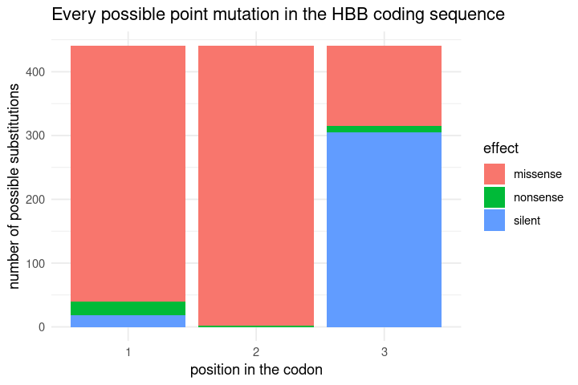

## Goal

By the end of this exercise you should be able to:

- use a table as a **lookup**: turn the genetic code into a **named vector** and translate codons with it;
- write small functions that cut a sequence into codons, translate it, make a point mutation, and **classify** the mutation as silent, missense or nonsense;
- apply a function to every row of a table with `rowwise()`, and summarise the effects of all possible point mutations in a gene.

## Before you start

This page builds on B1 of the [Exercise](exercise.qmd) and on the `str_sub()` work in the [DNA recap R exercise](../dna-recap/exercise-r.qmd). You need the packages readr, dplyr, stringr, tidyr and ggplot2. Download two files and save them in a `data/` folder of your R project:

- [genetic_code.csv](data/genetic_code.csv): the standard genetic code, 64 codons (DNA letters), with three-letter (`aa`) and one-letter (`aa1`) amino acids. It was typed in and checked against NCBI translation table 1 (see [data/README.md](data/README.md)).
- [HBB_NM_000518.5.fasta](data/HBB_NM_000518.5.fasta): the *HBB* mRNA, the same file as in the DNA recap.

## Tasks

**New idiom: a named vector as a lookup table.** A vector can have **names**, set with [`setNames(values, names)`](https://rdrr.io/r/stats/setNames.html). Then `x["name"]` returns the value with that name, and `x[c("n1", "n2", "n1")]` looks up many names at once, in order, with repeats. With codons as names and amino acids as values, translating a gene is a single lookup. (`x[["name"]]`, with double brackets, returns the bare value without its name.)

```r
library(readr)
library(dplyr)
library(stringr)
library(ggplot2)
```

**R1. (the genetic code as a named vector)** Read the code table, make a named vector `code`, and look up a few codons. Then count how many codons each amino acid has. Which amino acids have only one codon, and how many stop codons are there?

```r
code_tbl <- read_csv("data/genetic_code.csv")
code_tbl
code <- setNames(code_tbl$aa, code_tbl$codon)    # names are codons, values amino acids
code["GAG"]
code[c("ATG", "TGG", "TAA", "GTG")]
code_tbl |> count(aa, sort = TRUE) |> print(n = 21)
```

**R2. (translate)** Write `codons()`, which cuts a sequence into triplets with `str_sub()` and a vector of start positions, and `translate()`, which looks the triplets up in `code`. Translate the *HBB* coding sequence (positions 51–494 of the mRNA). How many codons are there, and what are the first ten and last three amino acids? Then translate to one-letter code with a second named vector, and compare with the UniProt sequence of β-globin ([P68871](https://www.uniprot.org/uniprotkb/P68871/entry)), which starts `MVHLTPEEKSAVTALWGKV`.

```r
codons <- function(dna) {
  starts <- seq(1, str_length(dna) - 2, by = 3)
  str_sub(dna, starts, starts + 2)
}
translate <- function(dna) {
  unname(code[codons(dna)])
}
codons("ATGGTGCATCTG")
translate("ATGGTGCATCTG")

lines <- readLines("data/HBB_NM_000518.5.fasta")
hbb <- str_c(lines[-1], collapse = "")
cds <- str_sub(hbb, 51, 494)
protein <- translate(cds)
length(protein)
head(protein, 10)
tail(protein, 3)
code1 <- setNames(code_tbl$aa1, code_tbl$codon)
str_c(code1[codons(cds)], collapse = "")
```

**R3. (make a point mutation)** Write `point_mutation(dna, pos, new)`, which returns the sequence with the base at `pos` replaced. Make HbS (c.20A>T) and HbC (c.19G>A), translate them, and find which amino acid changed with [`which()`](https://rdrr.io/r/base/which.html).

```r
point_mutation <- function(dna, pos, new) {
  str_sub(dna, pos, pos) <- new
  dna
}
hbs <- point_mutation(cds, 20, "T")      # c.20A>T
translate(hbs)[1:9]
which(translate(hbs) != protein)
hbc <- point_mutation(cds, 19, "A")      # c.19G>A
translate(hbc)[7]
```

**R4. (classify a mutation)** Write `classify(dna, pos, new)`, which finds the codon that contains `pos`, compares the old and new amino acid, and returns `"silent"`, `"missense"`, `"nonsense"` or `"stop-loss"`. The first base of the codon is `(pos - 1) %/% 3 * 3 + 1` (`%/%` is integer division). Then classify the changes from B1 of the exercise, plus two real *HBB* nonsense alleles from ClinVar (c.118C>T and c.114G>A). Because `classify()` handles one mutation at a time, use [`rowwise()`](https://dplyr.tidyverse.org/reference/rowwise.html) so that `mutate()` calls it once per row; the `ref_ok` column checks that the reference base is really there.

```r
classify <- function(dna, pos, new) {
  first <- (pos - 1) %/% 3 * 3 + 1             # first base of the codon that pos is in
  old_codon <- str_sub(dna, first, first + 2)
  new_codon <- str_sub(point_mutation(dna, pos, new), first, first + 2)
  old_aa <- code[[old_codon]]
  new_aa <- code[[new_codon]]
  if (old_aa == new_aa) {
    "silent"
  } else if (new_aa == "Stop") {
    "nonsense"
  } else if (old_aa == "Stop") {
    "stop-loss"
  } else {
    "missense"
  }
}
classify(cds, 20, "T")

variants <- tibble(
  name = c("HbS", "HbC", "codon 39 nonsense", "c.114G>A", "c.21G>A"),
  pos  = c(20, 19, 118, 114, 21),
  ref  = c("A", "G", "C", "G", "G"),
  alt  = c("T", "A", "T", "A", "A")
)
variants |>
  rowwise() |>
  mutate(ref_ok = str_sub(cds, pos, pos) == ref,
         codon  = (pos - 1) %/% 3 + 1,
         effect = classify(cds, pos, alt)) |>
  ungroup()
```

**R5. (every possible point mutation)** How likely is a random point mutation in *HBB* to be silent, missense or nonsense? Make a table of **every** possible substitution in codons 1–147 (positions 1–441, leaving out the stop codon): each position × each of the three other bases. [`tidyr::expand_grid()`](https://tidyr.tidyverse.org/reference/expand_grid.html) makes all combinations of its arguments. Classify them all, count the effects, and plot them by position within the codon.

```r
all_snvs <- tidyr::expand_grid(pos = 1:441, alt = c("A", "C", "G", "T")) |>
  mutate(ref = str_sub(cds, pos, pos)) |>
  filter(alt != ref) |>
  rowwise() |>
  mutate(effect = classify(cds, pos, alt)) |>
  ungroup() |>
  mutate(codon_position = (pos - 1) %% 3 + 1)
nrow(all_snvs)
all_snvs |> count(effect) |> mutate(fraction = n / sum(n))
all_snvs |> count(codon_position, effect) |> print(n = 20)

ggplot(all_snvs, aes(x = factor(codon_position), fill = effect)) +
  geom_bar() +
  labs(x = "position in the codon", y = "number of possible substitutions",
       fill = "effect", title = "Every possible point mutation in the HBB coding sequence") +
  theme_minimal()
```

a. Why are there 1323 rows?
b. Which codon position gives most silent changes, and why? Which position gives (almost) no silent changes?
c. Roughly what fraction of random point mutations in a coding sequence change the protein?

## Solutions

::: {.callout-note collapse="true" title="Solutions: In R"}

All output below is from `Rscript --vanilla` run in the unit folder (messages from loading packages left out).

**R1.**

```
Rows: 64 Columns: 3
── Column specification ────────────────────────────────────────────────────────
Delimiter: ","
chr (3): codon, aa, aa1

ℹ Use `spec()` to retrieve the full column specification for this data.
ℹ Specify the column types or set `show_col_types = FALSE` to quiet this message.
# A tibble: 64 × 3
   codon aa    aa1
   <chr> <chr> <chr>
 1 TTT   Phe   F
 2 TTC   Phe   F
 3 TTA   Leu   L
 4 TTG   Leu   L
 5 TCT   Ser   S
 6 TCC   Ser   S
 7 TCA   Ser   S
 8 TCG   Ser   S
 9 TAT   Tyr   Y
10 TAC   Tyr   Y
# ℹ 54 more rows
  GAG
"Glu"
   ATG    TGG    TAA    GTG
 "Met"  "Trp" "Stop"  "Val"
# A tibble: 21 × 2
   aa        n
   <chr> <int>
 1 Arg       6
 2 Leu       6
 3 Ser       6
 4 Ala       4
 5 Gly       4
 6 Pro       4
 7 Thr       4
 8 Val       4
 9 Ile       3
10 Stop      3
11 Asn       2
12 Asp       2
13 Cys       2
14 Gln       2
15 Glu       2
16 His       2
17 Lys       2
18 Phe       2
19 Tyr       2
20 Met       1
21 Trp       1
```

Only **Met** (ATG) and **Trp** (TGG) have a single codon; there are **3 stop codons** (TAA, TAG, TGA). Arg, Leu and Ser have six codons each. 61 codons for 20 amino acids: the code is **degenerate**.

**R2.**

```
[1] "ATG" "GTG" "CAT" "CTG"
[1] "Met" "Val" "His" "Leu"
[1] 148
 [1] "Met" "Val" "His" "Leu" "Thr" "Pro" "Glu" "Glu" "Lys" "Ser"
[1] "Tyr"  "His"  "Stop"
[1] "MVHLTPEEKSAVTALWGKVNVDEVGGEALGRLLVVYPWTQRFFESFGDLSTPDAVMGNPKVKAHGKKVLGAFSDGLAHLDNLKGTFATLSELHCDKLHVDPENFRLLGNVLVCVLAHHFGKEFTPPVQAAYQKVVAGVANALAHKYH*"
```

148 codons: 147 amino acids plus the stop codon. The one-letter translation is identical to UniProt P68871 (147 amino acids, ending `…ALAHKYH`), with `*` for the stop.

**R3.**

```
[1] "Met" "Val" "His" "Leu" "Thr" "Pro" "Val" "Glu" "Lys"
[1] 7
[1] "Lys"
```

HbS changes only amino acid **7** (Glu → Val), and HbC makes amino acid 7 **Lys**: p.Glu7Val and p.Glu7Lys.

**R4.**

```
[1] "missense"
# A tibble: 5 × 7
  name                pos ref   alt   ref_ok codon effect
  <chr>             <dbl> <chr> <chr> <lgl>  <dbl> <chr>
1 HbS                  20 A     T     TRUE       7 missense
2 HbC                  19 G     A     TRUE       7 missense
3 codon 39 nonsense   118 C     T     TRUE      40 nonsense
4 c.114G>A            114 G     A     TRUE      38 nonsense
5 c.21G>A              21 G     A     TRUE       7 silent
```

All reference bases match. c.118C>T turns codon 40 (CAG, Gln) into TAG: p.Gln40Ter, "codon 39" in the traditional numbering, a common β^0^-thalassaemia allele. c.114G>A turns codon 38 (TGG, Trp) into TGA: p.Trp38Ter. Both are listed as pathogenic nonsense variants in ClinVar (rs11549407 and rs33974936).

**R5.**

```
[1] 1323
# A tibble: 3 × 3
  effect       n fraction
  <chr>    <int>    <dbl>
1 missense   966   0.730
2 nonsense    34   0.0257
3 silent     323   0.244
# A tibble: 8 × 3
  codon_position effect       n
           <dbl> <chr>    <int>
1              1 missense   401
2              1 nonsense    22
3              1 silent      18
4              2 missense   439
5              2 nonsense     2
6              3 missense   126
7              3 nonsense    10
8              3 silent     305
```

{width="75%" fig-align="center"}

a. 441 positions × 3 alternative bases = **1323** possible substitutions.
b. The **third** position gives most silent changes (305 of 441): the code is degenerate mainly in the third base (for example GAG and GAA are both Glu; four-codon families such as Ala GCN accept any third base). The **second** position gives **no** silent changes here: no two codons that differ only in their middle base code for the same amino acid. The first position gives a few (18), from the six-codon amino acids Leu (CTN/TTA, TTG) and Arg (CGN/AGA, AGG).
c. About **75 %** (73 % missense + 2.6 % nonsense) change the protein; about a quarter are silent. That is why most new mutations in coding sequence are at least potentially harmful, and why the third codon position varies most between species.
:::

## Where this leads

`codons()` and `translate()` come back in Part 4, where you scan all six reading frames of a sequence for **open reading frames**. The named-vector lookup is a small version of a **join**: in Part 4 you join whole tables of variants and population frequencies with `left_join()`. In the next unit, **Gene expression (recap)**, you read a table of exon coordinates and summarise it with `group_by()` and `summarise()`.
