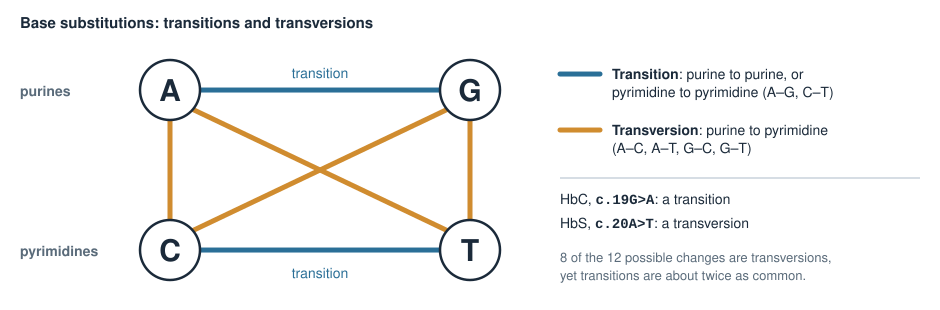
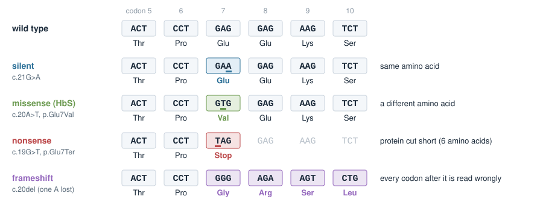
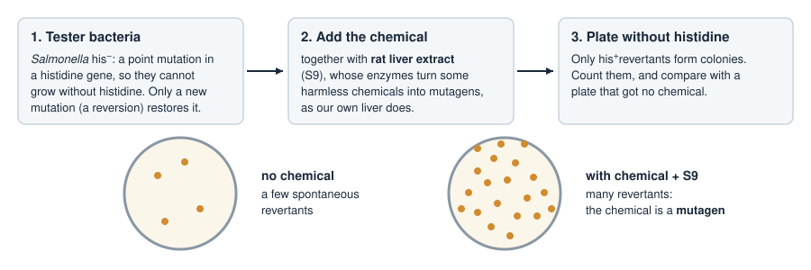
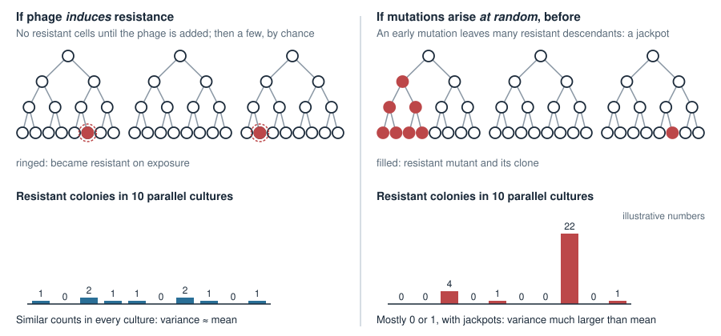
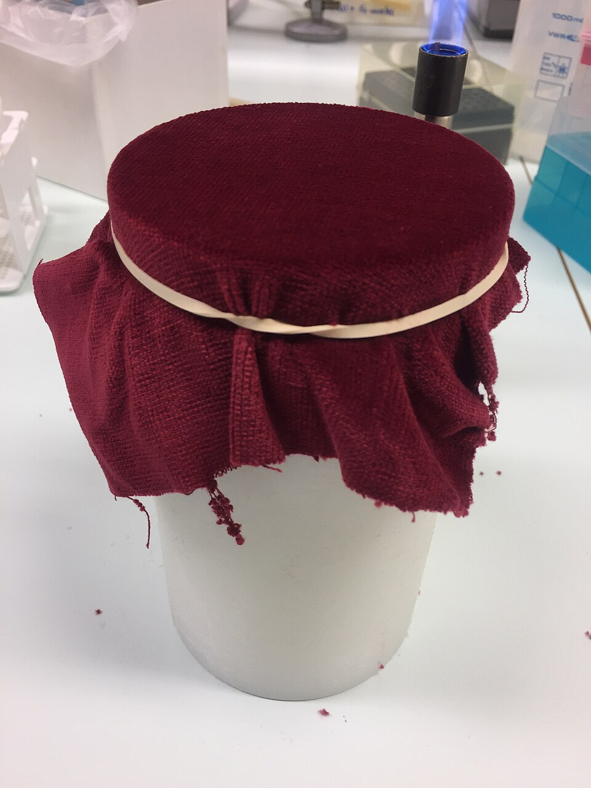
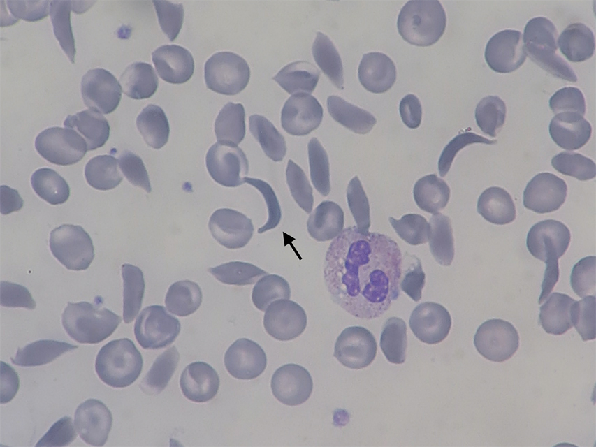
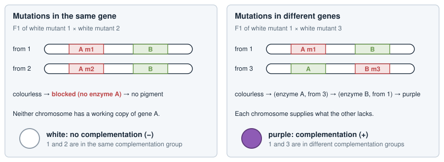
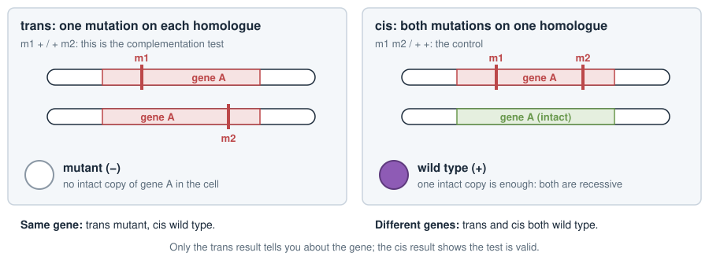
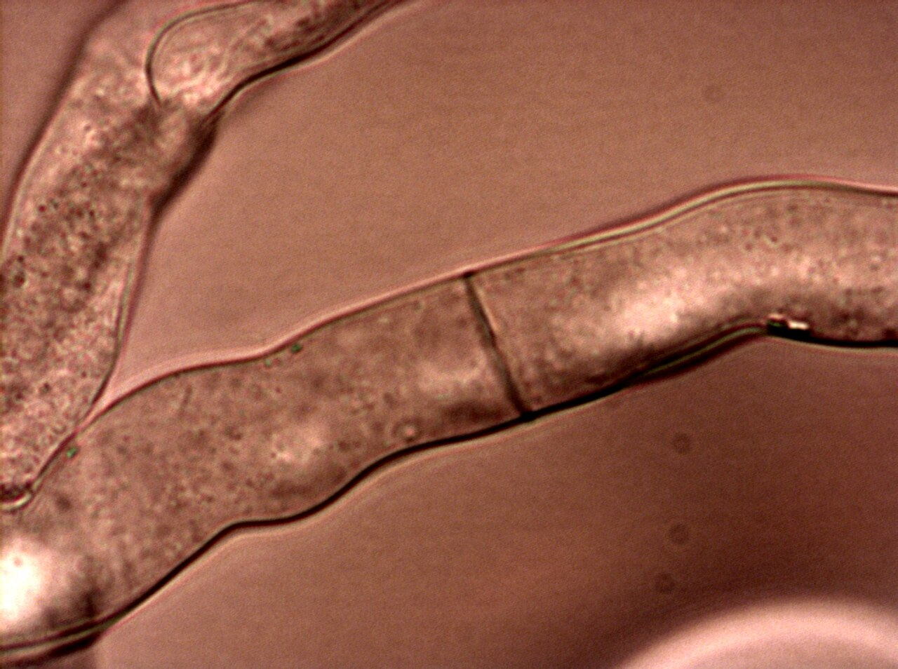
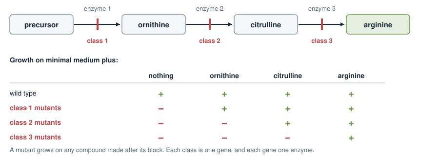

## About this lecture

Every allele you met in Parts 1 and 2 (wrinkled, white, HbS, the cystic fibrosis allele) began as a **mutation**: a heritable change in the DNA sequence. Mutations are the raw material of evolution, the cause of genetic disease, and the geneticist's main **tool**: we learn what a gene does by breaking it.

- **Kinds of mutation**: transitions and transversions; silent, missense, nonsense and frameshift, and how to classify a change by hand.
- **Where mutations come from**: spontaneous errors and damage, and induced mutation by mutagens. The **Ames test**.
- **Mutations are random**: the Luria–Delbrück fluctuation test, worked through with numbers, and replica plating.
- **DNA repair**, in brief.
- **Loss- and gain-of-function** alleles, and what they mean for dominance.
- **The complementation test**: are two mutations in the same gene? The cis–trans test, and common mistakes.
- **One gene, one enzyme**: Beadle and Tatum's screen.

Book: Hartwell, *Genetics: From Genes to Genomes*, Anatomy and function of a gene: dissection through mutation chapter.

::: notes
This is a full unit, not a recap. The previous unit ended with replication errors and proofreading; this unit asks what happens when they slip through. Keep two threads visible: the molecular one (what a mutation does to DNA and protein) and the genetic one (how mutants are used to find and count genes). The complementation test is the key piece of genetic logic in the unit, and the demo is about it. Throughout, reuse HBB: students know HbS and HbC from the first unit of the course.
:::

## Mutation: the raw material and the tool {.smaller}

| | |
|---|---|
| **Mutation** | a heritable change in the DNA sequence |
| **Germline** mutation | in a cell that makes gametes: passed on to offspring |
| **Somatic** mutation | in a body cell: passed on to that cell's descendants only (cancer, Part 7) |
| **Wild type** | the common, "standard" allele in a population (*A*, +) |
| **Forward** mutation | wild type → mutant |
| **Reverse** mutation (**reversion**) | mutant → wild type again |

**How often?** In humans about 1 new point mutation per 10^8^ base pairs per generation. With 3 × 10^9^ base pairs in each genome copy, every child carries some 50–100 new point mutations that neither parent had. Most fall outside genes and do nothing.

::: notes
Start with vocabulary, because the rest of the lecture uses it. The germline and somatic distinction matters for inheritance: only germline mutations enter a pedigree. A somatic mutation can still matter a great deal to the individual, as in cancer. The rate is an order-of-magnitude figure from whole-genome sequencing of parent and child trios. Reversions are important for the Ames test later: a test that counts reversions of a known mutation is very sensitive because you know exactly what you are selecting for. Per gene, the rate of new loss-of-function mutations is far higher than per base pair, because many different changes in a gene can break it.
:::

## Kinds of point mutation {.smaller}

{width="80%" fig-align="center"}

- **Substitution**: one base replaced by another. A **transition** keeps the class of base (purine for purine, pyrimidine for pyrimidine); a **transversion** swaps the class.
- **Insertion** or **deletion** (**indel**) of one or more bases.
- Larger changes (deletions of whole genes, inversions, translocations) are Part 5.

::: notes
There are 12 possible substitutions from a given base pair's point of view, 4 transitions and 8 transversions, so if all were equally likely transversions would be twice as common. In real genomes it is the other way round: transitions are about twice as common as transversions. The main reasons are chemistry: deamination of cytosine and of 5-methylcytosine gives C to T transitions, and tautomeric shifts and many mutagens produce transitions. The two HBB alleles from the first unit illustrate both kinds: HbC (c.19G>A) is a transition, HbS (c.20A>T) a transversion.
:::

## What a point mutation does to a protein {.smaller}

{width="75%" fig-align="center"}

**Silent** (synonymous): same amino acid, usually at the third codon position. **Missense**: another amino acid (HbS, HbC). **Nonsense**: a stop codon, so a short protein (*CFTR* p.Gly542Ter, *HBB* p.Gln40Ter). **Frameshift**: an indel that is not a multiple of 3 changes every codon downstream, usually until a stop codon appears.

::: notes
Walk down the rows. The wild type row is HBB codons 5 to 10 in database numbering (counting the start methionine), the same sequence students translated in the first unit. Silent: GAG to GAA is still glutamate, because the code is degenerate. Missense: GAG to GTG is HbS. Nonsense: GAG to TAG would stop the protein after six amino acids; that particular change is an example, but real nonsense alleles of HBB exist, such as codon 39 CAG to TAG (p.Gln40Ter), a common cause of beta-zero thalassaemia in the Mediterranean. In CFTR, G542X is one of the most common nonsense alleles in cystic fibrosis. Frameshift: losing one A changes the reading frame, so every codon after it is different. Silent is not always harmless (it can affect splicing; next unit), and missense can be anything from harmless to devastating, depending on which amino acid changes and where.
:::

## Worked example: classifying a point mutation by hand {.smaller}

**The method**, for a change c.*x*N>M in a coding sequence:

1. **Which codon?** *n* = *x* / 3, rounded **up**. Codon *n* covers c.(3*n*−2) to c.3*n*.
2. **Which position in the codon?** *x* − 3(*n* − 1): 1, 2 or 3.
3. **Read the codon, change the base, look up both** in the genetic code.
4. **Transition or transversion?** Does the base stay in its class (purine A, G; pyrimidine C, T)?
5. **Write the protein change**: p.(old)(*n*)(new), with Ter for stop and = for no change.

| | c.118C>T (*HBB*) | c.26A>T (*HBB*, made-up example) |
|---|---|---|
| codon | 118 / 3 = 39.3 → **codon 40** (c.118–120) | 26 / 3 = 8.7 → **codon 9** (c.25–27) |
| position in codon | 118 − 117 = **1st** | 26 − 24 = **2nd** |
| codon change | **C**AG → **T**AG: Gln → Stop | A**A**G → A**T**G: Lys → Met |
| Ts / Tv | C → T: pyrimidine → pyrimidine, **transition** | A → T: purine → pyrimidine, **transversion** |
| effect, HGVS | **nonsense**, p.Gln40Ter | **missense**, p.Lys9Met |

::: notes
This is the method behind exercise B1 and the R function classify(), so do it slowly on the board. The commonest slip is the codon number: students divide and round down, or forget that c.1 is the A of the start codon, so codon 1 is c.1 to c.3. A check that always works: the last base of codon n is c.3n. The first example is the real beta-zero thalassaemia allele from the database slide later on ("codon 39" in the old numbering, which does not count the start methionine). The second is invented for practice: it is not a known disease allele. The codons come from the HBB coding sequence NM_000518.5 (codon 40 CAG, codon 9 AAG), as translated in the R exercise.
:::

## Where do mutations come from? Spontaneous {.smaller}

Even without any mutagen, DNA changes all the time:

| Source | What happens | Typical result |
|---|---|---|
| **Replication errors** | wrong base inserted, not caught by proofreading or mismatch repair | substitutions; slippage in repeats gives small indels |
| **Depurination** | a purine base falls off the sugar, leaving a gap in the code | any base inserted opposite: substitutions |
| **Deamination** | C loses an amino group and becomes U | C→T transitions |
| **Methyl-C deamination** | 5-methylcytosine becomes T, a normal DNA base, so repair cannot spot it | C→T at CpG sites: **mutation hotspots** |
| **Oxidative damage** | guanine is oxidised to 8-oxoG, which pairs with A | G→T transversions |

**Spontaneous** does not mean "without a cause": it means caused by the cell's own chemistry and copying, not by an outside agent.

::: notes
Each row is chemistry that happens thousands of times per cell per day; repair fixes almost all of it. The methyl-C row is worth dwelling on: in mammals most CpG dinucleotides are methylated, and deamination of 5-methylcytosine gives thymine, which looks like a normal base. Repair can only see a T-G mismatch and has to guess which strand is right. That is why CpG sites mutate roughly ten times faster than other sites and are hotspots in disease genes. Replication slippage in short repeats is the origin of microsatellite length variation (Part 4) and of the trinucleotide repeat expansions behind Huntington disease.
:::

## Induced mutation: mutagens {.smaller}

A **mutagen** raises the mutation rate above the spontaneous rate. Geneticists use them on purpose to make mutants.

| Mutagen | How it acts | Typical mutation |
|---|---|---|
| **Base analogues** (5-bromouracil) | built into DNA in place of T; mispairs with G | transitions |
| **Alkylating agents** (EMS) | add an ethyl group to G; the altered G pairs with T | G:C → A:T transitions |
| **Intercalators** (proflavin, acridines) | slip between stacked bases; the polymerase adds or skips a base | **frameshifts** (+1, −1) |
| **UV light** | joins adjacent pyrimidines into **dimers** | C→T at dipyrimidines; error-prone bypass |
| **Ionising radiation** (X-rays) | breaks the backbone, often both strands | deletions, rearrangements |

Muller (1927) showed that X-rays raise the mutation rate in *Drosophila* by many-fold: the first induced mutations.

::: notes
The table pairs each mutagen with the kind of change it causes, which matters for the experiments later in this part. EMS is the standard mutagen in worm, fly, Arabidopsis and zebrafish screens because it gives mostly point mutations. Proflavin's frameshifts are what Crick and Brenner used to show that the code is read in triplets; that experiment is in the gene expression recap. UV dimers are repaired by nucleotide excision repair; the next slides return to that. Muller's experiment was the start of radiation genetics and won him the Nobel prize in 1946.
:::

## The Ames test: is this chemical a mutagen? {.smaller}

{width="82%" fig-align="center"}

- Counts **reversions** of a known *his*^−^ point mutation, so it detects rare events among billions of cells.
- Different tester strains carry different *his*^−^ mutations (a base substitution, a frameshift), so the test also says **what kind** of mutation a chemical causes.
- Most known **carcinogens** are mutagens in the Ames test: cancer is caused by somatic mutation (Part 7).

::: notes
Bruce Ames developed the test in the 1970s as a cheap screen for chemicals that might cause cancer. The logic is genetic: a his-minus strain cannot grow without histidine, so on a plate without histidine only bacteria that have mutated back to his-plus form colonies. The control plate counts spontaneous revertants; the test plate counts spontaneous plus induced. The liver extract (S9) matters because many carcinogens, such as benzo[a]pyrene in tobacco smoke, are not mutagens until liver enzymes modify them. A strain whose his mutation is a frameshift reverts only with another frameshift nearby, so it detects intercalators; a substitution strain detects base-changing mutagens. The tester strains also carry extra mutations that make them more sensitive, for example weakened excision repair.
:::

## Are mutations random, or a response? {.smaller}

The question in 1943: when *E. coli* is exposed to phage T1, a few colonies of **resistant** bacteria grow. Did the phage **cause** resistance in some cells (an adaptive response), or were resistant **mutants already there**, by chance?

**Luria and Delbrück's idea:** grow many small **parallel cultures**, each from a few cells, and plate each whole culture on phage.

- If phage **induces** resistance: every culture has the same chance per cell, so the number of resistant colonies per culture varies little (**variance ≈ mean**, as for a Poisson distribution).
- If resistance **arises at random, before** exposure: a mutation early in growth leaves a large clone of resistant cells (a **jackpot**), a late one leaves only one or two. The counts **fluctuate** wildly between cultures (**variance ≫ mean**).

::: notes
Set this up as a hypothesis test, like Mendel's crosses. Both hypotheses predict the same average number of resistant colonies; they differ in the variance. The insight was to realise that a mutation's timing during the growth of a culture determines the size of the resistant clone, so random mutation predicts a very skewed distribution. Delbrück worked out the expected distribution mathematically. A control is needed: many samples from one big culture should show only Poisson variation, because they all share the same history.
:::

## The fluctuation test: the result {.smaller}

{width="80%" fig-align="center"}

Luria and Delbrück saw **jackpots**: most cultures had few or no resistant cells, and a few had very many. Samples from **one** large culture, by contrast, varied little. **Resistance mutations arise at random, before selection**: the phage only **selects** them.

::: notes
The bar charts are illustrative, not the real data, but the shape matches what Luria and Delbrueck found: many zeros and a long tail. The control, many samples from one culture, gave counts close to Poisson, ruling out that the fluctuation came from the plating itself. The conclusion is one of the foundations of modern biology: mutation is random with respect to its usefulness; selection acts afterwards. It is the basis of how we think about antibiotic resistance and about resistance of tumours to therapy. Luria and Delbrueck shared the 1969 Nobel prize. The next slide puts numbers on "fluctuate".
:::

## Worked example: mean and variance {.smaller}

The two sets of 10 counts in the figure (illustrative numbers). Variance = sum of squared deviations from the mean ÷ (*n* − 1).

| | counts | mean | sum of squared deviations | variance | variance ÷ mean |
|---|---|---|---|---|---|
| induced | 1 0 2 1 1 0 2 1 0 1 | 9 / 10 = **0.9** | 4.9 | 4.9 / 9 = **0.54** | 0.6 |
| random, before | 0 0 4 0 1 0 0 22 0 1 | 28 / 10 = **2.8** | 423.6 | 423.6 / 9 = **47.1** | **17** |

For the second set: 6 zeros give 6 × (0 − 2.8)^2^ = 47.04; the two 1s give 6.48; the 4 gives 1.44; the 22 alone gives (22 − 2.8)^2^ = **368.64**. One jackpot makes most of the variance.

**Why jackpots?** A resistant cell that arises *k* divisions before plating leaves about 2^*k*^ resistant descendants: 1 if it arose in the last division, 2^10^ = 1024 if it arose ten divisions earlier. Timing, not rate, makes the counts so uneven.

::: notes
This is the calculation students do in exercise B4, with different numbers, so show every step. For a Poisson distribution the variance equals the mean, so the ratio variance over mean is about 1; well below or near 1 is what you expect from sampling one population. A ratio of 17 is far above that. The point to land is that both hypotheses can give similar means; only the spread tells them apart. The 2 to the k argument is the intuition Delbrueck turned into a full distribution: early mutations are rare (there are few cells early on) but each leaves a huge clone; late mutations are common but each leaves only a cell or two. The numbers are the illustrative ones from the figure, not Luria and Delbrueck's data.
:::

## Replica plating: seeing the mutants before selection {.smaller}

:::: {.columns}
::: {.column width="34%"}
{width="88%" fig-align="center"}
[Photo: Pilarbini, CC BY-SA 4.0, via Wikimedia Commons](https://commons.wikimedia.org/wiki/File:Sterile_velvet_on_a_block.jpg){.photo-credit}
:::
::: {.column width="66%"}
**Lederberg and Lederberg (1952)** made the same point without any statistics:

1. Grow colonies on a **master plate** with no phage.
2. Press a **sterile velvet** on it: each colony leaves a few cells on the fibres, in the same pattern.
3. Press the velvet on a **phage plate**. Only resistant cells grow; note the positions.
4. Go back to the **master plate**, which has **never seen phage**. Pick the colonies at those positions and test them: they are already resistant.

The mutants existed before the selective agent did. Selection **finds** mutants; it does not **make** them.
:::
::::

::: notes
Replica plating is the method behind many screens, not only this one: the same velvet can copy a plate onto several different media at once, for example to find auxotrophs (no growth on minimal medium) without killing them, which is how bacterial geneticists did what Beadle and Tatum did in Neurospora (later in this lecture). The photo is a modern velvet stretched over a block, the way it is still done in teaching labs. The Lederbergs used it with phage T1 and with streptomycin. The steps on the slide are simplified: in the real experiment the matching area of the master plate held a mixture of cells, so they enriched it over a few rounds of replica plating (indirect selection) until they had a pure resistant culture that had never met the selective agent. The logic is the cleanest possible answer to "does the phage cause resistance?": the cells you pick were never exposed.
:::

## DNA repair, in brief {.smaller}

Damage and mismatches are fixed before they become mutations, mostly by cutting out the bad strand and copying the good one.

| Repair system | Fixes | When it fails (humans) |
|---|---|---|
| **Proofreading** by DNA polymerase | wrong base just inserted | mutator phenotype |
| **Mismatch repair** | mismatches left after replication | **Lynch syndrome**: inherited colon cancer risk |
| **Base excision repair** | single damaged bases (U, 8-oxoG, lost bases) | |
| **Nucleotide excision repair** | bulky lesions, **UV dimers** | **xeroderma pigmentosum**: extreme sun sensitivity, skin cancer |
| **Homologous recombination** | double-strand breaks, using the sister chromatid | *BRCA1*, *BRCA2*: breast and ovarian cancer risk |
| **Non-homologous end joining** | double-strand breaks, by joining ends directly | often leaves small deletions |

The genetic lens: most repair genes were found as **mutators** or as **mutagen-sensitive mutants**, and many are tumour suppressors.

::: notes
Do not memorise the enzymes. The pattern is what matters: the complementary strand holds a backup copy of the information, so most repair systems cut out a stretch of damaged strand and resynthesise it. Double-strand breaks are harder because both strands are damaged; homologous recombination uses the sister chromatid as template (the previous unit), while end joining glues the ends and often loses a few bases. That is exactly what CRISPR gene editing exploits: Cas9 makes a break, and end joining creates small indels that knock out the gene. The human diseases in the right column show that repair is essential: losing one system raises mutation rates and cancer risk. Xeroderma pigmentosum is genetically heterogeneous: several different genes, found by complementation of patient cells, which is the method on the next slides.
:::

## Loss of function, gain of function {.smaller}

What a mutation does to the gene product explains whether the allele is **dominant** or **recessive** (Part 1):

| Kind of allele | Effect on the gene product | Usually |
|---|---|---|
| **Null** (amorph) | no function | recessive: one working copy is enough |
| **Hypomorph** | reduced function | recessive |
| **Haploinsufficient** gene, loss of function | half the product is not enough | **dominant** |
| **Dominant negative** (antimorph) | a faulty subunit spoils the normal ones (collagen in osteogenesis imperfecta) | **dominant** |
| **Gain of function** (hypermorph, neomorph) | too much, always-on, or a new activity (*FGFR3* in achondroplasia) | **dominant** |

Most mutations in most genes are **recessive loss-of-function** alleles: the cell's pathways have spare capacity. That is why the **complementation test** works.

::: notes
This links back to the dominance discussion in the Extensions to Mendel unit, where dominance was described at the level of phenotype. Now we can say why. One working copy of most genes makes enough product, so a null allele is recessive. When half is not enough, the gene is haploinsufficient and the loss-of-function allele is dominant. Dominant negatives poison a multi-subunit complex: a collagen triple helix with one faulty chain is defective. Gain-of-function alleles are dominant because the new activity is there even with a normal allele next to it; the achondroplasia allele makes a growth-factor receptor that signals too much. The next slide uses HbS as a puzzle for the room.
:::

## Check yourself: is HbS loss or gain of function? {.smaller}

:::: {.columns}
::: {.column width="45%"}
{width="100%"}
[Photo: Paulo Henrique Orlandi Mourao, CC BY-SA 4.0, via Wikimedia Commons](https://commons.wikimedia.org/wiki/File:Sickle-cell_smear_2015-09-10.jpg){.photo-credit}

Blood smear from a person with sickle-cell disease (*HBB* c.20A>T on both copies): sickled red cells (arrow) among round ones.
:::
::: {.column width="55%"}
HbS (p.Glu7Val) gives haemoglobin a **new** property: when it releases oxygen, it **polymerises** into fibres that bend the cell into a sickle.

- At the level of the **protein**: a gain of a new function (a neomorph).
- For the **disease**: **recessive**. In a carrier (HbA/HbS), the normal haemoglobin dilutes HbS and keeps polymerisation low in the body.
- At the level of the **cell**: carrier cells sickle when oxygen is removed in the lab (the sickling test), so the cell phenotype is **codominant**.

**Lesson:** "dominant" and "recessive" describe a **phenotype**, not an allele. Ask: which phenotype, measured how?
:::
::::

::: notes
Ask the room first: loss or gain? Most say loss, because it is a disease allele. The valine on the surface of the beta chain makes a sticky patch that lets deoxygenated haemoglobin molecules stack into long fibres; normal haemoglobin has glutamate there and does not polymerise. So molecularly it is a new function, yet the disease is recessive. That is the misconception to address: the same allele can be recessive for one phenotype (sickle-cell disease), codominant for another (the sickling test, or the protein bands on a gel, where carriers show both HbA and HbS), and even give a heterozygote advantage (protection against severe malaria, in the drift and selection unit of Part 7). The photo is a stained blood smear seen in a light microscope; the arrow is in the original image.
:::

## The complementation test {.smaller}

You have two **recessive** mutants with the **same** phenotype, say white flowers. Are the mutations in the **same gene** or in **different genes**? Cross them and look at the F~1~:

{width="78%" fig-align="center"}

- F~1~ **wild type**: the mutations **complement**: they are in **different genes**.
- F~1~ **mutant**: they **fail to complement**: they are in the **same gene**.

::: notes
This is the central piece of genetic logic in the unit. The F1 has one chromosome from each mutant. If both mutations hit gene A, neither chromosome carries a working A, so the pathway is blocked and the flower is white. If one hit A and the other B, the chromosome from mutant 3 supplies a working A and the one from mutant 1 a working B, so the pathway is complete and the flower is purple. Note the requirement: both mutations must be recessive. A dominant mutation gives a mutant F1 with anything, so it cannot be tested this way. The test works in any organism where you can bring two mutant genomes into one cell: crosses in plants and animals, diploids in yeast, heterokaryons in fungi, cell fusion in human cell lines (xeroderma pigmentosum), and co-infection in phage (Benzer's rII).
:::

## Complementation groups {.smaller}

:::: {.columns}
::: {.column width="48%"}

Five white-flowered mutants, crossed in all pairs (invented data):

|   | 1 | 2 | 3 | 4 | 5 |
|---|---|---|---|---|---|
| **1** | − | + | − | + | + |
| **2** |   | − | + | − | + |
| **3** |   |   | − | + | + |
| **4** |   |   |   | − | + |
| **5** |   |   |   |   | − |

:::
::: {.column width="52%"}

**Reading the table:**

- 1 and 3 fail to complement → same gene.
- 2 and 4 fail to complement → same gene.
- 5 complements everyone → a gene of its own.

Three **complementation groups**: {1, 3}, {2, 4}, {5}. So at least **three genes** are needed to make purple flowers.

A complementation group = a set of mutations that fail to complement each other = **one gene**.

:::
::::

::: notes
Work through the half-matrix on the board. The matrix is symmetric, so we show only half; the diagonal is always minus, because a mutant crossed with itself is homozygous for its own mutation. "Fails to complement" is transitive for simple loss-of-function alleles: if 1 fails with 3 and 3 fails with 6, then 1 must fail with 6. Use that as a consistency check. Note the "at least": a gene can only be found if someone found a mutant in it, so the number of groups is a lower bound on the number of genes in the pathway. With more mutants, new groups become rarer and the count approaches the true number; that is how geneticists judge whether a screen is "saturated".
:::

## Try it: sorting mutants into genes {.smaller}

```{=html}
<link rel="stylesheet" href="../demos/dist/demo.css">
<div data-demo="complementation" data-preset="two"></div>
<script src="../demos/dist/complementation.js"></script>
```

::: notes
Interactive demo. The matrix shows the result of crossing every pair of recessive mutants: minus means mutant offspring (fail to complement, same gene), plus means wild-type offspring (complement, different genes). Click the grey chip left of each row to put that mutant in group A, B, C and so on; then "check grouping". Suggested tour: on the 6-mutant set, mutant 1 fails with 4 and 6, so put 1, 4 and 6 in group A; 2, 3 and 5 fail with each other, so group B; check: consistent, 2 groups. Then "sort by group" to see the two blocks of minus along the diagonal, and "reveal genes". Then move to "8, harder", which has a gene with only one mutant: students often try to put it with another group. Click a cell to read that cross in words. "new random set" gives a new seeded set for practice.
:::

## Complementation is a *trans* test {.smaller}

The F~1~ in a complementation test carries one mutation on **each** homologue: the ***trans*** arrangement. The ***cis*** arrangement, with both mutations on one homologue, is the control.

{width="74%" fig-align="center"}

**Seymour Benzer** (1950s) used this cis–trans test on thousands of *rII* mutations of phage T4 and called the unit it defines a **cistron**: today, a gene.

::: notes
Why the control matters: the cis heterozygote has one completely intact copy of the gene, so if it is wild type, both mutations are recessive and the trans test can be trusted. If m1 and m2 are in the same gene, the trans cell has no intact copy and is mutant, while the cis cell is wild type: the position of the mutations, not just their presence, decides the phenotype. If they are in different genes, both arrangements are wild type. In phage, Benzer made the trans heterozygote by infecting one bacterium with two mutant phages at once, and the cis one by first recombining both mutations into one phage. The same cis–trans logic returns in the lac operon unit (Part 6), where it separates cis-acting DNA sites (the operator) from trans-acting proteins (the repressor), and in the human cell-fusion tests that sorted xeroderma pigmentosum patients into complementation groups.
:::

## Complementation: common mistakes {.smaller}

| Mistake | Correct |
|---|---|
| "They complement, so they are in the **same** gene." | Complement (wild-type F~1~) = **different** genes. Fail to complement = same gene. |
| Testing a **dominant** mutation. | The F~1~ is mutant whatever the partner, so the test says nothing. Use recessive mutations only (check with the cis control or a cross to wild type). |
| Confusing complementation with **recombination**. | Complementation reads the **F~1~ phenotype** of one cell or individual, at once. Recombination needs a further generation, and gives rare wild-type **offspring** even between two mutations in the same gene. |
| "We found 4 groups, so the pathway has 4 genes." | 4 is a **minimum**: genes with no mutant in the screen, or whose mutants die, are missed. |
| Ignoring a result that breaks **transitivity**. | If *x* fails with *y* and *y* fails with *z*, then *x* must fail with *z*. A mutant that breaks this is not a simple recessive point mutation in one gene: find out what it is before grouping it. |

::: notes
These are the five errors that come up every year in the exam. The first is pure vocabulary: "complement" sounds like "match", so students think it means the same gene; drill the phrase "complementation means each supplies what the other lacks". The recombination row matters for the lac operon and for Benzer: two mutations in the same gene can recombine in a later cross to give a rare wild-type chromosome, but the F1 itself, with one mutation on each homologue, is mutant. The transitivity rule from the groups slide is a good consistency check; quiz Q9 asks students to explain a mutant that breaks it, so do not give the answer here.
:::

## Beadle and Tatum's screen {.smaller}

:::: {.columns}
::: {.column width="40%"}
{width="100%"}
[Photo: Roland Gromes, CC BY-SA 3.0, via Wikimedia Commons](https://commons.wikimedia.org/wiki/File:Neurospora_crassahyphae.jpg){.photo-credit}

Hyphae of *Neurospora crassa* in a light microscope, with a cross-wall (septum).
:::
::: {.column width="60%"}
Why *Neurospora*? It grows on a simple **minimal medium** (sugar, salts, one vitamin) and makes everything else itself; and it is **haploid**, so every mutation shows at once.

1. **Irradiate** spores to make mutations.
2. **Cross** to wild type and grow single spores on **complete medium** (with amino acids and vitamins), so that mutants survive.
3. **Test** each culture on **minimal medium**. No growth: an **auxotroph**.
4. **Supplement** minimal medium with one compound at a time to find what it needs.

The cross also showed that each auxotrophy segregates as a **single gene** (1 : 1 among the haploid spores).
:::
::::

::: notes
The key design choice is step 2: a mutant that cannot make an essential compound would die on minimal medium, so you rescue it on complete medium first and only then test it. That is the same trick as using a temperature-sensitive mutant for an essential gene (DNA recap). Haploidy matters because a recessive mutation has no wild-type partner to hide behind. The first mutants Beadle and Tatum reported in 1941 needed vitamins (pyridoxine, thiamine and para-aminobenzoic acid); amino-acid auxotrophs such as the arginine mutants on the next slide came soon after. Their minimal medium contained sugar, salts and the vitamin biotin. The photo shows the filaments (hyphae) that the fungus grows as; the orange colour of Neurospora cultures comes from carotenoids in the spores.
:::

## One gene, one enzyme {.smaller}

**Beadle and Tatum (1941)** irradiated the mould *Neurospora crassa* and kept mutants that could no longer grow on **minimal medium** (**auxotrophs**). Feeding them single compounds showed where each was blocked. Srb and Horowitz (1944) used the method on mutants that need **arginine**:

{width="78%" fig-align="center"}

The three classes were three complementation groups, so three **genes**, each needed for one **step** of the pathway, that is, one **enzyme**: the **one gene–one enzyme** hypothesis. Today: one gene–one **polypeptide** (or one functional RNA).

::: notes
This is the experiment that connected Mendelian genes with biochemistry. The logic for ordering the steps: a mutant grows on any compound that comes after its block, because it can make everything downstream from that compound. Class 1 grows on ornithine, citrulline or arginine, so it is blocked before ornithine. Class 3 grows only on arginine, so it is blocked at the last step. Each class mapped to a different gene, and each blocked one enzyme. The hypothesis was later refined: some enzymes have several different polypeptide chains, each encoded by its own gene (haemoglobin has alpha and beta chains from HBA and HBB), and some genes encode RNAs that are never translated. Beadle and Tatum shared the 1958 Nobel prize with Lederberg. The same pathway-ordering logic is used in epistasis analysis, from the Extensions to Mendel unit.
:::

## Mutations in the databases {.smaller}

Every human variant in this lecture has a record you can look up:

| Allele | HGVS name (transcript) | Effect | dbSNP |
|---|---|---|---|
| HbS | NM_000518.5(*HBB*):c.20A>T (p.Glu7Val) | missense | rs334 |
| HbC | NM_000518.4(*HBB*):c.19G>A (p.Glu7Lys) | missense | rs33930165 |
| β^0^-thalassaemia, codon 39 | NM_000518.5(*HBB*):c.118C>T (p.Gln40Ter) | nonsense | rs11549407 |
| Cystic fibrosis G542X | NM_000492.4(*CFTR*):c.1624G>T (p.Gly542Ter) | nonsense | rs113993959 |

**HGVS** names count the start methionine as amino acid 1, so the classic Glu6Val is p.Glu7Val in databases. The `p.` part tells you the type: one amino acid for another (missense), `Ter` (nonsense), `fs` (frameshift).

::: notes
These are the records students open in the Find it part of the exercise. All four are classified as pathogenic in ClinVar. The two HbS and HbC names show the legacy versus HGVS numbering again: legacy numbering of globin chains starts after the initiator methionine, which is cleaved off the mature protein. G542X is the legacy one-letter name of p.Gly542Ter (X for stop). Note that ClinVar titles name the reference transcript and its version; the HbC record still uses version 4 of the HBB mRNA, which differs from version 5 only outside the coding sequence. The R exercise classifies these same changes automatically from the sequence and the genetic code.
:::

## Summary {.smaller}

| Concept | Key fact |
|---|---|
| Point mutations | transitions (purine↔purine, pyrimidine↔pyrimidine) and transversions; indels |
| Effect on protein | silent, missense, nonsense, frameshift; codon *n* = c.*x*/3 rounded up |
| Spontaneous mutation | replication errors, depurination, deamination (CpG hotspots), oxidation |
| Mutagens | base analogues and EMS (transitions), intercalators (frameshifts), UV (dimers), X-rays (breaks) |
| Ames test | reversion of *his*^−^ *Salmonella*, with liver extract; detects mutagens, most carcinogens |
| Fluctuation test | jackpots, variance ≫ mean: mutations arise at random, **before** selection; replica plating shows it directly |
| Repair | proofreading, mismatch, base and nucleotide excision, recombination, end joining |
| Loss vs gain of function | null alleles usually recessive; haploinsufficiency, dominant negatives, gain of function dominant; dominance depends on the phenotype (HbS) |
| Complementation | recessive mutants in *trans*: F~1~ wild type = different genes; mutant = same gene. Groups = minimum number of genes |
| One gene–one enzyme | auxotrophs rescued on complete medium; classes ordered by which compounds rescue them |

::: notes
The revision sheet. The two pieces of reasoning to be able to reproduce on an exam: the fluctuation test (why variance distinguishes the hypotheses) and the complementation test (how to read a matrix into groups, and why only recessive mutations can be tested).
:::

## Where this leads

- **Next: Gene expression (recap).** How a mutation's effect depends on where it falls: in a promoter, a splice site, a UTR or a codon; and how frameshift mutants proved the code is read in triplets.
- **Exercise in R:** a genetic-code table as a named vector; translate *HBB* and classify every possible point mutation.
- **Part 4: Genomic variation.** Point mutations that became common in a population are SNPs.
- **Part 6: Prokaryotic regulation.** The cis–trans test again, with partial diploids of the lac operon.
- **Part 7: Cancer genetics.** Somatic mutations, mutagens and failed repair; Knudson's two hits.

::: notes
Point forward. The exercise has by-hand problems on mutation types, the fluctuation test, the Ames test, complementation and pathway ordering; the demo for practising complementation groups; and ClinVar and dbSNP look-ups for HbS, HbC and CFTR G542X. The R page builds a translation function from a genetic-code table, which Part 4 reuses for open reading frames.
:::
