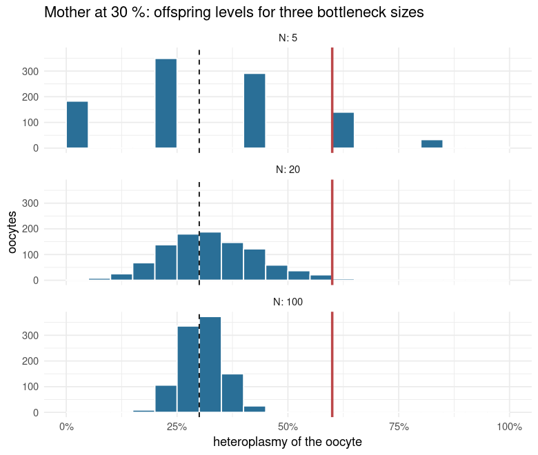
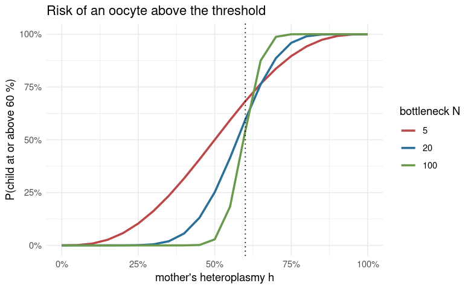

## Goal

By the end of this exercise you should be able to:

- simulate the mitochondrial bottleneck with `rbinom` and `replicate`, and wrap it in a small function;
- compare offspring heteroplasmy distributions for several bottleneck sizes with faceted ggplot2 histograms, and check the variance against $h(1-h)/N$;
- compute the exact probability of a child above a disease threshold with `pbinom`, and plot it as a risk curve;
- read a gene table of the human mitochondrial genome and answer questions about it with dplyr.

## Before you start

This page builds on the by-hand part and the demo of the [Exercise](exercise.qmd), so do those first. You need the packages dplyr, ggplot2 and readr.

Download the data file into a folder `data/` next to your script:

- [`data/mtdna_genes.csv`](data/mtdna_genes.csv): the 37 genes of human mtDNA, built from the NCBI RefSeq record NC_012920.1 (downloaded 2026-11-20; see [`data/README.md`](data/README.md)). Lines starting with `#` are comments.

The heteroplasmy levels in R1–R4 are **simulated**, not measured.

```r
library(dplyr)
library(ggplot2)
library(readr)
```

## Tasks

In the pedigree unit you simulated families with [`rbinom`](https://rdrr.io/r/stats/Binomial.html) and [`replicate`](https://rdrr.io/r/base/lapply.html). The bottleneck is the same idea: `rbinom(1, size = N, prob = h)` draws the number of mutant copies among the `N` founders of one oocyte, and `replicate` repeats that for many oocytes. Use [`set.seed`](https://rdrr.io/r/base/Random.html) so that your numbers match the solutions.

**R1. (one bottleneck)** A mother has $h = 0.30$ and the bottleneck is $N = 20$. Draw the number of mutant founders for one oocyte, and turn it into a level. Then write a function `bottleneck(h, N, n_oocytes)` that returns the levels of `n_oocytes` oocytes, run it for 1000 oocytes, and compare the mean and variance with $h$ and $h(1-h)/N$.

```r
h <- 0.30      # the mother's heteroplasmy: 30 % of her mtDNA copies are mutant
N <- 20        # bottleneck size: mtDNA copies that reach each oocyte

set.seed(1)
rbinom(1, size = N, prob = h)              # mutant copies in one oocyte
rbinom(1, size = N, prob = h) / N          # ... as a heteroplasmy level

bottleneck <- function(h, N, n_oocytes) {
  replicate(n_oocytes, rbinom(1, size = N, prob = h) / N)
}

set.seed(1)
levels20 <- bottleneck(h = 0.30, N = 20, n_oocytes = 1000)
head(levels20, 10)
mean(levels20)
var(levels20)
h * (1 - h) / N
```

(`rbinom(1000, size = N, prob = h) / N` gives the same kind of result in one call; `replicate` makes the "one oocyte at a time" idea explicit.)

**R2. (three bottleneck sizes)** Simulate 1000 oocytes each for $N = 5$, $20$ and $100$, stack them in one tibble with [`bind_rows`](https://dplyr.tidyverse.org/reference/bind_rows.html), and plot one histogram per $N$ with [`facet_wrap`](https://ggplot2.tidyverse.org/reference/facet_wrap.html). Add the mother's level (dashed) and a threshold of 60 % (red). Why does the top panel look so different?

```r
set.seed(2)
sims <- bind_rows(
  tibble(N = 5,   level = bottleneck(0.30, 5,   1000)),
  tibble(N = 20,  level = bottleneck(0.30, 20,  1000)),
  tibble(N = 100, level = bottleneck(0.30, 100, 1000))
)
sims |> count(N)

threshold <- 0.60
ggplot(sims, aes(x = level)) +
  geom_histogram(binwidth = 0.05, boundary = 0, closed = "left", fill = "#2a6f97", colour = "white") +
  geom_vline(xintercept = 0.30, linetype = "dashed") +
  geom_vline(xintercept = threshold, colour = "#bc4749", linewidth = 1) +
  facet_wrap(~ N, ncol = 1, labeller = label_both) +
  scale_x_continuous(labels = scales::percent) +
  coord_cartesian(xlim = c(0, 1)) +
  labs(x = "heteroplasmy of the oocyte", y = "oocytes",
       title = "Mother at 30 %: offspring levels for three bottleneck sizes") +
  theme_minimal()
```

(`closed = "left"` puts a level of exactly 60 % in the bar that starts at 60 %, so the bar sits on the right side of the threshold line.)

**R3. (summarise by N)** For each $N$, compute the mean level, the variance, the expected variance $0.3 \times 0.7 / N$, the fraction of oocytes at or above the threshold, and the fraction that has lost the variant altogether (level 0). Use [`group_by`](https://dplyr.tidyverse.org/reference/group_by.html) and [`summarise`](https://dplyr.tidyverse.org/reference/summarise.html).

```r
sims |>
  group_by(N) |>
  summarise(mean = mean(level),
            var = var(level),
            var_expected = 0.30 * 0.70 / first(N),
            above = mean(level >= threshold),
            homoplasmic_normal = mean(level == 0))
```

**R4. (exact risk curves)** The simulation estimates a probability that we can also compute exactly. An oocyte is at or above the threshold $t$ when $k \ge \lceil tN \rceil$, and [`pbinom`](https://rdrr.io/r/stats/Binomial.html)`(q, N, h)` gives $P(k \le q)$. Write `p_above(h, N, threshold)`, check it against R3, and compute the risk for mothers at 0 % to 100 % for $N = 5$, $20$ and $100$. Plot the three curves.

```r
p_above <- function(h, N, threshold) {
  1 - pbinom(ceiling(threshold * N) - 1, size = N, prob = h)
}
p_above(0.30, 20, 0.60)
p_above(0.30, 5, 0.60)

risk <- tibble(h = round(seq(0, 1, by = 0.05), 2)) |>
  mutate(N5 = p_above(h, 5, threshold),
         N20 = p_above(h, 20, threshold),
         N100 = p_above(h, 100, threshold))
risk |>
  filter(h %in% c(0.1, 0.2, 0.3, 0.4, 0.5, 0.6, 0.7)) |>
  mutate(across(c(N5, N20, N100), \(x) round(x, 4)))

risk_long <- bind_rows(
  risk |> transmute(h, N = "5",   p = N5),
  risk |> transmute(h, N = "20",  p = N20),
  risk |> transmute(h, N = "100", p = N100)
) |> mutate(N = factor(N, levels = c("5", "20", "100")))

ggplot(risk_long, aes(x = h, y = p, colour = N)) +
  geom_line(linewidth = 1) +
  geom_vline(xintercept = threshold, linetype = "dotted") +
  scale_x_continuous(labels = scales::percent) +
  scale_y_continuous(labels = scales::percent) +
  scale_colour_manual(values = c("#bc4749", "#2a6f97", "#6a994e")) +
  labs(x = "mother's heteroplasmy h", y = "P(child at or above 60 %)",
       colour = "bottleneck N",
       title = "Risk of an oocyte above the threshold") +
  theme_minimal()
```

For a mother **below** the threshold, which bottleneck size gives the highest risk? And for a mother **above** it?

**R5. (the genome itself)** Read the gene table. Count the genes by type. What fraction of the 16 569 bp do the genes cover (summing their lengths)? Which genes overlap their neighbour, and by how much? In which genes do m.3243 and m.11778 lie? Finally, check whether each protein-coding gene's length is a multiple of 3.

```r
genes <- read_csv("data/mtdna_genes.csv", comment = "#", show_col_types = FALSE)
genes |> count(type)
sum(genes$length_bp)
sum(genes$length_bp) / 16569

genes |>
  arrange(start) |>
  mutate(overlap_bp = lag(end) - start + 1) |>
  filter(overlap_bp > 0) |>
  select(gene, start, end, overlap_bp)

genes |> filter(start <= 3243, end >= 3243)
genes |> filter(start <= 11778, end >= 11778)

genes |>
  filter(type == "CDS") |>
  mutate(remainder = length_bp %% 3) |>
  select(gene, length_bp, remainder, strand)
```

Six of the 13 protein-coding genes are not a whole number of codons. How can a gene end in an incomplete codon?

## Solutions

::: {.callout-note collapse="true" title="Solutions: In R"}

All output below is from `Rscript --vanilla` run in the unit folder. Messages from loading packages are not shown.

**R1.**

```
[1] 5
[1] 0.25
 [1] 0.25 0.25 0.30 0.45 0.20 0.45 0.45 0.35 0.35 0.15
[1] 0.3012
[1] 0.01037894
[1] 0.0105
```

The first oocyte got 5 mutant founders out of 20 (25 %). Over 1000 oocytes the mean is **0.301**, close to the mother's 0.30, and the variance **0.0104** is close to $h(1-h)/N = 0.0105$: an SD of about 10 percentage points.

**R2.**

```
# A tibble: 3 × 2
      N     n
  <dbl> <int>
1     5  1000
2    20  1000
3   100  1000
```

{width="80%" fig-align="center"}

With $N = 5$ the only possible levels are 0, 20, 40, 60, 80 and 100 %, so the histogram has a few widely spaced bars, and a fair share of them lies at or above 60 %. With $N = 100$ every oocyte lies within about 10 points of the mother.

**R3.**

```
# A tibble: 3 × 6
      N  mean     var var_expected above homoplasmic_normal
  <dbl> <dbl>   <dbl>        <dbl> <dbl>              <dbl>
1     5 0.301 0.0457        0.042  0.177              0.183
2    20 0.303 0.0112        0.0105 0.006              0.001
3   100 0.302 0.00221       0.0021 0                  0
```

The **mean** stays at about 0.30 for every $N$: the bottleneck does not push the level up or down on average. The **variance** follows $h(1-h)/N$ (0.046 vs 0.042, 0.011 vs 0.0105, 0.0022 vs 0.0021). With $N = 5$, **17.7 %** of the oocytes are at or above 60 %, and **18.3 %** have lost the variant (exact: $0.7^5 = 0.168$). With $N = 20$ only 0.6 % are above the threshold; with $N = 100$ none.

**R4.**

```
[1] 0.005138162
[1] 0.16308
# A tibble: 7 × 4
      h     N5    N20   N100
  <dbl>  <dbl>  <dbl>  <dbl>
1   0.1 0.0086 0      0
2   0.2 0.0579 0.0001 0
3   0.3 0.163  0.0051 0
4   0.4 0.317  0.0565 0
5   0.5 0.5    0.252  0.0284
6   0.6 0.683  0.596  0.543
7   0.7 0.837  0.887  0.988
```

{width="80%" fig-align="center"}

The exact values agree with the simulation in R3: 0.005 for $N = 20$ (simulated 0.006) and 0.163 for $N = 5$ (simulated 0.177). For a mother **below** the threshold, the **smallest** bottleneck gives the highest risk (at $h = 0.3$: 16 % for $N = 5$, 0.5 % for $N = 20$, practically 0 for $N = 100$). For a mother **above** the threshold it is the other way round: a large bottleneck keeps almost all her eggs above it (98.8 % at $h = 0.7$, $N = 100$), while a small bottleneck gives her a better chance of an egg below it. The curves cross close to the threshold. A small bottleneck makes the outcome less predictable in both directions.

**R5.**

```
# A tibble: 3 × 2
  type      n
  <chr> <int>
1 CDS      13
2 rRNA      2
3 tRNA     22
[1] 15416
[1] 0.9304122
# A tibble: 5 × 4
  gene  start   end overlap_bp
  <chr> <dbl> <dbl>      <dbl>
1 TRNQ   4329  4400          3
2 TRNY   5826  5891          1
3 ATP6   8527  9207         46
4 COX3   9207  9990          1
5 ND4   10760 12137          7
# A tibble: 1 × 7
  gene  type  product  start   end strand length_bp
  <chr> <chr> <chr>    <dbl> <dbl> <chr>      <dbl>
1 TRNL1 tRNA  tRNA-Leu  3230  3304 +             75
# A tibble: 1 × 7
  gene  type  product                      start   end strand length_bp
  <chr> <chr> <chr>                        <dbl> <dbl> <chr>      <dbl>
1 ND4   CDS   NADH dehydrogenase subunit 4 10760 12137 +           1378
# A tibble: 13 × 4
   gene  length_bp remainder strand
   <chr>     <dbl>     <dbl> <chr>
 1 ND1         956         2 +
 2 ND2        1042         1 +
 3 COX1       1542         0 +
 4 COX2        684         0 +
 5 ATP8        207         0 +
 6 ATP6        681         0 +
 7 COX3        784         1 +
 8 ND3         346         1 +
 9 ND4L        297         0 +
10 ND4        1378         1 +
11 ND5        1812         0 +
12 ND6         525         0 -
13 CYTB       1141         1 +
```

**37 genes**: 13 protein-coding, 22 tRNA, 2 rRNA. Their lengths add up to 15 416 bp, **93 %** of the genome (slightly too high, because overlapping stretches are counted twice); almost all the rest is the control region. Five genes overlap the previous one, most clearly ***ATP8*/*ATP6* by 46 bp** and ***ND4L*/*ND4* by 7 bp**: the two genes are read in different reading frames from one mRNA. m.3243 lies in ***TRNL1*** (tRNA-Leu, *MT-TL1*) and m.11778 in ***ND4*** (*MT-ND4*), as in ClinVar. Only *ND6* is on the other strand. Six protein-coding genes (*ND1*, *ND2*, *COX3*, *ND3*, *ND4* and *CYTB*, with remainder 1 or 2) do not end in a complete codon: their stop codon is **completed by polyadenylation**. A gene that ends in T or TA becomes TAA, a stop codon, when the poly-A tail is added to the mRNA.
:::

## Where this leads

The model in R1 is one generation of **genetic drift**: a random sample of a finite number of copies. In Part 7 (*Drift and selection*) you repeat it generation after generation with a loop, and watch allele frequencies drift to 0 or 1, with the same variance $p(1-p)/N$ per generation (for $N$ copies).
