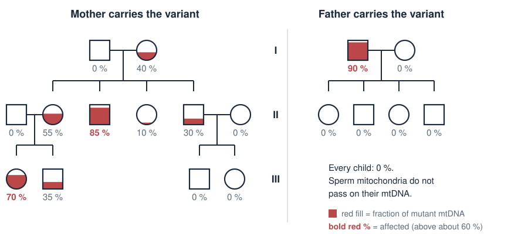

## Goal

By the end of this exercise you should be able to:

- recognise maternal (uniparental) inheritance from reciprocal crosses and pedigrees, and tell it apart from X-linked and nuclear inheritance;
- predict the offspring of crosses involving organelle genes in plants, fungi and algae;
- explain heteroplasmy, the mitochondrial bottleneck and the threshold effect, and compute the mean and spread of offspring heteroplasmy under a binomial bottleneck;
- compute, for small bottlenecks, the probability that a child is above a disease threshold;
- find the human mitochondrial genome in NCBI and read the records of the MELAS and LHON variants in ClinVar and MedGen.

Do the pen-and-paper part first. The demo and the databases come after; the R simulation is on its own page.

## Background

**Organelle genomes.** Human mtDNA is circular, 16 569 bp, with 37 genes: 13 protein-coding, 22 tRNA and 2 rRNA. A cell has hundreds to thousands of copies. Chloroplast genomes of land plants are about 120–160 kb. Most proteins of both organelles are encoded in the **nucleus** and imported; disease caused by such nuclear genes follows Mendel.

**Uniparental inheritance.** Organelles pass with the cytoplasm. In humans, mtDNA comes from the mother: every child of a carrier mother inherits the variant, no child of a carrier father does. **Reciprocal crosses differ**, and the difference depends on the sex of the **parent**, not of the offspring. Other patterns: most flowering plants maternal, many conifers paternal (cpDNA), *Chlamydomonas* cpDNA from the mt^+^ parent and mtDNA from the mt^−^ parent, baker's yeast biparental.

**Heteroplasmy.** A cell or person with a mixture of normal and mutant copies is heteroplasmic; the **heteroplasmy level** $h$ is the fraction of mutant copies. Homoplasmic: $h = 0$ or $h = 1$.

**The bottleneck (binomial model).** Each oocyte is founded by $N$ copies drawn at random from the mother's pool, then amplified. With $k$ mutant founders:

$$
P(k) = \binom{N}{k} h^k (1-h)^{N-k}, \qquad \text{level} = k/N, \qquad \text{mean} = h, \qquad \text{variance} = \frac{h(1-h)}{N}.
$$

**Threshold.** Symptoms appear when the level in a tissue exceeds a threshold, often 60–90 %, lowest in tissues with high energy demand (brain, muscle, heart, retina).

## By hand

**B1. (reciprocal crosses in *Neurospora*)** The bread mould *Neurospora crassa* has a slow-growing mutant, *poky*, with defective mitochondria. In a cross, one parent (the "female") contributes the large cell with most of the cytoplasm, and the other (the "male") contributes little more than a nucleus. The cross also follows a nuclear gene, *ad*^+^ / *ad*^−^ (adenine requirement). Predict the progeny (*Neurospora* progeny are haploid) of:
(a) *poky* female, *ad*^+^ × wild-type male, *ad*^−^;
(b) wild-type female, *ad*^+^ × *poky* male, *ad*^−^.
(c) What does the comparison of the two genes tell you?

**B2. (pedigree)** Use the pedigree from the lecture:

{width="80%" fig-align="center"}

(a) In the left family, which people **can** pass the variant on to their children? Which cannot?
(b) The 85 % son has children with a woman who does not carry the variant. What do you predict?
(c) The 55 % daughter is healthy, but her daughter has 70 % and is affected. Explain with the bottleneck and the threshold.
(d) Why can this pedigree not be explained by X-linked inheritance? Give one individual or trio that rules it out.

**B3. (*Mirabilis jalapa*)** Complete the table: for each cross (seed parent first), give the seedlings you expect.

| Seed parent: flower on a… | Pollen from a… | Seedlings |
|---|---|---|
| green branch | white branch | ? |
| white branch | green branch | ? |
| variegated branch | green branch | ? |
| green branch | variegated branch | ? |

**B4. (*Chlamydomonas*)** A mt^+^ strain carries a chloroplast mutation for erythromycin resistance (*ery-r*) and is *arg*^−^ (a nuclear gene). It is crossed with an erythromycin-sensitive, *arg*^+^ mt^−^ strain. Give the expected proportions among the haploid progeny for (a) mating type, (b) arginine requirement and (c) erythromycin resistance. (d) What would the reciprocal cross give for erythromycin resistance?

**B5. (a tiny bottleneck)** A mother has $h = 0.5$. Assume a bottleneck of $N = 2$ copies.
(a) List the possible levels in her eggs and their probabilities.
(b) The disease threshold is 60 %. What fraction of her eggs are at or above it?
(c) Repeat (a) and (b) for $N = 4$.

**B6. (spread)** A mother has $h = 0.2$.
(a) Compute the standard deviation of the offspring level for $N = 4$, $N = 25$ and $N = 100$.
(b) For $N = 4$, compute the probability that an egg is at or above 60 % (that is, $k \ge 3$).
(c) Without computing exactly: is a level of 60 % likely for $N = 25$? Use the SD from (a).

**B7. (nuclear or mitochondrial?)** For each family, decide whether the disease is more likely caused by a **mtDNA** variant or by a **nuclear** gene, and if nuclear, which mode of inheritance.
(a) Two of four children of healthy, unrelated parents have a respiratory chain disease. Nobody else in the family is affected.
(b) A woman, her mother, her brother and two of her three children have hearing loss and diabetes of varying severity. Her brother's children are all unaffected.
(c) An affected man has an affected son.

**B8. (mitochondrial donation)** After pronuclear transfer, an embryo carries 2 % of the mother's mutant mtDNA (carry-over); the rest is the donor's.
(a) The child is a girl. Using the binomial model with $N = 20$, is a child of hers likely to be at or above 60 %? (No exact computation needed; compare with the mean and SD.)
(b) Some embryonic stem cell lines made after mitochondrial transfer have shown the small fraction of the mother's mtDNA **rising** over time. What does that suggest about the binomial model?
(c) Why would the same carry-over in a boy matter less for future generations?

## Explore {#explore}

The demo simulates the bottleneck. A mother has heteroplasmy level *h*. Each oocyte draws *N* copies at random from her mtDNA (binomial sampling), which are then amplified, so its level is *k*/*N*. The histogram shows the levels of many oocytes. The dashed line is the mother's level, the red line the disease threshold (move it with the slider, or drag the handle); oocytes at or above the threshold are red. The readout gives the simulated fraction at or above the threshold, the exact binomial probability, and the mean and spread against $\sqrt{h(1-h)/N}$. "draw again" gives a new random sample (the seed goes up by one); a preset resets the seed to 1.

```{=html}
<link rel="stylesheet" href="../demos/dist/demo.css">
<div data-demo="bottleneck" data-preset="melas"></div>
<script src="../demos/dist/bottleneck.js"></script>
```

**E1.** The demo starts with a mother at 30 %, $N = 20$, 200 oocytes and a threshold of 60 %. How many oocytes are at or above the threshold? Compare the simulated mean and SD with what you expect from the formulas. Press "draw again" twice: how much do the numbers change?

**E2.** Click "tight: N = 5", then "wide: N = 200". For each, note the fraction at or above 60 %, the SD, and how many oocytes are at 0 %. Why does the histogram for $N = 5$ have only a few, widely spaced bars?

**E3.** Click "mother 70 %". The mother is now above the threshold herself. What fraction of her oocytes are at or above 60 %? Drag the threshold to 80 %: what fraction now? What does this say about the importance of knowing the threshold in genetic counselling?

**E4.** Set $N = 1$ (mother 30 %). What do you see? How does the variance compare with $h(1-h)/N$? What does a bottleneck of a single copy do to heteroplasmy in one generation?

**E5.** Click "homoplasmic". Change $N$ and the threshold. Does anything change? Which of the two diseases from the lecture, MELAS or LHON, does this preset resemble, and what does the demo **not** explain about that disease?

::: {.callout-note collapse="true" title="Solutions: Explore"}

**E1.** On seed 1, **1 of 200** oocytes (0.5 %) is at or above 60 %; the exact binomial probability is also 0.5 %. The mean is 30.0 % (expected $h$ = 30 %) and the SD is 9.9 percentage points, against $\sqrt{0.3 \times 0.7 / 20} = 0.102$, that is **10.2 points**. Seed 2 gives 2 of 200 (1.0 %), mean 30.7 %, SD 10.6; seed 3 gives 1 of 200, mean 30.0 %, SD 10.1. With 200 oocytes the summary numbers are stable to within about a point; the rare high-level oocytes vary more, because they are so few.

**E2.** (seed 1)

| | at or above 60 % | exact | SD (simulated / expected) | oocytes at 0 % |
|---|---|---|---|---|
| $N = 5$ | 37 of 200 (18.5 %) | 16.3 % | 20.2 / 20.5 points | 34 |
| $N = 20$ | 1 of 200 (0.5 %) | 0.5 % | 9.9 / 10.2 points | 0 |
| $N = 200$ | 0 of 200 | 0.0 % | 3.3 / 3.2 points | 0 |

With $N = 5$ an oocyte can only have 0, 1, …, 5 mutant founders, so the only possible levels are 0, 20, 40, 60, 80 and 100 %. A small bottleneck gives a wide spread: about one oocyte in six is at or above 60 %, and about one in six (0.7^5^ = 0.17) has lost the variant altogether. A large bottleneck keeps every oocyte close to the mother.

**E3.** With the threshold at 60 %, **181 of 200** (90.5 %; exact 88.7 %) are at or above it. With the threshold at 80 %, only **52 of 200** (26 %; exact 23.8 %) are. The same mother, the same eggs, but a very different risk estimate. The threshold depends on the variant and the tissue and is not known precisely, which is one reason why genetic counselling for mtDNA disease relies on observed outcomes in many families rather than on a formula.

**E4.** Every oocyte is at **0 % or 100 %**: one founder copy is either normal or mutant. On seed 1, 72 oocytes are at 100 % and 128 at 0 % (expected 30 % and 70 %, that is 60 and 140). The variance (0.23) is close to $h(1-h)/1 = 0.21$, the largest possible. A bottleneck of one copy turns a heteroplasmic mother into **homoplasmic** children in a single generation. Real bottlenecks are larger, but rapid shifts between generations have been observed, first in Holstein cattle.

**E5.** Nothing changes: all oocytes are at 100 %, whatever $N$, and all are above any threshold. Sampling from a pool in which every copy is mutant can only give mutant copies. This resembles **LHON**, where m.11778G>A is usually homoplasmic. The demo would predict that every child is affected, but in real LHON families only about a third to a half of the maternal relatives lose their sight, mostly men. The incomplete penetrance and the male bias come from factors outside the model (nuclear genes, sex, environment).
:::

## Find it

The human mitochondrial genome is in [NCBI Nucleotide](https://www.ncbi.nlm.nih.gov/nuccore/) under the RefSeq accession **NC_012920.1** (the revised Cambridge Reference Sequence). Variants are named by their position in this sequence with the prefix `m.`, for example m.3243A>G. [ClinVar](https://www.ncbi.nlm.nih.gov/clinvar/) and [MedGen](https://www.ncbi.nlm.nih.gov/medgen/) work as in the pedigree unit. [MITOMAP](https://www.mitomap.org) is a database devoted to human mtDNA variation.

**F1. The genome.** Open [NC_012920.1](https://www.ncbi.nlm.nih.gov/nuccore/NC_012920.1). Read the title and the length at the top of the GenBank record (first line, `LOCUS`). Is the molecule linear or circular? Then count the genes: in the **Graphics** view, or by searching the record (Ctrl+F) for `/gene=` features, how many protein-coding (`CDS`), `tRNA` and `rRNA` features are there?

**F2. MELAS.** Search ClinVar for [`m.3243A>G`](https://www.ncbi.nlm.nih.gov/clinvar/?term=m.3243A%3EG) and open the record `NC_012920.1(MT-TL1):m.3243A>G`. Report (a) the gene and what kind of gene it is; (b) the germline classification and the review status; (c) its dbSNP ID; (d) three conditions that submitters have reported for this variant. Why can one variant be listed with so many different conditions?

**F3. LHON.** Search ClinVar for [`m.11778G>A`](https://www.ncbi.nlm.nih.gov/clinvar/?term=m.11778G%3EA) and open `NC_012920.1(MT-ND4):m.11778G>A`. Report the gene, the protein change, the classification and review status, and the dbSNP ID. Read the expert panel's comment (in the section with the classification evidence): what does it say about heteroplasmy, penetrance and sex?

**F4. MedGen.** Open MedGen for [MELAS syndrome](https://www.ncbi.nlm.nih.gov/medgen/C0162671) and [Leber optic atrophy](https://www.ncbi.nlm.nih.gov/medgen/C0917796) (LHON). What does the field **Mode of inheritance** say, and how does MedGen define it? Look at the list of genes: on which genome are they? The OMIM entries are [540000](https://www.omim.org/entry/540000) (MELAS) and [535000](https://www.omim.org/entry/535000) (LHON).

**F5. MITOMAP.** On [MITOMAP](https://www.mitomap.org), use the menu to open the list of reported disease-associated **rRNA/tRNA mutations** (MITOMAP's tables of mtDNA base substitutions in disease), and find position 3243. Which locus and which diseases are listed? Does the table show the variant as homoplasmic, heteroplasmic, or both? Compare with ClinVar (F2).

::: {.callout-note collapse="true" title="Solutions: Find it"}

The NCBI facts were checked with the NCBI E-utilities (Nucleotide, ClinVar and MedGen) in November 2026. MITOMAP refuses automated access, so its page could not be checked by us; the locus and diseases in F5 agree with the ClinVar record.

**F1.** Title: ***Homo sapiens* mitochondrion, complete genome**; length **16 569 bp**; the `LOCUS` line says **circular**. The feature table has **13 CDS**, **22 tRNA** and **2 rRNA** features (37 genes; plus one `D-loop`). Click path: Nucleotide → search `NC_012920.1` → GenBank view → `LOCUS NC_012920 16569 bp DNA circular`; features listed below `FEATURES`. In RefSeq the genes are named *ND1*, *COX1* and so on; HGNC adds the prefix *MT-* (*MT-ND1*), which is what ClinVar shows.

**F2.** ClinVar Variation ID **9589** (VCV000009589). (a) ***MT-TL1***, the gene for **tRNA-Leu** (UUR), at positions 3230–3304. A tRNA gene, so the variant impairs translation of all 13 mtDNA-encoded proteins. (b) **Pathogenic**, **reviewed by expert panel**, for "Mitochondrial disease". (c) **rs199474657**. (d) Submitted conditions include **MELAS syndrome**, **maternally inherited diabetes and deafness (MIDD)**, **MERRF**, sensorineural hearing loss, stroke and seizures, among others. One variant gives many conditions because its effect depends on the heteroplasmy level and its distribution among tissues: low levels in some tissues give diabetes and deafness, high levels in brain and muscle give MELAS.

**F3.** ClinVar Variation ID **9708** (VCV000009708). Gene ***MT-ND4*** (NADH dehydrogenase subunit 4, complex I); protein change **p.Arg340His** (R340H), a missense change; **Pathogenic**, **reviewed by expert panel**; dbSNP **rs199476112**. The expert panel's comment says that it is the most common *MT-ND4* variant in LHON, that it is seen in both homoplasmic and heteroplasmic states, that it has **reduced penetrance** (it is even present in the healthy population), and that **males are more commonly affected** than females. (The OMIM text quoted in the record: 33–60 % of maternal relatives affected, about 80 % of them male.)

**F4.** MELAS syndrome (MedGen **C0162671**, OMIM 540000) and Leber optic atrophy (MedGen **C0917796**, OMIM 535000) both have Mode of inheritance **Mitochondrial inheritance**, defined as inheritance "observed for traits related to a gene encoded on the mitochondrial genome. Because the mitochondrial genome is essentially always maternally inherited, a mitochondrial condition can only be transmitted by females, although the condition can affect both sexes. The proportion of mutant mitochondria can vary (heteroplasmy)." The genes listed are all **mitochondrial** genes (prefix *MT-*): for MELAS for example *MT-TL1*, *MT-ND1*, *MT-ND5*, *MT-CO2*; for LHON *MT-ND1*, *MT-ND4*, *MT-ND6* and others. (MedGen also lists "Not genetically inherited" for MELAS, from the Orphanet record, a reminder that some cases arise from new mutations.)

**F5.** MITOMAP lists position 3243 in the locus ***MT-TL1*** (tRNA Leucine 1, UUR), with **MELAS** and related conditions such as MIDD. Read the homoplasmy and heteroplasmy columns yourself; m.3243A>G is typically found **heteroplasmic**, as the lecture says. The locus and disease agree with ClinVar (F2).
:::

## Solutions

::: {.callout-note collapse="true" title="Solutions: By hand"}

**B1.** The mitochondria (and *poky*) come from the female; the nuclear gene segregates 1 : 1 in the haploid progeny.
(a) **All *poky***; ½ *ad*^+^ and ½ *ad*^−^.
(b) **All wild type** (normal growth); ½ *ad*^+^ and ½ *ad*^−^.
(c) The nuclear gene behaves the same in both crosses (1 : 1), but *poky* follows the female parent. That is the signature of a **cytoplasmic (mitochondrial)** gene: reciprocal crosses differ, and there is no segregation ratio.

**B2.** (a) The **women** can pass the variant on: I-2 (40 %), the 55 % daughter and the 10 % daughter (the last at low levels, most likely). The **men** (the 85 % son and the 30 % son) cannot. (b) **None** of his children carries the variant (0 %). (c) Her eggs were founded by a small random sample of her mtDNA copies, so their levels vary around her own 55 %. This egg happened to get a larger share of mutant copies, 70 %, above the threshold of about 60 %. She herself is just below it. (d) **X-linked recessive** is ruled out by the 70 % granddaughter: an affected daughter needs an affected father, and her father (who married in) has 0 % and is unaffected. **X-linked dominant** is ruled out by the 85 % son: an affected son needs an affected mother, and his mother (40 %) is unaffected; the right-hand family rules it out too, since an affected father would have only affected daughters. The pattern that fits is the maternal one: every child of a carrier mother carries the variant, at very different levels, and no child of a carrier father does.

**B3.**

| Seed parent | Pollen | Seedlings |
|---|---|---|
| green | white | **green** |
| white | green | **white** (they die) |
| variegated | green | **green, white or variegated** |
| green | variegated | **green** |

The seedlings follow the seed parent's branch; the pollen contributes no chloroplasts.

**B4.** (a) Mating type is a nuclear gene: **½ mt^+^, ½ mt^−^**. (b) **½ *arg*^−^, ½ *arg*^+^**. (c) Chloroplast DNA comes from the mt^+^ parent, which is resistant: **all *ery-r***. (d) In the reciprocal cross (sensitive mt^+^ × resistant mt^−^), **all progeny are sensitive**.

**B5.** (a) $N = 2$, $h = 0.5$: $k = 0, 1, 2$ with probabilities ¼, ½, ¼, that is levels **0 %, 50 %, 100 %** with **¼, ½, ¼**. (b) Only 100 % is at or above 60 %: **¼**. (c) $N = 4$: $P(k) = \binom{4}{k}/16$, so levels 0, 25, 50, 75, 100 % with 1/16, 4/16, 6/16, 4/16, 1/16. At or above 60 %: 75 % and 100 %, **5/16 ≈ 0.31**. A slightly larger bottleneck gives a slightly larger risk here, because with $N = 2$ the only level above 60 % is 100 %.

**B6.** (a) $h(1-h) = 0.16$. $N = 4$: $\sqrt{0.16/4} = 0.20$ (**20 points**). $N = 25$: $\sqrt{0.16/25} = 0.08$ (**8 points**). $N = 100$: $\sqrt{0.0016} = 0.04$ (**4 points**).
(b) $P(k = 3) = 4 \times 0.2^3 \times 0.8 = 0.0256$; $P(k = 4) = 0.2^4 = 0.0016$. Sum **0.0272**, about 1 in 37.
(c) 60 % is 40 points above the mean of 20 %, that is **5 SD** for $N = 25$. Very unlikely: the exact binomial probability is about 1.4 × 10^−5^. A bottleneck of 25 practically protects a 20 % mother from having a child at 60 %; a bottleneck of 4 does not.

**B7.** (a) **Nuclear, autosomal recessive**: two affected children of healthy parents, recurrence within one sibship and nobody else affected. The father's side is equally involved; with a mtDNA variant you would expect the mother's relatives to be affected too. (b) **mtDNA** (maternal): it passes from mother to children of both sexes, with variable severity, but the affected brother's children are unaffected. Hearing loss with diabetes in a maternal line fits m.3243A>G (MIDD). (c) **Not mtDNA**: a man cannot pass on mtDNA. It is a nuclear gene, for example autosomal dominant.

**B8.** (a) The girl's eggs would have a mean level of 2 % and an SD of $\sqrt{0.02 \times 0.98 / 20} = 0.031$, about 3 points. 60 % is about 18 SD above the mean: under the binomial model this is **essentially impossible**: it needs 12 of 20 founders to be mutant, with probability about 4 × 10^−16^. (b) A rise that the binomial model cannot explain points to **selection**: the mother's mtDNA (or the haplotype it is on) may replicate faster than the donor's in some cells. Random sampling alone does not favour either kind of copy. (c) A boy does not pass on his mtDNA, so any carried-over copies end with him.
:::

## Where this leads

The bottleneck is **genetic drift** inside one woman's germline: random sampling of a finite number of copies, with variance $h(1-h)/N$. In Part 7 (*Drift and selection*) exactly the same model, repeated over generations in a population, drives allele frequencies to 0 or 1. Mitochondrial donation is discussed in the [Ethics](../ethics/lec.qmd) module.

**Next:** [Exercise in R](exercise-r.qmd): simulate the bottleneck with `rbinom` and `replicate`, compare bottleneck sizes, compute risk curves with `pbinom`, and explore the 37 mtDNA genes from the RefSeq record.
